<p align="center">
  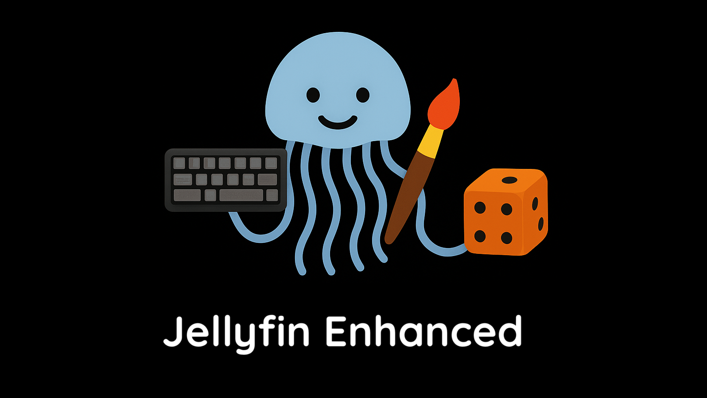
</p>

<h3 align="center">Everything you wish Jellyfin's web app already did, in one plugin.</h3>

<p align="center">
  Request new movies right from search · Watch shows without spoilers · See 4K, HDR and Atmos on every poster<br>
  Keyboard shortcuts · Bookmarks · A release calendar · Reviews · Live "who's watching" · and a lot more
</p>

<p align="center">
  
  
  
  
  <a href="https://discord.gg/EYNFf7y4CG"></a>
</p>

<p align="center">
  <a href="#-install-in-a-minute"><b>Install</b></a> ·
  <a href="#%EF%B8%8F-the-tour"><b>Tour</b></a> ·
  <a href="https://n00bcodr.github.io/Jellyfin-Enhanced/"><b>Documentation</b></a> ·
  <a href="#-common-questions"><b>FAQ</b></a> ·
  <a href="https://discord.gg/EYNFf7y4CG"><b>Discord</b></a>
</p>

<p align="center">
  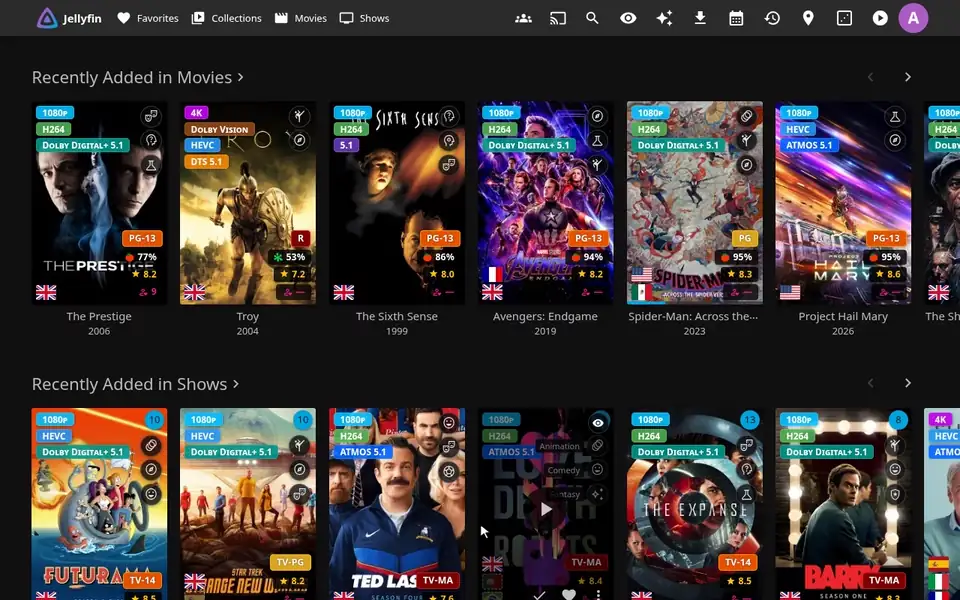
</p>

## 🪼 What is Jellyfin Enhanced?

[Jellyfin](https://jellyfin.org) is a free media server you run yourself, like your own private Netflix. **Jellyfin Enhanced** is a free server plugin that adds browsing and playback tools to your server's web interface, including compatible official mobile and desktop playback modes.

- **Install it once, on the server.** Everyone who uses your server gets the new features. There is nothing to install on phones, TVs or computers.
- **Every person picks what they want.** Press <kbd>?</kbd> outside an input or textarea in Jellyfin to open the Enhanced panel and switch features on or off for yourself.
- **Choose the features you want.** Whoever runs the server chooses which features are available and how they're set up by default; many start switched off. Connecting [Seerr](https://github.com/seerr-team/seerr), Sonarr, Radarr, TMDB or MDBList adds even more.

**🍿 For viewers:** [Poster tags](#%EF%B8%8F-see-quality-at-a-glance) · [Richer movie pages](#-richer-movie-and-show-pages) · [A better player](#%EF%B8%8F-a-better-player) · [Shortcuts](#%EF%B8%8F-the-enhanced-panel-and-shortcuts) · [Random](#-cant-decide)<br>
**👨‍👩‍👧 For households:** [Spoiler Guard](#-watch-without-spoilers) · [Hide things](#-keep-your-home-screen-tidy) · [Reviews and Activity](#-share-it-with-your-household) · [Phones](#-on-your-phone)<br>
**🛠️ For whoever runs the server:** [Requests](#-request-anything-right-from-search) · [Calendar](#-see-whats-coming) · [Active Streams](#-see-whos-watching-right-now) · [Admin tools](#%EF%B8%8F-tools-for-the-server-admin)

## ⚡ Install in a minute

1. In Jellyfin, open **Dashboard → Plugins → Repositories** and click **➕**.
2. Give it a name (for example `Jellyfin Enhanced`), paste this repository URL, and save:
   ```
   https://raw.githubusercontent.com/n00bcodr/jellyfin-plugins/main/manifest.json
   ```
3. Open the **Catalog** tab, find **Jellyfin Enhanced**, and click **Install**.
4. **Restart** Jellyfin and refresh your browser (<kbd>Ctrl</kbd>+<kbd>F5</kbd>). Press <kbd>?</kbd> outside an input or textarea, or choose **Enhanced Panel** in the drawer. On Jellyfin 12, choose **Jellyfin Enhanced** in the avatar menu. If the panel opens, JE’s web tools have loaded.

> [!IMPORTANT]
> Current JE builds target **Jellyfin 12.x and 10.11.x**. The same repository URL serves every version, and Jellyfin installs the build that matches your server. Something not working? See the [installation guide](https://n00bcodr.github.io/Jellyfin-Enhanced/installation/installation/) and [troubleshooting](https://n00bcodr.github.io/Jellyfin-Enhanced/installation/troubleshooting/).

<details>
<summary>First admin settings and defaults</summary>

Open **Dashboard → Plugins → Jellyfin Enhanced** next. **Overview** shows status and quick actions. Configure features in **Display**, **Playback**, **Pages**, **Seerr**, **\*arr**, **Elsewhere**, **Extras**, **Keyboard** and **Admin**; **Docs** links to the guides.

| Setting | Default | What it does |
|---|---|---|
| **Enable Custom Pause Screen** | On | Shows the pause overlay after the personal delay, initially 5 seconds. |
| **Enable Bookmarks Feature** | On | Saves playback timestamps. |
| **Enable Random Button** | On | Adds random browsing. |
| **Auto-pause on tab switch** | On | Sets the starting **Auto-pause** preference. |
| **Show available audio languages on item detail page** | On | Sets the starting audio-language preference. |

Main media-tag preferences start off, as do Seerr, Spoiler Guard, Activity, Requests, Calendar, Hidden Content, Catch Up and Active Streams. Elsewhere starts on, but its TMDB key is initially empty. Add a key to use it.

</details>

Start with the [quick start](https://n00bcodr.github.io/Jellyfin-Enhanced/getting-started/) or [settings overview](https://n00bcodr.github.io/Jellyfin-Enhanced/getting-started/settings-overview/).

## 🗺️ The tour

> The screenshots and recordings illustrate configured features on Jellyfin 12. They do not show fresh-install defaults; some recordings display an older plugin version.

### 🔎 Request anything, right from search

Search Jellyfin as usual to find Seerr results below your library matches. Request a missing title with one click. Your request goes to whoever runs the server, who can approve it from inside Jellyfin.

<p align="center">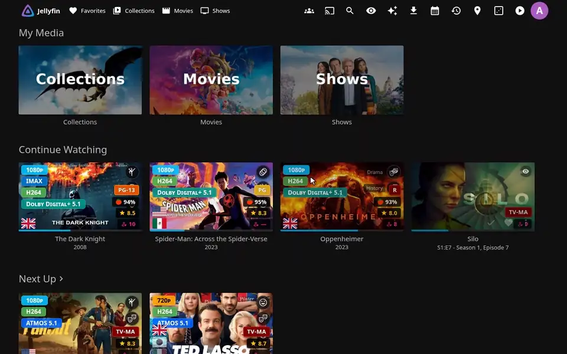</p>

- **Request movies and shows** from search results, detail pages and discovery pages, including **4K** and **specific seasons**.
- **Recommendations and "Similar"** rows on every movie and show page, with request buttons.
- **Browse and discover** by genre, network, studio, actor, collection or tag, plus a **Recommendations** page with trending and popular titles. Studio and network pages show their movies and series side by side, with an All / Movies / Series switch.
- **Smarter search:** type `Dune (2021)` to match a specific year, and optionally hide Seerr results you already have in Jellyfin.
- **Automatic requests:** when you're close to the end of a season, the next season is requested for you. The same works for the next movie in a collection.
- **More request options:** pick the server, quality profile and folder when requesting, see your request quota, and use **Request More** on a show to add missing seasons.
- **Watchlist sync** between Seerr and Jellyfin, in both directions ([KefinTweaks](https://github.com/ranaldsgift/KefinTweaks) shows the Jellyfin side as a watchlist).
- **Report a problem** (video, audio, subtitles or other) straight to Seerr from the item page.
- **Fix shows Seerr can't match:** for a series with no TVDB match (common with anime), pick the right one, or type its TVDB ID, before you request it.
- **Parental controls are respected.** Results follow each user's rating limit and blocked tags.

<p align="center"><b>Recommendations page (enabled separately)</b><br>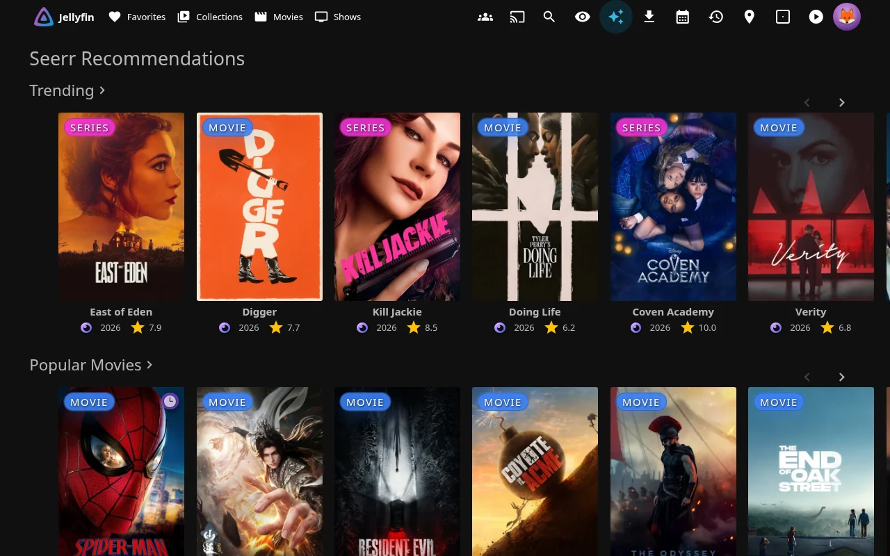</p>

<p align="center"><b>Requests, with approve and decline for authorized managers</b><br></p>

Configure a [Seerr](https://github.com/seerr-team/seerr) server in the admin **Seerr** tab. Each requesting user needs a Seerr account linked to their Jellyfin user ID and the appropriate permissions; optional automatic import can attempt to create that link. Approval follows Seerr policy, so requests do not necessarily wait for a Jellyfin administrator.

<details>
<summary>Seerr settings, automation and details</summary>

| Setting | Default | What it does |
|---|---|---|
| **Enable Seerr integration** | Off | Enables the integration. |
| **Seerr URL(s) (One per line)** | Empty | Connects to your Seerr server. |
| **Seerr API Key** | Empty | Authenticates server requests. |
| **Enable Recommendations Page** | Off | Enables the standalone page; also choose its delivery under **Pages**. |
| **Enable 4K Requests** | Off | Offers 4K movie requests, subject to permissions. |
| **Enable 4K TV Requests** | Off | Offers 4K TV requests, subject to permissions. |
| **Show advanced request options** | Off | Offers advanced fields to authorized users. |
| **Show "Report Issue" button on items** | Off | Adds issue reporting, subject to Seerr permissions. |

Administrator automation settings:

| Setting | Default | What it does |
|---|---|---|
| **Enable Automatic Advance Season Requests** | Off | Enables next-season requests. |
| **Episodes Remaining Threshold** | 2 | Sets the remaining-episode threshold for season requests. |
| **Require All Prior Episodes Watched** | Off | Adds a prior-episode watched requirement. |
| **Enable Auto Movie Requests** | Off | Enables requests for the immediately following collection part. |
| **When movie starts** | Off | Requests the next collection part as soon as a movie starts; either selected trigger can fire. |
| **After X minutes watched** | On | Requests the next collection part after playback reaches the minutes threshold; either selected trigger can fire. |
| **Minutes Watched Threshold:** | 20 | Sets the playback-position threshold in minutes. |
| **Only request if released** | On | Checks the next movie's release date. |
| **Quality Profile Mode:** | Default | Uses the default request quality mode. |
| **Sync Seerr Watchlist → Jellyfin** | Off | Enables this watchlist-sync direction independently. |
| **Sync Jellyfin Watchlist → Seerr** | Off | Enables the reverse sync direction independently. |

Movie automation needs a TMDB key and matching movie ID. It inspects the immediately following collection part without skipping ahead to a later missing movie. Jellyfin watchlist membership uses the Likes flag. [Seerr features](https://n00bcodr.github.io/Jellyfin-Enhanced/seerr/seerr-features/) · [Settings and automatic-request quality options](https://n00bcodr.github.io/Jellyfin-Enhanced/seerr/seerr-settings/) · [Permission audit](https://n00bcodr.github.io/Jellyfin-Enhanced/seerr/permission-audit/)

</details>

### 🫣 Watch without spoilers

Spoiler Guard hides unwatched episode images and details so you can browse without spoilers. Once you’ve watched an episode, it looks normal.

An admin must enable **Enable Spoiler Guard** (off by default). Then turn on **Spoiler Guard** for a show, movie or collection. Unwatched thumbnails use the show's artwork, or blur if your admin prefers. Titles, plots, ratings, chapter names and guest stars are hidden.

<p align="center">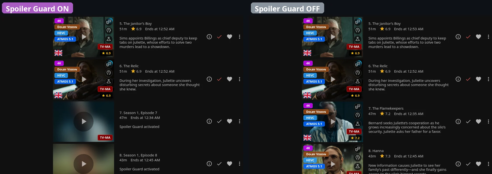</p>

- Supported Jellyfin images and metadata are protected **on the server**, including for native TV and phone clients.
- It's **per person**: turning it on for yourself doesn't change anything for anyone else. You can also choose which details stay visible for you, such as ratings or the cast.
- Server protection also covers supported **trickplay previews**, **chapter lists** and **search metadata**. JE's web interface additionally suppresses its **Reviews** panel; other clients using the Reviews API need their own corresponding UI behavior.
- Admins can turn it on automatically when someone starts a new show, requests one, or when a new title lands in the library, for shows, movies or only certain libraries.

<details>
<summary>▶️ See it in action</summary>
<p align="center">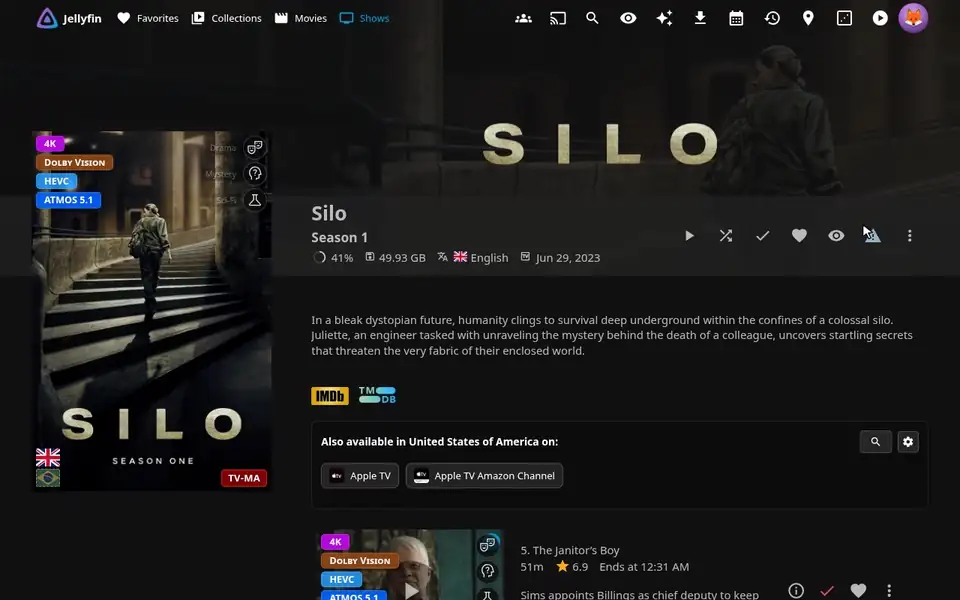</p>
</details>

<sub>[Spoiler Guard docs →](https://n00bcodr.github.io/Jellyfin-Enhanced/spoiler-guard/spoiler-guard-features/)</sub>

### 🏷️ See quality at a glance

Every poster gets small badges, so you can tell at a glance what you're about to watch.

<p align="center">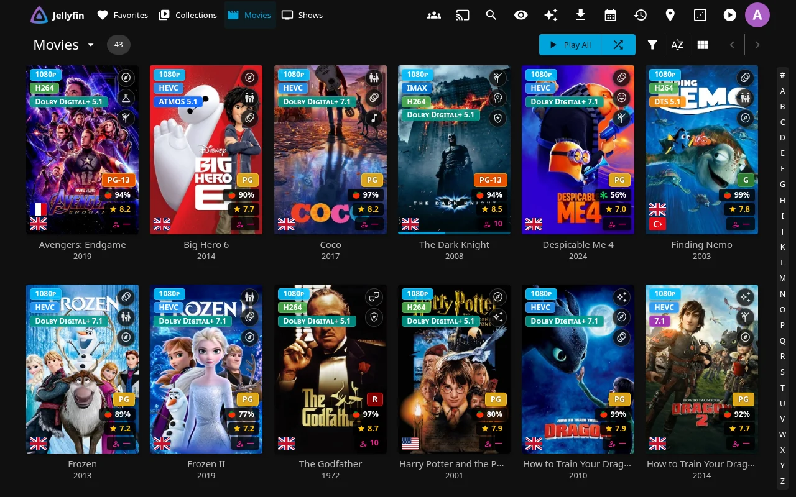</p>

| Badge | What it shows |
|---|---|
| **Quality** (top left) | Resolution (8K, 4K, 1080p…), source (BluRay, DVD, HDTV, VHS…), HDR, Dolby Vision, HDR10+, IMAX, 3D, codec, and audio such as Atmos, DTS:X, TrueHD and 7.1. It can describe matching audio tracks in *your* preferred language, with fallback to other tracks when no match exists |
| **Genre** (top right) | Icons for up to three genres, which expand into their names when you hover |
| **Language** (bottom left) | Up to three distinct flags for audio languages. On shows, a dimmed flag means that dub doesn't cover every episode |
| **Age rating** (bottom right) | The parental rating (PG-13, TV-MA, FSK 12, BBFC 15…), colour-coded by rating board |
| **Ratings** (bottom right) | The community and critic scores from your metadata (usually TMDB and Rotten Tomatoes), plus (optionally) the average rating from people on your server |
| **People** (cast photos) | Each actor's age now and at release, and their birthplace |

<p align="center">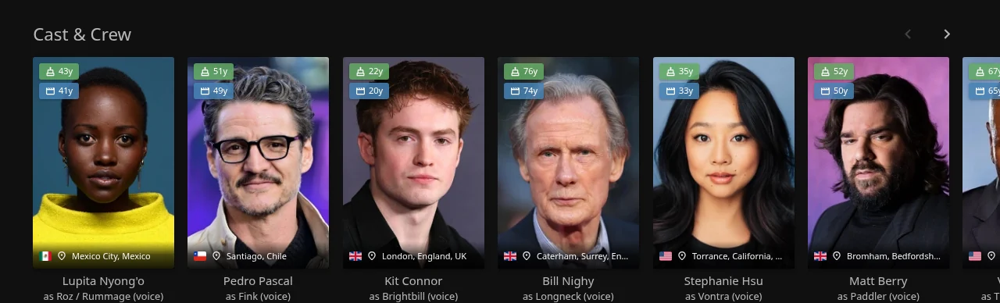</p>

Native Poster Tags adds your chosen tags to posters in eligible native apps. Choose your tag categories in the personal panel.

<details>
<summary>Tag settings and how native posters work</summary>

JE draws your selected tags into returned Primary images without changing artwork files. An administrator enables **Enable Native Poster Tags (Experimental)**; you can opt out with **Show Tags in Native Clients (Experimental)** in **UI Settings**. Your app may need a library refresh or restart to show changes.

See [Native Poster Tags](https://n00bcodr.github.io/Jellyfin-Enhanced/enhanced/tags/#native-poster-tags-experimental) for eligible clients and exclusions, [Tag Styles](https://n00bcodr.github.io/Jellyfin-Enhanced/enhanced/tags/#tag-styles-and-css) for colors, [tag-cache settings](https://n00bcodr.github.io/Jellyfin-Enhanced/enhanced/tags/#server-side-tag-cache) for exclusions and rebuilding, and [audio-language synchronization](https://n00bcodr.github.io/Jellyfin-Enhanced/enhanced/tags/#audio-language-links) for Jellyfin tag links and existing items.

</details>

<sub>[Tags & badges →](https://n00bcodr.github.io/Jellyfin-Enhanced/enhanced/tags/) · [Enhanced settings →](https://n00bcodr.github.io/Jellyfin-Enhanced/enhanced/enhanced-settings/)</sub>

### 📄 Richer movie and show pages

See ratings, streaming availability, reviews and extra details on movie and show pages. Open a title to see the features your administrator has enabled.

<p align="center">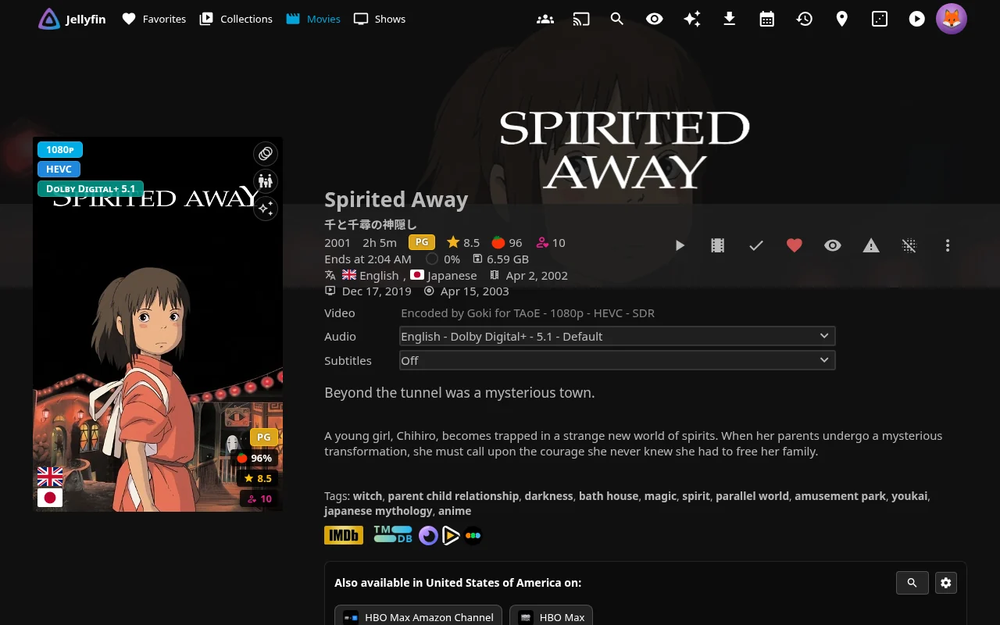</p>

<p align="center">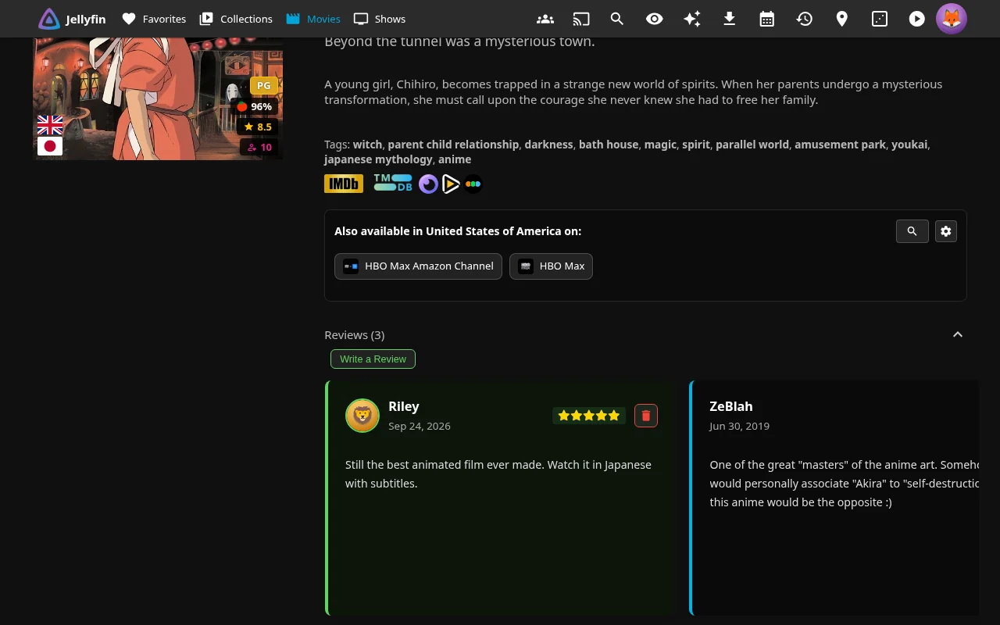</p>

- **Ratings** from TMDB and Rotten Tomatoes, plus IMDb, Letterboxd, Metacritic, Trakt and more through [MDBList](https://mdblist.com). MDBList ratings can also be saved into Jellyfin itself, for clients that display those metadata fields
- **Elsewhere:** see which streaming services carry the title in your selected region or another.
- **Reviews:** TMDB reviews, and **reviews and star ratings written by people on your server**
- **Awards:** see available wins and nominations from Wikidata for movies, shows and people.
- **Extra details** such as release dates (cinema, digital and physical for movies, air dates for shows), file size, watch progress and audio languages
- **Quick links** to Letterboxd, and (for admins) to the title in Sonarr, Radarr or Bazarr

<p align="center">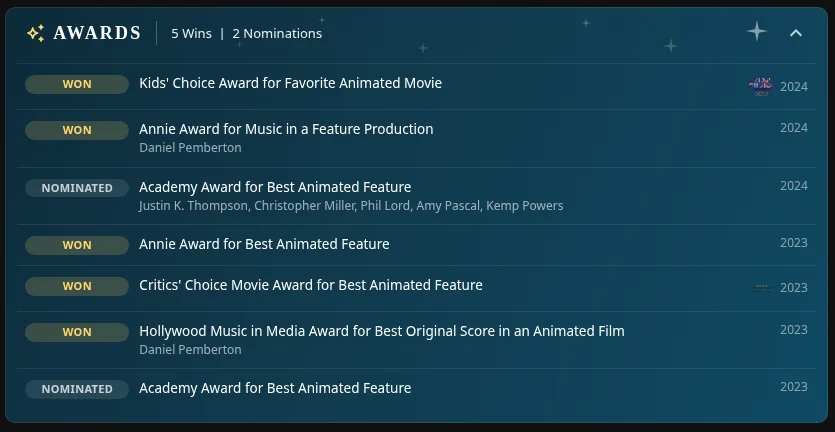</p>

Streaming availability, TMDB reviews and release-date lookups need a TMDB API key. Extra MDBList ratings need an MDBList key.

<details>
<summary>Detail-page settings and lookup details</summary>

For default aired season order, regular seasons fall back to series providers when needed. Specials without provider data are omitted. You can disable per-season providers in your personal Elsewhere search settings.

Awards need matching TMDB identifiers. Coverage depends on Wikidata claims; its public endpoint needs no API key.

Movie cinema, digital and physical dates prefer the configured region (initially US), then US, then another available region. Episode dates prefer Jellyfin's date before falling back to TMDB. Size and language information follow the selected media version.

Administrator detail-page settings:

| Setting | Default | What it does |
|---|---|---|
| **Per-season providers** | On | Looks up season providers for default aired season order; users can disable this in personal Elsewhere search settings. |
| **Show Awards Banner** | Off | Displays available Wikidata awards. |
| **Show Release/Air Date** | Off | Displays release and air-date lookups. |

Administrator display defaults, overridable through personal preferences:

| Setting | Default | What it does |
|---|---|---|
| **Show file sizes** | Off | Displays file-size information. |
| **Show watch progress** | Off | Displays watch-progress information. |
| **Show available audio languages on item detail page** | On | Displays audio languages. |

</details>

<details>
<summary>MDBList display, bulk fetching and metadata synchronization</summary>

Display lookups can populate the cache. For bulk setup, enable fetching and run **Fetch Ratings from MDBList**, then enable synchronization and run **Sync Ratings from MDBList to Jellyfin**. Sync reads the cache without MDBList lookups and skips missing entries; it does not require the Fetch switch. Display alone does not synchronize metadata. Lookups are subject to your account's quota.

</details>

<sub>[Elsewhere docs →](https://n00bcodr.github.io/Jellyfin-Enhanced/elsewhere/elsewhere-features/) · [MDBList settings →](https://n00bcodr.github.io/Jellyfin-Enhanced/other/other-settings/#mdblist-ratings)</sub>

### ⏯️ A better player

Save favorite moments, adjust subtitles and make playback more comfortable in Jellyfin’s web player.

<p align="center">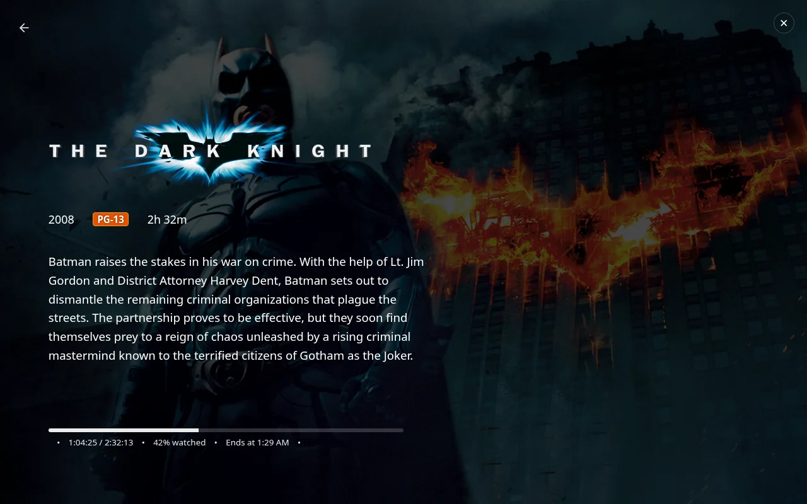</p>

- A **pause screen** with the title, plot, rating and how far you are through it
- **Bookmarks:** press <kbd>B</kbd> to save a moment. It appears as a marker on the timeline, and every bookmark is listed on its own page, where you can label, play, edit, delete and repair them.
- **Automatic intro and outro skipping**, using the intro data Jellyfin already has (for example from [Intro Skipper](https://github.com/intro-skipper/intro-skipper))
- **Auto-pause** when you switch browser tabs, **auto-resume** when you come back, and optional picture-in-picture
- **Custom subtitles:** font, size, color, background, position and an outline or drop shadow, with a live preview
- **Press and hold the video for 2× speed** (mouse or touch)
- **Ratings in the player** while the controls are showing, and optionally a brief age rating, content advisory and genre card when playback starts

<p align="center"><b>Bookmarks on the timeline</b><br>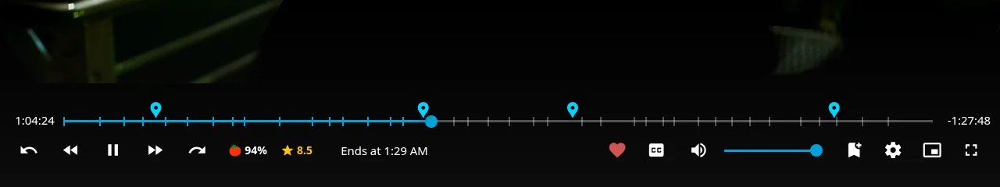</p>

<p align="center"><b>All your bookmarks in one place</b><br>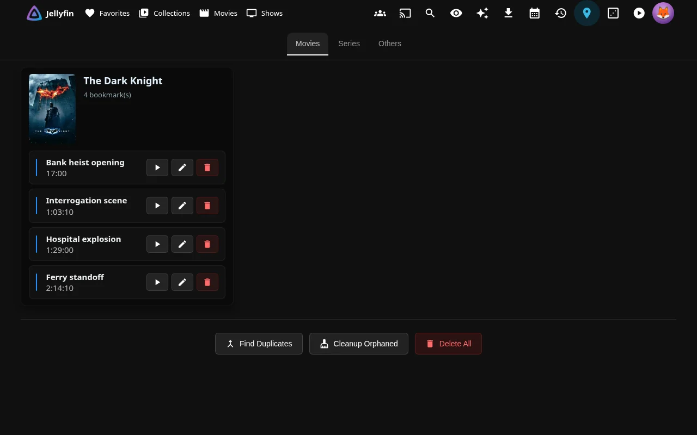</p>

<sub>[Playback docs →](https://n00bcodr.github.io/Jellyfin-Enhanced/enhanced/enhanced-features/#playback-controls)</sub>

<details>
<summary>Playback settings and limits</summary>

These personal playback settings start from the admin defaults and require Jellyfin's web player.

| Setting | Default | What it does |
|---|---|---|
| **Custom Pause Screen** | On | Shows the overlay while paused and idle, after **Delay before showing (seconds):**, initially 5 seconds. |
| **Auto-pause** | On | Pauses when leaving the tab. |
| **Auto-resume** | Off | Resumes on return. |
| **Auto Picture-in-Picture** | Off | Attempts PiP when leaving the tab. |
| **Automatically Skip Intro** | Off | Skips available Intro segments. |
| **Automatically Skip Outro** | Off | Skips available Outro segments. |
| **Long Press for 2x Speed (β)** | Off | Hold for 500 ms to play at 2×; release restores the previous speed. |

Saved personal choices take precedence over the administrator defaults.

Automatic skipping needs Intro/Outro Media Segment data. Automatic PiP depends on browser support and video state; JE closes only the PiP window it opened. Subtitle styling affects subtitle elements shown by the browser and cannot change subtitles burned into video.

Administrator playback setting:

| Setting | Default | What it does |
|---|---|---|
| **Show Age Rating When Playback Starts** | Off | Shows the age rating, available content advisories and genres for about five seconds when playback starts, once per item. |

A player bookmark button also saves a moment without a keyboard. Bookmark management provides **Movies**, **Series** and **Others** groups and repair tools. See the [bookmark and playback guide](https://n00bcodr.github.io/Jellyfin-Enhanced/enhanced/enhanced-features/#playback-controls) before destructive cleanup. There is no bookmark export/import interface; use the [settings backup guidance](https://n00bcodr.github.io/Jellyfin-Enhanced/getting-started/settings-overview/) for file backups.

</details>

### ⌨️ The Enhanced panel and shortcuts

Choose your personal settings and shortcuts in the Enhanced panel. Press <kbd>?</kbd> while you’re not typing in an input or textarea, or choose **Enhanced Panel** in the drawer.

<details>
<summary>Other ways to open the panel</summary>

Use **Jellyfin Enhanced** in Jellyfin 12's avatar menu or **Jellyfin Enhanced - User Settings** in user preferences. In mobile or TV web layouts, you can also use the player's tune button titled **Jellyfin Enhanced** when the player controls are available; desktop layouts hide it.

</details>

**Search settings…** filters the section list.

1. Open **Shortcuts** and click a key.
2. Press your new key combination. <kbd>Backspace</kbd> restores the current admin binding; <kbd>Delete</kbd> disables it.

<details>
<summary>Panel behavior and disabling shortcuts</summary>

Desktop restores your last section. Phone layouts start at the section list with a back button. **About → Release Notes** loads the latest GitHub release, which can differ from your installed version.

**Disable Keyboard Shortcuts** starts off. Enabling it disables ordinary JE shortcuts and hides their personal section. The separate `?` listener still opens the panel.

</details>

<p align="center">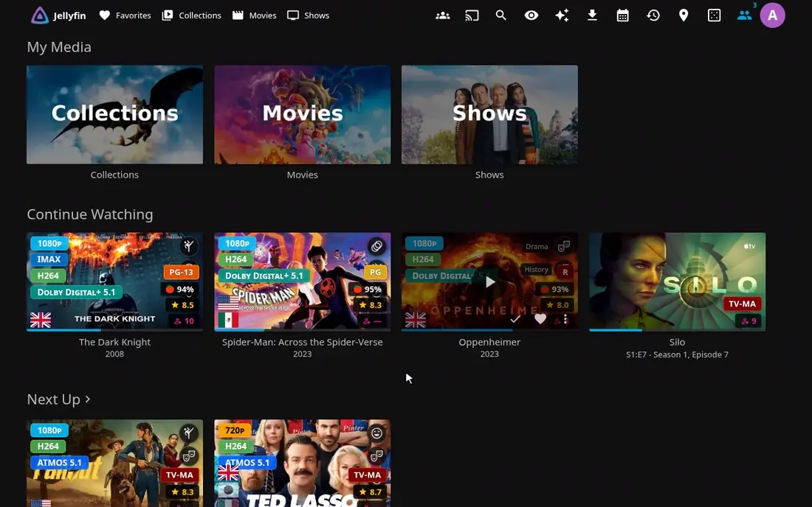</p>

<details>
<summary>⌨️ Default keyboard shortcuts</summary>

| While browsing | | In the web player | |
|---|---|---|---|
| <kbd>/</kbd> | Search | <kbd>B</kbd> | Bookmark this moment |
| <kbd>Shift</kbd>+<kbd>H</kbd> | Home | <kbd>O</kbd> | Skip intro or outro |
| <kbd>D</kbd> | Dashboard | <kbd>S</kbd> / <kbd>C</kbd> | Subtitle menu / next subtitle track |
| <kbd>Q</kbd> | Quick Connect | <kbd>V</kbd> | Next audio track |
| <kbd>R</kbd> | Open something random | <kbd>+</kbd> / <kbd>-</kbd> / <kbd>R</kbd> | Faster / slower / normal speed |
| <kbd>?</kbd> | Open the Enhanced panel | <kbd>A</kbd> | Change aspect ratio |
| | | <kbd>I</kbd> | Playback info |
| | | <kbd>P</kbd> | Episode preview (with the [InPlayerEpisodePreview](https://github.com/Namo2/InPlayerEpisodePreview) plugin) |
| | | <kbd>,</kbd> / <kbd>.</kbd> | Back or forward one frame |
| | | <kbd>Z</kbd> | Jump back to where you were |
| | | <kbd>0</kbd>–<kbd>9</kbd> | Jump to 0–90% of the video |

</details>

### 🙈 Keep your home screen tidy

Hide titles on the surfaces you choose, or remove them from home rows while keeping your watch progress. Use **Hidden Content** to restore hidden entries.

<p align="center"><b>Remove from Continue Watching</b><br>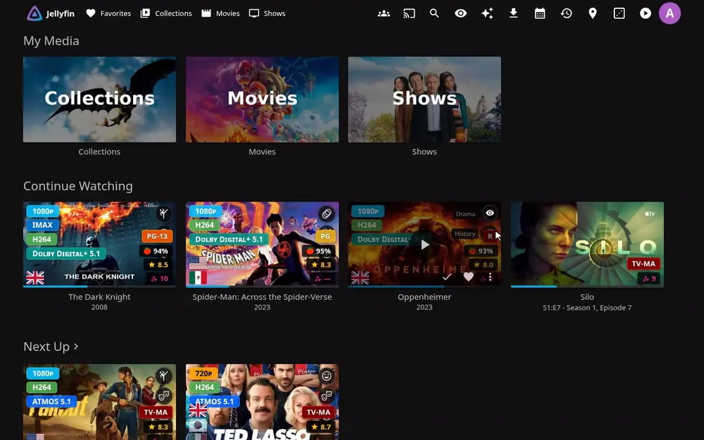</p>

<p align="center"><b>Hide a title and manage your hidden list</b><br>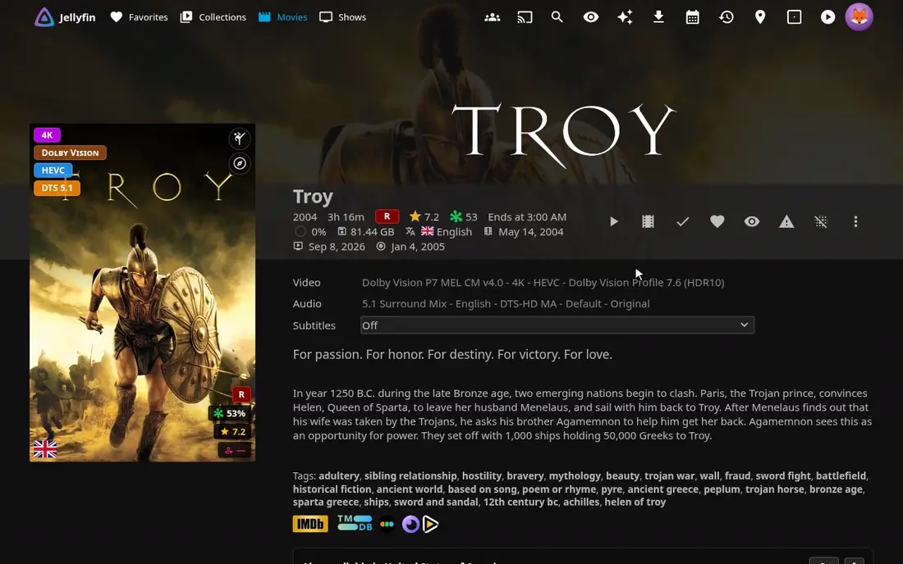</p>

- **Continue Watching only**, **Next Up only** and **Home sections only** hide titles from home rows while preserving progress.
- Hide titles from the surfaces you choose. Choose the surfaces to filter in personal **Hidden Content** settings.
- Your hidden list is saved on the server and follows you across devices on supported surfaces. Administrators can manage other users' lists when permitted. Hiding changes displayed results; it does not revoke library access.

<details>
<summary>Hidden Content settings and home-row behavior</summary>

Personal **Hidden Content** defaults:

| Setting | Default | What it does |
|---|---|---|
| **Filter Library** | On | Filters hidden titles from library views. |
| **Filter Recommendations** | On | Filters hidden titles from recommendations. |
| **Filter Calendar** | On | Filters hidden titles from the calendar. |
| **Filter Search** | Off | Filters hidden titles from search when enabled. |

Starting playback clears Continue Watching-only suppression; combined home suppression becomes Next Up-only. Restore Next Up suppression separately. The two hiding features share the hidden-content store.

Administrator settings:

| Setting | Default | What it does |
|---|---|---|
| **Enable "Remove from Continue Watching"** | Off | Enables home-row removal independently of Hidden Content. |
| **Enable Hidden Content** | Off | Enables filtering of hidden titles. |
| **Filter Search results** | Off | Sets the initial personal search-filter preference. |

</details>

<sub>[Hidden content docs →](https://n00bcodr.github.io/Jellyfin-Enhanced/enhanced/enhanced-features/#content-management)</sub>

### 📅 See what's coming

The **Calendar** shows upcoming episodes and movies from Sonarr and Radarr, plus anime from Shoko. See what's available and filter by cinema, digital or physical release.

Choose day, week, month or agenda view; your initial personal view is agenda. You can enable watchlist and watched/started indicators for matched events.

<p align="center"></p>

The combined **Requests** page shows Seerr requests and active downloads with progress bars.

<details>
<summary>Calendar details, Requests settings and permissions</summary>

**Pending Approval**, **Processing**, **Coming Soon** and **Available** describe request states, separate from the download queue. Processing excludes coming-soon and orphaned requests.

The Calendar supports several Sonarr and Radarr instances. Series indicators use the matched episode, rather than whole-show watch history.

Linked users can view all requests if they are Jellyfin admins or have Seerr `ADMIN`, `MANAGE_REQUESTS` or `REQUEST_VIEW`. Approval and decline require a linked account plus Jellyfin admin status or Seerr `ADMIN`/`MANAGE_REQUESTS`. Downloads normally show non-admins only content they requested; turning off **Filter Downloads by User Requests** exposes the queue to all authenticated users.

Administrator Requests settings:

| Setting | Default | What it does |
|---|---|---|
| **Enable Requests Page** | Off | Enables the combined page. |
| **Show Downloads in Requests Page** | On | Includes Sonarr/Radarr download progress. |
| **Filter Downloads by User Requests** | On | Restricts non-admin download and history visibility to requested content. |
| **Show Seerr Issues Section** | Off | Includes issues, subject to Seerr permissions. |
| **Show Download History Section** | On | Includes recent download history. |
| **Restrict Download History to Admins** | Off | Adds an admin-only history restriction. |

<sub>The Calendar needs Sonarr, Radarr or Shoko. Request and issue sections need Seerr; downloads and history need Sonarr or Radarr. Non-admin request filtering also needs a linked Seerr account. · [*arr docs →](https://n00bcodr.github.io/Jellyfin-Enhanced/arr/arr-features/)</sub>

</details>

### 👥 Share it with your household

See household activity and share reviews with the people on your server.

<p align="center">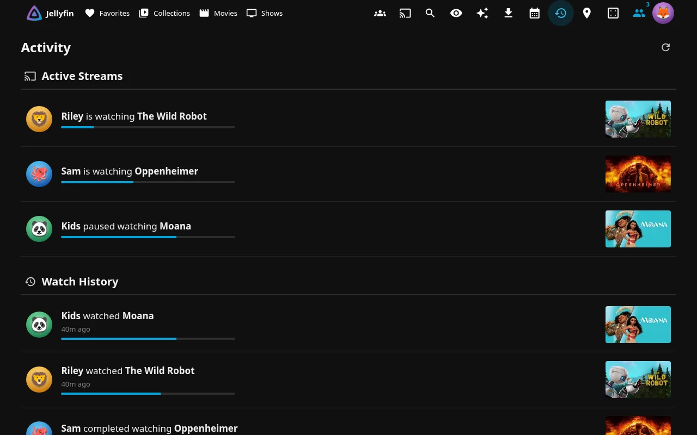</p>

- **Activity:** see recent watched, favorite and review activity. Active streams appear when separately enabled and permitted for your account. History respects the viewer's libraries and parental access.
- **Reviews and ratings:** users can review movies, shows, seasons and episodes when reviews are enabled. Click **Write a Review**, enter text, stars or both, then save. Text is limited to 2,000 characters after trimming whitespace at the ends. Ratings use 1–5 stars in half-star steps.
- **Login picture:** when someone picks their name to sign in, their profile picture appears above the password box.

<details>
<summary>Activity and review settings and author visibility</summary>

Administrator Activity and review settings:

| Setting | Default | What it does |
|---|---|---|
| **Enable Activity Feed** | Off | Enables the Activity page. |
| **Show recently watched** | On | Includes watched activity once the feed is enabled. |
| **Show recently favorited** | On | Includes favorite activity once the feed is enabled. |
| **Show recently reviewed** | On | Includes review activity once the feed is enabled. |
| **Show Active Streams section** | On | Includes streams in the enabled feed when **Active Streams Header Widget** is also enabled. Non-admin viewers also need **Show widget to non-admins** enabled. |
| **Enable User Written Reviews** | Off | Enables household reviews and star ratings. |
| **Show average user rating on poster cards** | Off | Adds poster averages when the personal **Show Rating Tags** preference is also enabled. |
| **Hide reviews from hidden users** | On | Filters hidden authors for other non-admin viewers; also applies to activity. |
| **Hide reviews from disabled users** | On | Filters disabled authors for other non-admin viewers; also applies to activity. |
| **Also save review star ratings as the user's Jellyfin rating** | Off | Saves movie/series review stars multiplied by two to Jellyfin's user rating, replacing any existing rating. |

Administrators can see all reviews and existing authors can see their own. Deleted or unresolved authors are hidden from non-admins when either author filter is on; activity filtering also has administrator/self exceptions. Season and episode review ratings are not mirrored.

</details>

<p align="center">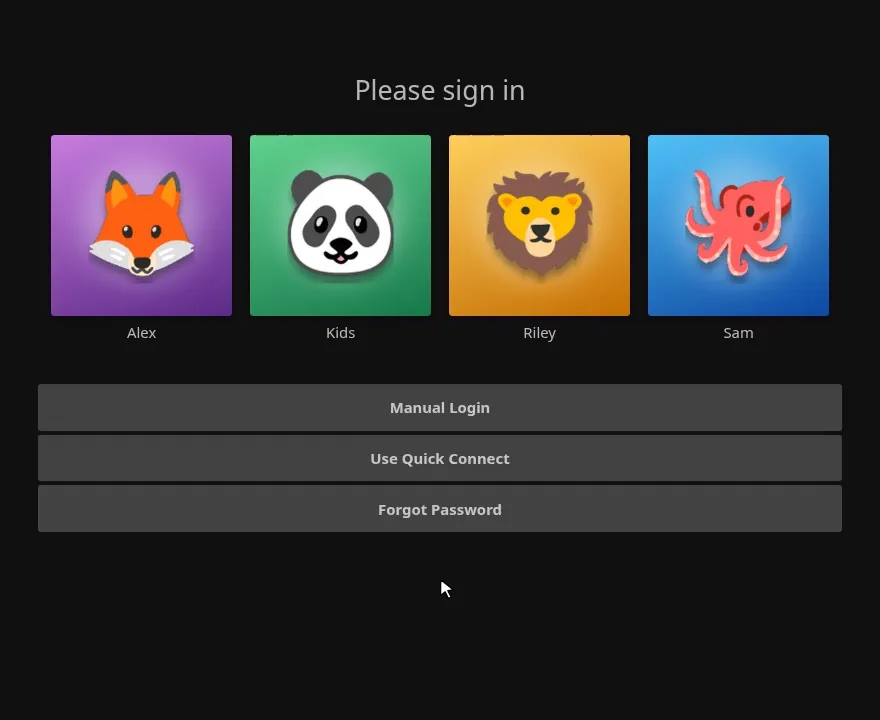</p>

### 📡 See who's watching right now

A live counter in the header shows how many streams are playing. Click it to see posters, progress, devices, codec and bitrate, and whether playback is direct or transcoded.

Admins can send a message to everyone who’s connected. Non-admin responses omit remote addresses, and broadcasting requires administrator access.

<details>
<summary>Active Streams settings</summary>

Administrator Active Streams settings:

| Setting | Default | What it does |
|---|---|---|
| **Active Streams Header Widget** | Off | Adds the header counter and session panel. |
| **Show widget to non-admins** | Off | Allows non-admin viewers to use the widget and see streams in Activity. |

</details>

[Active Streams, broadcasts and settings](https://n00bcodr.github.io/Jellyfin-Enhanced/other/other-features/).

<p align="center">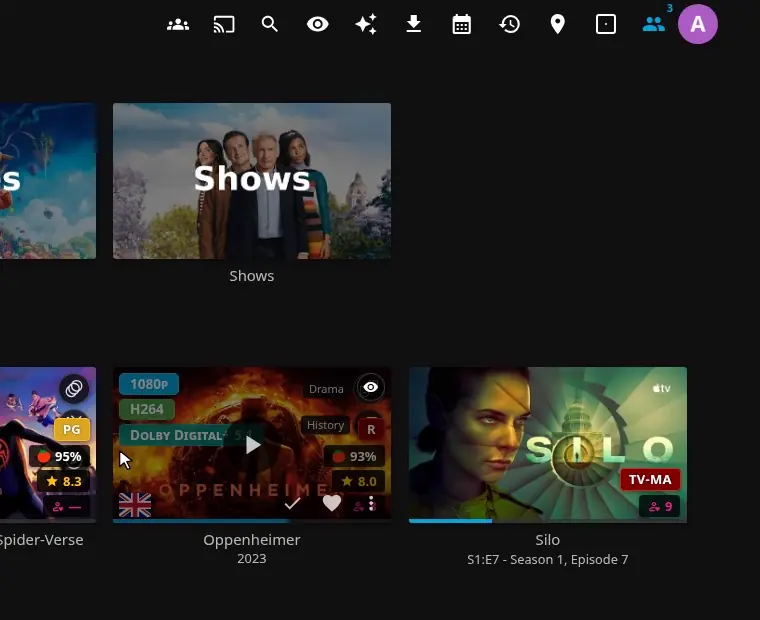</p>

### 🎲 Can't decide?

The **Random** button (or <kbd>R</kbd>) picks something from your library. You can limit it to movies, shows or things you haven't watched yet, or have it pick from the playlist or collection you're looking at (or one you choose).

<p align="center">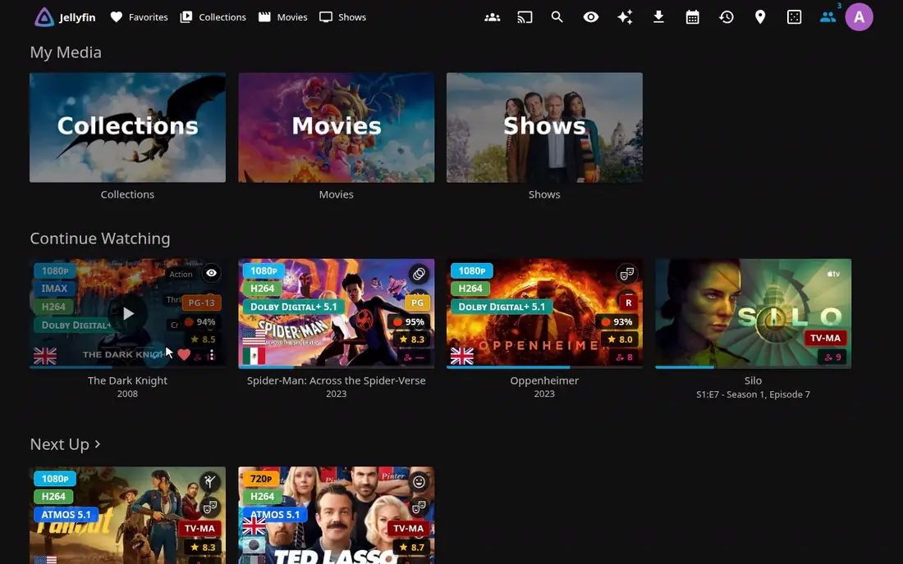</p>

### Catch Up

Catch Up helps you work through unwatched movies and series with artwork. Swipe through titles or use buttons and arrow keys:

- Right: mark watched. Multi-season series open a picker; single-season series are marked watched directly.
- Left: dismiss in this browser.
- Up: add to the watchlist.
- Down: open details.

<kbd>Backspace</kbd> rewinds. Selecting a later season selects earlier seasons too.

<details>
<summary>Catch Up settings and details</summary>

Administrator Catch Up settings under **Pages**:

| Setting | Default | What it does |
|---|---|---|
| **Enable Catch Up** | Off | Enables the Catch Up page. |
| **Record Catch Up activity** | On | Logs the user, title, action and time to `catchup-log.jsonl` in the server’s plugin configuration folder when Catch Up is enabled. Administrators can read the log and per-user summary in Catch Up’s **Activity** panel. |
| **Add Catch Up as a native Home tab** | Off | Adds a Home tab without a companion plugin. |
| **Use Plugin Pages** | Off | Delivers the page through the Plugin Pages plugin. |
| **Use Custom Tabs** | Off | Delivers the page through the Custom Tabs plugin. |
| **Add the Custom Tabs entry for me** | Off | Creates the Custom Tabs entry when that delivery is enabled. |

Native Home and Custom Tabs delivery are mutually exclusive in the admin UI. Adding to the watchlist sets Jellyfin’s Likes flag.

Dismissals are per user in this browser and do not follow you across devices. Marking watched intentionally updates Jellyfin's watched state. See [Catch Up features](https://n00bcodr.github.io/Jellyfin-Enhanced/enhanced/enhanced-features/) and [page setup](https://n00bcodr.github.io/Jellyfin-Enhanced/getting-started/pages-and-tabs/).

</details>

### 📱 On your phone

JE's web features work when the official Android/iOS app or a phone browser loads your server's web interface. The header adapts to small screens; playback enhancements depend on the player and client support.

Open personal settings without a keyboard through the drawer's **Enhanced Panel** or Jellyfin 12's avatar-menu **Jellyfin Enhanced**.

<p align="center">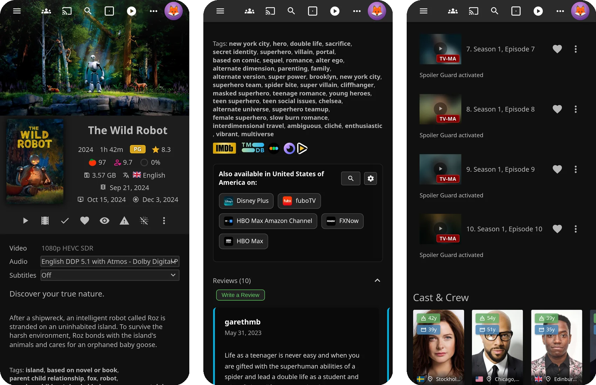</p>

### 🛠️ Tools for the server admin

Everything is configured from **Dashboard → Plugins → Jellyfin Enhanced**, with search, descriptions for every option and highlights of the new settings after each update.

<p align="center">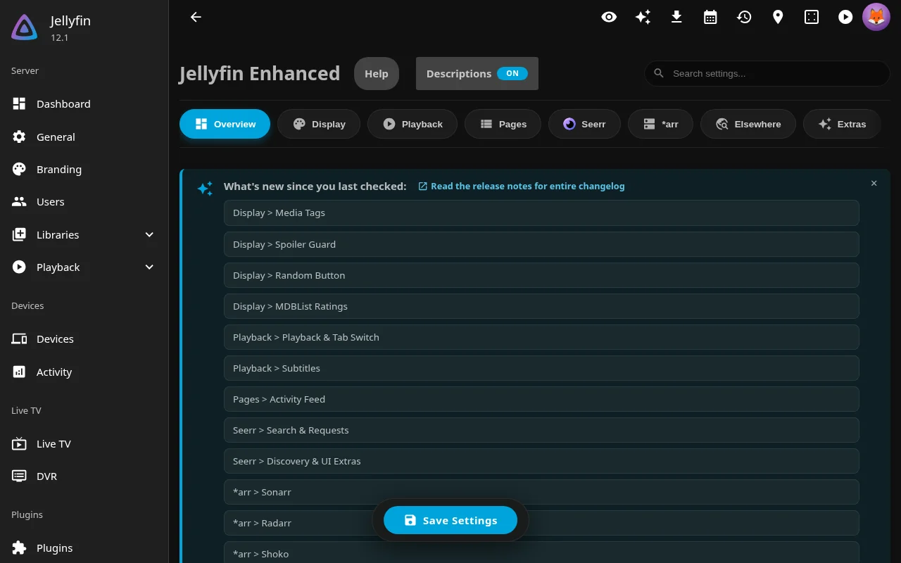</p>

- **Set defaults** for new personal settings. Saved user values take precedence. Integration and server-policy controls govern availability separately.
- **Import Jellyfin users into Seerr**, and **audit** who is allowed to request what
- **Sonarr, Radarr and Bazarr links**, plus \*arr and audio-language tags synchronized into Jellyfin's metadata
- **Check which parts are working** with built-in connection tests
- **Maintenance mode:** a banner on the login page with a live countdown, reminders when people start playing something, and optionally lock out everyone except admins while you work. It can also switch itself on every day for a set window, such as overnight while library scans run
- **Your own branding:** upload a logo, login banners, favicon and app icon, and set your own loading screen
- **Themes:** pick a color theme for [Jellyfish](https://github.com/n00bcodr/Jellyfish/) (or a random one each day), plus colored activity and plugin icons
- **[Documented CSS hooks](https://n00bcodr.github.io/Jellyfin-Enhanced/advanced/css-customization/)** to restyle JE
- **More than 30 locales** translated by the community; completeness varies and missing strings fall back to English

<p align="center">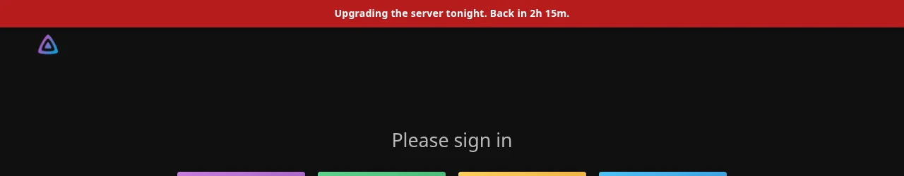</p>

<details>
<summary>Replacing personal settings and where choices are saved</summary>

To replace everyone’s choices, save the admin changes first. Then use **Overwrite everyone's personal settings** under **Overview → Quick Actions**. Personal settings are stored on the server; theme choices and Catch Up dismissals use browser storage.

</details>

<sub>[Admin & other features →](https://n00bcodr.github.io/Jellyfin-Enhanced/other/other-features/)</sub>

<p align="center"><b><a href="https://n00bcodr.github.io/Jellyfin-Enhanced/enhanced/enhanced-features/">📖 Read the full feature guide →</a></b></p>

## 📱 Where it works

| App | What you get |
|---|---|
| Jellyfin web UI | Full web integration when loading this server's web interface. |
| Official Android and iOS apps | Web integration through their embedded web UI; player capabilities depend on the app and playback mode. |
| Jellyfin Desktop | Injected features when it loads this server's web interface. Consult [desktop releases](https://github.com/jellyfin/jellyfin-desktop/releases) for that project's release information. |
| TV and other native clients | Enabled server features: Spoiler Guard, hidden-content/home-row filtering, automatic Seerr requests, watchlist sync, metadata ratings, audio-language/*arr tag sync, experimental Native Poster Tags and maintenance restrictions. |

Player enhancements require the Jellyfin web player. PiP and some controls depend on browser/client support; bundled web clients and external players can limit injected features. Configure server features from the web interface. Native clients may show server messages if they support them. See [compatibility and requirements](https://n00bcodr.github.io/Jellyfin-Enhanced/getting-started/compatibility/).

## 🧩 Works great with

| Plugin or app | Why |
|---|---|
| [Seerr](https://github.com/seerr-team/seerr) | Powers requests, discovery, recommendations and watchlist sync. |
| Sonarr / Radarr | Power the Calendar, the Requests page's download progress, and admin links. |
| Bazarr / Shoko | Bazarr adds subtitle links for admins; Shoko adds anime to the Calendar. |
| [Intro Skipper](https://github.com/intro-skipper/intro-skipper) | Finds the intros and outros that auto-skip jumps over. |
| [Plugin Pages](https://github.com/IAmParadox27/jellyfin-plugin-pages) / [Custom Tabs](https://github.com/IAmParadox27/jellyfin-plugin-custom-tabs) | Optional page navigation in the sidebar (mobile only in Jellyfin 12's Modern Layout) or as Home tabs; see [page placement](https://n00bcodr.github.io/Jellyfin-Enhanced/getting-started/pages-and-tabs/#choose-a-placement). Both need [File Transformation](https://github.com/IAmParadox27/jellyfin-plugin-file-transformation). JE’s native Home tabs work without them. |
| [KefinTweaks](https://github.com/ranaldsgift/KefinTweaks) | Shows the Jellyfin watchlist that watchlist sync keeps up to date. |
| [Jellyfish](https://github.com/n00bcodr/Jellyfish/) | A Jellyfin theme by the same author. The theme selector picks its colors. |

<details>
<summary>Setting up page navigation</summary>

Under **Pages**, enable each page and its desired delivery; placement switches start off. Native Home and Custom Tabs delivery are mutually exclusive per page. Plugin Pages 3.0+ supports live registration; older versions need a restart after first enabling a page. See [JE pages & tabs](https://n00bcodr.github.io/Jellyfin-Enhanced/getting-started/pages-and-tabs/).

</details>

## ❓ Common questions

<details>
<summary><b>Does it work on my TV?</b></summary>

Server features work when enabled: Spoiler Guard, hidden-content and home-row filtering, automatic requests, watchlist synchronization, ratings and audio-language/*arr tags saved into Jellyfin, experimental Native Poster Tags and maintenance restrictions. Injected controls need a client loading this server's web interface, and player enhancements need its web player. Configure server features from the web interface; native clients' cached images may need refreshing. See the [compatibility guide](https://n00bcodr.github.io/Jellyfin-Enhanced/getting-started/compatibility/).

</details>

<details>
<summary><b>Do I need Seerr, Sonarr or Radarr?</b></summary>

No. Without them you still get tags, shortcuts, the pause screen, bookmarks, Spoiler Guard, reviews, the Activity page, hidden content, themes and much more. The request, calendar and download features need Seerr, Sonarr, Radarr or (for the Calendar) Shoko.

</details>

<details>
<summary><b>Will it mess up my server or my watch history?</b></summary>

Your media files remain unchanged. Continue Watching removal preserves progress, and you can restore hidden entries. Catch Up intentionally changes watched state; optional review-rating mirroring changes movie/series user ratings. Optional rating and tag synchronization writes Jellyfin metadata. To uninstall, remove the plugin under **Dashboard → Plugins** and restart; uninstalling does not reverse those intentional metadata changes.

</details>

<details>
<summary><b>Does it send my data anywhere?</b></summary>

The server talks to configured services such as Seerr, Sonarr, Radarr, Shoko, TMDB and MDBList. Awards query Wikidata. The server also fetches upstream icons, flags and theme CSS into JE's local CDN cache; serving them locally does not mean they were bundled. Posters for non-library titles can load from TMDB. The browser queries GitHub for release notes and newly available locales.

Installation usage reporting is **off by default**. An admin must enable **Share Anonymous Usage Statistics** and save. **Preview** shows selected statistics, not the exact authenticated request: real reports also include installation credentials and build proof. Visiting the [Community Analytics dashboard](https://n00bcodr.github.io/Jellyfin-Enhanced/advanced/community-analytics/) separately makes browser requests to public Supabase views and Google Fonts, regardless of server reporting consent.

Catch Up has a separate local log. With **Enable Catch Up** and **Record Catch Up activity** enabled, it records usernames/IDs, title names/IDs, actions, times, reported success and selected seasons. The log and summary are administrator-only through JE. The server keeps `catchup-log.jsonl` and one rotated `catchup-log.1.jsonl`, rotating at approximately 5 MiB per file. These records are not included in analytics reports. Turn off **Record Catch Up activity** and save to stop future recording. [Collection, controls and reporting details](https://n00bcodr.github.io/Jellyfin-Enhanced/advanced/community-analytics/).

</details>

<details>
<summary><b>Is it free?</b></summary>

Yes. It's open source under [GPL-3.0](LICENSE). If you'd like to say thanks, there's [Ko-fi](https://ko-fi.com/n00bcodr) and [Buy Me a Coffee](https://www.buymeacoffee.com/n00bcodr).

</details>

<details>
<summary><b>Is it in my language?</b></summary>

Community translations cover more than 30 locales; completeness varies and missing strings fall back to English. **Display Language** in personal **Language Settings** can override automatic selection; save and refresh after changing it. Missing yours? [Help translate on Weblate](https://hosted.weblate.org/engage/jellyfinenhanced/). No coding needed.

</details>

<details>
<summary><b>Is this made by Jellyfin or Seerr?</b></summary>

No. It's a community project by [n00bcodr](https://github.com/n00bcodr) and contributors. Please report problems **here**, not to Jellyfin or Seerr.

</details>

More answers are in the [full FAQ](https://n00bcodr.github.io/Jellyfin-Enhanced/faq-support/faq/).

## 💬 Help, feedback and translations

- **Stuck?** Read the [FAQ](https://n00bcodr.github.io/Jellyfin-Enhanced/faq-support/faq/) or ask on [Discord](https://discord.gg/EYNFf7y4CG).
- **Found a bug?** [Open an issue](https://github.com/n00bcodr/Jellyfin-Enhanced/issues).
- **Have an idea?** [Start a discussion](https://github.com/n00bcodr/Jellyfin-Enhanced/discussions).
- **Speak another language?** [Help translate on Weblate](https://hosted.weblate.org/engage/jellyfinenhanced/).
- **Want to contribute code?** Start with [CONTRIBUTING.md](CONTRIBUTING.md).

<p align="center">
  <a href="https://hosted.weblate.org/engage/jellyfinenhanced/"></a>
</p>

<details>
<summary><b>More from n00bcodr</b></summary>

- [Jellyfish](https://github.com/n00bcodr/Jellyfish/): a custom Jellyfin theme
- [Jellyfin Tweaks](https://github.com/n00bcodr/JellyfinTweaks): a plugin with extra tweaks
- [Jellyfin JavaScript Injector](https://github.com/n00bcodr/Jellyfin-JavaScript-Injector): adds your own scripts to Jellyfin

</details>

## ⭐ Star history

<a href="https://www.star-history.com/?repos=n00bcodr%2FJellyfin-Enhanced&type=date&legend=top-left">
 <picture>
   <source media="(prefers-color-scheme: dark)" srcset="https://api.star-history.com/chart?repos=n00bcodr/Jellyfin-Enhanced&type=date&theme=dark&legend=top-left&sealed_token=dHVltYjTopyABWuSHsm1qmc7Q72ljM73fNCmKNNTqhJRqfngH-60EOzWJlfunX3xrqZimaAQdy3reRT1DWP_qt8ruMBd0LwddO1DZnX5ns00uOrFW9z82w" />
   <source media="(prefers-color-scheme: light)" srcset="https://api.star-history.com/chart?repos=n00bcodr/Jellyfin-Enhanced&type=date&legend=top-left&sealed_token=dHVltYjTopyABWuSHsm1qmc7Q72ljM73fNCmKNNTqhJRqfngH-60EOzWJlfunX3xrqZimaAQdy3reRT1DWP_qt8ruMBd0LwddO1DZnX5ns00uOrFW9z82w" />
   
 </picture>
</a>

---

<div align="center">

**If Jellyfin Enhanced made your server better, please ⭐ star the repo. It helps other people find it.**

<a href='https://ko-fi.com/G2G51TIZF0' target='_blank'></a>
<a href='https://www.buymeacoffee.com/n00bcodr' target='_blank'></a>

Licensed under [GPL-3.0](LICENSE) · Made with 💜 for Jellyfin and the community

</div>
