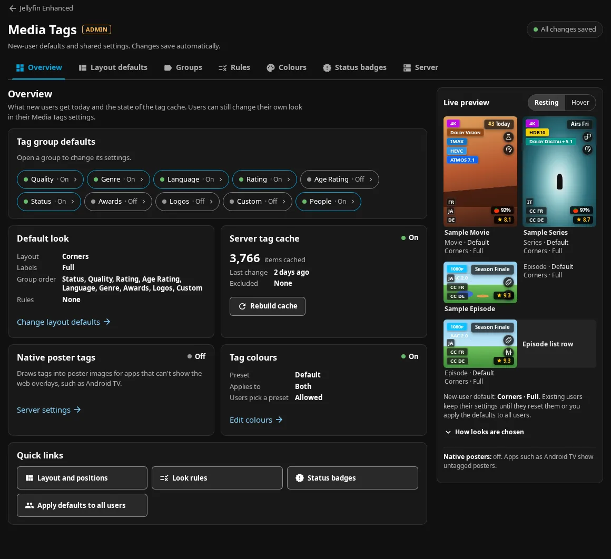
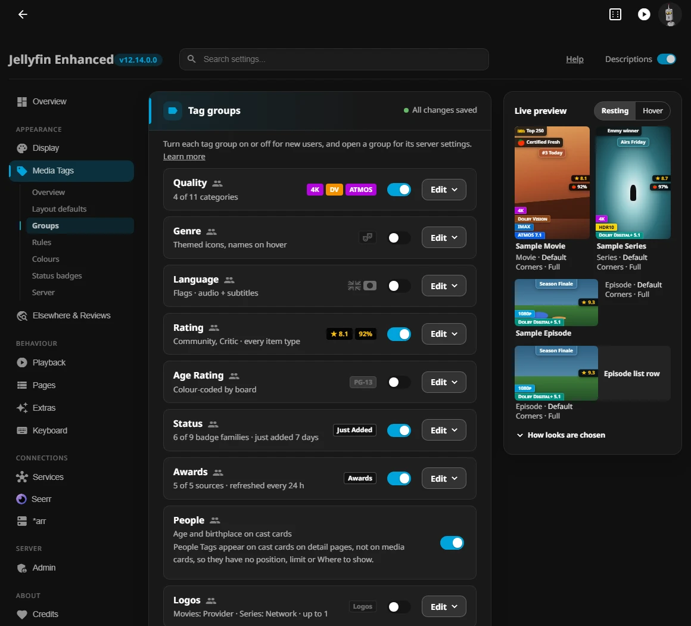

# Admin Media Tags tab

The **Media Tags** tab of the Jellyfin Enhanced configuration page (`#/configurationpage?name=Jellyfin%20Enhanced&jeSection=media-tags`) holds every server-wide poster tag setting. It is built from small section modules, so a new setting is a one-line declaration. This page is for contributors; administrators should read [Tags & badges](../enhanced/tags.md).


*The Overview section, with the live preview of a new user's cards.*


*The Groups section: each row opens that group's server settings.*

## How it fits together

- **Where it lives.** `Configuration/configPage.html` has a `media-tags` tab button and, **after its `<form>`**, the tab's content `<div id="media-tags" class="jellyfin-tab-content je-mt-tab">` holding `.je-tag-admin`.
    - The page's whole-form **Save**, its unsaved-changes badge (a snapshot of the form's controls), search highlighting and implicit Enter-submit never see the tab's controls.
    - `jeAdmin.js` lists the tab in the sidebar's Appearance group, after Display. The page adds a tree of the tab's seven sections under that entry (`[data-je-mt-tree]`), and marks the shown one from the `je-media-tags-section` event.
- **The page's look, not its own.** The tab draws no title row or section tabs of its own on a desktop: the sidebar's tree is its navigation, as for the page's other tabs. Its cards, setting rows, switches, fields, buttons, scope badges and focus rings use the configuration page's values (`admin-tags.css`).
    - Every section opens with its first card (`lead: 'card'` in `TABS`): the section's `<h2>` stays for screen readers and names its panel, keyboard focus from a sidebar link lands on that card's title, and the save status (**All changes saved** / **Saving…**) sits on that card's header row. Groups' rows sit inside one **Tag groups** card; Overview's intro is the page's tab-intro banner, which the page's **Descriptions** switch hides along with the tab's help text.
    - Below a 901 px window (where the page's sidebar becomes its menu) the sections are the page's chip row at the top of the tab, with the save status (**Saved**) at its end; the tablist itself holds only the section buttons.
- **Drawn on first open.** When the tab first opens, `configPage.html` (`jeMountMediaTags`) waits for the JE client bundle (already running on dashboard pages: `JE.t`, `core/tag-layout.js`, the panel's preview). It then loads `js/enhanced/admintags/admin-tags.css` and `admin-tags.js`, and calls `JE.adminTags.mountTab(tab)`.
    - `admin-tags.js` loads the files in `SECTION_FILES` once per document.
    - Opening the tab again, or showing the page again with the tab open (`pageshow`), calls `mountTab` again, which reloads the settings.
    - Only the shown page element is live. Jellyfin keeps earlier views in the document, so a newer view of the configuration page tears down the previous tab (after saving) and builds its own, keeping control ids unique.
- **Saving one field at a time.** Every control writes one `PluginConfiguration` field into the tab's working copy and saves it after a 400 ms pause through `POST /JellyfinEnhanced/admin/configuration`.
    - The server writes only the changed fields on top of the configuration it holds at that moment, inside the same critical section as every configuration save. So another administrator's changes to other fields are kept, as are the server's own writes (a maintenance window ending clears its toggle, the translation refresh task sets its signal, analytics records its state), which take the same lock.
    - Each field carries the value the tab read before it was edited. If someone else changed that field meanwhile, the server refuses it and the tab shows **Changed elsewhere** with **Keep mine** and **Take theirs**. For one field it names the field and both values, as **Keep <value>** and **Use <value>**.
    - A change that is not saved (refused, or changed elsewhere) floats as a bar where the page's Save dock floats, centred on the settings column, with both values for every field and its buttons; a field being edited is scrolled clear of it. The tab's sidebar entry shows a dot (a screen-reader note says "not saved") so it is seen from any other tab.
    - Unsaved edits live in a store shared by every view, so a failed save survives moving between sections and links. The store belongs to the signed-in administrator on this server:
        - An identity change (`JE.session.onUserChange`, and a check of the `ApiClient` user and server before every save and view) empties it and the live view. Requests started before it are ignored when they answer.
        - Every answer (a save, the settings for a first view or a returning one, the preview's Tag Styles) is checked against the session it was asked in, with the `ApiClient` identity read again first. A server switch that `JE.session` has not reported yet is caught there too. When someone is signed in by then, the tab loads again for them.
- **Living beside the whole-form Save.** The configuration page still saves its own form as a whole: it reads the saved configuration, overlays its own fields and writes the whole document.
    - Its whole-document writes run inside `JE.adminTags.holdSaves(fn)`: **Save**, **Apply the above**, **Apply all plugin settings** and the Overview's cache quick action.
    - Media Tags edits not saved yet are saved first, so the fresh read already has them. Field saves started meanwhile wait until the write is done, then go out with their `Expected` values intact, because the write put back what the server had.
    - A whole-configuration write therefore never puts an older Media Tags value back, and `apply-user-settings` still refuses Media Tags fields (`MediaTagsPageFields.Allowed`).
    - After a save, the tab dispatches `je-media-tags-store` (`{type, values, state}`), and the Display tab's Media Tags card summary follows the saved values.
    - The Save dock and the "refresh" hint are hidden on the tab unless another tab has unsaved changes.
- **The preview column** is `internal.createTagPreview` from `settingspanel/ui-panel-tag-preview.js` with a `source` option. It draws a new user's document seeded from the configuration (`JE.adminTags.seedUser`, mirroring `LoadUserSettingsDocument`) and restores the signed-in user's settings afterwards.
    - Each draw loads missing base styles for the groups enabled by that draft, including edits awaiting a save, independently of the administrator's personal group switches. This only loads CSS: it does not activate disabled renderers or fetch their data.
    - The hub preview and item editor keep following the user's own enabled groups.
    - From a tab width of 840 px (a 1400 px window beside Jellyfin's drawer and the settings sidebar) the preview sits beside the settings. Below that it collapses under a sticky toggle. The sticky preview sits under the configuration page's sticky header (on a phone, under its menu bar) and is capped to fit there, so at the end of a short section it does not ride up under the header; its explanations sit in **How looks are chosen**.
- **Addresses.**
    - `&jeSection=media-tags&tab=<id>` opens one of the tab's sections, and `&group=<id>` a Groups panel (or a section marked `data-je-anchor`). `&tab=<id>` without `jeSection` opens any other tab of the page.
    - A section asked for by the address is opened once per address, so returning to the tab keeps the section chosen since (`sessionStorage` `JE_mediaTagsAdminTab`).
    - Links to the configuration page itself open in place, because navigating would rebuild the view and drop unsaved changes on other tabs: the Display card, What's New entries, the tab's own links to main-page settings (`&jeSection=TMDB_API_KEY`), the Enhanced panel's pointers to the tab (the panel sits over the page), and the older `&jeSection=` ids of the old main form's Media Tags controls. The handler acts only for the view shown and leaves links inside another view alone.
    - The old address `#/configurationpage?name=JellyfinEnhancedMediaTags[&tab=<section>][&group=<id>]` is still registered (`PluginPageInfo`, outside the menu). It serves `Configuration/mediaTagsPage.html`, which only forwards to `&jeSection=media-tags` with the same `tab` and `group` (replacing itself in the history).

## Add a section

1. Create `js/enhanced/admintags/sections/<name>.js` (no hyphens in directory names; file names may have them) as a self-contained IIFE:

    ```js
    (function(JE) {
        'use strict';
        const A = JE.adminTags;
        if (!A) return;
        A.registerSection({
            id: 'group-awards',
            tab: 'groups',            // overview, layout, groups, rules, colours, badges, server
            order: 55,                // position within the tab
            title: 'Awards',
            hint: 'Awards ribbons from Wikidata and MDBList.',
            group: { id: 'awards', summary: (ctx) => '…', sample: () => [['status', 'Oscar']] }, // Groups tab rows only
            fields: [
                { id: 'awardsTagsEnabled', key: 'AwardsTagsEnabled', type: 'enable', label: 'Awards ribbons for new users' },
                { id: 'awardsTagsRefreshHours', key: 'AwardsTagsRefreshHours', type: 'number', min: 1, max: 168, fallback: 24, label: 'Refresh every' },
            ],
            render(ctx, body) { /* optional custom controls into body */ },
            refresh(ctx, body) { /* optional: redraw after any change */ },
        });
    })(window.JellyfinEnhanced);
    ```

2. Add the file to `SECTION_FILES` in `admin-tags.js` (a frontend test checks the list matches the directory).
3. Write the text in place, as plain English. The configuration page is not translated: it has no locale keys and does not use `JE.t` (`A.fmt(text, params)` fills `{name}` placeholders and `{n|one|many}` plural words).

## Field declarations

Keep each field on **one line** starting `{ id: '…', key: '…', type: '…'` with a `label: '…'`: `scripts/generate_config_flag_groups.py` and `Features/Admin/Services/WhatsNewService.cs` read them lexically, and a frontend test enforces the shape.

| Property | Meaning |
|---|---|
| `id` | The control's DOM id. When a control moves here from `configPage.html`, keep its old id so What's New and the analytics map keep tracking it; a new id appears in What's New as a new setting, listed under **Media Tags** with a link to the section's tab (and group). |
| `key` | The `PluginConfiguration` property it reads and writes (PascalCase). |
| `type` | `switch`, `select`, `number`, `text`, `textarea`, `pills`, `ordered` (a checkbox in a reorderable list; `orderKey`, `defaultOrder`), `enable` (a Groups row switch) or `custom` (drawn by the section's `render`, declared only for tracking). |
| `label`, `desc` | The text shown, in English. |
| `options` | `[[value, label]]` for `select` and `pills`. |
| `min`, `max`, `fallback`, `unit` | Numbers are clamped and fall back when empty. |
| `secret` | A `text` field drawn as a password input (`autocomplete="new-password"`), for a key the server keeps private (public configuration, logs and exports never carry it). |
| `read(raw, config)`, `write(value, config)` | Convert between the stored value and the control. |
| `onChange(value, config)` | Return more fields to write at the same time. |
| `when(config)`, `visible(config)` | Disable or hide the control unless true. |
| `place: 'section'` | The section draws the control itself with `A.fieldHtml(f, config)`; the tab still binds it. |
| `break: true` | Start a new box before this field. |
| `master: true` | A `switch` that the card's other settings depend on: drawn as the page's master switch (accent tint and edge). |
| `more: '<title>'` | Fields sharing it sit under one closed disclosure with that title, after the card's other fields (Quality's **Display behaviour** and **Audio language defaults**). |
| `hideWhenOff: true` | With `when`, hide the row (not only disable it) while `when` is false, as the page's dependent settings do. |

A section with `note: true` (an explanation with nothing to set) is drawn as a closed disclosure after the cards, named by `noteLabel` (or `title`). A card with no scope of its own in `SECTION_SCOPES` marks each per-user setting with the configuration page's people icon; shared settings carry no marker.

A section whose own editors write fields that are not declared as above (the layout editor's profiles, order and caps; the Tag Styles document and preset; excluded library ids; the clear-cache signal) names them on one line: `writes: ['TagLayouts', 'TagGroupOrder', 'TagGroupCaps'],`.

These declarations are the tab's whole field list. `JE.adminTags.pageFields()` collects them and the tab refuses to save anything else; `Shared/MediaTags/MediaTagsPageFields.cs` reads the same declarations from the embedded modules, and `POST /JellyfinEnhanced/admin/configuration` answers `400` for any other field, so API keys and the rest of the configuration stay with the configuration page's form. The server also checks each value against the field's contract (`MediaTagsPageFields.TryNormalize`, built on the normalisers the server already uses for these fields), so a value the page's controls cannot produce is refused with the reason; give a new field a case there when it has a range or a set of values. A set of values goes through `OneOf`, which also requires the canonical value to be in the set: several normalisers answer an empty string for a value they do not know, so without that check an empty value would pass. `tests/fixtures/admin-tags-page-fields.json` is the expected list; a frontend and a backend test compare both sides with it, so a new field means a declaration and a line there.

## Porting a control from the configuration page's form

1. Declare the field in the section that owns it, with the old id, and add its key to `tests/fixtures/admin-tags-page-fields.json`.
2. Delete its markup, load/save lines, `PARENT_DEPS` entry and any helper from the form in `configPage.html` (and its schema entry in `Configuration/admin/sections.js`). `buildConfigFromForm` starts from the saved configuration, so a field the form no longer touches keeps its value.
3. Run `python3 scripts/generate_config_flag_groups.py` and `python3 tests/inventory/generate.py`; commit the regenerated files.
4. Add the field's behaviour to the appropriate `tests/frontend/features/media-tags/admin/features-admin-tags-page-*.test.mjs` concern file (the Groups file exercises every declared field automatically).

## Integrated Tier 2 controls

The configuration page's form contains only the Media Tags summary card on the Display tab. Its legacy section links open the matching section of the Media Tags tab. Every moved field keeps its control id and is covered by the independent binding map derived from the form at `058f982b`.

| Section | Ported fields and validation |
|---|---|
| Layout defaults | `TagScale` (smaller/default/larger/largest), `TagGap` (tight/default/roomy), `TagEdgeSpacing` (default/tight/flush), using `TagLayoutRules` |
| Groups → Awards | `AwardsTagsEnabled`, `AwardsTagsPosition`, the five ribbon switches, `AwardsTagsImdbList`, `AwardsTagsLetterboxdList` (numeric id or owner/slug via `AwardLists.IsListId`) and `AwardsTagsRefreshHours` (1–168) |
| Groups → Logos | `LogoTagsEnabled`, `LogoTagsPosition`, `LogoTagsMovieMode` (provider/studio/off), `LogoTagsSeriesMode` (network/provider/off), `LogoTagsRegion` (empty follows server, otherwise a valid two-letter code) and `LogoTagsMaxLogos` (1–2), using `LogoTagRules` and `WatchProvidersBatch` |
| Groups → Custom | `CustomTagsEnabled`, `CustomTagsPosition`, `CustomTagRules`: the existing Match/Value/Label/Icon table, existing tag/collection suggestions, 20 rows, reserved-label hints and `CustomTagRuleSet` validation. Incomplete local rows are kept in the editor; complete valid rows auto-save. `CustomTagRuleKey` and `CustomTagRuleSources` are never declared or patchable. |
| Colours | Integrated Poster preset and its worst-case contrast badge, plus Awards/Logos/Custom targets; custom label targets follow table edits. Genre: one target per genre label (`TagStyleCatalog.Labels("genre")`, from `js/tags/genre-icons.json`) drawn as an icon tile from the catalog's `genreIcons`, with its name beside it above 640 px; above twelve labels the `#tagStyleTargetFilter` box narrows the tiles by name (Whole group and the label being edited always stay). Every group's target strip is a `radiogroup` with one tab stop (the selected tile, which keeps focus when the strip is rebuilt); arrow keys move the selection over the visible tiles, Home/End to the ends, and the filter box is a separate tab stop. The contrast badge rates each genre on its own. No new field: genre colours live in `TagStyleOverrides` (`labels["genre:<genre>"]`), validated by `TagStyleSet.TryValidate` as before, so the allowlist and validators are unchanged. The editor serializes the document in the server's stored order and keeps the group and label being edited when the page loads the stored value again |
| Groups → Language | The pre-existing priority string, strict policy and regional merging fields remain here. Personal priority arrays and native date context remain user settings. |
| Status badges | Existing family switches and day windows, plus the TMDB dependency note; no user-only date-context field is added to the patch allowlist. |
| Status badges → families (Tier 3) | `StatusTagsLeaving`, `StatusTagsDirectPlay` (switches, starting values for new users) |
| Status badges → Leaving soon (Tier 3) | `LeavingSoonCollections` (`LeavingSoonSources.IsCollectionList`: at most 20 names of at most 200 characters) is its one field. The section shows the state from `GET admin/leaving-soon` (and the home row's state) with a **Refresh now** button that calls `POST admin/leaving-soon/refresh` (no unsaved source edits to save first: the source is not on this page), and links to the *arr tab's Maintainerr card (with a linked copy under Services), which owns `LeavingSoonMaintainerrUrl`, `LeavingSoonMaintainerrApiKey`, `LeavingSoonRefreshHours`, `LeavingSoonMaintainerrActions` and `LeavingSoonHomeRow` (saved by the configuration page, checked on every save by `LeavingSoonSources.NormalizeSource`). |
| Server → Import & export | Writes no field of its own: an imported server document (`GET admin/media-tags/export`, `POST admin/media-tags/preview`, `Shared/MediaTags/MediaTagsPortable.cs`) is applied through `ctx.setMany` and the field patch, so every field keeps its allowlist entry, validator and conflict check. Signals (`ClearLocalStorageTimestamp`) and secrets are never exported or imported. Export saves pending edits first; while a save fails or waits for the conflict choice, the export dialog offers no document and says why, so it never hands out the stored settings in place of the ones on the page. Import does the same before it asks for the preview, then reads the configuration again into the page (the server compares the document with the stored settings, so they must be the ones the page shows, including fields another administrator saved or cleared since the page loaded: the configuration API omits null values, so a page field missing from a full configuration read is taken as null unless it has an edit not saved yet), and settles again before Apply; each listed change is then written with the value the preview compared as `Expected` (`ctx.setMany(values, { base })`), even when the page's copy already equals the new value, and Undo restores the preview's `from` values; if a field the document sets was edited on the page after the preview, Apply shows the preview again instead of writing. |
| Server → Presets for users | `TagOfferedPresets` (`custom`): a JSON array of at most 20 presets, each checked with the user import validators, at most 80 KiB of UTF-8 in its canonical stored form (`MediaTagsPortable.TryNormalizeOfferedPresets`); presets are checked through `POST user-settings/{id}/media-tags/preview` before they are offered. |
| Rules → Default tag look rules | `TagLookRules` (`custom`, section `rules` in `sections/rules.js`): the list (switch, **Edit**, reorder, delete with undo), the add/edit form with one to five condition rows (`JE.core.tagLook.MAX_CONDITIONS`; libraries from `Library/VirtualFolders` by name, genres and age ratings from `Items/Filters`), and **Edit as JSON**. A new rule gets its id from `JE.core.tagLook.newRuleId`; **Save rule** finds the edited rule by id (by place for an id-less rule) and keeps `Enabled`, `ColourPreset`, `Slots` and `Shapes`. The JSON box keeps a typed draft (`load` skips a dirty draft and shows the stale note); **Revert** forces the load. The server's `TagLookSettings.NormalizeRules` checks every save. |
| Rules → Server-wide item looks | `TagLookItemOverrides` (`writes`, section `item-looks` in `sections/rules.js`): the per-item looks the item editor's **For everyone** saves (`JE.core.tagLook.saveItemOverride`, the field patch with the list read before as `Expected`, once more after a `409`). The section lists them with titles, **Edit** opens the item editor in its server mode (`JE.tagItemEditor.open(id, { mode: 'server', onSave })`, which hands the look back to `ctx.set`) and the bin removes one with **Undo**. `MediaTagsPageFields.TryNormalize` refuses more than 500 entries and any entry `TagLookValidation.NormalizeItemOverrides` would drop or merge (a bad id, an unknown layout or density, an id used twice), and stores the normalized list (an empty one as `null`). It is part of the server export and import. A new field, not a port: no `configPage.html` control or old-form binding existed. |

All nine poster groups share the layout editor and preview. Page-wide Tag Styles, including Poster variables, skip scoped previews. The page seeds size/gap/edge and new-group defaults without changing the signed-in user's document. The current cache schema (`CurrentCacheSchemaVersion` in `Features/MediaTags/Services/TagCache/TagCacheService.cs`) and the resolver, renderer and pixel versions are unchanged by the admin page.

## Quality stream display fields

The existing `sections/quality.js` declares `QualityAudioDisplayMode`, `QualityVideoCodecDisplayMode`, `QualityHdrDisplayMode`, `QualityMinimumResolution` and `QualityHideSdr`. They appear below the category list in **Groups → Quality**. The three modes accept `highest`/`all`; the threshold accepts `off`/`720p`/`1080p`/`4k`, and Hide SDR is Boolean. `QualityDisplayRules` supplies shared read-time/user-save normalization; the patch validators reject unrecognized choices. The Quality group’s **Follow server settings** button restores all 23 nullable Quality overrides, including these five fields and the technical includes/orders. Explicit choices remain personal even when they equal the server defaults. These fields are present in the admin fixture and independent binding map and seed the preview's new-user document. All and visibility filtering also affect the live sample chips.

Technical additions live in the existing Quality and Status badges section modules: `ShowRuntimeTag`/`RuntimeTagOrder`, `ShowAspectRatioTag`/`AspectRatioTagOrder`, `ShowFrameRateTag`/`FrameRateTagOrder`, `ShowVersionsTag`/`VersionsTagOrder`, and `StatusTagsScenes`. Switches default off, order defaults are 8–11, booleans and 1–99 order values are validated by `MediaTagsPageFields`, and the fixture plus binding map cover the declarations. The main configuration form gains no controls. SDH is a derived subtitle fact and needs no admin field.

The portable user document carries 89 personal fields. The administrator allowlist has 115 fields including `TagOfferedPresets` and `TagLookItemOverrides`; its export contains 114 settings, excluding the clear-cache signal. The 8 MiB patch ceiling includes changes, expected values and JSON escaping, with headroom for 500 fully populated item looks and their previous values. Item look edits, removes and entry Undo capture per-id intent and Expected stamps when the user acts; save responses rebase only that pending delta. Canceled edits need no PATCH only when no write was started or the server definitively rejected it (a conflict, or a 4xx body naming the field). Network failures, 5xx responses and lost responses have unknown write outcomes: retained entry intent must be acknowledged by a successful PATCH before the page reports saved, including Undo queued during the failed save. Mutations affect at most 500 IDs; imports and import Undo explicitly replace the whole list as an array/null with whole-field Expected, bounded by the 500-entry final-list cap and the 8 MiB envelope. Until a replacement is acknowledged, entry edits and removals fold into its pending list and Retry sends that whole replacement. Keep mine / Take theirs resolves the whole replacement on conflict. Only successful acknowledgement releases replacement mode for subsequent per-entry edits.

`LeavingSoonMaintainerrApiKey` is explicitly excluded from both user and administrator portable exports/imports, public/private configuration and runtime snapshots, and is no field of this page (the Services tab saves it); the administrator-only core Jellyfin plugin configuration API keeps its normal credential-editing contract. Source URLs, collection names and cadence are administrator settings; private collection provenance never reaches tag clients.

## Where to show and the settings matrix

Every group row on the Groups tab draws the same **Where to show** block from `admin-tags.js` (`scopesHtml`), not from its section. Rating binds its switches to `RatingTagsOn…`. The other groups write `TagGroupScopes`, which stores only the switches turned off; each group section declares `writes: ['TagGroupScopes']`. A group row gets **Edit** only when it has settings of its own (`hasOwnControls`). Otherwise its notes and links sit in the row: People Tags, for example, explains why it has no switches. The common controls every group offers on the admin page, the personal hub and the item editor are declared once in `JE.core.tagSettingsMatrix` (`core/tag-renderer-base.js`). The surfaces render from that declaration, and `tests/browser/settings-matrix.spec.cjs` checks them against it.

