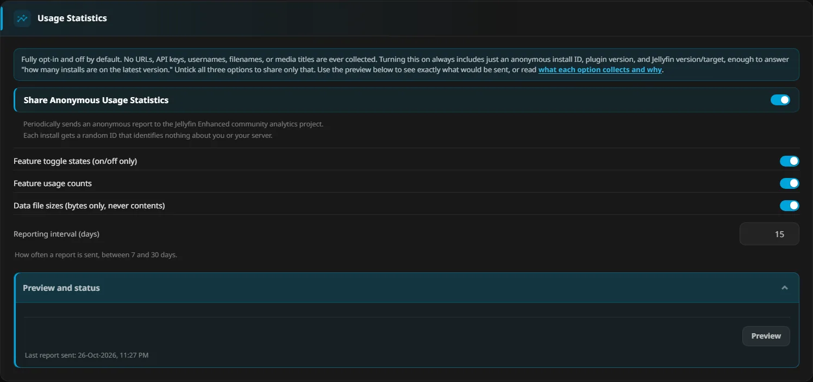

# Community Analytics Settings

Reporting is **opt-in and off by default**. These are the administrator controls; what is collected is listed in [What's collected](community-analytics.md), and aggregate results are in the [Live Dashboard](community-analytics-dashboard.md).

## Share usage statistics

[Admin > Usage Statistics](../open-in-jellyfin.md?tab=admin&card=usage-statistics){ .je-open }

Choose the categories you want to share, and use **Preview** to check the statistics before saving.

1. Turn on **Share Anonymous Usage Statistics** to show the category, interval, and **Preview** controls. Uncheck any categories you do not want to share.
2. Optionally click **Preview** to inspect your selections.
3. Save. JE queues the first reporting attempt automatically; you do not need to use **Preview** first.

The page shows the last successful report time, or tells you that no report has been sent yet.

Administrator settings:

| Setting | Default | What it does |
| --- | --- | --- |
| **Share Anonymous Usage Statistics** | Off | Enables server reporting to the community analytics service. |
| **Feature toggle states (on/off only)** | On | Shares on/off settings and selected text settings, despite the checkbox wording. |
| **Feature usage counts** | On | Shares action counts and current totals of stored entries. |
| **Data file sizes (bytes only, never contents)** | On | Shares the total size of the custom branding directory. |
| **Reporting interval (days)** | 15 | Sets how often reports are sent, within 7–30 days. |

??? note "Details"

    On first enablement, the interface checks all three categories. After you save your choices, later enables preserve them. The category defaults do not enable reporting while the master setting is off.

    If you uncheck all three categories, reports still include version information, installation credentials, the counting-period start date and build proof. See [Always included](community-analytics.md#always-included). The reporting interval is clamped to 7–30 days.

### What Preview shows

**Preview** lets you inspect the selected statistics without registering your installation or sending a report. It uses the category selections currently on screen, including unsaved changes.

*Previewing a report does not enable sharing.*

Other configuration values come from your saved server configuration. Counts and file sizes show the current state and may change before JE sends the report.

??? info "How it works"

    The preview route is administrator-only: `POST /JellyfinEnhanced/usage/preview`. Before registration, the install ID reads `(not registered yet; assigned on first real send)`.

    Preview shows readable property names. The actual report uses `p_*` field names and also sends the installation secret and a build-proof field, neither of which appears in Preview. The proof comes from the plugin assembly, installation ID and plugin version. It can be null if JE cannot read the assembly.

## Reporting, storage and opt-out

JE checks whether a report is due at startup and through the **Send Anonymous Usage Report** scheduled task. Turning reporting on and saving queues an immediate attempt.

To stop reporting:

1. Turn off **Share Anonymous Usage Statistics** and save.

!!! note "Opting out and remote history"

    For a registered installation, JE asks the service to exclude it from public views while keeping its history. Re-enabling reporting asks the service to include it again. Both effects depend on successful requests and the external service. Turning reporting off does not request remote deletion.

??? info "How it works"

    The server sends HTTPS requests to `https://cgsdfzfdoxunzoofzhgd.supabase.co`. Registration uses `/rest/v1/rpc/register_install`; reports use `/rest/v1/rpc/report_stats`.

    The scheduled task's default trigger is every 24 hours. It sends only when the configured interval has elapsed or the plugin version, Jellyfin version or build target has changed. Running the task manually uses the same check. Saving an off-to-on transition bypasses the check for its immediate attempt.

    Failed registration or reporting logs a warning, retains unsent counts and leaves the last-success timestamp unchanged. Repeated credential rejection can cause JE to clear its credentials and register again on the next attempt.

    Credentials, the last report projection and report state are saved in plugin configuration. Action counters are stored locally in `usage-counters.json`.

    Opting out queues a best-effort `/rest/v1/rpc/set_opted_out` request using the installation ID and secret. Re-enabling queues a report intended to clear that flag.

??? note "Details"

    Reports have no dedicated username, media-title or IP-address fields. They do use persistent installation credentials and selected text settings. This repository does not establish the remote service's retention policy or access-log practices. The dashboard shows aggregate results.

### Local Catch Up activity log

Catch Up has a separate local activity log for administrators. Its records are not included in installation analytics reports.

With **Enable Catch Up** and **Record Catch Up activity** enabled, the server records the user's username and ID, title and ID, action, time, reported success, and selected seasons where applicable. Only administrators can retrieve the log and summary through JE.

To stop future recording, turn off **Record Catch Up activity** and save.

Administrator settings:

| Setting | Default | What it does |
| --- | --- | --- |
| **Enable Catch Up** | Off | Enables the Catch Up page. |
| **Record Catch Up activity** | On | Records local activity when Catch Up is enabled. |

??? info "How it works"

    The server keeps `catchup-log.jsonl` and one rotated `catchup-log.1.jsonl` beside JE's shared data files. Rotation occurs at approximately 5 MiB per file.

See [Catch Up and Activity](../enhanced/enhanced-features.md) and [settings](../enhanced/enhanced-settings.md).
