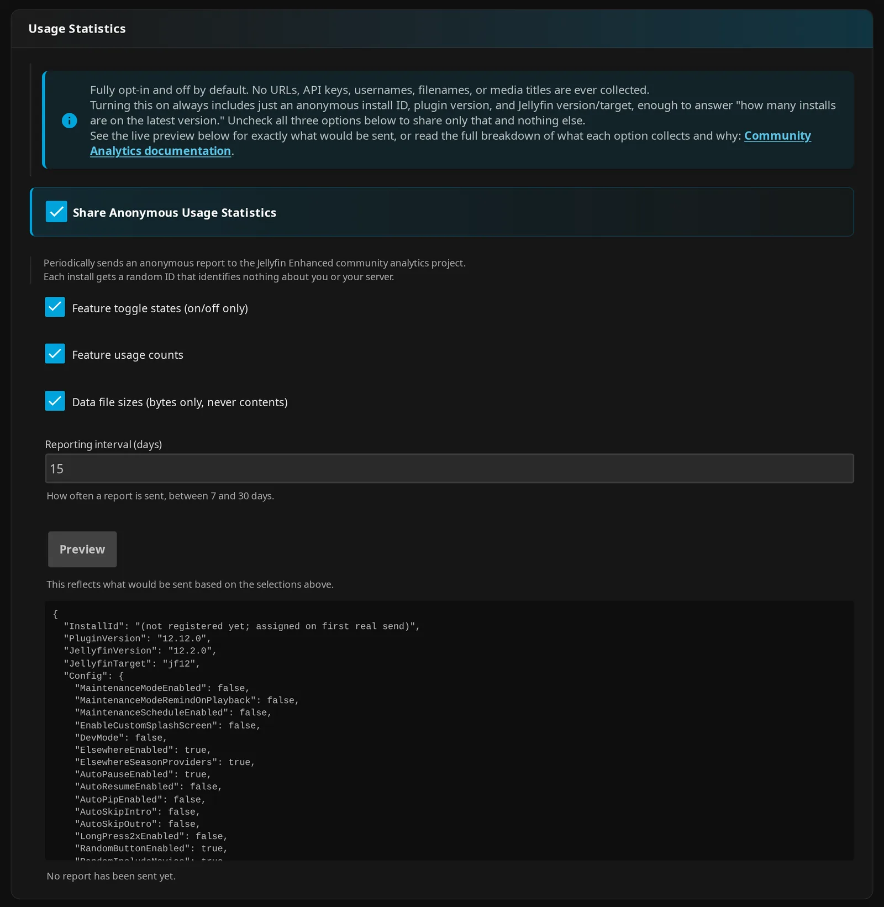

# Community Analytics

JE can share installation statistics to help you see how the community uses the plugin. Reporting is **opt-in and off by default**; an administrator must enable **Share Anonymous Usage Statistics** and save.

!!! note "About the dashboard"

    The dashboard reads aggregate results from public views. Visiting this page makes browser requests to the analytics service, Google Fonts and external tab-icon assets, even if your Jellyfin server has never enabled reporting. These requests are separate from installation reports.

    The figures show trends among installations that choose to report. They do not count all JE installations.

## How to use

Choose the categories you want to share, and use **Preview** to check the statistics before saving.

1. Open **Dashboard → Plugins → Jellyfin Enhanced → Admin → Usage Statistics**.
2. Turn on **Share Anonymous Usage Statistics** to show the category, interval, and **Preview** controls. Uncheck any categories you do not want to share.
3. Optionally click **Preview** to inspect your selections.
4. Save. JE queues the first reporting attempt automatically; you do not need to use **Preview** first.

The page shows the last successful report time, or tells you that no report has been sent yet.

Administrator settings:

| Setting | Default | What it does |
| --- | --- | --- |
| **Share Anonymous Usage Statistics** | Off | Enables server reporting to the community analytics service. |
| **Feature toggle states (on/off only)** | On | Shares on/off settings and selected text settings, despite the checkbox wording. |
| **Feature usage counts** | On | Shares action counts and current totals of stored entries. |
| **Data file sizes (bytes only, never contents)** | On | Shares the total size of the custom branding directory. |
| **Reporting interval (days)** | 15 | Sets how often reports are sent, within 7–30 days. |

??? note "Details"

    On first enablement, the interface checks all three categories. After you save your choices, later enables preserve them. The category defaults do not enable reporting while the master setting is off.

    If you uncheck all three categories, reports still include version information, installation credentials, the counting-period start date and build proof. See **Always included** below. The reporting interval is clamped to 7–30 days.

### What Preview shows

**Preview** lets you inspect the selected statistics without registering your installation or sending a report. It uses the category selections currently on screen, including unsaved changes.

*Previewing a report does not enable sharing.*

Other configuration values come from your saved server configuration. Counts and file sizes show the current state and may change before JE sends the report.

??? info "How it works"

    The preview route is administrator-only: `POST /JellyfinEnhanced/usage/preview`. Before registration, the install ID reads `(not registered yet; assigned on first real send)`.

    Preview shows readable property names. The actual report uses `p_*` field names and also sends the installation secret and a build-proof field, neither of which appears in Preview. The proof comes from the plugin assembly, installation ID and plugin version. It can be null if JE cannot read the assembly.

## What's collected

Every enabled report includes installation and version information. The three optional categories add settings, counts or branding-directory size.

### Always included

Every enabled report includes these fields, even if you uncheck all three categories:

- A persistent installation ID assigned by the reporting service.
- The plugin version, Jellyfin server version and build target.
- The start date of the counting period.
- The installation secret used to authenticate the report, and the build-proof field.

??? info "How it works"

    The build target is `jf10` or `jf12`. During registration, the service returns the installation ID and secret. JE stores them in its plugin configuration.

### Feature toggle states

This category shows which features participating servers use. It shares on/off settings, whether TMDB and MDBList keys are configured, and a selected set of text settings.

Select **Feature toggle states (on/off only)** before saving to include this category.

??? info "How it works"

    Boolean settings are included except properties beginning with `Analytics` and properties marked `[AnalyticsExclude]`. `TmdbEnabled` and `MdblistEnabled` indicate whether keys are configured; the keys themselves are not sent.

    The selected text settings are:

    | Choice | Reported property and filtering |
    | --- | --- |
    | Icon style | `IconStyle` |
    | Maintenance actions and affected users | `MaintenanceModeAction`, `MaintenanceScheduleAction` and `MaintenanceModeAffectedUsers`. The user scope is reduced to `all` or `selected`, without selected user IDs. |
    | Tag positions | `QualityTagsPosition`, `GenreTagsPosition`, `LanguageTagsPosition`, `RatingTagsPosition`, `AgeRatingTagsPosition` |
    | Tag styling | `TagStyleTarget`, `TagStylePreset`, `TagStyleApplyScope` |
    | Language priority | `LanguageTagsPriority`, filtered to tokens shaped like language codes and converted to lowercase |
    | Additional Native Poster Tags client exclusions | `NativePosterTagsWebClientNames`, filtered to short app-name-shaped entries, deduplicated and limited to 20. Built-in web clients are omitted. |

    Nonempty strings marked `[AnalyticsInclude]` are included as stored. Other strings are excluded unless the reporting code explicitly derives and filters them. Checking the shape of language/client strings does not guarantee what the entered text means.

    The report does not include configured service URLs, media-service API keys, branding text or image contents.

### Feature usage counts

This category shares counts of Seerr requests and qualifying home-row removal events, plus totals of stored entries. It sends counts rather than titles, review contents or user records.

Select **Feature usage counts** before saving to include this category.

Current totals cover:

- Bookmarks across user files.
- Hidden-content entries, including home-row suppression entries.
- Direct Spoiler Guard series, movie and collection entries; pending protection intents are excluded.
- Reviews in the shared review store.

These totals count entries. The same title can contribute entries for several users, so the totals do not count unique titles or users.

??? info "How it works"

    Action counters record:

    | Counter | Meaning |
    | --- | --- |
    | `seerr.request_submitted` | Submitted Seerr requests recorded by the client. |
    | `continue_watching.auto_removed` | Playback-start events that clear or demote qualifying home-row removals while the Remove Continue Watching feature is enabled. Counts events, not individual entries removed. |

    Actions count only while reporting **and** the usage-count category are enabled. JE does not reconstruct earlier activity. Each off-to-on reporting transition clears counters at the point you enable reporting.

    Every successful report advances the counting period and subtracts the captured counter snapshot. This also happens when **Feature usage counts** is unchecked and those earlier counts were omitted from the report. Increments during transmission carry forward. Failed attempts do not subtract the captured counts.

### Data file sizes

This category shares the total size of your custom branding directory, without file names or contents. It does not include other plugin data-file sizes.

Select **Data file sizes (bytes only, never contents)** before saving to include this category.

??? info "How it works"

    The report uses the key `custom_branding`. It sends the total bytes in the branding directory, or zero if the directory is absent, empty or unreadable.

## Reporting, storage and opt-out

JE checks whether a report is due at startup and through the **Send Anonymous Usage Report** scheduled task. Turning reporting on and saving queues an immediate attempt.

To stop reporting:

1. Open **Admin → Usage Statistics** in the plugin configuration.
2. Turn off **Share Anonymous Usage Statistics** and save.

!!! note "Opting out and remote history"

    For a registered installation, JE asks the service to exclude it from public views while keeping its history. Re-enabling reporting asks the service to include it again. Both effects depend on successful requests and the external service. Turning reporting off does not request remote deletion.

??? info "How it works"

    The server sends HTTPS requests to `https://cgsdfzfdoxunzoofzhgd.supabase.co`. Registration uses `/rest/v1/rpc/register_install`; reports use `/rest/v1/rpc/report_stats`.

    The scheduled task's default trigger is every 24 hours. It sends only when the configured interval has elapsed or the plugin version, Jellyfin version or build target has changed. Running the task manually uses the same check. Saving an off-to-on transition bypasses the check for its immediate attempt.

    Failed registration or reporting logs a warning, retains unsent counts and leaves the last-success timestamp unchanged. Repeated credential rejection can cause JE to clear its credentials and register again on the next attempt.

    Credentials, the last report projection and report state are saved in plugin configuration. Action counters are stored locally in `usage-counters.json`.

    Opting out queues a best-effort `/rest/v1/rpc/set_opted_out` request using the installation ID and secret. Re-enabling queues a report intended to clear that flag.

??? note "Details"

    Reports have no dedicated username, media-title or IP-address fields. They do use persistent installation credentials and selected text settings. This repository does not establish the remote service's retention policy or access-log practices. The dashboard shows aggregate results.

### Local Catch Up activity log

Catch Up has a separate local activity log for administrators. Its records are not included in installation analytics reports.

With **Enable Catch Up** and **Record Catch Up activity** enabled, the server records the user's username and ID, title and ID, action, time, reported success, and selected seasons where applicable. Only administrators can retrieve the log and summary through JE.

To stop future recording, turn off **Record Catch Up activity** and save.

Administrator settings:

| Setting | Default | What it does |
| --- | --- | --- |
| **Enable Catch Up** | Off | Enables the Catch Up page. |
| **Record Catch Up activity** | On | Records local activity when Catch Up is enabled. |

??? info "How it works"

    The server keeps `catchup-log.jsonl` and one rotated `catchup-log.1.jsonl` beside JE's shared data files. Rotation occurs at approximately 5 MiB per file.

See [Catch Up and Activity](../enhanced/enhanced-features.md) and [settings](../enhanced/enhanced-settings.md).

## Live Dashboard

Browse aggregate results from participating installations. Usage covers the last 45 days; totals show current stored entries.

1. Use the facet buttons to select a settings tab.
2. Type to filter a table.
3. Click a column heading to sort; click it again to reverse the order.

Data reloads when you arrive on the page or refresh your browser. A version warning means the build target does not match the Jellyfin major version.

??? note "Details"

    **Feature Toggle Adoption** lists settings present in reporting data. New or unreported settings may be absent; it is not a complete configuration catalog.

    Labels and defaults come from the generated settings map. Unknown labels use readable versions of property names, and unknown groups use Other.

    Queries have these limits:

    | Data | Limit |
    | --- | --- |
    | Versions | Up to 500 rows fetched; the largest 50 fetched groups appear in the version table |
    | Usage | 20 rows |
    | Current totals | 24 rows |
    | Feature flags | 500 rows |
    | Setting values | 500 rows |

    Settings percentages use the fetched value rows for each setting. These limits can further reduce the sample.

Loading live data…

### Installs & Versions

### Current Totals

Across reporting installs

### Feature Usage

Last 45 days

### Feature Toggle Adoption

### Settings Distribution

