# *arr Features

Connect Sonarr and Radarr for item links, metadata tags, upcoming releases, and download monitoring. Bazarr adds subtitle-management links; Shoko adds anime events to **Calendar**.

## Features

!!! note "Who can use these features"
    Service links are available to Jellyfin administrators. Signed-in viewers can use tag links and enabled **Calendar** and **Requests** pages. What they see depends on library access, request ownership, section settings, and Seerr permissions.

Configure connections under **Jellyfin Enhanced** → **\*arr**. Configure the pages under **Pages**. See [*arr settings](arr-settings.md) for every control and its default, or [troubleshooting](troubleshooting-support.md) if results are missing.

## ARR Links

Open a movie or series in Sonarr, Radarr, or Bazarr from its Jellyfin detail page. Sonarr and Radarr links appear only for servers that contain the title.

### Setup

1. Open **Jellyfin Enhanced** → **\*arr**.
2. Use **+ Add Sonarr instance** or **+ Add Radarr instance** and enter **URL** and **API Key**. The URL must be reachable from the Jellyfin server.
3. Optionally enter **Bazarr URL**.
4. Turn on **Enable \*arr Links on Detail Pages** and choose the link presentation below.
5. Click **Save Settings**, then reload the Jellyfin web client.

### Usage

1. Sign in as an administrator and open a movie or series detail page.
2. Look beside the TMDB external link.
3. Click a service icon, text link, or dropdown entry to open a new browser tab.

With **Show links as text** and **Show status badge for single-instance** on, a Sonarr link shows downloaded/total episode counts and a colored status border.

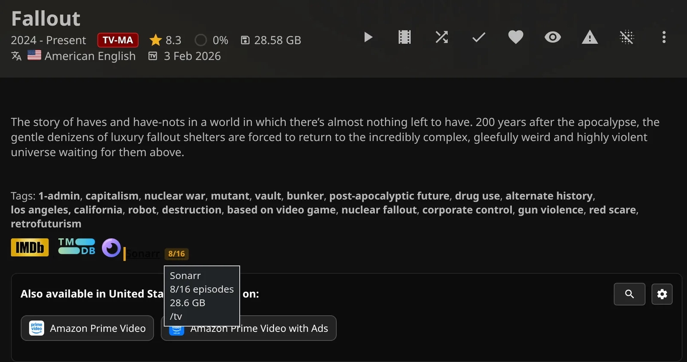

!!! note "Detail-page requirements"
    The detail page must show a TMDB link. These service links do not appear on individual season or episode pages. Bazarr opens the series or movies overview rather than the specific title.

### Link settings

These are admin (server) settings:

| Setting | Default | What it does |
|---|---|---|
| **Enable \*arr Links on Detail Pages** | Off | Adds administrator-only service links. |
| **Show links as text** | Off | Uses text labels instead of icons. |
| **Show status badge for single-instance** | Off | Adds status styling to one matching instance; visible badges also require text mode. |

!!! note "Metadata icons override text links"
    **Enable Metadata Icons (Druidblack)** under **Extras** forces service links into icon mode. It overrides **Show links as text**.

??? info "Title matching and request-card links"
    Sonarr also requires a TVDB provider ID; Radarr uses the movie's TMDB ID. Bazarr opens `/series/` or `/movies/`.

    Administrators can also get **Open in Sonarr** and **Open in Radarr** icons on Seerr request cards when **Enable \*arr Links on Detail Pages** is on. Movie cards require TMDB; TV cards require both TMDB and TVDB. These use the first matching instance, with no dropdown or Bazarr link. See [Seerr features](../seerr/seerr-features.md) for request-card actions and **View on Seerr**.

    Shoko's **Open in Shoko** link is on anime Calendar events; see [Anime Calendar Events (Shoko)](#anime-calendar-events-shoko).

### Multi-Instance Support

Add separate servers (instances) for TV, anime, HD, or 4K libraries. Give them distinct names so you can tell them apart. Each has its own connection and browser URL mappings.

1. Add an instance under **Sonarr** or **Radarr**.
2. Give it a distinct name.
3. Click **Save Settings**.

Use the checkbox in a card's summary to enable or disable that instance. Click **Save Settings** after changing the checkbox, adding a card, or confirming **Remove**.

With one matching instance, you get a direct link. With multiple matches, click the service button to open a dropdown containing instance names, download status, and available sizes. Sonarr includes episode-file counts.

| Color | Meaning |
|---|---|
| Green | Sonarr's reported episode-file total is complete, or Radarr has a movie file. |
| Amber | Sonarr has some episode files, but fewer than its reported episode total. |
| Gray | The title exists in the instance, but reports no downloaded episode files or movie file. Missing Sonarr statistics also use this color. |

Instances without the title are omitted. For one match, turn on both **Show status badge for single-instance** and **Show links as text** to see the episode count or **Downloaded**/**Missing** badge.

??? info "Instance names, disabled connections, and status details"
    Names appear in links, Calendar badges, and tooltips on source icons for ordinary download cards. Grouped **Season** cards show only **Sonarr**.

    Disabled instances keep their credentials. JE skips them for lookups, Calendar, queue/history retrieval, and tag sync.

    If Sonarr reports no statistics, the badge reads `0/0` with gray status. Icon-mode tooltips retain available status details.

### URL Mappings

Use mappings when the server connects to an internal service address but your browser needs a public address. The left side is the Jellyfin address used by the client; the right side is the service address to open.

1. Open that instance's **URL Mappings (optional)**.
2. Enter one pair per line, as in the example below.
3. Use **Validate Mappings** to check URL syntax and that the two addresses differ.

```text
https://jellyfin.example.com|https://sonarr.example.com
http://192.168.1.10:8096|http://192.168.1.20:8989
```

??? info "How mappings are matched"
    Matching ignores case and trailing slashes, but otherwise compares the full Jellyfin server address, including its base path. The first matching pair wins. If none matches, the browser link uses the instance's **URL**. Each instance's mappings are independent; they do not inherit a global mapping.

    Bazarr and Shoko have their own mapping fields with the same format.

!!! note "Keep the server connection address"
    Mappings change browser links only. Keep **URL** reachable from Jellyfin, especially when the public address requires an interactive proxy login. **Validate Mappings** does not test connectivity or API authentication.

### Legacy Single-Instance Fields

Keep a configuration backup if you may need to restore an earlier setup.

??? info "Compatibility and recovery"
    An explicitly empty instance list can fall back to the legacy connection fields. Saving cards copies the first complete card into the legacy URL, API key, and mappings, even if that card is disabled. Removing all cards and saving clears the legacy fields.

    An unreadable instance list does not fall back to legacy fields; see [instance recovery](troubleshooting-support.md#connection-errors-and-instance-recovery).

## ARR Tags

Copy Sonarr and Radarr tags into Jellyfin metadata, then display them as clickable links on detail pages. Clicking a tag opens Jellyfin's list of items carrying that full prefixed tag.

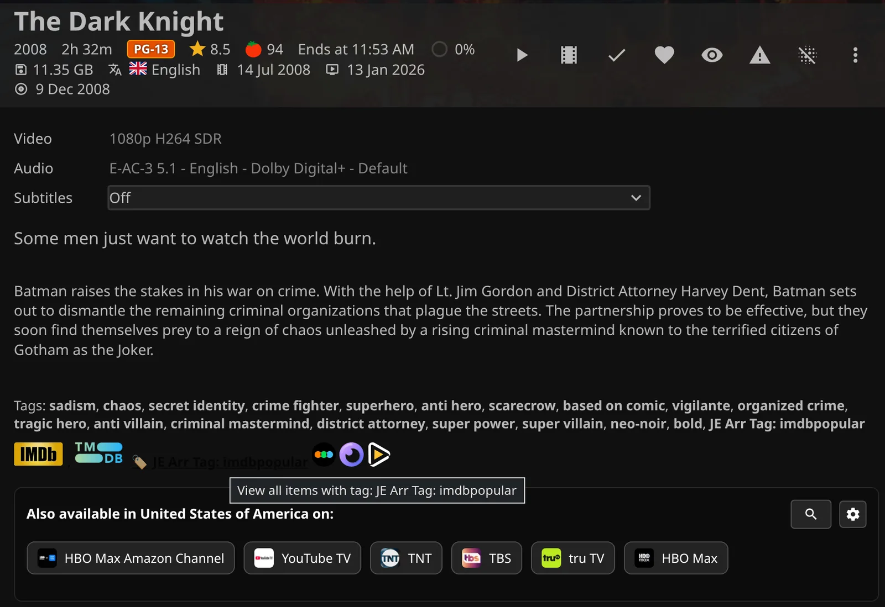

### Setup

1. Configure at least one complete, enabled Sonarr or Radarr instance under **\*arr**.
2. In **Tags Sync**, turn on **Enable Tags Sync**, choose a nonempty **Tag Prefix**, and review cleanup and filters.
3. Click **Save Settings**.
4. Open Jellyfin's **Scheduled Tasks** and run **Sync Tags from \*arr to Jellyfin**, in the **Jellyfin Enhanced** category.
5. Add a task trigger if you want recurring synchronization, then reload item pages to see the updated tags.

!!! note "Run or schedule the task yourself"
    Saving does not run the task, and it has no default triggers. Tag sync does not require **Enable \*arr Links on Detail Pages**.

### Tag Settings

These are admin (server) settings:

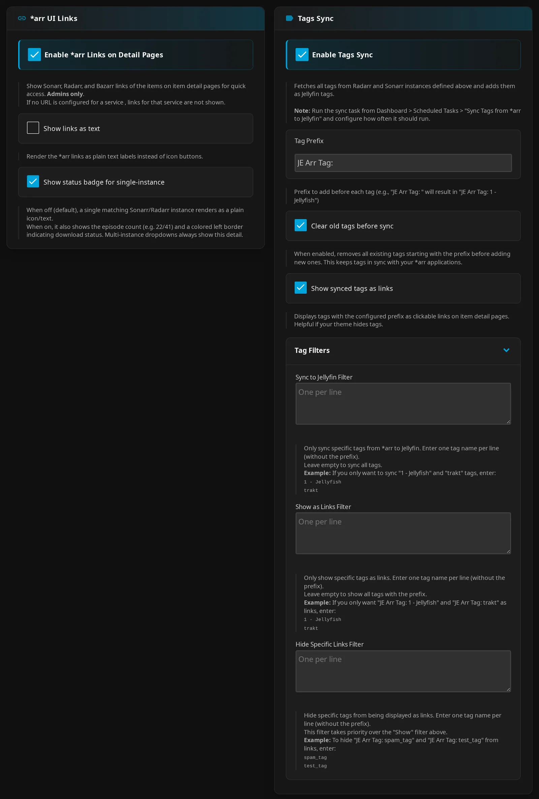

| Setting | Default | What it does |
|---|---|---|
| **Enable Tags Sync** | Off | Allows the scheduled task to update metadata. |
| **Tag Prefix** | `JE Arr Tag: ` | Prepends this text to each source tag, including the trailing space. |
| **Clear old tags before sync** | On | Removes metadata tags starting with the current prefix before adding replacements. |
| **Show synced tags as links** | On | Shows existing matching metadata tags as detail-page links for viewers. |

??? info "How tags are matched"
    Radarr matches movies by TMDB ID; Sonarr tag sync matches series by IMDb ID. Sync updates movies and series in your library, excluding virtual placeholders, combines tags from enabled instances, and avoids duplicates regardless of letter case. Bazarr and Shoko do not supply tags.

!!! warning "Cleanup can remove tags without replacements"
    **Clear old tags before sync** also affects unmatched items and runs where upstream tag results are empty or failed. Check connectivity before running cleanup. Turning cleanup off preserves stale tags; changing **Tag Prefix** leaves tags bearing the previous prefix in place.

??? note "Prefix behavior"
    Keep **Tag Prefix** nonempty and its spelling/case consistent. The factory default is `JE Arr Tag: `, but settings replace a blank value with `Requested by: `. When the prefix is blank, displayed tag links use `JE Arr Tag: `; sync uses `Requested by: ` only if the stored prefix is unset, rather than empty. Links require matching prefix capitalization; cleanup ignores capitalization.

### Tag Filtering

Choose which tags to sync or show as links. Link filters change what you see without changing stored metadata.

1. Open **Tag Filters** under **Tags Sync**.
2. Enter source tag names without the prefix. Matching is exact and ignores letter case.
3. Use commas or semicolons for **Sync to Jellyfin Filter**, and one name per line for the two link filters.

| Setting | Default | What it does |
|---|---|---|
| **Sync to Jellyfin Filter** | Empty | Limits metadata writes to listed tags; empty syncs all source tags. Use commas or semicolons. |
| **Show as Links Filter** | Empty | Limits clickable links to listed tags; empty allows all tags with the prefix. Use one name per line. |
| **Hide Specific Links Filter** | Empty | Hides listed tag links and takes priority over the show filter. Use one name per line. |

For **Sync to Jellyfin Filter**, use:

```text
in-netflix,in-disney,4k-upgrade
```

!!! warning "Use commas or semicolons for the sync filter"
    The form says one per line, but putting each name on a new line does not work for **Sync to Jellyfin Filter**.

For **Show as Links Filter**, use:

```text
in-netflix
in-disney
4k-upgrade
```

For **Hide Specific Links Filter**, use:

```text
internal-tag
do-not-show
```

??? info "Existing metadata tags"
    Existing prefixed tags can appear as links without enabling sync or running another task. The visible link text includes the prefix.

### Custom Styling

Use custom CSS to rename a visible tag label, hide a link, or change its color. The examples below show the supported hooks.

??? info "CSS hooks and examples"
    Tag links expose `.arr-tag-link`, `.arr-tag-link-text`, and `.arr-tag-link-icon`, plus `data-tag` (full tag), `data-tag-name` (unprefixed name), `data-tag-prefix`, and `data-id` (slugified name).

    Rename a visible label:

    ```css
    .itemExternalLinks a.arr-tag-link[data-tag-name="1 - n00bcodr"] .arr-tag-link-text {
      display: none !important;
    }
    .itemExternalLinks a.arr-tag-link[data-tag-name="1 - n00bcodr"]::after {
      content: " N00bCodr";
    }
    ```

    Hide a link or give it a service color:

    ```css
    .itemExternalLinks a.arr-tag-link[data-id="internal-tag"] {
      display: none !important;
    }
    .itemExternalLinks a.arr-tag-link[data-id="in-netflix"] {
      background: #d81f26;
      color: #fff;
    }
    ```

    See [CSS customization](../advanced/css-customization.md) for more recipes.

## Calendar Page

See upcoming episodes and cinema, digital, and physical movie releases in one Calendar. Enabled Sonarr and Radarr instances and a configured Shoko server supply events independently.

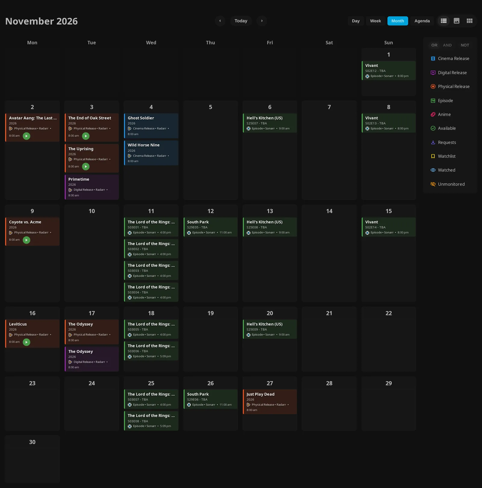
*This example uses **Month** with Monday first; the default view is **Agenda**.*

**Agenda** lists releases by date across a 30-day range. Use **Today** to start the range at the current date.

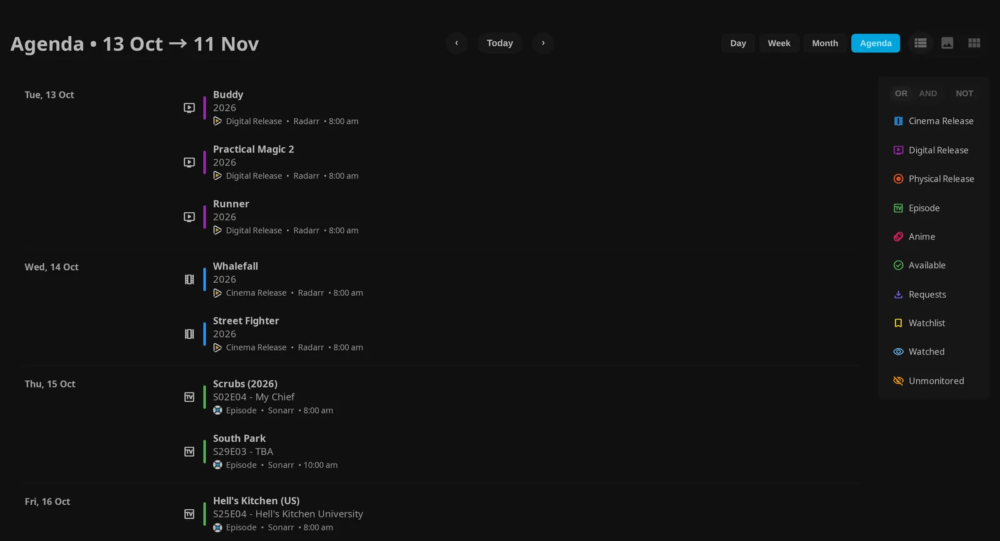

### Setup

1. Configure an enabled Sonarr or Radarr instance, or enter **Shoko URL** and **Shoko API Key**, under **\*arr**.
2. Open **Pages** → **Calendar Page** and turn on **Enable Calendar Page**.
3. Choose a navigation mode, then click **Save Settings** and reload the web client.

!!! note "Calendar data needs no companion plugin"
    Calendar data does not require **Enable \*arr Links on Detail Pages** or a companion plugin. Placement through Plugin Pages or Custom Tabs requires the corresponding plugin.

??? info "Navigation and plugin requirements"
    By default, JE adds **Calendar** where its navigation section is available. With placement modes off, you can also open `/web/index.html#/calendar`, prefixed by your Jellyfin base path.

    For a Home tab, enable **Add Calendar as a native Home tab**; this requires no companion plugin. Alternatively use **Use Plugin Pages** or **Use Custom Tabs** with the corresponding installed plugin. Native and Custom Tabs modes cannot both be enabled for Calendar. Use the generated navigation link rather than a fixed Home tab index. On Jellyfin 12's experimental layout, header access can open a tab whose tab-strip button is hidden.

    Plugin Pages 3.0+ supports live registration on save; older versions or a failed live update need a server restart. When a detected Plugin Pages integration is selected, use its page entry instead of the standalone URL. Entry locations depend on layout and viewport; the Modern Layout sidebar is mobile-only. See [JE pages and tabs](../getting-started/pages-and-tabs.md) for placement instructions.

### Usage

1. Open **Calendar** from your configured entry point.
2. Choose **Day**, **Week**, **Month**, or **Agenda**.
3. Use the previous/next arrows to move by a day, week, month, or 30-day Agenda period. Click **Today** to return to the current date.
4. Click legend chips to filter events. On phones, expand the initially collapsed filter panel to see the legend.

**Week** shows seven days of releases. Use the previous/next arrows to move one week at a time.

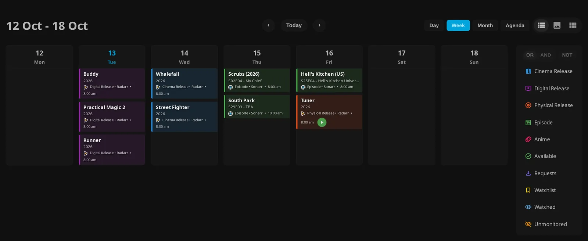

For one date, choose **Day** and use the previous/next arrows to change dates. In **List** and **Backdrop** presentation, timed releases are grouped by hour.

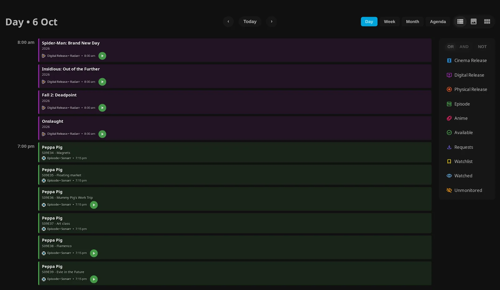

Choose **List**, **Backdrop**, or **Cards** to change presentation in **Day**, **Week**, or **Month**. These controls are disabled in **Agenda**.

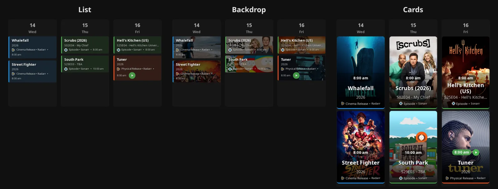

Colors represent **Cinema Release**, **Digital Release**, **Physical Release**, **Episode**, and **Anime**. Badges identify service/instance names. There is no source-service selector or text search.

Click legend chips to select release categories or **Available**, plus **Requests** when Seerr is enabled. **Watchlist** and **Watched** appear when their highlight settings are on. With no selected chips, all otherwise eligible monitored events appear.

<figure class="je-video">
  <video autoplay loop muted playsinline controls preload="metadata" aria-label="Switching calendar views and filtering release events">
    <source src="../../images/arr/calendar-view-flow.mp4" type="video/mp4">
  </video>
  <figcaption>Switch from Month to Week to Agenda, then select and clear the Episode filter.</figcaption>
</figure>

Event times use your browser's local timezone. Click a series event to open the matching series in Jellyfin. A movie event needs a file in Radarr before you can open it. The **Available** arrow and available time labels open episode or movie details without starting playback.

Your controls have personal defaults, saved through Calendar itself:

| Setting | Default | What it does |
|---|---|---|
| **Day** / **Week** / **Month** / **Agenda** | **Agenda** | Chooses the view and saves it in your personal settings; Agenda covers 30 days. |
| **List** / **Backdrop** / **Cards** | **List** | Chooses presentation and saves it in your personal settings; disabled in Agenda. |
| **Unmonitored** | Off | Includes otherwise excluded unmonitored events; saved per user in this browser's local storage. |

??? info "Combine Calendar filters"

    - **OR** matches any selected chip; **AND** requires every selected chip. These controls need at least two selected chips.
    - **NOT** inverts the combined match and needs at least one selected chip.
    - **Unmonitored** is a separate inclusion toggle. **NOT** does not override it, library access, or forced requested-only filtering.

    For example, select **Episode** and **Available**, then **AND** to show available episodes. Selecting mutually exclusive release categories with **AND** can yield no events. Your selected filter chips are not saved as personal preferences.

??? info "Event availability and duplicate releases"
    Time labels have different styles for upcoming unavailable events, past unavailable events, and those at least 24 hours late. Available files have their own styling. A source file may exist before Jellyfin has scanned or matched it, so clicking may do nothing yet.

    Duplicate Sonarr events merge by TVDB ID, season, episode, and UTC date; Radarr events merge by TMDB ID, release category, and UTC date. Titles are the fallback when provider IDs are missing. JE prefers an accessible match, then one with a file, and retains distinct instance names in the badge. Cinema/digital/physical releases stay separate, as do Shoko events from Sonarr events.

### Calendar Settings

These are admin (server) settings; users cannot override them as personal defaults:

| Setting | Default | What it does |
|---|---|---|
| **First Day of Week** | **Monday** | Chooses any of the seven weekdays for the grid. |
| **Time Format** | **5pm/5:30pm** | Selects 12-hour or **17:00/17:30** 24-hour formatting. |
| **Highlight Favorites/Watchlist** | Off | Adds watchlist indicators and a **Watchlist** filter. |
| **Highlight Watched Series** | Off | Adds watched indicators and a **Watched** filter for the matched played/started episode or movie. |
| **Filter by Library Access** | On | Filters releases by your library access; access checks for titles not yet in Jellyfin may be incomplete. |
| **Show Requested Only (Default)** | Off | Initially selects **Requests**; you can change filters. |
| **Force Only Requested Items** | Off | Always limits the displayed Calendar to your requested titles and hides the **Requests** chip. |

To show watchlisted episodes on a phone, expand the filter panel, select **Episode** and **Watchlist**, then choose **AND**. The **Watchlist** chip requires **Highlight Favorites/Watchlist**.

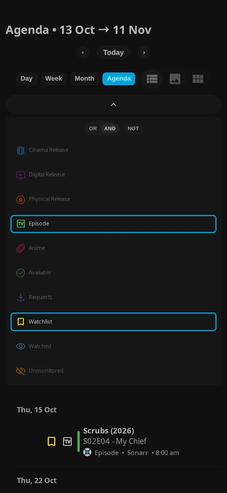

??? info "Highlighting, library access, and requested-only limits"
    Watchlist highlighting uses Jellyfin's like (Likes) flag, not the favorite (heart) flag. Under **Seerr**, **Add requested media to Watchlist** and **Sync Seerr Watchlist → Jellyfin** set this flag for matching library items; see [Seerr settings](../seerr/seerr-settings.md). Watching another episode of a series does not mark an upcoming episode watched.

    Library filtering infers unmatched-title access from matched Calendar events sharing an upstream root folder. Unknown roots remain visible; unmatched Shoko events have no root folder for this inference. Turning the option off broadens Calendar results without granting playback access.

    Requested-only modes need Seerr request data for your linked account, matched by media type and TMDB ID. Missing request data can leave an empty Calendar; Shoko events lack TMDB IDs and are excluded. These options only change what you see in Calendar; they do not restrict access to Calendar data from the server.

### Anime Calendar Events (Shoko)

Shoko adds pink **Anime** events from its server collection. Use it to include anime in Calendar.

1. Configure the one supported Shoko connection under **\*arr** → **Shoko**.
2. Enable Calendar under **Pages**.
3. Under **Episode Types to Show on Calendar**, enable the types you want.

| Setting | Default | What it does |
|---|---|---|
| **Episodes** | On | Includes regular episodes. |
| **Specials** | Off | Includes specials. |
| **Credits (OP/ED)** | Off | Includes opening/ending credits. |
| **Trailers** | Off | Includes trailers. |
| **Parodies** | Off | Includes parodies. |
| **Other** | Off | Includes other episode types. |

??? info "Anime event limits, matching, and air dates"
    With all six off, no anime events appear. Missing and restricted Shoko content is excluded; selecting episode types does not include restricted content.

    Jellyfin matches use the `Shoko Series` and `Shoko Episode` provider IDs, normally supplied by Shokofin. Matched events can use Jellyfin poster artwork. Unmatched events may lack artwork and cannot open a matched Jellyfin detail page, but administrators can use **Open in Shoko** on the source icon when a Shoko series ID and URL are available. This opens `/webui/collection/series/<id>` using **Shoko URL** and **Shoko URL Mappings**. These connection details and links are available only to administrators.

    A Shoko event is **Available** when Shoko reports an episode file. Shoko air dates are converted to your browser's local time, so depending on your timezone an event can show a time or appear on the previous day.

## Downloads Page

Downloads are part of the shared **Requests** page, alongside Seerr **Requests**, optional **Issues**, and **History**. Sonarr and Radarr provide queue/history data; see [Seerr features](../seerr/seerr-features.md) for request lists, request actions, issues, and request statuses such as **Coming Soon** and **Orphaned**.

### Setup

1. Configure complete, enabled Sonarr/Radarr instances under **\*arr**.
2. Open **Pages** → **Requests Page** and turn on **Enable Requests Page**.
3. Keep **Show Downloads in Requests Page** on and review ownership and History controls below.
4. Choose standalone, native Home tab, Plugin Pages, or Custom Tabs placement, then click **Save Settings** and reload.

??? info "Placement and connection requirements"
    With placement modes off, open **Requests** from JE navigation or `/web/index.html#/downloads`, including any Jellyfin base path. **Add Requests as a native Home tab** needs no companion plugin. **Use Plugin Pages for Requests** and **Use Custom Tabs for Requests** require their respective plugins. Native and Custom Tabs modes are mutually exclusive for Requests; Plugin Pages live registration/restart rules are the same as Calendar. See [JE pages and tabs](../getting-started/pages-and-tabs.md).

    **Enable \*arr Links on Detail Pages** is not required for queue/history data. Seerr is optional for administrator queue monitoring, but default viewer ownership filtering needs enabled/configured Seerr and a linked account. Configure the Seerr connection under **Seerr**; it does not create a second Requests page.

### Features

Download cards show title, progress, downloaded/total size, ETA where available, and status. Use them to follow a transfer through to import.

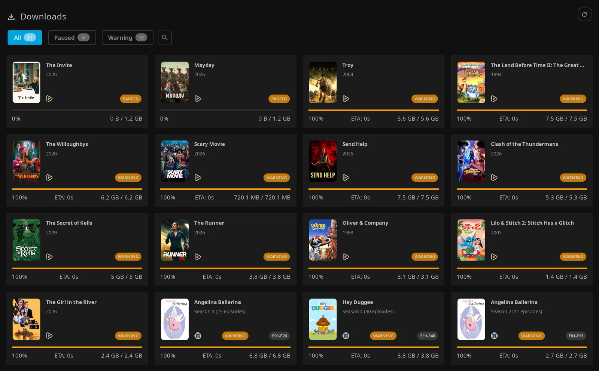

**How to use**

1. Open **Requests** from your configured entry point.
2. Check the cards under **Downloads**.
3. When multiple statuses are present, use the status tabs or **All**. Click the search icon to search title, subtitle, and instance name; matching ignores letter case. The search toggle appears only in this multiple-status layout.

Statuses include **Downloading**, **Queued**, **Paused**, **Importing**, **Completed**, **Warning**, **Failed**, and **Unknown**.

### Downloads settings

Admin (server) section and refresh settings:

| Setting | Default | What it does |
|---|---|---|
| **Enable Requests Page** | Off | Enables the shared page. |
| **Show Downloads in Requests Page** | On | Shows the queue; turning it off also hides History in the page. |
| **Filter Downloads by User Requests** | On | Restricts non-admin queue/history results to titles they requested through Seerr. |
| **Show Seerr Issues Section** | Off | Adds Seerr issues when Seerr is enabled. |
| **Show Download History Section** | On | Shows recently imported/failed downloads. |
| **Restrict Download History to Admins** | Off | Enforces administrator-only History access on the server. |
| **Enable Auto-Refresh** | On | Refreshes enabled sections. See [Refresh behavior](#refresh-behavior). |
| **Poll Interval (seconds)** | 30 | Sets the refresh interval; the form accepts 30–300 seconds. |

??? info "Card details, status priority, and queue limits"
    Hover the source icon on an ordinary card to see the instance name. Grouped **Season** cards show only **Sonarr**. Cards do not show quality.

    An upstream tracked warning takes priority. Tracked import/failure states override transfer status. A completed transfer can still be importing or require intervention before Jellyfin can show it.

    Three or more Sonarr entries sharing title, season, progress, and instance name collapse into a **Season** card. Grouped entries may still be separate downloads. Sizes are counted once only if every grouped entry has identical total and remaining sizes; otherwise they are summed. JE reads one queue page of up to 1,000 records per instance.

### Download History

History shows recent import results so you can check what reached your library. Cards show source/instance, title, relative time, and **Imported**, **Import Failed**, or **Partially Imported**.

1. Open **History** below the other sections.
2. Use its pagination to browse recent results; History has no search control.

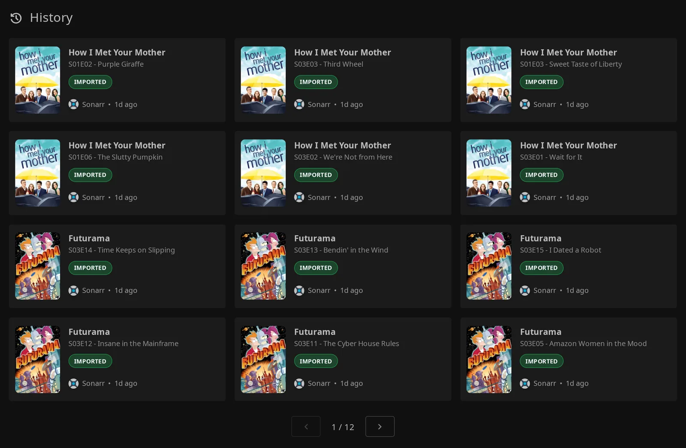

Mixed Sonarr groups include imported/total counts.

??? info "History limits"
    JE reads the latest 200 history records per enabled instance, keeps import/failure records, groups Sonarr records by download ID, and retains at most 200 merged cards before viewer filtering. Pagination covers this bounded pool, not the complete upstream archive. Other history events, such as grabs, renames, and deletions, are omitted. History errors appear in server logs rather than the named instance errors shown for the queue.

### Who sees downloads

Administrators see downloads without request-ownership filtering. With **Filter Downloads by User Requests** on, other viewers see titles they requested through Seerr.

??? info "How request ownership is matched"
    Titles match by TMDB ID and media type. This is title-level filtering, not downloader ownership. Missing Seerr configuration, an unlinked account, no requests, or queue/history entries lacking usable TMDB IDs can yield no results.

!!! warning "Turning off ownership filtering shares download titles"
    Turning off **Filter Downloads by User Requests** exposes other users' queue/history titles to signed-in viewers, subject to the independent administrator-only History option.

Seerr request-list and issue permissions remain separate. For differences caused by hidden items, see [Hidden Content filtering](troubleshooting-support.md#hidden-content-filtering).

### Refresh behavior

Requests loads data when you open it, even with auto-refresh off. Use the refresh icon beside **Downloads** to reload all enabled sections.

??? info "Polling and caching"
    Polling stops when you leave the standalone page or switch away from its native Home or Custom Tabs tab. With Plugin Pages, it can keep refreshing after you navigate away, until you reload or close the browser page. Hidden browser tabs are always skipped.

    Queue and History use separate shared server caches. Their lifetime follows the configured poll interval, clamped internally to 5–300 seconds; even a manual refresh may return cached data.

If a transfer has finished but the item is missing from Jellyfin, check upstream import and library scanning. Reaching 100% progress does not mean the item is available in your library.
