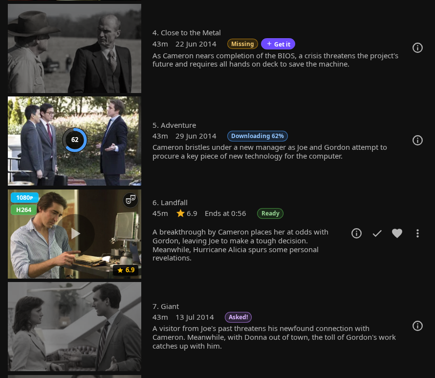
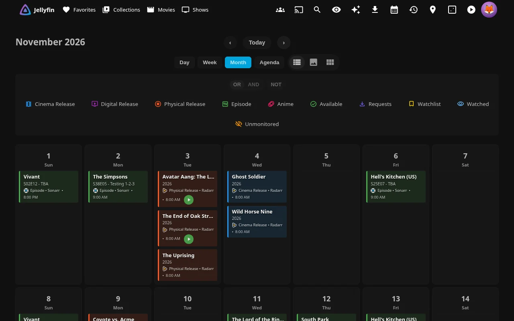
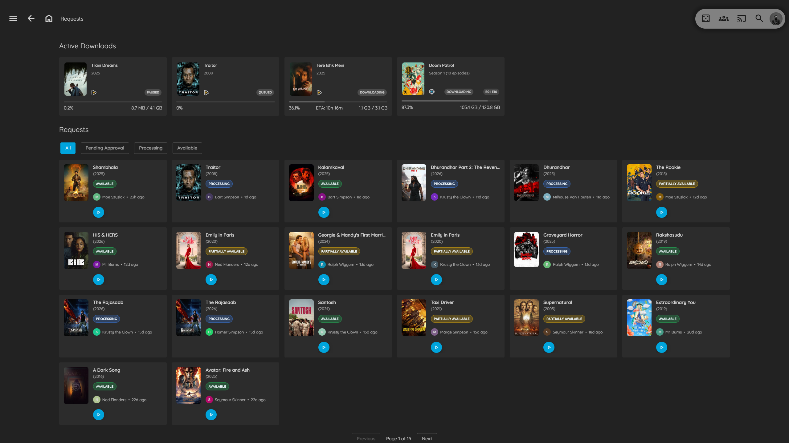

# ARR Integration

Quick access to Sonarr, Radarr, and Bazarr from Jellyfin, plus calendar and download monitoring.

!!! success "Note"

    ***arr links are only visible to admin users**

    **Other features are visible to all users.**


!!! warning


    **Security Considerations:**

    - **API Keys** are stored securely on server
    - **Network Access** - Ensure *arr instances are secure
    - **HTTPS** - Use HTTPS for remote access

## Features

The ARR integration provides convenient links to your Sonarr, Radarr, and Bazarr instances directly from Jellyfin item pages. Additionally, it can display *arr tags as clickable links and provide calendar and download monitoring pages.

- **Quick Links** - Jump to Sonarr, Radarr, Bazarr pages for any item
- **Tag Links** - Display *arr tags as clickable links with filtering
- **Calendar View** - Upcoming releases from Sonarr/Radarr
- **Requests Page** - Monitor download queue and status
- **Admin Only** - Links only visible to administrators
- **Requests & downloads (new, experimental)** - Where every title has got to, on its own page, kept current live; see [below](#requests-downloads-new)

## Requests & downloads (new)

**Experimental and off by default** (*arr Settings tab → Requests & downloads (new) → Show where things have got
to). Seerr stays in charge of requests: Jellyfin Enhanced reads Seerr's request list and Sonarr/Radarr, and shows
everyone where the things they care about have got to, in plain words. Settings: [*arr Settings](arr-settings.md#requests-downloads-new).

**One status language.** *Waiting for Dad to OK it → OK'd! Getting started → Not out yet → Looking for it →
Downloading · 42% · about 12 min → Almost ready → Ready to watch*. "Ready" means a Jellyfin item *you* can open.
Family members see these sentences only; administrators also see which Sonarr/Radarr holds each copy, the app's
own message ("Manual Import required") and what would fix it.

**Where it shows**

- **Details pages**: a pill under the title (tap it for the journey: asked, OK'd, downloading, … with dates);
  series and season pages get a summary ("Season 1 ready · 1 downloading"; episodes Sonarr is still looking for read "Looking for 3", ones missing for a long while "2 missing"); seasons get episode chips and a
  "Missing: E5, E6" line. Episodes whose downloads can't be checked count as "taking longer than usual"
  in the series or season summary. When Sonarr's episode list of a series can't be read, the series and its seasons
  follow Sonarr's season counts, missing episodes get no row or chip until it can, and administrators see
  "Sonarr … episode list … can't be read".
- **Posters**: a small badge while something downloads, is almost ready or takes longer than usual.
- **Seerr's more-info window**: the same pill and journey for titles that aren't in the library yet, e.g.
  "Downloading · 42%" with "Asked by someone in your household → OK'd → Downloading".
- **Requests page** (`#/requests`, "Requests" in the sidebar): your own requests, grouped into *Waiting for an
  OK*, *On the way*, *Not out yet* and *Said no*; **Coming soon** (dates in the next two months, by day) and
  **Ready** (what arrived in the last two weeks, with Play). Each request follows what it asked for: a request
  for Season 3 of a show you already have waits for Season 3, and a 4K request for the 4K copy (with no 4K
  Sonarr/Radarr set up in Jellyfin Enhanced, for Seerr to say the 4K copy is available); **Play** on a 4K
  request only ever opens the 4K copy, never the standard one (a copy counts as the 4K one only when the 4K
  Sonarr/Radarr's linked libraries, path mappings or folder name say so, or Seerr names it). Nobody sees anyone else's requests here, and
  someone else's request for the same title doesn't change how yours shows. Titles you hid with
  **Hidden Content** (when it filters requests) don't show here either. Release dates are calendar days: a
  movie out "on the 20th" (or an episode with an air day but no time) is on the 20th wherever you are, and
  stays in Coming soon through that day, even after midnight UTC. Open
  requests always show; with more than 200 titles the page lists your open ones and the newest and says so.
  Administrators also get the **Downloads** and **Calendar** pages as tabs (when those pages are on); the old
  pages stay where they are.

Everything updates on open pages within seconds, without a reload: Jellyfin Enhanced keeps a live connection to
each Sonarr/Radarr and reads Seerr's request list in the background; browsers only ever ask Jellyfin. When a
Sonarr/Radarr stops answering, what it was downloading is no longer shown as if it were live: after 10 minutes
(30 for its history) its titles read "Taking longer than usual" (administrators: "Can't be read") until it answers
again (a series whose missing episodes all depend on it too), and the Requests page says download details can't
be checked right now. A failed read that isn't that old yet drops the time left at once. A persistently incomplete queue
read retains omitted downloads for status and Needs attention, without ETA or actions, until ten minutes
from the last read that actually saw them; then their status becomes unknown. Incomplete reads never
prove that a download departed. The legacy Downloads list omits rows from an expired queue and keeps
the instance's error toast; its history still shows past events. When a page can't refresh, it
keeps what it showed with "Couldn't refresh · showing what we had at 14:05 · Retry" and tries again on its own.

Copies are matched to Sonarr/Radarr by every id the title is known by (a series Jellyfin knows only by its TMDB
id, a movie only by its IMDb id). Status and notifications share the same ids, following links between the
arr libraries and the last complete Seerr request list. Copies are matched to the right instance by its linked
libraries, its path mappings (the longest that applies) or its folder names; two instances whose folders end the same way (both rooted at
/movies on different hosts) are never guessed between, so a 4K copy is never mistaken for the standard one.

**Manage (administrators).** A **Manage** button on details pages, in Seerr's more-info window and on the Requests
page opens a panel (on the right on a computer, from the bottom on a phone) with:

- *Where it has got to*: the status with every copy's reason and fix;
- **Search now** (per Sonarr/Radarr; recorded in the arr action audit log) and **Open in Sonarr/Radarr**;
- *Versions across instances*: the title in each Sonarr/Radarr of its kind (e.g. Radarr and Radarr 4K), with
  monitoring, profile, size and its Jellyfin library, or "Not in Radarr 4K" with an **Add in Radarr 4K** link to
  that app's add page. With phase 3 on and Jellyfin Enhanced handling requests, it becomes an **Add to Radarr 4K**
  button (the link stays next to it): a small sheet with that instance's quality profiles, root folders (with free
  space) and, for a series, the seasons to monitor. Only the instance's saved add defaults are preselected; nothing
  else is picked for you. **Add** records the add as your request routed to that instance, so it goes through the
  same outgoing queue as every request (one key per sheet, re-check, read-back, audit), and the sheet follows it until
  the instance confirms it ("Added to Radarr 4K…") or says why it is held;
- a *timeline* per instance: added, grabbed, imported, failed, searches run from Jellyfin Enhanced, the download in
  progress and when Jellyfin got it (when that app's queue is out of date it says "queue as of 14:05"; when it
  can't be read at all, "queue can't be read; last read 14:05" and no download or download action is offered);
- *Requests in Seerr*: who asked, when, and the answer;
- with **admin tools (phase 2)** on, the title's downloads with **Retry import**, **Search again** and
  **Remove…** (keeps the download's data; the same "blocklist / search again" questions and season-pack warning
  as the Activity tab). Removing the data as well stays on the Activity tab.

**Admin tools (phase 2).** With **Tell me, and admin essentials (phase 2)** on, administrators get four more tabs on
the Requests page (everyone else never receives them):

- **Overview**: a card per Sonarr/Radarr (live or not, downloads in the queue, health, a disk bar per root
  folder); **Needs attention**, built only from what the apps and Jellyfin report themselves, each row with a fix:

    | Row | Fix offered |
    |---|---|
    | Import blocked (the app says it needs a manual import) | **Open in Sonarr/Radarr** (its queue), **Remove & search again** |
    | Waiting to import, with the app's warning ("Sample") | **Retry import** (the app's own "check finished downloads" command), Open in…, Remove & search again |
    | Download warning ("no peers") / stalled (the download client reports no time left with data still missing) | **Remove & search again** (keeps the partial download; "delete it too?" asks separately, with the same blocklist and search choices) |
    | Download client unavailable (the app can't reach it; no progress is known) | **Open System**, Open in… |
    | Download failed and nothing new since | **Search now** |
    | Low disk / root folder missing / the app's health checks | **Open System**, Open in… |
    | In Sonarr/Radarr, not in Jellyfin (an import Jellyfin still doesn't list after 10 minutes) | **Scan now**, or the path doctor when Jellyfin can't see the file |
    | OK'd in Seerr, but none of the Sonarr/Radarr Jellyfin Enhanced watches has it (a 4K request: none of the 4K ones; tagged [4K]) | **Open Seerr's settings** (usually Seerr's own Sonarr/Radarr settings) |
    | An app that can't be read, a live connection down for 10 minutes, a webhook silent for a day | **Open System** |

  Three or more rows with the same reason (and app) whose only fix is a page link (Open Seerr's settings, Open
  System) share one row with that fix, what they have in common (why Jellyfin can't list them, or which app
  lacks them) and a **Show all** list; rows with a fix of their own stay apart. The count
  still counts every row. Then the next 24 hours (episodes airing, movies coming out) and two weeks of grabs and
  imports.
  A download's "for 3 h" counts from when Jellyfin Enhanced first saw the problem (not from the grab), so a
  restart may make it read late, never early (a stalled download too: from when it stalled); the daily digest
  lists what has been stuck that long. A finished
  download the app can't import is "Waiting to import", never "downloading". When an app's queue is out of
  date, its card and the Activity tab say "queue as of 14:05"; when it can't be read at all, "queue can't be
  read; last read 14:05", and the downloads last read are listed without any action (a click on one already
  open is refused and nothing is sent to the app).
- **Activity**: every download (a season pack is one download), with the app's own words, progress and
  **Remove…** (keeps the download client's data; optionally blocklist the release and search for another
  copy), **Search again** and **Retry import** (where the app retries imports itself). Deleting the download's
  data too is offered only inside the Remove dialog ("Delete the download's data too…", where the download
  allows it): it keeps that dialog's blocklist and search choices, shows what it covers ("This download covers
  S02E01–E08; removing it affects all 8 episodes") and needs the word DELETE typed and a one-time confirmation
  from the server. Every action covers all of the download's rows: when the queue is read over more than
  one page (more than 500 queue rows; Sonarr lists each episode of a season pack as its own row), or could
  not be read whole, the download's rows are read again in one read before the action or the confirmation,
  and if that fails the action says "The queue is changing; try again in a moment." Below, the recent history.
  Sonarr and Radarr have no way to change a download's priority, so neither does this tab.
- **System**: per app its version, health checks, disks, scheduled tasks, live connection and webhook; Seerr's
  request list; and the **Jellyfin bridge**: recent imports Jellyfin doesn't list yet (with why: not scanned
  yet, Jellyfin can't see the file there, outside every library), titles with files Jellyfin doesn't list at
  all, and the **path doctor**, which shows each app's root folders as Jellyfin sees them, compares a few titles
  both sides have and suggests the path mapping that would fix a mismatch ("/data/media → /media").
- **Audit**: every action taken from Jellyfin Enhanced (who, what, where, the outcome and what the app
  answered), including refusals, and attempts by someone who isn't an administrator to use these actions
  ("denied", at most once a minute per person and action). Each one is also copied into Jellyfin's own
  activity log (Dashboard → Activity) unless that setting is off.

The tabs update when something changes (an app was read again, an action was recorded), with a fallback
re-read every minute.

With phase 2 the Downloads tab folds into Activity (the old Downloads page itself stays).

**Imports show up in Jellyfin right away.** When Sonarr/Radarr import a file, Jellyfin Enhanced refreshes only
the folder it landed in (the season; the series and then the new season folder for a new season; or the movie
library's folder for a new movie), looking only at the new files, so the episode or movie appears within seconds
and open pages switch to "Ready" without a library scan. A whole TV library is never refreshed this way: a
brand-new series folder is handed to Jellyfin's own library monitor when that library has real-time monitoring
on, and otherwise waits for Jellyfin's next library scan (it is listed under "In Sonarr/Radarr, not in
Jellyfin" with **Scan now** meanwhile). It uses each app's path mappings (see the path doctor) and
waits while Jellyfin's own library scan runs. A folder is never refreshed twice at once: imports that arrive while
it runs are gathered into the next refresh of that folder, and a file whose refresh is still waiting its turn
is carried the rest of the way once that refresh has run (unless the setting was switched off meanwhile).
Imports of the last 30 minutes are looked at again when Jellyfin starts, so one made while it was restarting
still shows up. On Windows, folders that differ only in upper/lower case are the same folder.

**OK'd in Seerr, but nothing happens.** When Seerr has OK'd a request and, after 15 minutes, no Sonarr/Radarr
has the title, administrators see "OK'd in Seerr 20 min ago, but none of the Sonarr/Radarr Jellyfin Enhanced
watches has it" on the title and under Needs attention. The family keeps seeing "OK'd! Getting started" until the
"still looking" hours, then "Taking longer than usual". Each quality is judged on its own instances: a 4K request
on the 4K Radarr or Sonarr alone ("4K request OK'd in Seerr … but none of the 4K Radarr Jellyfin Enhanced watches
has it", even when the standard Radarr has the movie; likewise for series and the 4K Sonarr), a standard request
on the others, so a finished standard request never hides a stuck 4K one. A request Seerr counts as done
(completed, or its media available) is never flagged, even when no Sonarr/Radarr holds the title any more.
Nothing is flagged for a kind of title no Sonarr/Radarr is set up for in Jellyfin Enhanced, nor for a 4K request
with no 4K instance set up (Seerr may send it to an app Jellyfin Enhanced doesn't know).

Privacy: family members only ever hear about titles they can open in Jellyfin (library access, parental rating and
tags) or that they asked for themselves while Jellyfin doesn't have them yet (once Jellyfin has a title and their
limits hide it, their own request no longer shows it); nothing they receive names a server, path, download client,
release or another person.

### Missing episodes: Get it and Search (phase 3)

With **Ask for it** on (see [Durable requests](#durable-requests-phase-3-server-api)), season pages let people who may
ask fetch the episodes that are missing, one tap each:

- **Rows for missing episodes.** When your Jellyfin profile shows missing episodes (*Settings → Display → Display
  missing episodes within seasons*; each person turns it on for themselves), every missing episode is a row in the
  season's list, in episode order: title, runtime, air date, overview and a dimmed thumbnail, with one **Missing** label
  and a **Get it** button. Where your library makes its own rows for missing episodes (the TMDb plugin's *Import missing
  episodes* option) those rows get the same label and button; for every other missing episode Jellyfin Enhanced adds a
  row that looks like the others (never a second row for the same episode). Tap a row Jellyfin Enhanced added to see
  where that episode has got to.
- **The "Missing" line instead.** With that display setting off, the season keeps the *Missing: E4, E7* line above
  the list and it gets **Get them** (or **Get E4** for a single one). Rows and the line are never shown together.
- **What happens after a tap** is said plainly on the row: *Waiting for OK* when the ask needs someone's OK (Kids
  always; Members over their allowance or house rules), *Asked!* when it went straight through, *Someone asked* when
  another person in the household already asked for it. Anything else (over the week's allowance, not allowed,
  couldn't ask right now) shows as a short message and **Get it** stays.
- An episode that is downloading shows the download ring on its thumbnail next to its *Downloading 60%* label.
- **With Seerr handling requests** single episodes can't be asked for: Seerr takes whole seasons. Every control that
  would ask for episodes (a row's **Get it**, the line's **Get them**, the episode's own page and its details window,
  a series page's **Get missing episodes**, **Get it again** for removed episodes) asks for the episode's season
  instead and says so on the button before it is pressed: **Get Season 2** (Kids: "Ask Dad for Season 2"), with
  "Seerr takes whole seasons, so this asks for all of Season 2." next to it, and every missing episode of that season
  then shows the answer. The request sheet has no *Pick episodes…* there. With Seerr's *partial requests* setting off,
  Seerr takes a request for the whole series only: those buttons read **Get the whole series** and the sheet offers
  *The whole series* alone. Someone else's **Search** stays only for an episode a request already went out for. A
  single-episode ask sent to the server anyway is refused before anything is recorded (409
  `seerr_whole_season_only`, "Seerr takes whole seasons, so single episodes can't be asked for. Ask for the season
  instead."); approving an older single-episode ask made in Jellyfin Enhanced mode is refused the same way.

**Search instead of "Still looking".** An episode (or movie) that is monitored in Sonarr/Radarr, has aired or come
out, and has had nothing grabbed for longer than the "still looking" hours (`ArrStatusLookingHours`, 24 by default)
no longer says "Still looking, we'll keep trying" with a journey: it says plainly **Missing**, and its button reads
**Search** instead of **Get it** (on its row, on the *Missing* line when every episode there is like that, and on the
episode's own page, and on a series page when the whole series has nothing; Kids see "Ask Dad to search"). This also
holds when someone already asked for it and the ask was sent: once nothing turns up for that long, it reads **Missing**
with **Search** again (an ask still waiting for an OK keeps *Waiting for OK*). Those hours count from the latest of
when it aired or came out, when Sonarr/Radarr first listed it, and (with *Ask for it*, phase 3, on) when a request for it
last went out: sent to Sonarr/Radarr in Jellyfin Enhanced mode (joining a request that was already sent restarts
nothing; a request moved from Seerr while Seerr was already fetching it counts from when it was asked for there), or
OK'd in Seerr in Seerr mode. An episode asked for today in a series Sonarr has had for years reads "Looking for it",
not **Missing**. Fresh ones keep "Looking for it" and offer nothing to press (Sonarr is already on them): no **Get it**
on their row, in their details or on their page, the *Missing* line names them with *Looking for it* (one chip when
every episode there is), and a season whose every episode is still fresh gets no **Get Season N**. Ones Sonarr/Radarr
isn't fetching keep "Not being fetched" with **Get it**. On a series page, **Get Season N** and **Get missing episodes**
ask only for episodes nobody is fetching; seasons with episodes missing for a long while get **Search** instead (also
when other parts of the series are here), so a season a request already sent is searched again rather than asked for
again.
A season, a series, or a request's card (Household, My requests, approvals) reads **Missing** too when every episode
still to come there is missing like that and none of it is here, downloading or on its way; one still fresh keeps the
whole scope at "Looking for it", and a scope with some episodes already here keeps "Some episodes here, looking for the
rest" (its seasons and episodes say which parts are missing).

- **Administrators** (with the Manage drawer on): **Search** runs Sonarr's or Radarr's own search for exactly that
  episode (from the *Missing* line: the season; a series with nothing at all: the series) right away, shows
  *Searching…*, then says what happened: *Found a copy — downloading* when the search grabbed something, *Nothing
  found yet · searched just now* when it didn't. The admin line under the status also says when Sonarr/Radarr last
  searched ("Sonarr · Monitored; still nothing grabbed · since 2 Jan · last searched 3 h ago").
- **Everyone else who may ask**: when a request already went out for that episode or movie (theirs or someone
  else's in the household), **Search** runs Sonarr's or Radarr's search for it again, with no new request: nothing is
  charged and no OK is needed, since the request already was. The same goes for a series or season page's **Search**
  (and the request controls of a series, and the *Missing* line of a season): when requests already sent every
  episode there that is missing for a long while, Sonarr searches again for exactly those (at most 50 at a time,
  leaving out the specials of a whole series, episodes already here, and ones Jellyfin hides from that person), in
  one search; with more than 50, the next press searches the next ones nobody searched yet, not the same first 50
  again. This works for a series that isn't in the library yet too. Only the standard copy the request went to
  is searched (never a 4K copy; a request sent before that instance's address or API key changed still counts), and with Seerr handling requests only once Seerr has OK'd the request (a request
  still waiting for an OK in Seerr is asked for as usual instead). It says what happened the same way (*Found a copy
  — downloading*, *Nothing found yet · searched just now*). The household gets one such search per episode or movie
  per "still looking" period, whichever page it was pressed on: a series Search right after a season's searches only
  the episodes left, and pressing it again when none are says "Searched for it a little while ago. We'll keep
  looking." When some of those episodes were never sent, the *Missing* line searches each episode a request sent (at
  most ten) and asks for the others, and a series page asks for its seasons. For anything no request sent yet,
  **Search** asks for it like **Get it** (Kids: *Waiting for OK*; the request limit applies), and the request goes to
  Sonarr/Radarr as a search for what they already monitor.
  The route is `POST acquire/requests/search` with `{"key": "tv:tvdb:78874:s1:e4", "idempotencyKey": "…"}` (a movie
  key, or a series key, alone, with a season, or with a season and episode). It answers `{found}` (true, false, or
  null while unknown); outcome `skipped` with `not_requested` (nothing was sent for it: ask instead) or
  `not_searchable` (not missing for long enough) when there is nothing for it to search; 429 `searched_recently`, 502
  `search_failed`, and the request API's own refusals (Watchers, parental limits).

**Paused: storage full, never a bare "Missing".** When the drive a download would land on has less free space than
**Low disk warning below** (the admin tools' setting, 10% by default), asks are paused, and every place that would
offer **Get it**, **Get them**, **Request** or a **Search** that is really an ask says so instead: *Paused: storage
full* on the episode's row, one line for the season above its episodes (or on the *Missing* line), on series, movie
and episode pages (also the pages of titles that aren't in the library, where a season page says it once, on its
episodes), in the request sheet, on Discover and search cards, in Seerr's more-info window (JE mode: the paused line
takes the place of **Request**, or of **Request in 4K** when that edition is paused, before anything is pressed; a
standard pause keeps **Request in 4K** when 4K can still be asked for), on collection pages, in a collection's
**Request** list and in My requests. Family
members read a plain sentence ("There's no room for new downloads right now, so asking is paused. Dad can free up
some space."); administrators read which Sonarr/Radarr, which folder and how much is free ("Sonarr: /tv/Firefly
has 1.2 TB free (3%), under the 10% low-disk limit"). In JE mode the drive measured is the one the download would be
imported into: the title's own folder when Sonarr/Radarr already has the title (also when an administrator names
another root folder: Sonarr/Radarr keeps a title it has in its folder), otherwise the root folder named or the
instance's default root folder for adding titles (with no default root set, a new add isn't measured; it waits for
the defaults anyway). So a full default root doesn't pause asks for a series whose folder is on a roomy drive, and a
series whose own folder's drive is full is paused even when the default root has room. In Seerr mode (Seerr picks the
server and folder) only the root folder named or JE's default root folder is measured, as before. This applies to
every role. Lists of titles answer title by title the same way: a Discover or search card says *Paused: storage full*
only when that title's own drive (or, for a title Sonarr/Radarr doesn't have, the default root's) is full, and
pressing it opens the request sheet, which says why (a 4K **Request more** goes to another instance, so the sheet
checks that one). On a collection page each paused movie says so in the list and is left out of **Get the N
missing**, which asks for the others; with every movie paused, the paused line takes the button's place. Administrators keep their
**Search** (the Manage drawer's search of Sonarr's or Radarr's own, which needs no request): Search runs as usual
under the paused line, which tells them where and how much is free. Everyone else's Search is
paused too (it would be an ask, or a search whose download couldn't be imported); a Search refused that way answers
403 `low_disk` (outcome `blocked`). If the instance a request would go to can't take it for another reason (it was
disabled, or its add defaults are invalid), the controls read *Can't ask right now* instead, and administrators are
told to check that instance. Right after a restart (JE mode), the disks and the list of titles Sonarr/Radarr has are
read before the first answer, so the pause is never missed or measured on the wrong drive while they load.

Watchers see the rows and labels but no **Get it** or **Search**. Titles, overviews and thumbnails of missing episodes come from TMDB
through Jellyfin Enhanced (one read per season page, using the TMDB key in the plugin settings); without a key the rows
show the episode number and air date only. Episodes your parental limits hide from you never get a row, and Spoiler
Guard hides the overview and blurs the thumbnail of a protected series' missing episodes.




### Searching the history

The history at the bottom of the Activity tab is searched on the server, over everything Jellyfin Enhanced
holds of each app's history (up to its newest 2,000 events per app), not only what is on screen:

- **Search** looks for the words in the title (or episode title), the release name and the app's message
  (why a download failed, for example), ignoring upper/lower case. It searches a moment after you stop typing,
  or at once with Enter.
- **Event** (Grabbed, Imported, Failed, Deleted, Renamed, Ignored) and, with more than one app, **Instance**
  narrow it down. **Clear filters** goes back to everything.
- 50 events a page, newest first, with **Previous** / **Next** and "Page 2 of 7".
- Under the search, one line per app says what it covers: "Radarr: showing the newest 2,000 of 5,312 events,
  since 3 Oct", or "all 420 events" when everything the app has is there. Older events are only in the app.

Failed and ignored events show the app's own message under the title (in the Manage drawer's timeline too).

### Notifications (phase 2)

**Off by default** (*arr Settings tab → Requests & downloads (new) → Tell me, and admin essentials → Notifications).
Settings: [*arr Settings](arr-settings.md#notifications-phase-2).

- **Notify me.** A bell button in the action row of movie, series and season pages ("Notify me about new
  episodes" on a series), a **Notify me** button in Seerr's more-info window (titles that aren't in the library yet
  too) and a **Following** button on each Requests page row. Your own requests are followed automatically (turn it
  off per title with the same button, or for all in your settings).
- **What you hear about:** a title you asked for or follow is **ready to watch** (for you: a 4K request waits for
  the 4K copy, and a title in a library you can't open never counts); **new episodes** of series you follow or
  asked for, gathered per series for 10 minutes from the first one ("Severance: 3 new episodes ready"; a whole season
  at once reads "Season 2 is ready" when Sonarr says that is all of it; only numbers, never an episode's name, so
  nothing is spoiled; a 4K request hears about the 4K copy's episodes only, and with no 4K Sonarr set up in
  Jellyfin Enhanced only about the copy Seerr matched it to, never the standard copy); a request of yours **declined**
  (with the reason given) and, for requests Jellyfin Enhanced handles (phase 3), a request of yours **OK'd** ("Dad
  OK'd Firefly S1E4"; "… is on its way" when someone else's request covered it). In JE mode your requests are
  followed like Seerr requests are in Seerr mode: Ready and new episodes are told for exactly the part you asked for
  (a single episode, not the rest of its season), each edition by its own copy (a 4K request made after the standard
  copy arrived is told when the 4K copy arrives; Seerr requests are followed the same way in Seerr mode), and what
  arrived after you asked is told even when Jellyfin was restarted before it first looked. Turning **Following** off for one mutes it. An OK held by
  quiet hours isn't sent once the request was cancelled or declined meanwhile. Following
  something that is already there tells you nothing; each thing is told once (once per Jellyfin item, whichever id it
  is known by), even across restarts, and told again if you ask for it again after it was removed; a title you can
  no longer open by the time a batch goes out is left out (a series followed under two ids, even for different
  seasons, is still one batch).
  Phone alerts and e-mails held back by quiet hours or retries are checked again as they go out (nothing about a
  title you can no longer open, nothing of a kind you switched off meanwhile, nothing on a channel switched off
  meanwhile; the bell then shows such an entry without its title), and a disabled account is told nothing. When a
  Jellyfin user is deleted, their follows, settings and inbox go with them.
- **Where:** the **bell** in the header (unread count; the inbox with posters, "5 min ago", **Play** for what is
  ready, Mark all read, older items on demand); a **pop-up** on open pages within a couple of seconds (never while a
  video plays: you get one "N more notifications arrived" when it ends); and, if the administrator sets them up,
  **phone alerts** through [ntfy](https://ntfy.sh) and **e-mail**, both with a link straight to the title.
- **Requests & alerts** (Jellyfin Enhanced panel, per person): what to hear about, pop-ups on or off, follow what I
  request, phone alerts (make up a private topic, or type your own, then subscribe to it in the ntfy app), e-mail
  (confirmed with a 6-digit code sent to the address), **quiet hours** (phone and e-mail wait until they end, in your
  device's time zone; the bell still fills), "hide titles on the lock screen" (no title in any phone or e-mail
  text, administrators' alerts included) and **Send me a test**. Every e-mail's
  unsubscribe link opens this section.
- **Administrators** also hear about a new request waiting for an OK (only those who can see the title, as on the
  Requests page: an administrator with a parental limit, or without the library it lands in, isn't told; one who
  loses sight of it later finds the bell entry without its title, and its phone or e-mail alert doesn't go out), and straight away about what the admin tools'
  **Needs attention** list shows that needs someone: a download Sonarr/Radarr can't import without a manual import,
  a request Seerr OK'd that no Sonarr/Radarr has after the grace, an instance that stops answering for a while (and
  when it is back) and a root folder low on disk space (at the same threshold as the Overview, once a day per
  folder); each once, linked to the Overview or System tab (rows already listed when the alerts are switched on,
  or switched back on, stay on the Overview only, so turning them on doesn't send one alert per old row; a row
  that started while Jellyfin was restarting is still told). A daily list gathers the downloads Needs attention has
  shown for hours. And **reminders**: family members get **Remind Dad** next to a status that is taking longer than usual
  (at most once a day per title, whichever episode or season page it is sent from); like a request waiting for an OK,
  a reminder reaches only the administrators who can see the title. These alerts stay with
  administrators: someone who is no longer one, or who switched administrators' alerts off, doesn't get them on
  the phone (and someone who is no longer one doesn't see them in the bell).

Notifications are driven by the same live updates as the status (Sonarr/Radarr, Seerr's request list and Jellyfin's
library), never by extra calls to the arrs. With **Show imports in Jellyfin right away** (the admin tools' targeted
refresh) "ready to watch" goes out within seconds of the import: the moment the refresh finds the file, the title is
looked at again, without waiting for a library scan or for Jellyfin to finish reading its metadata. Follows, the inbox and delivery state are kept in a small database
(`acquire.db`) in Jellyfin Enhanced's data folder, included in JE backups. Failed phone or e-mail deliveries are
retried (30 s, 2 min, 10 min, 30 min, 2 h, 6 h) and then shown to administrators under **Notification status**; an
e-mail server that doesn't answer is given up on after 30 seconds for that try, so other alerts aren't held up.
Switching notifications off holds what is queued until they are back on; switching phone alerts or e-mail off (or a
person switching theirs off) drops what was queued for that channel. When four or more alerts for one person are due on
one channel at once (a backlog after quiet hours or after notifications were off), they go out as one "N new
notifications" message linking to the bell instead of one push or e-mail each (new alerts wait up to a couple of seconds
for others that follow, so a backlog that comes in one by one is grouped too). Pointing Jellyfin Enhanced at another Seerr
server starts its request list afresh: the requests already on it are not announced as new, approved or declined.

Episode batches also recheck every stored episode file when a quiet-hours or retry hold ends:
no visible episodes suppresses the delivery without retries; a partially visible batch announces only
the remaining count and seasons, never a whole season that is no longer all visible. Deliveries saved
before episode files were recorded continue using the parent item's visibility check.

## ARR Links

### Setup

1. Go to **Dashboard** → **Plugins** → **Jellyfin Enhanced**
2. Navigate to ***arr Settings** tab
3. Check **"Enable *arr Links"**
4. Add one or more Sonarr and/or Radarr instances (see [Multi-Instance Support](#multi-instance-support) below)
5. Optionally add a **Bazarr URL** for subtitle management links
6. Optional: Check **"Show *arr Links as Text"** for text links instead of icons
7. Click **Save**

### Multi-Instance Support

You can configure multiple Sonarr instances and multiple Radarr instances — useful for separate libraries (e.g., TV vs Anime, HD vs 4K).

**Each instance has:**

| Field | Description |
|---|---|
| **Name** | Display name shown in dropdowns (e.g., "TV Shows", "Anime", "4K Movies") |
| **URL** | Base URL of the instance (e.g., `http://192.168.1.100:8989`) |
| **API Key** | API key for authenticating with the instance |
| **URL Mappings** | Optional per-instance URL remapping (see below) |
| **Enabled** | Toggle to disable an instance without deleting it |

**Adding instances:**

1. Open plugin settings → ***arr Settings** tab
2. Click **"Add Sonarr Instance"** or **"Add Radarr Instance"**
3. Fill in Name, URL, and API Key
4. Click **Save**

**Disabling an instance:**

Toggle the **Enabled** switch off to temporarily disable an instance (e.g., during maintenance). The instance remains in config with its URL and API key intact — re-enable it at any time without re-entering credentials.

**How links behave with multiple instances:**

- **Single matching instance** — renders as a plain icon link (no badge clutter). Enable **"Show status badge for single-instance links"** to always show the status border and episode/file count.
- **Multiple matching instances** — the link becomes a dropdown button. Click it to see each instance with:
    - A colour-coded status dot (green = complete, amber = partial, grey = missing)
    - Episode count or download status
    - File size on disk

**Calendar and Requests pages** fan out across all enabled instances automatically.

### URL Mappings

Map internal and external URLs for different network contexts. Mappings can be set globally (legacy fields) or per-instance.

**Format:**
```text
internal_url|external_url
```

**Example:**
```text
http://sonarr:8989|https://sonarr.example.com
http://radarr:7878|https://radarr.example.com
```

**Use Case:** Different URLs for local network vs remote access.

### Legacy Single-Instance Fields

The original `SonarrUrl`, `SonarrApiKey`, `RadarrUrl`, and `RadarrApiKey` fields are preserved for downgrade safety. If no instances are configured in the new multi-instance list, the plugin automatically falls back to these legacy fields so existing setups continue working without any migration step.

!!! note
    After adding instances via the new UI, the legacy fields are no longer used for arr links. They remain in config and are not deleted, so downgrading to an older plugin version restores the previous single-instance behaviour.

### Usage

**On Item Detail Pages:**

1. Open any movie or TV show
2. Look for *arr link icons in the external links section
3. Click to open the item in the respective *arr application, or click the dropdown to choose an instance

**Visibility:**

- Only visible to administrators
- Automatically detects item type (movie/TV)
- Shows relevant links only (Sonarr for TV, Radarr for movies)

## ARR Tags

Display synced *arr tags as clickable links on item detail pages.

### Setup

**Prerequisites:**

- Sonarr and/or Radarr configured
- API keys for Sonarr and Radarr

**Configuration:**

1. Go to **Dashboard** → **Plugins** → **Jellyfin Enhanced**
2. Navigate to ***arr Settings** tab
3. Check **"Enable *arr Tags Sync"**
4. Enter **Sonarr API Key**
5. Enter **Radarr API Key**
6. Configure tag settings (see below)
7. Click **Save**

### Tag Settings

**Tag Prefix:**

- Default: `JE Arr Tag: ` (also used when the prefix is left empty)
- Prefix added to synced tags
- Helps identify plugin-managed tags

**Clear Old Tags:**

- Remove old plugin-managed tags before syncing
- Keeps tags clean and up-to-date
- Recommended: Enabled

**Show Tags as Links:**

- Display tags as clickable links on item pages
- Click to view all items with that tag
- Recommended: Enabled

### Tag Filtering

**Links Filter (Show Only):**

- Comma-separated list of tag names to show
- Only matching tags displayed as links
- Leave empty to show all tags

**Example:**

```text
in-netflix,in-disney,4k-upgrade
```

**Links Hide Filter:**

- Comma-separated list of tag names to hide
- Matching tags not displayed as links
- Overrides show filter

**Example:**
```text
internal-tag,do-not-show
```

**Sync Filter:**

- Comma-separated list of tag names to sync
- Only matching tags synced from *arr
- Leave empty to sync all tags

**How titles are matched:** movies by their TMDB id, or by their IMDb id when no Radarr movie has that TMDB id and exactly one Radarr movie has that IMDb id (an IMDb id several Radarr movies share matches none of them, and the IMDb fallback is skipped for a run in which a Radarr instance can't be read); series by TVDB, TMDB or IMDb id (whichever the Jellyfin item has). **Clear Old Tags** only removes tags from a title whose place in Sonarr/Radarr is certain: a movie with a TMDB id (unless no Radarr movie has it and its IMDb id is one several Radarr movies share), a series with a TVDB id, or a title whose other id matches a Sonarr/Radarr entry. A title with no usable id, or only ids no entry has, keeps its tags. If a Sonarr or Radarr instance can't be read during a run, **Clear Old Tags** skips the titles of that kind for that run, so a temporary outage never strips their tags.

### Custom Styling

Customize tag link appearance with CSS.

**Example - Rename Tag:**
```css
/* Hide original label */
.itemExternalLinks a.arr-tag-link[data-tag-name="1 - n00bcodr"] .arr-tag-link-text {
  display: none !important;
}

/* Add custom label */
.itemExternalLinks a.arr-tag-link[data-tag-name="1 - n00bcodr"]::after {
  content: " N00bCodr";
}
```

**Example - Hide Specific Tag:**
```css
.itemExternalLinks a.arr-tag-link[data-id="in-netflix"] {
  display: none !important;
}
```

**Example - Service Colors:**
```css
.itemExternalLinks a.arr-tag-link[data-id="in-netflix"] {
  background: #d81f26;
  color: #fff;
}
```

See README for more CSS examples.

## Calendar Page



View upcoming releases from Sonarr and Radarr in a calendar interface.

### Setup

1. Go to **Dashboard** → **Plugins** → **Jellyfin Enhanced**
2. Navigate to ***arr Settings** tab
3. Check **"Enable Calendar Page"**
4. Choose integration method:
   - **Use Plugin Pages** - Adds sidebar link (requires [Plugin Pages](https://github.com/IAmParadox27/jellyfin-plugin-pages) plugin; Jellyfin 12: user profile menu instead)
   - **Use Custom Tabs** - Adds custom tab (requires [Custom Tabs](https://github.com/IAmParadox27/jellyfin-plugin-custom-tabs) plugin)
5. Configure calendar settings (see below)
6. Click **Save**
7. Restart Jellyfin if using Plugin Pages

### Calendar Settings

**First Day of Week:**

- Monday (default)
- Sunday

**Time Format:**

- `5pm/5:30pm` - 12-hour format
- `17:00/17:30` - 24-hour format

**Highlight Favorites:**

- Highlight favorite shows/movies in calendar
- Requires favorites set in Jellyfin

**Highlight Watched Series:**

- Highlight series you're currently watching
- Based on watch history

**Requests Filter:**

- Filter calendar to show only requested items
- Helps track upcoming releases you've requested
- Toggle on/off as needed

**Filter by Library Access:**

- Users who aren't administrators see an episode or movie Jellyfin already has only if they can open it
  (an episode Jellyfin hides from them, by its own rating or tags, stays hidden even when they can open its series).
  A title in two libraries (say "TV" and "TV 4K") shows when they can open either copy
- An upcoming title that isn't in Jellyfin yet shows only to users who can open the library it will land in:
  the libraries its Sonarr/Radarr instance is linked to, or else the library whose folder holds the title's
  folder (through the instance's path mappings; a mapping for a folder inside a root folder counts too)
- When that can't be told (no Jellyfin library holds the folder; two instances have the same root folder
  and neither maps it; or, with no mapping for the title, an instance's root folders can't be read yet)
  the title is hidden from everyone but administrators; the path doctor on the
  Requests page's System tab points out such roots while the Calendar and this setting are on. Set a path mapping or link the instance's libraries to fix it
  (the setting's own description says so too, for installs without the System tab)
- The calendar never waits for root folders: when a title needs them and they haven't been read yet (or were
  read over an hour ago), it answers with what it knows and reads them in the background for the next load
- If the calendar can't be loaded, it says so with a **Try again** button instead of showing "No upcoming releases"

### Usage

**Access Calendar:**

- Click "Calendar" in sidebar (Plugin Pages; Jellyfin 12: user profile menu instead)
- Navigate to custom tab (Custom Tabs)
- Direct URL: `/web/index.html#!/jellyfinenhanced/calendar`

**Features:**

- Month, week, and agenda views
- Color-coded by series/movie
- Click event to view details
- Filter by Sonarr/Radarr
- Search functionality

### Anime Calendar Events (Shoko)

When [Shoko is configured](arr-settings.md#shoko), upcoming anime episodes from your Shoko collection appear on the Calendar page alongside Sonarr/Radarr releases, with their own pink **Anime** legend entry to show/hide them independently.

**Scope:**

- Only anime already in your Shoko collection — Shoko's calendar isn't a discovery feed for anime you don't track
- Restricted/H content is never fetched or shown
- Only AniDB `Episode` and `Special` types are shown; `Credits`/`Trailer`/`Parody`/`Other` are dropped as calendar noise
- No time-of-day — AniDB only has date-level granularity, so anime cards have no time pill and sort after same-day timed events
- Subtitles use AniDB-style numbering (`Episode 12`, `Special 3`), not Sonarr's season/episode grid

**Matching and click-through:**

- Anime cards become clickable, taking you to the series page, once [Shokofin](https://github.com/ShokoAnime/Shokofin) has matched that anime into your Jellyfin library
- Anime not yet in your Jellyfin library still renders as a card, but isn't clickable — same as any other unmatched calendar item

**Dedup:**

Shoko events are never deduped against Sonarr/Radarr events, even for the same anime — a title tracked in both shows up twice. Sonarr/Radarr dedup keys on TVDB/TMDB ids, which Shoko doesn't carry; Shoko identifies anime by its own AniDB/Shoko-internal ids instead. Matching across the two by title alone would risk merging unrelated entries, so the two sources are kept deliberately separate rather than guessed at.

---

## Downloads Page



Monitor active downloads from Sonarr and Radarr in a dedicated page.

### Features

- Active download queue with progress bars and ETA
- Quality and file size information
- Auto-refresh with configurable poll interval
- Filter and search

### Setup

1. Go to **Dashboard** → **Plugins** → **Jellyfin Enhanced**
2. Navigate to ***arr Settings** tab
3. Check **"Enable Requests Page"** (under "Requests Page (Downloads)")
4. Choose integration method (Plugin Pages or Custom Tabs; Jellyfin 12: Plugin Pages links show in the user profile menu instead of the sidebar)
5. Click **Save** and restart Jellyfin if using Plugin Pages

Direct URL: `/web/index.html#!/jellyfinenhanced/downloads`

!!! note
    This page shows only *arr download queue entries. Seerr media requests and issues are shown on a separate Requests page configured in the **Seerr Settings** tab.

**Who sees which downloads:** administrators see the whole queue and history. Everyone else sees a
download only for a title they could open in Jellyfin (their library access and parental limits apply,
down to single episodes of a season pack). A title that isn't in Jellyfin yet shows when they can open a
destination library resolved from its title folder through path mappings (the longest mapping and
deepest library win, constrained to the instance's linked libraries when configured), falling back to
those linked libraries if the folder cannot resolve. An unresolved destination requires access to every
library; an unlinked instance does not grant access by itself. Blocked folders take precedence over
all-library or enabled-folder permissions. Status-by-key, follows, the change feed, Downloads and the
Calendar use this destination rule. For a title the viewer can already open in Jellyfin, status keeps
copies whose destination is unresolved, and omits copies resolved into libraries they cannot open,
including another quality variant. A requester's own absent title remains accessible through their Seerr
request; once Jellyfin has the title, its visibility decision applies. For status and downloads, viewers
with parental limits see absent titles only when they asked for them in Seerr (this also works with "Requests &
downloads (new)" off: their Seerr requests are then read only when such a title is in the queue or
history, at most about twice a minute, and a slow Seerr never holds up the page; saving the Seerr settings
drops what was read). Calendar retains its existing treatment of parental limits for upcoming titles,
whose rating Jellyfin cannot yet judge. With **Filter Downloads by User Requests** on, they additionally see only what they
requested in Seerr. That filter runs before the newest 200 history items are selected, so newer imports
of other people's titles cannot crowd out their own. A short hourly history read is retried once;
if still short it merges into the existing ring and leaves the full read due for the next poll.
A cold short read keeps a real timestamp and a separate retry flag. Episode file ids used to recheck
delayed notifications remain on the server; inbox rows and browser toasts receive only display parameters.

## Durable requests (phase 3, server API)

**Ask for it** is off by default and requires both the integration and status switches. Request handling defaults
to Seerr; selecting Jellyfin Enhanced is an explicit administrator choice. The server stores requests, approvals,
quota reservations and outgoing jobs in the same SQLite database as notifications. JE backup and restore include this
database. Approved requests are sent by the request backend they were approved for: Jellyfin Enhanced's own
Sonarr/Radarr sender in Jellyfin Enhanced mode, Seerr in Seerr mode (see [Sending requests](#sending-requests-phase-3)).
A request approved in one mode is never sent through the other after a switch.

Household roles are Watcher (status only), Kid (always approval), Member, Manager and Jellyfin Admin. The default role
is Watcher. Members in JE mode follow the selected house rules; Managers approve only visible titles. Seerr-mode Managers can read pending cards, but approving or declining additionally requires a fresh Seerr management permission check. Roles never loosen Jellyfin's
rating, tag or library rules. With phase 3 enabled, upcoming titles absent from Jellyfin also need a verified local
rating for restricted users; unrated titles and failed lookups are hidden. Keyword rules need a configured Seerr.
The calendar enforces rating and shared destination rules even when its legacy optional library filter is off. Existing Jellyfin copies use Jellyfin's own
visibility decision. With all phase-3 prerequisites enabled, a single server edition check gates 4K submissions and
approval edits, including legacy Seerr movie and season submits. Seerr's Admin permission grants its 4K permissions;
Jellyfin administrator status alone does not bypass Seerr's edition settings or permission. With any prerequisite
disabled, legacy Seerr submissions retain their previous behavior and make no additional edition-settings read.
Legacy approve/decline also keeps its cached user lookup and optional automatic user import while any prerequisite is off.

Quota uses a rolling window. Movies and seasons cost one; the first five single episodes in a window are free, then
another group of five costs one. Episode allowance follows the reservation's approval date, including delayed approvals.
The optional estimated GB limit is a hard cap for every role: create and approval return 429 `quota_exceeded` when
exceeded, and queued jobs re-check it before sending. Approval can grant count-quota and series-threshold excess.
Overlapping asks charge only additional scope. An existing user's covered scope reuses
their want; another user follows covered intent without a charge. Sharing requires the same backend, resolved instance,
connection generation and Seerr source. A request for another target creates its own work. Members need approval after their cumulative scope
passes the series threshold, even when they ask for seasons individually. An ask that crosses the threshold is split:
the seasons that still fit under it go ahead and only the excess waits for approval as its own request (with S1–S3
asked before and a threshold of 4, an S4–S6 ask queues S4 and holds S5–S6; seasons the Member already asked for stay
free). The person is told which seasons wait. When the part under the threshold could not go ahead on its own either
(over quota, the Approve everything preset, a Kid, or no room left), the whole ask waits as before. If shared scope is withdrawn from a mixed request, that request shows pending with reason `removed`;
its own job and charge stay with its owner. Approval adds only missing scope, and the full ask becomes sent only when
every part is confirmed. When approval changes the resolved target, it replaces known-unsent old-target work and
rechecks free followers against their current policy. Eligible followers move with the new target; others return to
review. A send-time hold also returns dependants to review when their scope has no live job. Old-target completions
cannot change the current target's request state. Reapproval refunds the linked charge of known-unsent parked work
before charging its replacement; uncertain or succeeded work keeps its charge. Approving a request whose work was held
after part of it was written resumes that same work with the approval's authority (same scope and charge, still
uncertain); it can't be edited or moved to another target meanwhile (409). Approval edits replace known-unsent jobs and their charges together; an edit conflicting with
sent or uncertain scope returns 409. Future-season owners pay once per observed
new season, including an overdraft; followers do not. A season counts once Sonarr monitors it and it has started
(an aired episode or a file), seen in a Sonarr library read of the instance and connection the request went to; a
season someone else asked for themselves is theirs to pay for. *Charge future seasons when they start* turns it off. Declines have a configurable cooldown. Cancel before sending or
decline refunds the reservation. An uncertain outgoing action keeps its reservation until a fresh read of the original
connection resolves it, even after authority changes. Deleting an approver anonymizes retained job contexts and preserves
send certainty; only known-unsent queued approvals return to review, refunding just their own scope's charges. Charges
for surviving jobs still count toward count, estimated GB and episode allowances. Deleting a requester anonymizes
sent, uncertain and shared intent while retaining the transport records needed for read-back. Purely unsent intent
without followers is deleted. Known-unsent jobs are cancelled, and followers of an uncertain or confirmed send remain
linked. If read-back or a pre-send refusal proves a deleted requester's job was not sent, that job is cancelled and
only its scope's reservation is refunded. Fully unsent anonymous intent is cancelled; free followers whose coverage is
lost end with `removed` and can ask again. Other confirmed or uncertain jobs and their charges are retained.
Transport outcomes still reach the JSONL audit if their ledger row disappears during the send.

All routes below require an authenticated Jellyfin person; API keys and deleted or disabled accounts cannot use them.
Paths are relative to `/JellyfinEnhanced`. Responses include `outcome`, `reason`, `certainty` and safe `message` fields.
New intent (including a free follow of queued intent) returns 201; a repeated ask or a scope confirmed upstream returns 200; malformed input returns 400, permission or policy refusal
403, missing ids 404, conflicting idempotency or concurrent changes 409, hard limits 429, and unavailable storage 503.
Bulk approval returns 207 when some rows fail, with a separate checked outcome for every item.

| Method | Route | Access and purpose |
|---|---|---|
| POST | `acquire/requests` | `requests.create`; create explicit movie, seasons, episodes, future or next-season scope |
| GET | `acquire/requests?view=mine` | Own requests filtered by current visibility |
| GET | `acquire/requests?view=pending` | `requests.approve`; visible pending requests |
| GET | `acquire/requests/quota` | Own allowance, use, estimate and next usable slot |
| GET | `acquire/requests/me` | Any person (Watchers too); own role, whether they may ask or approve, 4K, the household contact word, and `pausedMovies` / `pausedSeries` when new titles of that kind are paused for storage (`{"reason": "low_disk"}`; administrators also get `instance`, `folder`, `free`, `freePercent`, `limitPercent`) |
| GET | `acquire/requests/check?key=&variant=` | Any person; whether they may ask for one title (`standard` or `4k`) now: `{canRequest, blocked}`, `blocked` as in `pausedMovies` (or `instance_changed` / `invalid_instance` / `invalid_defaults`) |
| GET | `acquire/requests/season/{itemId}` | A season item the caller can open; their request state per episode, the metadata of episodes with no file, and `blocked` (why they can't ask now, as in the check) |
| POST | `acquire/requests/search` | `requests.create`; search again for a movie, one episode, or a series' or season's episodes that a request already sent and that are missing for a long while (no new request; see [Get it and Search](#missing-episodes-get-it-and-search-phase-3)) |
| POST | `acquire/requests/{id}/cancel` | Owner, or visible Admin; before the outgoing write |
| POST | `acquire/requests/{id}/approve` | Approver; optional `input` edits scope/edition; instance/profile/folder edits require Admin |
| POST | `acquire/requests/{id}/decline` | Approver; plain-text `reason`, at most 500 characters |
| POST | `acquire/requests/bulk-approve` | Approver; at most 20 `ids`, each independently checked |

Create example:

```json
{
  "clientRequestId": "a-new-client-generated-id",
  "input": {
    "key": "tv:tvdb:78874",
    "scope": "seasons",
    "variant": "standard",
    "seasons": [1, 2],
    "episodes": []
  }
}
```

A future or next-season scope confirms one explicit season number; episode scope uses objects such as
`{"season":1,"episode":2}`. The canonical input is stored with an immutable fingerprint: reusing the client id with a
different input returns `idempotency_conflict`. Approving with edits uses the same input shape inside the approval body.
A matching ask from an Admin or Manager who may approve authorizes the existing pending scope after fresh requester
checks. The original scope owner keeps the charge; the new asker follows for free. A Member allowed to request
automatically can start their own authorized scope when the earlier ask is still awaiting approval. Once scope is queued,
other visible, permitted pending wants covered by it become free followers; additional scope remains pending. Declining
one pending want preserves other users' pending intents and holds their reservations until approval. Quota response fields
use camelCase, including `used`, `remaining`, `nextSlotAt`, `usedGb` and `available`.
Requests are serialized locally by title and edition; this lock cannot stop another upstream application writing.
The outgoing worker rechecks identity, roles, visibility, edition, flags, authority and connection identity at send.
A changed permission parks work for review. Restarted `sending` rows become `maybe_sent` and require read-back before
any resend. A 4K request nothing can take any more (no usable 4K Radarr/Sonarr in Jellyfin Enhanced mode, no 4K server
in Seerr as last read in Seerr mode) says so instead of turning stale: one not sent yet waits for an administrator
(`no_4k_instance`, "Stuck · nothing can take the 4K copy now" on the approval card; a queued job is held at send with
that reason), and one already sent keeps its state with that reason and is listed on the approval page as stuck. When a
4K target is back each is released as it was (sent, queued, or waiting for an OK, which resumes a job held at send).
A new 4K ask with no 4K target is refused up front, as the 4K capability needs one. List validators include user, role and policy revision, with private cache headers. Family responses contain
no backend connection, folder, profile, credential or other person's identity.

### Asking for titles

With **Ask for it** on, people who may request see request controls on Jellyfin's own pages. Watchers see none,
and nothing changes while the feature is off. Family members only ever see plain words: no servers, quality
profiles, folders or tags.

- **Movies** are asked for with one tap and a toast ("Asked! We'll let you know."). A short sheet appears first only
  when the weekly allowance is nearly used, when the person's asks wait for an OK, or when they may choose 4K.
  Jellyfin Enhanced's toasts (these, the notification toasts and the hidden-content undo toast) always show above
  its own windows and sheets (the request sheet, Seerr's more-info window, the settings panel) and Jellyfin's
  dialogs; Jellyfin's own toasts stay on top of them.
- **The request sheet** is a bottom sheet on phones, a dialog on desktop and a full-screen panel on TV (Back closes
  it). For a series it offers large cards: *Everything*, *Just the latest season*, *Next season only*, *Pick
  seasons…*, *Pick episodes…* and *Just new episodes from now on* (with Seerr handling requests Jellyfin Enhanced
  asks Seerr for each new season as it starts, see [Sending requests](#sending-requests-phase-3); *Pick episodes…*
  isn't offered there, since Seerr takes whole seasons, see [Missing episodes](#missing-episodes-get-it-and-search-phase-3);
  with Seerr's partial requests off only *The whole series* is). Each card shows what it costs ("Uses 2 of your 4
  this week"); with no weekly limit there is no cost line. A Standard / 4K choice appears only for people who may
  ask for 4K. Seasons already in Jellyfin (in any quality) or already asked for are not offered again for the
  standard copy; for 4K every season stays offered, since Jellyfin's count doesn't say which copies are 4K.
- **Over the weekly limit** with Jellyfin Enhanced handling requests, the sheet says when the next request frees up
  and its button becomes **Send to {contact} for an OK**: the ask is kept and waits for an OK. With Seerr handling
  requests, Seerr's limit applies and the sheet says so instead of sending.
- **Kids** (and everyone under *Approve everything*) see "Ask {contact}" instead of "Request", and the toast says
  "Asked! {contact} will take a look."
- **Series pages** get **Get Season N** (the first season with aired episodes nobody is fetching and none of it here),
  **Get missing episodes** (aired episodes nobody is fetching in seasons that are partly here), **Search** (seasons with
  episodes missing for a long while) and **More…** (the sheet), with the cost of the first one. After an ask the button
  shows where it stands: *Waiting for OK* or *Asked!*. Seasons you asked for yourself (with Jellyfin Enhanced handling
  requests) aren't offered again there or in the sheet, also once Sonarr has them and the page reads *Looking for it*
  (Search still offers them once their episodes are missing for a long while). Once one has arrived your ask is done:
  if that season is deleted again later, it is offered again.
- **Movies in the library** get **Get 4K** for people who may ask for 4K, when no 4K copy is there yet.
- **Collection pages** say "You have 4 of 6." and offer **Get the 2 missing** with a cost preview ("Uses 2 of your 5
  this week; 1 need {contact}'s OK"). Movies that aren't out yet are listed but not asked for; movies someone has
  already asked for show that instead; movies that can't be asked for now say *Paused: storage full* and are left
  out. The button asks for each movie in turn (at most 20) and then says what happened, for example "Asked for 2 ·
  1 waits for Dad's OK · 1 paused: storage full · 1 couldn't be asked". The list comes from the
  collection's TMDB entry, so it needs the server's TMDB key. Movies the person can't see in Jellyfin are left out,
  and for people with parental limits a missing movie is only listed when its rating is known and allowed.

Every ask carries a client request id: a double tap or a retry after a lost answer is the same request.
`GET acquire/requests/collection/{itemId}` (any signed-in person who can open the collection) answers
`{outcome, reason, certainty, message, collection: {have, total, missing: [{key, title, year, poster, released,
request, blocked?}]}}`, where `request` is the person's own request state (`waiting`, `asked`, `declined`) or
`household` when someone else asked, and `blocked` (released movies nobody asked for only) says why the person can't
ask for it now, as in the title check (`{"reason": "low_disk"}`; where and how much is free for administrators only).
A collection the person can't open, or one TMDB can't describe, answers 404.

### Titles that aren't in the library (native details)

With Seerr's experimental **Open titles that aren't in the library on Jellyfin's own details page** on (see
[Seerr](../seerr/seerr-features.md#titles-that-arent-in-the-library-jellyfins-own-details-page-experimental)), a
title you don't have opens on a Jellyfin details page, and the request controls above sit on it exactly as on a
library page: the status pill and journey (or the season's pill), *Notify me*, *Manage* for administrators, and

- **movies**: *Request* (one tap, or the sheet when it's needed), turning into *Search*, or giving way to the status
  pill once it says where the request stands (one chip, not a second one beside the pill);
- **series**: **Get Season N** and **Request** (the sheet with every season);
- **seasons**: **Get Season N**, and the episodes as rows with *Missing* and **Get it** (or *Search*) when the person
  shows missing episodes, otherwise the *Missing: E1…* banner (it leaves asking for the whole season to Get Season N);
  a downloading episode gets its ring;
- **episodes**: **Get it** or *Search*.

The first of them sits in Jellyfin's button row where *Play* is on a library title; the others follow it there as icon
buttons, and the status pill (with the request's cost under it) heads the details, as on a library page.
These are the page's only request controls, and they ask through Jellyfin Enhanced in both request modes: in JE mode
the request goes straight to Sonarr or Radarr (asks that need an OK wait for it), in Seerr mode Jellyfin Enhanced
passes it on to Seerr as the person who asked. In JE mode the cards of the *Not in your library* search row and of the
Discover tab open these pages too, and the request is followed on the page and in *My requests* through to *Ready*.

The status comes from Sonarr or Radarr when one holds the title (downloading, looking, almost ready…), otherwise every
aired episode is simply not here and later ones are *not out yet*. The page's id is never taken for a copy: once one
arrives that the person can open, the page offers **Open**.
Its cast, crew, genres, studios and tags lead to the library's own pages or to pages made the same way (a person's
page with their filmography, a genre's or studio's discovery page; see
[Seerr](../seerr/seerr-features.md#titles-that-arent-in-the-library-jellyfins-own-details-page-experimental)), where a
title opens the library copy or its own native page again.

The routes behind it (paths relative to `/JellyfinEnhanced`; the native page's own requests are answered by the
facade and never touch the library):

| Method | Route | Purpose |
|---|---|---|
| GET | `acquire/status/item/{pageId}` | The page's status by key, as for a library item; adds `openItemId` once a copy the caller can open is here. An empty list when the caller may not open the page |
| GET | `acquire/requests/season/{pageId}` | A season page's rows: every episode's metadata and the caller's request state; 404 when the caller may not open it |
| GET | `native-details/resolve?key=…[&season=&episode=]` or `?id={pageId}` | Where a title opens for the caller: `{itemId}` (a library item they can open, the season or episode when named) or `{id}` (the native page). 404 when the title has no TMDB id; 403 for API keys or with the setting off |
| GET | `native-details/person/{tmdbId}/filmography` | The filmography on a person's own page, filtered for the caller on the server: a library copy they can open carries its Jellyfin id, a title the library hides from them is left out, a title not in the library is listed only when its page would open for them. No Seerr account needed in Jellyfin Enhanced request mode. 404 when refused or unknown, 503 when Seerr can't answer, 504 while parental checks still run, 429 (`Retry-After`) when the list isn't cached and the caller has started too many new reads or already has 8 running or waiting (or the server has too many queued); 403 for API keys or with the setting off |
| GET | `native-details/discover/{movie\|tv}/{genre\|studio\|network\|company\|keyword}/{id}?page=&sortBy=` | One page of a genre, studio, network or tag (TMDB keyword) discovery feed (`company`: a studio's own series, from TMDB), filtered and limited for the caller like the filmography; `totalPages` is the upstream count, so a page with every title left out isn't the end. Library pages' discovery rows use these for callers without a Seerr account |
| GET | `native-details/title/{movie\|tv}/{tmdbId}[/ratings]` | A title's public details (Seerr's per-account `mediaInfo` replaced by the caller's own: `{status: 5, jellyfinMediaId}` for a library copy they can open, else Seerr's public state of an absent title) or its ratings (`null` when it has none), for its native page's extras and for Seerr's details window of a caller without a Seerr account, under that page's own rule (no Seerr account needed in Jellyfin Enhanced request mode). Also answered with native pages off while requests run in Jellyfin Enhanced mode; ratings are limited like the feeds |
| GET | `native-details/title/{movie\|tv}/{tmdbId}/related/{similar\|recommendations}?page=` | One page of a title's similar or recommended titles, under the title's rule above and filtered and limited like the discovery feeds, for the rows on a title's page of a caller without a Seerr account |
| GET | `native-details/collection/{collectionId}` | A movie collection's public details and its movies, each judged for the caller like a filmography's titles (`mediaInfo.status` 5 and `jellyfinMediaId` for a copy they can open), for a collection's **Request** of a caller without a Seerr account; answered like the title route |
| GET | `native-details/genres/{movie\|tv}`, `native-details/keywords?query=` | TMDB's genres (`[{id, name}]`) and the keywords matching a tag (`{results: [{id, name}]}`), so library genre and tag rows find their TMDB ids without a Seerr account |

The native page's own reads (its title, seasons, episodes and parents, a person, studio or network page) come out of
the same per-account budget as these lists: a read nobody has made yet waits up to 3 seconds for room, then answers
429 with `Retry-After: 2`. Jellyfin Enhanced's browser code waits at least that long before it asks again.

`items/by-providers` now answers only with an item the caller can open (an API key keeps the first match).

### Discover and search (JE mode)

With **Ask for it** on and request handling set to **Jellyfin Enhanced**, people who may ask for titles (Members,
Managers, administrators and Kids) get two places to find titles that aren't in Jellyfin yet. In Seerr mode Seerr's own
discovery and search row stay as they are, and neither of these appears.

- **Discover tab** on the Requests page (`#/requests?tab=discover`): rows for Trending, Coming soon, Popular TV and
  "Because you watched …" (recommendations for up to three titles you watched lately; the row is left out when there
  are none). Rows scroll sideways on wider screens and become a two-column grid on phones; **More** loads the next page.
- **Not in your library** row on Jellyfin's search page: while you type, the titles you don't have yet are shown after
  Jellyfin's own Movies and Shows rows. In JE mode it replaces Seerr's search row, so it shows even when Seerr's
  search results are switched on (Seerr's row isn't drawn then, and there is never a second row).

**Seerr's request buttons in JE mode.** Seerr no longer takes requests once Jellyfin Enhanced handles them, so every
Seerr-style **Request** control Jellyfin Enhanced draws opens Jellyfin Enhanced's own request sheet for that title
instead: search and Discover cards, the request buttons and season picker of Seerr's details window, the
recommendation, collection and person rows, and Home Screen Sections' discover cards. Movies are asked for with one
tap unless the sheet is needed (the button then reads *Asked!*); series open the sheet with their seasons and
episodes (afterwards the button reads **Request more** and opens the sheet again for the rest); the 4K buttons and
the 4K menu ask for the 4K copy. A collection's **Request** lists the collection's movies (the ones already in your
library can't be ticked; movies not out yet, with no release date or a later one, are listed as *Not out yet* and
can't be ticked either, as on a collection page; a movie whose drive is nearly full says *Paused: storage full*, can't
be ticked, and a line above the list says why; a movie already asked for, on its way or already here says so, "Looking
for it" for example, and isn't offered again; when the arrs can't be read and nobody asked for it, the movie can still
be ticked, as the server allows) and asks Jellyfin Enhanced for each ticked one, then says what happened ("Asked
for 2 · 1 waits for Dad's OK"). Up to 20 can be asked for at a time: with more than that missing, the first 20 are
ticked, a note says so, and no more can be ticked until one is unticked. Seerr's own request windows (with its servers, profiles and folders) are never shown
in JE mode, and Seerr's "only Seerr results" search filter (double-tap on its icon) does nothing there: the icon's
tooltip then reads just "Seerr is active" instead of offering it. In Seerr mode
every Seerr control behaves as before. With Seerr's experimental native details page on, the card itself (title,
poster, Enter) opens the title's [details page](#titles-that-arent-in-the-library-native-details) instead of Seerr's
window; only its **Request** button opens the sheet.

**People without a Seerr account (JE mode).** Asking for a title in JE mode needs no Seerr account, and neither does
looking at one: Seerr's details window, a collection's **Request** and the *Recommended* and *Similar* rows on a
title's page show the title's public details for someone whose Jellyfin account isn't linked to Seerr (or whom
Seerr is turned off for), with or without the experimental native details page. Jellyfin Enhanced reads them with
its own Seerr key and filters them for that person on the server, as it does for native pages: what the library hides
from them is left out, their parental limit applies, and a copy they can open is shown as *Available*. What only a
Seerr account has (who asked, Seerr's downloads and quota) isn't shown; one line in the window says so. Their own
requests show as usual in Jellyfin Enhanced's status line. In Seerr mode such a person can't use Seerr's window: it
says once that their Seerr account isn't linked yet instead of opening empty, and the rows aren't asked for. (On
Jellyfin 10.11 the public details aren't available, so the window says the same in JE mode.)

Each card shows the poster, title and year, a state chip (**In your library**, **Asked!**, **Waiting for OK** or
**Someone asked**, always with an icon and words) and a **Request** button. People whose asks wait for an OK
see **Ask {name}** instead, using the name set under "What the family calls you". Series open the request sheet with
their seasons (read from TMDB); movies are asked for with one tap unless the sheet is needed (4K can be chosen, the
request limit is nearly used, or the ask waits for an OK). Without the request sheet, series cards offer **Notify me**
only. After your own ask the button stays as **Request more** while there is more to ask for: other seasons of a
series (the sheet leaves out the seasons you already asked for), or the other copy of a movie for people who may ask
for 4K (the sheet then starts on it). A card opens the title in Jellyfin when you
have it, otherwise Seerr's details window when Seerr is set up.

Titles and posters come from TMDB through the server (the TMDB key set for the plugin), cached per person for a short
time. People with parental controls only see titles Jellyfin lets them open, or titles not in Jellyfin whose rating
could be checked and is within their limit; unrated titles and failed lookups are left out. A copy in a library you
can't open doesn't count as "in your library". Titles you hid everywhere with Hidden Content are left out of Discover
when Hidden Content filters discovery, and out of the search row when it filters search. Administrators can hide the
search row from Kids (**Hide free-text search from Kids**); Discover stays for them, filtered as above.

Routes (relative to `/JellyfinEnhanced`, a signed-in person who may ask; API keys and unknown users get 403
`user_required`, Watchers `requests_create_required`, Seerr mode and phase 3 off `feature_disabled`):

| Route | Answer |
|---|---|
| `GET acquire/discover?list=trending\|upcoming\|popular\|because&type=movie\|tv&page=1..10` | One page of a row (`because`: groups per watched title) |
| `GET acquire/search?q=…&page=1..10` | Movies and series only; queries over 100 characters get 400 `query_too_long`; Kids get 403 `search_hidden` when search is hidden from them |

Each result carries the title key, kind, TMDB id, title, year, poster path, a short overview, whether you have it
(with the Jellyfin item), whether anyone asked and your own ask's state, with what your own open asks cover
(`mineVariants`: standard and/or 4k; `mineSeasons`: the seasons your standard asks cover whole; both left out when
empty), and `blocked` when the person can't ask for the title's standard copy now (as in the title check: `low_disk`
measured on the title's own drive, else the default root's; worked out on every answer, cached pages too). Nothing
about Sonarr/Radarr, paths or other people is included (administrators' `blocked` names the instance, folder and free
space). TMDB being unavailable answers 503 `discover_unavailable`.

### Approvals and household

With **Ask for it** on, the Requests page (`#/requests`) gains two tabs for Managers and Admins, and My requests
lists requests made through Jellyfin Enhanced.

- **Approvals** shows one card per request waiting for an OK on titles the approver can see: poster, title, who asked
  and when, what they asked for (Movie, Season 2, S2E8), their role and how much of their request limit they have used.
  For someone with a parental limit the card shows the title's rating against it ("G · within Leo's limit"). It also
  lists who else asked for the same part (an episode of another season doesn't count), where that part already is
  when it is on its way or here through someone else's request, an **Over quota** chip, a size estimate when one is known, the free space where it
  would land ("Movies drive: 1.2 TB free": the Jellyfin library name, never a folder) and **Already in 4K** when a 4K
  copy is already there (administrators see which 4K Radarr/Sonarr has it). **Approve** and
  **Decline** are always buttons. Decline offers reasons ("Not for kids", "We have something similar", "Too big right
  now", "Let's watch it together"), an optional short note (up to 200 characters; not on TV) or no reason at all; the
  requester sees the words. **Change and approve** approves fewer seasons or episodes, or switches between Standard and 4K
  when the approver may give 4K. **Select** approves up to 20 at once; each one is checked again, so some can be
  refused while others go through, and each card says how it went. On phones you can also swipe right to approve, or
  left for the decline reasons. Requests held back at sending are marked **Stuck** with the reason in plain words
  for Admins ("Stuck · their access changed since the OK"); the reason code is under the card's **Details**. A Manager who can't approve a card (such as a Seerr-mode Manager without Seerr's request-management
  permission) sees it read-only.
- **Household** lists the people who share at least one library with a Manager (everyone, for Admins), each with
  their role, request use and open requests, each saying where it has got to (*Downloading 45%*, *Almost ready*, ...).
  A Manager sees only the requests, seasons and episodes they could see themselves. Admins can also set each person's role and request limit, the house rules
  (who needs an OK, the role for everyone else, the household limit and per-role limits) and see who may ask for 4K.
  **Save** asks for a confirmation first. Jellyfin administrators are always Admin; nobody can be made Admin here.
- **My requests** adds your own requests to the list, one row per title, grouped like the existing rows. Requests not
  sent yet have **Cancel**. In JE mode each row follows where exactly the part you asked for is, the way Seerr
  requests do in Seerr mode: *Waiting for OK*, *OK'd*, *Looking*, *Downloading 45%*, *Almost ready*, then **Ready**
  with **Play** (and under Ready for two weeks), judged by that movie or edition, those seasons or those episodes only
  (an episode you asked for isn't "Ready" because others of its season are). A request whose title arrived and was
  later removed from Jellyfin and from every Sonarr/Radarr reads *Was here, since removed* (under **Since removed**,
  for the two weeks it would have been Ready), never *OK'd! Getting started* again, with **Get it again** (Kids:
  **Ask Dad again**; *Paused: storage full* while new titles of its kind are paused) to ask for the same part once
  more. Removed from Jellyfin only (Sonarr/Radarr still has it), it reads where Sonarr/Radarr has it, such as *Missing*
  with **Search**. A title asked for in both editions
  follows one at a time, in either mode: the edition still waited for (the standard one first), so a 4K request after
  the standard copy arrived reads (and is labelled) where the 4K copy is, not Ready. **Coming soon** lists them too. Rows update live.
- **Arrival**: once what a request asks for is in Jellyfin (for the person who asked, with their library access and
  parental limits), the request is marked fulfilled, so it reads Ready everywhere and is never marked stale; a
  request whose part arrives another way while it still waits for an OK is closed the same way and gives its allowance
  back. "Just new episodes from now on" requests never end. A season has arrived when every aired episode of it is in
  Jellyfin, including ones Sonarr doesn't monitor (yet). A season is only judged with Sonarr's episode list: while
  Sonarr or its episode list can't be read, the episodes in Jellyfin don't close a season request (it is looked at
  again later). Every
  open request is looked at in turn (every ten minutes, a page at a time), besides at once when its title changes.
- **Home chip bar**: Managers and Admins see "3 need your OK · 1 stuck" above the home rows when something is
  waiting. The chips open the Approvals tab; the stuck chip shows only the stuck requests. The bar follows live
  updates and is hidden when nothing is waiting.

| Method | Route | Access and purpose |
|---|---|---|
| GET | `acquire/requests/approvals` | Manager or Admin; approval cards for visible titles (requester names, role, quota use, rating line, "also wanted by", estimate) |
| GET | `acquire/requests/mine` | Any person; own requests with title data and whether each can still be cancelled |
| GET | `acquire/requests/attention` | Manager or Admin; `needOk` and `stuck` counts for visible titles (no network) |
| GET | `acquire/household` | Manager (people sharing a library) or Admin (everyone, overrides and house rules) |
| POST | `acquire/household` | Jellyfin administrator; saves roles, per-person limits, role limits, the preset and the default role |

The household save body names only what changes, for example
`{"preset":"ask_first","users":{"<user id>":{"role":"Kid","quotaLimit":3}},"roles":{"Member":{"quotaLimit":7}}}`.
A person's entry replaces their role and limit overrides (`null` removes one); other parts of the override, such as
4K grants and GB caps, are kept. Unknown user ids, the Admin role, unknown presets and limits outside −1 to 10000 are
refused with 400 and nothing is written. Responses are private to the caller and never name an instance, profile,
folder or path.

### Sending requests (phase 3)

**Jellyfin Enhanced mode** sends straight to Sonarr and Radarr:

- **Which instance.** The default instance of the request's edition: the default (else first) *standard* Sonarr or
  Radarr for standard requests, the default (else first) *4K* one for 4K requests. A 4K request never goes to a
  standard instance; with no usable 4K instance it can't be asked for. An instance set to Anime or Other is never
  picked for a request (it can still be chosen by an administrator when approving with edits or in Manage › Add to).
- **Add defaults.** A title the instance doesn't have yet is added with the instance's saved quality profile, root
  folder and tags (and Radarr's minimum availability or Sonarr's series type), set per instance on the settings page
  (*When Jellyfin Enhanced adds a title*). They are checked against the instance's current profile and folder list
  right before sending: if they are missing or no longer valid the request waits for an administrator (`invalid_defaults`;
  administrators see such a held request on the title as "Stuck · needs a look in Requests", not as waiting for an OK);
  if the list can't be read just now it is tried again later. Nothing is guessed (for example "the first profile").
  It also gets the tag `je-requested` (created on the instance the first time it is needed; it never names a person),
  so you can tell in Sonarr/Radarr which titles Jellyfin Enhanced added. If the tag can't be created the title is
  added without it. Titles the instance already had aren't re-tagged.
- **Read before write.** The title is looked up in the instance first; only a lookup result carrying the requested
  TMDB/TVDB/IMDb id counts. A title the instance already has is a merge: only the monitoring the request needs is
  switched on, with field-scoped edits (`movie/editor`, `series/editor`, `seasonpass`, `episode/monitor`), never a
  full update of the title, so the rest of its monitoring, profile and folder stay as they are. "This movie/series has
  already been added" (someone else added it meanwhile) also counts as a merge.
- **What each scope does** (new series are added with every season unmonitored except the requested ones and no
  monitoring preset, so Sonarr doesn't monitor anything else after its first refresh):

  | Request | Sonarr / Radarr change | Search |
  |---|---|---|
  | Movie | added monitored (or monitoring switched on) | added: Radarr's own search on add; existing without a file: *Movies search* |
  | Seasons | the series and those seasons monitored, with all their episodes | Sonarr's search on add, or *Season search* per season |
  | Single episodes | the series monitored and exactly those episodes | *Episode search* for those episodes |
  | Keep getting new episodes | the current season as above, plus new seasons monitored (`monitorNewItems`) | as for a season |
  | Next season | that season as above; until Sonarr lists it the request waits (`not_aired`, shown as "Not aired yet"): Sonarr refreshes the series and it is checked again every 6 hours, with nothing to approve | as for a season |
- **Confirmed by a fresh read.** The request counts as sent only when a fresh read shows exactly what was asked for
  (title present and monitored; the seasons flagged and their episodes monitored; the episodes monitored; new-season
  monitoring on) and its search was accepted. If an answer is lost (a timeout or a dropped connection after sending)
  the request is *maybe sent*: it is not sent again until a fresh read of the same instance, at the same address and
  key, shows whether the change is there. If the title isn't there, sending again is safe because every step reads
  before it writes. If it is there (all of the change or only part of it), the request is finished by sending again,
  which writes only what is missing and searches; until then it can't be cancelled or refunded as if nothing had been
  sent. A search may run twice; an add or a monitoring change can't be duplicated. Authority is checked again before
  every write and search (the last time right before the call leaves, after any wait for a free connection to the
  instance), so a request cancelled or no longer allowed part-way stops there and waits for an administrator. Once it
  is allowed again, approving it resumes the same request, which writes only what is still missing.
- **Changed connection.** Each request remembers the instance's connection identity (its kind, address and API key
  fingerprint; renaming doesn't count). If the address or key changes before the request is sent, the request waits
  for an administrator (`instance_changed`); a maybe-sent request can't be confirmed through the new connection.

After a change the title's entry and the queue are re-read, so the status pill follows within moments.

**Seerr mode** sends each request to Seerr *as the person who asked* (Seerr's per-user header with Jellyfin
Enhanced's key), so Seerr's own permissions, quotas, approval rules and override rules apply:

- Seerr knows titles by their TMDB id. A series asked for before any Sonarr or Seerr request holds it (from its page
  while it isn't in the library, say) is known by its TVDB id only; Jellyfin Enhanced finds its TMDB id on TMDB
  (through the shared TMDB cache, so it needs the TMDB API key) and sends it under that. Without one it waits
  (`title_not_found`).
- `is4k` is always sent. Who may ask for 4K comes from Seerr: its 4K server setting and the person's own Seerr 4K
  permission (Seerr's Admin permission includes it). Jellyfin administrator status doesn't bypass it.
- Seerr's partial-request setting is read at send time and treated as on, off or *unknown* (anything that isn't a
  real true/false). Only *on* sends some seasons; with *off* or *unknown*, only a request covering every season is
  sent, and a request for some seasons waits (`seerr_whole_series_only`). Specials are sent only when Seerr's specials
  setting is on (a missing setting counts as off). The seasons sent are always among those confirmed. Single episodes
  can't be sent to Seerr: an ask for them is refused before anything is recorded (409 `seerr_whole_season_only`) and
  the request controls ask for their season instead, saying so (see
  [Missing episodes](#missing-episodes-get-it-and-search-phase-3)); one recorded before the switch to Seerr mode
  waits with that reason. The capabilities (`GET acquire/requests/me`) carry `seerrWholeSeries` when Seerr's partial
  requests are off or unknown, so the controls offer only the whole series.
- "Keep getting new episodes" sends the current season; Seerr doesn't follow new seasons itself, so Jellyfin Enhanced
  does: soon after start and then every 6 hours it reads Seerr's details of each followed series (one read per series
  and copy, nothing else) and, for every season after the one asked for that has started (episodes listed, first air
  date passed) and that nobody has requested for that copy in Seerr, nor Seerr declined, sends one request for that
  season as the owner, with the approval the request went out with (a Kid's OK'd request needs no new OK). Each season
  is asked for once, also across restarts; the owner is charged 1 for it once (an overdraft is allowed; off with
  *Charge future seasons when they start*); people who asked for the same follow for free, and a season someone else
  asked for in Jellyfin Enhanced is theirs. When Seerr refuses one (over its quota, a permission, partial requests
  off), the request waits for an OK with Seerr's reason, and approving it sends that season again (the charge stays as
  it was).
- Seerr's request permissions are per kind: someone who may ask only for series (or only for movies) in Seerr gets the
  request controls for that kind only.
- Requests go to the first Seerr address only, and the account check before the POST and the reads that confirm it are
  made at that same address. A POST whose answer is lost is maybe sent and is never repeated against another Seerr
  address; a fresh read of the title in Seerr (not the cached request list) settles it: every season sent must be
  requested (by anyone) or on its way, and the person's own request for the same edition must be among them. Seerr
  leaves out seasons someone else already asked for and creates the rest, so the same rule confirms its 201 answer.
  The account and the exact seasons a request goes out with are recorded before the POST, so that read looks for
  exactly them (also after a restart), whatever Seerr's specials setting or account links say by then. If the person's
  request is there but a season it was sent with is no longer covered (someone else's request for it was declined
  meanwhile), the request is sent again as the same account and Seerr takes only the seasons nobody has requested. Seerr's duplicate answer (409 "Request for this media already exists.") and its 202
  "No seasons available to request" count as success only with a JSON body and a fresh read showing the scope already
  requested or available (the asker then follows that request); otherwise the request waits for an administrator.
  Seerr refusing for quota, 4K permission or its blocklist holds the request with that reason.
- The person's Seerr quota (used, limit, remaining, window) is read from Seerr. Seerr doesn't say when its next slot
  frees up, so it is worked out from the request list: each of the person's requests Seerr counts (not declined, made
  within the window; a series counts its seasons) leaves the window that many days after it was made. When the list
  doesn't hold exactly what Seerr counts (a request made since the list was last read, or one Seerr no longer counts),
  it is an estimate of the latest the slot can free up: requests it doesn't hold count as made now, and requests it
  holds beyond Seerr's count are taken to be the oldest. When Seerr doesn't say who the person is,
  the request waits and is retried, and once it does, the request goes out as that account after every check is made
  again with its permissions. When Seerr answers that no Seerr account is linked to the person, the request is held
  (`seerr_user_unlinked`: "Stuck · needs a Seerr account linked to them" on an administrator's approval card, waiting
  for an OK in the person's own list) and checked again once an hour, with one audit entry for the hold rather than
  one per check. It goes out by itself, once, as soon as Jellyfin Enhanced next reads who the person is in Seerr and
  finds the link (for example when they open Jellyfin after an administrator links or imports their account), else at
  the next hourly check; an OK on the card checks it at once. Right before each request is sent, a fresh read confirms that the Seerr account is still
  linked to the person who asked; if Seerr can't confirm it, nothing is sent and the request is retried. An account
  linked to someone else or deleted, a different Seerr account than the one it was approved for, or a changed Seerr
  address or key holds it (`identity_changed`). Changing a Sonarr or Radarr connection doesn't affect requests sent
  through Seerr.
- Asks Seerr can't know about yet count in the status as Seerr's own requests do, for the title, its seasons and its
  episodes alike, so a series' headline, its season and the episode rows say the same thing at the same time: one
  waiting for an OK in Jellyfin Enhanced, OK'd and waiting to be sent, or sent and not yet in Seerr's request list (it
  counts until Seerr's list shows that person's request for the same copy and seasons, and for at most 15 minutes after
  it went out). Each confirmed send asks for Seerr's list to be read again about a second later, so the request shows as
  Seerr's own almost at once. Asks made for another Seerr (a changed address or key) don't count.

Reasons a sent request can wait with (shown to administrators; family members see "Waiting for {contact} to take
another look" or "Taking longer than usual"):

| Reason | Meaning | Fix |
|---|---|---|
| `invalid_defaults` | The instance's add defaults are missing or no longer valid | Set them on the settings page, then approve again |
| `instance_changed` | The instance was disabled, changed role, or its address/key changed | Approve again (with edits) |
| `not_aired` | Sonarr doesn't list the season or episode yet | Nothing: the series is refreshed and the request checked again every 6 hours (only a request that already wrote part of its change waits for an approval) |
| `title_not_found` | The instance (or Seerr) doesn't know the title by its id | Check the title; add it in the app |
| `service_down` | The instance or Seerr rejected Jellyfin Enhanced's key, or the URL base is wrong | Fix the connection |
| `instance_rejected` | Sonarr/Radarr refused the add (its own validation message is in the job's details) | Fix it in the app, then approve again |
| `seerr_whole_series_only` / `seerr_whole_season_only` / `seerr_specials_off` | Seerr can't take this scope | Ask for the whole series or season, or change Seerr's setting |
| `seerr_conflict` / `seerr_refused` / `seerr_rejected` | Seerr refused in a way a read couldn't confirm | Check the request in Seerr |

Administrators' **Manage › Add to {instance}** uses `GET arr/admin/manage/add-options?instanceId=…&key=…` (the instance's
profiles, root folders, tags and saved defaults from a current snapshot; with a key, the title and its seasons from one
lookup on that instance) and `POST arr/admin/manage/add` (`instanceId`, `key`, optional `profileId`/`rootFolder`,
`seasons` for a series, and one `idempotencyKey` per sheet). The add is a request owned by the administrator and
routed to that instance, so it shares the outgoing queue, read-back, change feed and audit. It is offered only in Jellyfin
Enhanced mode; adding to a 4K instance needs the phase-3 4K switch for that kind of title.

### Moving requests from Seerr

When you switch **Request handling** from Seerr to Jellyfin Enhanced, Jellyfin Enhanced can take over the requests
Seerr already holds. **Move requests from Seerr...** (under *Ask for it* on the configuration page) does it in two steps:

1. **Check.** Jellyfin Enhanced reads every request Seerr holds (all pages, not just the newest few thousand) and
   says what a move would do: how many are waiting for an OK, how many are in progress, and what is left out
   (declined, completed or already available, people without a Jellyfin account, requests already moved). It also
   checks that nobody can still ask in Seerr: no non-admin Seerr user and no default permission may hold a request
   permission (Seerr administrators aren't counted; they always hold every permission and can still ask in Seerr itself).
   The check changes nothing.
2. **Move.** Jellyfin Enhanced reads Seerr again and refuses when anything changed since the check, when Seerr's list
   couldn't be read completely, when the Seerr address was changed in the settings while it read, or while people can
   still ask in Seerr (remove the request permissions there first).
   When Seerr's permissions can't be read at all, you confirm that requesting is off (if any part of what could be
   read shows that someone can still ask, the move is refused). Requests waiting for an OK then wait in Jellyfin
   Enhanced's Approvals; requests already in progress are linked to their title, with nothing sent to Sonarr or
   Radarr again. Someone who later asks for a title Seerr was already fetching joins that request, and approving a
   moved ask for it sends nothing either. Moving costs nobody's allowance and sends no "new request" notices. Request
   handling switches to Jellyfin Enhanced, and from then on Jellyfin Enhanced never writes a request to Seerr: Seerr
   request and approval calls through Jellyfin Enhanced answer `requests_in_je`. Seerr can stay for discovery and
   still gets its scans triggered.

While a move runs, Jellyfin Enhanced's own request writes to Seerr wait: one already on its way finishes first, and
new ones are refused with `migration_busy` until the move is over. Changes made in Seerr's own interface during the
move make it refuse ("changed since the check") instead of being missed.

Moving again is safe: requests already moved from the same Seerr are skipped (a new Seerr API key is still the same
Seerr; another address is another Seerr), and an ask someone already has in Jellyfin Enhanced isn't duplicated. A
request Seerr is already processing is still linked when that person's own ask in Jellyfin Enhanced is only waiting for
an OK or was sent to Seerr, so approving that ask, or someone else asking, doesn't send the title again. That
person's lists (My requests, Household, Approvals' person view) show the ask and the linked request as one title, led by
the ask while it waits for an OK; Cancel withdraws only what wasn't sent. The
move is all or nothing: if it fails part-way, nothing of it is kept and Seerr stays in charge.

A move can be **rolled back** for 14 days from the same panel. Rolling back removes the moved requests nobody changed
since and returns request handling to what it was before that move (rolling back a later move, made while Jellyfin
Enhanced already handled requests, keeps Jellyfin Enhanced); requests that were approved, cancelled or otherwise
changed in Jellyfin Enhanced in the meantime are kept. Request handling is switched back first: if that can't be
saved, nothing is rolled back, and if the requests can't be removed afterwards, rolling back again finishes it.

### Automatic requests with "Ask for it"

With phase 3 on, **Auto Season Request** and **Auto Movie Request** (Seerr settings) record what they decide as a
request in Jellyfin Enhanced, under the same rules as a person's own ask, instead of sending it to Seerr directly:

- A Member's automatic request waits for an OK in Jellyfin Enhanced mode (nobody approves their own request by
  watching); Kids always wait; Managers and Admins go straight through. Watchers get nothing. In Seerr mode, Seerr's
  own approval rules apply as before. Whether someone already asked is decided by Jellyfin Enhanced's requests, not
  by Seerr's pending or processing status (only a title Seerr reports as available is skipped).
- The request counts against the person's allowance like any other. The same automatic request is never recorded
  twice, and one that was declined or cancelled isn't asked for again.
- In Jellyfin Enhanced mode no Seerr is needed: the next season or the next movie of a collection is looked up on
  TMDB (a TMDB API key is required) and checked against your library. The quality settings of Auto Movie Request
  (original or custom server, quality profile and root folder) apply only with phase 3 off: with it on, in either
  mode, the next movie is recorded as a plain request and goes out with the defaults (the instance's add defaults in
  Jellyfin Enhanced mode, Seerr's default server and profile in Seerr mode).
- A lookup that fails (TMDB or Seerr down) is retried after a couple of minutes instead of being taken as "nothing to
  do"; a definite answer waits an hour before the same episode or movie is checked again, as before.

Playback events only hand the work to a queue and return; the checks run in the background, one at a time. Every
outcome (recorded, nothing to do and why, failed lookup) is kept for 90 days in the request database's automation log. Turning
Auto Season Request, Auto Movie Request or Add Requested Media to Watchlist on (or off) takes effect right away; no
restart is needed.

**Add Requested Media to Watchlist** and the request part of **Sync Seerr Watchlist to Jellyfin** read who asked from
Jellyfin Enhanced's own requests in Jellyfin Enhanced mode, and from Seerr's complete background read in Seerr mode.
While that read is still loading or incomplete, a newly added title is checked again a few minutes later instead of
being treated as unrequested. When Seerr holds more requests than that read keeps, the title's own request list is
asked from Seerr, so people who asked long ago aren't missed.

### Privacy and Seerr scans

- **Download progress from Seerr.** Seerr's title answers include the download rows it copies from Sonarr/Radarr's
  queue, release names included. People who aren't administrators now get only the status, size, time left and
  episode numbers; the progress popover shows "Downloading" instead of the release name. The link Seerr keeps from a
  title to its Sonarr/Radarr entry (the Sonarr/Radarr address and its ids) is removed for them too. Administrators
  see Seerr's answer unchanged.
- **Calendar "also in".** When two Sonarr/Radarr instances list the same release, the calendar row names the other
  instance only if the viewer may see that instance's event.
- **Seerr scan trigger.** With *Trigger Seerr recently-added scan* on, additions in a burst still trigger one scan after
  the debounce, but never later than four times the debounce (at most an hour) after the first addition. If Seerr is
  already running that scan, Jellyfin Enhanced waits for it and asks once more afterwards instead of interrupting it,
  and it asks only the first of your Seerr addresses that answers. In Jellyfin Enhanced request mode, a title Jellyfin
  Enhanced adds to Radarr or Sonarr also triggers Seerr's Radarr or Sonarr scan, so Seerr shows it as requested.
