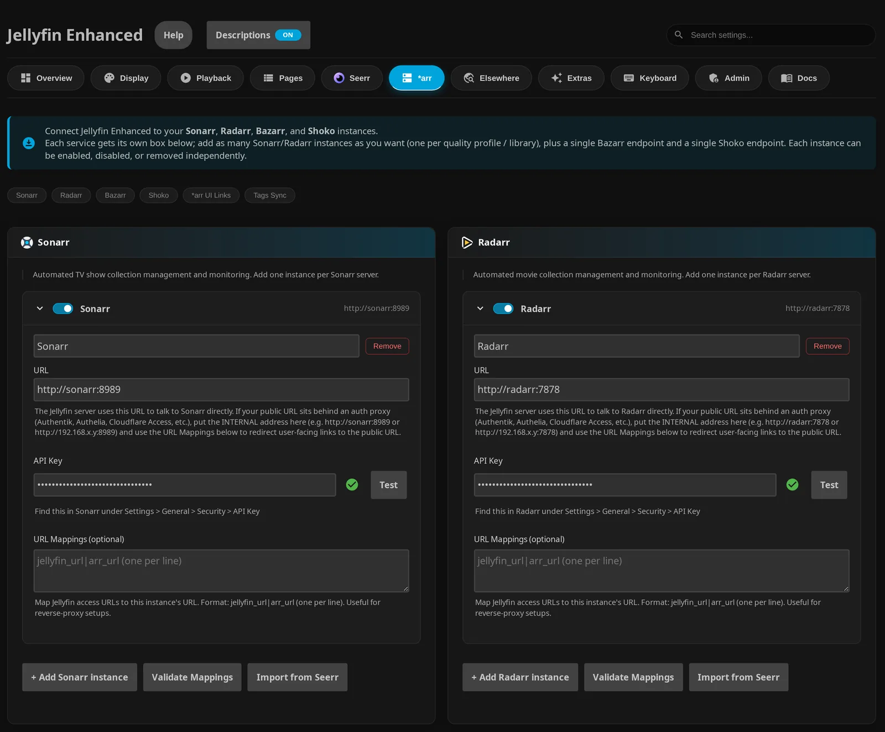
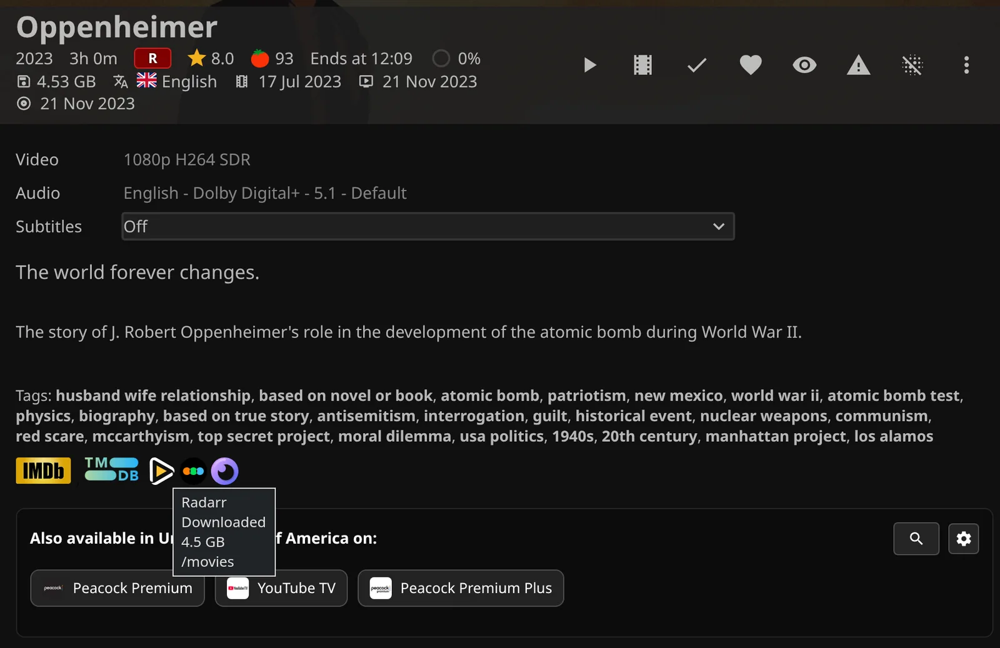
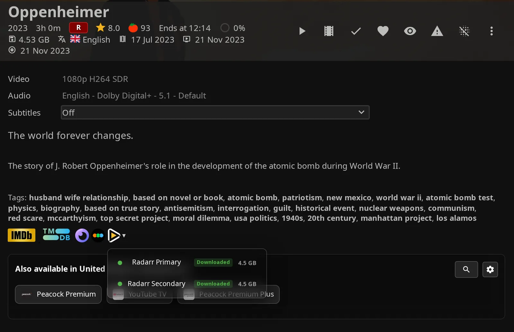
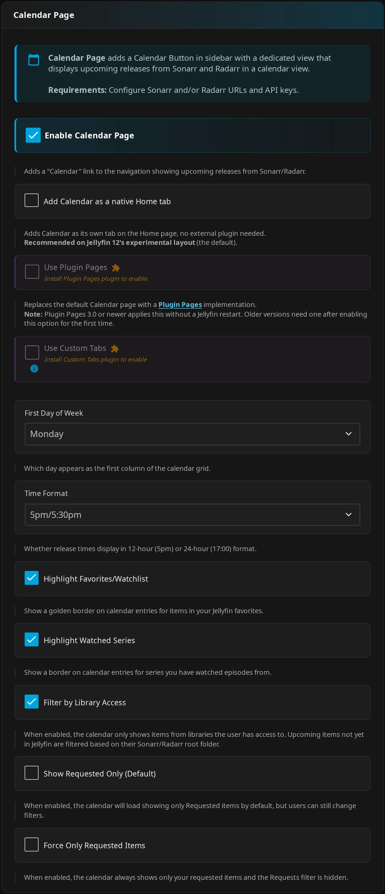
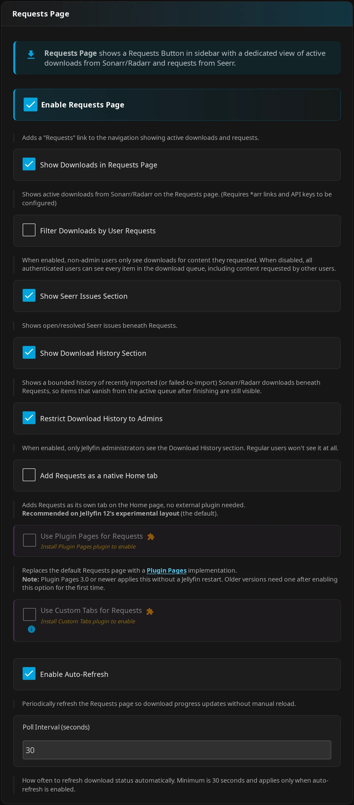

# *arr Settings

Use **Jellyfin Enhanced** → **\*arr** for connections, item links, and tag sync, and **Pages** → **Calendar Page** or **Requests Page** for page controls.

Administrator settings apply server-wide unless marked personal. For workflows, see [*arr features](arr-features.md); for missing links, data, or navigation, see [troubleshooting](troubleshooting-support.md).

## Setup

Connect only the services you need for the features you want. The table below shows what each feature requires.

1. Configure your services under **Jellyfin Enhanced** → **\*arr**.
2. Choose the features you want to enable.
3. Click **Save Settings** and reload the web client.

!!! note "Back up your connections"
    Keep a configuration backup before replacing connections.

| Feature | Connection needed |
|---|---|
| Item links | Enabled Sonarr/Radarr instance with URL/key, or a Bazarr URL; administrator account and detail-page metadata prerequisites. |
| Tag sync | Enabled Sonarr/Radarr instance with URL/key and a scheduled-task run. |
| Calendar | Enabled Sonarr/Radarr instance with URL/key, or both Shoko URL and key. |
| Downloads and History | Enabled Sonarr/Radarr instance with URL/key; default non-admin ownership filtering also needs Seerr and account linkage. |

??? info "How API keys are used"
    API keys are kept in a separate `secrets.json` file and used for server requests; the settings page shows only a masked placeholder with **Replace** and **Clear**. See [Stored credentials](#stored-credentials). JE's browser features receive Sonarr/Radarr connection details without the API keys.

### CSS Customization

See [tag-link styling](arr-features.md#custom-styling) and [CSS customization](../advanced/css-customization.md) for supported hooks and examples.

## Multi-Instance Configuration

Add one card per Sonarr or Radarr server so you can manage each connection separately. Open **\*arr** → **Sonarr** or **Radarr** to get started.

### Adding an Instance

1. Click **+ Add Sonarr instance** or **+ Add Radarr instance**.
2. Expand the card and enter its name, **URL**, and **API Key**.
3. Optionally add **URL Mappings (optional)**.
4. Click **Test** to check the current **URL** and **API Key**.
5. Click **Save Settings**.

!!! note "Complete both connection fields"
    Only cards with both **URL** and **API Key** are saved. Incomplete cards are omitted; a card with a URL but no key produces a warning.

### Instance Fields

Use a distinct name to recognize each server in links and pages. The checkbox beside the collapsed card's name enables or disables the instance.



| Setting | Default | What it does |
|---|---|---|
| Instance name (unlabeled input) | Empty | Optional. Distinct names make sources easier to identify. |
| Summary enable checkbox | On | Includes the instance in service lookups, Calendar, queue/history, and tag sync. |
| **URL** | Empty | Required with the key to save a card. Server-side API address, including the service base path if needed. |
| **API Key** | Empty | Required with the URL. Get it from the service's **Settings** → **General** → **Security** → **API Key**. |
| **URL Mappings (optional)** | Empty | Maps Jellyfin access addresses to this instance's browser address. |

??? info "Instance defaults and connection testing"
    Both instance lists default to empty (`[]`). Saving a blank name substitutes **Sonarr** or **Radarr**. The summary checkbox's accessible label is `Enable <name> instance`.

    **Test** checks the card's values against `/api/v3/system/status` without saving them, and that the address really is Sonarr or Radarr. A saved key, shown masked, is tested on the server against that instance's saved URL. A successful test confirms that the service answered, but does not guarantee that queue, Calendar, or title lookups will work.

### Import from Seerr

Copy Sonarr/Radarr connections from Seerr to save entering them manually. This is a one-time copy, not ongoing synchronization.

!!! note "Seerr key permission"
    The configured Seerr key needs Administrator permission to read service settings.

1. Save an enabled, complete Seerr connection under **Seerr**. It needs **Enable Seerr integration** (default off), **Seerr URL(s) (One per line)** (default empty), and **Seerr API Key** (default empty). See [Seerr settings](../seerr/seerr-settings.md).
2. Under **Sonarr** or **Radarr**, click **Import from Seerr**.
3. Select the instances and review the **Internal** and **External** Jellyfin addresses used for mapping rows.
4. Click **Import Selected**, review the resulting cards, then click **Save Settings**. **Cancel** closes the picker without importing.

??? info "What the import copies"
    Import uses the first nonempty newline-separated Seerr URL. It copies name, hostname/port/base-path URL, and mapping rows into enabled cards. The API keys are read on the server and never reach the browser; an imported key is saved only for the address Seerr reported, and only within 30 minutes. Exact URL duplicates are marked **already imported** and cannot be selected.

### Disabling an Instance

Disable an instance to skip it while keeping its connection.

1. Uncheck the summary checkbox.
2. Click **Save Settings**.

??? info "Editing and removing a disabled instance"
    The card body becomes disabled. Re-enable the checkbox to edit it or use **Remove**. Removal asks for confirmation and takes effect only after **Save Settings**.

### URL Mappings (per-instance)

Use mappings when your browser needs a different service address from the Jellyfin server.

1. Open **URL Mappings (optional)** on the instance.
2. Enter one `jellyfin_url|service_url` pair per line. Put the Jellyfin address on the left and the browser-facing service address on the right.
3. Click **Validate Mappings**, then **Save Settings**.

For example:

```text
https://jellyfin.example.com/jellyfin|https://sonarr.example.com
http://192.168.1.10:8096|http://sonarr:8989
```

??? info "Mapping rules and validation"
    The left side must match the Jellyfin server address used by the client, including the base path. Matching ignores case and trailing slashes; the first match wins. If nothing matches, the instance's **URL** becomes the browser address. Mappings are independent per instance, with no inherited global mapping.

    The server continues using **URL** for API calls. **Validate Mappings** checks syntax and that both sides differ; it does not test network access or credentials. See [URL mapping usage](arr-features.md#url-mappings).

## Link Behaviour

Add service links so you can open a title in Sonarr, Radarr, or Bazarr from Jellyfin. These links are for administrators.

1. Open **\*arr** → **\*arr UI Links**.
2. Turn on **Enable \*arr Links on Detail Pages** and choose icons or text.
3. Click **Save Settings** and reload the web client.

| Setting | Default | What it does |
|---|---|---|
| **Enable \*arr Links on Detail Pages** | Off | Adds administrator-only Sonarr/Radarr/Bazarr links on Movie/Series detail pages and Sonarr/Radarr icons on request cards. |
| **Show links as text** | Off | Uses text instead of service icons. |
| **Show status badge for single-instance** | Off | Adds status styling for a single Sonarr/Radarr match. Visible badges also require **Show links as text**. |

??? info "Title-matching requirements"
    The detail page must show a TMDB external link. Sonarr additionally needs TVDB; Radarr uses the movie's TMDB ID. Unmatched titles have no Sonarr/Radarr link.

### Single Instance

One matching instance opens directly. Enable **Show status badge for single-instance** and **Show links as text** to see Sonarr episode-file counts or Radarr **Downloaded**/**Missing** badges.

Hover the link for its instance name, status, file size, and root folder when supplied, even with **Show status badge for single-instance** off.



??? info "Icon mode and missing statistics"
    Icon-mode tooltips retain available details. If Sonarr reports no statistics, the badge reads `0/0` with gray status.

### Multiple Instances (Dropdown)

Multiple matching instances produce a dropdown with names, status dots, counts/download status, and file sizes when supplied. Green means complete, amber means partially downloaded Sonarr episodes, and gray means a matching title with no downloaded files. Instances that do not contain the title are omitted.



!!! note "Metadata icons override text links"
    Under **Extras**, **Enable Metadata Icons (Druidblack)** defaults off. Turning it on forces **Show links as text** off. It is a server setting, not a personal service-link override.

## Legacy Single-Instance Fields

JE keeps older connection fields for compatibility. Restoring an older configuration requires a backup; downgrading alone does not restore it.

??? info "Stored fields and compatibility"
    Legacy `SonarrUrl`, `SonarrApiKey`, `SonarrUrlMappings`, `RadarrUrl`, `RadarrApiKey`, and `RadarrUrlMappings` all default empty. These are stored compatibility fields, not separate controls in the current tab.

    The original `SonarrUrl`, `SonarrApiKey`, `RadarrUrl`, and `RadarrApiKey` fields come from before multi-instance support. When the plugin starts and finds them set while no instance in the list has both a URL and an API key, it uses them exactly like the old fallback: the instance at that address gets the legacy key, or a new instance (named `Sonarr` / `Radarr`) is added. The URL fields are still kept in step with the first instance; once an instance holds a key, the legacy API key fields are no longer stored. See [Stored credentials](#stored-credentials) for downgrading. Unreadable stored lists and their legacy fields are preserved on ordinary save, without legacy fallback.

## Stored credentials

Every API key Jellyfin Enhanced stores (Sonarr and Radarr instances, Seerr, TMDB, MDBList, DoesTheDogDie, Shoko, the ntfy token, the SMTP password, the backup passphrase, and the usage-statistics install secret) is kept in a separate file, `secrets.json`, in the plugin's data folder (`<config>/plugins/configurations/Jellyfin.Plugin.JellyfinEnhanced/`). The file is readable by the Jellyfin user only and is never served by Jellyfin or by the plugin. The plugin's settings file (`Jellyfin.Plugin.JellyfinEnhanced.xml`) and the dashboard only ever see a placeholder such as `••••••••3f9a` (the last four characters, so you can tell keys apart).

??? info "Upgrades, the settings page, and Import from Seerr"
    - **On upgrade** the plugin moves existing keys out of the settings file on its first start. Nothing needs re-entering.
    - **On the settings page** a saved key shows as that placeholder with **Replace** and **Clear** buttons. Saving without touching it keeps the key. **Test** buttons check the saved key on the server.
    - **A saved key stays with its server.** It is only tested against, and only kept for, the address (scheme, host and port) it was saved for. When you change an instance's URL, the Seerr URLs or the Shoko URL to another server, the key field asks for the key again; saving without it removes the old key from that connection.
    - **Import from Seerr** reads the Sonarr/Radarr keys on the server; the browser never receives them. An imported key is only saved for the address Seerr reported and only within 30 minutes; otherwise the page tells you after saving which instances need their key entered.

??? info "Backups and unreadable files"
    - **Backups:** Jellyfin's own backups don't include plugin data. Use [Backup & restore](#backup-restore): it can include the keys, encrypted with a passphrase. If you copy files by hand instead, keep `secrets.json` together with the settings file; without it, the keys have to be entered again (the plugin logs which ones are missing).
    - **If `secrets.json` can't be read** (for example it was edited by hand and is no longer valid JSON), the plugin leaves it exactly as it is, logs an error and treats the stored keys as unavailable; it never removes or overwrites them meanwhile, and reads the file again every 30 seconds. Fix the file (or restore it from a backup) and the keys work again. Keys you type while it is unreadable, or while the folder can't be written, are kept in the settings file as before and move into `secrets.json` on a later start.
    - **An unreadable Sonarr/Radarr instance list** (invalid JSON in the settings file) is moved into `secrets.json` as `SonarrInstances.corrupt` / `RadarrInstances.corrupt`, since it may contain keys; the settings page shows it as corrupt and offers a reset.

### Downgrading to a version without the secrets file

Older versions expect the keys in the settings file. Before installing an older version, write them back with this request as an administrator, then install the older version and restart:

```bash
curl -X POST "http://<jellyfin>/JellyfinEnhanced/admin/secrets/rollback" \
  -H 'Authorization: MediaBrowser Token="<API key from Dashboard > API Keys>"' \
  -H "Content-Type: application/json" \
  -d '{"confirm":"write-credentials-to-plugin-config"}'
```

`secrets.json` keeps its copy. If this version starts again instead, it simply moves the keys back out. Without the request, you can also copy the values from `secrets.json` into the settings file by hand while Jellyfin is stopped (`arr:<instance id>` entries belong to the `ApiKey` of the instance with that `Id`).

## How Sonarr/Radarr data is read

The Requests page (queue and history), the Calendar, the item-page links and the request cards don't
call Sonarr or Radarr while you browse. Jellyfin Enhanced keeps a copy of what they need in memory and
refreshes it in the background while a page uses it:

| Data | Refreshed | Used by |
|---|---|---|
| Download queue (every row, read page by page) | At the Requests page's **Poll Interval** while the page is open or something is downloading, otherwise every 5 minutes | Requests page |
| Recent history (the newest 1000 records, then only what's new; read in full again every hour) | Same as the queue | Requests page history |
| Calendar (from the start of last month to about three months ahead) | Every 15 minutes | Calendar page; other months are read when you open them and kept for 15 minutes |
| Library (every movie or series with its ids and tags) | Every 15 minutes | Item-page links, request-card links, "not in Sonarr/Radarr" on requests, tag sync |

??? info "Data that can't be read, busy queues, and wrong addresses"
    Nothing is read until a page asks for it, and data nobody has looked at for a while stops being
    refreshed. A queue or history that can't be read again is still shown for a while (10 minutes for the
    queue, 30 for the history); after that, "Requests & downloads" treats what that app is downloading as
    unknown rather than showing it as current. After a restart the library list starts from a cached copy (in the `arr-state` folder of
    the plugin's data folder) and is refreshed in the background. A title you just added in Sonarr or
    Radarr can take up to 15 minutes to get its link, and a change to the calendar (a title added or
    removed) up to 15 minutes to show.

    A busy queue can reorder while it is read page by page (Sonarr and Radarr sort it by time left), so a
    row can be missed. The queue is then read once more; if rows still moved, the last complete copy is
    kept for up to 2 minutes (it shows its age), and after that the newest read is shown. Neither counts as
    the instance being unreachable. A row missing from a queue read over more than one page (more than
    500 queue rows; Sonarr lists each episode of a season pack as its own row, so a few season packs can be
    enough) only counts as gone when the next complete read lacks it too; even a kept short read that
    shows it restarts that count. Until then it keeps its last queue state and first-seen problem clock,
    with no time-left estimate. Its old state expires ten minutes after its last published sighting, even if a
    newer read missed it. A finished download in such a queue shows as importing one refresh later. No download
    counts as finished because a read missed it.

    Every read checks that the address really is Sonarr or Radarr (a Sonarr address in a Radarr box shows
    "wrong app at this URL" instead of odd results) and never follows a redirect, the same as the **Test**
    button. An instance that can't be read shows a short reason on the page; administrators also see the
    details. The **arr/admin/state** API shows what's held and how old it is (see [API](../advanced/api.md)).

## Backup & restore

Back up Jellyfin Enhanced's own data: Jellyfin's backups don't include plugin data.

**How to use:**

1. Open the plugin's **Admin** tab → **Backup & Restore**.
2. Click **Download a backup**. Choose whether to leave API keys out or include them, encrypted with a passphrase of at least 12 characters.
3. To restore, choose the file, enter its passphrase if it holds keys, and confirm. Restart Jellyfin afterwards.

??? info "What a backup holds and how restore works"
    - **Download a backup** saves one zip with the plugin settings, every user's Jellyfin Enhanced settings
      (shortcuts, hidden content, bookmarks, reviews, …), custom branding and the plugin's other stores.
      Caches are left out. API keys and passwords are either left out (enter them again after restoring
      on a new server) or included, encrypted with a passphrase of at least 12 characters.
    - **Restore** checks the file first (its checksums, and the passphrase if it has keys), saves a copy
      of the current data (and of `secrets.json`) to `backups` in the plugin's data folder, whatever backup
      folder you chose, then puts the backup's files and settings in place. Files the backup doesn't have
      are kept, and so is this server's arr action audit log. Restart Jellyfin afterwards so every part
      reads the restored data. The usage-statistics settings of the server you restore on are kept.
    - A key saved on this server is only kept for the address it was saved for: when a backup without keys
      points Seerr, Shoko or an arr instance at another address than this server uses now, that key is
      left out and the restore lists it to enter again.
    - **Scheduled backups**: the task **Back up Jellyfin Enhanced data** (Dashboard → Scheduled Tasks, no
      trigger until you add one) writes a backup to the chosen folder (default: `backups` in the plugin's
      data folder; pick another disk to survive a disk failure) and keeps the newest copies. To include
      the keys, tick the option and save a passphrase; the task fails rather than quietly leaving them out
      when no passphrase is saved.

??? info "Restoring by hand"
    To restore by hand instead: stop Jellyfin, unzip `config/Jellyfin.Plugin.JellyfinEnhanced.xml` to
    `<config>/plugins/configurations/` and the `data/` folder's contents to
    `<config>/plugins/configurations/Jellyfin.Plugin.JellyfinEnhanced/`, then start Jellyfin. Keys in an
    encrypted backup can only be restored through the page.

## Bazarr

Bazarr adds links to its movie and series overviews so you can manage subtitles. You can configure one Bazarr connection.

1. Open **\*arr** → **Bazarr**.
2. Enter **Bazarr URL** and, if needed, **Bazarr URL Mappings**.
3. Click **Save Settings**.

| Setting | Default | What it does |
|---|---|---|
| **Bazarr URL** | Empty | Base browser address for Movie/Series overview links. |
| **Bazarr URL Mappings** | Empty | Uses the same Jellyfin-address-to-service-address format as instance mappings. |

??? info "Bazarr link requirements and limits"
    Bazarr has no API-key input, tag sync, Calendar source, queue, or History integration. Its detail links require administrator service links and a visible TMDB link. They open `/movies/` or `/series/`, not a specific item.

## Shoko

Connect Shoko to include anime events in Calendar. You can use Shoko as the only Calendar source.

!!! note "Enter both Shoko connection fields"
    Both **Shoko URL** and **Shoko API Key** must be present. Partial configuration produces a Calendar error.

### Generating a Shoko API Key

1. In Shoko's web UI, open **Settings** → **API Keys** → **Add API Key**.
2. Copy the key into **Shoko API Key**.

### Setup

1. Open **\*arr** → **Shoko** and enter **Shoko URL** and **Shoko API Key**.
2. Optionally configure **Shoko URL Mappings**.
3. Click **Save Settings**.
4. Enable Calendar under **Pages**. No Sonarr/Radarr connection is needed for a Shoko-only Calendar.

### Instance Fields

| Setting | Default | What it does |
|---|---|---|
| **Shoko URL** | Empty | Server-side Shoko address; also the browser-link fallback. |
| **Shoko API Key** | Empty | Key for Shoko API v3 requests. |
| **Shoko URL Mappings** | Empty | Browser-link mappings under **Advanced URL Mappings**. |
| **Episodes** | On | Includes regular anime episodes on Calendar. |
| **Specials** | Off | Includes special episodes. |
| **Credits (OP/ED)** | Off | Includes opening/ending credits. |
| **Trailers** | Off | Includes trailers. |
| **Parodies** | Off | Includes parodies. |
| **Other** | Off | Includes other AniDB episode types. |

The six type switches are under **Episode Types to Show on Calendar**.

??? info "Shoko matching and event limits"
    Shoko supports one server and has no instance-name or enable-checkbox control. Connections use **Shoko API Key** and time out after 15 seconds. With all six episode types off, no anime events appear. Missing and restricted Shoko content is excluded; selecting episode types does not include restricted content.

    Matching uses `Shoko Series` and `Shoko Episode` provider IDs, normally supplied by Shokofin. Unmatched anime may lack Jellyfin artwork and navigation, but administrators can still get **Open in Shoko** on the Calendar source icon. See [anime event limits](arr-features.md#anime-calendar-events-shoko).

## Tag synchronization

Copy Sonarr/Radarr tags into Jellyfin metadata and show them as clickable links. Run the scheduled task to sync them.

1. Open **\*arr** → **Tags Sync** and turn on **Enable Tags Sync**.
2. Choose a nonempty **Tag Prefix** and review cleanup. Filters are under **Tag Filters**.
3. Click **Save Settings**.
4. Run **Sync Tags from \*arr to Jellyfin** from **Scheduled Tasks**.
5. Add your own trigger for recurring runs; there are no default triggers.

| Setting | Default | What it does |
|---|---|---|
| **Enable Tags Sync** | Off | Permits **Sync Tags from \*arr to Jellyfin** to update Movie/Series metadata. It does not run or schedule the task. |
| **Tag Prefix** | `JE Arr Tag: ` | Prepended to source tags; preserve the trailing space and use a nonempty value. |
| **Clear old tags before sync** | On | Removes tags starting with the current prefix before adding replacements. |
| **Show synced tags as links** | On | Shows existing prefixed metadata tags as links for viewers, independently of sync and administrator service links. |
| **Sync to Jellyfin Filter** | Empty | Comma/semicolon-separated unprefixed names to sync; empty syncs all. |
| **Show as Links Filter** | Empty | Newline-separated unprefixed names to show; empty shows all tags with the prefix. |
| **Hide Specific Links Filter** | Empty | Newline-separated names to hide; hiding wins over the show filter. |

!!! warning "Review cleanup and filter format"
    **Clear old tags before sync** also removes tags on unmatched items or failed/empty source results. Use commas or semicolons for **Sync to Jellyfin Filter**, even though the form says one per line.

??? info "Prefix and matching details"
    A blank **Tag Prefix** is saved, synced, and linked as `JE Arr Tag: `. Changing the prefix leaves previously prefixed metadata in place.

    Filters ignore capitalization in tag names, but displayed links require matching prefix capitalization. Movies match by TMDB, series by IMDb. See [ARR Tags](arr-features.md#arr-tags) for cleanup limits, working filter examples, and styling.

## Calendar Page Settings

Choose how Calendar looks and which releases it shows. These are admin (server) settings.

1. Open **Pages** → **Calendar Page** and turn on **Enable Calendar Page**.
2. Choose page placement and display options.
3. Click **Save Settings** and reload the web client.



| Setting | Default | What it does |
|---|---|---|
| **Enable Calendar Page** | Off | Enables the Calendar surface using configured Sonarr/Radarr/Shoko sources. |
| **Add Calendar as a native Home tab** | Off | Adds a Home tab without a companion plugin. |
| **Use Plugin Pages** | Off | Uses the installed Plugin Pages integration. |
| **Use Custom Tabs** | Off | Embeds Calendar in a Custom Tabs tab. |
| **Add the Custom Tabs entry for me** | Off | Creates a matching entry on save when the page and Custom Tabs mode are also enabled. |
| **First Day of Week** | **Monday** | Selects any weekday as the grid's first column. |
| **Time Format** | **5pm/5:30pm** | Chooses 12-hour or **17:00/17:30** 24-hour format; times use the browser timezone. |
| **Highlight Favorites/Watchlist** | Off | Adds watchlist indicators and a **Watchlist** filter. |
| **Highlight Watched Series** | Off | Marks the event's matched played/started episode; movie events also use played/started state. |
| **Filter by Library Access** | On | Filters releases by your library access; a title not in Jellyfin yet shows only to people who can open the library it will land in. |
| **Show Requested Only (Default)** | Off | Initially selects **Requests**; viewers can change filters. |
| **Force Only Requested Items** | Off | Always limits the displayed Calendar to your requested titles and hides the **Requests** chip. |

??? info "Highlighting and access limits"
    Watchlist highlighting uses Jellyfin's like (Likes) flag, not the favorite (heart) flag. Library filtering uses Jellyfin's own access check for titles it has. A title not in Jellyfin yet shows only to people who can open its destination library (the instance's linked libraries, or the library holding its folder through path mappings); when that can't be told, only administrators see it. See [Calendar](arr-features.md#calendar-settings).

    Under **Seerr**, **Add requested media to Watchlist** and **Sync Seerr Watchlist → Jellyfin** set the like flag for matching library items; see [Seerr settings](../seerr/seerr-settings.md).

    Requested-only display requires Seerr data for the linked viewer and matches TMDB ID plus media type. It excludes Shoko events and can be empty when request data is unavailable. These options only change what you see in Calendar; they do not restrict access to Calendar data from the server. Broader Calendar visibility does not grant playback access. While the page is off, its data route answers `403` too.

Standalone address: `/web/index.html#/calendar`, including your Jellyfin base path. Use the Plugin Pages entry when that installed integration is selected. See [Calendar usage](arr-features.md#calendar-page) and [page placement](#page-placement).

## Requests Page Settings

Use one shared Requests page to follow downloads, requests, and import results. Sonarr/Radarr supply Downloads and History; Seerr supplies Requests and optional Issues.

1. Open **Pages** → **Requests Page** and turn on **Enable Requests Page**.
2. Choose sections, access rules, placement, and refresh options.
3. Click **Save Settings** and reload the web client.

These are admin (server) settings:



| Setting | Default | What it does |
|---|---|---|
| **Enable Requests Page** | Off | Enables the shared Requests surface. |
| **Show Downloads in Requests Page** | On | Shows the queue; turning it off also hides History on the page. |
| **Filter Downloads by User Requests** | On | Filters non-admin queue/history to titles they requested through Seerr, and the request list to their own requests. Library access applies either way. Administrators bypass it. |
| **Show Seerr Issues Section** | Off | Adds Issues when Seerr is enabled. |
| **Show Download History Section** | On | Shows recent import/failure results. |
| **Restrict Download History to Admins** | Off | Hides History from non-admins, enforced on the server. |
| **Add Requests as a native Home tab** | Off | Adds a Home tab without a companion plugin. |
| **Use Plugin Pages for Requests** | Off | Uses the installed Plugin Pages integration. |
| **Use Custom Tabs for Requests** | Off | Embeds Requests in a Custom Tabs tab. |
| **Add the Custom Tabs entry for me** | Off | Creates a matching entry on save when the page and Custom Tabs mode are also enabled. |
| **Enable Auto-Refresh** | On | Refreshes enabled sections; hidden browser tabs are skipped. |
| **Poll Interval (seconds)** | 30 | Editable when **Enable Auto-Refresh** is on; form range 30–300 seconds. Save enforces a minimum of 30. |

!!! note "Download sources and viewer access"
    Queue/history require complete enabled Sonarr/Radarr credentials, not **Enable \*arr Links on Detail Pages**. Default viewer filtering also requires enabled/configured Seerr, a linked account, and matching requests. Without them, viewers can receive empty results. Non-admins only ever see titles they could open in Jellyfin; see [Who sees downloads](arr-features.md#who-sees-downloads).

!!! warning "Turning off ownership filtering shares download titles"
    Turning off **Filter Downloads by User Requests** shows authenticated viewers every queue/history title they could open in Jellyfin, subject to the History administrator restriction, and lets the request list follow each user's Seerr permissions.

Opening the page loads data independently of polling. Use the Downloads refresh icon to reload enabled sections.

??? info "Ownership, refresh behavior, and History limits"
    Ownership matches use TMDB ID and media type. History shows the newest 200 merged cards the viewer may see; filtering runs first, so other people's newer events never push the viewer's own out. If an instance's history can't be read, the page says so instead of showing it as empty.

    Auto-refresh stops when you leave the standalone page or switch away from its native Home or Custom Tabs tab. Plugin Pages can keep refreshing after navigation until you reload or close the browser page. Hidden browser tabs are skipped.

    Queue and History come from in-memory copies refreshed in the background (see [How Sonarr/Radarr data is read](#how-sonarrradarr-data-is-read)). Manual refresh may return what was last read. While the page is off (or **Show Downloads in Requests Page** is off) its queue and history routes return nothing as well.

Standalone address: `/web/index.html#/downloads`, including your Jellyfin base path. Use the configured integration entry in Plugin Pages mode. See [downloads and History](arr-features.md#downloads-page), [Seerr features](../seerr/seerr-features.md), and [page placement](#page-placement).

## Requests & downloads (new)

A reworked Sonarr/Radarr integration, delivered in stages. With it off, everything on the \*arr tab works exactly as described above. See [*arr features](arr-features.md#requests-downloads-new) for what each stage does.

!!! warning "Experimental and off by default"
    Every switch in this section starts off.

**How to use:**

1. Open **Jellyfin Enhanced** → **\*arr** → **Requests & downloads (new)** and turn on **Enable Requests & downloads (new)**.
2. Fill in each Sonarr/Radarr card's new fields below, then click **Check connections**.
3. Turn on the stages you want and click **Save Settings**.

Each Sonarr/Radarr card gains these fields:

| Field | Description |
|---|---|
| **Role** | Standard, 4K (UHD), Anime or Other. Later stages use it to pick the instance for each request: the default instance of the matching role. A 4K request is never sent to a standard instance; anime falls back to the standard instance when there is no anime one. |
| **Default for this role** | Which instance to use when several share a role. |
| **Linked libraries** | The Jellyfin libraries whose files this instance manages. |
| **Path mappings** | Only when the arr and Jellyfin see the same folders under different paths: one `arr_path|jellyfin_path` per line. |

**Check connections** tests every saved instance. It confirms the URL really is Sonarr or Radarr (a Radarr address in a Sonarr box fails), that the key works and the version is supported (Sonarr v4+, Radarr v4+), and lists the instance's own health warnings.

Each instance also gets a permanent id the first time the plugin starts with this version, whether or not the switch is on.

### Requests page, Manage and Seerr's window (phase 1)

Under **Show where things have got to (status on pages)**:

| Setting | Default | What it does |
|---|---|---|
| **Show status badges on posters** | On | Corner badge on poster cards while something downloads, is almost ready or takes longer than usual |
| **"Missing" with Search after (hours)** | 24 | When "Looking for it" (nothing grabbed yet) becomes plainly **Missing** with a **Search** button (1-720) |
| **What the family calls you** | (empty: "the admin") | Used in family texts: "Waiting for Dad to OK it" |
| **Requests page** | On | The "Requests" sidebar page (`#/requests`): everyone's own requests (waiting for an OK, on the way, not out yet, said no), Coming soon and Ready. Administrators also get the Downloads and Calendar pages as tabs when those pages are on; with it on, the Downloads page's own sidebar link reads "Downloads" |
| **Manage button for administrators** | On | The Manage panel on details pages, Seerr's more-info window and the Requests page: explanation, Search now, Open in Sonarr/Radarr, versions across instances, timeline, Seerr's requests |
| **Show the status in Seerr's more-info window** | On | The pill and journey for titles not in the library yet (needs "Use the more-info window" on the Seerr tab) |
| **Read Seerr's requests every (minutes)** | 5 | How often Seerr's request list is read in the background (1-60); every 30 seconds while someone has the Requests page open, and about a second after a request is made, approved, declined or removed through Jellyfin Enhanced |

??? info "Where requests come from, and Search now"
    Requests come from Seerr (Seerr tab), matched to Jellyfin users through Seerr's own user import; with Seerr off
    the Requests page says requests aren't set up, and statuses still work from Sonarr/Radarr alone. A full read of
    Seerr's list is used only when it is complete (requests made or removed while its pages are read make it try again a
    minute later; only several such reads in a row show as a problem on the System tab), so a request is never taken for
    removed because the list moved. With more than 3000 requests the newest 3000 are read and older ones read since
    Jellyfin started keep what was last known of them (up to 9000 more); the System tab says so. Requests that aren't
    read are never taken for removed, but ones older than the newest 3000 when Jellyfin started aren't known (no
    "ready" alert comes from them); one that dropped out of what is read is not announced as new or declined if Seerr
    later shrinks and lists it again. A Seerr (or a proxy in front of it) that serves fewer requests per page than asked is still read to the end.
    Another Seerr address or API key counts as another Seerr: its request
    list is read afresh. Seerr is read with
    its API key in the background only: opening a page never calls Seerr, Sonarr or Radarr. **Search now** asks that
    Sonarr/Radarr to search for the movie, series, season or episode the page is about; each one is recorded in the
    arr action audit log (who, when, the outcome and how the search ended).

### Tell me, and admin essentials (phase 2)

**Tell me, and admin essentials (phase 2)** sits under the status switch and needs **Requests & downloads (new)** and
"Show where things have got to". Off by default. It switches on the admin tools below and, with **Notifications**,
the alerts.

#### Admin tools

| Setting | Default | What it does |
|---|---|---|
| **Show imports in Jellyfin right away** | On | After an import, refresh only the Jellyfin folder the file landed in (never a TV library's root; a new series folder is left to Jellyfin's library monitor when the library has real-time monitoring on, otherwise to its next library scan or Scan now). Needs path mappings when the apps and Jellyfin see the files under different paths |
| **"In Sonarr/Radarr, not in Jellyfin" after (minutes)** | 10 | When an import Jellyfin still doesn't list goes under Needs attention (1-1440) |
| **Low disk warning below (% free)** | 10 | A root folder whose disk has less free space goes under Needs attention and, with notifications on, administrators are alerted (at most once a day per folder) (1-50). With **Ask for it** on, asks whose download would land on such a disk (JE mode: the title's own folder, or the default root for a new title; Seerr mode: the default root) are paused and say *Paused: storage full*; administrators' Search still runs |
| **Tell me when Seerr's OK reaches no Sonarr/Radarr after (minutes)** | 15 | When administrators are told that a request Seerr OK'd isn't in any Sonarr/Radarr (1-1440). The family sees "Taking longer than usual" only after the "still looking" hours |
| **Copy actions into Jellyfin's activity log** | On | Every audited action (Search now, queue actions, Scan now, webhook set-up) also appears in Dashboard → Activity |

??? info "How the admin tools read and act"
    The admin tabs read everything from memory (the apps are read in the background); only the actions call
    Sonarr/Radarr, each one once per click, recorded in the audit log with what the app answered. Removing a
    download *with* its data is never automatic and needs a one-time confirmation that expires after two minutes.

#### Notifications

**Notifications** sits under the phase 2 switch (on once phase 2 is on).

| Setting | Default | What it does |
|---|---|---|
| **Notifications** | On | Notify me / Following buttons, the bell and inbox, pop-ups, phone and e-mail alerts, admin alerts and Remind |
| **Your household's Jellyfin address** | (empty) | The address people open Jellyfin with on their phones (e.g. `https://jellyfin.example.com`). Phone alerts and e-mails link to the title there, and e-mails' unsubscribe link to the "Requests & alerts" settings. Empty: no links |
| **Gather new episodes for (minutes)** | 10 | Episodes of one series arriving within this time after the first go out as one message (1-60) |
| **Phone alerts (ntfy)** | Off | Your ntfy server (`https://ntfy.sh` or your own; it must be reachable from Jellyfin and from people's phones) and, for servers that need one to publish, an access token (stored like the API keys, only ever shown masked). People choose a topic in "Requests & alerts", or you give someone a random one under **Notification status**. **Send test** publishes one message to a topic with the saved settings |
| **E-mail** | Off | SMTP server, port (587), STARTTLS (servers that only offer TLS on port 465 are not supported), user name and password (stored like the API keys), sender address and name. Alerts only go to addresses people confirmed with a code. **Send test** sends one e-mail with the saved settings |
| **Tell me when an instance hasn't answered for (minutes)** | 10 | Administrators' outage alert (1-1440). The instance is checked with Jellyfin Enhanced's regular background reads, so the alert can come a few minutes after this time |
| **Daily digest: downloads needing attention for at least (hours)** | 6 | Queue entries the app marks as a problem (import blocked, failed, warning) for at least this long (1-168) |
| **Send the digest at (hour, server time)** | 9 | 0-23 |

??? info "Request answers, administrators' alerts, and Notification status"
    With phase 3 on, people also hear when a request of theirs is **OK'd** or **declined** in Jellyfin Enhanced (with the
    reason), through the bell, pop-ups, phone and e-mail like any alert (their own switches and quiet hours apply; a
    "A request of mine was OK'd" switch appears in "Requests & alerts"). Each is told once, even across restarts.

    Administrators are also told straight away, once per item, when Needs attention lists a download that needs a manual
    import (the app says import blocked) or a request Seerr OK'd that no Sonarr/Radarr has after the grace above. The
    low-disk alert uses **Low disk warning below** from the admin tools (at most once a day per root folder), so the alert
    and the Overview's disk bars always agree.

    **Notification status** lists deliveries in the last 24 hours (sent, failed, waiting for a retry or for someone's
    quiet hours), the latest problems with the reason (never a credential), the database, and everyone's phone and
    e-mail state, with a button to give someone a random phone topic.

!!! note "Who chooses where alerts go"
    Nobody but the administrator chooses where alerts go: people pick a topic name on your ntfy server and confirm their
    own e-mail address, so no one can make Jellyfin contact an address of their choosing. ntfy is called without following
    redirects and never at a cloud-metadata or link-local address; the SMTP server is checked the same way.

### Live updates (phase 1)

**Show where things have got to (status on pages)**, under the master switch, shows each title's status
(details-page pill and journey, poster badges, episode chips) and keeps it current within seconds, without a
page reload. Off by default; it needs **Requests & downloads (new)**.

**How to use:** Set **Jellyfin's address as Sonarr/Radarr see it**, then use **Set up instant updates** in **Live updates status** for each instance that should also send webhooks.

??? info "The live connection and webhooks"
    - **Live connection (nothing to set up).** Jellyfin Enhanced keeps one connection open to each enabled
      Sonarr/Radarr, the same kind of connection their own web pages use, and reads the queue, history or a
      single title again whenever one reports a change. The API key travels in a request header only. The
      connection reconnects by itself (waiting 2 seconds, then longer, up to 2 minutes), and after every
      reconnect it reads the queue, history and library again (the library at most once a minute per
      instance; a quicker reconnect gets its library read when the minute is up), because the arrs don't
      replay what was missed. Each instance box has **Live updates from this Sonarr/Radarr** to turn
      it off for one instance; status then refreshes every 30 seconds while someone is looking.
    - **Webhooks (optional, instant).** A second path for downloads, imports, deletions and health events.
      **Live updates status** lists each instance with its connection and webhook, and offers:
        - **Set up instant updates** / **Repair webhook**: after you agree, adds (or updates) a webhook named
          "Jellyfin Enhanced" in that app (Settings → Connect) pointing at
          `<Jellyfin's address>/JellyfinEnhanced/arr/hook/<instance id>`, with a secret header and every
          event the app offers switched on. The app sends a test event when it saves, so a success also
          proves it can reach Jellyfin. Doing it again updates the same webhook (never a second copy) and
          keeps the secret. Every change is recorded in the arr action audit log.
        - **Copy-paste set-up**: the address, header and triggers to enter by hand instead. This is the only
          place the secret is shown (also recorded in the audit log).
        - **Remove webhook**: deletes Jellyfin Enhanced's webhook from the app and forgets the secret, so
          anything still sending with it is refused. **Live updates status** and removal stay available with
          phase 1 off (only the master switch is needed), so webhooks can be cleaned up after turning it off.

        Set **Jellyfin's address as Sonarr/Radarr see it** first (often the container name or LAN address,
        for example `http://jellyfin:8096`). A webhook is only ever a hint: Jellyfin Enhanced reads the
        app again before showing anything, never acts on what the webhook says, refuses calls without the
        right secret (compared in constant time), limits how often an instance can call and how often an
        address can fail (a failing address never blocks the app's own correctly signed calls), and
        ignores bodies over 1 MiB. The status line warns when a set-up webhook has been silent
        for a day although the app imported something.

??? info "In the browser"
    Pages showing download status long-poll Jellyfin Enhanced (never Sonarr or
      Radarr) while the tab is visible and update the pill, badges and chips in place when a title they show
      changes, and only hear about titles the person may open in Jellyfin (an
      episode or season Jellyfin hides from them stays hidden even when its series is visible). A title
      that isn't in Jellyfin yet is announced only to people with no content limit (parental rating,
      blocked or allowed tags, unrated items, blocked folders), and only when they can open one of the
      libraries the instance holding it is linked to (if it is linked to any).

??? info "Episode monitoring changed in Sonarr itself"
    Sonarr reports no change when an episode is monitored or
      unmonitored in its own UI (no live message, no webhook), so Jellyfin Enhanced reads the series' episodes again
      instead: when a page opens the series and they are over a minute old (the page shows them at once and updates
      when the new read is in), and every minute while a page has the series open (its long-poll names it). The change
      reaches the episode status within about a minute of being made, or as soon as the series is opened. Series
      nobody has open are read every 5 minutes while someone looked at them in the last 15; nothing is read for series
      nobody has opened. Monitoring or unmonitoring a whole season in Sonarr is announced live and shows within
      seconds.

### Ask for it (phase 3)

`ArrPhase3Enabled` is off by default; enable the integration and phase 1 switches first. `ArrRequestBackend` accepts
`seerr` (default), `je` (explicit opt in), or `status_only`. In `je` mode approved requests go straight to Sonarr and
Radarr; in `seerr` mode they go to Seerr as the person who asked. How each is sent is described in
[Sending requests](arr-features.md#sending-requests-phase-3). With phase 3 on and a request backend selected, the
request controls appear for people who may ask (see [Requests & downloads](arr-features.md#missing-episodes-get-it-and-search-phase-3):
Get it on season pages, the request sheet, series and collection actions, Approvals, Household and, in JE mode,
Discover). With Seerr's experimental *Open titles that aren't in the library on Jellyfin's own details page* on, the
same controls appear on those pages (see [Titles that aren't in the library](arr-features.md#titles-that-arent-in-the-library-native-details)).

??? info "Add defaults per instance"
    With the master switch on, each Sonarr/Radarr card has *When Jellyfin Enhanced adds a
    title*: the quality profile, root folder and tags new titles get, plus Radarr's minimum availability or Sonarr's
    series type. Open the card of a saved instance to load its own profiles, folders and tags; values the instance no
    longer lists are shown as "(not in Radarr now)" rather than swapped for something else. In Jellyfin Enhanced mode a
    request for a title the instance doesn't have yet waits for an administrator until both a profile and a folder are
    set. Manage › Add to preselects these defaults.

**Move requests from Seerr...** checks and then moves Seerr's pending and in-progress requests into Jellyfin Enhanced
and switches `ArrRequestBackend` to `je` (see [Moving requests from Seerr](arr-features.md#moving-requests-from-seerr)).
Turn off requesting in Seerr first. The page's Request handling field follows the switch, so saving afterwards keeps
it. The routes behind the panel are in the [API reference](../advanced/api.md#requests-and-approvals-phase-3).

`ArrRequestPreset` selects `ask_first`, `open_house`, or `approve_everything`. `ArrRequestDefaultRole` defaults to
`Watcher`; accepted household roles are Watcher, Kid, Member and Manager. Administrator status always comes from
Jellyfin, never from the JSON role settings. Kid suggestions are not automatically applied.

The advanced fields are server-owned. Quota and preset settings govern JE mode; Seerr mode uses the person's quota as Seerr reports it (allowance shows as unavailable while Seerr can't be read):

| Setting | Default | What it does |
|---|---|---|
| `ArrRequest4kMoviesEnabled` / `ArrRequest4kSeriesEnabled` | false | Phase-3 edition switches; work with Seerr disabled in JE mode |
| `ArrStandardNeedsNonFourK` | false | *Standard requests need a non-4K copy*: a standard request (Requests page, arrival) waits for a playable copy that isn't 4K; off, any playable copy satisfies it. A 4K request always needs a playable 4K version (3200 px wide or 2000 px tall) in a current, enabled library the requester can open; rows left from a removed library or a removed path within a current library never satisfy a request |
| `ArrRequestQuotaLimit` | 0 | Preset limit: 7 for Ask first, 15 for Open house; negative means unlimited |
| `ArrRequestQuotaWindowDays` | 7 | Rolling window, bounded to 1–365 days |
| `ArrRequestSeriesThreshold` | 4 | Cumulative seasons before a Member needs approval |
| `ArrRequestDeclineCooldownDays` | 7 | Wait before repeating a declined scope |
| `ArrRequestPendingLimit` | 10 | Pending requests per person |
| `ArrRequestQuotaGb` | 0 | Optional estimated GB cap; zero disables it |
| `ArrRequestChargeFutureSeasons` | true | Charge the owner of a "Keep getting new episodes" request once for each new season Sonarr monitors, once it starts (an aired episode or a file); in Seerr mode, once for each new season Jellyfin Enhanced asks Seerr for. Off: new seasons are still followed, without a charge |
| `ArrRequestStaleDays` | 30 | Flag a sent request that hasn't arrived for review; no automatic refund. A request whose part is in Jellyfin is marked fulfilled instead and never turns stale, nor does a 4K request nothing can take any more (it says `no_4k_instance`) |
| `ArrRequestRoles` | `{}` | Optional per-role `QuotaLimit`, `QuotaGb` and `FourKInstances` defaults |
| `ArrRequestUsers` | `{}` | Per-user `Role`, `QuotaLimit`, `QuotaGb` and `FourKInstances` overrides |

??? info "Per-role and per-user JSON, 4K, and size estimates"
    For example, the roles JSON can be `{"Manager":{"FourKInstances":["your-4k-instance-id"]}}`; the users JSON is keyed by
    Jellyfin user id. A missing per-user quota inherits the role quota, then the global/preset quota. In JE mode the count
    holds only a Member's asks for an OK (a Kid's always wait), so a Manager's or an Admin's allowance shows no limit and
    their cost lines (request sheet, a collection's "Get the N missing") never show the household's. An empty per-user 4K
    instance list removes that user's inherited grant. Phase 3 has its own movie/TV 4K switches under Ask for it; the older Seerr switches remain in use while phase 3 is off. Seerr mode additionally
    requires Seerr's edition setting and the user's corresponding permission. Optional GB accounting uses estimates (it
    is not the arr's actual file size): from the files on the Radarr/Sonarr a request would go to (the default instance of
    its edition) when its library has been read, a movie counts as the median movie file there and an episode as the median
    episode file (each from at least three files of 100 MB or more), and a season as its episodes as that Sonarr lists them
    for the series (10 when it doesn't hold the series); otherwise the fixed estimates: a movie 8 GB (4K 40), a season
    10 GB (4K 40), an episode 1 GB (4K 4). The estimate is fixed when the request is recorded or approved.

#### Discover and search (JE mode)

| Setting | Default | What it does |
|---|---|---|
| `ArrKidsHideSearch` | false | **Hide free-text search from Kids**: Kids don't get the search page's "Not in your library" row, and the search route refuses them. The Discover tab stays, limited to titles within their parental limits |

Discover and the search row need request handling set to Jellyfin Enhanced and a TMDB API key; see
[Discover and search (JE mode)](arr-features.md#discover-and-search-je-mode). In JE mode the search row replaces
Seerr's (Seerr's **Show search results** setting no longer adds a second row), and Seerr's request buttons open
Jellyfin Enhanced's request sheet.

#### Household tab

Admins can edit the preset, default role, quota limit, per-role limits, and each person's role and limit from the Household tab of the Requests page instead of the JSON fields.

??? info "What a Household save changes"
    Admins can edit `ArrRequestPreset`, `ArrRequestDefaultRole`, `ArrRequestQuotaLimit`, the per-role `QuotaLimit` in
    `ArrRequestRoles` and each person's `Role` and `QuotaLimit` in `ArrRequestUsers` from the Household tab of the Requests
    page instead of the JSON fields. A save changes only those values; 4K grants and GB caps in the same JSON are kept.
    Limits offer the inherited value, **No limit** (−1) or a fixed number of requests per window. Jellyfin administrators
    are always Admin and have no role picker. People with a Jellyfin parental limit get a hint that Kid may suit them; it is
    never applied automatically. Managers can read the tab but not change it. The configuration page keeps these fields (and
    *Request handling*, which a move from Seerr switches) as the server has them when it is saved, unless they were changed
    on that page: a page left open before a Household edit or a move doesn't put the older values back, even when the edit
    lands while the page is saving.

## Page placement

Choose where you open each enabled page. Native Home tabs need no companion plugin; Plugin Pages and Custom Tabs need their corresponding plugins.

### Native Home tabs

Use **Add Calendar as a native Home tab** or **Add Requests as a native Home tab** for navigation without a companion plugin. See [JE Pages & Tabs](../getting-started/pages-and-tabs.md#choose-a-placement) for setup, layout behavior, and generated Home links.

### Plugin Pages

Use **Use Plugin Pages** for Calendar or **Use Plugin Pages for Requests** with the companion installed. Follow [Plugin Pages setup and fallback](../getting-started/pages-and-tabs.md#plugin-pages-setup-and-fallback) for registration, restart requirements, and navigation.

### Custom Tabs

Use **Use Custom Tabs** for Calendar or **Use Custom Tabs for Requests** to embed the page on Home. Follow [Custom Tabs setup](../getting-started/pages-and-tabs.md#custom-tabs-automatic-or-manual-entries) for prerequisites, managed entries, manual HTML markers, and detection recovery.

## Personal settings

Choose your preferred Calendar view and presentation directly in Calendar. These controls save personal preferences; they are not admin defaults or settings-panel toggles.

1. Open **Calendar**.
2. Choose a view and presentation, or turn on **Unmonitored** to include unmonitored events.

| Setting | Default | What it does |
|---|---|---|
| **Day** / **Week** / **Month** / **Agenda** | **Agenda** | Saves your preferred Calendar view in your personal settings. |
| **List** / **Backdrop** / **Cards** | **List** | Saves your preferred presentation in your personal settings; unavailable in Agenda. |
| **Unmonitored** | Off | Includes unmonitored events; remembered for your account in this browser, without syncing to other browsers. |

??? info "What personal preferences cover"
    Your selected filter chips are not saved as personal preferences. Service connections, service-link settings, tag-sync settings, and Calendar access/highlight options are controlled by the administrator.

### Hidden Content settings

Hide matching items from Calendar, Downloads, and Requests. The administrator sets starting values, and you can change your personal filters.

1. As an administrator, enable **Enable Hidden Content** and review defaults under **Pages** → **Hidden Content** → **More Settings**.
2. In your personal **Hidden Content** settings, enable **Enable Content Hiding** and choose the surface filters.

Admin (server) settings:

| Setting | Default | What it does |
|---|---|---|
| **Enable Hidden Content** | Off | Enables the feature server-wide, including personal filters. |
| **Hidden Content enabled by default** | On | Sets the starting personal hiding state for new users. |
| **Filter Calendar** | On | Sets the starting personal Calendar filter; users can override it. |
| **Filter Requests page** | On | Sets the starting personal Requests filter; users can override it. |

!!! note "Both hiding switches must be on"
    **Enable Hidden Content** and your personal **Enable Content Hiding** must both be enabled for filtering. Ordinary saves preserve existing personal choices.

Personal controls in **Hidden Content**:

| Setting | Default | What it does |
|---|---|---|
| **Enable Content Hiding** | On | Enables your own hiding and surface filters when the server feature is enabled. |
| **Filter Calendar** | On | Starts with the admin default. Hides matching hidden items in **Month**, **Week**, and **Agenda**; hidden items remain visible in **Day**. |
| **Filter Requests** | On | Starts with the admin default. Hides matching hidden items in **Downloads** and **Requests**; **History** and **Issues** remain unchanged. |

See [Hidden Content filtering](troubleshooting-support.md#hidden-content-filtering) for these surface differences and [Enhanced features](../enhanced/enhanced-features.md#content-management) for the full Hidden Content workflow.
