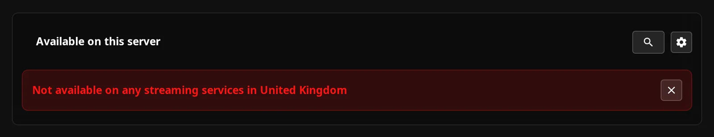
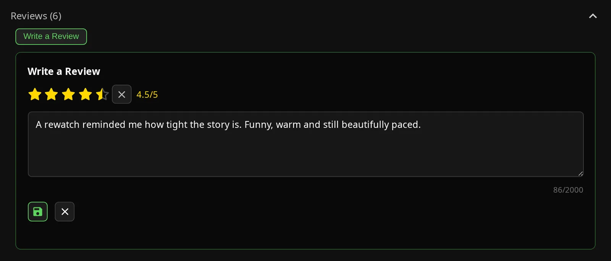
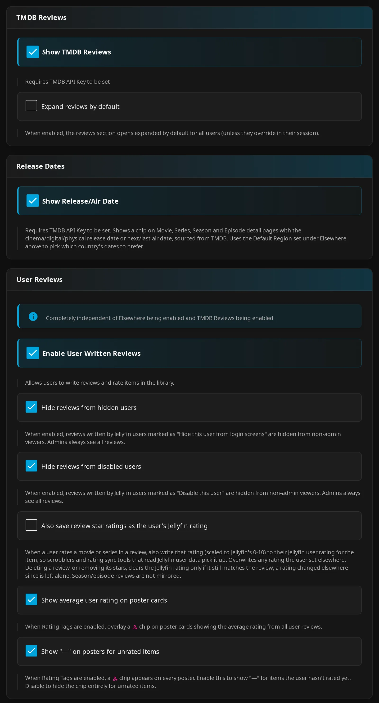
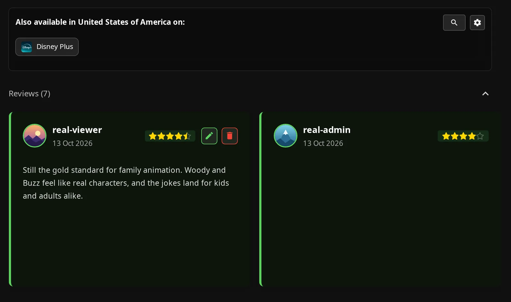
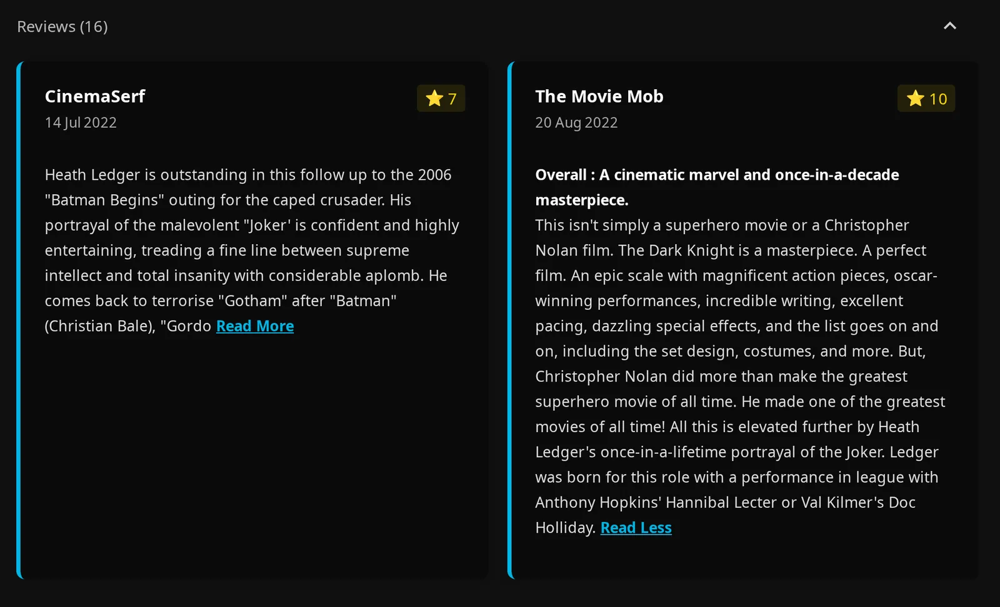
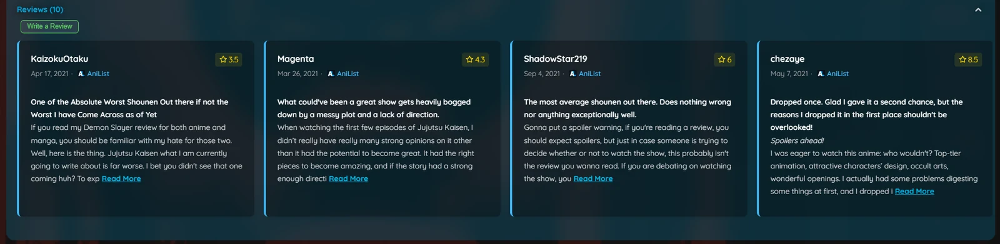
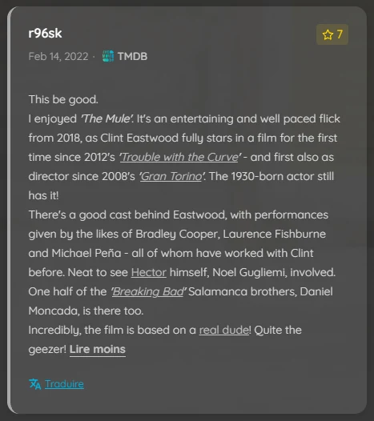
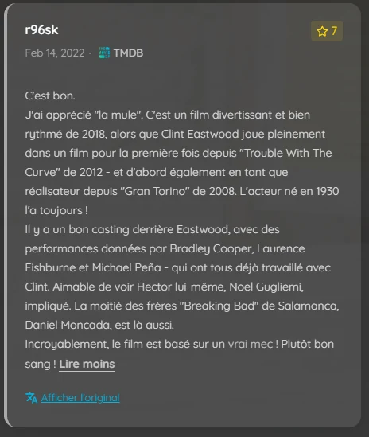
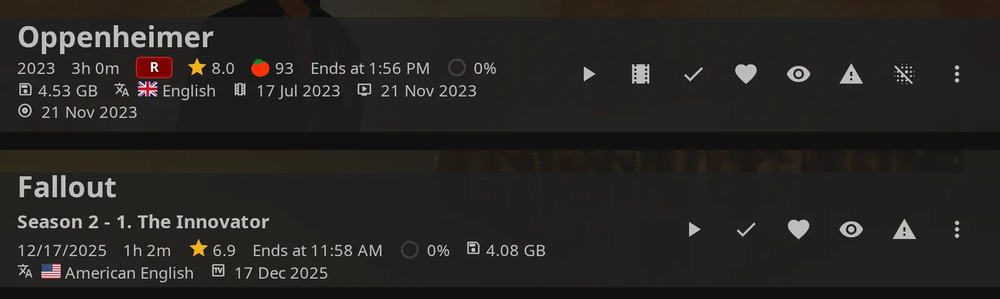

# Elsewhere & Reviews

Find subscription streaming providers, read reviews, and see release or air dates on item detail pages in Jellyfin. These features work in compatible Jellyfin web clients.

## Overview

You can set up provider lookup, TMDB reviews, release dates, and reviews from your Jellyfin users in the admin **Elsewhere & Reviews** tab. Start with [Elsewhere & Reviews Settings](elsewhere-settings.md) for setup, defaults, and troubleshooting.

!!! note "API key requirements"

    Provider lookup, TMDB reviews, and release dates share the **TMDB API Key**. User-written reviews stay on your server and need no API key.

## Streaming Provider Lookup

See which subscription services carry a movie or series in your default search country. Provider badges let you scan the results, and manual searches let you compare other countries.

### How to use

1. After an admin completes [setup](elsewhere-settings.md#setup), open a movie or series detail page with a TMDB external link.
2. Find the provider panel, normally just below the external links.
3. Read **Also available in {region} on:** and its provider badges, or **Not available on any streaming services in {region}**. An admin can replace the unavailable heading with a custom message and optional icon.
4. Use the gear icon to open **Search Settings**, choose countries and providers, and click **Save**. Reload or revisit the page to update automatic results.
5. Use the magnifying-glass icon to search manually. Available countries get separate blocks; unavailable countries share one block. Use the close icons to dismiss blocks. Searching again replaces the previous manual results.

*An admin's **Custom Branding Message** replaces the unavailable heading; the red box is a manual search result.*

Admin settings in **Elsewhere & Reviews**:

| Setting | Default | What it does |
| --- | --- | --- |
| **Enable Elsewhere** | On | Enables the detail-page provider panel with a configured TMDB key. |
| **TMDB API Key** | Empty | Supplies the shared key for server-side TMDB requests. |
| **Default Region** | `US` | Sets the automatic country until you choose a personal default. |
| **Default Providers** | Empty | Allows all subscription providers when empty; otherwise allows only exact provider names. |
| **Ignore Providers** | Empty | Hides matching provider names after **Default Providers** is applied. |

Provider badges show names and logos. Available headings open a regional availability link in a new tab when TMDB supplies one, with the **JustWatch** tooltip. These links and badges do not start playback or verify your subscriptions.

!!! note "Subscription availability only"

    Rental, purchase, free, and ad-supported categories are not shown separately. An unavailable result means no matching subscription providers for the country and filters you used. It does not mean the title is exclusive to your server.

??? info "How automatic and manual results differ"

    **Ignore Providers** uses case-insensitive regular expressions after **Default Providers**. Automatic results use the admin provider filters and your **Default Search Country**. Manual searches use **Search Other Countries (leave empty to use default)**, falling back to your default country only when that list is empty. They use your **Providers (leave empty to show all available)** selection and bypass both admin provider lists. See [Search Settings](elsewhere-settings.md#search-settings) and [provider filtering](elsewhere-settings.md#default-providers).

    Availability comes from TMDB's subscription (`flatrate`) category. If a badge logo fails to load, its name remains. Without an external-links container, the panel is added to the detail section.

### Per-season providers

See which services carry each part of a series. When seasons have different providers, a series page groups them under labels such as **Seasons 1–6** and **Season 7**; a season page shows its own providers.

#### How to use

1. Open a series in its default aired order, or one of its numbered seasons, with a parent-series TMDB ID.
2. Keep the admin **Per-season providers** setting on.
3. In the panel's **Search Settings**, keep **Show providers per season (when seasons differ)** on. This personal setting appears only when the admin permits it.

| Setting | Default | What it does |
| --- | --- | --- |
| **Per-season providers** | On (admin) | Enables automatic season lookup for default/aired-order series. |
| **Show providers per season (when seasons differ)** | On (per user) | Lets you turn off season lookup for your account. |

??? info "Grouping and fallbacks"

    Grouping uses integer-numbered Jellyfin seasons returned for you. Admin filtering happens first. Regular seasons without matching providers fall back to filtered series providers; specials without matching providers are left out of grouping. If every considered season has the same provider set, the display stays at series level.

    Alternate orders, manual searches, and Seerr cards use title-level availability. See [Per-season providers](elsewhere-settings.md#per-season-providers) for the requirements for showing the panel and its fallbacks.

### Custom Branding

Give the unavailable-provider heading your own message and optional icon. It appears when no filtered automatic providers or season groups remain.

#### How to use

1. As an admin, open **Custom Branding** in the **Elsewhere & Reviews** tab.
2. Enter a message and optional image URL, then click **Save Settings**.
3. Reload the detail page.

| Setting | Default | What it does |
| --- | --- | --- |
| **Custom Branding Message** | Empty (admin) | Replaces the automatic unavailable heading; empty keeps the standard heading. |
| **Custom Branding Icon URL** | Empty (admin) | Adds an optional icon beside a nonempty custom message; empty supplies no icon. |

??? note "Country, filters, and controls"

    The message reflects the current country and filters. In this state, search and gear controls appear when you hover over the panel. See [Custom Branding](elsewhere-settings.md#custom-branding) for image paths and touch-device considerations.

## User Reviews

Share your thoughts and star ratings with other viewers on your Jellyfin server. You can review movies, series, and their numbered seasons and episodes.

### How to use

1. An admin opens **Elsewhere & Reviews**, turns on **Enable User Written Reviews**, and clicks **Save Settings**. Reload the client after changing the configuration.
2. Open an eligible item and expand **Reviews ({count})**.
3. Click **Write a Review** (shown only when you have no review for this item), enter text and/or choose a rating, then click the save icon. Click a star's left half for a half-star value or its right half for a full value. Use the close icon beside the stars to clear a rating, or the form's close icon to cancel.
4. Use your card's **Edit** icon to update the review or **Delete** to remove it after confirmation. You have one review per movie, series, season, or episode; saving again updates it.

Admin settings in **Elsewhere & Reviews**:

| Setting | Default | What it does |
| --- | --- | --- |
| **Enable User Written Reviews** | Off | Enables the local review panel and writing controls, independently of provider lookup and TMDB reviews. |
| **Hide reviews from hidden users** | On | Hides these authors' reviews from other non-admin viewers. |
| **Hide reviews from disabled users** | On | Hides these authors' reviews from other non-admin viewers. |
| **Also save review star ratings as the user's Jellyfin rating** | Off | Copies movie/series review stars to the author's Jellyfin rating at twice the star value. |
| **Show average user rating on poster cards** | Off | Adds visible local-review averages to eligible posters when rating tags are enabled. |
| **Show "—" on posters for unrated items** | On | Shows a dash when no visible rated-review average exists, if poster averages are enabled. |

Your server's review cards appear before TMDB cards. They have green borders, author names and avatars, update dates, and star ratings when supplied. Use **Read More** and **Read Less** for long text.

!!! note "Review requirements and limits"

    Movies and series need TMDB IDs. Season and episode pages need the parent series' TMDB ID and the relevant season/episode numbers. Reviews accept up to 2,000 characters and/or a rating from 1–5 stars in half-star increments.

!!! warning "Choose at least 1 star"

    The picker offers 0.5 on the left half of the first star, but the server rejects that value. Choose at least 1 star or clear the rating for a text-only review.

??? note "Visibility, moderation, and averages"

    Reviews are stored locally. The admin's author-visibility settings and your Spoiler Guard settings control which reviews you see. Existing authors see their own reviews even when author filters apply; admins bypass those filters. Deleted-author reviews are hidden from non-admins while either filter is on. Filtering keeps reviews stored and also applies to averages.

    Admins can use **Delete as admin** on other authors' cards. The web UI does not let them edit another author's review. Failed deletions show feedback. Each review is stored under its movie, series, season, or episode key. Duplicate library items with the same TMDB identity and child numbering share reviews. Hidden authors are identified by Jellyfin account policy, independently of your Hidden Content list; these author filters also apply to stored Activity Feed entries.

    Detail pages show the average of visible rated local reviews out of ten. Poster averages also need effective **Show Rating Tags**; a stored personal value overrides the admin **Enable Rating Tags** default. Rating-tag type and row exclusions also suppress review chips; see [Tags](../enhanced/tags.md#user-review-chips). See [User Reviews settings](elsewhere-settings.md#user-reviews) for visibility, poster controls, and the effects of copying ratings to Jellyfin.

## TMDB Reviews

Read TMDB community reviews on movie and series detail pages. You can browse the cards alongside reviews from your own server.

### How to use

1. Open **Dashboard** → **Plugins** → **Jellyfin Enhanced**, then the **Elsewhere & Reviews** tab.
2. Enter and test the shared **TMDB API Key**. Keep **Enable Elsewhere** on to edit the TMDB-review controls in the admin UI.
3. Turn on **Show TMDB Reviews**, optionally turn on **Expand reviews by default**, and click **Save Settings**.
4. Reload the client, open a movie or series with a TMDB ID, and expand **Reviews ({count})**. Scroll horizontally through the cards; use **Read More** or **Read Less** for long text.

Admin settings in **Elsewhere & Reviews**:

| Setting | Default | What it does |
| --- | --- | --- |
| **TMDB API Key** | Empty | Supplies the same server-side key used for provider lookup and release dates. |
| **Show TMDB Reviews** | Off | Displays TMDB reviews for movies and series. |
| **Expand reviews by default** | Off | Sets the starting expansion preference, which you can override by opening or closing the section. |

TMDB cards have blue borders and show the author, review date, supplied rating, and a TMDB logo that links to the original review. Text over 350 characters starts as a preview. Opening or closing the section saves your preference for future pages; opening a writing form also opens the section. There is no separate expansion toggle in the personal Enhanced panel.

*With local reviews disabled, the panel has no **Write a Review** button.*

??? info "How TMDB reviews load"

    Jellyfin Enhanced retrieves reviews through your Jellyfin server and caches the responses. Your browser does not call the TMDB API directly. Your expansion preference is stored in your account's `settings.json`.

    Requests fetch the first page in `en-US`, and the panel shows at most ten TMDB cards. **Reviews ({count})** counts fetched TMDB reviews plus visible local reviews, so the count can exceed the TMDB cards shown. Empty or failed lookups can leave **Reviews (0)**. Seasons and episodes support local reviews only.

    Loading TMDB reviews needs the key and **Show TMDB Reviews**, independently of **Enable Elsewhere**. The admin controls have the extra UI dependency described in [TMDB Reviews settings](elsewhere-settings.md#tmdb-reviews).

!!! note "Spoiler Guard and reviews"

    Spoiler Guard can hide both review sources on guarded movies, series, and child pages in the web client. See [Spoiler Guard settings](../spoiler-guard/spoiler-guard-settings.md).

??? note "Spoiler Guard defaults and overrides"

    **Enable Spoiler Guard** is off by default; **Hide reviews on Spoiler Guard series** is on by default. The personal **Reviews** override inherits the admin policy until changed. Turning it off allows reviews after Spoiler Guard state loads successfully. If state loading fails, reviews are hidden before that override is checked.

## AniList Reviews

Read the top AniList user reviews for anime on movie and series detail pages. The cards appear in the same **Reviews ({count})** section, after any TMDB reviews.

### How to use

1. Make sure AniList is a metadata provider for your anime library (for example with the Jellyfin AniList plugin), so each item has an AniList ID.
2. Open **Dashboard** → **Plugins** → **Jellyfin Enhanced**, then the **Elsewhere & Reviews** tab, turn on **Show AniList Reviews**, and click **Save Settings**.
3. Reload the client, open an anime movie or series that has an AniList ID, and expand **Reviews ({count})**.

| Setting | Default | What it does |
| --- | --- | --- |
| **Show AniList Reviews** | Off | Displays the top AniList user reviews for movies and series that have an AniList ID. |

AniList cards have a lighter blue border and show the author, review date, the reviewer's score out of ten, the AniList logo and a link to the original review. The review summary appears in bold above the text. Text over 350 characters starts as a preview with **Read More** and **Read Less**.

!!! note "Requires AniList as a metadata provider"

    Items are matched by their AniList ID, so this only works for items that have one. Items without an AniList ID show no AniList cards. No API key is needed.

??? info "How AniList reviews load"

    Jellyfin Enhanced retrieves reviews through your Jellyfin server from AniList's public API, so your browser does not call AniList directly. The server keeps results in memory for 12 hours (2 hours when an anime has no reviews) to stay well inside AniList's rate limit.

    The panel shows up to ten reviews, ordered by how many AniList users found them helpful. Spoiler sections of a review are replaced with "[spoiler hidden]", and embedded images and videos are removed. Seasons and episodes support local reviews only. **Reviews ({count})** includes the AniList cards.

    Spoiler Guard hides AniList reviews on guarded series the same way it hides TMDB and local reviews.

## Review Translation

Translate English TMDB and AniList reviews into your Jellyfin language. Each review gets a **Translate** button with a translate icon under its text. Click it to read the translation, and click **Show original** to switch back.

!!! warning "Only shown when your display language is not English"

    The **Translate** button appears only for users whose Jellyfin display language is **not English**. With an English display language there is nothing to translate into, so the button is never shown, even when the setting is on. To try it, switch your own display language to another language (for example French) and reload.

| Original review (English) | After clicking **Translate** (French display language) |
| --- | --- |
|  |  |

### How to use

1. Open **Dashboard** → **Plugins** → **Jellyfin Enhanced**, then the **Elsewhere & Reviews** tab, turn on **Enable Review Translation**, and click **Save Settings**.
2. Optionally set a **LibreTranslate URL** so browsers without a built-in translator can translate too.
3. Make sure your Jellyfin display language is **not English** (the button never shows for English), then reload the client and expand **Reviews ({count})** on a title that has reviews.

| Setting | Default | What it does |
| --- | --- | --- |
| **Enable Review Translation** | Off | Adds the **Translate** button to English TMDB and AniList reviews. |
| **LibreTranslate URL (optional)** | Empty | Your LibreTranslate instance, used when the browser cannot translate. |
| **LibreTranslate API Key (optional)** | Empty | Only needed when your instance requires a key. |

!!! note "Only English reviews, into your Jellyfin language"

    Reviews are translated from English only. The target is your Jellyfin display language, so the button never shows when your language is English. It also hides itself when neither translator offers your language. Local user reviews are not translated.

!!! note "Limits of the browser's built-in translator"

    The browser translator is an experimental browser feature, so it is only used where it exists:

    - **Browser:** desktop Chromium browsers only, such as recent Google Chrome (138 or newer) and Microsoft Edge. Firefox, Safari, most mobile browsers, the Jellyfin mobile and TV apps and other embedded web views do not have it.
    - **Secure page:** it needs HTTPS or `localhost`. On a plain `http://` address (for example `http://server:8096`) the browser does not offer it.
    - **Language pair:** English to your language must be one the browser supports. A first translation into a language may download a language model, so the button can take a while the first time and needs free disk space on that device.
    - **Quality:** translations come from a small on-device model and can be rougher than LibreTranslate's.

    Where the browser translator is not available, the button falls back to your LibreTranslate instance. Without one, users in those browsers see no button.

??? info "How translation works"

    Jellyfin Enhanced tries your browser's built-in translator first (Chrome and Edge, over HTTPS or localhost). It runs on your device, nothing is sent anywhere, and the browser may download a language model the first time. If the browser cannot translate, or fails, the review text goes to the LibreTranslate instance you set. If neither is available, the button is not shown.

    Translations are done live and are never stored. The server keeps only a small in-memory cache of recent translations for one hour, which is cleared on restart. Reviews over 20,000 characters are not sent to LibreTranslate.

    The translator receives plain prose, because translators mangle links and formatting. Links in the review are kept where they can be matched: each link is put back on its translated label, or on its original wording when that still appears in the translation (titles and names usually do). A link that matches neither shows as plain text, and italics are not kept in the translation. **Show original** restores the full formatting.

## Release Dates

See movie release dates or television air dates beside the item's other metadata. Each date chip has an icon and uses your locale's date format.

### How to use

1. In **Elsewhere & Reviews**, configure the shared **TMDB API Key**.
2. Under **Release Dates**, turn on **Show Release/Air Date** and click **Save Settings**.
3. Reload the client and open a movie, series, season, or episode with the required TMDB metadata. Hover over a movie chip to see **Cinema Release**, **Digital Release**, or **Physical Release**; television chips use **Episode**.

Admin settings in **Elsewhere & Reviews**:

| Setting | Default | What it does |
| --- | --- | --- |
| **Show Release/Air Date** | Off | Adds release/air-date chips with a configured TMDB key and available dates. |
| **Default Region** | `US` | Sets the preferred country for movie release dates. |
| **TMDB API Key** | Empty | Enables TMDB-backed date lookups. |

No available date means no chip. There is no personal enable switch. This feature does not require **Enable Elsewhere**. See [Release Dates settings](elsewhere-settings.md#release-dates).

??? info "Which dates are shown"

    | Item | Date selection |
    | --- | --- |
    | Movie | Separate cinema, digital, and physical dates. Each category prefers the admin country, then US, then the first other region containing that category. It uses the earliest date within the chosen country/category. |
    | Series | Next episode's air date, falling back to the last episode's air date. |
    | Season | First dated episode in TMDB response order airing today or later, falling back to the last dated episode in that response. |
    | Episode | Jellyfin's episode premiere date when present, otherwise its TMDB air date. |

    Movies and series need their own TMDB IDs. Child pages need the parent series' TMDB ID and numbering for TMDB lookups. Even an episode using Jellyfin's premiere date needs that parent ID. Your personal **Default Search Country** does not change movie release-date preference.

## Integration with Seerr

Provider logos on Jellyfin Enhanced's Seerr cards help you check subscription availability before requesting a title. These cards appear inside Jellyfin, including Seerr results in Jellyfin search.

### How to use

1. Complete [Seerr connection setup](../seerr/seerr-settings.md).
2. Configure the shared **TMDB API Key** in **Elsewhere & Reviews**.
3. Open **Seerr**, turn on **Show Streaming Providers on Posters**, and click **Save Settings**.
4. Reload the client and browse JE's Seerr cards.

| Setting | Default | What it does |
| --- | --- | --- |
| **Show Streaming Providers on Posters** | Off (admin, **Seerr**) | Shows up to four valid subscription-provider logos on JE's Seerr cards. |
| **Show Seerr Results in Search** | On (admin, **Seerr**) | Enables JE's Seerr results in Jellyfin search, when the integration is configured and enabled. |

!!! note "Requirements"

    Provider logos need working Seerr cards and a TMDB key. They do not require **Enable Elsewhere**. See [Integration with Seerr settings](elsewhere-settings.md#integration-with-seerr) for all prerequisites.

??? info "Country, filters, and logos"

    Cards use the admin **Default Region** and provider filters, with title-level data. They can differ from personal or season-specific detail-page results and have no personal country-search controls.

    Logos have provider-name tooltips. Failed images are removed.
