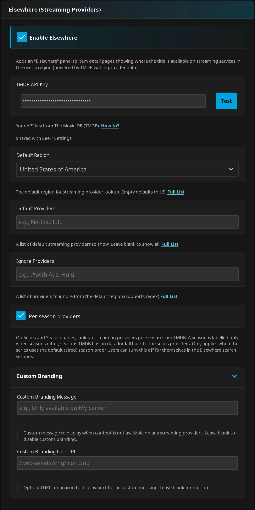
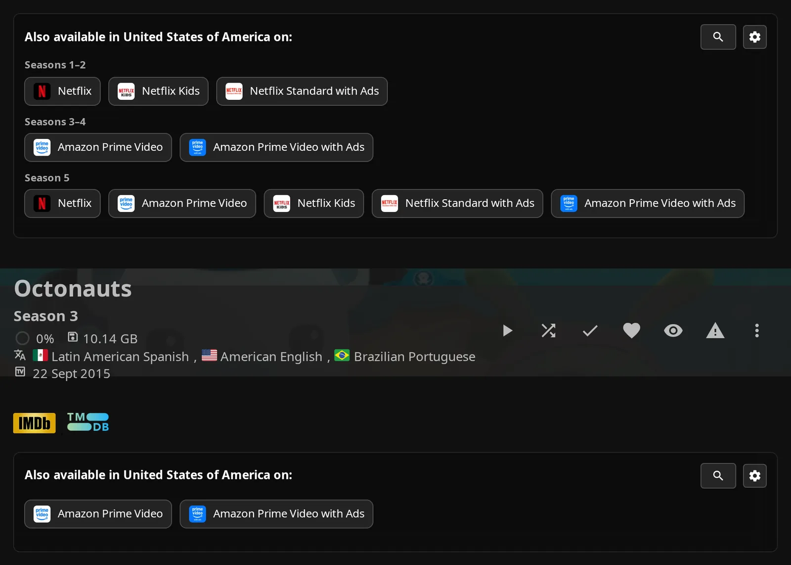
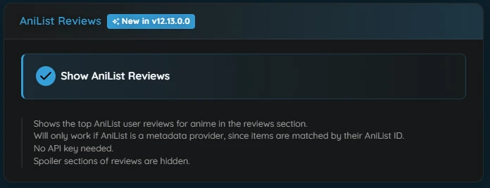

# Elsewhere & Reviews Settings

Configure providers, TMDB reviews, release dates, and local reviews in **Dashboard** → **Plugins** → **Jellyfin Enhanced** → **Elsewhere & Reviews**. Settings on this page are admin settings for the server unless marked per user. For viewer workflows, see [Elsewhere Integration](elsewhere-features.md).

## Prerequisites

Use a compatible Jellyfin web client with Jellyfin Enhanced loaded. See [Compatibility](../getting-started/compatibility.md) to check your client.

!!! note "A compatible web client is required"

    These panels depend on the web client's detail-page elements. Installing the server plugin does not add them to every native or third-party app.

!!! note "TMDB key and internet access"

    Provider lookup, TMDB reviews, and release dates need a TMDB API key and outbound internet access from your Jellyfin server. Get the v3 API key from your [TMDB account's API settings](https://www.themoviedb.org/settings/api). Local reviews need no key, but the item still needs a TMDB identity.

??? info "How items are identified"

    Ordinary provider lookup finds a title through a TMDB external link in the detail section. A metadata ID alone is not enough to show this panel. Eligible season pages have a parent-series exception described under [Per-season providers](#per-season-providers). Reviews and release-date chips use IDs from Jellyfin item metadata instead.

## Setup

Set up the shared TMDB key first, then choose the Elsewhere features you want. The same key also serves JE's TMDB-dependent Seerr features.

1. Open **Dashboard** → **Plugins** → **Jellyfin Enhanced**, then **Elsewhere & Reviews**.
2. Enter your **TMDB API Key**. Click **Test** beside it and read the feedback. This checks the entered key through Jellyfin, including an unsaved key; it does not save configuration.
3. Turn on **Enable Elsewhere**. Enter the key first if this checkbox is disabled.
4. Choose **Default Region**, such as `US`, `GB`, `DE`, or `AU`. Optionally configure **Default Providers**, **Ignore Providers**, and **Custom Branding**.
5. Turn on any review or release-date features you want, then click **Save Settings**.
6. Reload the client and open a supported item detail page.

??? note "Configured key versus tested key"

    **Enable Elsewhere** ships on, but providers cannot work until a key is configured. Its checkbox depends on that key requirement. The server's configured-key flag only means the key is nonempty and non-whitespace; it does not mean the key passed **Test**.

## Configuration Options

Use **Elsewhere (Streaming Providers)** to choose what appears in automatic detail-page results. The country and provider filters also affect logos on JE's Seerr cards.

Follow [Setup](#setup) to apply these server settings, then use the sections below to adjust countries and filters.



| Setting | Default | What it does |
| --- | --- | --- |
| **Enable Elsewhere** | On | Enables the detail-page provider panel with a configured TMDB key. |
| **TMDB API Key** | Empty | Supplies the server-side key shared by TMDB-backed features. |
| **Default Region** | `US` | Sets the automatic search country unless the viewer chooses a personal default. Empty falls back to `US`. |
| **Default Providers** | Empty | Shows all subscription providers when empty; otherwise permits only exact provider names. |
| **Ignore Providers** | Empty | Hides matching provider names after **Default Providers** is applied. |
| **Per-season providers** | On | Enables automatic season lookup for default/aired-order series; users can opt out. |
| **Custom Branding Message** | Empty | Replaces the unavailable heading when no filtered automatic providers or season groups remain. |
| **Custom Branding Icon URL** | Empty | Adds an optional icon beside a nonempty custom message. |

### Default Region

Choose the main country for your server's provider results.

Choose **Default Region** and click **Save Settings**. Viewers inherit it until they save **Default Search Country** in the provider panel's [Search Settings](#search-settings).

??? info "Country defaults and suggestions"

    Seerr provider logos and movie release-date preference use the admin country. Your personal country override does not affect them.

    The admin selector and personal suggestions offer country names and codes. The linked [region suggestion list](https://cdn.jsdelivr.net/gh/n00bcodr/Jellyfin-Elsewhere/resources/regions.txt) helps you select a country; it does not guarantee provider data in every country.

### Default Providers

Limit automatic results and Seerr poster logos to the services you want. Leave **Default Providers** blank to allow all TMDB subscription providers.

1. Enter provider names, separated by commas or newlines. Copy names exactly, including capitalization.
2. Click **Save Settings**.

For example:

```text
Netflix,Amazon Prime Video,Disney Plus
```

The [provider suggestion list](https://cdn.jsdelivr.net/gh/n00bcodr/Jellyfin-Elsewhere/resources/providers.txt) can help you find names. Availability and names depend on the TMDB data returned.

??? info "Exact matching and list handling"

    **Default Providers** uses case-sensitive full-name equality, rather than a regular expression or a partial-name match. A list with no matching names removes every provider.

    Both admin lists accept comma-separated or newline-separated entries. Leading and trailing whitespace is trimmed, empty entries are discarded, and apostrophes are removed. A pattern containing a comma is split into multiple entries and cannot remain one pattern.

    Manual searches bypass **Default Providers** and **Ignore Providers**. They use your personal **Providers (leave empty to show all available)** selection instead, so a manual search in the same country can show different services.

### Ignore Providers

Hide services from automatic results and Seerr poster logos. **Ignore Providers** applies after **Default Providers**, so an exclusion wins even if you allowed that service.

1. Enter names or patterns in **Ignore Providers**, separated by commas or newlines.
2. Click **Save Settings**.

For simple exclusions:

```text
Apple TV,Google Play Movies
```

??? info "Pattern matching and invalid patterns"

    Each entry becomes a case-insensitive regular expression. Simple patterns match anywhere in a name. For full-name matches, anchor the patterns:

    ```text
    ^Apple TV$,^Google Play Movies$
    ```

    To match a literal name containing regex metacharacters such as `+`, `.`, or parentheses, escape them with a backslash. For example, `\+` matches a literal plus sign. A pattern such as `.*with Ads` hides matching subscription-provider names; it does not filter a separate ad-supported availability category.

    If any entry is an invalid regex, the entire ignore step is skipped and an error is logged in the browser console. **Default Providers** still applies. With **Default Providers** set to `Netflix,Amazon Prime Video` and **Ignore Providers** set to `^Netflix$`, only Amazon Prime Video survives when both services are returned.

## Usage

The provider panel shows services for your saved **Default Search Country**, or the admin **Default Region** until you set one. Automatic lookup uses the admin provider lists and, when enabled, season lookup.

### On Item Detail Pages

Read provider badges to see which subscription services carry a title. The badges show names and logos; they do not link to playback.

1. Open a supported movie or series page. Find the provider panel, normally directly below external links.
2. Look for **Also available in {region} on:** or **Not available on any streaming services in {region}**. Custom branding can replace the unavailable heading.
3. Click an available heading to open TMDB's regional availability URL in a new tab, when supplied. Both automatic and manual-country headings use the **JustWatch** tooltip.

??? note "Other display states"

    When raw providers exist but an active **Default Providers** list leaves no matching automatic providers, the panel can also show **No configured services available**. Broken badge logos are hidden while names remain.

### Manual country searches

Compare subscription availability in other countries using your personal provider selection. Manual searches check the whole title, including when you start from a season page.

1. Open the gear icon's **Search Settings** and choose countries and providers.
2. Click **Save**, then use the panel's magnifying-glass icon. It shows **Searching…** while fetching.
3. Read the available-country blocks and the combined unavailable-country block. Use their close icons to dismiss them; searching again replaces all previous manual blocks.

??? info "Which countries and providers are searched"

    A nonempty **Search Other Countries (leave empty to use default)** list replaces the fallback country list. Your default country is not automatically added. With that list empty, the search checks your effective default country only.

    Personal provider selection uses case-sensitive full-name matching. Empty shows all available subscription providers. Manual results bypass both admin lists.

## Search Settings

Use the provider panel's gear icon to choose your country and manual-search preferences. These settings belong to your Jellyfin account and are saved on the server, so they are not limited to one browser.

### How to use

1. Open **Search Settings** and choose **Default Search Country** from the dropdown. Its **Reset to plugin default** icon selects the current admin country.
2. Type in the country or provider autocomplete field, then select a suggestion to add a removable chip. While suggestions are open, use ++arrow-up++ or ++arrow-down++ to navigate, ++enter++ to add, and ++esc++ to dismiss suggestions. Remove a chip with its × control.
3. Set **Show providers per season (when seasons differ)** if available.
4. Click **Save** to submit your selections. **Cancel** or a click on the backdrop closes the dialog without saving.
5. Reload or revisit the page to update automatic results for your new country and season preference.

<figure class="je-video">
  <video autoplay loop muted playsinline controls preload="metadata" aria-label="Changing streaming countries and providers in Search Settings">
    <source src="../../images/elsewhere/provider-region-flow.mp4" type="video/mp4">
  </video>
  <figcaption>Save Canada, Australia, and Netflix in Search Settings, then search for matching providers.</figcaption>
</figure>

Per-user settings:

| Setting | Default | What it does |
| --- | --- | --- |
| **Default Search Country** | Empty; inherits admin country | Sets your automatic country and the manual-search fallback country. |
| **Search Other Countries (leave empty to use default)** | Empty list | Replaces the manual-search country list when nonempty. |
| **Providers (leave empty to show all available)** | Empty list | Selects exact provider names for manual searches only. |
| **Show providers per season (when seasons differ)** | On | Enables your automatic season lookup; shown only when the admin permits it. |

??? note "Saving, resetting, and reopening the dialog"

    Preferences are saved in `elsewhere.json`. **Save** updates the manual-search variables and closes the dialog, but does not rebuild automatic results already on the page.

    Closing without saving does not reset the dialog's unsaved controls; they can still be present when you reopen it. The country reset selects the admin country rather than clearing your saved override back to an inherited empty value.

    Save failures are logged without an error shown in this dialog. If preferences do not persist after reloading, check the browser console and Jellyfin logs.

## Per-season providers

Show which services carry different parts of a series. A series page groups different provider sets under labels such as **Seasons 1–6** and **Season 7**; a season page shows that season's filtered providers.


*Top: series groups; bottom: the Season 3 page.*

### How to use

1. Use a default/aired-order series with a TMDB ID and numbered Jellyfin seasons visible to your account, or an eligible season page with its parent-series ID and season number.
2. Keep the admin **Per-season providers** on.
3. In the panel's **Search Settings**, leave **Show providers per season (when seasons differ)** on and click **Save**.
4. Reload or revisit the series or season page.

| Setting | Default | What it does |
| --- | --- | --- |
| **Per-season providers** | On (admin) | Permits automatic season lookup. |
| **Show providers per season (when seasons differ)** | On (per user) | Lets you opt out when the admin permits season lookup. |

??? info "Grouping, display orders, and fallbacks"

    Grouping considers integer-numbered Jellyfin seasons returned for you, rather than every season TMDB knows about. If all considered seasons have the same provider set, the display stays at series level.

    Admin filters run before grouping and fallback. A regular season with missing data or no matching providers falls back to the filtered series providers. In series grouping, specials (season 0) without matching providers are omitted; they do not inherit series providers. A specials detail page with no usable season result can still fall back to the title-level panel. Different raw season data can collapse to the same set after filtering.

    DVD, absolute, and other alternate display orders keep title-level results because their numbers may not match TMDB's aired order. Manual searches and Seerr cards are always title-level. A season page without a TMDB external link can show the panel through its parent series only when both season settings permit lookup and the parent uses default/aired order.

## Custom Branding

Show your own heading when no filtered automatic providers or season groups remain. The message describes the current country and filters; it does not establish that the title is exclusive to your server.

### How to use

1. Expand **Custom Branding** in **Elsewhere & Reviews**.
2. Enter a message and optional icon URL. Use an image viewers can access, such as an HTTPS URL or a root-relative path like `/web/assets/img/icon.png`.
3. Click **Save Settings** and reload the client.

| Setting | Default | What it does |
| --- | --- | --- |
| **Custom Branding Message** | Empty | Replaces only the automatic unavailable heading. Empty keeps the standard unavailable heading. |
| **Custom Branding Icon URL** | Empty | Adds a 24 × 24 CSS-pixel icon beside the custom message. Empty supplies no icon. |

!!! tip "Check your touch devices"

    With a custom message in the unavailable automatic state, search and settings controls appear on hover. Test this state on the touch devices you use before relying on hover instructions.

??? info "Icons, headings, and hidden controls"

    An icon URL without a message has no effect. Failed icons are hidden. There is no default branding logo. Manual-country results retain their own availability headings.

    With a custom message in the unavailable automatic state, search and settings controls initially have zero opacity. Pointer entry reveals them and pointer exit hides them; their click handlers remain.

## TMDB Reviews

Read TMDB community reviews on movie and series pages. See [TMDB Reviews](elsewhere-features.md#tmdb-reviews) for card behavior and limits.

### How to use

1. Configure and test **TMDB API Key**. Keep **Enable Elsewhere** on to edit the review controls.
2. Turn on **Show TMDB Reviews** and, optionally, **Expand reviews by default**.
3. Click **Save Settings** and reload the client.

| Setting | Default | What it does |
| --- | --- | --- |
| **Show TMDB Reviews** | Off | Enables TMDB review cards for movies and series with TMDB IDs and a configured key. |
| **Expand reviews by default** | Off | Sets the admin default for opening the shared reviews section. A stored viewer preference overrides it. |

Opening or closing **Reviews ({count})** saves your expansion choice, including for local-only reviews. Opening a writing form also opens the section.

??? info "Control dependencies and loading limits"

    The admin UI disables both controls when **Enable Elsewhere** is off. It also disables expansion when **Show TMDB Reviews** is off. This dependency applies to the admin UI: loading TMDB reviews does not require **Enable Elsewhere**. Local reviews are independent of both toggles.

    Your expansion choice is stored in `settings.json`. TMDB requests use `en-US`, page 1, and show at most ten TMDB cards. The count includes all fetched TMDB reviews plus visible local reviews and can exceed the cards shown. Failed or empty lookups can leave **Reviews (0)**.

## AniList Reviews

Show the top AniList user reviews for anime on movie and series pages. See [AniList Reviews](elsewhere-features.md#anilist-reviews) for card behavior and limits.

### How to use

1. Make sure AniList is a metadata provider for your anime library, so items have an AniList ID.
2. Turn on **Show AniList Reviews**, click **Save Settings**, and reload the client.

| Setting | Default | What it does |
| --- | --- | --- |
| **Show AniList Reviews** | Off | Enables AniList review cards for movies and series that have an AniList ID. |



??? info "Dependencies and privacy"

    This needs no API key and is independent of **Enable Elsewhere**, the TMDB key and **Show TMDB Reviews**. Items without an AniList ID show no AniList cards.

    Your Jellyfin server sends the item's AniList ID to AniList's public GraphQL API (`graphql.anilist.co`) and caches the response in memory. No user information is sent.

## User Reviews

Let viewers share text reviews and/or star ratings on your server. Local reviews need no TMDB API key or enabled provider panel.

### How to use

1. Turn on **Enable User Written Reviews** in **Elsewhere & Reviews**, click **Save Settings**, and reload the client.
2. On an eligible detail page, expand **Reviews ({count})** and click **Write a Review** if you have no review for that item, or **Edit** on your existing review.

See [User Reviews](elsewhere-features.md#user-reviews) for writing, editing, deletion, character limits, and the picker limitation.

| Setting | Default | What it does |
| --- | --- | --- |
| **Enable User Written Reviews** | Off | Enables local review UI independently of provider lookup and TMDB reviews. |
| **Hide reviews from hidden users** | On | Hides reviews by hidden Jellyfin authors from other non-admin viewers. |
| **Hide reviews from disabled users** | On | Hides reviews by disabled Jellyfin authors from other non-admin viewers. |
| **Also save review star ratings as the user's Jellyfin rating** | Off | Copies movie/series review stars to the author's Jellyfin rating at twice the star value. |
| **Show average user rating on poster cards** | Off | Adds visible local-review averages to eligible posters when rating tags are enabled. |
| **Show "—" on posters for unrated items** | On | Uses a dash when no visible rated-review average exists and poster averages are enabled. |

!!! note "Item requirements"

    Movies and series need TMDB IDs. Seasons and episodes need the parent-series TMDB ID and the relevant numbering.

??? note "Admin control dependency"

    The admin UI disables the five subordinate local-review controls when **Enable User Written Reviews** is off.

### Author visibility and moderation

Choose whose reviews other viewers can see, and remove reviews when needed. Local reviews are shared server data, rather than private personal notes.

1. Use **Hide reviews from hidden users** and **Hide reviews from disabled users** to set author visibility.
2. Authors can **Edit** or **Delete** their own cards. Admins can use **Delete as admin** on other authors' cards, with confirmation and failure feedback. The web UI does not let admins edit another author's review.

??? info "Visibility rules and deleted accounts"

    The two author-hide settings filter reviews for other non-admin viewers. They use Jellyfin account policies for hidden/disabled users, rather than your **Hidden Content** list. Existing authors always see their own reviews, and admins bypass author filtering.

    Reviews whose authors were deleted are hidden from non-admins while either filter is enabled. With both filters off, those reviews are visible. These rules also govern review averages. Hiding an author leaves the review stored. Deleting a Jellyfin account does not erase its stored reviews.

    Account updates, deletion, and lockout invalidate cached authors for subsequent requests.

### Averages and poster controls

Detail pages show the average of visible rated local reviews out of ten. For example, 3- and 4-star reviews average to 7; text-only reviews do not contribute.

1. Keep **Enable User Written Reviews** on and turn on **Show average user rating on poster cards**.
2. Enable rating tags: use the admin **Enable Rating Tags** in **Display**, or your personal **Show Rating Tags** preference.
3. Choose whether **Show "—" on posters for unrated items** should show a dash when no visible rated-review average exists.

See [Tags](../enhanced/tags.md) for rating-tag placement and supported card contexts.

??? note "Rating-tag defaults and the dash"

    Poster averages require local reviews, poster averages, and effective rating tags to be enabled. The admin **Enable Rating Tags** defaults off. A stored per-user **Show Rating Tags** value overrides that default, including a saved off value.

    The dash means there is no visible rated-review average. It does not mean the current viewer has not rated the item.

### Jellyfin rating mirroring

Copy movie and series review stars to the author's Jellyfin rating. The Jellyfin value is twice the star value; seasons and episodes are excluded.

To use this, turn on **Also save review star ratings as the user's Jellyfin rating**. Saving movie/series stars then copies the rating.

!!! warning "Existing Jellyfin ratings are overwritten"

    Saving review stars with this setting on replaces a Jellyfin rating set elsewhere.

??? note "Removing stars, deleting reviews, and failures"

    Removing stars or deleting the review clears the Jellyfin rating only while mirroring is enabled and the current rating still matches the previous review stars ×2. A value changed elsewhere is preserved.

    A mirroring failure is logged and does not undo the review save or deletion.

### Spoiler Guard

Hide both local and TMDB review panels on guarded items in the web client. This includes guarded movies and a guarded series' child pages.

1. Use the admin **Enable Spoiler Guard** and **Hide reviews on Spoiler Guard series** settings in **Display**.
2. Set your personal **Reviews** preference in Spoiler Guard to override the admin policy, or leave it unset to inherit that policy.

| Setting | Default | What it does |
| --- | --- | --- |
| **Enable Spoiler Guard** | Off (admin, **Display**) | Enables Spoiler Guard, including its review-suppression checks. |
| **Hide reviews on Spoiler Guard series** | On (admin, **Display**) | Permits suppression of local and TMDB review panels for guarded items. |
| **Reviews** | Unset; inherits admin policy (per user) | Controls personal review hiding in Spoiler Guard preferences. Off allows reviews once state loads successfully. |

See [Spoiler Guard settings](../spoiler-guard/spoiler-guard-settings.md).

??? note "State-loading failures and API access"

    If Spoiler Guard state fails to load, reviews are hidden before your personal override is checked. Hiding the panel is a web-client behavior; it does not make local reviews inaccessible through the review API.

## Release Dates

Show movie release dates and television air dates beside detail-page metadata. See [Release Dates](elsewhere-features.md#release-dates) for how each item's date is chosen.

### How to use

1. Configure the shared **TMDB API Key**.
2. Turn on **Show Release/Air Date** under **Release Dates**, then click **Save Settings**.
3. Reload the client and open an identifiable movie, series, season, or episode.

| Setting | Default | What it does |
| --- | --- | --- |
| **Show Release/Air Date** | Off | Enables release/air-date chips with a configured key and resolvable date data. |
| **Default Region** | `US` | Sets movie release-date country preference, followed by US and then other available regions. |

Dates use your locale's format and preserve the calendar day. Missing dates leave out the chip. This feature does not require **Enable Elsewhere**.

??? note "Country preference and child items"

    Your personal **Default Search Country** does not affect movie release dates. Child pages need a parent-series TMDB ID, even when an episode uses its Jellyfin premiere date.

## Integration with Seerr

Show subscription-provider logos on JE's Seerr cards inside Jellyfin, including Seerr results in Jellyfin search. This setting does not configure the external Seerr website.

### How to use

1. Complete [Seerr connection setup](../seerr/seerr-settings.md).
2. Configure the shared **TMDB API Key** in **Elsewhere & Reviews**.
3. Open **Seerr**, turn on **Show Streaming Providers on Posters**, and click **Save Settings**.
4. Reload the client and browse JE's Seerr cards. For Jellyfin search cards, keep **Show Seerr Results in Search** on.

Admin settings in **Seerr**, except the TMDB key:

| Setting | Default | What it does |
| --- | --- | --- |
| **Enable Seerr integration** | Off | Enables JE's Seerr features. |
| **Seerr URL(s) (One per line)** | Empty | Supplies the Seerr instance addresses used by JE. |
| **Seerr API Key** | Empty | Authenticates JE's requests to Seerr. |
| **TMDB API Key** | Empty (**Elsewhere & Reviews**) | Enables server-side watch-provider lookups. |
| **Show Streaming Providers on Posters** | Off | Adds at most four valid subscription-provider logos to JE's Seerr cards. |
| **Show Seerr Results in Search** | On | Enables JE's Seerr results in Jellyfin search when connection and access requirements are met. |

??? info "Country, filters, and logos"

    Cards use the admin **Default Region**, **Default Providers**, and **Ignore Providers**, with title-level availability. They can differ from personal or season-specific item-page results. These cards have no personal country-search/settings panel.

    Logos have provider-name tooltips; failed logos are removed. The logo setting does not require **Enable Elsewhere**.

## Privacy & Data

TMDB lookups send the queried title identifiers and your server's API key to TMDB over HTTPS. User-written reviews stay in Jellyfin's local storage and are not posted to TMDB.

The plugin does not upload your full library inventory or viewing history to TMDB. Individual TMDB IDs identify the titles being looked up. Encryption between your browser and Jellyfin depends on your deployment's HTTPS configuration.

??? info "Request handling and external images"

    Jellyfin handles TMDB API requests through authenticated JE routes. Watch-provider responses contain all available regions. Ordinary detail requests select the country in the browser; Seerr batches send the country to Jellyfin for server-side extraction. The selected country is not added to ordinary upstream watch-provider requests.

    Browsers load provider logos from `image.tmdb.org` and custom branding images from the host in the configured URL. Country/provider suggestions use JE's local CDN route, backed by jsDelivr, with hardcoded fallbacks if loading fails. Clicking an external availability heading opens the URL supplied by TMDB.

### Cache freshness and storage

Cached results can take time to reflect changes on TMDB. Reloading clears results temporarily saved in your browser, but your Jellyfin server may still return its saved results.

??? info "Cache lifetimes and requests"

    Title-level provider and TMDB-review requests use a shared 30-minute client cache. Successful JSON server lookup responses have a six-hour lifetime; JSON 404 responses are cached for ten minutes. Non-JSON responses and HTTP 401, 429, and 5xx outcomes are not stored in that server response cache.

    Concurrent identical lookups share upstream work. Eligible title requests without cached data can bundle providers, reviews, and other title data. Each upstream attempt has a 30-second timeout budget; that does not guarantee a 30-second limit for the entire browser operation.

    Season-provider and TMDB season-number promises stay cached for the lifetime of the initialized Elsewhere script, across detail-page navigation, without time-based expiry. Failed entries are removed. Release-date results have a separate one-hour client cache.

??? note "Stored files and backups"

    JE stores these files under `<PluginsPath>/configurations/Jellyfin.Plugin.JellyfinEnhanced/`:

    | File | Contents |
    | --- | --- |
    | `<userId>/elsewhere.json` | Personal country, manual-search countries/providers, and season preference. |
    | `<userId>/settings.json` | Personal Enhanced settings, including review expansion. |
    | `reviews.json` | Shared local reviews; back this up separately from per-user preferences. |
    | `tmdb-cache.json` | Persistent shared TMDB response cache; not the local-review store. |

    User-directory IDs are normalized lowercase GUIDs without dashes. See [Settings Overview](../getting-started/settings-overview.md) for the broader settings and backup reference.

### API access

You can use authenticated JE routes to access provider data, preferences, and reviews. See the [API reference](../advanced/api.md) for integration examples.

??? info "Provider, settings, and review routes"

    All routes below use the `/JellyfinEnhanced` prefix and require authentication. Admin-only actions check administrator status in their handlers.

    | Method and route | Access and limits |
    | --- | --- |
    | `GET tmdb/{**apiPath}` | Authenticated TMDB proxy; missing configured key returns 503. Parental restrictions can refuse lookups. |
    | `GET tmdb/validate?apiKey=…` | Admin-only test of the supplied key, including an unsaved key. |
    | `GET watch-providers?items=movie:603,tv:1399&region=US` | At most 100 distinct valid titles; `items` at most 2,048 characters. IDs are positive, one to nine digits. An explicit nonempty region must be two uppercase letters. Omitted/empty uses normalized admin country, falling back to US if invalid. |
    | `GET user-settings/{userId}/elsewhere.json` | Own preferences, or another user's preferences for an admin. |
    | `POST user-settings/{userId}/elsewhere.json` | Same access rules; saves personal preferences. |
    | `GET reviews/{mediaType}/{tmdbId}` | Returns reviews visible to the authenticated viewer. |
    | `POST reviews/{mediaType}/{tmdbId}` | Creates or updates the caller's review. |
    | `DELETE reviews/{mediaType}/{tmdbId}` | Deletes the caller's review. |
    | `GET reviews/ratings?keys=…` | Averages and counts of visible rated reviews; at most 200 distinct valid keys. |
    | `GET reviews/admin/all` | Admin list/export; supports `since`, `userId`, `limit`, and `offset`. Limit defaults to 500, accepts 1–1,000; offset defaults to 0 and must be nonnegative. |
    | `POST reviews/admin/{userIdN}/{mediaType}/{tmdbId}` | Admin upsert on another author's behalf. |
    | `DELETE reviews/admin/{userIdN}/{mediaType}/{tmdbId}` | Admin moderation deletion. |

    Review media types are `movie` and `tv`. Season keys use `<seriesTmdbId>:s<n>`; episode keys use `<seriesTmdbId>:s<n>:e<n>`. Reviews are keyed by author, media type, and item key. POST accepts `content` and/or `rating`, with the same 2,000-character and 1–5 half-star limits as the UI.

    Provider batches return a `region` and a `results` map. An empty array means no usable regional subscription entries after server extraction, which also validates names and logo paths. `null` can mean a blocked/failed lookup or an unusable response. Parental restrictions apply to TMDB proxy and provider-batch requests. A missing TMDB key returns 503 for provider batches too.

    The review-ratings response maps keys to `{average, count}` or `null` when no visible rated review exists; its API average is on the five-star scale. **Enable User Written Reviews** governs the client UI, not authorization or availability of the review endpoints. **Show average user rating on poster cards** governs poster inclusion, not access to the direct ratings endpoint.

## Troubleshooting

If the whole client enhancement is absent, start with [installation troubleshooting](../installation/troubleshooting.md). Elsewhere's panels are added to the web client.

### Elsewhere Not Showing

Check the key and the item's TMDB link first. The server also needs a working connection to TMDB.

1. Check **Enable Elsewhere**, test **TMDB API Key**, click **Save Settings**, and reload.
2. Confirm the detail section has a matching TMDB movie/TV external link. A metadata ID alone is not enough.
3. For a season without that link, check the parent TMDB ID, aired/default order, season number, and both season settings.
4. Check DNS, internet connectivity, and firewall rules on the server or inside its container. TMDB API access starts from Jellyfin.
5. Check parental restrictions, the browser console, and Jellyfin logs.

??? note "Client layouts and device VPNs"

    A web-client layout without the expected detail elements can prevent the panel from appearing. A VPN applied only to your viewing device does not change the server's outbound connection.

### No Providers Showing

Check the country and filters before assuming a title has no subscription providers. TMDB data can also be incomplete or outdated, and cached results can delay changes.

1. Check your effective default country and both admin lists. **Default Providers** can remove everything through unmatched names or capitalization; **Ignore Providers** can exclude all matches.
2. Try a manual search with an empty personal provider list to compare unfiltered subscription data in another country.
3. If names show without logos, check browser access to `image.tmdb.org`. For a missing branding icon, check the configured image host.

??? note "Subscription categories"

    No matching subscription (`flatrate`) providers does not mean the title is unavailable to rent, buy, or watch through another category.

### Provider errors

Use the message shown in the panel to choose your next check.

| Message | What to check |
| --- | --- |
| **Invalid TMDB API Key.** | Re-enter the v3 key and use **Test** before saving. |
| **The requested item could not be found on TMDB.** | Verify the item's TMDB identity and metadata match. |
| **Too many requests. Please wait a moment and try again.** | Allow the rate limit to recover before retrying. |
| **The TMDB service is temporarily unavailable. Please try again later.** | Check Jellyfin logs and server/container connectivity; retry after the temporary failure. |
| **Received an unexpected response from the server. Check your reverse proxy or Jellyfin configuration.** | Inspect reverse-proxy/middleware responses for a non-JSON error page. |
| **TMDB API is unreachable.** | Check the browser-to-Jellyfin request as well as the server's outbound TMDB connection. |

??? note "Missing keys and other errors"

    The missing-key proxy response is 503, so the temporary-service message can also mean no key is configured. Other errors can show their underlying HTTP message, including parental-policy refusals.

    Review retrieval failures are logged and can appear as an empty review section rather than a provider error.

### Reviews or dates missing

Check the feature's own setting and the item's metadata. Local reviews need no key; TMDB reviews and dates do.

1. Check the relevant feature toggle and **TMDB API Key** for TMDB reviews or dates. For local reviews, check **Enable User Written Reviews**.
2. Verify item IDs and child numbering. If the review panel is absent, check [Spoiler Guard](#spoiler-guard).
3. Check author filtering, which can reduce reviews and averages. Poster average chips also need rating tags enabled; check **Show Rating Tags** and see [Averages and poster controls](#averages-and-poster-controls) for the admin default and your personal override.
4. If a preference change has not appeared, reload or revisit after **Search Settings** → **Save**.

Missing release data simply leaves out date chips.

??? note "Preferences that do not persist"

    If changes do not persist, inspect the logged save failure. The search dialog does not display that error.

## Limitations

Availability depends on TMDB's data quality, country coverage, and update timing. Displays use subscription-provider data only, and your filters can narrow it further.

!!! note "Availability is informational"

    Logos and headings do not verify your subscriptions or start playback. TMDB lookups and external images require internet access. Local reviews remain local, and cached results can lag behind upstream changes.

## Support

Check the [FAQ](../faq-support/faq.md), [installation troubleshooting](../installation/troubleshooting.md), and your browser/Jellyfin logs. For an unresolved issue, use the [issue-reporting guide](../faq-support/report-issues.md) or [GitHub issues](https://github.com/n00bcodr/Jellyfin-Enhanced/issues).

Include the client, item type, country, and relevant settings. Redact API keys.
