# Enhanced Features

Use Jellyfin Enhanced's shortcuts, browsing tools, and player controls to make Jellyfin fit the way you watch. You can also catch up on unwatched titles, see server activity, and add information to detail pages.

!!! note "Client requirements"

    These controls need a client running JE's injected web scripts. Server-side hidden-content filtering can also affect supported list responses in native clients. See [Compatibility](../getting-started/compatibility.md).

**Open your personal settings:**

1. Press ++question++ outside a text field to open the Enhanced panel. You can also choose **Enhanced Panel** under the **Jellyfin Enhanced** drawer heading, **Jellyfin Enhanced** in Jellyfin 12's avatar menu, or **Jellyfin Enhanced - User Settings** in user preferences. During playback in mobile or TV web layouts, use the tune button titled **Jellyfin Enhanced** when the player controls are available. Desktop layouts hide this button.
2. Use **Search settings…** or select the section named in the feature below. On phones, use the back arrow to return to the section list.
3. Close with ×, ++escape++, or ++question++.

**Open admin settings:** Go to **Dashboard → Plugins → Jellyfin Enhanced**. Tables below show stock defaults for a new installation.

??? note "Personal defaults and saving changes"

    Where an admin setting supplies a personal default, existing users keep their saved choices. Personal settings and shortcut overrides save automatically on the server for each account. Reload another open client to load changes.

    See [Enhanced Settings](enhanced-settings.md) and [Settings Overview](../getting-started/settings-overview.md) for the default/override workflow, including **Overview → Quick Actions → Overwrite everyone's personal settings**.

??? note "Choose where JE pages appear"

    Choose either a native Home tab or Custom Tabs; Plugin Pages can coexist with either. Native tabs need no companion plugin and are recommended for Jellyfin 12's experimental layout. Plugin Pages and Custom Tabs require their respective plugins.

    Plugin Pages 3.0+ applies integration changes without a server restart. Older versions need a restart after first enabling integration.

    Native Home links combine an allocated `tab` index with `jeTab=bookmarks`, `jeTab=hidden-content`, `jeTab=activity`, or `jeTab=catchup`. Use JE's generated links rather than a fixed tab number. See [JE Pages & Tabs](../getting-started/pages-and-tabs.md) for complete placement instructions.

## Header Shortcuts

JE shortcuts share a single header row with Jellyfin's controls, so you can reach common actions quickly. Shortcuts that do not fit move into a menu and return as you widen the window.


**How to use:**

1. Click the ••• button, **More from Jellyfin Enhanced**, to open **More from JE**.
2. Choose a labeled action. On short screens, use **Previous page** and **Next page** to see the remaining actions.
3. Close with the close button, by choosing an action, clicking outside, or pressing ++escape++.

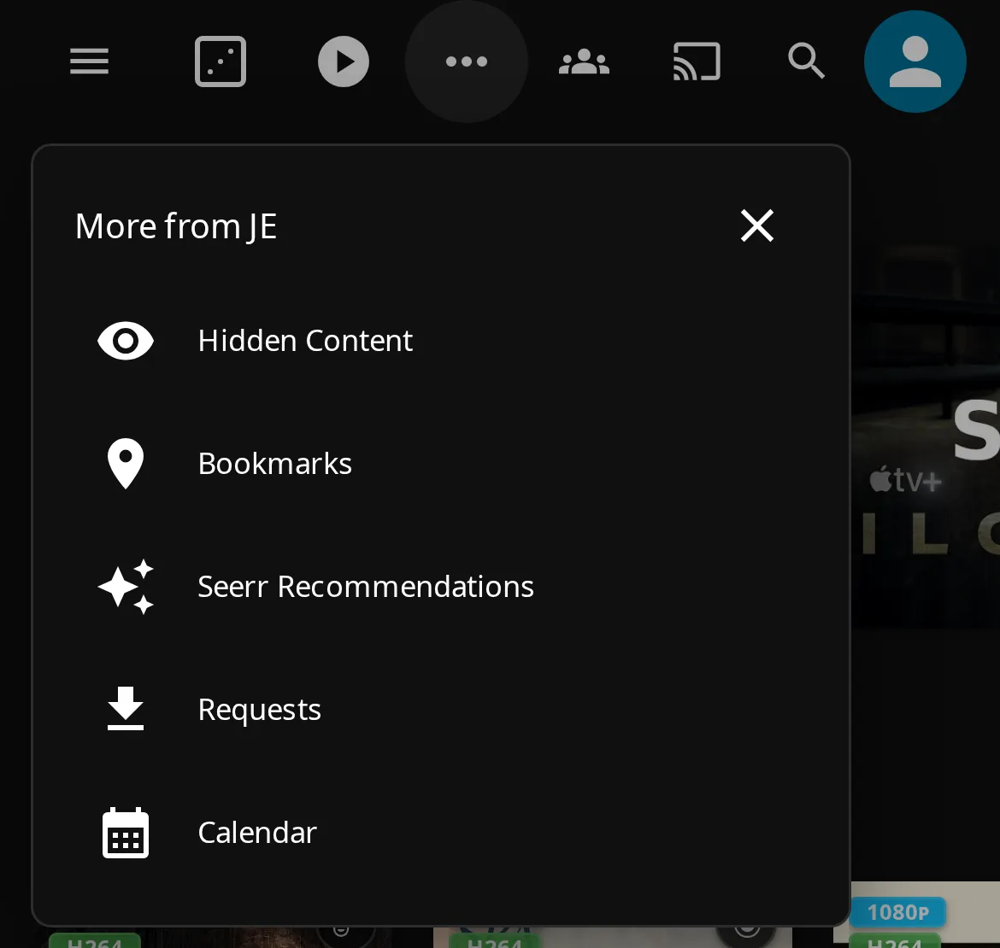

There is no separate setting for this automatic layout. Each shortcut follows its feature's availability. Random gets first priority; other enabled shortcuts stay visible while there is room.

<figure class="je-video">
  <video autoplay loop muted playsinline controls preload="metadata" aria-label="Header shortcuts move into More from JE as the screen narrows">
    <source src="../../images/enhanced/header-resize.mp4" type="video/mp4">
  </video>
  <figcaption>Header shortcuts move into More from JE as the screen narrows.</figcaption>
</figure>

### Random Button

Use the dice button to pick a random title when you cannot decide what to watch. It opens the title's detail page without starting playback.

<figure class="je-video">
  <video autoplay loop muted playsinline controls preload="metadata" aria-label="Random button opens two library titles">
    <source src="../../images/enhanced/random-pick.mp4" type="video/mp4">
  </video>
  <figcaption>Random button opens two library titles.</figcaption>
</figure>

**How to use:**

1. Open **Random Button Settings** to choose item types and a source. Keep at least one of **Movies** and **Shows** selected.
2. Click the dice button or press the stock ++r++ shortcut outside the player. Inside the player, ++r++ resets playback speed.

Personal settings in **Random Button Settings**:

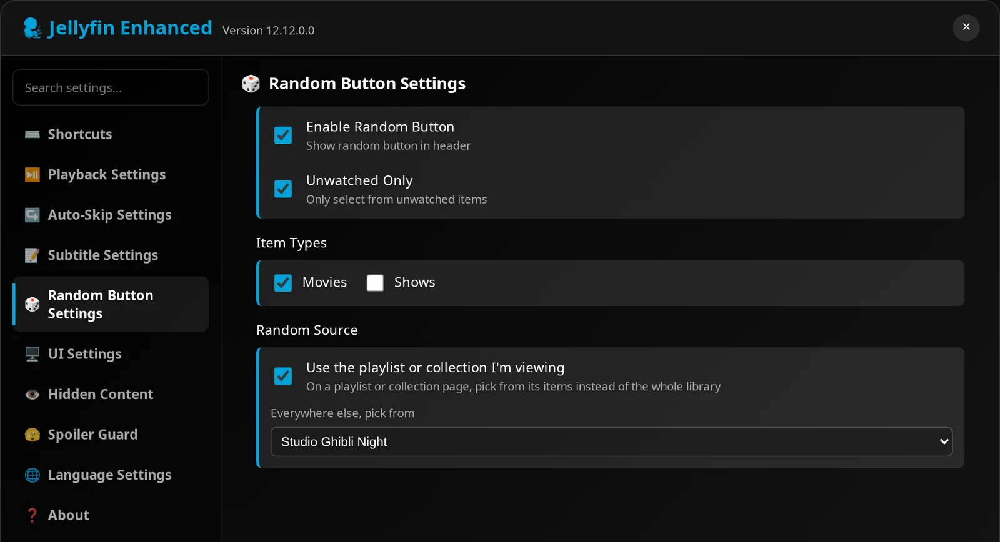

| Setting | Default | What it does |
|---|---|---|
| **Enable Random Button** | On | Shows the dice button. |
| **Unwatched Only** | Off | Includes unplayed movies/episodes and shows with unplayed episodes. |
| **Movies** | On | Includes movies. |
| **Shows** | On | Includes series and, inside playlists/collections, episodes. |
| **Use the playlist or collection I'm viewing** | Off | Gives the open playlist/collection detail page priority over a pinned source. |
| **Everywhere else, pick from** | **Whole library** | Under **Random Source**, pins an accessible playlist or collection for other pages. This choice is personal only. |

Matching initial defaults are under admin **Display → Random Button**:

| Setting | Default | What it does |
|---|---|---|
| **Enable Random Button** | On | Initial button visibility. |
| **Show unwatched only** | Off | Initial watched-state filter. |
| **Include movies** | On | Initial movie selection. |
| **Include shows** | On | Initial show selection. |
| **Scope to the current playlist or collection** | Off | Starting behavior for the playlist or collection you are viewing. |

??? info "How random selection works"

    JE samples up to 100 randomly ordered candidates, then applies the unwatched filter. Playlists and collections supply only their direct children; the whole-library query includes nested items.

    If a pinned source is unavailable or a playlist/collection sample has no eligible titles, JE falls back directly to the library and shows a toast. It bypasses any other pinned source. An empty eligible library sample shows an error. An empty sample does not mean every item in the source is ineligible.

## Content Management

Keep titles you do not want to see out of your browsing lists, or clear individual home rows without changing your playback progress.

### Hidden Content System

Requests & downloads also offers Hide/Unhide on titles that have not arrived yet, their recommendation and discovery cards, and the More Info window. These hides use the movie or series TMDB identity, so all library copies remain hidden after arrival or reimport. The library details page recognises the same rule and offers Unhide, which removes it for every copy, including older item-specific aliases. Undo removes that title rule. Search continues to follow your separate search-filter preference. A failed save leaves the control available to retry. Confirmations and Undo belong to the signed-in session: switching users dismisses them and cancels deferred actions.


Native movie and series card hides honor your confirmation preference before saving. Cancel leaves the title visible; turning confirmations off, or temporarily suppressing them, saves the hide directly.

Jellyfin Enhanced's own card data (tags, ratings and language chips) leaves hidden titles out as well. If another account is playing something you hid, your remote control for that session still works. The title shows as "Hidden content", its tracks are listed by language, codec and channels without their titles, and only values Jellyfin itself vouches for are kept (a language tag that isn't a known language is left out).

Failed title and parent-series metadata batches retry on the next normal scan after a 30-second wait, including the same cards already on screen and later batches that were never requested. No page reload is needed. When you return to a view, cards that previously had no provider metadata are checked again, including cards retained on screen. Rule and account changes also recheck those cards; pending and failed reads keep their existing retry wait. List-view rows get the same checks as cards, so a hidden movie or series disappears from list views too. A parent-series lookup that finishes after you open a details page doesn't hide that page's episodes; the next scan decides them. Cards and rows that leave the page before a hide is shown on them (for example because you navigated away) are checked again when they come back, so a hidden title never reappears. A hide saved while search results or another page are still loading also applies to that response.

Confirmed manager Unhide actions remain valid when you close the manager, but cancel if the signed-in session changes during the fade.
Hide titles from the browsing lists whose filters you enable. Your hidden list follows your account across devices.

!!! note "Hiding does not restrict access"

    You can still open hidden titles directly and play them. “Everywhere” means only the browsing areas whose filters are enabled.

**How to hide:**

1. Ask an administrator to enable **Pages → Hidden Content → Enable Hidden Content**.
2. Open a movie, series, season, or episode detail page and click the open-eye **Hide** button. Movies, series, and seasons use a standard confirmation. An episode with a known series offers **Hide this episode everywhere** or **Hide entire show everywhere**.

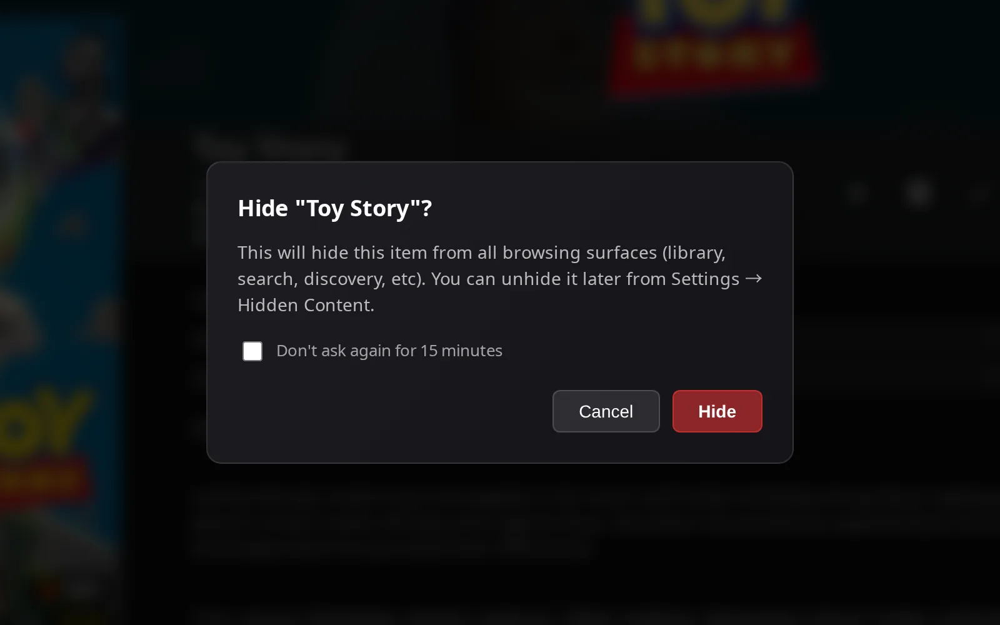

If **Show in Library Views** is on, you can also use card eye buttons. In **Continue Watching** or **Next Up**, their choice dialog can limit a hide to that row: **Remove from Continue Watching** or **Hide from Next Up only**. These choices are separate from detail-page hiding.

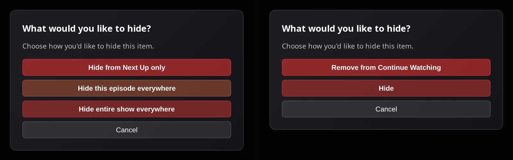

An already-hidden item shows a crossed-out eye; use it to **Unhide**. After a hide, the **Undo** toast lasts eight seconds. A new hide replaces the previous toast.

<figure class="je-video">
  <video autoplay loop muted playsinline controls preload="metadata" aria-label="Hiding a library movie and restoring it with Undo">
    <source src="../../images/enhanced/hide-undo-flow.mp4" type="video/mp4">
  </video>
  <figcaption>Hiding a library movie and restoring it with Undo.</figcaption>
</figure>

**How to manage:** Open **Hidden Content** through its configured entry, or choose **Manage Hidden Content** in the personal section. The page presents **Movies**, expandable **Series** groups, and **Cast / Actors**.

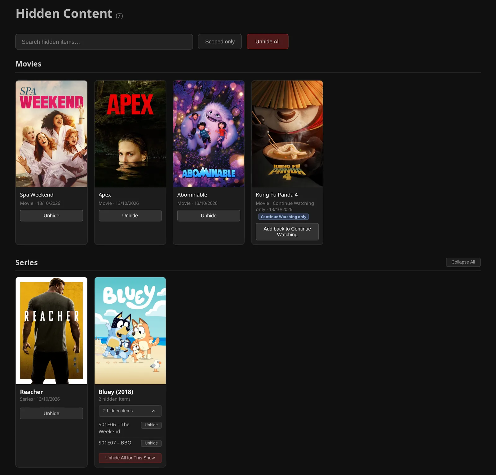

- **Search hidden items…** matches item and series names.
- **Scoped only** shows non-global entries, rather than selecting a particular scope. Badges distinguish **Continue Watching only**, **Next Up only**, and **Home sections only**.
- **Expand All** / **Collapse All** opens or closes series groups.
- **Unhide** restores an entry; **Add back to Continue Watching** restores a Continue Watching-only entry. **Unhide All for This Show** clears a series group.
- **Unhide All** clears the entire list, even if search or **Scoped only** currently shows a subset.

Personal settings in the Enhanced panel's **Hidden Content** section start from admin **Pages → Hidden Content** defaults. The table includes matching admin labels. Button visibility and filtering are separate:

| Setting | Default | What it does |
|---|---|---|
| **Enable Content Hiding** | On | Enables personal filtering without deleting entries when turned off. Admin: **Hidden Content enabled by default**. |
| **Show Hide Buttons** | On | Shows eye buttons; turning it off preserves filtering. Admin: **Show "Hide" buttons by default**. |
| **Show Confirmation Dialog** | On | Confirms standard hides. Admin: **Show confirmation dialog before hiding**. |
| **Show on Seerr Items** | On | Shows eye buttons on supported Seerr results. Admin: **Show "Hide" button on Seerr search results**. |
| **Show in Library Views** | Off | Shows eye buttons on library/home cards. Admin: **Show "Hide" button on library / home cards**. |
| **Show on Detail Pages** | On | Shows eye buttons on supported media detail pages. Admin: **Show "Hide" button on item details pages**. |
| **Show on Cast/Actors** | Off | Adds hiding on cast cards and person detail pages. Admin: **Show "Hide" button on cast / actor cards**. |
| **Filter Library** | On | Filters library lists and supported detail-page lists. Admin: **Filter Library & details pages**. |
| **Filter Search** | Off | Filters supported Jellyfin and Seerr search results. Admin: **Filter Search results**. |
| **Filter Continue Watching** | On | Filters that home row, including row-specific hides. |
| **Filter Next Up** | On | Filters that home row, including row-specific hides. |
| **Filter Upcoming** | On | Filters upcoming episodes. Admin: **Filter Upcoming episodes**. |
| **Filter Recommendations** | On | Filters supported suggestions/recommendation results. Admin: **Filter Suggestions / recommendations**. |
| **Filter Discovery** | On | Filters JE's Seerr discovery results. |
| **Filter Calendar** | On | Filters JE's Calendar. |
| **Filter Requests** | On | Filters JE's Requests page. Admin: **Filter Requests page**. |
| **Hide Collections & Libraries** | Off | Experimental: allows hiding My Media libraries, collections, and playlists with library-card buttons enabled, without recursively hiding every child. Admin: **Allow hiding collections, libraries, and playlists (experimental)**. |

Admin settings in **Pages → Hidden Content**:

| Setting | Default | What it does |
|---|---|---|
| **Enable Hidden Content** | Off | Loads the full feature, personal section, and management page. |
| **Add Hidden Content as a native Home tab** | Off | Adds a built-in Home tab; its shortcut is available when the tab button is hidden. |
| **Use Plugin Pages for Hidden Content** | Off | Adds the page to Plugin Pages. |
| **Use Custom Tabs for Hidden Content** | Off | Uses a Custom Tabs entry instead of a native tab. |
| **Add the Custom Tabs entry for me** | Off | Creates/manages the JE-owned entry on save. |

??? info "Hidden Content details"

    Plugin Pages uses `/JellyfinEnhanced/hiddenContentPage`. For manual Custom Tabs setup, use:

    ```html
    <div class="jellyfinenhanced hidden-content"></div>
    ```

    Standard confirmation offers **Don't ask again for 15 minutes**. This preference is local to your browser and specific to your account. **Show Confirmation Dialog** controls the persistent preference. Episode/show and home-row choice dialogs still appear when you need to choose an action.

    The other filter labels are identical in the personal and admin interfaces. Hidden Content preferences are saved with your per-account list on the server in `hidden-content.json`, separately from ordinary personal settings. The standalone `#/hidden-content` route opens only with native Home tab and Custom Tabs placement off and no detected Plugin Pages integration for Hidden Content. See the [standalone-route table](../getting-started/pages-and-tabs.md#reach-the-pages-on-desktop-and-phone) for navigation conditions.

    Cast hiding saves the person as a hidden item; it does not hide every movie or show featuring that person. A series hide can suppress its episodes and seasons through their series ID.

    Server filtering also affects clients consuming covered Jellyfin list endpoints, even if they cannot show JE's eye buttons. Native filtering matches Jellyfin item/series IDs; Seerr filtering matches TMDB IDs. A Seerr-only hide does not guarantee hiding a later-added library item.

    Calendar filtering also matches normalized names, which can collide. Deleting a library item removes entries for its Jellyfin ID. Home Screen Sections' synthetic discovery/upcoming results are not equivalent to JE's integration results.

### Remove from Continue Watching / Next Up

Remove an item from a home row while preserving its playback position and watched state. Row-specific hides are stored server-side for your account.

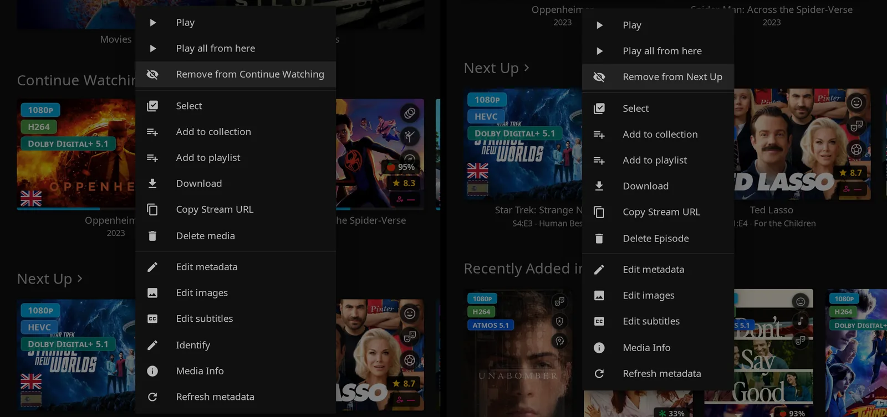

**How to use:**

1. Open an item's ⋯ menu, right-click menu, or long-press/multi-select menu in **Continue Watching** or **Next Up**.
2. Choose **Remove from Continue Watching** or **Remove from Next Up**. Mixed selections from removable rows use **Remove**; selections from one row use its specific label.

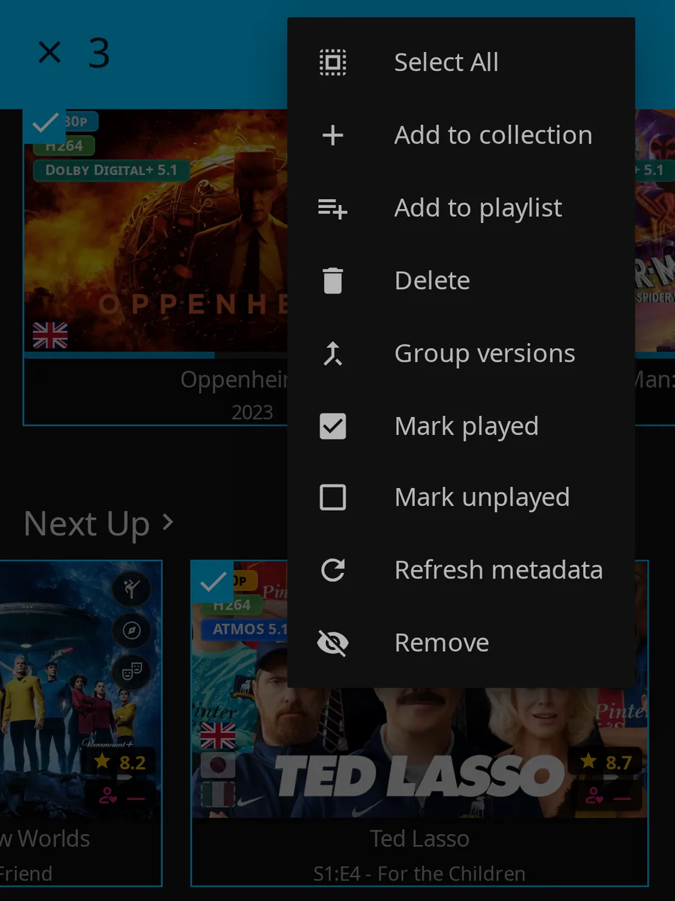

For multiple removable items, confirm the list of titles and rows. A single removable item needs no bulk confirmation.

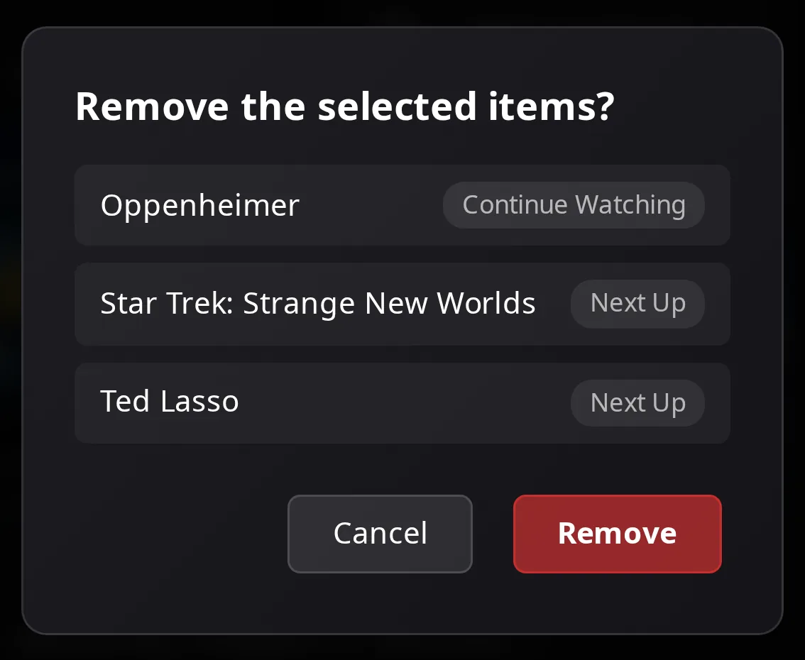

| Setting | Default | What it does |
|---|---|---|
| **Enable "Remove from Continue Watching"** — admin **Display** | Off | Enables server row filtering and supplies the initial personal removal-button default. |
| **Add Remove from Continue Watching & Next Up Buttons** — personal **UI Settings** | Off | Adds the menu actions. Turning it off retains earlier hides. |

To restore entries manually, enable the full Hidden Content feature and use its management page: **Add back to Continue Watching** for Continue Watching-only entries, **Unhide** for Next Up or combined entries. Confirm with **Unhide** in the dialog.

<figure class="je-video">
  <video autoplay loop muted playsinline controls preload="metadata" aria-label="Removing an in-progress movie and adding it back without losing progress">
    <source src="../../images/enhanced/remove-flow.mp4" type="video/mp4">
  </video>
  <figcaption>Remove a movie, restore it through Hidden Content, and return to its saved playback progress.</figcaption>
</figure>

!!! note "Keep removed items out of the row"

    Lasting filtering needs the server's removal setting or **Enable Hidden Content**, plus personal **Enable Content Hiding** and the relevant **Filter Continue Watching** / **Filter Next Up** setting.

??? info "Row removal and restoration"

    With both server features off, a personal button can save the hide and remove the current card, but later server responses are not filtered. First-time removal enables personal filtering; existing Hidden Content preferences are retained.

    Items outside removable rows are ignored, although a card carrying a playback position can be recognized as Continue Watching. Requests run separately, so a batch can partly succeed. Canceling or total failure preserves the selection. Successful removals also hide empty home sections. Home Screen Sections rows, including its combined Continue Watching/Next Up row, are supported.

    Removing the same item from both rows combines the hide; global and already-combined hides are preserved.

    Resuming clears a matching Continue Watching-only hide. A combined hide becomes Next Up-only, restoring Continue Watching visibility. Next Up-only and global hides remain until removed manually. Episode playback can also match a hide saved against its series.

### Admin: Other Users' Hidden Content

As an administrator, you can review and manage other users' hidden lists from the same **Hidden Content** page.

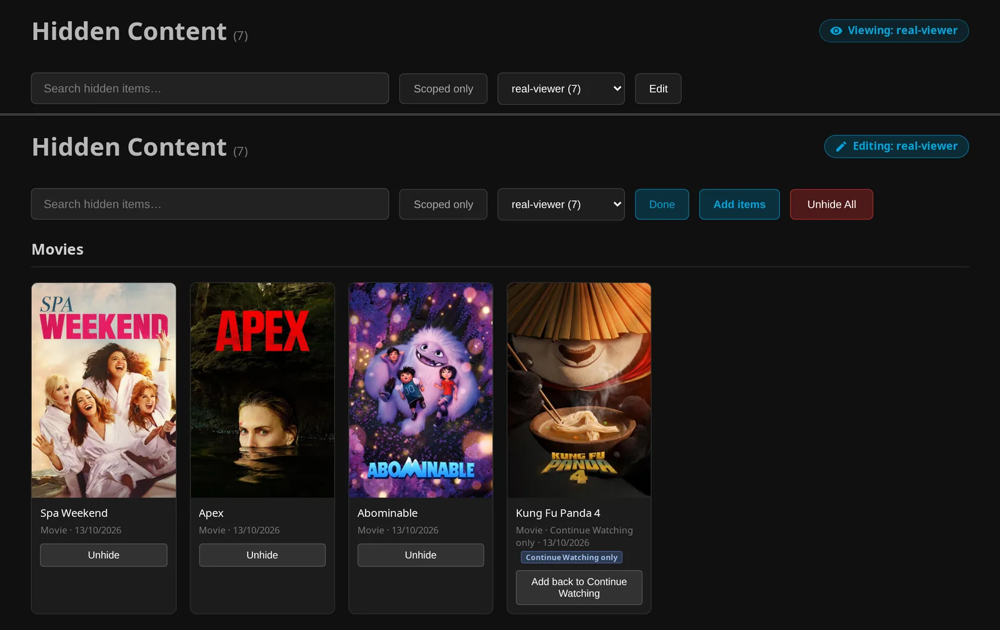

**How to use:**

1. Select a user from **View user's hidden content**. The picker appears when another user has hidden entries. **My hidden content** returns to your own list.
2. Choose **Edit** to restore entries, or **Add items** to search for titles. Enter at least two characters. **In library** and **Discover** distinguish sources.
3. Click **Hide** to add a global hide. **Already hidden** entries are skipped, preserving the user's existing hide.
4. Choose **Done** to return to read-only mode. **Unhide All** in edit mode clears the selected user's entire list.

Admin **Pages → Hidden Content → Admin Controls**:

| Setting | Default | What it does |
|---|---|---|
| **Let admins view and manage other users' hidden content** | On | Enables both cross-user viewing and editing when Hidden Content is enabled. Turn it off to disable these controls. |

??? note "Cross-user access and search"

    Access is checked server-side. Switching users clears search/scoped filtering and opens a read-only list with **Viewing: {userName}**.

    JE requests up to 24 library matches using the admin's library access and also searches Seerr when available.

## Playback & Controls

Use shortcuts, bookmarks, and player preferences to make watching more comfortable.

### Advanced Keyboard Shortcuts

Navigate Jellyfin and control local video playback without opening menus. Admin bindings supply defaults; you can override or disable individual JE actions for your account.

<figure class="je-video">
  <video autoplay loop muted playsinline controls preload="metadata" aria-label="Opening shortcut help over the player and returning to playback">
    <source src="../../images/enhanced/shortcut-overlay.mp4" type="video/mp4">
  </video>
  <figcaption>Opening shortcut help over the player and returning to playback.</figcaption>
</figure>

**How to use:** Press the keys below outside text input fields. To customize them:

1. Open **Shortcuts** in the Enhanced panel.
2. Click or focus a binding to show **Waiting…**, then press a key combination.
3. While listening, use ++backspace++ to restore the current admin default, or ++delete++ or the disable control to mark the action **Disabled**. Re-enabling restores the admin default. ++tab++ moves on and ++esc++ closes the panel; neither is recorded.

<figure class="je-video">
  <video autoplay loop muted playsinline controls preload="metadata" aria-label="Changing, disabling and resetting a keyboard shortcut">
    <source src="../../images/enhanced/shortcut-edit-flow.mp4" type="video/mp4">
  </video>
  <figcaption>Changing, disabling and resetting a keyboard shortcut.</figcaption>
</figure>

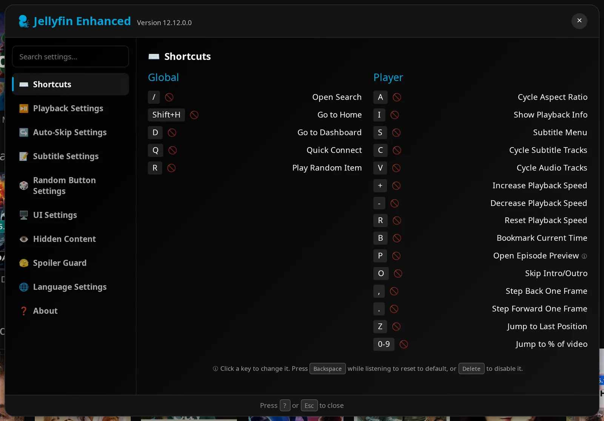

| Global action | Stock key | What it does |
|---|---|---|
| **Open Search** | ++slash++ | Opens search. |
| **Go to Home** | ++shift+h++ | Opens Home. |
| **Go to Dashboard** | ++d++ | Opens the dashboard; Jellyfin permissions still apply. |
| **Quick Connect** | ++q++ | Opens Quick Connect. |
| **Play Random Item** | ++r++ | Opens random item details when the dice button is available. |

| Player action | Stock key | What it does |
|---|---|---|
| **Cycle Aspect Ratio** | ++a++ | Cycles **Auto → Cover → Fill**. |
| **Show Playback Info** | ++i++ | Toggles JE's statistics overlay. |
| **Subtitle Menu** | ++s++ | Opens the subtitle menu. |
| **Cycle Subtitle Tracks** | ++c++ | Cycles tracks, including **Off**. |
| **Cycle Audio Tracks** | ++v++ | Cycles audio tracks, without an Off option. |
| **Increase Playback Speed** | ++plus++ | Steps up through 0.25×, 0.5×, 0.75×, 1×, 1.25×, 1.5×, 1.75×, and 2×. |
| **Decrease Playback Speed** | ++minus++ | Steps down through those speeds. |
| **Reset Playback Speed** | ++r++ | Returns to 1×. |
| **Bookmark Current Time** | ++b++ | Opens **Add Bookmark** when Bookmarks is enabled. |
| **Open Episode Preview** | ++p++ | Clicks the existing preview button; requires the separate InPlayerEpisodePreview plugin. |
| **Skip Intro/Outro** | ++o++ | Skips the current segment. |
| **Step Back One Frame** | ++comma++ | Pauses and seeks back one estimated frame. |
| **Step Forward One Frame** | ++period++ | Pauses and seeks forward one estimated frame. |
| **Jump to Last Position** | ++z++ | Returns once to the position saved before the last seek. |
| **Jump to % of video** | ++0++–++9++ | Seeks to 0%, 10%, … 90%. Can be disabled but not rebound. |

| Setting | Default | What it does |
|---|---|---|
| **Disable Keyboard Shortcuts** — admin **Keyboard** | Off | Disables ordinary JE shortcuts and hides **Shortcuts**. The ++question++ panel shortcut still works outside text fields. |
| **Shortcuts Panel Autoclose Delay (ms)** — admin **Playback** | 15000 | Closes the panel after the configured delay while the pointer is outside it. |

??? info "Shortcut behavior and admin bindings"

    Modifier-only presses are ignored. Conflicts and reserved native player bindings are rejected with a red shake; a dot marks personal overrides. Changes save in your server-side `shortcuts.json`.

    Administrators can set server bindings in **Keyboard → Keyboard Config** using its recorder, then **Save Settings**. While recording there, ++delete++ disables an action and ++backspace++ restores its stock binding. Existing personal overrides still take precedence.

    Held ++c++ or ++v++ does not repeatedly cycle tracks. Frame stepping uses media frame-rate metadata. When it is missing, JE falls back to 24 fps and shows a notice.

    **Cycle Aspect Ratio** stores Jellyfin's aspect ratio in this browser and adjusts graphical-subtitle canvases. **Show Playback Info** refreshes the statistics overlay every second while open. **Skip Intro/Outro** seeks past the segment containing the current position, including other segment types, and falls back to an available native skip button. It is independent of auto-skip settings.

### Smart Bookmarks

Save moments in a video and return to them from timeline markers or a library-wide page. Your bookmarks are personal and stored on the server.

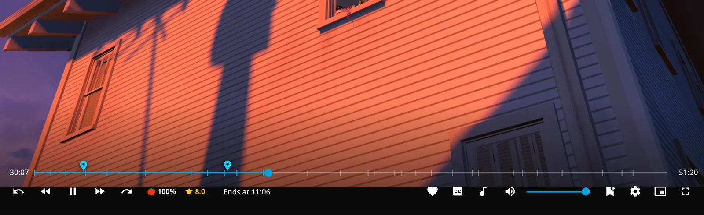

**How to use:**

1. During playback, press ++b++ or click the bookmark-add player button.
2. In **Add Bookmark**, **Time** is captured when opening begins and is read-only. Enter **Label (optional)**, up to 100 characters.
3. Click **Add Bookmark** to save. Click its timeline marker to jump there. **Existing Bookmarks** also offers jump and delete controls.
4. Open **Bookmarks** through its navigation entry. Use **Movies**, **Series**, or **Others**; the last group covers items outside Movie/Episode groupings. Click a timestamp/play icon to start there. Edit a time in seconds or `HH:MM:SS` and change its label.

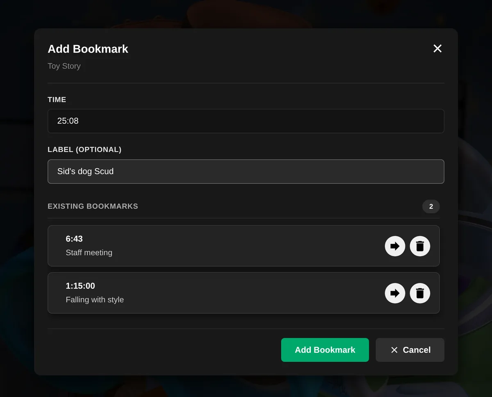

<figure class="je-video">
  <video autoplay loop muted playsinline controls preload="metadata" aria-label="Saving a bookmark and jumping back to it during playback">
    <source src="../../images/enhanced/bookmark-add-jump.mp4" type="video/mp4">
  </video>
  <figcaption>Saving a bookmark and jumping back to it during playback.</figcaption>
</figure>

Admin **Pages → Bookmarks**:

| Setting | Default | What it does |
|---|---|---|
| **Enable Bookmarks Feature** | On | Enables creation, timeline markers, and management. |
| **Add Bookmarks as a native Home tab** | Off | Adds a built-in Home tab and a shortcut when its tab button is hidden. |
| **Use Plugin Pages for Bookmarks Library** | Off | Adds the page to Plugin Pages. |
| **Use Custom Tabs for Bookmarks** | Off | Uses Custom Tabs instead of a native tab. |
| **Add the Custom Tabs entry for me** | Off | Manages the entry on save. |

??? info "Bookmark storage and matching"

Panel edits belong to the current signed-in session. Closing the panel or switching users cancels an unfinished subtitle-position drag.

    Plugin Pages uses `/JellyfinEnhanced/bookmarksPage`. For manual Custom Tabs setup, use:

    ```html
    <div class="sections bookmarks"></div>
    ```

    Your bookmarks are stored in `bookmark.json`. The standalone `#/bookmarks` route opens only with native Home tab and Custom Tabs placement off and no detected Plugin Pages integration for Bookmarks. See the [standalone-route table](../getting-started/pages-and-tabs.md#reach-the-pages-on-desktop-and-phone) for navigation conditions.

    Markers for the exact item are cyan. If that item has no exact bookmarks, matching TMDB/TVDB IDs can provide orange fallback markers with **File may have changed since bookmark was created**.

    Episode matching checks saved season/episode identity when present. Legacy records without it can match by provider ID alone. Timestamps are reused without adjusting for different edits of the video.

??? tip "Merge duplicates, adjust timing, or recover a replaced file"

    **Find Duplicates → Merge to Primary** copies matching bookmarks to the first item key in the stored duplicate group. “Primary” is not a detected preferred Jellyfin version. Originals remain; repeated merges can create copies. Episode duplicate/replacement matching preserves available season/episode identity.

    On the resulting item, use **Adjust Offset**, enter positive or negative **Time Offset (seconds)**, then **Apply Offset**. Only copied records still marked as synchronized are shifted, with times clamped at zero. Successful updates clear their synchronization markers; a zero offset clears markers without shifting times.

    For an **Orphaned** item, use **Find Replacement**, select a matching library item, then **Migrate Bookmarks**. Migration moves records and removes the old ones after a successful save. The replacement button needs a saved TMDB ID; matching can also use TVDB. Search checks at most the newest 500 candidates, so an older replacement may not appear.

    Failed saves show feedback and roll back changes; a failed migration preserves the original records. Bookmark writes are serialized within the client.

!!! warning

    Individual deletion is immediate. **Delete All** asks for confirmation and has no undo. Recover replacements before **Cleanup Orphaned**: cleanup treats failed item lookups as missing, so network or access failures can cause unintended deletion. There is no bookmark export/import control.

### Custom Pause Screen

After you pause and stop interacting, JE can display artwork and media information over the video.

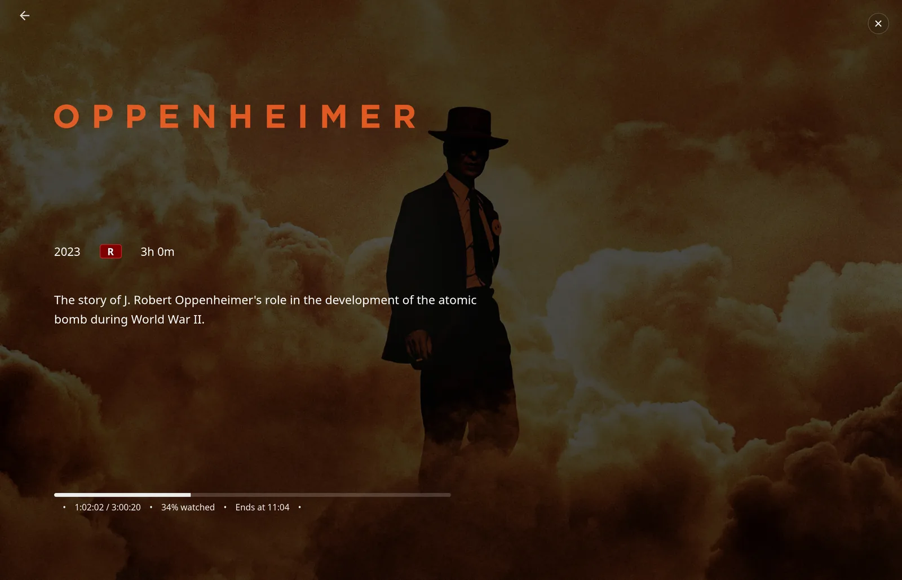

**How to use:**

1. Enable **Custom Pause Screen** in **Playback Settings**.
2. Pause and wait for the idle delay. Interaction postpones its appearance; moving the pointer after it appears leaves the overlay visible.
3. Press ++space++ / ++enter++ or click/tap the background to resume. × dismisses without resuming and prevents another overlay during that pause.

<figure class="je-video">
  <video autoplay loop muted playsinline controls preload="metadata" aria-label="Pause screen appears after a delay and disappears on resume">
    <source src="../../images/enhanced/pause-appearance.mp4" type="video/mp4">
  </video>
  <figcaption>Pause screen appears after a delay and disappears on resume.</figcaption>
</figure>

| Setting | Default | What it does |
|---|---|---|
| **Enable Custom Pause Screen** — admin **Playback → Playback & Tab Switch** | On | Supplies the initial personal default. |
| **Custom Pause Screen** — personal **Playback Settings** | On | Enables the overlay; reload after changing enablement. |
| **Delay before showing (seconds):** — personal **Playback Settings** | 5 | Idle delay while paused; accepts integers from 1–60 and updates the running delay. |

The overlay shows the year, official age rating, runtime, description, elapsed/total time, watched percentage, and estimated **Ends at** time. See [CSS Customization](../advanced/css-customization.md) for styling.

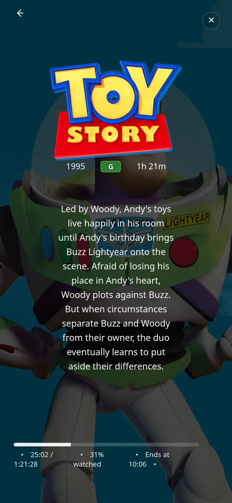

??? note "Pause-screen artwork and layout"

    Logo, disc, and blurred backdrop depend on available item/parent/series artwork. A missing logo does not guarantee a text-title fallback. Disc art hides on narrow layouts, can return in short landscape layouts, and stops rotating with reduced-motion preferences.

### Smart Playback

Manage tab-switch playback, temporary speed boosts, and automatic intro/outro skipping in the browser player.

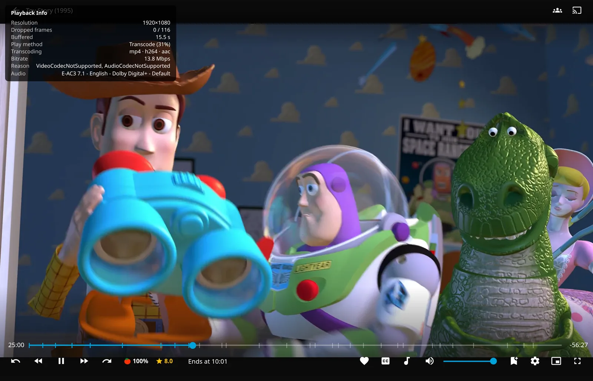
*The player also shows rating chips, a bookmark button, and the optional Playback Info overlay.*

**How to use:** Open **Playback Settings** for tab-switch and hold controls, or **Auto-Skip Settings** for intros/outros. Admin defaults are under **Playback → Playback & Tab Switch** and **Playback → Auto-Skip**.

- For continuous Picture-in-Picture playback, turn off **Auto-pause**.
- For temporary 2× speed, hold the video background with the left mouse button or touch for 500 ms. Release or cancel to restore the previous speed. Hold only on the video background.

<figure class="je-video">
  <video autoplay loop muted playsinline controls preload="metadata" aria-label="Holding the video temporarily increases playback to twice normal speed">
    <source src="../../images/enhanced/long-press-speed.mp4" type="video/mp4">
  </video>
  <figcaption>Holding the video temporarily increases playback to twice normal speed.</figcaption>
</figure>

For auto-skip, you need Jellyfin's stored media segments from a provider such as Intro Skipper.

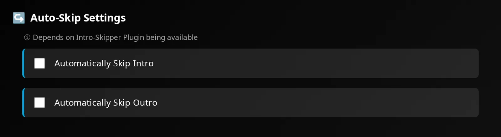

| Setting | Default | What it does |
|---|---|---|
| **Auto-pause** — personal; **Auto-pause on tab switch** — admin | On | Pauses playing video when the browser tab is hidden. |
| **Auto-resume** — personal; **Auto-resume on tab switch** — admin | Off | Resumes only when JE recorded that it paused on leaving; does not resume a video already paused manually. |
| **Auto Picture-in-Picture** — personal; **Auto Picture-in-Picture on tab switch** — admin | Off | Requests PiP when leaving and closes the PiP window JE opened when returning. |
| **Long Press for 2x Speed (β)** — personal; **Long press/hold for 2x speed β** — admin | Off | Temporarily boosts speed while holding. Reload after first enabling. |
| **Automatically Skip Intro** — personal; **Auto-skip Intro** — admin | Off | Seeks to the end of stored Intro segments. |
| **Automatically Skip Outro** — personal; **Auto-skip Outro** — admin | Off | Seeks to the end of stored Outro segments. |

??? info "Playback behavior and limits"

    **Picture-in-Picture:** Auto-pause pauses playing video when the document is hidden. Auto-pause and PiP can run on the same visibility change. PiP needs browser support, loaded video metadata, and browser permission/activation. A request can be refused. Edge/Chrome may open their own automatic PiP; JE closes only the window it opened itself.

    **Temporary 2× speed:** A speed indicator appears during the boost. Activation on a paused video attempts playback. Moving more than ten pixels before activation cancels the pending hold. OSD controls and the pause overlay are excluded, but the Enhanced panel is not reliably excluded.

    **Auto-skip:** JE seeks to the exact stored segment end. It does not depend on an English button label or require Jellyfin's segment action to display a skip button. Segments need start/end boundaries and must last at least one second.

    Seeking back inside a segment just skipped leaves you there. Seek before its start and play through it to skip again. **Recap**, **Preview**, and **Commercial** actions remain Jellyfin's responsibility; JE's automatic toggles cover only intros/outros. Outro skipping does not implement a separate auto-next feature; Jellyfin controls next-episode autoplay.

    Failed segment retrieval or ambiguous playing-item identity can leave skipping inactive. Jellyfin stores segments per item, so multiple versions with different timings can use boundaries from the primary version.

!!! note "Auto-skip uses a local seek"

    Direct play/direct stream and HLS are suitable. Progressive transcoding can stall beyond produced data, and SyncPlay peers do not follow this local seek.

### Customizable Subtitles

Style text subtitles with presets, colors, effects, and a live position preview. These preferences do not change Jellyfin's saved subtitle appearance settings.

**How to use:**

1. During playback, open **Subtitle Settings**.
2. Choose presets or edit **Text** / **Background**, and preview the result. Changes apply to supported text tracks.
3. For positioning, set Jellyfin's **Subtitle styling** to **Custom** in user subtitle preferences, then click or drag the **Position** grid.

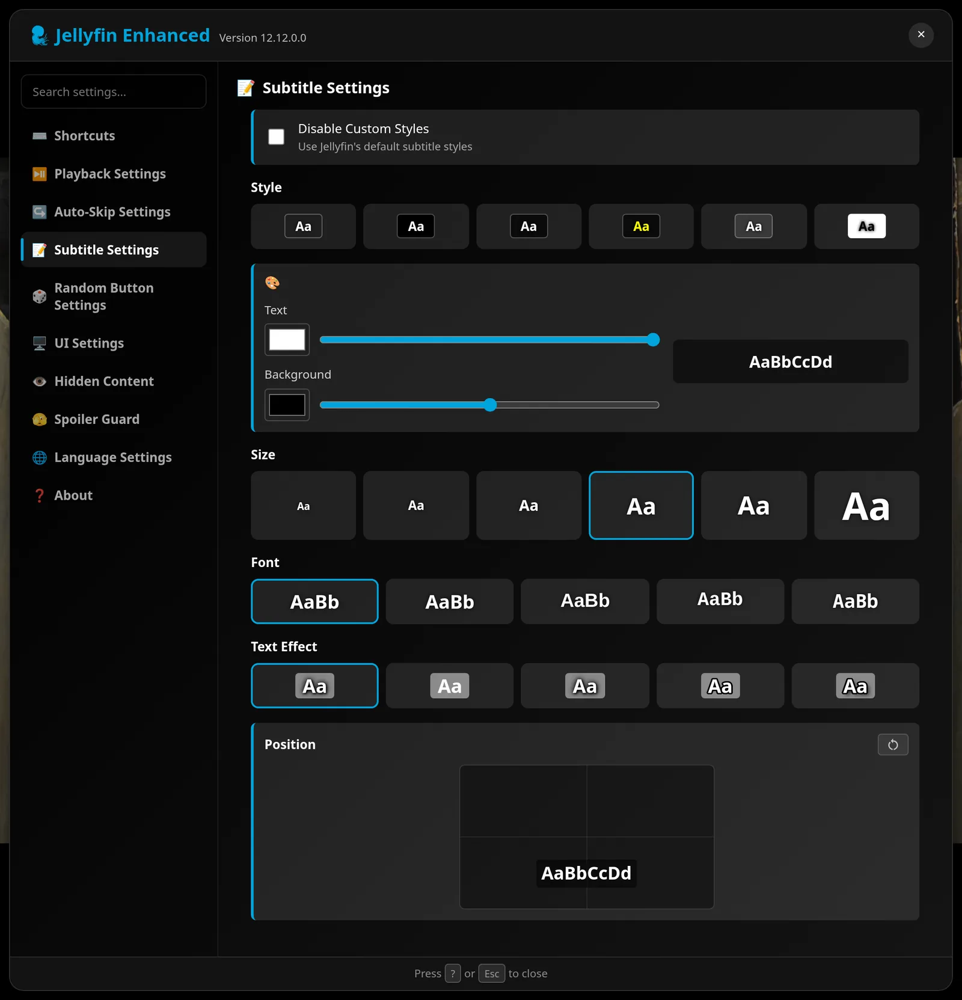

Personal **Subtitle Settings**, with initial defaults from admin **Playback → Subtitles**:

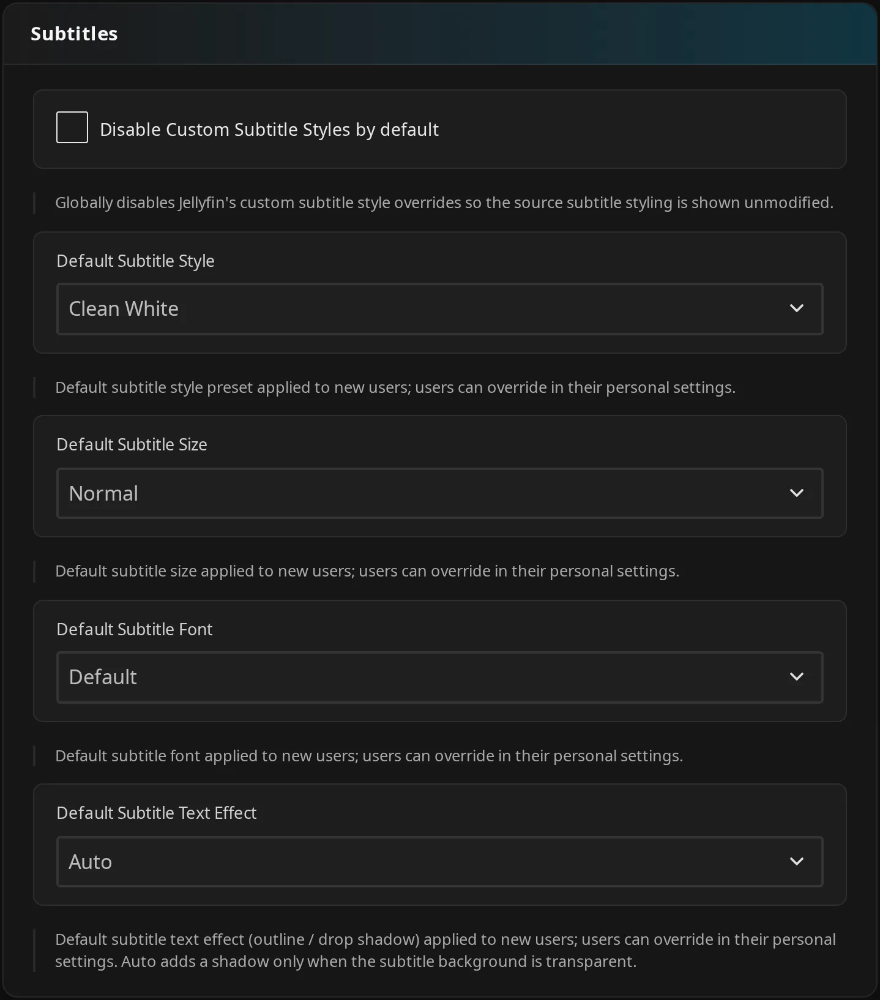

| Setting | Default | What it does |
|---|---|---|
| **Style** | **Clean White** | Sets preset text/background colors; admin **Default Subtitle Style**. |
| **Size** | **Normal** | Selects size; admin **Default Subtitle Size**. |
| **Font** | **Default** | Selects font; admin **Default Subtitle Font**. |
| **Text Effect** | **Auto** | Selects shadow/outline; admin **Default Subtitle Text Effect**. Auto uses a shadow with the transparent preset or `#00000000`; a visible box, including a semi-transparent one, has no Auto shadow. |
| **Text** | White, `#FFFFFFFF` | Custom text color/alpha. |
| **Background** | Transparent, `#00000000` | Custom background color/alpha. |
| **Position** | Horizontal 50%, vertical 85% for server-created settings | Places the stack's lower edge; grid range is 2–98% on both axes. |
| **Disable Custom Styles** | Off | Leaves styling to Jellyfin after reload; admin **Disable Custom Subtitle Styles by default**. |

- **Style:** **Clean White**, **Classic Black Box**, **Netflix Style**, **Cinema Yellow**, **Soft Gray**, **High Contrast**.
- **Size:** **Tiny**, **Small**, **Normal**, **Large**, **Extra Large**, **Gigantic**.
- **Font:** **Default**, **Noto Sans**, **Sans Serif**, **Typewriter**, **Roboto** (Roboto Mono).
- **Text Effect:** **Auto**, **None**, **Shadow**, **Outline**, **Outline + Shadow**.

For white text on a semi-transparent black box like the example below, set **Text** to `#FFFFFFFF` and **Background** to `#00000080`. The last two digits set opacity.

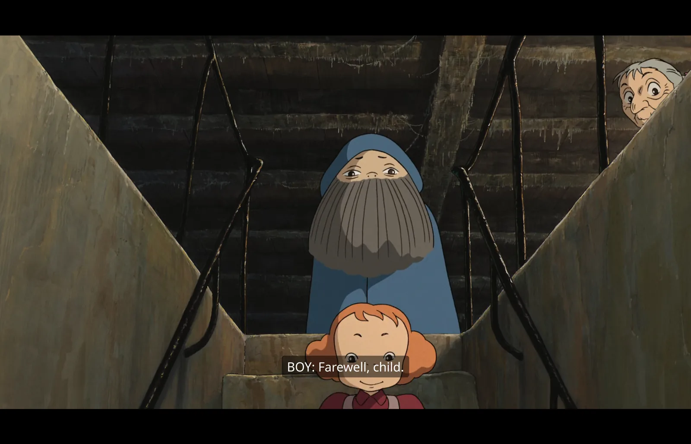

To stop styling, turn on personal **Disable Custom Styles** and reload. To change the starting preference for everyone, save admin **Disable Custom Subtitle Styles by default**. Use **Overwrite everyone's personal settings** only if you intend to replace existing personal preferences.

!!! note "Choose a supported text track"

    **ASS / SSA**, **PGS**, **VobSub / DVD**, **DVB bitmap**, and burned-in subtitles do not pass through the text element JE can restyle. Choose a text track such as SRT if you need these controls.

??? info "Subtitle colors, positioning, and support checks"

    Color alpha spans 0–255 using `#RRGGBBAA`. Editing colors enables custom colors. Choosing **Style** replaces both colors and returns to preset colors. **Clean White** stores its preset background as `transparent`. JE's custom text styling resets weight, italics, small-caps, and primary-track margins.

    The position grid's client fallback and reset use `(50,95)`.

    | Renderer | Supported styling |
    |---|---|
    | Jellyfin custom text element | Color, background, size, font, effect, and position. Primary/secondary tracks share a position and stack together. |
    | Browser native captions | Color, background, size, font, and effect. No position grid, custom padding, or rounded box. |

    The panel checks format when opened, using the first controllable session with a playing item and its primary subtitle stream. Reopen after changing tracks. It may reflect another session or miss a secondary track, so no warning is not proof of support.

### Player Ratings

See Jellyfin's community/critic scores in the player or briefly show age-rating information when playback starts. These are admin controls, independent of poster-tag switches.

**How to use:** Start playback to see the optional startup badge; reveal the player controls to see score chips beside the time information.

Admin **Display → Media Tags** and **Playback → Playback & Tab Switch**, respectively:

| Setting | Default | What it does |
|---|---|---|
| **Show Rating in Video Player** | On | Adds community/critic score chips to the player controls using Jellyfin rating fields. |
| **Show Age Rating When Playback Starts** | Off | Shows official age rating, up to three recognized advisory tags, and up to three genres for five seconds. |

??? note "Rating metadata and visibility"

    Available metadata determines what appears. Episodes can use series data for missing age rating/genres and incorporate series advisory tags. These controls have no personal-panel toggle. [Spoiler Guard](../spoiler-guard/spoiler-guard-features.md) can suppress protected information.

## Discovery & Integration

Find missing media through connected services, share reviews, and see what others are watching.

### Seerr Search Integration

Search and request missing media from Jellyfin with Seerr.

**How to use:**

1. Turn on admin **Seerr → Enable Seerr integration** (off by default).
2. Configure and **Test** the connection, then link/import users.

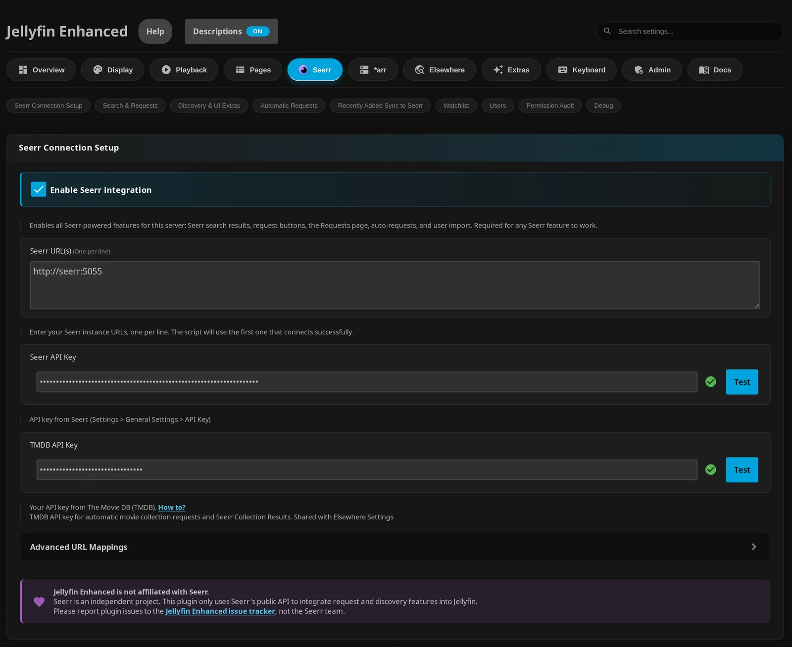

Follow [Seerr Features](../seerr/seerr-features.md), [Seerr Settings](../seerr/seerr-settings.md), and [Permission Audit](../seerr/permission-audit.md) for requirements, search, request permissions, quotas, and watchlist options.

??? tip "Existing setup illustrations"

    
    *Illustrative external settings capture; its version is unknown. Its annotations do not establish JE's current account-import requirements.*

    These external icon illustrations show active, unlinked-user, and disabled styling. JE loads its own icons through its asset service; an active connection still requires request permission for request actions.

    
    
    

### Seerr Item Details

Seerr adds similar/recommended rows, discovery, request actions, and a **More Info** modal. You can control these features separately.

**How to use:** See [Seerr Features](../seerr/seerr-features.md) and [Seerr Settings](../seerr/seerr-settings.md) for detail-page controls, collection discovery, exclusions, the standalone Recommendations page, and setup.

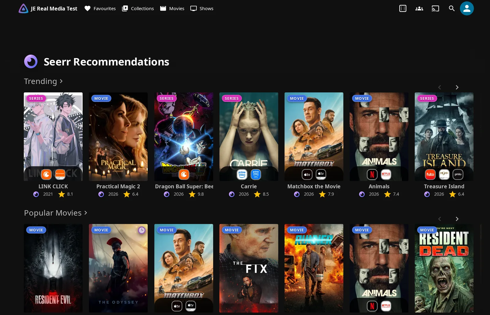
*The standalone page is separate from similar/recommended rows on item details.*

### .arr Links Integration

As an administrator, you can open matched titles in Sonarr, Radarr, or Bazarr. Synced Jellyfin tag links are a separate feature.

**How to use:** See [*arr Features](../arr/arr-features.md) and [*arr Settings](../arr/arr-settings.md) for service setup, multiple instances, status badges, tag filters, and synchronization tasks.


### Streaming Provider Lookup

Elsewhere shows subscription streaming providers for a title in your region, including supported per-season lookups.

**How to use:**

1. An administrator configures **Enable Elsewhere** and **TMDB API Key** under **Elsewhere**.
2. Choose regions/providers in a title's Elsewhere controls.

See [Elsewhere Features](../elsewhere/elsewhere-features.md) and [Elsewhere Settings](../elsewhere/elsewhere-settings.md) for defaults and limits.

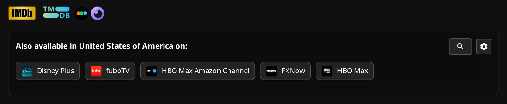

### User Reviews

Share text reviews and star ratings for movies, series, seasons, and episodes with viewers on your server. See [User Reviews](../elsewhere/elsewhere-features.md#user-reviews) for writing and moderation, and [User Reviews settings](../elsewhere/elsewhere-settings.md#user-reviews) for author visibility, poster averages, and Jellyfin rating mirroring.
- Spoiler Guard applies to season and episode reviews the same way as to the series: while it hides a guarded series' ratings or reviews, it also hides them for that series' seasons and episodes

### Activity Feed

See recently watched, favorited, and reviewed titles across the server, with an optional live session section.

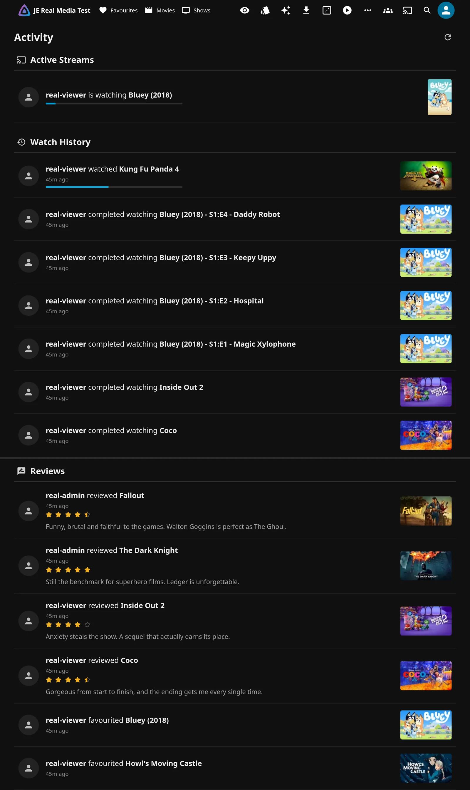

**How to use:**

1. Open **Activity** through the configured Home tab or Plugin Pages entry.
2. Click titles/artwork to open details, or read stars/text previews. **Watch History** shows progress for partial watches and **completed watching** for completed ones. Favorites and reviews share the **Reviews** section.
3. Use **Refresh** for an update.

Admin **Pages → Activity Feed**:

| Setting | Default | What it does |
|---|---|---|
| **Enable Activity Feed** | Off | Enables the page and watched/favorite collection. |
| **Show recently watched** | On | Records and shows qualifying playback stops. |
| **Show recently favorited** | On | Records and shows favorites. |
| **Show recently reviewed** | On | Includes current review-store entries. |
| **Non-admins only see their own activity** | Off | Regular users only see their own watched, favorited and reviewed entries; administrators still see everyone. |
| **Show Active Streams section** | On | Adds live sessions when Active Streams is enabled and the viewer is allowed. |
| **Add Activity as a native Home tab** | Off | Adds a built-in Home tab. |
| **Use Plugin Pages** | Off | Adds the page to Plugin Pages. |
| **Use Custom Tabs** | Off | Uses Custom Tabs instead of a native tab. |
| **Add the Custom Tabs entry for me** | Off | Manages the entry on save. |

The live section also requires admin **Extras → UI Tweaks → Active Streams Header Widget**. Non-admins need **Show widget to non-admins**.

??? info "Activity collection, access, and refresh"

    Plugin Pages uses `/JellyfinEnhanced/activityPage`. For manual Custom Tabs setup, use:

    ```html
    <div class="jellyfinenhanced activity"></div>
    ```

    **Watch History** includes playback stopped at a position of at least 5% of known runtime, plus playback Jellyfin marks completed. This measures position, not time spent watching.

    Only the live section polls every 15 seconds while visible, skipping hidden browser tabs. Stored history/review/favorite entries respect viewer library access and the review-author filters, with admin/self author exceptions. Live sessions use the separate Active Streams permission policy and can include titles outside the viewer's library access.

    A standard feed request returns up to 50 merged entries without UI pagination. Watched/favorite storage in `activity.json` is capped at 500 entries, one per user/item/type. Rewatches update time while preserving highest progress and completion. Unfavoriting removes its entry.

    Turning the feed off hides it and stops watched/favorite collection without deleting history. User Reviews continues independently, so reviews written while the feed is off can appear after re-enabling it.

### Catch Up

Sort unwatched movies and shows with a card deck. Touch, mouse, and keyboard actions update your own Jellyfin account.

**How to use:**

1. Open **Catch Up** through the configured Home tab or Plugin Pages entry.
2. Choose **Movies** or **Shows**.
3. Use the gestures or keys below to sort your deck.

| Gesture/control | Keyboard | What it does |
|---|---|---|
| Swipe right | ++arrow-right++ | Marks watched. |
| Swipe left | ++arrow-left++ | Dismisses from your deck in this browser. |
| Swipe up | ++arrow-up++ | Adds to your watchlist using Jellyfin's Likes flag. |
| Swipe down | ++arrow-down++ | Opens details. |
| **Rewind (Backspace)** | ++backspace++ / ++z++ | Reverses the last watched, dismiss, or watchlist action in the current deck. |

<figure class="je-video">
  <video autoplay loop muted playsinline controls preload="metadata" aria-label="Dismissing a Catch Up card and restoring it with Rewind">
    <source src="../../images/enhanced/catchup-swipe.mp4" type="video/mp4">
  </video>
  <figcaption>Dismissing a Catch Up card and restoring it with Rewind.</figcaption>
</figure>

For a show with at least two regular seasons, swiping right opens a season picker. Selecting a later season selects earlier ones; select a selected season again to untick just that season. Choose **Mark {n} season(s) watched** to confirm. Specials are not listed. Fewer regular seasons mark the whole series directly.

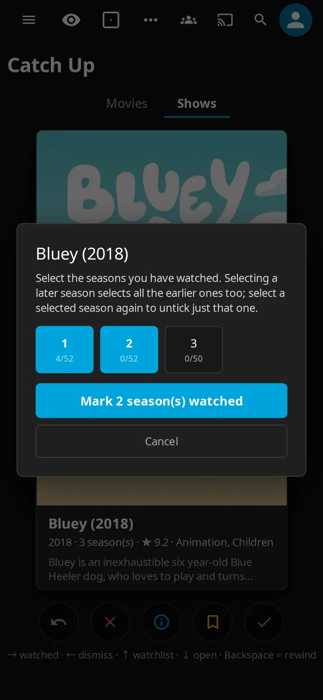

Admin **Pages → Catch Up**:

| Setting | Default | What it does |
|---|---|---|
| **Enable Catch Up** | Off | Enables the deck page. |
| **Record Catch Up activity** | On | Records new actions when Catch Up is enabled; turning it off retains readable history and the admin panel. |
| **Add Catch Up as a native Home tab** | Off | Adds a built-in Home tab. |
| **Use Plugin Pages** | Off | Adds the page to Plugin Pages. |
| **Use Custom Tabs** | Off | Uses Custom Tabs instead of a native tab. |
| **Add the Custom Tabs entry for me** | Off | Manages the entry on save. |

!!! note "Rewind does not restore earlier ratings or watched state"

    Rewind reverses the action rather than restoring a saved snapshot. It does not preserve previous watched/liked/disliked state. A failed action can still remove the card and show **Failed: {error}**; rewind can also fail.

??? info "Deck selection, browser preferences, and rewind"

    Plugin Pages uses `/JellyfinEnhanced/catchUpPage`. For manual Custom Tabs setup, use:

    ```html
    <div class="jellyfinenhanced catchup"></div>
    ```

    Decks use random batches of 40 unwatched accessible items, filtering dismissed, already-seen, and imageless cards. **Nothing more to show here.** can mean the sample yielded no new eligible cards.

    Dismissals and the **Movies**/**Shows** choice are browser-local per-user preferences, separate from Hidden Content. Reloading retains dismissals; rewind or clearing the relevant browser storage removes them. Switching/restarting a deck clears its queue, seen set, and undo history.

    The swipe-up Likes flag is the watchlist flag used by Seerr watchlist sync. Swiping down does not add an undo-history entry. Selecting all regular seasons writes the series ID; a subset writes selected season IDs.

    Watched undo removes PlayedItems state, and watchlist undo removes the Likes rating.

**For administrators:**

1. Open **Activity**, then **Feed** or **Summary**.
2. In **Feed**, choose **All users** or a user, select action chips, or enter **Search titles**. No selected action chips means all actions. The feed shows up to 300 matching events.
3. Use **Refresh** or **Hide** to update or close the panel.

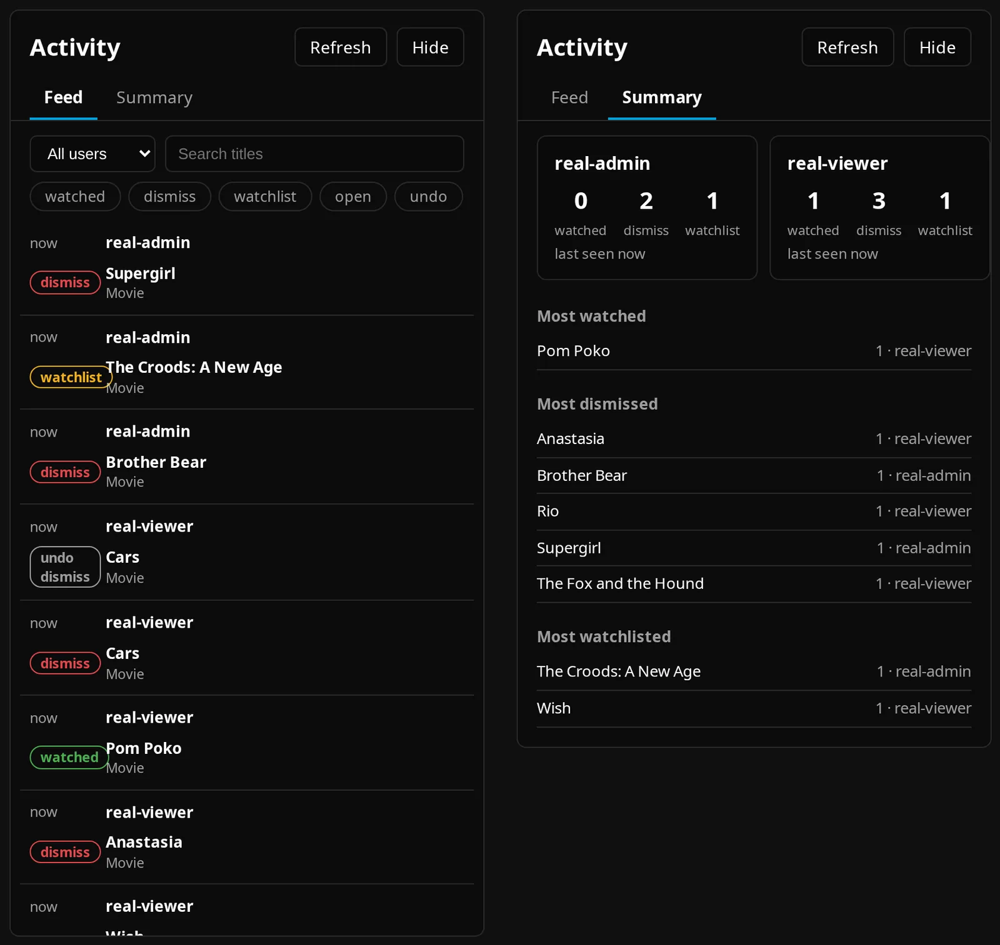
*On wide screens, Activity docks beside the deck; on narrower screens, it opens as a modal.*

??? note "Catch Up admin activity"

    **Summary** counts distinct successful user/title actions after corresponding recorded undos. **Most watched**, **Most dismissed**, and **Most watchlisted** each show up to 15 titles. Feed filters do not affect Summary.

    The open panel refreshes every ten seconds. It docks beside the deck at widths of at least 1100 pixels and opens as a modal on narrower screens. Non-admins cannot read these endpoints.

    Logs include open, undo, and failed actions. They are client reports, not proof of viewing. Item names are resolved server-side. `catchup-log.jsonl` is bounded to about 5 MB per file with two files retained.

### TMDB Reviews

Read TMDB reviews alongside local reviews on movie and series detail pages. See [TMDB Reviews](../elsewhere/elsewhere-features.md#tmdb-reviews) for setup, expansion, ordering, and fetching limits.

## Visual Enhancements

Add quality, genre, language, score, age-rating, and people information to cards with optional tags. All six tag families start off; detail-page information and awards are independent features.

**How to use:** See [Tags](tags.md) for controls, prerequisites, caches, styles, native poster rendering, and audio-language tag synchronization.

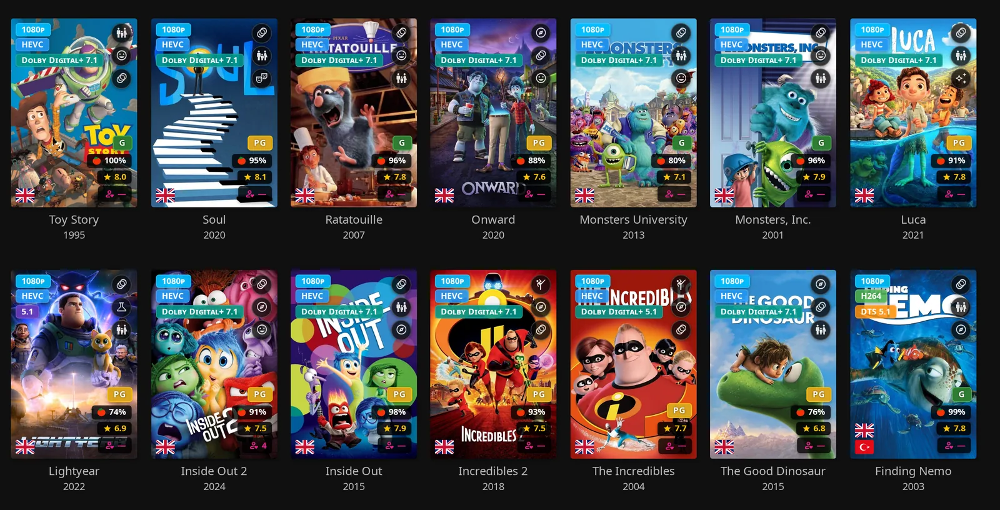
*This example enables all poster tag groups.*

### Watch Progress

See how much you have watched on a title's detail page. You can check movies, series, seasons, episodes, collections, and playlists.

**How to use:**

1. Enable **Show Watch Progress** in **UI Settings**.
2. Open details and click the progress chip to cycle **Percentage → Time Watched → Time Remaining**. The selected mode saves for your account.

<figure class="je-video">
  <video autoplay loop muted playsinline controls preload="metadata" aria-label="Watch progress cycles through percentage and time displays">
    <source src="../../images/enhanced/watch-progress.mp4" type="video/mp4">
  </video>
  <figcaption>Watch progress cycles through percentage and time displays.</figcaption>
</figure>

| Setting | Default | What it does |
|---|---|---|
| **Show watch progress** — admin **Display**; **Show Watch Progress** — personal **UI Settings** | Off | Shows the detail-page chip. |
| **Watch Progress Default** — admin **Display** | **Percentage** | Initial mode: **Percentage**, **Time Watched**, or **Time Remaining**; personal choices are in **UI Settings**. |
| **Watch Progress Time Format** — admin **Display** | **h:m** | Initial duration format; personal **h:m** / **y:mo:d:h:m** choices are in **UI Settings**. |

??? note "Watch-progress calculation"

    For containers, progress adds together accessible leaf items. It depends on runtime metadata and ignores media-version selection.

### File Size and Audio Languages

See total file size and available audio languages in a title's detail information. These controls are independent of poster tags.

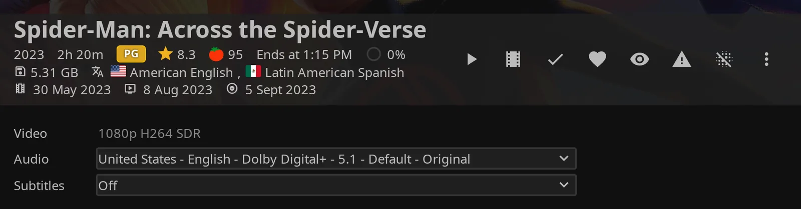

**How to use:**

1. Open **UI Settings** and enable the chip you want.
2. Open a detail page. Selecting another media version changes its size and audio-language data.

| Setting | Default | What it does |
|---|---|---|
| **Show file sizes** — admin **Display**; **Show File Sizes** — personal **UI Settings** | Off | Shows total file size. |
| **Show available audio languages on item detail page** — admin **Display**; **Show Audio Languages** — personal **UI Settings** | On | Shows detail-page audio-language chips. |

??? note "Supported items and audio-language links"

    File size supports movies, series, seasons, episodes, collections, and playlists. Container sizes add together accessible leaf items. Audio languages supports movies, series, seasons, and episodes. Missing usable values display a dash.

    When audio-language tag synchronization/linking is configured, a chip can open its matching Jellyfin tag page: regional tag first, base-language tag second, otherwise plain text. See [Tags](tags.md) for that separate admin setup and task.

### Release and Air Dates

See movie cinema, digital, and physical release dates or television air dates beside the item's metadata. See [Release Dates](../elsewhere/elsewhere-features.md#release-dates) for setup, region fallback, and date-selection rules.

### Awards

Expand an awards banner on detail pages to see Wikidata wins and nominations with categories, years, and recipients.

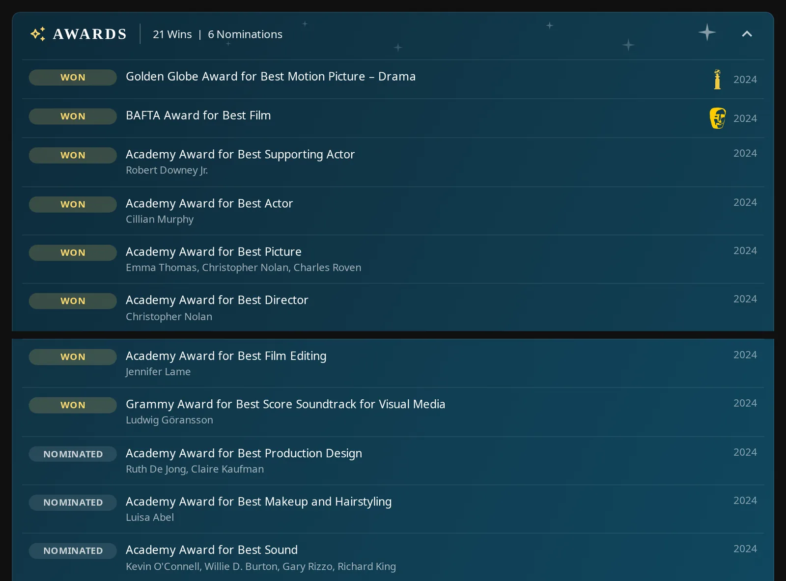

**How to use:**

1. Enable **Show Awards Banner** in admin **Display → Awards**, save, and reload.
2. Click the banner to expand it. Reviews do not need to be enabled.

Admin **Display → Awards**:

| Setting | Default | What it does |
|---|---|---|
| **Show Awards Banner** | Off | Enables Wikidata award lookups and display. |

??? info "Award sources, grouping, and caching"

    Movies and people use their own TMDB identity. Series use their series identity; seasons/episodes show their parent series' awards.

    Entries sort newest year first, with wins before nominations within a year. Redundant nominations for a winning category/year are merged with recipients/work. Totals therefore count grouped entries rather than raw statements.

    Wikidata coverage varies and is not exhaustive. No banner may mean no data or a failed lookup. The server's `awards.json` caches successful results for 180 days, confirmed empty results for 30 days, and failures for one hour.

## Personal Scripts

These optional extras are bundled with Jellyfin Enhanced, so you do not need a separate script installation. Despite this section's name, they are server switches.

**How to use:** As an administrator, enable them under **Extras → UI Tweaks**, save, and reload. See [Other Features](../other/other-features.md) and [Other Settings](../other/other-settings.md) for the broader extras guide.

### Active Streams Widget

Check playing and paused sessions from the header, and send a broadcast message as an administrator. See [Active Streams Widget](../other/other-features.md#active-streams-widget) for setup, session details, refresh behavior, non-admin access, and broadcasts.

### Colored Activity Icons

Add predefined colors and icons to the Activity list on Jellyfin's dashboard home to make events easier to scan.


**How to use:** Enable **Colored Dashboard Icons**, save/reload, and open the dashboard.

| Setting | Default | What it does |
|---|---|---|
| **Colored Dashboard Icons** — admin **Extras → UI Tweaks** | Off | Styles supported dashboard events. |

??? note "Dashboard icon limits"

    Unmatched events keep their existing appearance. There is no color editor. This feature is separate from JE's Activity Feed.

### Colored Ratings

Color official parental/age classifications on detail pages, including supported international boards, US TV descriptors, and ESRB labels.


**How to use:** Enable **Colored Ratings Backgrounds**, save/reload, and open a classified title.

| Setting | Default | What it does |
|---|---|---|
| **Colored Ratings Backgrounds** — admin **Extras → UI Tweaks** | Off | Applies predefined classification colors. |

??? note "Classification colors"

    The capture shows colored G, PG-13, and R badges on Toy Story, The Dark Knight, and Oppenheimer detail pages. Supported classifications extend beyond these examples. This feature does not style numeric review scores.

### Login Image Display

Show a public user's avatar above the password field on the manual-login form. When the avatar is available, the name input is visually hidden.


**How to use:**

1. Enable **Profile Picture on Login**.
2. Select a public user on the login page, or enter a name matching an existing public user card.

| Setting | Default | What it does |
|---|---|---|
| **Profile Picture on Login** — admin **Extras → UI Tweaks** | Off | Adds the avatar to the manual-login form. |

??? note "When no avatar appears"

    No matching card/image or an image-load failure leaves or restores the name input. This does not discover hidden accounts through another lookup.

### Plugin Icons

Add Material icons and image logos to supported dashboard plugin links, plus optional links to other configuration pages.

**How to use:**

1. Enable **Custom Plugin Menu Icons** and save/reload.
2. For additional links, fill in **Sidebar Custom Links** using the format below.
3. Use **Test Links** to preview temporary sidebar entries until refresh. **Save Settings** persists them.


| Setting | Default | What it does |
|---|---|---|
| **Custom Plugin Menu Icons** — admin **Extras → UI Tweaks** | Off | Enables bundled plugin icon mappings and custom links. |
| **Sidebar Custom Links** — admin **Extras → External Links** | Empty | Adds configuration-page links using the format below. |

??? note "Custom sidebar link format"

    Enter one decoded exact configuration-page name and Material icon per line, for example:

    ```text
    Configuration Page Name | Material Icon Name
    ```

    Preview requires the icon script to have initialized after enabling it.

See [Other Features](../other/other-features.md) for supported plugin mappings.

### Theme Selector

Choose a Jellyfish color variant from the **Theme** row in Jellyfin user preferences.

!!! note "Jellyfish installation required"

    Jellyfish must be installed natively. The admin guidance excludes the KefinTweaks installation method.


**How to use:**

1. After an administrator enables the selector, open Jellyfin user preferences.
2. Select a variant. Selection fades and reloads the page. **Default** removes the variant override.
3. To enable **Daily**, click the shuffle button titled **Random daily theme**.

| Setting | Default | What it does |
|---|---|---|
| **Theme Selector (Jellyfish)** — admin **Extras → UI Tweaks** | Off | Adds the Theme row. |
| **Random daily theme** — user preferences **Theme** | Off | Enables daily variant selection. |

??? note "Theme storage and daily timing"

    Variant/daily choices are stored per user in this browser, rather than in server-synced Enhanced settings. Daily mode chooses a variant during initialization when the saved UTC calendar date differs. It is not a midnight timer.

## Customization

Adjust Jellyfin's appearance and choose the language for JE's interface.

### Custom Styling with CSS

Customize the pause screen, Enhanced panel, player score chips, tag overlays, and synced *arr tag links with Jellyfin custom CSS.

**How to use:** See [CSS Customization](../advanced/css-customization.md) for selectors and examples, and [Tags](tags.md) for JE's built-in Tag Styles controls.

### Custom Branding

Replace Jellyfin's logos, banners, favicon, and touch icon with your own uploads, or show your logo during startup. See [Custom Branding](../other/other-features.md#custom-branding) for uploads and storage, [Splash Screen](../other/other-features.md#splash-screen) for the loading overlay, and [branding settings](../other/other-settings.md#custom-branding) for asset slots and filenames.

### Internationalization

Open **Language Settings** → **Display Language** and choose a language or **Auto**; your choice saves and reloads the page. Use **Clear Translation Cache** in the same section to clear this browser's translations and reload. See [Internationalization](../other/other-features.md#internationalization) for language precedence, loading, and server invalidation, and [language settings](../other/other-settings.md#default-ui-language) for defaults.
