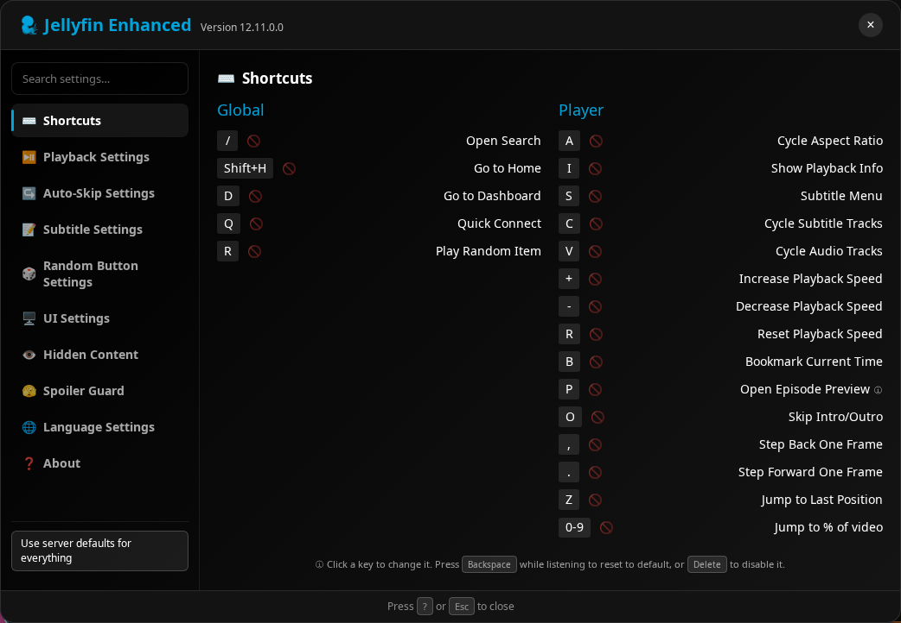
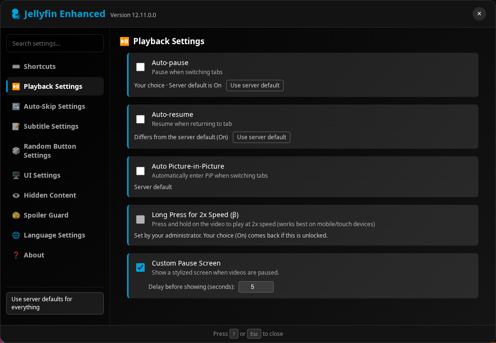
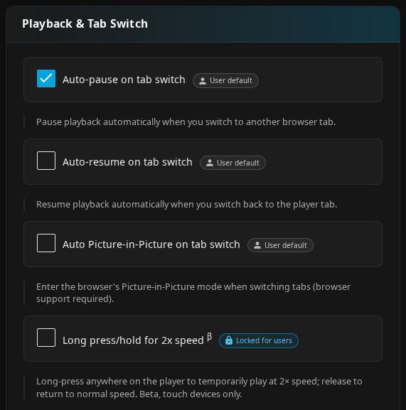
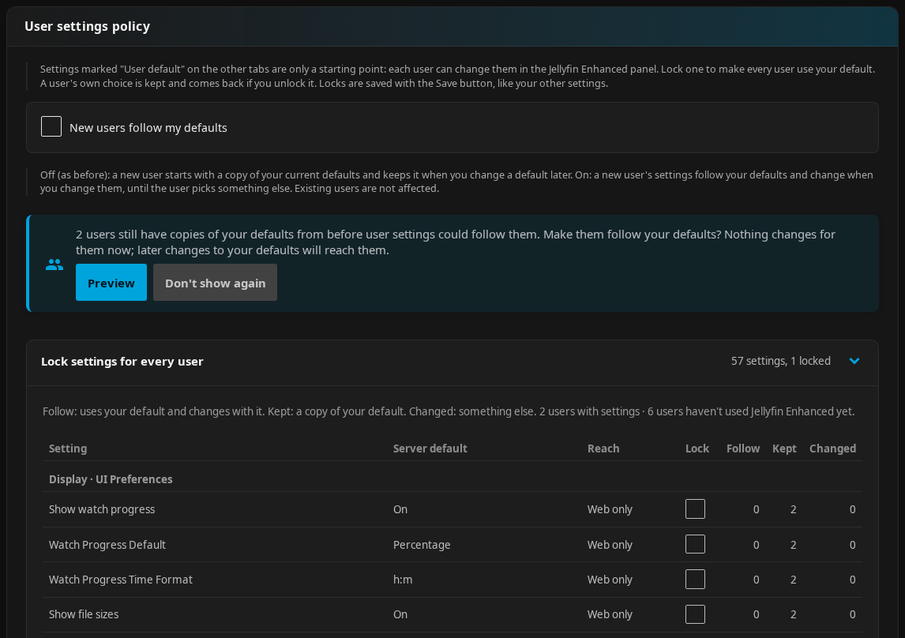
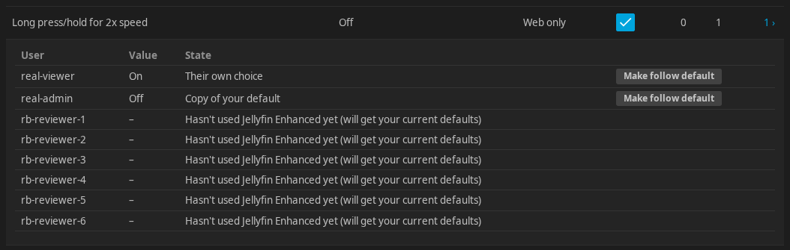
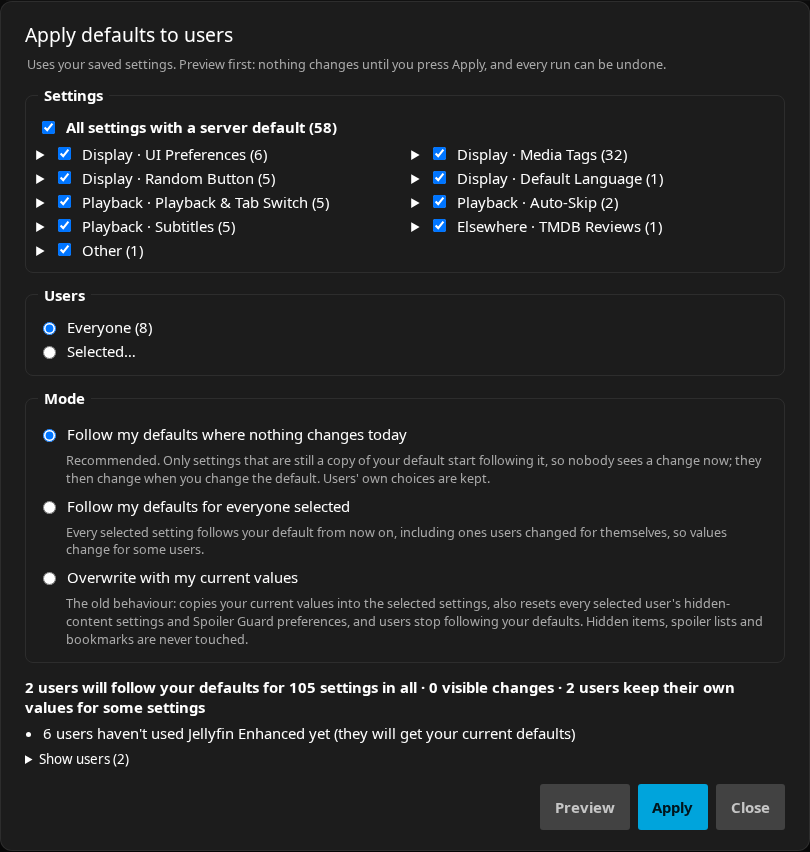

# Enhanced Settings — User configuration

## Jellyfin Enhanced panel

Access user-configured settings via the Jellyfin Enhanced panel:

| Shortcuts | Settings |
|-----------|----------|
|  |  |

**Open Panel:**

- Click **Jellyfin Enhanced** in the sidebar (Jellyfin 12: user profile menu instead)
- Press `?` keyboard shortcut

**Toggleable User Features:**

- Quality Tags
- Genre Tags
- Language Tags
- Rating Tags
- Age Rating Tags
- People Tags
- Pause Screen
- Auto-skip Intros
- Auto Picture-in-Picture
- Review tags
- And more...

**Sections:**

- **Shortcuts** - Customize keyboard shortcuts
- **Playback**, **Auto-Skip**, **Subtitles**, **Random Button**, **UI**, **Hidden Content**, **Spoiler Guard**, **Language** - Enable/disable features, adjust positions
- **Search settings...** at the top of the list finds a setting in any section

On phones the panel opens on the section list; pick a section to open it.

**Settings Persistence:**

- Saved on the server for your Jellyfin user, so they follow you to every browser and device
- Each change is saved as you make it. If a save fails, the panel says so and the value is corrected the next time the panel refreshes from the server
- Changes made on another device, or by your administrator, show up when you come back to the browser tab
- The section you opened last is remembered per device (in the browser, for each server and user)

### Where each value comes from

Your administrator sets the server default for most settings. Under a setting, the panel says where its value comes from when that tells you something:

| Note under the setting | Meaning |
|---|---|
| *(no note)* | The value is the server default, or the setting has no server default |
| **Server default** | You use the server default. When your administrator changes it, your value changes too |
| **Your choice · Server default is On** | You picked this value. It stays when the server default changes |
| **Differs from the server default (On)** | A value saved before Jellyfin Enhanced tracked where values come from. It stays as it is |
| **Set by your administrator · you can change it** | Your administrator changed this setting for you. You can still change it |
| **Set by your administrator.** | The setting is locked (see below) |

- **Use server default** next to a value switches that setting to the server default and keeps it following the default from then on.
- **Use server defaults for everything** at the bottom of the section list does the same for every setting that has a server default. It first tells you how many of your settings will change. Reload the page afterwards so every change takes effect. Settings without a server default, such as the subtitle position or custom colours, keep their value.

### Locked settings

An administrator can lock a setting so that every user gets the server default. A locked setting is shown greyed out with the value in effect and the note **Set by your administrator.** If your own value was different, the note adds **Your choice (On) comes back if this is unlocked.** Settings that also change poster images in native TV and phone apps say so on a second line. Locks apply to administrators' own panels too.

The lock also reaches outside the panel: the watch-progress chip on item pages shows the locked mode and can't be switched, and opening the reviews section is not remembered. A locked display language (or one that follows the server default) becomes the language of this browser from the next page load. A locked subtitle style (or one that follows the server default) uses that style's colours, unless you picked your own text and background colours.

### When settings can't be loaded

If your saved settings can't be read (for example while the server's disk is unavailable), the panel shows **Your settings couldn't be loaded, so they can't be changed right now. Your saved settings are untouched.** with a **Retry** button. Nothing is saved until they load, so your real settings are never replaced by defaults.

### Keyboard and TV

- The panel opens as a dialog with focus inside it. `Tab` and `Shift+Tab` stay in the panel, and `Esc` or `?` closes it and puts focus back where it was.
- With a remote or the arrow keys in Jellyfin's TV layout, focus stays in the panel instead of moving to the page behind it.
- In **Shortcuts**, select a key and press `Enter` (or click it) to change it, then press the new key. `Esc` cancels, `Backspace` resets the shortcut to its default and `Delete` turns it off. `Tab` moves on without changing anything.
- Using the panel with the keyboard or touch keeps it from closing on its own.

# Enhanced Settings — Admin configuration

## Feature Toggles

Most features can be enabled/disabled individually:

1. Open the Jellyfin Enhanced panel
2. Open the feature's section (for example **Playback Settings**)
3. Toggle features on/off
4. Changes apply immediately *(no restart needed)*

## User defaults and the User settings policy

Many settings on the plugin page are **user defaults**: the value each user starts with, which they can change in their own Jellyfin Enhanced panel. A line under each such control says so:

- **Web only**: applies in the Jellyfin Enhanced web interface, which also runs in Jellyfin for Android and webOS.
- **Web + native posters**: also changes the poster images native TV and phone apps get, while [Native Poster Tags](#native-poster-tags-experimental) is on. With it off the line reads **Web only (native poster tags are off)**.
- **Locked** (or **1 of 2 locked** for a row that holds several settings) when you locked it.
- **›** jumps to the setting's row in **User settings policy**.

### User settings policy

**Dashboard** → **Plugins** → **Jellyfin Enhanced** → **Admin** tab → **User settings policy**.

- **New users follow my defaults**: off by default, which keeps the old behaviour: a new user starts with a copy of your current defaults and keeps it when you change a default later. When on, a new user's settings follow your defaults and change when you change them, until the user picks something else. Existing users are not affected.
- **Lock settings for every user** opens the table: each setting with its server default, where it applies, a **Lock** box and three counts. Ticking or unticking a lock shows who it affects before you save; locks take effect when you click **Save**, like every other setting. A locked setting gives every user your default, on the web and, for the tag settings, in native poster images. Each user's own value is kept and comes back when you unlock it. Locks apply to administrators too.
- The counts are read when you open the table: **Follow** (users who follow your default and get your changes), **Kept** (users with a copy of your default that won't change with it) and **Changed** (users with something else). Users whose settings file can't be read (corrupt or too large) are reported and not counted.
- Click a **Changed** count to list those users with their value and state (their own choice, kept from before, set by an administrator, and users who haven't used Jellyfin Enhanced yet). **Make follow default** makes that one user follow your default; it can be undone.

**Upgrade card.** After updating, a card on the **Overview** and **Admin** tabs says how many users still have copies of your defaults from before settings could follow them. **Preview** opens **Apply defaults to users…** in the mode that changes nothing anyone sees today; **Don't show again** hides it for every administrator.

### Apply defaults to users…

**Apply defaults to users…** (in the policy section, and in **Overview** → Quick Actions) replaces "Overwrite everyone's personal settings". It always uses your *saved* settings, so **Preview** and **Apply** in the dialog stay disabled until you save pending changes.

1. Pick the **Settings** (all of them, a group, or single settings) and the **Users** (everyone, or selected users).
2. Pick a **Mode**:
    - **Follow my defaults where nothing changes today** (recommended): only settings that are still an untouched copy of your default start following it, so nobody sees a change now. Users' own choices are kept.
    - **Follow my defaults for everyone selected**: every selected setting follows your default, so values change for users who picked something else.
    - **Overwrite with my current values**: the old reset. Copies your current values into the selected settings and stops them following your defaults. It still also resets the selected users' hidden-content settings and Spoiler Guard preferences, as before. Hidden items, spoiler lists and bookmarks are never touched.
3. **Preview** shows what would change, for how many users, and how many changes are visible. Nothing is written yet.
4. **Apply**, then **Undo** if needed. Undo restores only what still holds the value the run wrote; anything a user changed since is kept. The last 20 runs can be undone.

If the plugin settings are saved between the preview and **Apply**, you are asked to preview again.

**Honest results.** Instead of a plain "Success", the result counts the users that were changed and lists every user that was skipped or failed, by name and with the reason: a settings file that is corrupt (left untouched), too large or unreadable, or a user who hasn't used Jellyfin Enhanced yet (they get your current defaults on first use).

### Unsaved changes

- The **Save** bar only appears when there are unsaved changes.
- Leaving the plugin page through a link while changes are unsaved asks for confirmation first. The browser's back button can't be stopped, but the changes are not lost: they are kept for that browser tab, and the next time you open the page a banner offers to **Restore** or **Discard** them. API keys, other credentials and *arr instances are never kept this way.

### Downgrading

Going back to a version without these features is possible, with two effects:

- **Locks are lifted.** Each user's own saved value applies again, including in native poster images. The older version also drops the saved locks when you next save the plugin settings, so they are gone if you upgrade again.
- **Following settings stop following.** They keep the last value written to the user's file, which may be an older default if you changed it since that user's settings were last saved. When the older version saves a user's settings it also drops the record of which values follow your defaults, so after upgrading again that user's values read as saved before these features (no labels, nothing following) until they change them or you run **Apply defaults to users…**.

## Tags: Quality, Genre, Language, Rating, Age Rating, People

### Configuration
1. Open the Jellyfin Enhanced panel → `Enhanced Settings`
2. Enable and configure tags you want *(Eg: `Quality Tags`)*
3. Adjust position (top-left, top-right, etc.)
4. For Quality Tags, optionally pick a **Preferred Audio Language** so the sound tag
   (Atmos, DTS, ...) reflects that language's track, or let it follow each user's
   Jellyfin audio language — see [Quality Tags](enhanced-features.md#quality-tags)

!!! tip

    [Custom CSS available](../advanced/css-customization.md#tags)

### Server-Side Tag Cache

By default the server pre-computes tag data for the whole library and serves it to clients in a single request, so tags appear instantly without per-page API calls. The cache is built on first startup, kept up to date by library scan events, and refreshed daily by the **Refresh Tag Cache** scheduled task.

The web client keeps its own copy of the cache in the browser (IndexedDB, one per server and user) and, on every page load after the first, renders tags from that copy once a quick request for the entries that changed since confirms it is still current. The copy is replaced when the server rebuilds the cache or the user's library access or Spoiler Guard changes (including from another device), and dropped when the cache is switched off, by **Clear All Client Caches**, and when another user signs in on the same browser (each user's copy is spoiler-stripped for them alone). Browsers without IndexedDB (some private modes) download the cache on every page load as before. The average user-review ratings shown on posters ride on the same cache, so browsing a library sends no review lookups.

Disabling **Server-Side Tag Cache** (Dashboard → Plugins → Jellyfin Enhanced → Display → Media Tags) switches clients to the legacy per-page batch mode (each client picks this up on its next page load) and completely turns off the server-side cache — it is not loaded, built, or maintained while the setting is off, and the in-memory cache is released immediately.

!!! note "Very large libraries"

    The cache build processes the library in small pages, so server memory use stays bounded even on libraries with tens of thousands of items. If you still prefer not to run a server-side cache, disable the setting — tags keep working via the per-page batch mode.

Turning the setting back on from the dashboard restores the last saved snapshot and catches up on anything that changed while it was off, automatically in the background — no restart or manual task run needed. (Only if you edit the plugin's configuration file by hand instead of using the dashboard: restart the server so the change is picked up, then run the **Refresh Tag Cache** scheduled task to catch up.)

### Audio Language Tags

Dashboard → Plugins → Jellyfin Enhanced → Display → Audio Language Tags. See [Audio Language Links](enhanced-features.md#audio-language-links).

| Setting | Description |
|---|---|
| Enable Audio Language Tags Sync | Writes each movie's and series' audio languages as Jellyfin tags. Off by default. |
| Tag Prefix | Prefix for every tag. Default `JE Language: `. Tags written under a previous prefix are not removed. |
| Link audio languages to their tag page | Links the audio languages on item detail pages to the tag's list page. |

Run the **Sync Audio Language Tags to Jellyfin** scheduled task (Dashboard → Scheduled Tasks) once to tag existing items. While the [Server-Side Tag Cache](#server-side-tag-cache) is enabled, new and changed items are tagged after a library scan. With the cache off, the task must run on a schedule.

### Native Poster Tags (Experimental)

Native Poster Tags draw each user's Media Tags into the poster images Jellyfin sends to native apps (Android TV, Tizen, Swiftfin, Findroid and so on), which can't run Jellyfin Enhanced's web overlays. It is built into Jellyfin Enhanced, so there is nothing else to install. See [Native Poster Tags](enhanced-features.md#native-poster-tags-experimental) for what it draws and its limitations.

<!-- Screenshot placeholder: admin Display → Media Tags, Native Poster Tags block (native-poster-tags-admin.png) -->

Administrators configure the feature at the bottom of **Dashboard → Plugins → Jellyfin Enhanced → Display → Media Tags**:

| Setting | Default | Description |
|---|---|---|
| **Enable Native Poster Tags (Experimental)** | Off | Server-wide master switch. When on, every user gets native poster tags unless they turn them off for themselves. When off, every app gets the original posters, whatever a user's personal choice, and the server does no extra image work. |
| **Additional Excluded Clients** | Empty | Apps that already run Jellyfin Enhanced's web overlays and should keep the original posters, on top of the built-in list below. Enter the app name as shown under **Dashboard → Devices**, one per line or comma separated. |

These apps load the Jellyfin web client, so Jellyfin Enhanced's overlays already run in them. They always get the original posters, which avoids drawing the tags twice:

- Jellyfin Web (any browser)
- Jellyfin Media Player
- Jellyfin Desktop
- Jellyfin for WebOS
- Jellyfin for Android (the phone app; **Jellyfin for Android TV** is a native app and does get the tags)

If another app shows the tags twice, for example a custom shell around the web client, add its name to **Additional Excluded Clients**.

**Per-user choice.** Each user can opt out in **Jellyfin Enhanced panel → UI Settings** with **Show Tags in Native Clients (Experimental)**, which is on until they turn it off. While the master switch is off the control is hidden and the saved choice is kept.

<!-- Screenshot placeholder: Jellyfin Enhanced panel → UI Settings, "Show Tags in Native Clients" toggle (native-poster-tags-user.png) -->

Which tags appear, their corners, their order and the other tag options come from the same settings as the web overlays: the user's own Jellyfin Enhanced panel settings, or the admin defaults for anything the user hasn't changed, and [locks](#user-settings-policy) apply to them too. Only the on/off choice is separate. Native apps may need the library reopened or the app restarted to pick up a change.

## Activity Feed

Configured under **Dashboard** → **Plugins** → **Jellyfin Enhanced** → **Extras** tab. See [Enhanced Features - Activity Feed](enhanced-features.md#activity-feed) for what it shows and how the reachability options differ.

| Setting | Default | Description |
|---|---|---|
| **Enable Activity Feed** | Off | Master switch for the feature |
| **Show recently watched** | On | Include playback completions in the feed |
| **Show recently favorited** | On | Include favorites in the feed |
| **Show recently reviewed** | On | Include new/updated [User Reviews](enhanced-features.md#user-reviews) in the feed |
| **Show Active Streams section** | On | Adds a live "who's watching now" section, independent of the [Active Streams Widget](../other/other-settings.md#active-streams-widget)'s own header icon |
| **Add Activity as a native Home tab** | Off | Adds a Home-page tab, no external plugin needed |
| **Use Plugin Pages** | Off | Adds an "Activity" sidebar link via [Plugin Pages](https://github.com/IAmParadox27/jellyfin-plugin-pages) (Jellyfin 12: user profile menu instead) |
| **Use Custom Tabs** | Off | Adds a Home-page tab via [Custom Tabs](https://github.com/IAmParadox27/jellyfin-plugin-custom-tabs) instead of the native one |

## Catch Up

Configured under **Dashboard** → **Plugins** → **Jellyfin Enhanced** → **Extras** tab. See [Enhanced Features - Catch Up](enhanced-features.md#catch-up) for the gestures and the admin Activity panel.

| Setting | Default | Description |
|---|---|---|
| **Enable Catch Up** | Off | Master switch for the feature |
| **Add Catch Up as a native Home tab** | Off | Adds a Home-page tab, no external plugin needed |
| **Use Plugin Pages** | Off | Adds a "Catch Up" sidebar link via [Plugin Pages](https://github.com/IAmParadox27/jellyfin-plugin-pages) (Jellyfin 12: user profile menu instead) |
| **Use Custom Tabs** | Off | Adds a Home-page tab via [Custom Tabs](https://github.com/IAmParadox27/jellyfin-plugin-custom-tabs) instead of the native one |
| **Record Catch Up activity** | On | Logs who swiped what to `catchup-log.jsonl`; administrators read it in the page's Activity panel. Turn off to record nothing |
