# Ratings, Awards & More

Rating, Age Rating, Awards, Logos, Custom and People tags, and player badges. Quality, Genre and Language are in [Quality, Genre & Language](tags-quality.md); layout and placement are in [Layouts & Rules](tags-layouts.md).

## Rating Tags

Rating Tags show an ordered selection of Community, Critic, IMDb, TMDb, Rotten Tomatoes critic and audience, Metacritic, Metacritic user, Letterboxd, Trakt, MyAnimeList, Roger Ebert and MDBList scores. Each named source has a bundled logo. MyAnimeList only has scores for anime, and Roger Ebert's only for films he reviewed, so on other titles those chips simply do not appear. Choose which item types and home rows show them. The scores come from the server tag cache, which the **Fetch Ratings from MDBList** task refreshes after each run, so a source appears once that task has covered a title.

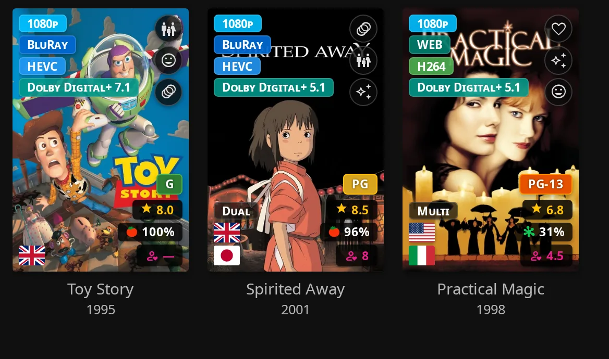

**How to use:**

1. Turn on the **Rating** group on the **Groups** tab of **Media Tags**.
2. Under **Include**, tick sources and move them up or down. Set **Minimum score** and **Colour by score** if desired.
3. Keep or change the item types and home rows under **Choose where to show**.

Administrators set defaults on the Media Tags admin tab under **Groups** → **Rating**. MDBList itself (key, quota, fetch task) stays under [**Display** → **MDBList Ratings**](../open-in-jellyfin.md?tab=display&card=mdblist-ratings); the Rating group shows whether it is set up.

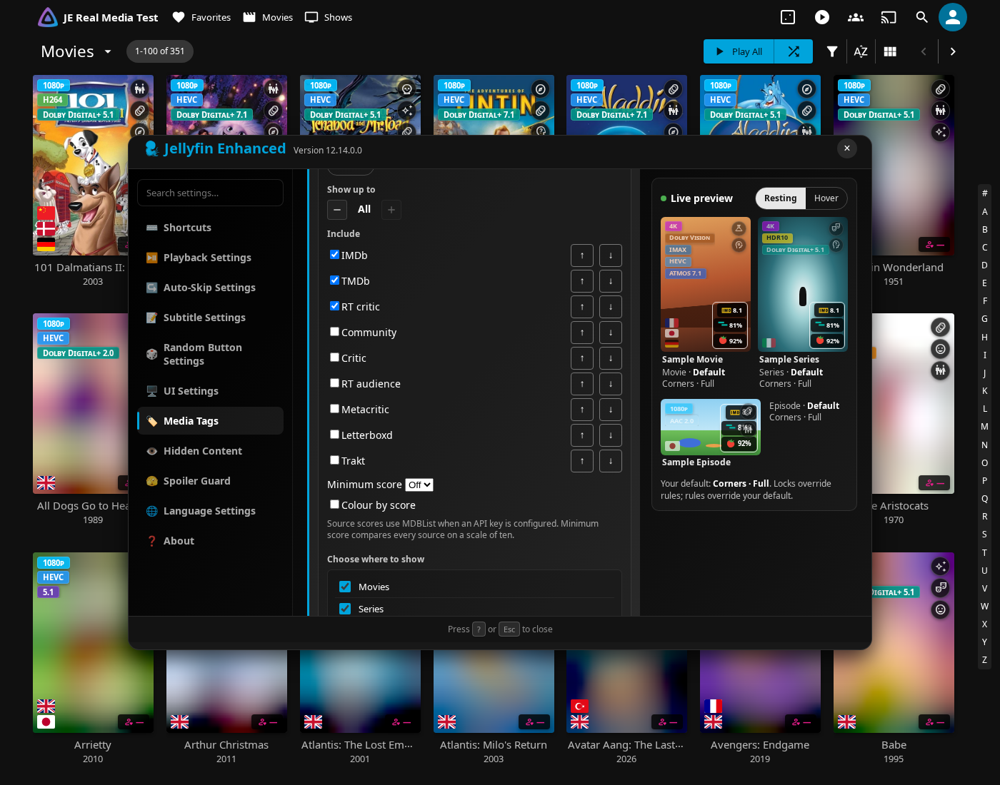

| Setting | Default | What it does |
|---|---|---|
| Admin: **Enable Rating Tags** / personal: **Rating** switch | Off | Enables poster score chips and, when configured, user-review chips |
| Admin: **Show on movies** / personal: **Movies** | On | Allows rating and review chips on movie cards |
| Admin: **Show on series** / personal: **Series** | On | Allows rating and review chips on series cards |
| Admin: **Show on seasons** / personal: **Seasons** | On | Allows rating and review chips on season cards |
| Admin: **Show on episodes** / personal: **Episodes** | On | Allows rating and review chips on episode cards |
| Admin: **Show in the Continue Watching row** / personal: **Continue Watching row** | On | Allows rating and review chips in that row |
| Admin: **Show in the Next Up row** / personal: **Next Up row** | On | Allows rating and review chips in home **Next Up** and the series-page shelf |
| **Rating sources** | Community, Critic | Ordered enabled source list; an empty list hides source scores while review chips remain independent |
| **Minimum score** | Off | Off, 5, 6, 7 or 8; compares each source on a scale of ten before applying the group limit |
| **Colour by score** | Off | Red below 5, amber through green at 7.5; explicit Tag Styles colours take precedence |

Your item-type and row choices both apply. Turn off **Episodes** to hide these chips on every episode card, including **Next Up** and **Continue Watching**. Turn off a row to hide them only in that row. These choices do not hide quality, genre, language, or age-rating badges.

??? info "Score sources and fallback"
    Collections and videos are not governed by the four type switches. Critic scores below 60% use the rotten icon; 60% and above use the fresh icon. Compact density shows named-source values beside a tiny source-coloured dot. Native posters use the same source order, formats, minimum, cap and colours.

    Community and Critic come from Jellyfin's `CommunityRating` and `CriticRating`. Their sources depend on your metadata providers or synchronization, including [MDBList settings](../other/other-settings.md#mdblist-ratings). The overlays do not fetch TMDB or Rotten Tomatoes scores directly. A community score displayed as `0.0` becomes a dash; absent scores do not produce their respective chips.

    A season or episode with no score of its own (none, or 0) shows its series' community and critic scores. One with any score of its own shows only its own scores, so an episode's critic score is never replaced by its series'. The server cache, batch fallback and native posters follow the same rule.

Named sources use the server's existing MDBList service when its API key is configured. Full tag-cache builds warm bounded batches, and reconciliation refreshes expired ratings even when library metadata has not changed. Library changes warm their titles together, in batches of up to 150, before their entries are rebuilt; a native poster built on demand never waits for MDBList: it draws the scores already cached and the missing ones are fetched in the background for later posters. Found titles have a seven-day TTL; confirmed misses and failures keep the existing MDBList retry policy. A refresh that fails (an outage, a timeout, the daily quota) never erases scores a title already has: they stay on the cards and the title is tried again an hour later. Batch mode also shares this cache: a batch request waits at most two seconds for the scores of titles that have none, then answers with everything else (quality, language, status and the scores already cached) while the fetch finishes in the background. Such an answer is marked as waiting for scores, and the browser keeps it for only a minute (not the usual Local Storage lifetime): the next view after that asks again and shows the scores. Every batch answer also says when its scores stop being current, and the browser keeps it no longer than that: a week for found scores, three days for a title MDBList does not know, and an hour after a failed lookup (an outage, the daily quota), when the server tries again, so scores return on their own once MDBList recovers; a title whose scores are fresh never waits behind another title's fetch. The API key stays on the server. Without a key or a returned score, that source produces no chip. Seasons and episodes use their series' source ratings.

| Source | Example | Native scale |
|---|---|---|
| IMDb | 8.1 | /10 |
| TMDb | 81% | /100 |
| RT critic / RT audience | 92% / 88% | /100 |
| Metacritic | 74 | /100 |
| Letterboxd | 4.1 | /5 |
| Trakt | 85% | /100 |
| Metacritic user | 7.9 | /10 |
| MyAnimeList | 8.4 | /10 |
| Roger Ebert | 3.5 | /4 |
| MDBList | 78% | /100 |

Scores are written the way your language writes numbers: `8,1` in German or French, Arabic-Indic or Persian digits where the locale uses them (the language Jellyfin Enhanced's text follows; native posters use the language saved with your web settings, the same one their dates use). Units stay as they are (`%`, no space). Existing users retain their old Community/Critic include choices and order until they edit sources. New users take the administrator's defaults. Named sources have individual labels in **Tag Styles** and `data-je-rating-source` hooks for custom CSS.

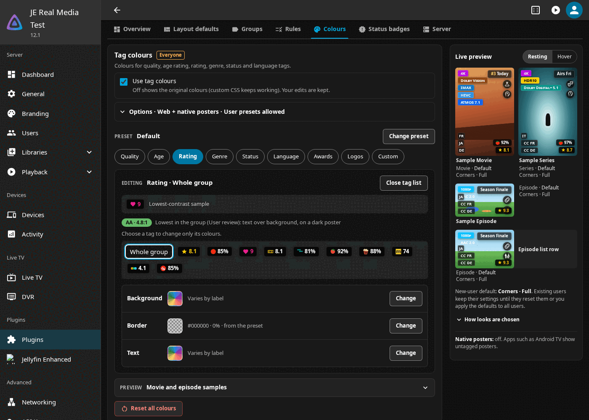

!!! note "Spoiler Guard and scores"
    [Spoiler Guard](../spoiler-guard/spoiler-guard-settings.md) can suppress score data on protected items. Age classifications have a separate policy, described below.

### User-review chips

A pink person-with-heart chip shows the average star rating from reviews visible to you. It converts the 1–5 average to a /10 display: a four-star average appears as `8`.

**How to use:**

1. As an administrator, open [**Elsewhere & Reviews** → **User Reviews**](../open-in-jellyfin.md?tab=elsewhere&card=user-reviews).
2. Turn on **Enable User Written Reviews** and **Show average user rating on poster cards**, then click **Save Settings**.
3. Each viewer must also turn on the **Rating** group. There is no separate personal review-chip switch.

To contribute, open an eligible detail page and click **Write a Review**. Choose stars, enter review text, or both.

| Setting | Default | What it does |
|---|---|---|
| **Enable User Written Reviews** | Off | Enables JE's stored user reviews; independent of Elsewhere and TMDB Reviews being enabled |
| **Show average user rating on poster cards** | Off | Adds the average-review chip to eligible cards with Rating Tags enabled |
| **Show a dash on posters for unrated items** | On | Shows a dash when no visible aggregate star rating exists; off removes that chip |
| **Hide reviews from hidden users** | On | Hides those authors' reviews from other non-admin viewers; self-view and admin exceptions apply |
| **Hide reviews from disabled users** | On | Applies the same visibility rule to disabled accounts |
| **Also save review star ratings as the user's Jellyfin rating** | Off | Mirrors movie/series review stars to Jellyfin's personal /10 rating, independently of the displayed average |

The optional dash means there is no visible average star rating, even if you have written a text-only review.

!!! warning "Mirroring replaces your Jellyfin rating"
    **Also save review star ratings as the user's Jellyfin rating** overwrites an existing personal Jellyfin rating.

??? info "Review identities, limits, and mirrored ratings"
    Movies and series require a TMDB ID. Seasons and episodes require the parent series' TMDB ID and their season/episode numbers.

    Matching identities share reviews across duplicate library items. Collections and generic videos do not have these review chips. The chips follow the same corner and scope exclusions as Rating Tags and respect applicable Spoiler Guard review restrictions.

    Stars range from 1–5 in half-star increments. Review text is limited to 2,000 characters, and a review needs stars or nonblank text. Only reviews with stars contribute to the poster average.

    Deleting a review or removing its stars clears the mirrored rating only if it still matches. A rating changed elsewhere is preserved. Season/episode reviews are not mirrored. Writing and moderating reviews is covered in [User Reviews](../elsewhere/elsewhere-features.md#user-reviews).

## Age Rating Tags

Age Rating Tags show the official parental/content classification Jellyfin already has, such as `PG-13`, `R`, `TV-MA`, `FSK-12` or `GB-15` (Jellyfin's TMDB provider writes most non-US ratings with their country code). Supported rating-board labels receive predefined colors, with a fallback for other labels.

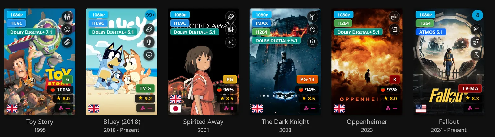

**How to use:** Turn on the **Age Rating** group on the **Groups** tab of **Media Tags** and choose its position.

| Setting | Default | What it does |
|---|---|---|
| Admin: **Enable Age Rating Tags** / personal: **Age Rating** switch | Off | Shows the item's official classification on supported cards |
| Admin: **Colored Ratings Backgrounds** | Off | Under [**Extras** → **UI Tweaks**](../open-in-jellyfin.md?tab=extras&card=ui-tweaks), colors official classification boxes on detail pages and applicable player elements |

The default bottom-right position stacks with Rating Tags. Seasons and episodes normally show their own nonblank classification, or their series' classification if they have none.

Poster age badges use classification colors independently of **Colored Ratings Backgrounds**. That separate switch controls detail/player classification boxes.

??? info "Classification labels and colors"
    Equivalent labels share colors. For example, `DE-12` and `FSK 12` become `FSK-12`, and supported unrated labels become `NR`. Color support includes international boards, US TV descriptors, and ESRB classifications. These are classification colors, not gradients for community/critic scores.

!!! note "Spoiler Guard and classifications"
    Age classifications remain visible. When score stripping protects unwatched episodes or unstarted seasons, the badge can deliberately use the series classification instead of the child's own rating, avoiding a hint from an unusually high episode classification.

## Awards Tags

Awards adds **IMDb Top 250**, **Rotten Tomatoes Certified Fresh**, **Oscar Winner**, **Emmy Winner** and **Letterboxd Top 250** chips to movie and series posters. Each has a source logo. Hover for its list rank or most recent known ceremony year. Clicking a chip opens the poster’s item; modifier and middle clicks open it in a new tab. Chips add no keyboard tab stops. In Summary, the hidden summary pill lets pointer events reach the revealed chips even when its three facts come from other groups. A nomination never produces a winner chip, and a high tomato score never implies Certified Fresh.

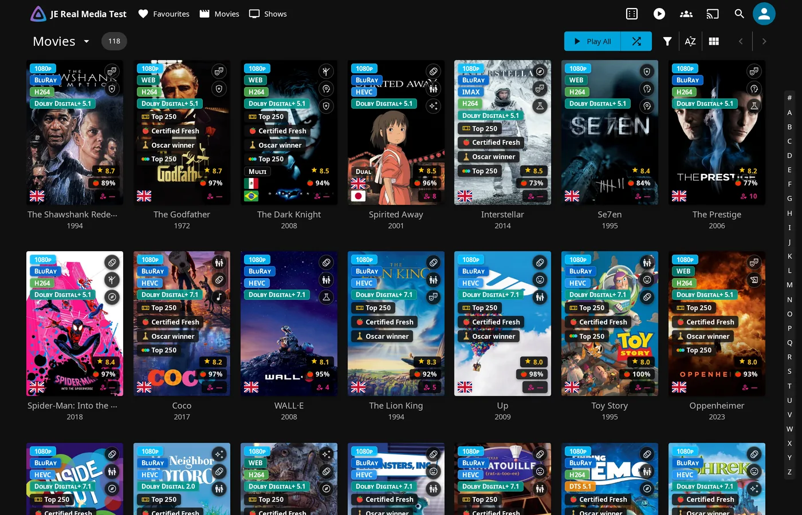
*Fixture facts demonstrate all ribbons without an MDBList key; this is rendering evidence, not verified award history for these titles.*

**How to use:**

1. An administrator enables **Media Tags settings → Groups → Awards**, then selects the ribbons. Each edit saves automatically.
2. For chart membership and Certified Fresh, configure the existing server **MDBList API Key**. Without a key these three ribbons are off; Oscar/Emmy use Wikidata without a key.
3. Run **Refresh Awards Tags** in **Dashboard → Scheduled Tasks → Jellyfin Enhanced**. Its default daily trigger is 04:00, and the first refresh starts on its own when you turn Awards on. The task also works with Server-Side Tag Cache off. Under **Groups → Awards**, **What it needs** shows whether the MDBList key is set and when the task last ran.
4. Each existing user enables **Awards** in [**Media Tags → Groups**](../open-in-jellyfin.md?jeSection=media-tags&tab=groups). New users take the admin default. Set its position, priority and **Show up to** limit like other groups (two by default, or All).

| Administrator setting | Default | Behavior |
|---|---|---|
| **Enable Awards Tags** | Off | Gates enrichment and the group's admin starting default; existing users retain their switch |
| **IMDb Top 250 / Certified Fresh / Oscar Winner / Emmy Winner / Letterboxd Top 250** | On while enabled | Selects which facts to fetch and which ribbons may appear |
| **IMDb Top 250 MDBList id or owner/slug** | `aramil89/imdb-top-250` | An MDBList list (not an IMDb link), numeric list IDs are accepted too |
| **Letterboxd Top 250 MDBList id or owner/slug** | `abdulwahabaa/letterboxd-top-250` | Configurable community list; only ranks 1–250 qualify |
| **Refresh interval (hours)** | 24 | Fact/list freshness, clamped to 1–168 hours; adjust the scheduled task trigger too for a shorter cadence |

The default [IMDb](https://mdblist.com/lists/aramil89/imdb-top-250) and [Letterboxd](https://mdblist.com/lists/abdulwahabaa/letterboxd-top-250) lists are maintained by MDBList users. Their availability, order and accuracy can change; a displayed rank is the configured list's rank. Replace the id/slug with a preferred maintained list as needed. An invalid or unavailable list fails independently; it does not become an empty successful chart.

Refreshes happen on the server, never per card. Chart requests and batched certification requests respect MDBList's existing account reserve. Wikidata queries share the detail-page awards cache (180-day positive, 30-day confirmed-negative, one-hour failure retry), with one actual query at a time, at least one second apart and provider Retry-After backoff. Refresh cancellation stops pending requests. Provider failures retain the last good facts for the same configuration and retry after an hour. Changing the key, lists or ribbon switches retires incompatible facts until refreshed. Facts and lists survive server restarts in `award-tags.json`; no key is written there.

Awards belongs to the exact movie or series, so seasons and episodes do not inherit a series win. Wikidata coverage is incomplete; no known win produces no winner chip. Unknown ceremony years omit the year. Spoiler Guard removes Awards wherever it strips score facts. Batch fallback and Native Poster Tags consume the same cached facts; native posters draw Awards in Corners and Bands with the same caps and order as the web. Static images cannot show hover details. All five labels and the whole Awards group have colours in **Tag Styles**.

The bundled simplified source marks and award silhouettes provide the same paths on web and native posters without remote logo downloads. They are nominative identification, distributed under this project's GPL-3.0 terms; award/service trademarks remain with their owners. See the asset generator and its provenance table. The existing detail-page CDN award logos remain independent.

## Logo Tags

Logo Tags show where a title streams, or the TV network or studio behind it, as one small logo on the card. Provider logos sit on a dark pill, network and studio logos on a light one so dark logos stay readable over any poster. A title without a logo image shows its name instead, shortened to its initials when it is long (`Home Box Office` → `HBO`).

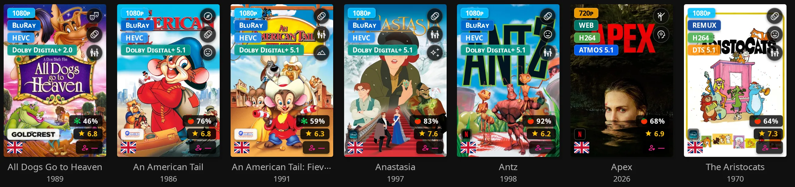

**How to use:**

1. Turn on the **Logos** group on the **Groups** tab of **Media Tags**. Choose its position and **Show up to** like any other group.
2. Administrators choose what the logo shows under **Media Tags settings** → **Groups** → **Logos**.

| Setting | Default | What it does |
|---|---|---|
| Admin: **Enable Logo Tags** / personal: **Logos** switch | Off | Shows the Logos group; the admin value is the starting value for new users |
| Admin / personal: **Position** | Bottom left | The group's corner or anchor in the Corners layout. Bands puts it in the top band, Caption in the caption strip, Summary and Minimal in the hover reveal |
| Admin: **Movies show** | **Streaming service (studio when none)** | **Streaming service**, **Studio** or **No logo** |
| Admin: **Series show** | **Network** | **Network**, **Streaming service (network when none)** or **No logo**. Seasons and episodes show their series' logo |
| Admin: **Streaming region** | Empty (the Seerr default region, else US) | Two-letter country code whose subscription services count |
| Admin: **Logos per title** | 1 | 1 or 2; personal **Show up to** can show fewer |

??? info "Where the logos come from"
    - **Streaming service:** the title's subscription (flat-rate) services in the region, from TMDB's watch providers, in TMDB's order. Titles that no service streams there show their studio or network instead.
    - **Network and studio:** the names Jellyfin has for the item (its studios), with the matching TMDB network or production-company logo when TMDB has one; otherwise the name.
    - The server looks titles up with the **TMDB API Key** from the [Elsewhere settings](../elsewhere/elsewhere-settings.md) and keeps each answer for a day. Full tag cache builds and the daily **Refresh Tag Cache** fetch new and expired lookups in small, rate-limited batches; a failed lookup is retried after an hour. A newly added item gets its logo when its cache entry is built, and the batch lookup used with the server cache off waits at most three seconds for it.
    - Logo images are downloaded by the server once and served from its own cache (`/JellyfinEnhanced/logo/…`), so **browsers never contact TMDB**. Without a TMDB key or internet access the server cannot look anything up: cards show the studio or network names Jellyfin has, as name chips.
    - Turning the group on for the first user, or changing the administrator's choices, refreshes the logos of every cached item in the background. With the server tag cache on, the page you turned the group on from shows the logos once that refresh lands (it checks for a few minutes), without a reload.

**Native Poster Tags** draw the same logos from the server's image cache, and the name chip when an image is not cached yet; a poster request never waits for TMDB, it queues the lookup or image in the background and the poster is redrawn once it arrives. [Spoiler Guard](../spoiler-guard/spoiler-guard-settings.md)'s **Hide tags** removes the logos from protected items like their genres, on web cards, batch lookups and native posters. All browser fallback groups share the server-issued `StripRevision`, validated centrally for both memory and saved copies. Only unguarded (`none`) answers survive page loads; guarded answers stay on the current page, and unknown authority causes a fresh lookup. Logos the browser remembers (with the server tag cache off, or its local fallback on) carry that revision: after you protect or unprotect an item, or switch **Hide tags**, they are fetched again instead of being redrawn. Tag Styles colour the pills on the **Logos** tab. Custom CSS can target `.logo-overlay-container`, `.je-logo-chip` and its `data-je-logo-kind` / `data-je-logo-style` attributes (see [CSS Customization](../advanced/css-customization.md)).

## Custom Tags

Custom Tags turn your own Jellyfin metadata into poster chips. The administrator writes rules: items that carry a Jellyfin tag (for example `4K Remaster`) or belong to a collection (for example `Criterion`) get a chip with the rule's label and, optionally, an icon. Tags are the ones in each item's metadata (**Edit metadata** → **Tags**, or imported keywords).

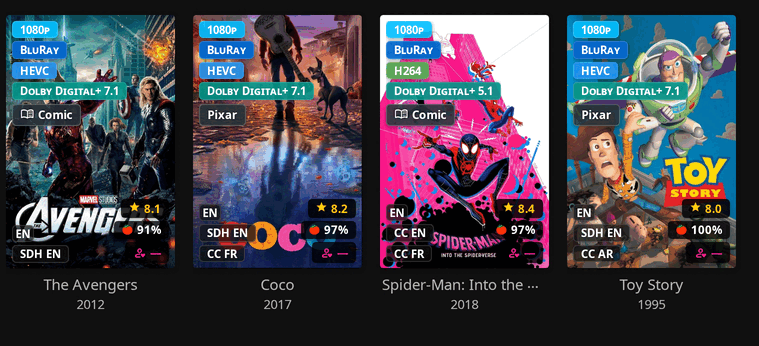

**How to use — administrators:**

1. Open **Media Tags settings** → **Groups** → **Custom**.
2. Click **Add rule**. Choose **Tag** or **Collection**, then type the name: suggestions list the library's tags or collections. Enter the chip's **Label** and pick an **Icon** if you want one.
3. Complete rows save automatically. Colour each label under **Colours** → **Custom**.
4. **Enable Custom Tags** and its **Position** set the starting values for users, like the other groups.

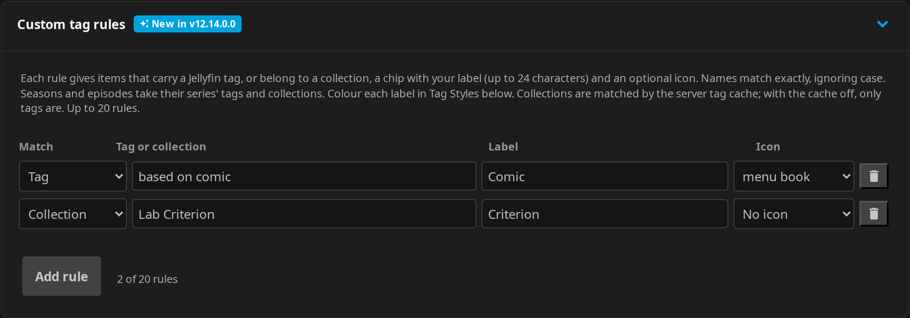

**How to use — personal preferences:** turn on the **Custom** group on the **Groups** tab of **Media Tags** and choose its position and limit, like any other group.

| Setting | Default | What it does |
|---|---|---|
| Admin: **Enable Custom Tags** / personal: **Custom** switch | Off | Shows a chip for each rule an item matches |
| Admin: **Custom tag rules** | None | Up to 20 rules: **Match** (**Tag** or **Collection**), the tag or collection name, a **Label** of up to 24 characters and an optional **Icon**, picked from a grid of the genre icons and further icons for picture and sound, sources, curation and themes |
| **Show up to** | 3 | Chips beyond the limit are left out, as for other groups |

Names match exactly but ignore case and extra spaces. Chips follow the rule order in the table, and reordering the rules takes effect at once; a rule whose name matches nothing simply shows no chip. Seasons and episodes take their series' tags and collections as well as their own. A collection chip only shows for users who can open that collection: if library access or parental controls hide the collection from someone, its chip is hidden on its items too, even on items they can see. Hovering a chip shows its label; administrators also see the tag or collection it came from. Other users never receive the tag or collection names a rule uses. Spoiler Guard treats custom chips like genres: when it hides tags (**Hide tags**, unless the user's own override keeps them), guarded items show no custom chips, since a tag or collection can give away the plot. With the server tag cache off, the browser keeps custom matches between page loads only for users with nothing guarded. A guard set on another device therefore takes effect on the next page load. Rule edits reach native posters at once, the server tag cache on or off: a poster drawn after the save matches its item against the new rules (label and icon edits keep the matches as they are). The server checks the rules when you save: it drops incomplete rows, unknown match types and labels made only of punctuation in any script (such as `*`, which the table flags), trims names and labels, shortens long labels and merges rows that name the same tag or collection.

??? info "When chips update"
    The [server tag cache](tags-server.md#server-side-tag-cache) records which rules each item matches. Editing an item's tags, adding items to or removing them from a collection, renaming or deleting a collection, or changing a series' tags updates its chips (and its seasons' and episodes') within seconds. Saving rules that match something new re-checks the whole cache in the background, without reading media files; changing only a label, icon or colour takes effect at once. The nightly reconcile and a full rebuild catch anything else.

    With the server tag cache off, chips come from each card's batched tag data and match **tags only**: collection membership needs the cache. Browsers remember an item's chips only while the rules stay the same.

## People Tags

People Tags add age and birthplace facts to cast and guest-cast cards on item detail pages. They support rectangular and round portraits.

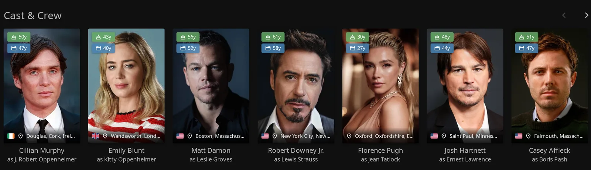

**How to use:**

1. Turn on **Show People Tags** in [**Media Tags** → **Layout**](../open-in-jellyfin.md?jeSection=media-tags).
2. Open a title's detail page and view its cast.

Administrators can set the starting value in **Media Tags**.

| Setting | Default | What it does |
|---|---|---|
| Admin: **Enable People Tags** / personal: **Show People Tags** | Off | Adds age chips, birthplace information, and deceased styling to cast cards |
| Admin: **Tags Cache Duration (days)** | 30 | Sets the lifetime of cached person facts in the browser; allowed range 1–365 |

You'll see green current-age chips, red age-at-death chips, and blue age-at-release chips near the top of a rectangular portrait. Birthplace appears along the bottom, with a country flag when the place can be resolved. Deceased people receive a cross and grayscale styling; round portraits use an adjusted layout.

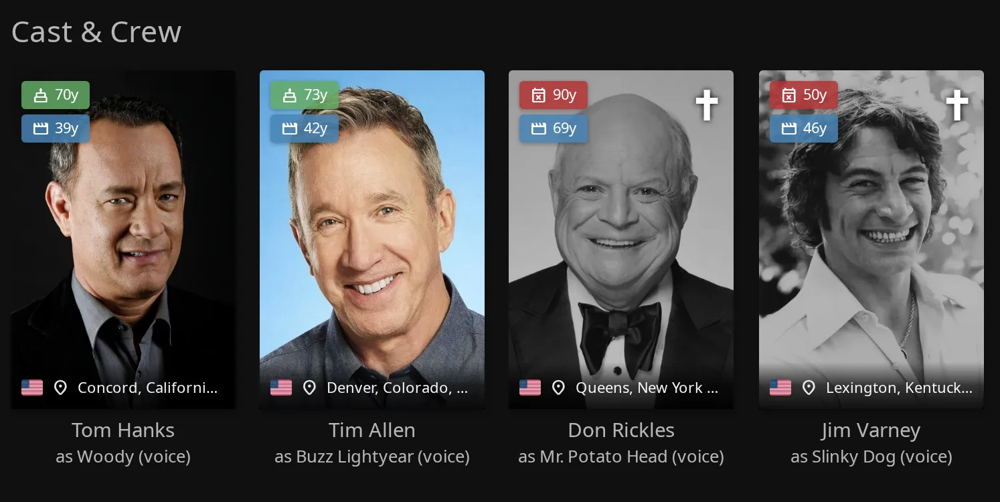

!!! note "Optional TMDB enrichment"
    To add facts from TMDB, the person needs a TMDB ID and a server admin must set **TMDB API Key** under [**Elsewhere & Reviews**](../open-in-jellyfin.md?tab=elsewhere&card=tmdb).

??? info "Person metadata and caching"
    Facts come from Jellyfin person metadata. Failed or unavailable TMDB enrichment keeps usable Jellyfin facts. Missing birth/death dates or birthplace omit the corresponding details. Age at release also needs the viewed item's visible premiere date; hidden or stripped dates cannot supply it.

    Age at release is calculated from birth to premiere without a death-date limit. For a posthumous release, that chip can show an age the person never reached.

    Birthplace flags require the last comma-separated part of the place to match a recognized country name. A place ending in `England UK` can therefore show its text without a flag.

    The separate browser facts cache holds at most 3,000 people. Ages are calculated from cached dates for the current visit rather than kept as stale age numbers. People Tags are web cast overlays and are not drawn by Native Poster Tags. Spoiler Guard can remove protected guest-cast/cast cards before these overlays appear.

## Player badges

You can show scores in the web video player's controls and an age-classification badge when playback starts. These are independent server settings; neither has a personal control in the panel.

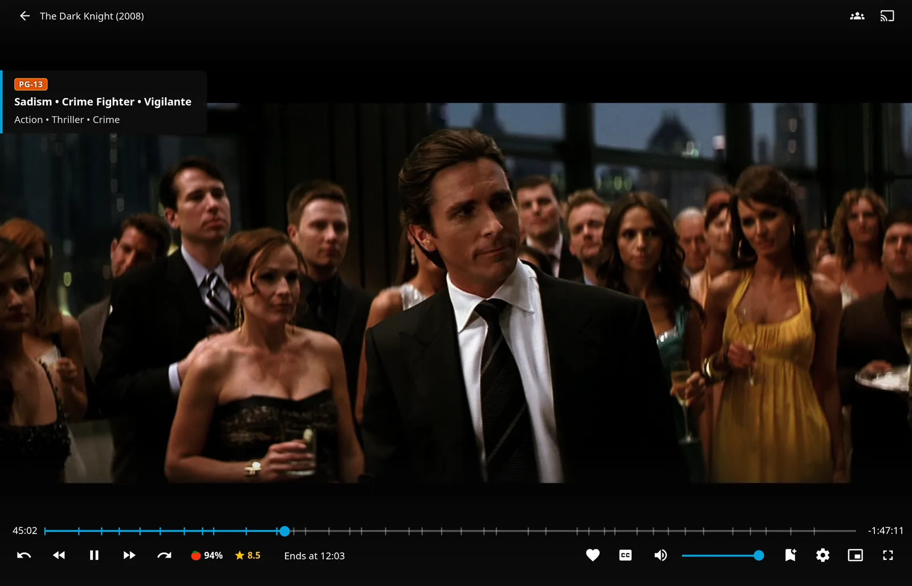

**How to use:**

1. Configure score chips on the Media Tags admin tab (**Groups** → **Rating**, which also holds **Show the rating in the video player**).
2. Configure the playback-start classification badge under [**Playback** → **Player Behaviour**](../open-in-jellyfin.md?tab=playback&card=player-behaviour).
3. Save the playback setting on the main page; Media Tags edits save automatically. Refresh the web client.

| Setting | Default | What it does |
|---|---|---|
| **Show Rating in Video Player** | On | Shows community and critic score chips near the time information in the on-screen controls, before **Ends at** |
| **Show Age Rating When Playback Starts** | Off | When an official classification is available, shows it with up to three recognized advisory tags and up to three genres when playback starts |

Neither setting requires poster Rating Tags or Age Rating Tags. Poster scope switches do not control player score chips.

??? info "Player score and classification behavior"
    Player score chips use Jellyfin's rating fields and can fall back to series scores when a season/episode has neither score.

    The playback-start badge needs an official classification. It uses the series' classification when an episode has none. It displays for five seconds, followed by a 400 ms fade.

    Advisories are selected from matching Jellyfin metadata tags. Episodes also use series genres when their own are missing and incorporate series tags. Missing advisories or genres omit only their respective lines. **Colored Ratings Backgrounds** can color its classification box.
