# Layouts & Rules

Where tags appear on a poster, how large they are, and which cards get their own look: layouts, tag size and spacing, rules, locked items, one item's look, and import, export and presets. Start with [Tags & Badges](tags.md) for setup.

## Layouts

A layout decides where the poster groups appear and how much of each you see. Pick one for your account; each layout keeps its own arrangement, so you can switch back and forth without losing it. Positions are physical: **Top left** is the poster's top-left corner in every interface language, right-to-left ones included.

**How to use — personal preferences:**

1. In **Media Tags**, on the **Layout** tab, pick a layout tile, a **Label density** and, for Corners, an **Edge spacing**. The live preview shows your layout as you change it.
2. On the **Groups** tab, open a group to choose where it goes in that layout and how many tags it shows. Use the arrow buttons to change the priority order.

**How to use — admin defaults:** on the Media Tags admin tab, open **Layout defaults** and set the starting layout, density, size, gap, edge spacing, order, positions and limits. Changes save as you make them.

| Layout | Where tags go | Default arrangement |
|---|---|---|
| **Corners** (default) | Nine anchors: four corners, top/bottom centre, left/right centre and centre; groups sharing an anchor keep their priority order | Quality top left, genre and status top right, language bottom left, rating and age rating bottom right |
| **Bands** | A gradient band along the top (first group left, the others right) and one along the bottom that wraps; the middle of the poster stays clear | Status and age rating on top; quality, rating and language at the bottom; genre hidden |
| **Caption** | A strip below the poster, between the image and the title, plus a small stack at the poster's top left | Status on the poster; quality, rating, age rating and language in the caption; genre hidden |
| **Summary** | One pill at the bottom of the poster with up to three short facts (for example `Just Added · 4K DV · ★ 8.1`); every group's full chips appear over a dark scrim on hover or keyboard focus | Status, quality and rating in the pill; genre, language and age rating on hover |
| **Minimal** | Status at the top left, one coloured dot per quality chip (resolution blue, dynamic range orange, audio green, codec grey), the rating in the bottom-right corner; full chips on hover or focus | As listed; genre, language and age rating on hover |

=== "Corners"

    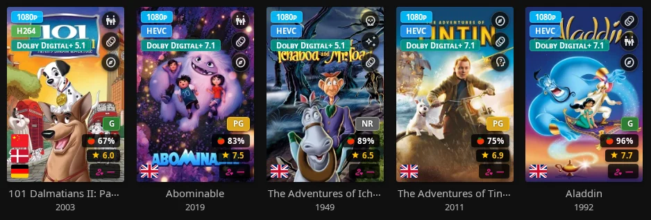

=== "Centre anchors"

    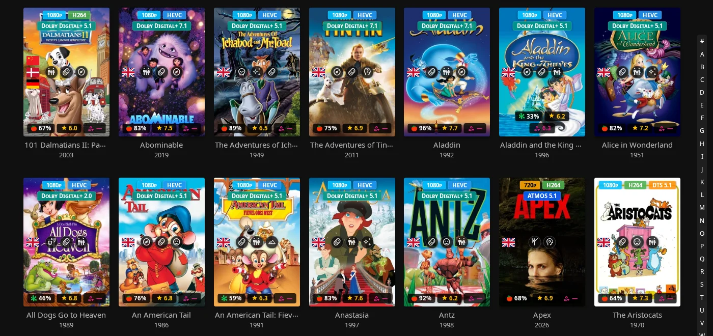

=== "Bands"

    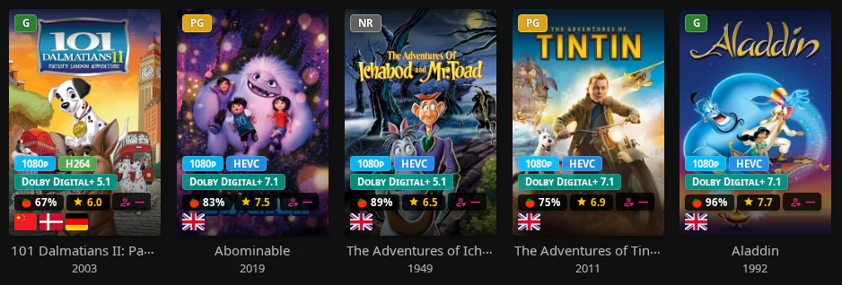

=== "Caption"

    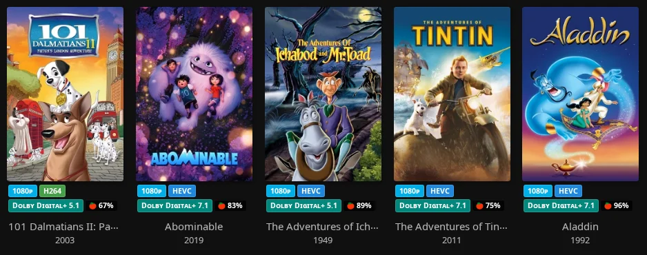

=== "Summary"

    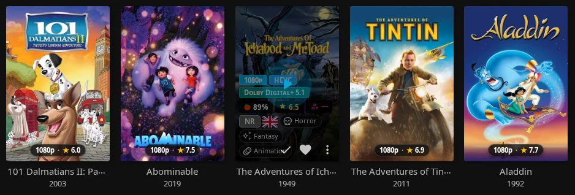

=== "Minimal"

    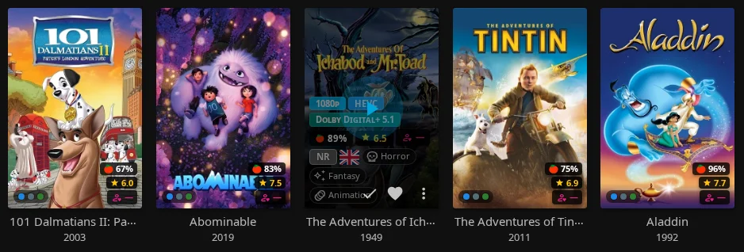

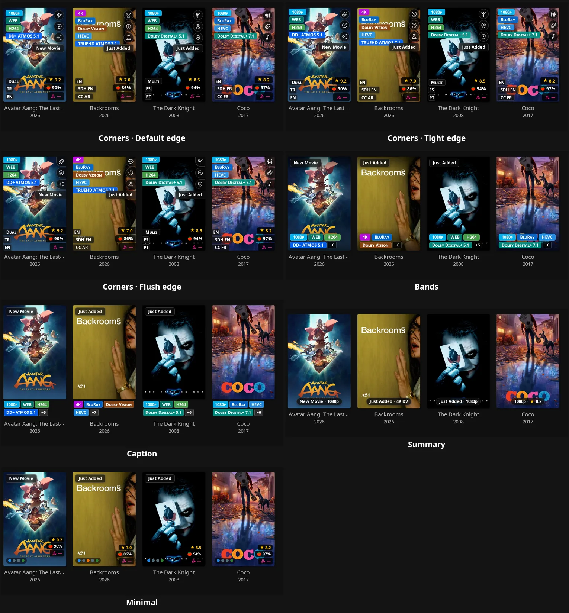
*The same four posters and tag groups in every layout.*

At left or right centre, a group uses the poster's full width when the opposite side is empty; with groups on both sides each gets half. The first chip at every anchor always stays visible, and a label too wide for its space is shortened with an ellipsis. A `+N` chip counts only later chips that do not fit.

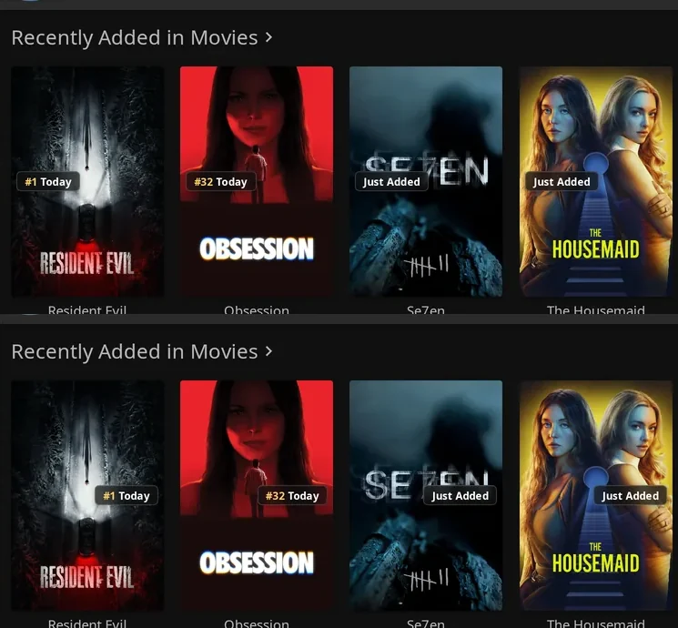
*Status at left centre (top) and right centre (bottom): the first badge stays visible.*

### Tag size and spacing

On [**Media Tags** → **Layout**](../open-in-jellyfin.md?jeSection=media-tags), below **Label density**, choose **Tag size** and **Gap**. The live preview and the cards already on screen update immediately; the choices save to your account.

| Setting | Choices | Default |
|---|---|---|
| **Tag size** / admin **Default Tag size** | **Smaller (85%)**, **Default (100%)**, **Larger (115%)**, **Largest (130%)** | **Default (100%)** |
| **Gap** / admin **Default Gap** | **Tight** (75% of the usual spacing), **Default** (100%), **Roomy** (150%) | **Default** |
| **Size and opacity per tag** / admin **Size and opacity per tag** under **Layout defaults** | One row per kind of tag: each quality category (resolution, source, HDR, special format, video format, sound, edition, runtime, aspect ratio, frame rate, versions) and every other group (status, rating, age rating, language, genre, awards, logos, custom). **Opacity** 10–100% and **Size** 50–200% of the tag's usual size, each kind on its own; **Tag size** above still applies to every tag. **All tags** with **Apply to all** sets every row, the ↺ button and **Reset all** go back to the administrator's values. Changes show on cards and in the preview as you type. Applies on web and native posters; the Summary pill, Minimal's dots and the "+N" chip keep the card's look. A size that makes one tag wider than the poster keeps it at the poster's width with its label cut. | The administrator's (100% / 100%) |

Size scales text, icons, flags, chip padding, summary pills, hover reveals and **+N** chips. Gap adjusts spacing between chips and groups. Larger tags can fit fewer chips; the usual limits and overflow fitting still apply, and edge insets are unaffected. The inherited **Same as default look** option follows the default size.

Administrators set the starting choices on the plugin's **Media Tags** page, **Layout defaults** tab. New users and **Apply defaults to all users** take those choices. Existing version-0 settings keep their original size and gap, including when saving an unrelated preference. The first layout edit preserves both defaults unless you change one. **Reset to defaults** restores both admin choices.

An enabled shape override has its own **Tag size** and **Gap** selectors. **Same as default look** inherits that setting independently; choosing **Default** explicitly keeps 100% even if the default look is larger or roomier. Stored rule/lock shape looks accept the same fields. Native posters follow the account's size and gap in Corners and Bands, and ignore shape overrides.

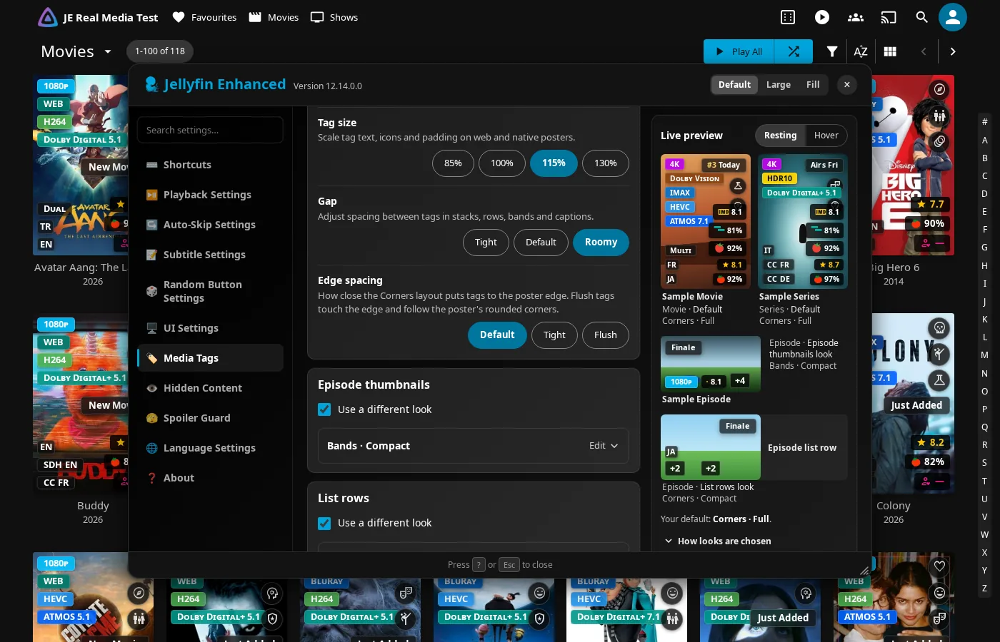

### Edge spacing

**Edge spacing** sets how close the Corners layout puts tags to the poster edge, on all nine anchors:

| Edge spacing | Distance from the edge | Notes |
|---|---|---|
| **Default** | 6px | What Corners always looked like |
| **Tight** | 3px | |
| **Flush** | 0px | Tags touch the edge, like a tab hanging off the poster: the chip corners against an edge are square, and a tag in a corner follows the poster's own rounded corner. Nothing is drawn outside the poster |

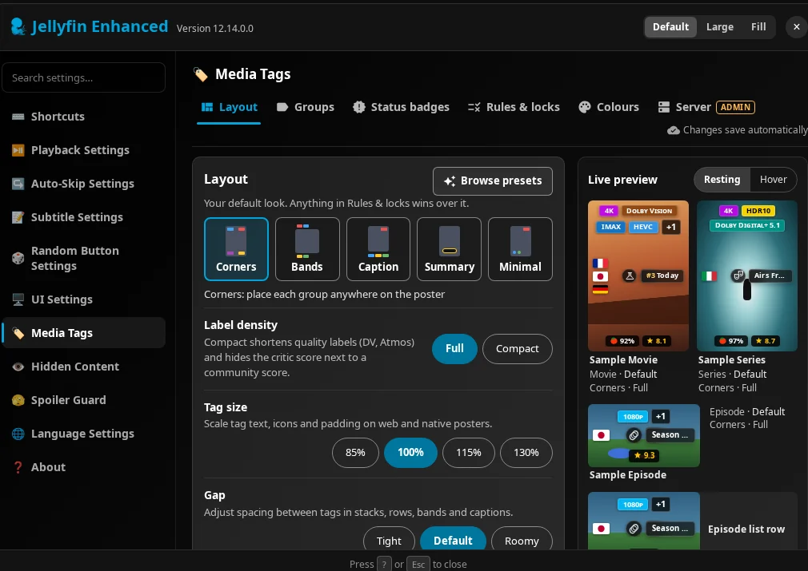
*Edge spacing sits on the Layout tab below Tag size and Gap.*

Flush chips lose their border and shadow on the sides touching an edge. The other layouts ignore edge spacing. Native Poster Tags use the selected inset in Corners; Bands keeps its own 6px inset.

??? note "Flush details"

    Flush chips have no visible border or shadow on the sides touching an edge; inward borders and shadows remain. Genre chips follow the same rule, with a flat side against the edge, and still show their name on hover. Language flags keep their shape. Top-centre tabs meet `top: 0` with square top corners, and bottom-centre tabs meet `bottom: 0` with square bottom corners. If a progress bar is present, bottom centre meets its top edge without a gap. Top centre first narrows to the gap between corner indicators and moves below them only when that gap cannot fit its first chip. Tight and Default retain their existing indicator and progress gaps. The other layouts have their own spacing and ignore it. Native Poster Tags use the selected inset in Corners; Bands retains its own 6px inset, including for overflow chips. Edge spacing applies to every Corners card, including shape overrides; size and gap may be overridden independently for each shape.

    Native Flush uses the same touching-edge treatment and centre-row indicator fallback. A native image request does not provide the app's progress-bar geometry; callers with known geometry can supply it to the layout planner. Native apps drawing their own progress overlays still control that placement.

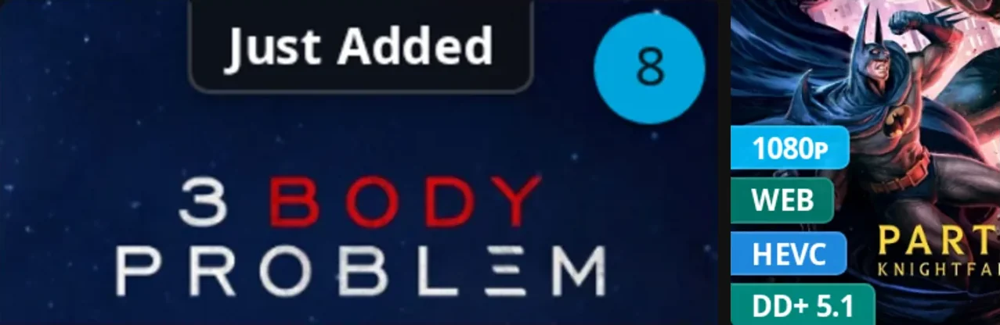
*Flush at 5×: the top-centre Status tab sits on the edge beside Jellyfin's count bubble; the bottom-left stack shows the compact `DD+ 5.1` label.*

!!! note "Flush and rounded posters"
    Flush tags are clipped to the poster's rounded corners rather than being given a radius of their own, so a corner tag takes exactly the curve your theme gives the poster.

### Episode thumbnails and list rows

On **Layout**, turn on **Use a different look** under **Episode thumbnails** or **List rows**. Each shape has its own layout, label density, group positions and chip limits. **Use recommended** restores these starting arrangements:

| Shape | Recommended look |
|---|---|
| Episode thumbnails and backdrop cards | **Bands**, **Compact**: status and age rating on top, quality and rating below, language and genre hidden |
| Large list images | **Corners**, **Compact**: quality top left, status top right, rating bottom right, each limited to two chips; the other groups hidden |

Both switches start off; switching one off uses your default look again. Portrait posters and square cards (including music and people) always use the default look.

??? note "How the shape is detected"

    Jellyfin's card classes decide first; otherwise the image's rendered aspect ratio does (wider than 1.2:1 is landscape, square counts as portrait), measured again whenever the card's size changes. Stored rules and locks may carry their own shape looks through the API; the rule editor edits layout and density only.

Each card uses the first match of **your item lock → the administrator's item look → first matching rule → shape override → default**.

The episode and list samples in the live preview follow their own shape settings. **Caption** on list rows still puts caption chips on the image; choose another layout to avoid this fallback. **Native Poster Tags** draw on poster images only and ignore shape overrides.

Shape chip limits run from **1** to **10**, then **All**. From **All**, press **−** to return to **10**; at **1**, **−** is disabled.

Administrators can choose **Same look as posters** or the recommended look for each shape under **Layout defaults** → **Card shapes** on the Media Tags admin tab. This seeds new users and applies when overwriting personal settings. Existing version-0 documents keep their old look until an explicit edit; merely loading or saving unrelated preferences does not enable overrides.

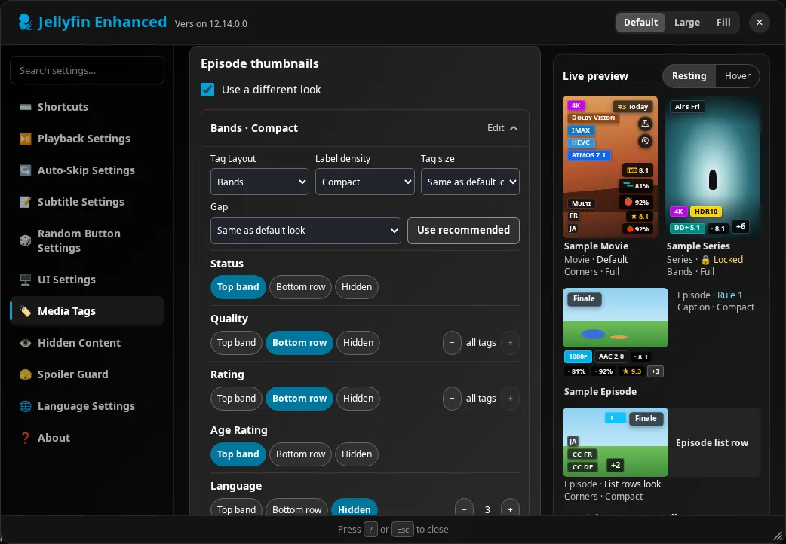

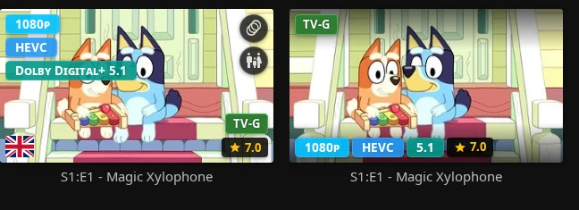

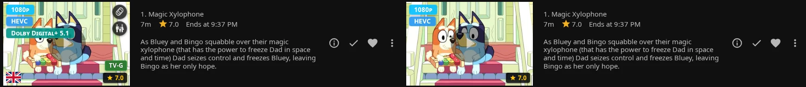

### Tag groups: order, position, limits

Each group has a row on the **Groups** tab, highest priority first. Groups higher in the list win when space is short: they stack nearest the edge of a shared corner, come first in a band or the caption, and take the summary pill's three places first. The row shows where the group goes in the selected layout and how many tags it shows (for example **Bottom row · up to 3**); the switch on the right turns the group on or off.

Open a row to change it:

- **Position:** the places the selected layout offers, plus **Hidden**. Corners shows poster-shaped tiles in a 3×3 grid, with a marker on the selected place, and **Hidden** is an icon button beside them; the other layouts list their places as pills. Each row's controls sit in a second column beside its label. Changing the layout re-labels every row. **Dots** is offered to quality only.
- **Show up to:** how many tags the group shows, from 1 to 10. Quality and rating also offer **All**. Age rating and status always show one.
- **Include:** the quality categories with their stack order, or the rating group's **Community score** and **Critic score**. Other groups have nothing to choose here.
- **Where to show:** every group has the same six switches: **Movies**, **Series**, **Seasons**, **Episodes**, **Continue Watching row** and **Next Up row**. Turn one off to keep that group off those cards, for example genres off episodes or the age rating off the Next Up row. Each switch you have not changed follows the administrator's choice, and **Follow server** puts the whole group back on the administrator's choices. The item types also apply to [Native Poster Tags](tags-server.md#native-poster-tags-experimental). The two home rows are a web setting, because an app's image request does not say which row a poster is in. The live preview applies the switches to its sample movie, series and episode. People Tags appear on cast cards, not on media cards, so they have no switches. The item editor does not have them either, since they are set for all titles here. Collections and other videos always show the group. Rating works the same way: a Rating switch you turned off before this release stays off, and the others follow the administrator.
- **Show up to** reads **Always one tag** for Status, Age rating and a one-logo Logos group, on the hub and in the item editor.

The limit applies after each group's own filtering (quality categories, language grouping and priority, [hidden tags](tags-server.md#hidden-tags), each group's **Where to show** switches). **Reset to defaults** restores the administrator's layout, density, positions, order and limits; your group switches and include choices stay.

**Show up to** appears only for groups that can show multiple chips. Status (including Leaving soon and direct play) and Age rating always have a limit of one. Logos hides the control when the administrator permits only one logo, and shows it when the maximum is two. Saved higher limits cannot increase these single-chip groups. The hub and administrator Layout defaults / Groups panels follow the same rule.

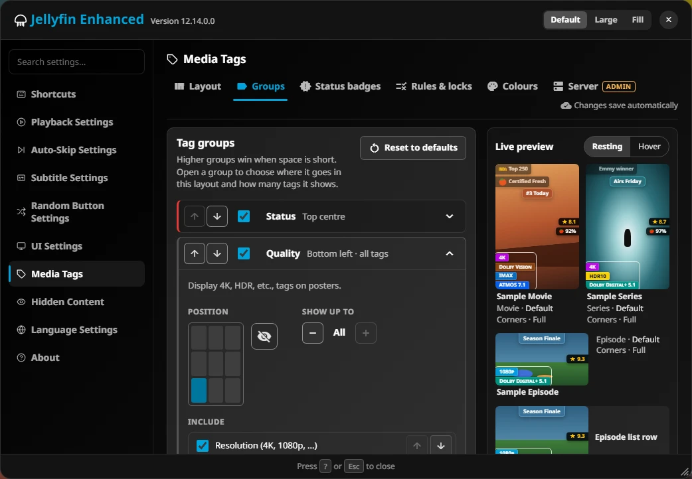

| Setting | Default | What it does |
|---|---|---|
| Personal: **Tag Layout** / admin: **Default Tag Layout** | **Corners** | Chooses one of the layouts above |
| Personal: **Label density** / admin: **Label density** under **Default look** | **Full** | **Compact** shortens quality labels (`Dolby Vision` → `DV`, `HDR10+` → `HDR+`, `ATMOS 7.1` → `ATMOS`, `Dolby Digital 5.1` → `DD 5.1`, `Dolby Digital+ 5.1` → `DD+ 5.1`) and hides the critic score when a community score is shown |
| **Tag Groups** order | Status, quality, rating, age rating, language, genre, awards, logos, custom | Priority order of the groups |
| **Show up to** | Genre 3, language 3, awards 2, custom 3; quality, rating and two-logo groups all | Hidden for single-chip Status and Age rating, and for Logos when **Logos per title** is 1; these groups always cap at 1 |
| **Position** — Quality / Genre / Language / Rating / Age Rating / Status Tags | Corners: **Top Left** / **Top Right** / **Bottom Left** / **Bottom Right** / **Bottom Right** / **Top Right** | Any of the nine anchors in the Corners layout; the admin **Position** selects set these defaults |
| Admin / personal: **Hide tags on hover** | Off | Fades web poster tags when you hover over a card, making its buttons easier to see; new and overwritten personal settings take the admin value |
| Admin: **Disable Tags on Search Page** | Off | Suppresses the poster tags on Jellyfin web search results, including age-rating and review chips; useful for compatibility with Gelato |

Compact quality vocabulary is shared by web and native rendering. The canonical Full label remains the colour identity; normalized layouts detect AC-3 and DTS-HD explicitly. Audio aliases follow the [TRaSH-Guides Audio Formats](https://trash-guides.info/Radarr/Radarr-collection-of-custom-formats/#audio-formats) vocabulary, adapted from release names to stream titles, codecs and profiles: Atmos and Plus forms win before plain DD, and DTS-HD before DTS. E-AC-3, EAC3, DDP, DD+ and Dolby Digital Plus share the DD+ identity; an E-AC-3 track whose profile or title says JOC (Dolby's object coding) is **DD+ ATMOS**.

| Full label (optional channel suffix) | Compact |
|---|---|
| Dolby Digital / Dolby Digital+ | DD / DD+ (keeps channels, for example DD+ 5.1) |
| DTS-HD MA / DTS-HD HRA / DTS-HD | DTS-HD (keeps channels) |
| TRUEHD / ATMOS / TRUEHD ATMOS / DD+ ATMOS / DTS-X / DTS (including DTS-ES) | Keeps the canonical codec name (both Atmos carriers shorten to ATMOS); drops channels |
| FLAC / PCM | Keep their name and channels (FLAC 2.0, PCM 7.1) |
| AAC / Opus / MP3 | Channel-only fallback (for example 5.1 or 7.1); stereo has no sound chip |
| Dolby Vision / HDR10+ / BluRay | DV / HDR+ / BD |

Other emitted video codec labels (AV1, HEVC, H265, VP9, H264, VP8, XVID, DIVX, WMV, MPEG2, MPEG4, MJPEG, THEORA) are already short and remain unchanged.

AC-3 tracks produce **Dolby Digital 5.1** in Full and **DD 5.1** in Compact (E-AC-3 uses **Dolby Digital+ 5.1** / **DD+ 5.1**). DTS-HD Master Audio and High Resolution remain distinct Full facts (**DTS-HD MA** / **DTS-HD HRA**) and both shorten to **DTS-HD**, retaining channels. A track that only says `DTS-HD` (no `MA`, `XLL` or `Master Audio` in its title or profile, and no HRA) is **DTS-HD**: JE does not claim it is lossless. Dolby TrueHD, Dolby Atmos and DTS:X stream aliases resolve to the established **TRUEHD**, **ATMOS** and **DTS-X** facts. The formatter also accepts their long names from portable or older cached labels; those aliases are not the detector’s canonical output. AAC, FLAC and Opus keep the existing channel-only fallback.

Existing version-0 Full layouts keep their previous audio labels until a layout setting is saved. This preserves their appearance; normalized layouts and Compact presentation use the codec facts above.

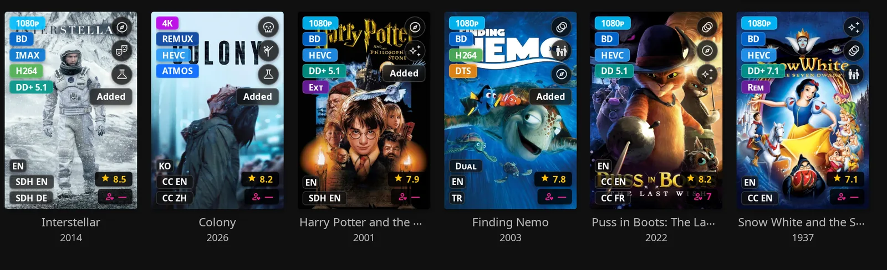
*Compact labels on real library files: `DD+ 5.1`, `DD 5.1`, `DTS-HD 5.1`, `BD`, `REMUX`, `IMAX`, `Ext` and `DC`.*

The four default corners keep their original appearance. Top and bottom centre wrap chips into centred rows (up to two); left and right centre stack chips vertically. Centre rows reserve the width occupied by corner groups, including a tall column from the opposite edge that reaches into the row on a short image, and each keeps to its half of the image; side columns reserve the height of their neighbouring corner stacks. Chips that are too wide or tall are hidden whole and counted in a **+N** chip, which names the hidden tags on hover or focus. Group limits apply before fitting.

Top-right groups move below Jellyfin's watched or unplayed-count indicator. Top centre reserves space for side indicators; in Flush it stays on the edge while the first chip fits that gap, and falls below indicators only when needed and only while it stays in the image's top half. On a short image crowded with tags (an episode still with every group on), a centre row with no room left even for a `+N` chip is left out; its tags stay in the card's hover description. Default and Tight keep their existing clearance. Bottom centre clears a card's progress bar; Flush meets the bar's top edge. People Tags have their own cast-card layout and no position.

At the left and right centre anchors, genre names appear toward the inside of the card on hover.

With **Hide tags on hover** off, genre names expand beside their icons on hover. Turn it on to fade poster tags instead.

<figure class="je-video">
  <video autoplay loop muted playsinline controls preload="metadata" aria-label="Genre labels expand and poster tags fade on hover">
    <source src="../../images/tags/tag-hover.mp4" type="video/mp4">
  </video>
  <figcaption>Genre names expand with Hide Tags on Hover off; turning it on fades the tags instead.</figcaption>
</figure>

### Admin defaults

The **Layout defaults** section of the Media Tags admin tab sets what new users start with: the layout, density, group order, each group's position per layout and the limits. In Corners a group's position is one of nine anchors on a small poster (these are the group's old Position settings) or **Hidden**; pick another default layout to set its positions. A group's row is greyed out while it is off for new users. The order and limits are only stored once you change them.

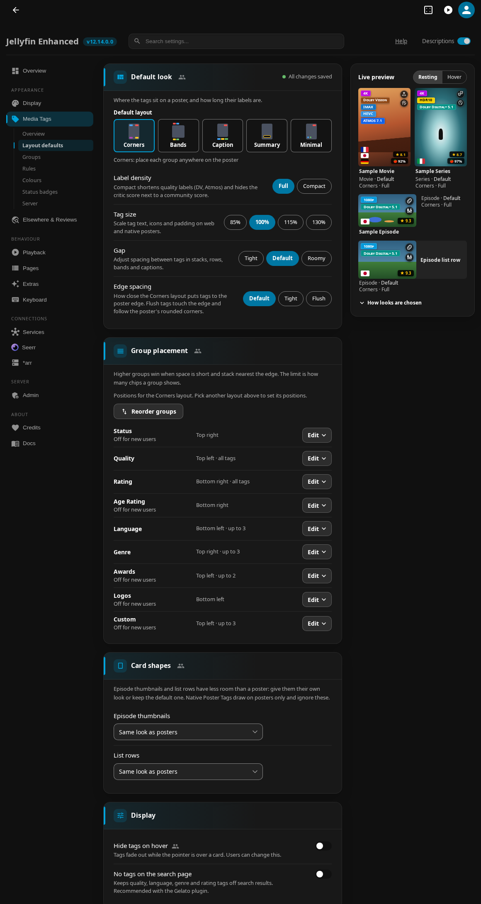

??? info "Upgrades, defaults, and limits"
    - Settings saved before layouts existed keep the **Corners** layout, your corner choices, full labels, the original stacking order and limits. Your first change in the layout editor changes only what you changed; everything else carries over. Administrators' new layout defaults never change an existing user's view.
    - The editor shows such settings in the default order; the order is saved the first time you move a group.
    - New users, and **Apply defaults to all users**, start from the administrator's layout defaults. A group hidden in the Corners layout on the Media Tags admin tab reaches users the same way; the corner positions apply to everyone who has not picked a corner.
    - **Caption** needs a title block below the image. List rows and other cards without one show the caption groups in the poster's top-left stack instead, with as many whole chips as fit the image's height and the rest counted in a `+N` chip. The caption strip has room for two rows of chips; lower-priority chips that do not fit are left out whole and counted in a `+N` chip; hovering or focusing the card shows their names at the top of the poster, and screen readers hear them as part of the card's description. Space for it is reserved as soon as a card appears so titles do not jump when the chips arrive.
    - The **Bands** bottom band keeps to two rows (then `+N`), or to the rows that fit below the top band's chips on short images such as episode thumbnails at the larger tag sizes, and on cards narrower than 160px both bands use compact labels.
    - In **Minimal**'s status and score stacks and **Caption**'s poster stack every chip stays whole and inside the card: one wider than the card keeps its rounded box 6px from the edges and ends its label with an ellipsis. On a card too narrow for the quality dots and the scores side by side, the scores sit just above the dots; on a short image (an episode still) with several rating sources, the scores that do not fit inside the image appear when you hover the card.
    - The **Summary** pill drops its lowest-priority facts when the card is too narrow for all of them; its tooltip keeps every fact. The hover reveal of **Summary** and **Minimal** always uses compact labels and keeps to two rows at the bottom of the poster (then `+N`), clear of the play button; on short cards such as episode thumbnails it shows only the rows that fit in the bottom 40% of the image. Jellyfin's card buttons stay on top and clickable.
    - **How rows fill:** the caption strip, the Bands bottom band, the hover reveal and the centre rows show chips in priority order until the first one that has no room left. That chip and every chip after it go behind `+N`, so a lower-priority chip never takes the place of a higher-priority one. A chip that could never fit is the only one skipped: one wider than the whole row, or, when there is room for just one row, one too wide to sit beside `+N`. A row's height is planned as if it held the slot's tallest chips. As a result, switching a group off or removing a chip only ever shows more of the others, and switching it back on gives the same card as before. Award and logo chips in the caption strip take the strip's chip size.
    - **Hide tags on hover** hides tags on the poster in Corners, Bands and Caption; the caption strip stays visible. In Summary and Minimal it hides the pill, dots and corner, and the full chips still appear.
    - Settings saved before layouts keep the **Default** edge spacing whatever the administrator picks; the first layout change pins it, so only a later Edge spacing change moves the tags.
    - [Native Poster Tags](tags-server.md#native-poster-tags-experimental) draw Corners or Bands. Caption, Summary and Minimal use the saved Corners profile with Full labels. Bands follows its positions, hidden groups, order and limits with its own padding; Corners follows edge spacing. Both respect the chosen Full or Compact label density, as on the web; settings saved before layouts (version 0) keep their previous labels.

## Rules and locked items

Rules give some cards a different look (a layout and a label density) than your default: for example, a caption strip in the Movies library and compact bands on episodes. A lock keeps one item's own look (set in its [Media Tags editor](#one-items-look)), whatever you change later.

**How to use:**

1. In **Media Tags**, open **Rules & locks**. The **Add a rule** form is always open beside the list (below it on a phone).
2. Pick one or more conditions (all of them must hold, up to five; every condition needs a value) and the look, which starts at **Caption** and **Compact**. Click **Add rule**: the rule goes to the end of the list.
3. Use the arrows to order the rules, **On**/**Off** to pause one, **Edit** to load it into the form (**Save rule** keeps its place and its On/Off state) or **Delete** to remove it.
4. To give one item its own look, choose **Media Tags** in its ⋮ menu (see [One item's look](#one-items-look)). In **Locked items**, **Edit** opens that editor again and **Unlock** releases the item. **Unlock all** asks for a second click. On a phone, **Show** unfolds the locked items and **Unlock all**.

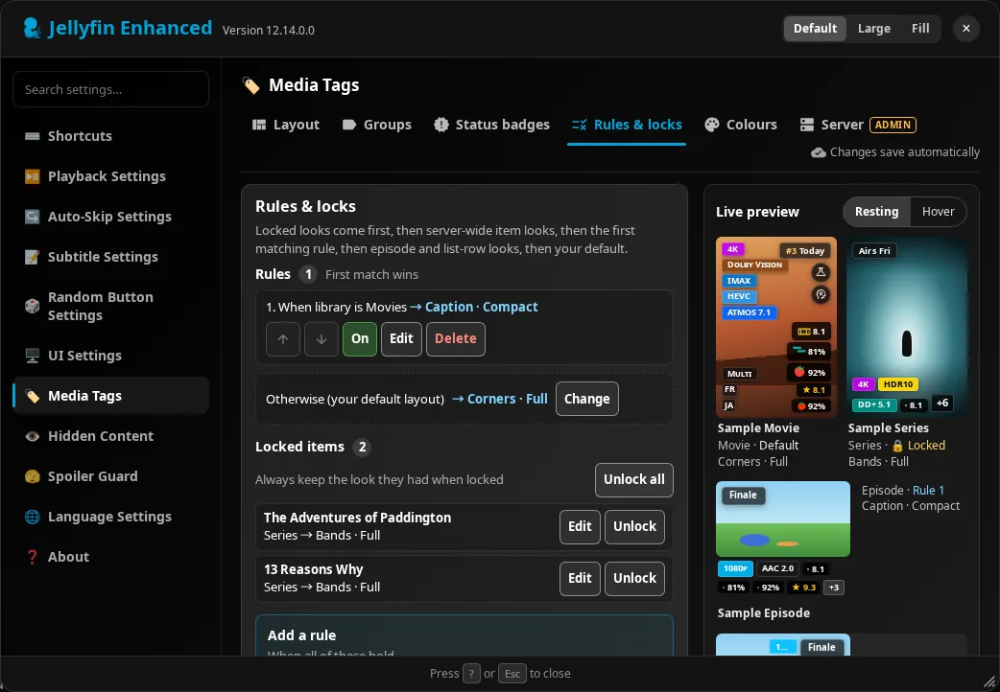

Each card gets its look from the first of these that applies:

1. **Your lock** on the item. A series locked for its seasons and episodes also gives them its look, unless one of them has its own lock.
2. **The administrator's item look** for it (**For everyone** in the item editor), the same way: the item's own, else its series'.
3. **The first enabled rule** whose conditions all hold, from the top of the list.
4. **The shape override**, if enabled for an episode thumbnail or list row.
5. **Your default** Tag Layout and Label density (the **Otherwise** row).

| Condition | Matches | Notes |
|---|---|---|
| **Library** | The library the item is in | Seasons and episodes use their series' library. An item in two libraries that share a folder uses the first one Jellyfin reports |
| **Type** | Movie, Series, Season, Episode, Collection or Video | The card's own type: an episode card showing its series' poster still counts as an episode |
| **Genre** | One of the item's genres | Not case-sensitive. Seasons and episodes use the genres the tag cache gives them |
| **Age rating** | The item's age rating | Compared as the age rating tags show it (`DE-12` and `FSK-12` match), not case-sensitive. Seasons and episodes fall back to their series' rating |

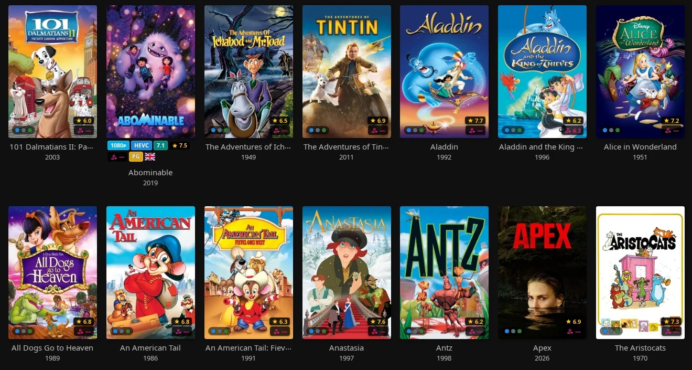

| Setting | Default | What it does |
|---|---|---|
| Personal: **Rules & locks** | No rules | Ordered rules: when every condition holds, the card uses that rule's layout and density |
| Personal: **Locked items** | None | Items that keep the look you gave them; **Edit** reopens the item editor, **Unlock all** asks for a second click |
| Admin: **Rules** tab | Empty | Rules that new users and **Apply defaults to all users** start with. The form is the personal one: up to five conditions (libraries by name, genres and age ratings from your library), **Edit** loads a rule into it (**Save rule** keeps its place, its On/Off state and any per-rule positions), **Cancel** goes back to adding. **Edit as JSON** sets what the form does not: per-rule group positions and episode or list-row looks |
| Admin: **Rules** → **Server-wide item looks** | None | Item looks every user gets (set with **For everyone** in the item editor); **Edit** opens the editor, the bin removes one with **Undo** |

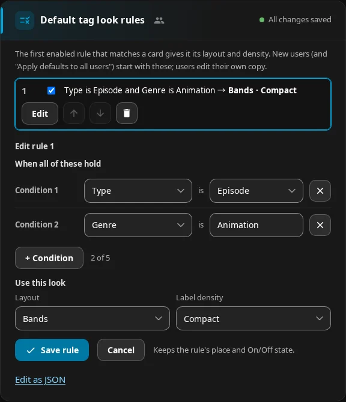

??? info "Limits and details"
    - Up to 50 rules, each with up to 5 conditions, up to 500 locked items per user and up to 500 server-wide item looks; past 500 the oldest is released. The server drops an invalid rule, lock or item look (an unknown layout, a malformed id) on its own and keeps the rest. A rule with an unknown condition, or more than five, is dropped whole: removing only that condition would make the rule match more cards than you asked for.
    - On the admin **Rules** tab, a draft you are typing in **Edit as JSON** is never replaced by a save, the server tidying the rules or another administrator's change: the box says when the saved rules changed beneath it, **Save JSON** replaces them with your text and **Revert** loads the saved ones.
    - A lock stores the layout, the density and where every group sits in that layout, plus any **Show up to**, size, gap and edge spacing chosen for the item, so later changes to your arrangement do not move a locked item. Group order still follows your settings, and so does anything the lock leaves at **Your default**.
    - A rule uses your arrangement for its layout. Group order and limits are yours for every look.
    - Rules on library, genre and age rating, and a series lock on its seasons and episodes, read the item's data: its entry in the server tag cache, or the batch lookup when the cache is off or does not have the item yet. The browser remembers what the lookup said about each item (type, series, library, genres, age rating), so cards drawn from the per-tag fallback cache match every rule as well; an item it knows nothing about is looked up once.
    - While a card's data is on its way and a rule or lock could change its look, its chips wait for the data instead of appearing in your default look and then moving. Type-only rules never make a card wait. Space for the caption strip follows your default in the meantime, so when a rule gives a card Caption (or takes it away) the strip appears (or goes) once the data arrives, the first time this browser sees that item. A card whose data does not come shows its tags in your default look once the lookup ends, or after 8 seconds at most.
    - The item editor looks the item up first when its data is not loaded yet, so it starts from the look the item's cards really have; if the lookup fails it says the current look is not known. If a rule or lock change cannot be saved, it is undone on screen and a message says so.
    - Saving a look for yourself and **For everyone** at once writes two things. If one of them fails, the editor says which was saved (it stays, also if you close the editor) and which was not; **Save** then writes only the missing one while you change nothing else.
    - Mixing Caption with other looks on one row is allowed; caption cards are taller than their neighbours.
    - Settings saved before layouts existed never pick up the administrator's default rules; rules you add yourself apply.
    - Changing a rule or a lock updates the cards on screen at once, without reloading their tags.
    - [Native Poster Tags](tags-server.md#native-poster-tags-experimental) follow rules too, decided from the same item data (the server tag cache entry, or the item itself when the cache is off): a rule that hides Quality on movies hides it on the TV as well, and a group you keep hidden by default (its position **Hidden**) appears on the TV wherever a rule gives it a place, for example Quality only in your 4K library. A rule choosing Caption, Summary or Minimal draws Corners there, with the rule's hidden groups still hidden. Native apps pick up a rule change when they next load the library (the poster addresses change). One difference: a genre rule matches a poster that Spoiler Guard protects on the TV, while the web, which receives that item without its genres, does not; either way the protected tags themselves stay hidden.
    - Locked cards carry `data-je-locked="1"` on their tag host for [custom CSS](../advanced/css-customization.md); cards with a server-wide item look do not. Nothing else marks them by default.
    - Server-wide item looks reach every account, including settings saved before layouts existed (which never take the administrator's rules); clients receive only item and series ids visible through their Jellyfin library and parental access checks; anonymous callers receive none.

## One item's look

Any movie, series, season, episode, collection or video can have its own look. Open its ⋮ menu, on its page or on its card, and choose **Media Tags**. The editor starts from the fully resolved look, including a shape look’s size, gap and limits, so opening it leaves the preview unchanged. It shows the item's poster with its real tags, in the look you are building:

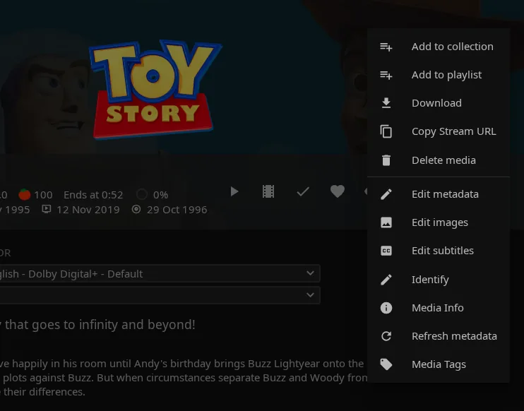

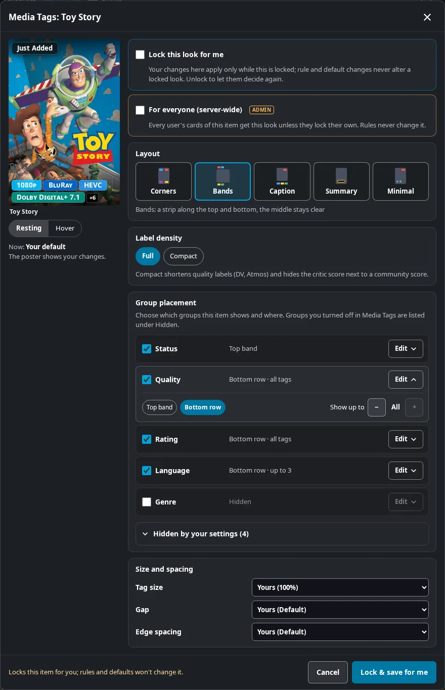

**How to use:**

1. Pick a **Layout** and **Label density**. Under **Group placement**, switch groups on or off for this item and open a group's **Edit** to choose where it goes (the nine named positions on Corners, the layout's places otherwise) and how many tags it shows (**Show up to**); groups you turned off in your Media Tags settings are listed under **Hidden by your settings**. **Size and spacing** changes tag size, gap and edge spacing for this item only (**Yours (…)** follows your settings).
2. For a series, season or episode, choose **Apply to**: **This series and its seasons and episodes** keeps one look on the series that its seasons and episodes share; **This episode only** (or **This series poster only**) keeps it to the one card.
3. Choose where the look goes at the top of the editor: **Lock this look for me** keeps it as your lock. If you change the look without choosing, the button reads **Lock & save for me** and saving locks it for you; **Cancel** leaves it unkept. The save button always names what it does (**Save for me**, **Save for everyone**, **Save for me and everyone**). Turning the lock off on a locked item and saving releases it; the message offers **Undo**. Undo restores only the released looks, keeps unrelated changes made since, and keeps a newer look on the same item.
4. Administrators also see **For everyone (server-wide)**: the look becomes the item's look for every user, unless they lock their own. The Media Tags admin tab lists these looks in its **Rules** section.

On a phone the editor fills the screen, with the poster beside the item's name at the top and **Save** always in reach:

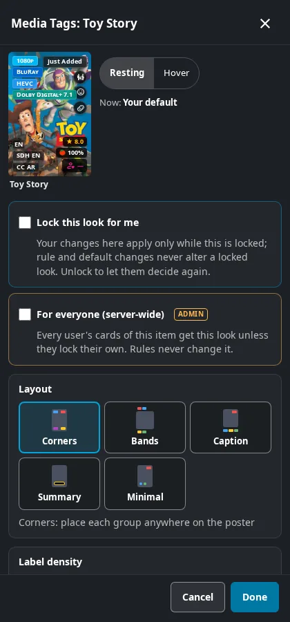

| Setting | Default | What it does |
|---|---|---|
| **Layout**, **Label density** | The item's current look | The look the item gets |
| **Groups** | The item's current look | On/off, place and **Show up to** per group; groups you switched off in your settings say so and show nothing |
| **Size and spacing** | **Your default: …** | Tag size, gap and edge spacing for this item; **Your default** follows your own setting |
| **Apply to** | Series: the series and its episodes; season or episode: this one only | Where the look is kept |
| **Lock this look for me** | Off (on for a locked item) | Saves the look as your lock; off releases it |
| Admin: **For everyone (server-wide)** | Off | Saves the look as the item's server-wide look |

??? info "Limits and details"
    - The editor's row is added to Jellyfin's own ⋮ menu with the same markup as its other rows, so it looks and works the same with a mouse, touch or keyboard. It appears only for items that can have poster tags and while at least one tag group is on.
    - The poster in the editor is the item's own artwork with the tags copied from its card on the page, or drawn from the tag cache. Nothing else on the page changes until **Save**.
    - [Native Poster Tags](tags-server.md#native-poster-tags-experimental) follow locks and server-wide item looks in Corners and Bands, with their size, gap, edge spacing, positions, hidden groups and limits; Caption, Summary and Minimal use your Corners positions there, with the item look’s hidden groups and limits still applied.

## Import, export and presets

Your Media Tags settings can be saved as a file, moved to another server or shared as a preset. Every import is checked by the server first and shows exactly what will change before anything is applied.

**How to use:**

1. In **Media Tags**, stay on **Layout** and scroll to the bottom: **Presets** and **Import & export**.
2. **Export settings** shows your settings as a document; **Download** saves it as a `.json` file and **Copy** puts it on the clipboard.
3. **Import settings** takes a file or pasted text. **Check** lists every setting that would change (old value → new value) and every setting that is skipped, with the reason. **Apply** saves the changes; the panel opens again on the new settings with **Undo** for 10 seconds.
4. Under **Presets**, **Apply** previews a preset the same way. **Share** copies a preset so someone else can import it. **Save as preset** keeps your current settings under a name and description; **Import preset** adds a shared preset to your list. **Delete** removes one of yours.

Export, **Check**, a preset's **Apply** and **Save as preset** first save your latest change, so they work on the settings the panel shows. If that save fails (for example the connection dropped), they stop and say your change is not saved yet; **Retry** (or **Check** / **Save** again) tries once more. If a setting the document sets changes in the panel after the preview, **Apply** shows the preview again instead. If saving an applied import fails, the import is taken back, except a setting you changed in the panel while it was saving: that newer change stays.

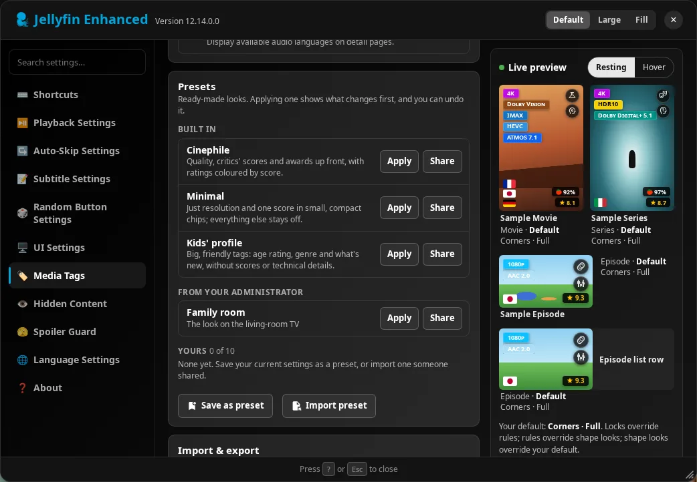

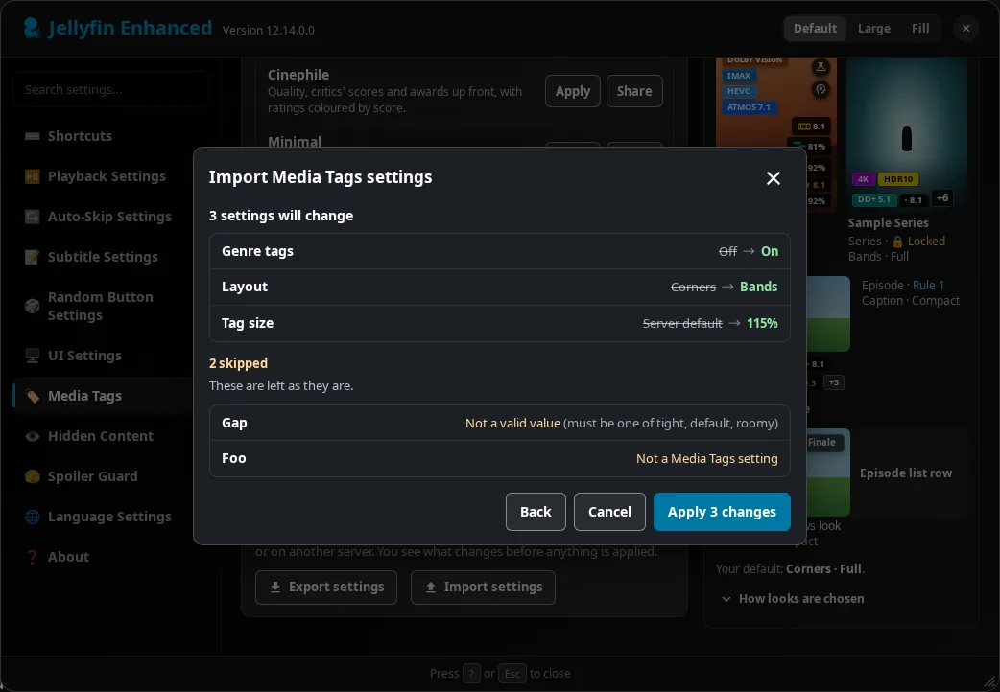

| Preset list | Where it comes from |
|---|---|
| **Built in** | **Cinephile** (quality, critics' scores and awards up front, ratings coloured by score), **Minimal** (resolution and one score in small compact chips) and **Kids' profile** (big tags: age rating, genre and what's new). |
| **From your administrator** | Presets the administrator offers on the Media Tags admin tab (up to 20). |
| **Yours** | Up to 10 presets you saved or imported. They are kept on the server, so they follow you to every device. |

A document carries your layout and its profiles, group order, limits and positions, card-shape looks, density, size, gap and edge spacing, group switches and what each group includes, rating sources, language display and priority, status badge families and your colour preset. Rules and locked items are left out: they name this server's libraries and titles. A preset can carry only some of these; applying it changes those and keeps the rest.

??? info "What is skipped, and why"
    - **Not a Media Tags setting**: a field this version does not know (from a newer version, or a typo).
    - **Not a valid value**: a value the settings save would not accept as given (an unknown layout, a cap over 10, a position that does not exist, a language that is not an ISO code). The reason is shown next to it.
    - **A secret, never imported**: API keys and the custom rule key never travel in a document.
    - A document from a newer version of Jellyfin Enhanced is refused as a whole; update the plugin first.
    - Settings saved before layouts existed export as they are (their layout version travels with them), so importing them elsewhere gives the same look. The built-in presets switch to the current layout system.

**Administrators** export and import the server-wide settings in the **Server** section of the Media Tags admin tab. Pasting a personal export from your own panel works too, so an administrator can make their own look the default for everyone: every setting on that tab (defaults, groups, Tag Styles, custom rules, award lists, logo choices, status windows, cache options and offered presets), never an API key or the custom rule key. An import shows the changes, asks for a confirmation and saves them like any edit on that page: a setting another administrator changed meanwhile waits for **Keep mine** or **Take theirs**, and the snackbar offers **Undo** for 10 seconds. **Presets for users** lists the presets offered in every user's Presets list: **Offer my settings** uses your own Media Tags settings (saved first: if that save fails it offers nothing and says so, with **Retry**), **Offer from a file** a preset or settings file; each can be shared or removed.

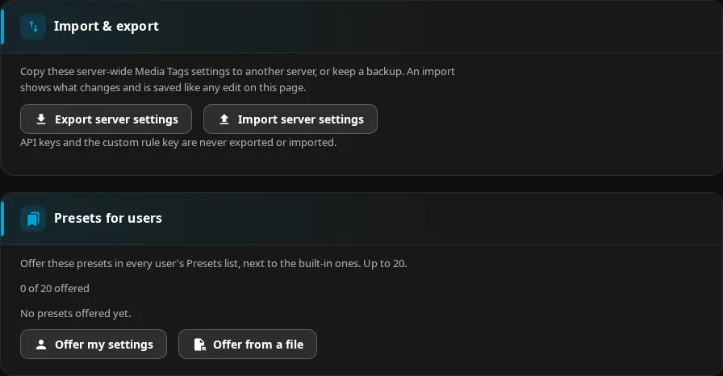

| Setting | Default | What it does |
|---|---|---|
| Personal: **Presets** / **Import & export** | Built-in presets only | Apply, share, save and import presets; export or import your settings with a preview and Undo |
| Admin: **Server** → **Import & export** | — | Export or import the server-wide Media Tags settings; secrets never included |
| Admin: **Server** → **Presets for users** | None | Up to 20 presets every user sees under **From your administrator** |
