# Quality, Genre & Language

Quality, Genre and Language tags, audio-language links, and how chip text is localised. Layout and placement are in [Layouts & Rules](tags-layouts.md).

## Quality Tags

Quality badges help you identify a file's picture and sound format before opening it. They read Jellyfin's media metadata and naming signals.

**How to use:**

1. Turn on the **Quality** group on the **Groups** tab of **Media Tags**.
2. Open the row and select categories under **Include**.
3. Use **Move up** / **Move down** to change their stacking order.

Administrators configure the same defaults on the Media Tags admin tab under **Groups** → **Quality**.

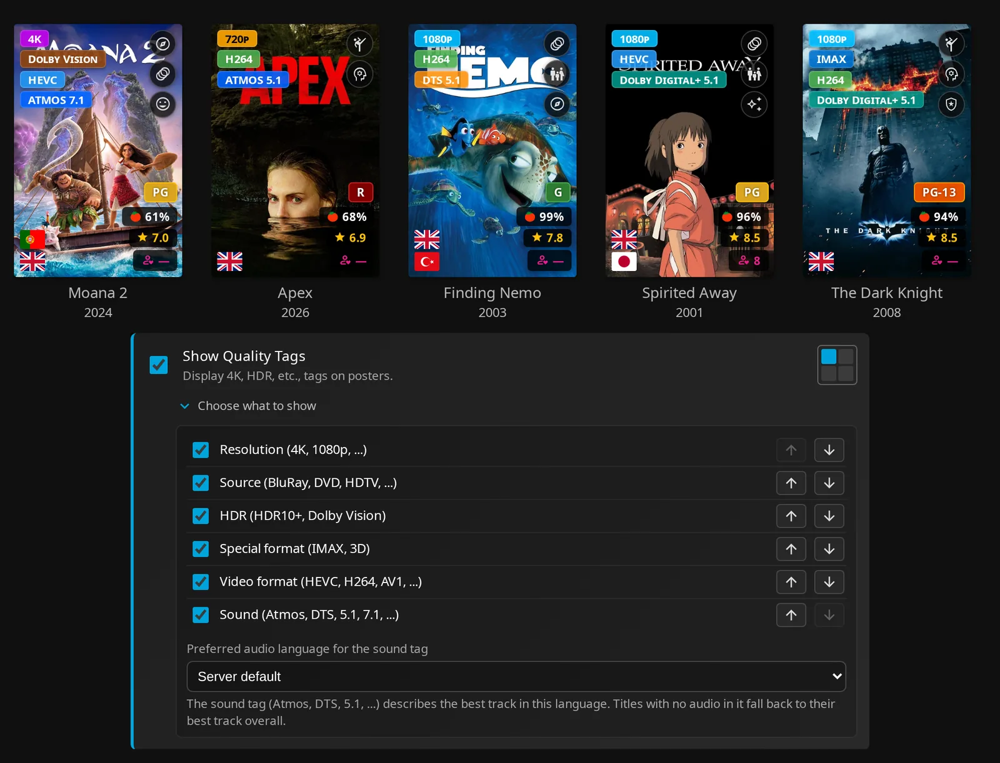

| Setting | Default | What it does |
|---|---|---|
| Admin: **Enable Quality Tags** / personal: **Quality** switch | Off | Enables the quality group |
| Admin: **Show resolution (4K, 1080p, ...)** / personal: **Resolution (4K, 1080p, ...)** | On; first | Shows resolution from the first video stream |
| **Source (REMUX, BluRay, WEB, HDTV, DVD, …)** | On; second | Shows the source inferred server-side from release naming, or the source of a physical-media stub |
| Admin: **Show HDR (HDR10+, Dolby Vision)** / personal: **HDR (HDR10+, Dolby Vision)** | On; third | Shows the dynamic range Jellyfin reports for the video (Dolby Vision, HDR10+, HDR10, HLG) |
| Admin: **Show special format (IMAX, 3D)** / personal: **Special format (IMAX, 3D)** | On; fourth | Shows detected IMAX/3D labels |
| Admin: **Show video format (HEVC, H264, AV1, ...)** / personal: **Video format (HEVC, H264, AV1, ...)** | On; fifth | Shows video codec labels |
| Admin: **Show sound (Atmos, DTS, 5.1, 7.1, ...)** / personal: **Sound (Atmos, DTS, 5.1, 7.1, ...)** | On; sixth | Shows recognized audio format/channel information |
| **Edition (Director’s Cut, Extended, …)** | On; seventh, after sound | Shows the edition from file/folder naming; its order is configurable |
| **Include low-quality sources (CAM, TS, TC, SCR)** | Off | Allows those source labels when the Source category is on |
| **Versions (2 versions, 3 versions …)** | Off; eleventh | On a movie, episode or video with several versions (media sources), how many: **2 versions** (Compact **×2**), in your language. Series and seasons never show it. The other quality chips describe one version (see [Detection details](#series-policy-and-detection-details)) |
| Personal: **Follow server settings** | — | Makes all 23 nullable Quality overrides follow the administrator again: edition, low-quality sources, technical categories, the Versions chip, all eleven category orders, display modes, minimum resolution, Hide SDR and the series policy. Until then, any change you make to one of them stays yours, even a change back to the administrator's value |
| Admin: **Preferred Audio Language for Sound Tags** | **No preference (best track overall)** | Chooses a fixed language whose audio tracks determine the sound tag |
| Admin: **Use Each User's Jellyfin Audio Language** | Off | Uses each user's Jellyfin preferred audio language; users without one retain the fixed admin language |
| Personal: **Preferred audio language for the sound tag** | **Server default** | Inherits server policy, uses **My Jellyfin audio language**, selects **No preference (best track overall)**, or chooses a specific language |

??? info "Badge examples"

    | Category | Examples the detector can produce |
    |---|---|
    | Resolution | `8K`, `4K`, `1440p`, `1080p`, `720p`, `576p`, `480p`, `LOW-RES` |
    | Source | `REMUX`, `BluRay`, `WEB`, `HD DVD`, `DVD`, `VHS`, `HDTV`, `SDTV`; physical stubs also support `Physical`; optional `CAM`, `TS`, `TC`, `SCR` |
    | Dynamic range | `Dolby Vision`, `HDR10+`, `HDR10`, `HLG`, `HDR`; All mode also shows a Dolby Vision stream's base layer (`HDR10`, `HDR10+` or `HLG`) and `SDR` |
    | Special format | `IMAX`, `3D` |
    | Video codec | `VVC`, `AV1`, `HEVC`, `H265`, `VP9`, `H264`, `VP8`, `XVID`, `DIVX`, `VC-1`, `WMV`, `MPEG2`, `MPEG4`, `MJPEG`, `THEORA`, `ProRes` |
    | Edition | `Director's Cut`, `Extended`, `Unrated`, `Theatrical`, `IMAX`, `Remastered`, `Criterion`, `Uncut`, `Final Cut`, `Special Edition`, `Redux`, `Ultimate` (Ultimate Cut/Edition), `Collector's Edition`, `Anniversary` (`25th Anniversary`, `Anniversary Edition`), `Uncensored`, `Open Matte`, `Rogue Cut`, `Black and Chrome`, `Masters of Cinema`, `Producer's Cut`, `Alternate Cut`, `Assembly Cut`, `International Cut`, `Restored`, `Hybrid`, `Roadshow` (Roadshow Cut/Edition/Version), `Despecialized`, `Fan Edit`, or a custom `{edition-…}` label |
    | Sound | `TRUEHD ATMOS`, `DTS-X`, `ATMOS` (carrier unknown), `DD+ ATMOS`, `TRUEHD`, `DTS-HD MA`, `PCM`, `FLAC`, `DTS-HD HRA`, `DTS-HD`, `Dolby Digital+`, `DTS`, `Dolby Digital`, `7.1`, `6.1`, `5.1`; codec labels include the same track's layout, such as `Dolby Digital 5.1`, `DTS 6.1`, `PCM 4.0`, `FLAC 2.0` or `TRUEHD ATMOS 7.1.4` |

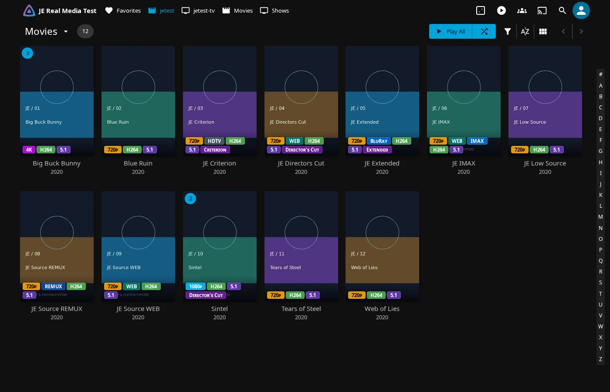

??? info "Compact phone labels and the Quality controls"

    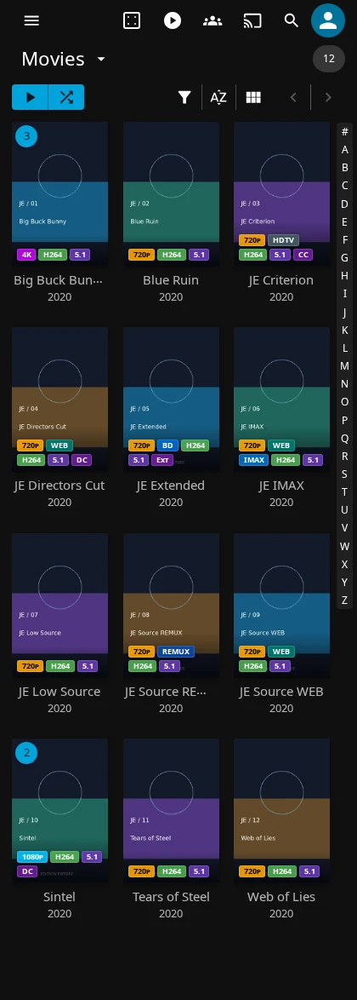

    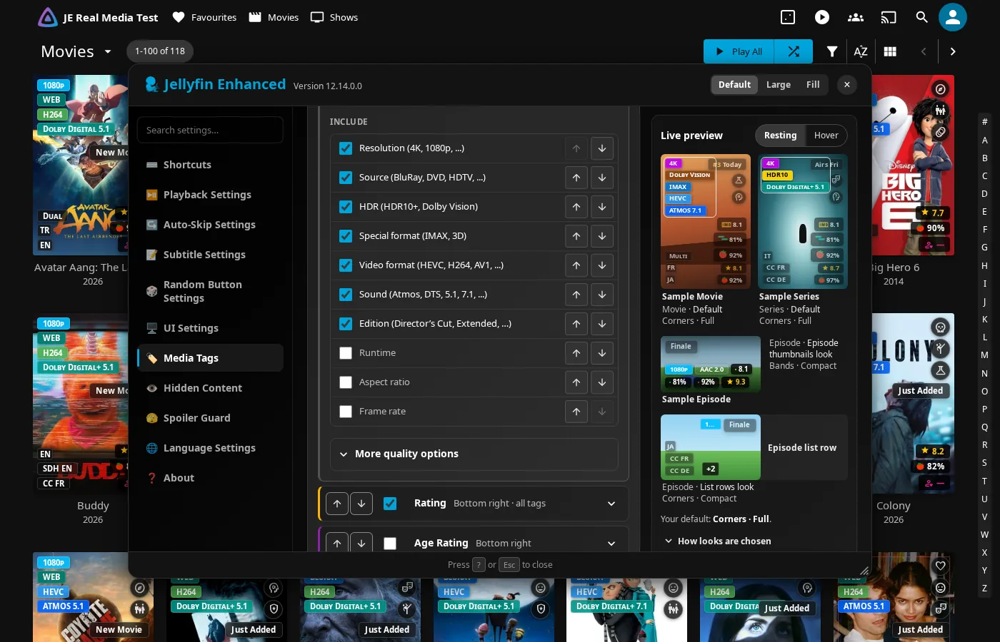

### Highest only or every stream value

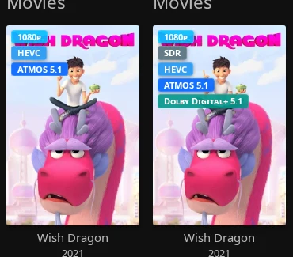

Under **Groups → Quality**, below the categories, choose a separate **Sound display mode**, **Video codec display mode** and **HDR display mode**. **Highest only** is the default and keeps the existing detector's output. **All distinct values** shows every recognized value from the available streams, deduplicated and ranked within its category. For sound, each codec stays paired with that track's own channels: `ATMOS 7.1`, `DTS 7.1`, `DTS 5.1`. For HDR, a Dolby Vision stream also lists its base layer, the format a display without Dolby Vision plays: `Dolby Vision` and `HDR10` for a profile 7 or 8.1 file, `Dolby Vision` and `HLG` for profile 8.4; a profile 5 file (no fallback) shows `Dolby Vision` alone. The existing sound-language preference still selects tracks before deduplication; this does not change playback.

| Setting | Default | Choices |
|---|---|---|
| **Sound display mode** | Highest only | Highest only / All distinct values |
| **Video codec display mode** | Highest only | Highest only / All distinct values |
| **HDR display mode** | Highest only | Highest only / All distinct values; All can include SDR |
| **Minimum resolution to show** | Off | Off / 720p / 1080p / 4K; hide resolution chips below the selected bucket |
| **Hide SDR** | Off | Suppresses SDR in All HDR mode; Highest only retains its existing omission of SDR |

Sound chooses the preferred language's tracks before extracting labels, including tracks with no displayable sound label. For example, English AAC stereo plus German Atmos shows no sound chip with English preferred; it does not fall back to German. Exact-region matches take priority over base-language matches. Only an absent language falls back to all available tracks; with no preference, all tracks are eligible.

Each personal control also offers **Server default**, which follows future administrator changes. Administrators set starting values under [**Media Tags → Groups → Quality**](../open-in-jellyfin.md?jeSection=media-tags&tab=groups). New accounts and **Apply defaults to all users** copy those defaults. Existing preferences keep their appearance until a mode or default changes; editing these controls does not migrate a legacy layout.

The resolution threshold is inclusive: **1080p** keeps 1080p and higher; **4K** hides the 1080p chips in a mostly 1080p library while keeping 4K and 8K standouts. Other quality categories remain eligible. Category switches and order apply first, then the Quality group's **Show up to** limit. Compact density shortens every additional chip as usual. Chips omitted by layout fitting count toward **+N**; chips intentionally removed by category filtering, thresholds or the group limit do not.

For series and seasons, each category in All mode follows the selected aggregation policy:

| Policy | All-mode values |
|---|---|
| Representative episode | That episode's distinct sets |
| Latest episode | The latest aired episode's distinct sets |
| Best quality | Union of the episodes' distinct sets, ranked |
| Only what every episode has | Intersection: values present in every episode; an unknown episode contributes an empty set |
| Best, marked when mixed | Ranked union, plus Mixed when an enabled category's episode sets differ |

Categories left on Highest only keep their existing aggregation semantics. Source, edition, special formats and resolution retain their existing policies. Restricted accounts aggregate only episodes they can access. Browser cache, batch fallback and Native Poster Tags use the same facts and filtering. Native Corners and Bands respect the chosen Full or Compact label density and their existing overflow rules.

### Runtime, aspect ratio and frame rate

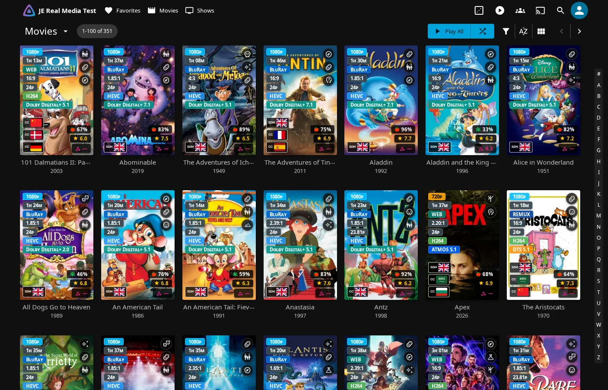

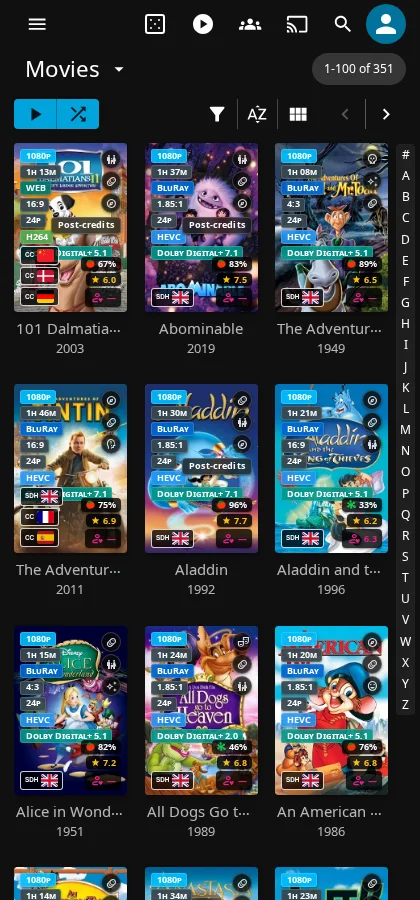

Under [**Media Tags → Groups → Quality → Include**](../open-in-jellyfin.md?jeSection=media-tags&tab=groups), enable **Runtime**, **Aspect ratio** or **Frame rate**. All three start off. Administrators choose defaults and stacking order on the Media Tags admin tab’s **Groups → Quality** section; existing personal choices remain in effect.

| Category | Full / Compact example | Source |
|---|---|---|
| Runtime | `1h 52m` / `1h52` | Jellyfin RunTimeTicks, truncated to whole minutes; unknown/zero values are omitted |
| Aspect ratio | `2.39:1` / `2.39`; `16:9`, `4:3`, `2.35:1`, `1.43:1` | Video display aspect, falling back to width/height |
| Frame rate | `24p`, `25p`, `30p`, `50i`, `60p`, `120p` | Real frame rate, otherwise average; interlaced rates display fields per second |

Aspect ratios snap to the nearest supported ratio within an absolute tolerance: 4:3 and 16:9 ±0.025; 1.43 ±0.015; 1.66 and 1.90 ±0.02; 1.85, 2.00, 2.20, 2.39 and 2.76 ±0.025; 2.35 ±0.019. Scope metadata at 2.39 and 2.40 shares the label `2.39:1` (`2.39` in Compact); 2.35 keeps `2.35:1`. A ratio never names a format: 1.43 (IMAX's film ratio) reads `1.43:1` and 1.90 (also the DCI full container, 2048×1080) reads `1.90:1`; the IMAX chip itself comes from the special-format detection, which needs an IMAX signal on the video, the item or its release name. The web snapping table is generated from the server table by `scripts/generate_technical_ratios.py`. Other usable ratios show two decimal places. This is a format hint derived from metadata, not a certification that a title was filmed in IMAX. Fractional rates such as 23.976, 29.97 and 59.94 snap to their familiar integer labels within 0.15; other rates retain up to two decimal places.

Series and seasons use the representative episode for these three facts under Representative, Best, Shared and Mixed policies. Latest uses the latest episode’s facts, just like Source and Edition. They follow the quality group’s order, cap, density and Tag Styles, including Native Poster Tags. Missing data leaves the chip out.

### Series policy and detection details

Series and seasons share the **Series and seasons show:** setting in [**Media Tags** → **Groups**](../open-in-jellyfin.md?jeSection=media-tags&tab=groups) → **Quality**. The administrator sets its starting default on the Media Tags admin tab under **Groups** → **Quality** → **Series and season quality**. **Follow server (…)**, the starting choice, follows the administrator's later changes. Each user can instead choose one of these, which then stays theirs even when it matches the administrator's:

| Policy | What appears |
|---|---|
| **Representative episode** (default) | Today's behavior: the first non-virtual episode with usable streams, preferring regular episodes over specials |
| **Latest episode** | Quality of the non-virtual episode with the newest known air date at or before now; future and undated episodes cannot win, and when the newest has not been probed the newest probed one is used |
| **Best quality** | The best resolution, source, dynamic range, video codec and audio found independently across episodes; these facts can come from different episodes |
| **Only what every episode has** | A category appears only when every episode has the same value; mixed 1080p/4K episodes therefore show no resolution chip, and a season with WEB and BluRay episodes no source chip |
| **Best, marked when mixed** | Best quality plus a **Mixed** chip when an enabled resolution, source, dynamic-range, codec or sound category differs; compact density uses **±** |

The policy covers each series' episodes or each season's own episodes, including specials and all available media versions: when an episode's first version has not been probed, a probed alternate version's resolution, dynamic range and codec still count (an individual episode card describes its first probed version). The source is summarised across episodes like the technical categories (a season upgraded piecemeal from WEB to BluRay shows **BluRay** under Best, nothing under Only what every episode has, and **BluRay** with **Mixed** under Best, marked when mixed). Edition and special-format chips retain the representative episode for best/shared/mixed; latest takes those chips from its own episode. The codec and dynamic-range rankings follow the quality category orders below. Aggregated audio uses the same ranking as a single file (see **Sound** under Detection details: TRaSH's order for lossless and object audio, channels first among lossy tracks), among the preferred language's tracks; an unavailable language falls back to the available tracks.

Missing streams count as unknown: a known/unknown difference suppresses that category in shared mode and marks mixed mode. Empty containers show no mixed marker. Collections keep their existing behavior and normally have no quality badges. Older cache entries without a summary fall back to representative streams until rebuilt.

The server stores policy-independent summaries with both legacy and current sound facts, so changing the policy does not need another episode fetch. Version-0 accounts retain their previous audio vocabulary under every policy, sound display mode and language preference; normalized accounts use the current codec labels. Access-restricted users receive summaries, audio and subtitle languages (with partial-dub coverage) recomputed from the episodes they can see, using the existing access/filter revision, so a hidden episode never adds a language or a Dual/Multi badge. The batch fallback and Native Poster Tags honor the same policy. Quality category switches, ordering, layout limits, label density and Tag Styles still apply; **Mixed** is an editable quality label in Tag Styles.

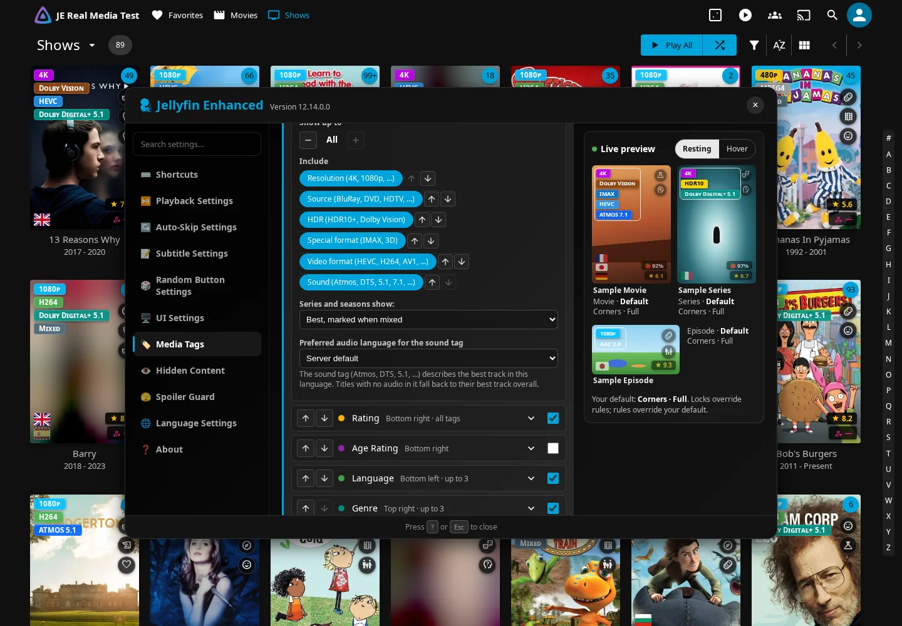

=== "Shared values"

    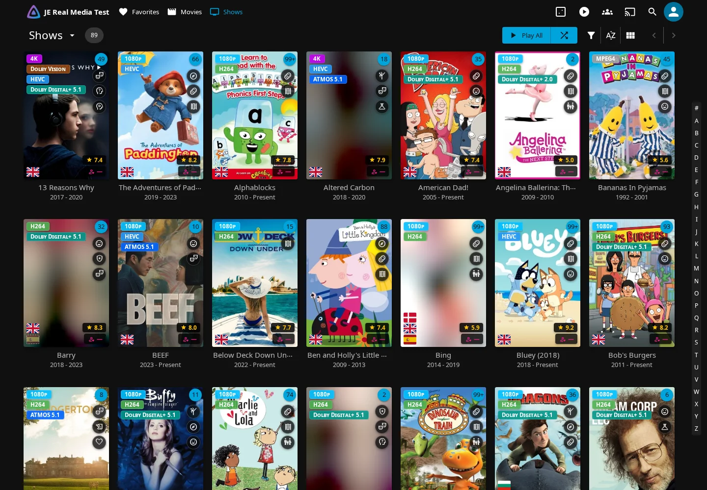

=== "Best with Mixed"

    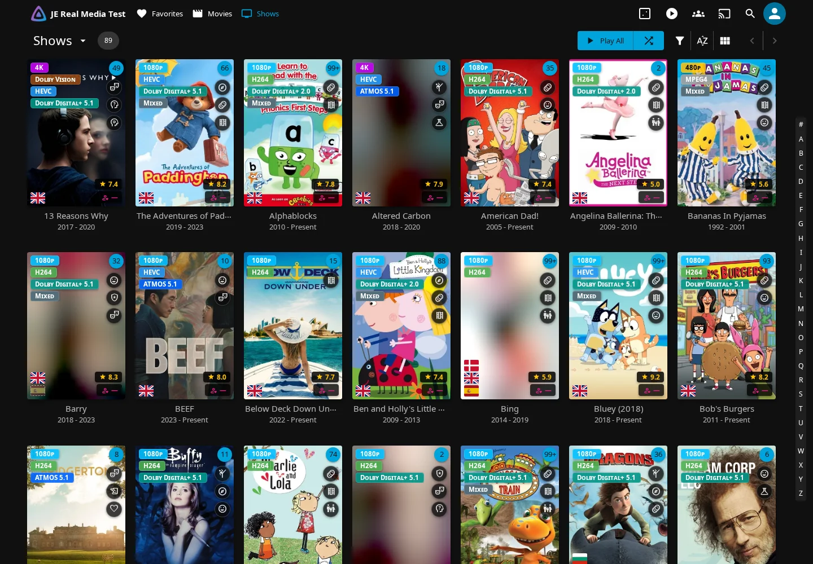

??? info "Detection and sound-language details"

    **Resolution:** the video's known width and height decide; a resolution word in the stream title (`1080p`, `4K`) only counts when Jellyfin has no dimensions for it, so a release named `720p` that is really 1920×1080 shows `1080p`. A known interlaced frame keeps its scan: `1080i` (Live TV recordings, broadcast captures), `576i` and `480i` (DVDs and SD broadcasts); a stream title naming `1080i`, `576i` or `480i` counts when the dimensions are unknown. The minimum-resolution setting treats `1080i` as 1080. A portrait frame is measured by its short and long sides, so a 1080×1920 phone video is `1080p`, not `4K`; a 4K-class height also needs a 4K-class width, so a 2560×1600 frame is `1440p`, and an 8K-class height needs an 8K-class width, so a 4:3 4096×3072 frame is `4K`. A codec named in a stream title counts only as a whole word (`NAV1GATOR` is no AV1), with or without its dot or hyphen (`H.264`, `VC-1`, `MPEG-2`). This applies to every account, including settings saved before layouts.

    Dimension fallback recognizes 8K at height ≥3000 or width ≥7000, and 4K at height ≥1550 or width ≥3500. A 3840×1600 ultrawide file can therefore show `4K`. PAL-sized video can show `576p`. Sorting and styling support `SD`, but the current web resolution detector does not produce it.

    **Source:** A `.disc` physical-media stub wins first. Otherwise JE checks the selected version's file name, then its immediate parent folder. Matching ignores case and uses separators such as dots, spaces, underscores, hyphens and brackets; `Blue Ruin` does not match BluRay. `BDRip`/`BRRip` and full discs (`BR-DISK`, `BD25`/`BD50`) become **BluRay**, `WEB-DL`/`WEBDL`/`WEBRip` and a bare `WEB` anywhere after the title (`1080p.WEB.DDP5.1`) become **WEB**, though any other source word in the name wins over a bare `WEB` (`Show.S01E01.The.Web.720p.HDTV` is **HDTV** even when the episode's own title is unknown), `HDTV`, `HDTVRip`, `PDTV` and Sonarr's `Raw-HD` become **HDTV**, Sonarr's `SDTV`, `TVRip`, `SATRip` and `DVBRip` become **SDTV**, `HD-DVD` becomes **HD DVD**, `DVDRip`, `DVD-R`, `DVD5` and `DVD9` become **DVD**, `VHSRip` becomes **VHS**, and anime's bare `BD` (`[BD 1080p HEVC FLAC]`) becomes **BluRay**. A scene release group closing the name after its codec, audio or resolution (`…WEB.H264-TS`) is a name, not a release word: a group called TS or CAM never names the source, even when nothing else does (`Film.2020.1080p.H264-CAM` has no source); compounds such as `BD-REMUX`, `WEB-DL`, `DVD-R` and `HD-DVD` stay whole. `.strm` names are read like any other file name; a remote version's address loses its query string, and when the address names nothing (`https://…/stream/123`) the item's own file name speaks for it. `HDRip` reads as **WEB** (as Radarr does), `PPV` as **HDTV**, `HDTC` as **TC**, and `R5` and `WORKPRINT` as **SCR**.

    **Unprobed and remote versions:** until Jellyfin has probed a version (a newly added file, a `.strm` or other remote stream that has not been played), it has no streams, so its card shows only its naming facts (source and edition, from the names); resolution, HDR, codec and sound appear once Jellyfin probes it. A card prefers a probed version when the first one is not. A title word is never a source: `Web of Lies (2016)` and `Charlotte's Web (2006)` produce none. A `.ts` file extension does not itself mean a telesync release.

    **Several versions of one item:** a card's quality chips (resolution, HDR, codec, sound, source and edition together) describe one version: on the web the version you last picked in the version selector on the item's page (remembered in this browser for each server and user, so another account signing in here starts from the first version), otherwise the first version Jellyfin lists that has been probed (has stream facts), else the first one listed; native posters use the same first probed version. The chips never mix versions: a remembered pick of an unprobed version shows only that version's naming facts. The item-level `Source`/`Edition` fields (used when no version-level facts exist, such as older cache entries) are chosen differently: the highest resolution bucket first, then the better copy: REMUX, BluRay, WEB, HD DVD, HDTV, DVD, SDTV, VHS, then the pre-release copies SCR, TC, TS, CAM, with stable server order for equal ranks. Series and season summaries rank sources the same way, over every version of every episode. For series and seasons, **Latest episode** uses that episode’s source and edition. **Representative episode** keeps the representative episode’s source and edition; **Best quality**, **Only what every episode has** and **Best, marked when mixed** summarise the source across episodes (see the policy table) and keep the representative episode’s edition. This does not select the version used for playback.

    **Disc structures:** when the names carry no source word, a version Jellyfin recognises as a Blu-ray or DVD disc structure (a `BDMV` or `VIDEO_TS` folder, or a Blu-ray or DVD image) shows **BluRay** or **DVD**.

    **Edition:** Explicit `{edition-…}` markers in the file name, then the parent folder, take precedence over known edition words in those names; an explicit label is shown as written (`{edition-Extended Director's Cut}`) unless it is exactly a known edition (`{edition-Directors Cut}` shows **Director's Cut**). Known edition and source words only count after the title: a name that starts with the item's own title, or its original title when the metadata is localised, is read from after it (`Uncut Gems 1080p WEB-DL.mkv` for the movie *Uncut Gems*, or for *Der schwarze Diamant* with original title *Uncut Gems*, has no edition; `Cam 1080p.mkv` for *Cam* no CAM source); otherwise after the year in brackets (`Uncut Gems (2019)` has no edition, `Movie (2020) Extended Cut` and `Film (2020) Extended 2024 BluRay` do), else after the first year that does not open the name (`The.Final.Cut.2004` has none, `2001 A Space Odyssey 1968 Remastered` does), and for an episode after its episode title: an episode marker ends the series title (`SxxEyy`, Sonarr's `1x05`, a daily air date such as `2024-03-15`, or an absolute number between ` - ` separators such as ` - 105 - `), the episode's own title (its Jellyfin name) right after any of these markers is skipped by name and release parsing starts right after it (`Show.S01E01.Pilot.Extended.1080p.WEB-DL` for the episode *Pilot* is Extended), a four-digit year between separators (`Title - 1982 - Final Cut`) is a year, not an absolute number, else the title ends at the first `[` or quality token (`The Daily Show - 2024-03-15 - Extended Interview [HDTV-720p]` has no edition) (`Show - S01E05 - The Director's Cut [WEBDL-1080p]` has no edition, and `Show.S01E01.The.Web.720p.HDTV` for the episode *The Web* is HDTV, not WEB). A name with no year and no episode marker only counts when it has some release word (`Movie.Extended.1080p.BluRay` does; `Uncut Gems.mkv` and `Remux (2024)` have nothing). A word that could be either, such as `Show.S01E03.Extended.1080p`, is read as the episode title; use `{edition-Extended}` to mark it. For example, `Movie (2020) {edition-Director's Cut}/Movie.1080p.WEB-DL.mkv` shows **WEB** and **Director's Cut**. Custom explicit edition labels are plain text, limited to 64 characters, and cannot include path separators. Directory paths stay on the server; clients receive labels and the existing basename-only legacy signals.

    Full density keeps full edition labels. Compact density uses **BD**, **DC**, **Ext**, **Unr**, **Rem**, **CC**, **Special**, **Ult**, **CE**, **Anniv**, **Unc**, **OM**, **Rogue**, **B&C**, **MoC**, **PC**, **Alt**, **Asm**, **Intl**, **Rest**, **Hyb**, **Road**, **Despec** and **Fan** for BluRay, Director's Cut, Extended, Unrated, Remastered, Criterion, Special Edition, Ultimate, Collector's Edition, Anniversary, Uncensored, Open Matte, Rogue Cut, Black and Chrome, Masters of Cinema, Producer's Cut, Alternate Cut, Assembly Cut, International Cut, Restored, Hybrid, Roadshow, Despecialized and Fan Edit. If both the special-format and edition categories would show IMAX, the special-format chip wins; disabling that category leaves the edition chip eligible. Native Poster Tags apply the same detection, category toggles/order and low-quality gate, with the chosen label density in both Corners and Bands.

    Source colours are deep blue for REMUX, blue for BluRay, teal for WEB, grey-blue for HDTV, grey for DVD and red for low-quality sources. Editions use purple. The known source and edition labels are available in **Tag Styles**; custom editions inherit the quality group's style.

    **Special format:** IMAX detection uses the item name, file names (without a release group closing them, so `…H264-IMAX` is not IMAX), paths and the video stream title, and excludes `NON-IMAX`; an audio or subtitle track named after IMAX does not count. 3D comes from Jellyfin's own 3D format for the version, else a file name with the whole word `3D` and a recognized format word such as `HSBS`, `FSBS`, `HTAB`, `FTAB` or `MVC`, outside a release group closing the name (`3Days.To.Kill.2014.1080p.H264-MVC` is not 3D).

    **Dynamic range:** JE reads Jellyfin's own video range type first (`SDR`, `HDR10`, `HDR10Plus`, `HLG` and the `DOVI…` Dolby Vision family with its base layer); the stream title only counts when that type is missing or unknown, and then only as a whole word (`Dolby Vision`, `DoVi`, `DV`, `HDR10+`, `HDR10`, `HLG`, `HDR`, `SDR`), so `DVD` or `Advanced` in a title never reads as Dolby Vision. A title naming Dolby Vision and a base layer (`Dolby Vision HDR10`, `Dolby Vision SDR`) keeps both in All mode, as the structured type would. When the type is unknown and the title has no hint, Jellyfin's coarse `VideoRange` still decides `HDR` (or known SDR). Jellyfin's `DOVIInvalid` (unusable Dolby Vision metadata) is never shown as Dolby Vision, even when the title says DV; the title's other hints and the coarse range still apply. A video stream with no range information at all shows no dynamic-range chip, even in All mode, rather than `SDR`.

    **Sound:** each track's channels are its actual layout: Jellyfin's channel layout (`mono` is `1.0`, `quad` `4.0`, `5.0`, `6.1`, …), else a layout named in its title when the track's channel count is unknown or agrees with it (its bed, or bed plus heights: `7.1.4` over 8 decoded channels), so a stereo track titled `5.1` stays `2.0`, else the usual layout for its count (1, 2, 6, 7 and 8 channels; another count without a layout shows no channel number). Height channels stay part of the layout (`5.1.2`, `7.1.4`, from Jellyfin's layout or the title) and count when tracks are ranked, so `7.1.4` beats `7.1`. Highest only ranks every eligible track (after the language preference below) and shows the best one, with that track's own codec and channels: TrueHD Atmos 7.1 beats AC-3 5.1 whatever their order in the file, and a DTS 5.1 track never borrows another track's 7.1. Codecs rank in the order of the [TRaSH-Guides audio scores](https://trash-guides.info/Radarr/Radarr-collection-of-custom-formats/#audio-formats): TrueHD Atmos, DTS:X, Atmos with an unknown carrier, DD+ Atmos, TrueHD, DTS-HD MA, PCM, FLAC, DTS-HD HRA, DTS-HD (unspecified), then the lossy tracks. Among lossy tracks (Dolby Digital+, DTS, Dolby Digital and tracks without a codec chip such as AAC) more channels win first, then the codec in that order, so an AAC 5.1 soundtrack beats an AC-3 2.0 dub and Dolby Digital+ 5.1 beats DTS 5.1. Above them the codec decides and more channels only break a tie; the first track wins a full tie. Two deliberate differences from TRaSH: PCM is listed before FLAC (TRaSH scores them equally), and a track without a codec chip ranks below Dolby Digital at the same channel count, because a named codec says more. A track's codec comes from its display title, then its codec and profile, but the stream codec bounds what a title may claim: a title can refine its carrier (DTS → DTS-HD MA, E-AC-3 → DD+ ATMOS) and never contradict it, so an AC-3 track titled "Atmos" stays Dolby Digital and an AAC track titled "DTS" or "TrueHD Atmos 7.1" has no codec chip (it shows its own layout when that is surround). A DTS-HD profile the stream reports (`DTS-HD MA` or `DTS-HD HRA`) outranks a title's other DTS claim, so a Master Audio track titled `DTS-HD HRA 5.1` stays **DTS-HD MA**; a title naming DTS:X still refines it. A track whose codec Jellyfin does not report lets the title decide. A layout named in a title can be any of `1.0` to `7.1` (`PCM 4.0`, `PCM 3.0`). A track without a recognised codec (AAC, Opus, MP3) shows its layout alone only for `5.1`, `6.1` and `7.1` (its bed, so `5.1.2` shows `5.1`); a recognised codec always carries its layout (`FLAC 2.0`, `PCM 4.0`, `DTS 6.1`).

    **Video codec and resolution:** `VC-1` is its own label (it read `WMV` before), and VVC (H.266) and Apple ProRes are recognised. XviD and DivX files, which Jellyfin reports as `mpeg4`, are named from their codec tag (`XVID`; `DIVX`, `DX50`, `DIV3`–`DIV6`). Resolution uses the height or, for cropped encodes, the width: 1920 wide is 1080p (`1920×800`), 1280 wide is 720p, and 640 wide or more is 480p, so a cropped DVD (`720×304`) is not `LOW-RES`. `1440p` needs a 1440-class height (1250 or more), so ultrawide `2560×1080` is 1080p. A `4K`/`2160p` hint in a title is ignored when the known height is below 1250 pixels, and an `8K`/`4320p` hint below 2500 pixels; the dimensions decide instead.

    **Settings saved before layouts (version 0)** get the same video detection as everyone (dynamic range, codec and resolution above), so a DVD title never reads as Dolby Vision on any account. Only their sound chip keeps its earlier vocabulary, so their cards keep their look (but it never claims a carrier the stream codec cannot be, such as Atmos on AC-3, or more channels than the track reports): the first recognised title (Atmos, TrueHD, DTS:X, DTS, Dolby Digital+) with the richest channels of the ordinary tracks, bucketed into 7.1, 5.1 or 2.0, and no `Dolby Digital`, `DTS-HD`, `FLAC` or `PCM` labels. That vocabulary applies in every sound display mode and series policy, but only to the words: the decision itself is checked against the tracks, so the codec and channels shown always come from one real track (a TrueHD 2.0 track beside an AAC 7.1 track reads `TRUEHD 2.0`, not `TRUEHD 7.1`), a DTS-HD MA track whose profile says XLL is `DTS`, never `DTS-X`, and when the earlier words would claim more, the best single track is described in them instead. Labels that vocabulary does not have (Dolby Digital, PCM, FLAC, a bare 2.0) are left out.

    **Commentary and audio description:** a commentary or audio-description track (see [Language Tags](#language-tags)) never decides the sound chip while the file has an ordinary audio track, in any mode, and All mode does not list it. The track title decides, in English, the common European languages, Russian, Ukrainian, Greek, Turkish, Arabic, Hebrew, Japanese, Chinese and Korean: commentary (`Commentary`, `Kommentar`, `Audiokommentar`, `commentaire`, `comentario`, `commento`, `commentaar`, `komentarz`, `kommentár`, `комментарий`, `коментар`, `σχόλια`, `yorum`, `تعليق`, `פרשנות`, `音声解説`, `コメンタリー`, `导演评论`, `解說`, `코멘터리` …) and audio description (`Audio Description`, `AD`, `Audiodeskription`, `Hörfilm`, `audiodescription`, `audiodescripción`, `syntolkning`, `synstolkning`, `аудиоописание`, `sesli betimleme`, `音声ガイド`, `口述影像`, `화면해설` …).

    A sound-language preference tries language plus region, then the base language, then all tracks if no match exists. For example, selecting a German AC3 5.1 dub replaces an English Atmos badge with `Dolby Digital 5.1` (`DD 5.1` in Compact); a version-0 account keeps its earlier `5.1` label. The detector does not emit `AC3` as a codec label. These choices change the badge, not the audio selected for playback.

## Genre Tags

Genre Tags show up to three genres (the genre limit of your [layout](tags-layouts.md#layouts)) as compact Material Design icons, so you can recognize them while browsing. You can hover to see names beside the icons. Administrators can give each genre its own colours in [Tag Styles](tags-server.md#genre-colours).

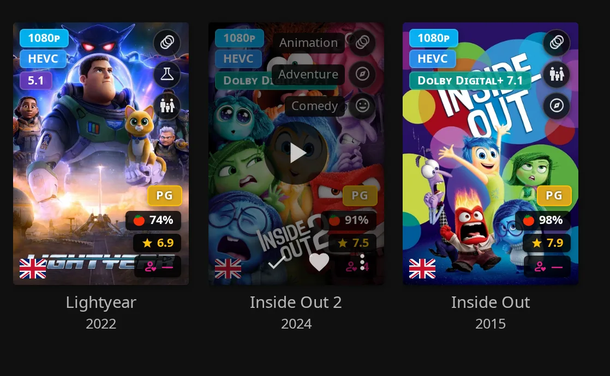

**How to use:**

1. Turn on the **Genre** group on the **Groups** tab of **Media Tags** and choose its position.
2. Leave **Hide tags on hover** off to see expanded names.

| Setting | Default | What it does |
|---|---|---|
| Admin: **Enable Genre Tags** / personal: **Genre** switch | Off | Shows genre icons on supported cards (three by default; see [Layouts](tags-layouts.md#layouts)) |
| Admin: **Hide** switch of a genre (Colours tab) | Off | Hides a genre, in every spelling, from every poster; the next genres take its place (see [Hidden tags](tags-server.md#hidden-tags)) |

??? info "Genre sources and hover behavior"
    Genres come from Jellyfin metadata. Unfamiliar names use a generic icon.

    With **Server-Side Tag Cache** on, series and season cards keep their own genres when present and use episode or parent-series genres only when their own are missing. Batch fallback does the same: a season card shows its own genres, else its parent series'. Series cards without genres use the first episode.

    The names stay inside the card and clear of the other tags. Each one sits beside its icon, toward the middle of the card, and ends a few pixels before the next chip on its line or the card's edge: a long name is shortened with an ellipsis while at least 60% of it fits, and a name with less room is left out (its icon still names it in its tooltip). Icons side by side (a top or bottom centre row, a band) list their names one per line under the row, or above it when the row is in the lower half of the card. The same applies to the live previews' **Hover** view, and to the "More tags: …" note a card with a `+N` chip shows on hover: it takes the first band across the card, from the top down, that no chip or name touches, or is left out when there is none (the card link still describes the hidden tags).

    With **Hide tags on hover** on, names do not expand on the poster and the overlays fade out instead; the Summary and Minimal hover reveal still lists each genre by name, and a caption strip still shows names on hover. There is no genre-name expansion in a static native poster image.

## Language Tags

Codes, CC/SDH subtitle chips and Dual/Multi badges use the quality chips’ padding, radius, font, border and shadow, including Flush edges. **Tag Styles → Language** supplies their background, border and text colours, and **Poster** takes these from the artwork. Per-language code colours (such as `en`), or `dual` / `multi`, override the chip-kind and group colours. Flag images retain their original appearance and border ring. Partial code chips use reduced opacity; only partial flag images keep a dashed outline.

Short language code chips use tighter horizontal padding while retaining the quality font and height. When a corner language column crowds a centered rating, excess language chips move into `+N`, after the group limit is applied. The first language chip stays visible. In that mixed language-and-rating row, rating values stay complete; a rating without enough room moves into `+N` with its full value in the overflow description. Cards without that language column keep the usual first-chip fitting and ellipsis.

Language Tags show audio and subtitle languages as flags or short uppercase codes. Subtitle chips carry a **CC** prefix, or **SDH** when a hearing-impaired subtitle flag or a whole-word SDH/CC title marker is present. Hover a chip for Audio or Subtitles and the full language name, in your own language (`Audio: japonais` with French); partial dubs identify missing episode coverage. Dual/Multi tooltips include the distinct count and represented audio languages in priority order. A language fact assigned to the Summary pill keeps the CC prefix and full-name tooltip. Language chips follow the poster link, including Ctrl/Command-click and middle-click to open a new tab. An optional **Dual** (two audio languages) or **Multi** (three or more) badge helps you find multilingual titles. Audio with no linguistic content uses a crossed-out speech-bubble symbol labeled **No dialogue**. A language without a flag (Esperanto, Welsh, Latin and other languages with no single country) keeps a code chip such as `EO` in Flags style rather than disappearing, on the web and on Native Poster Tags; Bosnian, Khmer, Lao, Burmese and Luxembourgish use their countries' flags.

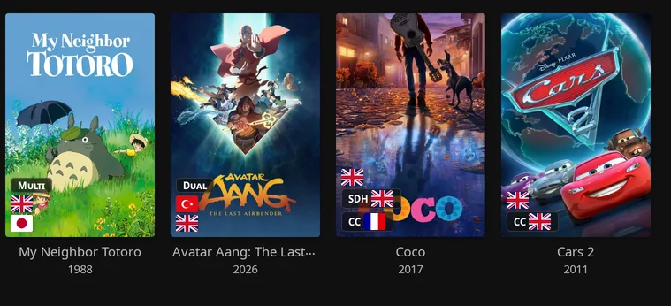

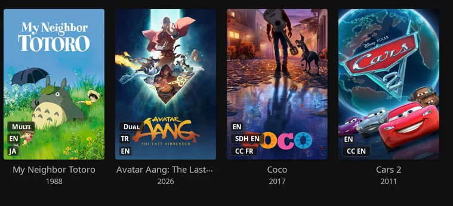

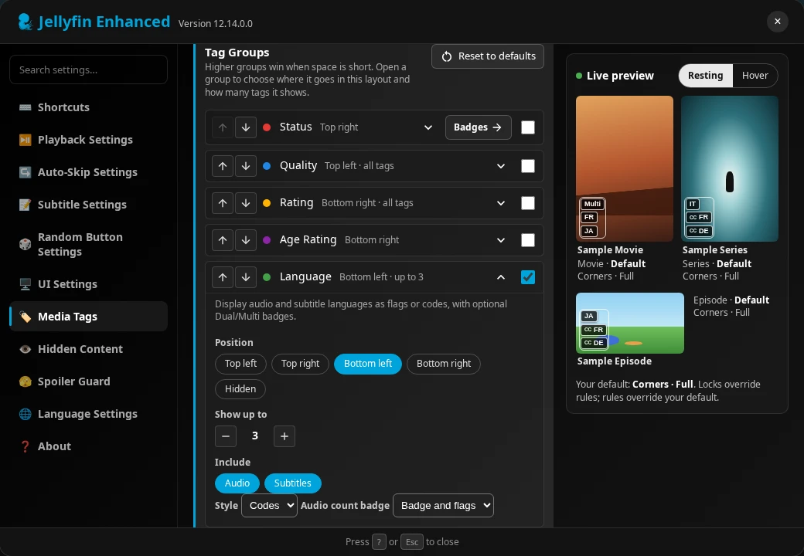

**How to use:**

1. Turn on the **Language** group on the **Groups** tab of **Media Tags**.
2. Expand **Language**. Under **Include**, choose **Audio**, **Subtitles**, or both. Choose **Flags** or **Codes** under **Style** and optionally enable the **Audio count badge**.
3. Set **Show up to** for the combined list. A badge takes one place, followed by audio chips, then subtitle chips. For a separate list on the detail page, enable **Show Audio Languages**.

Each user can choose a personal order under **Groups** → **Language** → **Priority**. **Follow server policy** starts on: it uses the administrator's **Priority Languages**, including future changes. Turn it off, search by language name or ISO code, and **Add** up to 12 languages. Move them with the up/down buttons or remove one. Equivalent codes such as `eng`/`en`, `fre`/`fra`/`fr`, Tagalog/Filipino and Norwegian variants share one preference. Personal priorities apply to audio and subtitles in Flags and Codes styles, the Dual/Multi badge and Summary pill, and Native Poster Tags.

**Only show priority languages** starts at **Follow server (…)**. Choose **Only priority languages** to filter, or **Priority languages first, then others** to keep the rest. This choice inherits independently of the list. An empty personal list means no prioritization or strict filtering. Switch **Follow server policy** back on to use the server list again. The server's **Merge Regional Variants** still controls regional flags; personal base-language choices match all regional tracks. These choices change poster badges, not playback track selection.

Priority controls pause while a change saves. If it fails, the previous list and strict choice return; other settings changed during the save still save with that restored policy. Try the priority edit again after the controls become available.

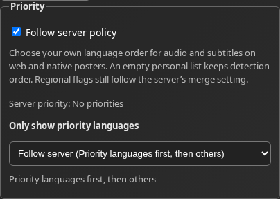

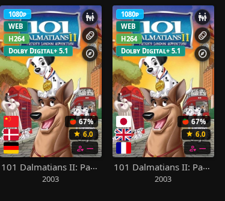

??? info "Phone editor and controls"

    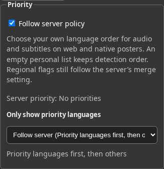

    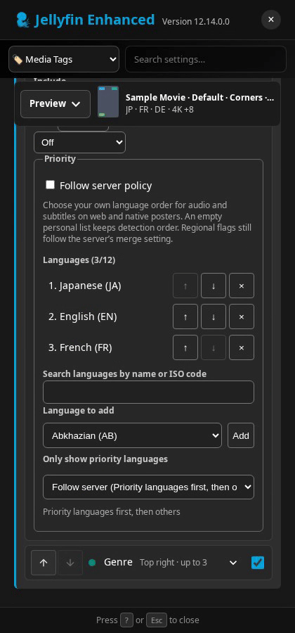

Administrators can set the shared fallback under **Priority Languages**. Existing personal settings without a priority list continue to follow that policy.

| Setting | Default | What it does |
|---|---|---|
| Admin: **Enable Language Tags** / personal: **Language** switch | Off | Shows distinct flags/symbols on supported cards (three by default; see [Layouts](tags-layouts.md#layouts)) |
| **Include: Audio / Subtitles** | Audio on, subtitles off | Choose either or both track types; repeated SDH tracks count once per language. A commentary or audio-description track is not a dub, and a language with only forced subtitles (signs, foreign dialogue) is not a subtitle option, so neither adds a chip or counts toward Dual/Multi |
| **Style: Flags / Codes** | Flags | Codes use uppercase ISO 639-1 where available, otherwise the three-letter code (for example `TL`, `NB`, `NN`, `FIL`); audio equivalence still governs deduplication and counting. Both styles have full-name tooltips identifying Audio or Subtitles |
| **Audio count badge** | Off | **Badge only** replaces audio chips when two or more audio languages qualify; **Badge and flags** keeps them (or codes with Codes style). Selected subtitles remain. Counts distinct canonical audio languages after priority filtering and before the cap; regional versions and no-dialogue tracks do not increase the count |
| Personal: **Priority** → **Follow server policy** | On | Follows the live administrator list; turn off for an ordered list of up to 12 ISO 639-1/639-2 languages. An empty personal list has no priorities. |
| Personal: **Only show priority languages** | Follow server | Inherits strict filtering, or explicitly filters/keeps other languages. |
| Admin: **Priority Languages** | Empty | Comma-separated language names or codes such as `English, ja, pt-BR`. Codes match equivalent two- and three-letter tags (`en` covers `eng`). A bare code also covers regional variants (`en` covers `en-US` and `en-GB`); a regional code accepts bare tags but not a different region (`pt-BR` covers `pt`, not `pt-PT`). Matching flags appear first in list order |
| Admin: **Only Show Priority Languages** | Off | With a nonempty priority list, removes flags that do not match; an item can show fewer flags than its limit, or none |
| Admin: **Merge Regional Variants** | Off | Regional and script variants such as `en-GB`, `pt-BR` or `zh-Hant` share their base language's flag, so tracks Jellyfin lists as one language show one flag |

### Grouping, regions, and partial dubs

With **Server-Side Tag Cache** enabled, series and season cards show audio languages across their episodes. A dub missing from some episodes has a dimmed flag or code with a dashed outline and “not on all episodes” in its title/alt text.

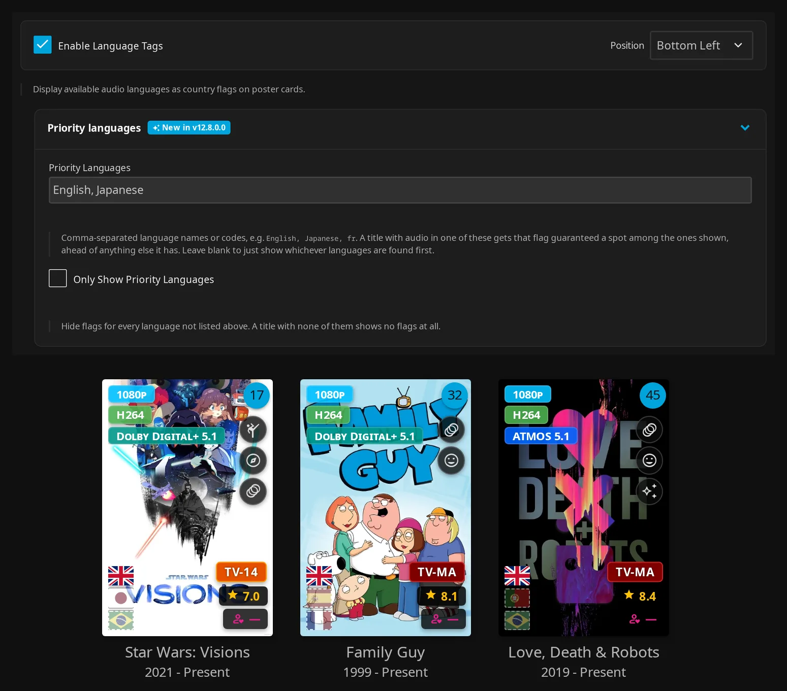

??? info "Flag grouping, coverage, and regions"
    Flags come through Jellyfin Enhanced's asset service. Tracks marked `zxx` (no linguistic content) use the **No dialogue** symbol. Norwegian Bokmål and Nynorsk (`nb`, `nob`, `nn`, `nno`) use Norway's flag, Cantonese (`yue`) Hong Kong's, Swiss German (`gsw`) Switzerland's and Irish (`ga`, `gle`) Ireland's.

    Languages sharing a flag are grouped before the three-flag limit. Their names are stored in the flag's title/alt text. Hover a flag or code to read those names. Tags remain visible on hover unless **Hide tags on hover** is enabled.

    Priority filtering also operates on grouped flags: a matching flag can represent additional languages sharing it. An empty priority list leaves flags unchanged even with strict filtering on. A personal list overrides the administrator list. Strict mode follows the personal override when set, otherwise the administrator value.

    Server-list matching uses the flag's language code, its base code, or its displayed language names, and compares codes the way the audio-language filter does across every language the chip represents: `ja` matches `jpn`, `en` matches `en-US`, and `te` finds the India flag Hindi claimed first. Personal ISO priorities match every represented language canonically.

    Cached audio and subtitle languages use the union across episodes. Subtitle tracks use the same access and Spoiler Guard stripping paths as audio. With the server cache off, container cards use their representative episode instead of the full union. Forced-only subtitle tracks are left out entirely; an SDH track shares its language's chip with the ordinary track, and a grouped subtitle chip carries SDH if any represented track is SDH. The tooltip reads, for example, **Subtitles (SDH): English**. Flags, Codes, the Summary pill and native posters preserve the marker. It appears only while Subtitles is enabled.

    The cached audio flags use the union of audio languages across episodes. Full-coverage flags normally come first, but administrator priorities can put a partial flag ahead of them. A grouped flag is partial only when all its represented languages are partial.

    Specials do not count against a series' full-coverage languages. Tracks with no usable language tag are ignored: none, `und` (undetermined), `mul` (several languages), `mis` (uncoded) and the local-use codes `qaa`–`qtz` (broadcast "original version" tracks are `qaa`). Equivalent tags such as `eng`/`en` or `fre`/`fr-FR` can count as the same dub. Regional variants that coexist in one episode, such as `es-419` and `es-ES`, are assessed separately.

    In batch fallback mode, series/season poster flags reflect a representative episode and do not show partial coverage.

    Cached collection flags combine languages from linked movie and series members. A collection containing an English movie and a Japanese movie can therefore show both flags; it does not mean every member has both languages. The flags follow the members: when a member file gains or loses an audio or subtitle track, or a member is deleted, the collection changes with it.

    Regional flags require explicit regional metadata. For example, `pt-BR` shows Brazil, `pt`/`pt-PT` show Portugal, `es-419`/`es-MX` show Mexico, and `zh-Hant` shows Taiwan. A base language such as `pt`, `es`, or `zh` keeps its default flag; JE does not guess a region.

!!! note "Tagging matters"
    Region detection depends on the language metadata in the media file. Poster Language Tags and the detail-page audio-language row have separate switches; enabling one does not enable the other.

## Audio language links

The detail-page audio-language row shows language names and flags. You can also sync languages to Jellyfin metadata tags, so clicking a matching language opens a list of items with that tag.

**How to use:**

1. Keep **Show Audio Languages** on in **UI Settings** to display the row.
2. As an administrator, open [**Display** → **Audio Language Tags**](../open-in-jellyfin.md?tab=display&card=audio-language-tags) and turn on **Enable Audio Language Tags Sync** and **Link audio languages to their tag page**. Click **Save Settings**.
3. Run **Sync Audio Language Tags to Jellyfin** under **Dashboard** → **Scheduled Tasks** → **Jellyfin Enhanced** to tag existing movies and series.

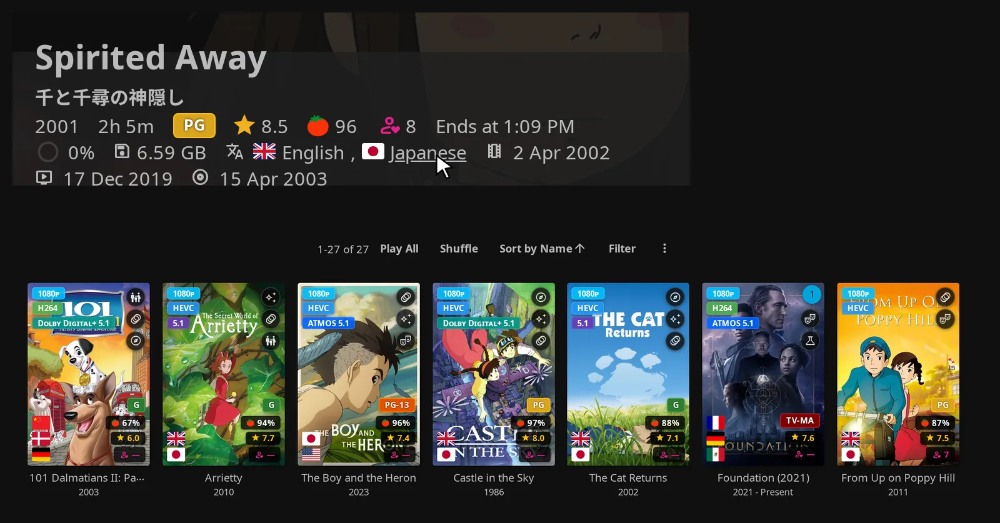

Admin settings below are under [**Display**](../open-in-jellyfin.md?tab=display); the row's default is in [**UI Preferences**](../open-in-jellyfin.md?tab=display&card=ui-preferences), and synchronization controls are in [**Audio Language Tags**](../open-in-jellyfin.md?tab=display&card=audio-language-tags).

| Setting | Default | What it does |
|---|---|---|
| Admin: **Show available audio languages on item detail page** / personal: **Show Audio Languages** | On | Displays the audio-language row on movie, series, season, and episode detail pages |
| Admin: **Enable Audio Language Tags Sync** | Off | Writes audio languages as Jellyfin tags on movies and series |
| Admin: **Tag Prefix** | `JE Language: ` (trailing space) | Prefixes synchronized language tags |
| Admin: **Link audio languages to their tag page** | On | Turns a displayed language into a link when a matching synchronized tag exists on the item |

!!! note "Schedule language synchronization"
    **Sync Audio Language Tags to Jellyfin** has **no default schedule**. Add a trigger or run it manually, especially with the server cache off.

??? info "Language matching and synchronization"
    A regional track gets a base tag, such as `JE Language: English`, and a regional tag, such as `JE Language: English (United States)`. A regional chip tries the matching regional tag first, then its base tag. Without a match it remains plain text.

    The synchronized series tags combine languages across episodes. The detail-page row itself uses a representative episode for series/seasons. It can therefore show fewer languages than cached poster flags or synchronized series tags.

    For playable items, changing the selected media version can change the row. More than three languages can scroll horizontally; missing usable data shows a dash.

    Synchronization directly tags movies and series, not seasons or episodes. With the server cache on, cache updates can sync new or changed items after library changes. Cache-excluded items skip that update path but can still be processed by the standalone task.

    Updates remove stale tags only under the current prefix. Changing the prefix leaves old-prefix tags behind. Disabling synchronization does not delete existing tags.

## Languages

Media Tags follow the language Jellyfin Enhanced's text uses (your Jellyfin display language, else the Jellyfin Enhanced display language, else the browser's):

| What | Web | Native posters |
|---|---|---|
| Chip words (status badges, `Dual`/`Multi`, `Mixed`, editions such as `Extended`, award captions such as `Oscar Winner`) | Your language | The language saved with your web settings (the one their dates use) |
| Scores (`8,1` in German, Persian digits in Persian) | Your language's decimal separator and digits | Same, from the saved language; text is laid out with the Unicode bidirectional algorithm, as the browser draws it: numbers read left to right in Arabic and Persian, Hebrew or Arabic words mixed with numbers or Latin names keep their reading order, and bracket pairs resolve together |
| Dates (`Airs Nov 6`) and time zones | Your language and the browser's time zone | The saved language and time zone |
| Language names in tooltips (`Audio: japonais`) | Your language | No tooltips |
| Codecs, sources, resolutions, brand names (`HEVC`, `REMUX`, `4K`, `IMDb Top 250`) | Unchanged | Unchanged |

A string not yet translated into your language appears in English. Translations come from the project's [Weblate](https://hosted.weblate.org/engage/jellyfinenhanced/) contributors; most Media Tags strings are new and only in English so far. To see how far each language is, run `node scripts/tag-translation-coverage.mjs` in a checkout: it lists the translated Media Tags strings per language, and the test suite checks that every translated string keeps the `{placeholders}` of the English one.
