# Server, Native Posters & Styles

The server-side tag cache, Native Poster Tags for other apps, and Tag Styles and CSS.

## Server-Side Tag Cache

The server cache prepares tags for supported items in included libraries, so each page avoids repeating metadata requests. You receive only data allowed by your library access and Spoiler Guard policy. Each entry also records the item's library (a season's or episode's is its series'), which [tag look rules](tags-layouts.md#rules-and-locked-items) match on.

**How to use:**

1. Leave **Server-side tag cache** on (Media Tags admin tab → **Server**). Choose library exclusions if needed.
2. After changing exclusions, or after a plugin update that changes tag computation, click **Rebuild cache** there (or on the **Overview** tab).
3. Confirm the full rebuild. The Overview shows **Rebuilding** until it is done, keeps showing it if you reload the page meanwhile, and says so when the rebuild finishes.
4. Check server logs for progress and completion. The existing cache keeps serving while the new one builds in the background.

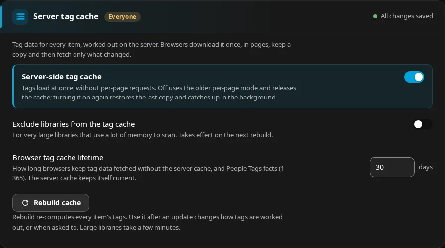
*Browser fallback controls appear only with the server tag cache off.*

| Setting | Default | What it does |
|---|---|---|
| **Server-Side Tag Cache** | On | Loads, builds, and maintains the server cache; off uses per-page batch fallback |
| **Exclude libraries from the tag cache** | Off | Reveals library selection for omitting libraries from precomputation |
| **Libraries to exclude** | Empty | Selects libraries to skip on the next full rebuild; an empty selection excludes nothing |
| **Tags Cache Duration (days)** | 30 | Lifetime of browser fallback entries and People Tags facts, not the server cache's refresh schedule; range 1–365 |
| **Persist Tag Fallback Cache in Browser Storage** | Off in configuration | Visible only with **Server-Side Tag Cache** off; saving in that mode forces it on. See Browser storage and fallback below |
| **Clear All Client Caches** | Action | Visible here only with **Server-Side Tag Cache** off; signals clients to invalidate JE caches on their next load. Does not rebuild the server snapshot or reset server-stored personal preferences |

### Builds, refreshes, and exclusions

The retained cache grows with the number of included items. Exclude large libraries or disable server mode if its memory cost is unsuitable.

Jellyfin compresses the cache response with Brotli or gzip, so a browser downloads about a tenth of its JSON size. On a 3,882-entry test library a full download was 14.7 MB of JSON and 1.39 MB on the wire, about 3.8 KB and 360 bytes per entry; entries have since grown to about 4.6 KB (3,892 entries, November 2026). At that size 50,000 entries are roughly 230 MB of JSON and, compressed as before, about 22 MB to download. The browser reads a full download in pages of 2,000 entries, so no response or parse holds the whole library. Up to 20,000 entries it keeps them in memory and stores a copy afterwards. Past that it writes what it holds, and then each page as it arrives, straight into its stored copy and keeps none of them, so a load never holds more than 20,000 entries plus one page; once the copy is complete it reads entries from it as cards need them. A load that keeps seeing the cache change underneath starts over twice, after short pauses, then leaves the cards to batch lookups until the next navigation tries again; it never asks for the whole cache in one response. After a load it fetches only changed entries, and removed items arrive as a list of ids.

`scripts/bench-tag-cache.mjs` measures this on a synthetic library whose entries carry the real ones' fields (about 4.2 KB of JSON each; the run prints the size). Memory is the heap still held after each page once garbage is collected, in Node; a browser's own peak (with IndexedDB's copies in flight) is somewhat higher. On a desktop with Node 26:

| Synthetic library | One response | Pages of 2,000 | Memory kept |
|---|---|---|---|
| 50,000 entries, 203.3 MB of JSON | one 203.3 MB body, one 1.7 s parse | largest body 8.3 MB, longest parse 48 ms | at most 102.5 MB kept between pages while loading (pages streamed into the stored copy past 20,000); 254.0 MB when every page was held until the copy was written |
| 100,000 entries, 407.2 MB of JSON | one 407.2 MB body, one 3.0 s parse | largest body 8.3 MB, longest parse 57 ms | at most 102.5 MB kept between pages; 508.7 MB when every page was held |

On the server, every page of a full load reads one shared, sorted list of the cache's keys, made once and made again only when an item is added or removed, instead of sorting the rest of the library for each page. An opt-in benchmark in the backend tests (`PrivacyCachePagingBenchmark`, run with `JE_BENCH_TAG_CACHE=1`) pages through 200,000 entries in about 0.3 s for an account that sees everything (100 pages, four such loads at once in about the same time), where sorting the rest of the library for every page took about 4 s for the keys alone.

Without a stored copy (private browsing, storage blocked or full), a library of up to 20,000 entries stays in memory and the next page load downloads it again; a larger one is not held at all: cards ask for their tags in batches of up to 200 for the rest of the session. Each browser profile downloads in full once, then again only after a full rebuild, more than 20,000 removals between rebuilds, a Spoiler Guard change, or an access change that makes an item visible the browser has not stored (a library or parental limit opened up). When the user can only see less (an item added where they cannot see it, library access removed, an item re-rated above their limit), the next update carries the list of ids they can still see, and the browser drops the rest and clears their tags from the cards on screen. Any update redraws the cards on screen whose items it changed; the other cards keep their tags. If you put Jellyfin behind a reverse proxy, let it pass `Accept-Encoding` through so compression stays on.

??? info "Cache lifecycle and excluded libraries"
    When poster review chips are enabled, visible review averages travel with the filtered cache data.

    At startup, JE restores `tag-cache.json` from `<PluginsPath>/configurations/Jellyfin.Plugin.JellyfinEnhanced/`. If no usable cache is available, it queues **Refresh Tag Cache** to build one. Library item additions, updates, and removals keep entries current. A series edit that changes its scores, age rating or genres also updates the seasons and episodes that take them from it (re-reading their metadata, not their media), on the same update or reconcile; native posters built while the cache is off drop those children's remembered entries at once. The scheduled task normally reconciles changes rather than recomputing every item. Its default daily trigger is 03:00.

    Excluded libraries do not lose access or forcibly lose their web tags. Cards without a server entry can use per-page batch fallback. Exclusions also bypass the normal cache-update audio-language synchronization path; the standalone language-sync task can still process those items.

    Builds load item data in small pages to reduce peak memory.

    Audio languages that JE reads from Matroska track headers (for regional tags such as `pt-BR`) are kept in `matroska-languages.json` next to the tag cache, keyed by file path, size and modification time. Later rebuilds, reconciles and tag-data requests do not open an unchanged file again, which matters on network and cloud mounts where each open can download a large read-ahead.

    Turning server mode off releases the in-memory cache and stops loading, building, monitoring, and scheduled refresh work. The saved snapshot remains on disk. Clients pick up the switch on their next load.

    Re-enabling from the dashboard restores the snapshot and catches up on missed changes in the background, without a restart.

    If you edit the configuration file by hand instead, restart Jellyfin and run **Refresh Tag Cache** to catch up.

### Browser storage and fallback

Turn off **Server-side tag cache** to reveal **Keep a tag cache in each browser** and **Clear all browser caches** in the **Server** section of the Media Tags admin tab (the configuration page's Overview keeps a quick action for the clear signal).

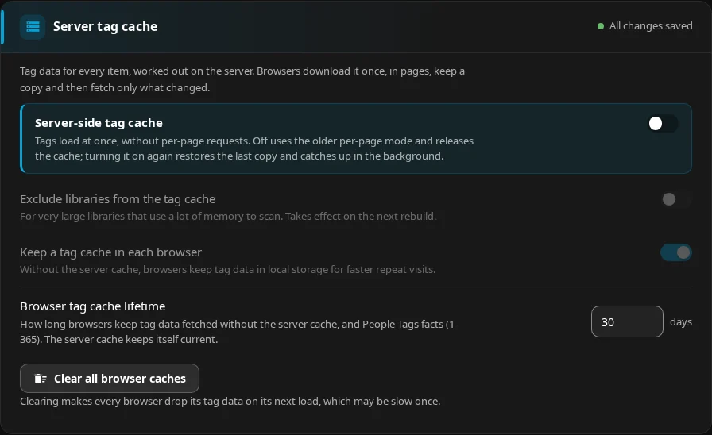

??? info "Browser storage and fallback details"
    The first web load downloads the server payload and saves an IndexedDB copy scoped to that server and user. Later loads restore that copy and request changes since the saved cursor. Tags wait for confirmation that the stored version and access/Spoiler Guard revision still match. A rebuild or changed filtering replaces the copy, including changes made from another device. Navigation also checks for updates, with requests spaced during rapid browsing.

    A copy written before the entry format last changed (version 11 added the library) is not restored; the browser downloads the cache again.

    The stored copy is invalidated when server mode is switched off, by **Clear All Client Caches**, or when another account signs in in the same browser. Each copy contains that user's filtered, spoiler-safe data.

    Without usable IndexedDB, including some private modes or storage failures, the client downloads the payload again on each page load and uses memory only.

    Saving with the server cache off forces **Persist Tag Fallback Cache in Browser Storage** on. The client enables localStorage fallback whenever server mode is off.

    Batch fallback fetches the items needed for the current page and keeps frequently used entries in memory. Every group validates its fallback data against the server-issued `StripRevision` through the shared renderer base. Only authoritative `none` entries persist in localStorage using **Tags Cache Duration (days)**; guarded entries are page-only, and unknown or mismatched revisions require fresh data. This is separate from the full server-payload copy in IndexedDB. Browser storage failures leave tags able to fetch data again. Average-review lookups in fallback mode are batched separately.

    For [rules and locked items](tags-layouts.md#rules-and-locked-items), the batch lookup's type, series, library, genres and age rating of each item are remembered beside those entries (`JE_tagLookFacts`, at most 3,000 items, newest kept). Like the per-tag entries, they belong to the signed-in user and are dropped when another account signs in or by **Clear All Client Caches**.

### Card identity and shared artwork

Web badges describe the card's item, even when an episode displays a season or series poster. Loading the artwork later does not change which item's tags appear. Cards without a valid item identifier can still use the poster URL as a fallback.

### Tags after navigation

With the server cache off, cards still waiting for a batch fetch are retried after navigation. Season cards added as a series page opens receive tags without a reload; completed cards keep their tags.

### Related routes

??? info "Diagnostic routes"
    These routes are useful when diagnosing a cache problem; routine setup uses the dashboard controls above. All require authentication. See the [API reference](../advanced/api.md) for broader API use.

    | Route | Access and behavior |
    |---|---|
    | `GET /JellyfinEnhanced/tag-cache/{userId}` | Own account or administrator; filtered cache payload. Returns 404 when server mode is off. Optional `since` is a Unix-millisecond cursor; use the returned generation `timestamp`, not `servedAt` |
    | `POST /JellyfinEnhanced/tag-data/{userId}` | Own account or administrator; per-page fallback for accessible items. Body is a nonempty array of at most 200 item-ID strings; optional `mediaSourceId` selects a media version; optional `latestEpisode=true` adds the newest episode's added date to series and seasons |
    | `GET /JellyfinEnhanced/status-tags/series?ids=…` | Signed-in caller; up to 50 accessible series IDs, returning TMDB status and last/next aired facts |
    | `GET /JellyfinEnhanced/status-tags/trending` | Any signed-in user; the shared trending list for Status Tags. Empty while the admin has Status Tags or the trending rank off |
    | `POST /JellyfinEnhanced/tag-cache/rebuild` | Administrator only; starts a full background rebuild. Returns 400 with server mode off, or 409 if a rebuild is already running |
    | `GET /JellyfinEnhanced/audio-language-tags?codes=…` | Returns base/regional synchronized tag names for the supplied comma-separated language codes; empty mapping when sync is off |

## Native Poster Tags (Experimental)

Native Poster Tags add your enabled poster groups to images shown in eligible native apps, without changing the original artwork files. The feature is built into JE, so you need no companion plugin or client modification.

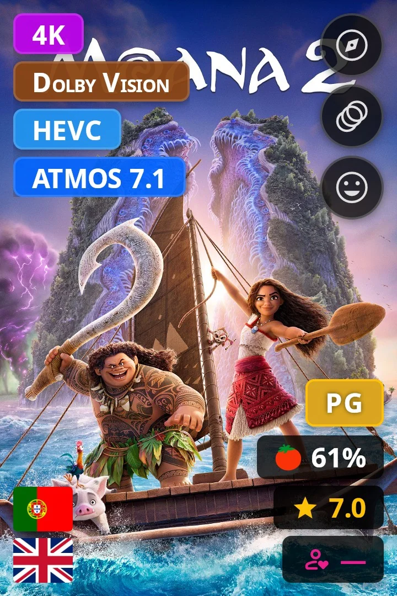
*Server preview; this is not a native-app screenshot.*

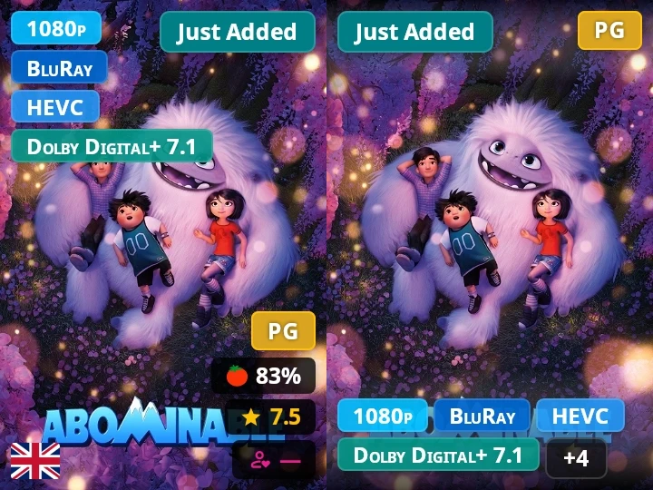
*Personalized native image responses for the same movie: Corners (left), Bands (right). These are composited posters, not physical-device screenshots.*

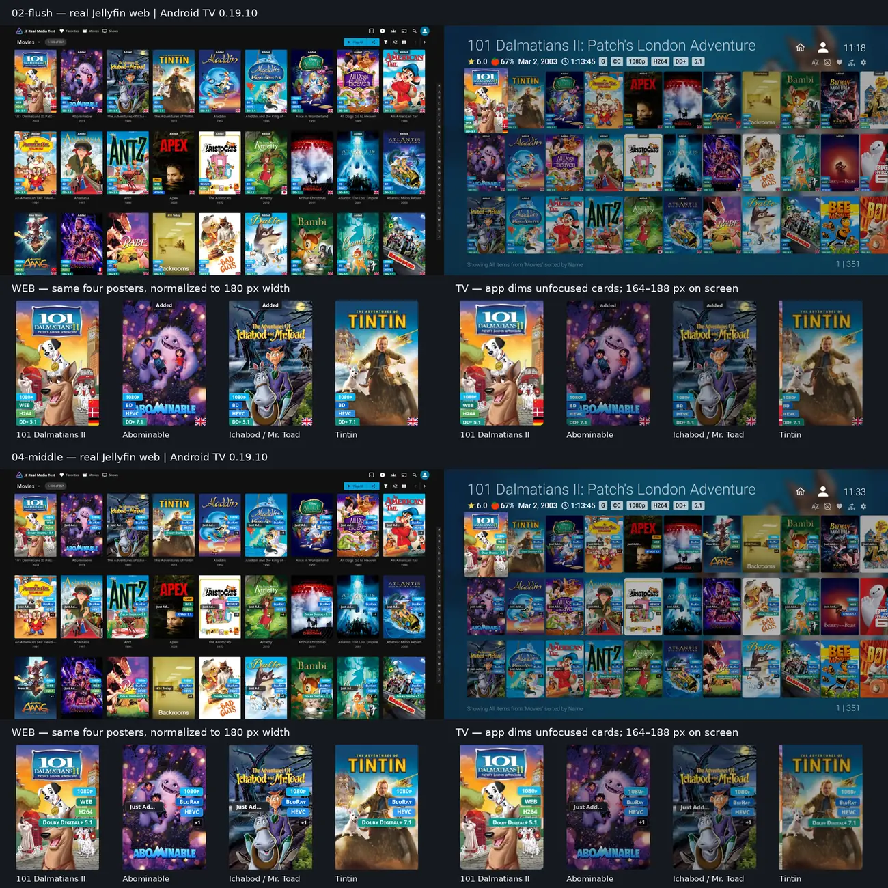
*Web (left) and the real Jellyfin Android TV 0.19.10 app in the emulator (right): Flush Corners with Compact labels (top) and Status at left centre with Quality at right centre (bottom). The app dims unfocused cards.*

**How to use:**

1. Enable suitable tag groups and ensure the items have the required metadata.
2. On the Media Tags admin tab → **Server**, turn on **Native poster tags (experimental)**.
3. Each user can opt out with **Show Tags in Native Clients (Experimental)** in [**Media Tags** → **Layout**](../open-in-jellyfin.md?jeSection=media-tags).
4. Reopen the native app's library or restart the app to pick up changed poster addresses.

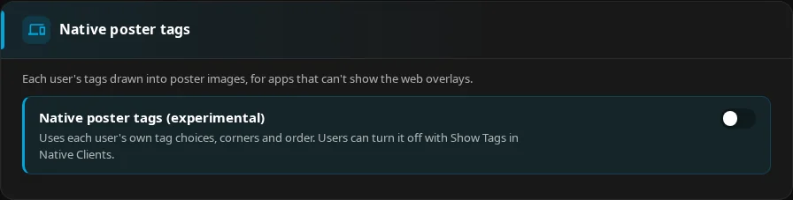

| Setting | Default | What it does |
|---|---|---|
| Admin: **Native poster tags (experimental)** | Off | Server-wide master switch; off serves original posters and stops native tag composition |
| Admin: **Additional excluded apps** | Empty | Adds web-wrapper client names that should retain original posters; newline- or comma-separated |
| Personal: **Show Tags in Native Clients (Experimental)** | On while allowed | Shows tags in native clients; hidden while the master switch is off, retaining the saved choice |

??? info "Stored native preferences"
    The admin configuration uses `NativePosterTagsEnabled` and `NativePosterTagsWebClientNames` for the master switch and additional client exclusions. The personal `UseNativePosterTags` value permits native tags when null or true; false opts out while retaining the preference when the master switch is off.

!!! note "Enable the tag groups too"
    The master switch alone does not produce visible tags: each user's applicable groups start off.

??? info "Supported groups and preferences"
    JE draws tags into Primary images for movies, series, seasons, episodes, collections, and videos. Supported groups are quality, genre, language, ratings, user-review, age-classification, Awards, Status, Logos and Custom. People Tags are not a native group.

    It uses personal tag switches, audio/subtitle includes, Flags/Codes style and Dual/Multi badge mode, quality categories/order, sound-language preference, each group's **Where to show** item-type switches, score includes, together with the personal language-priority policy (or the live administrator fallback). Native posters draw **Corners** or **Bands** from your saved default layout. Both respect the chosen Full or Compact label density, as on the web; version-0 (legacy) accounts keep their previous labels. Corners supports all nine anchors, hidden groups, your explicit group order (otherwise the original stacking order) and limits. Bands uses its own top/bottom/hidden profile, priority order and limits. Its translucent gradient strips keep the middle clear; the first top group starts left and later groups align right. Each strip fits at most two rows. The bottom strip shows chips in priority order until the first one with no room, as on the web, and counts the rest in **+N**; only a chip that could never fit is skipped on its own. The overflow chip uses the web’s 11px bold style multiplied by tag size and reserves the total-count width before bottom-band selection, then displays the actual omitted count. Caption, Summary and Minimal fall back to the saved Corners profile with Full labels because native images have no title block or hover surface. Per-item locks, server-wide item looks and [tag look rules](tags-layouts.md#rules-and-locked-items) apply natively (each look gets its own poster variant); shape overrides remain web features, because an image request does not say what shape of card shows it.

    **Centre-anchor differences:** in the centre slots (top and bottom centre, left and right centre, and centre), native posters omit whole chips that do not fit and show a fitting **+N** count for them; the count is left out when its own box cannot fit. A static image has no hover or focus, so the count cannot reveal the hidden names as the web's tooltip does. The first chip in a centre anchor stays visible with an ellipsis when necessary, keeping its original typography; subsequent chips that do not fit are omitted. The image request cannot reproduce the web card's progress bar, Jellyfin indicators or custom overlays; native placement uses the saved default Bands or Corners profile, the item's own look or the matching rule's. The four default corner positions are unchanged.

### Eligible clients and requests

Examples of native clients include Jellyfin for Android TV, Tizen, Swiftfin, Findroid, and Streamyfin.

The built-in exclusions are Jellyfin Web, Jellyfin Media Player, Jellium Desktop, Jellyfin Desktop, Jellyfin for WebOS, Jellyfin for Android (the phone app), Jellyfin iOS and Jellyfin iPadOS. These load web overlays and retain original poster images. Jellyfin for Android TV is a different client name and is eligible.

If a custom web wrapper shows tags twice, add its name as shown under **Dashboard** → **Devices** to **Additional excluded apps**.

??? info "Client matching and image requests"
    Native tags depend on the app retaining Jellyfin's personalized image tag in its poster request. Requests that omit it, or ask Jellyfin to draw its own watched/progress/unplayed-count indicators into the image, retain original artwork.

    Exclusion matching trims whitespace and compares exact names without case sensitivity. Unidentified clients are excluded.

### Limits and caching

??? info "Layout, Spoiler Guard, and image caching"

    - **Static layout:** genre hover names and **Hide tags on hover** do not apply. Size follows the image width rather than the app's final display size; landscape episode images use an adjusted layout.
    - **No page or row context:** **Disable Tags on Search Page** and the **Continue Watching row** / **Next Up row** switches of **Where to show** do not apply. Its item-type switches still apply. Tags can appear anywhere the app reuses that Primary image, including search and detail pages. If an episode card uses a series poster, its tags describe that image's owner.
    - **Spoiler-safe data:** native composition applies the user's Spoiler Guard stripping policy. Artwork follows the configured stock-card/blur policy, rather than always using blur. Spoiler-scoped responses use `no-store` so an old poster is not retained under a changed policy.
    - **Remote status:** cold or expired trending/schedule snapshots omit remote badges for that render and refresh in the background; image delivery never waits for TMDB. Queued series schedules refresh in batches of 16, up to four TMDB lookups at once within the shared rate limit, and each batch shows on the next poster request as soon as it finishes.
    - **First-view cost:** the server draws a poster the first time a particular variant/size is requested. Rendered images are cached with a 128 MiB memory budget and approximately 1 GiB disk budget under Jellyfin's cache directory, `jellyfin-enhanced/poster-tags`.
    - **Status dates and language:** saving personal preferences in the web client with Status enabled remembers that user's date locale and timezone. Native labels use that saved context; until then they use the JE display language (English fallback) and the server timezone. TMDB dates remain plain calendar dates, as on the web. Another native device cannot supply its own browser timezone through an image request. Short month/day dates use browser-generated locale patterns, month names, calendars and digits for the shipped languages and their regional variants (including en-IN, es-419 and fr-CA). An unlisted variant uses its closest culture ancestor. Saved Unicode locale extensions are retained, while native formatting uses their base language/script/region. Status text uses Tag Styles' Status group and individual badge colours; static chips do not apply the web backdrop blur.
    - **Status freshness:** posters with a visible Status group use five-minute URL buckets and an HTTP cache lifetime capped to the remaining URL bucket (whole seconds; sub-second remaining lifetime is served uncached), even with the server tag cache off. Date-window and local-midnight changes appear within five minutes after a fresh metadata/image request. A URL keeps drawing its tags through the next bucket too (status as of the request), so a poster requested just after a bucket boundary is not untagged; a client retaining a URL longer than that must refresh library metadata, and older tokens serve original artwork until then. The server draws a poster again only when the badge it shows changes: its stored composite is keyed by the resolved Status badge (and the filtered parent facts), not by the URL bucket, so a new URL for an unchanged poster is served from the stored image. Text and family colours enter the tile key. No live status data is persisted in the tag cache and its schema is unchanged.
    - **Refreshes:** settings changes can change poster addresses. With the server tag cache on, tag-data changes also change addresses for cached items. Apps can need a library refresh or restart to use them. With the cache off, tag-data changes keep the same URL; apps can show the old composite for up to an hour before revalidating that URL.
    - **Fallback:** unsupported identity/token requests, missing renderable tags, decode/render failures, sources over 32 MiB, or decoded image sides outside 32–4096 pixels can yield original artwork. These are implementation limits, not adjustable settings.

??? note "Signing key and backups"
    JE stores a 32-byte signing secret in `<PluginsPath>/configurations/Jellyfin.Plugin.JellyfinEnhanced/native-poster-tags.key`, separately from rendered-image caches. Preserve it in backups to retain personalized URL-signing continuity. JE recreates a missing or invalid key. Older URLs can then serve original artwork until clients refresh.

    If the key cannot be persisted, JE logs a warning and uses a process-lifetime key that changes after restart.

    On Unix, new keys use owner-only read/write permissions. There is no setting for this internal key.

??? info "Administrator preview route"
    Administrators can diagnose composition with `GET /JellyfinEnhanced/native-poster-tags/preview/{itemId}`. It requires an accessible supported item, an existing target user, and a local Primary image.

    Optional `userId` defaults to the caller. `width` defaults to 360, and width/optional height are clamped to 32–2048. Optional `topRightOffset` controls indicator clearance.

    The JPEG response uses `no-store` and includes `X-JE-Poster-Tags-*` diagnostics.

    The preview attempts composition even with the master/personal native switch off. It strips tag data for Spoiler Guard but uses original, unblurred artwork. It therefore does not preview image protection.

Server-wide item look edits preserve unrelated changes made by another administrator while saving. Removing a look and immediately choosing **Undo** cancels that edit. After an uncertain save failure, **Undo** stays pending until the server acknowledges the restored look. Server import and its **Undo** replace the complete item-look list, including when both lists contain 500 different entries. Edits made while a replacement is still saving or awaiting **Retry** become part of that replacement; **Keep mine** and **Take theirs** resolve the complete list.

## Tag Styles and CSS

Use Tag Styles to recolour poster tags without writing CSS. You pick a preset, then adjust a whole group of tags or a single tag. The same colours reach the web overlays and the posters drawn for native apps.

**How to use:**

1. Open the **Colours** section of the Media Tags admin tab and turn on **Use these tag colours**.
2. Under **Apply to**, choose **Web**, **Native posters** or **Both**.
3. Pick a **Preset**. It applies straight away and keeps any group or tag colours you set. The presets are always shown. Under the group tabs, **Preset for this group** gives one group its own preset (for example the Poster preset on Status only); **Same as the design** follows the main one.
4. Choose a group tab (**Quality**, **Age**, **Rating**, **Genre**, **Status**, **Language**, **Awards**, **Logos**, **Custom**), then **Whole group** or one tag.
5. Set **Background**, **Border** and **Text** with a swatch or any colour, and an **Opacity** of 40–100% on its own row. Watch the contrast badge and the preview; every status badge can be coloured, not only the first few.
6. Each edit saves on its own. Refresh web clients to see the change; native posters redraw the next time they load.

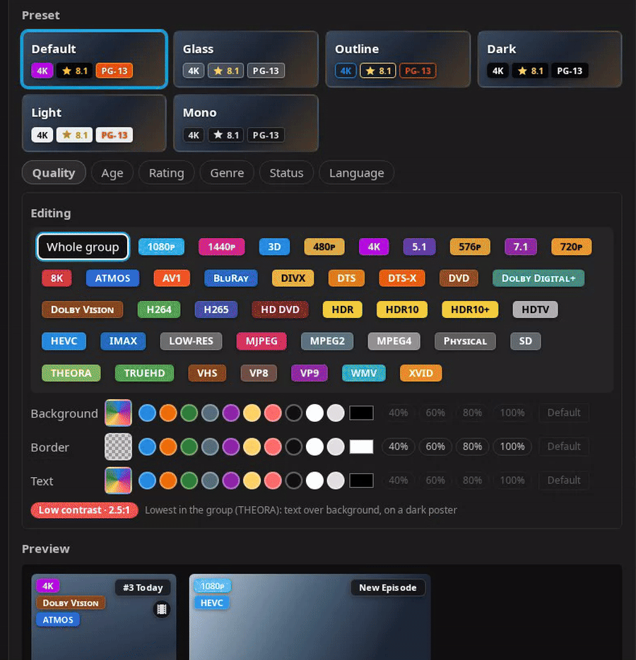

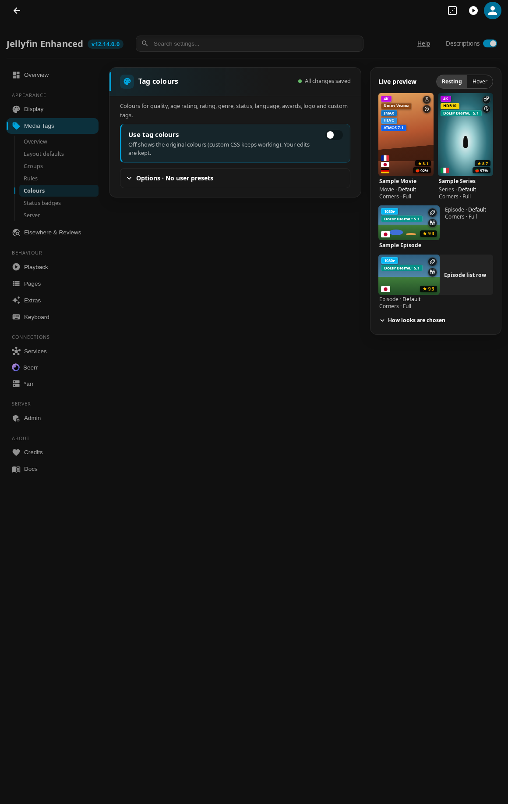

| Setting | Default | What it does |
|---|---|---|
| **Use these tag colours** | Off | Turns the colours on. Turning it off keeps your edits |
| **Apply to** | **Both** | **Web** recolours the overlays in Jellyfin Web; **Native posters** recolours the tags drawn into posters for apps such as Android TV (needs **Native poster tags (experimental)**) |
| **Preset** | **Default** | The colours every tag starts from (see below) |
| **Let users pick their own preset** | Off | Adds the **Colours** tab to each user's **Media Tags** section. Your group and tag colours stay on top of the preset a user picks |
| **Reset all colours** | | Clears every group and tag colour and returns to the **Default** preset after a confirmation; **Undo** in the message brings them back |

### Presets

Each preset sets a background, border and text colour for every kind of tag. Each preset tile previews a 4K, a rating and a PG-13 tag in its colours.

| Preset | Look |
|---|---|
| **Default** | The built-in colours. Nothing changes and custom CSS keeps working as before |
| **Glass** | Light translucent chips with a soft white border; white text, gold community scores and trending ranks, red critic scores |
| **Outline** | Dark translucent chips; the border and text take each tag's tint: blue resolution, orange dynamic range and IMAX/3D, green audio, grey codec and source, gold community score, red critic score, the board colour for age ratings. Genre, status and language get a white border |
| **Dark** | Near-black chips without a border; white text with gold and red scores |
| **Light** | Near-white chips without a border; dark text, darker gold and red scores, age ratings in their board colour |
| **Mono** | Neutral dark grey chips with light grey text and a faint border |
| **Poster** | Each tag takes its colour from the poster it sits on: the artwork's main colour, kept saturated (a red poster gives red tags) and darkened or lightened just enough that white or black text reads at 4.5:1 or better; a grey or very dark poster gives a neutral dark tag. The border is a lighter or darker shade of the same colour. Flags keep their own look |

#### The Poster preset

The colour comes from the artwork your browser is already showing (never the blurred placeholder shown while it loads): a 32px copy is read once, in idle time, and the result is remembered per poster in the browser, so scrolling back is instant. A new poster image for an item is read again. Nothing is sent anywhere. If the browser cannot read an image (for example artwork served from another site), that poster keeps the **Default** colours. Native posters work out the same colour from the image they draw on.

Group and tag colours you set stay on top, field by field: set a group's text to white and every tag of the group keeps white text over its poster colour. **Default** on a row hands that field back to the poster. Because the colours depend on the artwork, the [contrast check](#contrast-check) shows the worst case Poster can produce, and the preview shows the colours of a red poster.

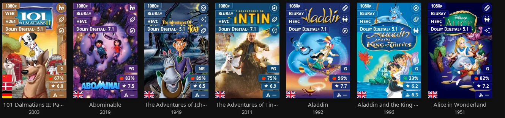

### Groups and single tags

The editor shows every tag of the selected group in its current colours, so you can see the result before changing anything. A dot marks a group or tag you changed.

| Tab | Tags you can edit one by one | Notes |
|---|---|---|
| **Quality** | Every quality label (4K, HDR10, ATMOS, TRUEHD ATMOS, DD+ ATMOS, HEVC…) | Combined labels such as ATMOS 7.1 follow their base label; TRUEHD ATMOS and DD+ ATMOS are labels of their own that start with the ATMOS colours |
| **Age** | One chip per age rating colour board, shown with a sample rating | Hover a chip to see every rating it covers |
| **Rating** | **Community**, **Critic**, **User review** | Rating chips have no border of their own: a border colour draws a thin inner ring |
| **Genre** | Every genre with an icon of its own and **Other** (see [Genre colours](#genre-colours)) | **Text** colours the icon; a genre with colours of its own also colours its name beside it on hover |
| **Status** | **Just Added**, **New Movie**, **New Series**, **New Episode**, **Trending**, schedule, milestone and series-state badges | Applies to web and native posters. A Trending text colour also recolours the rank |
| **Awards** | **IMDb Top 250**, **Certified Fresh**, **Oscar Winner**, **Emmy Winner**, **Letterboxd Top 250** | Bundled logos keep their source colours; the chip background, text and border can change |
| **Language** | **Flag image**, **Language codes**, **Subtitles**, **Dual / Multi**, **Dual**, **Multi**, and individual ISO language codes | Chips share the quality-chip box and take background, border and text colours. Flag images keep only their border ring; partial flags keep their dashed outline |
| **Logos** | **Provider logo**, **Network / studio logo**, **Name chip** | Colours the pill behind the logo; **Text** colours the name chip |

| **Custom** | Each label of the **Custom tag rules** | The labels follow the rules table as you edit it; rules that share a label share its colours. The icon takes the text colour |

A tag's colours are worked out field by field: its own colour if you set one, else the group colour, else the preset. **Default** on a row removes that one colour from what you are editing, so it falls back to the group or the preset.

#### Tag text

Quality, genre, status and awards tags also have a **Text** field under their **Hide** switch: choose a tag and type the words its chips should show (for example **Season Finale** becomes **End of Season**). The text replaces the whole chip text for every user, on web posters and on native posters (native genre chips draw only an icon, so a genre text shows on the web only). Leave the field empty to go back to the tag's own words; it saves when you leave the field and offers Undo. Texts are up to 32 characters, apply in Full and Compact density alike, and are not translated: every language shows what you typed. A tile renames every chip it colours, so renaming **Dolby Digital+** replaces **Dolby Digital+ 5.1** and **Dolby Digital+ 2.0** alike.

#### Hidden tags

Any tag in the editor's tag list can also be hidden: choose it and turn on its **Hide** switch (named after the tag, for example **Hide Drama**). Its chips then never show, on web posters and native posters, for every user. Hidden tiles are dimmed, outlined and marked; the group's tab shows how many it hides; and a **Hidden** line under the list names them, each a shortcut to its switch (with more than four, **Show only the hidden tags** narrows the list to them). **Undo** in the confirmation brings a tag back, as does turning the switch off again. Hidden tags work whether **Use tag colours** is on or off; with colours off the editor stays open for hiding and its colour controls are dimmed.

Each group on the **Groups** tab says how many of its tags are hidden and links to them (**Hidden Genre tags (Colours and text)**). Turning a group off there only changes what new users start with; hiding a tag applies to everyone.

A tag hides exactly the chips its colours apply to:

| Tab | Hiding a tag hides |
|---|---|
| **Quality** | That label, whatever its channels (**Dolby Digital+** hides *Dolby Digital+ 5.1*). Hiding a resolution such as **4K** never shows a lower resolution in its place. |
| **Age** | Every rating on that colour board (hover the tile for the list). |
| **Rating** | That score (Community, Critic, User review or a named source). |
| **Genre** | That genre in every spelling and translation (**Drama** hides *Drame* and *Драма*). **Other** hides every genre without an icon of its own, such as *Reality*, *Talk* or *Anime*. The next genres take the hidden ones' places within **Show up to**. |
| **Status** | That badge. |
| **Awards** | That ribbon. |
| **Language** | A language code hides that language's audio and subtitle chips (the Dual/Multi badge still counts it); **Subtitles**, **Dual / Multi**, **Dual** and **Multi** hide those chips. **Flag image** and **Language codes** colour every flag or code and cannot be hidden. |
| **Logos** | Every logo of that kind: **Provider logo** (streaming services), **Network / studio logo**, or **Name chip** (logos without an image). The next logo takes their place. |
| **Custom** | Every chip with that label. A hidden label whose rule was removed keeps its tile (*Kids (no rule)*) until it is shown again, so it never silently hides a later rule with the same label. |

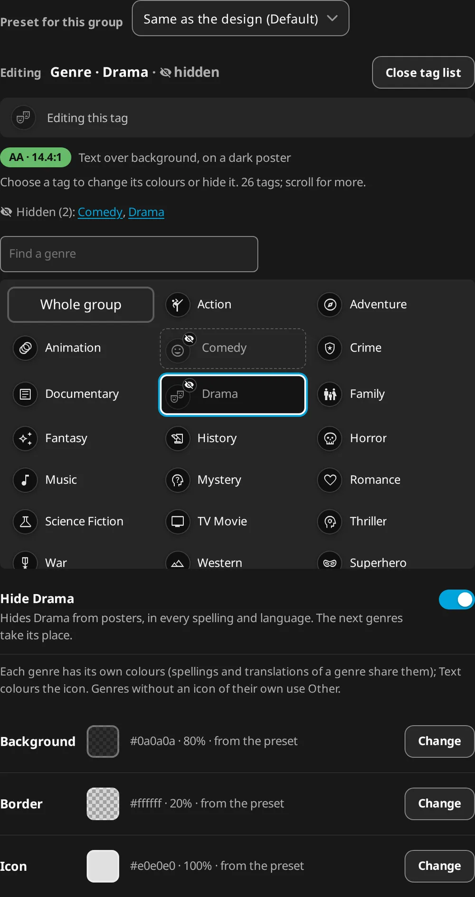

#### Genre colours

Each genre the icons know is its own tag on the **Genre** tab, shown as its icon (with its name where there is room; hover a tile for the name). **Find a genre** narrows the list. With the keyboard the tiles are a single stop: the arrow keys move the selection, **Home** and **End** jump to the first and last tile. A genre and its other spellings and translations share one tag, so colouring **Comedy** also colours *Comédie* and *Komödie*. Genres without an icon of their own (for example *Anime* or *Children*) use **Other**. Genre names are matched without regard to case.

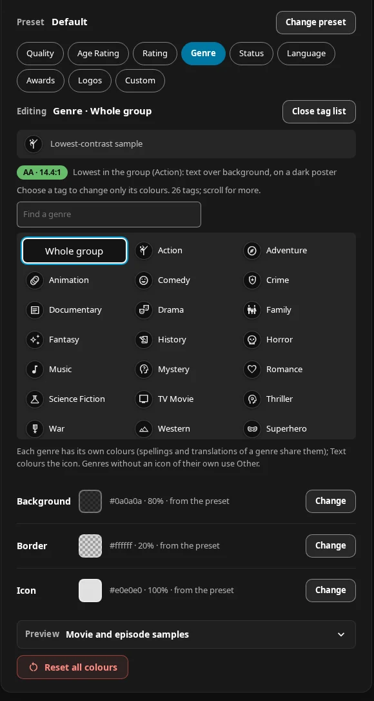

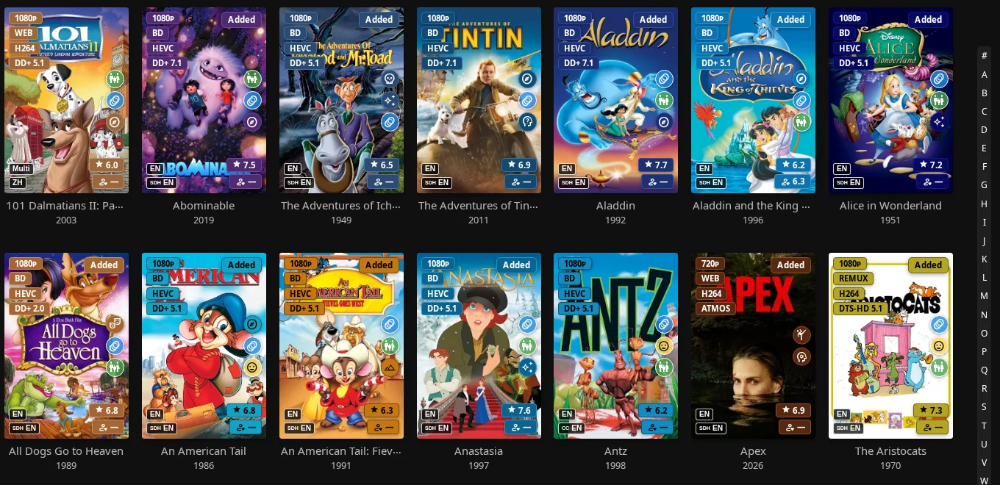
*Poster preset with three coloured genres: Animation blue, Family green, Comedy yellow; every other tag takes its poster's colour.*

| Tag | Key | Icon | Also covers |
|---|---|---|---|
| Action | `action` | `sports_martial_arts` | acción, azione, akció, боевик |
| Adventure | `adventure` | `explore` | aventure, aventura, abenteuer, avventura, eventyr, äventyr, kaland, приключения |
| Animation | `animation` | `animation` | animación, animazione, animációs, мультфильм |
| Comedy | `comedy` | `mood` | comédie, comedia, komödie, commedia, komedie, komedi, vígjáték, комедия |
| Crime | `crime` | `local_police` | crimen, krimi, crimine, brott, bűnügyi, криминал |
| Documentary | `documentary` | `article` | documental, dokumentarfilm, documentario, dokumentar, dokumentär, dokumentum, документальный |
| Drama | `drama` | `theater_comedy` | drame, drammatico, dráma, драма |
| Family | `family` | `family_restroom` | familial, familiar, familienfilm, famiglia, familie, familj, családi, семейный |
| Fantasy | `fantasy` | `auto_awesome` | fantastique, fantasía, fantastico, фэнтези |
| History | `history` | `history_edu` | histoire, historique, historia, geschichte, storico, historie, történelmi, история |
| Horror | `horror` | `skull` | horreur, terror, orrore, gyser, skräck, ужасы |
| Music | `music` | `music_note` | musique, música, musica, musik, zenei, музыка |
| Mystery | `mystery` | `psychology_alt` | mystère, misterio, mistero, mysterie, mysterium, misztikus, детектив |
| Romance | `romance` | `favorite` | liebesfilm, romantico, romantik, romantikus, мелодрама |
| Science Fiction | `science fiction` | `science` | sci-fi, science-fiction, ciencia ficción, fantascienza, фантастика |
| TV Movie | `tv movie` | `tv` | téléfilm, película de tv, fernsehfilm, film per la tv, tv-film, tv film, телевизионный фильм |
| Thriller | `thriller` | `psychology` | suspense, триллер |
| War | `war` | `military_tech` | guerre, bélica, kriegsfilm, guerra, krig, krigs, háborús, военный |
| Western | `western` | `landscape` | вестерн |
| Superhero | `superhero` | `domino_mask` | superhéroes |
| Musical | `musical` | `music_video` | comédie musicale, musikfilm |
| Biography | `biography` | `menu_book` | biographie, biografía, biografico, életrajzi |
| Sport | `sport` | `sports_soccer` | deporte, sportivo |
| Game Show | `game-show` | `quiz` | jeu-concours, concurso, spielshow, game show, spilshow, spelshow, játékshow |
| Reality TV | `reality-tv` | `live_tv` | télé-réalité, telerrealidad, reality tv, valóság-tv, реалити-шоу |
| Other | `other` | `theaters` | Every genre not listed above |

The genre's colours apply to its icon on web cards and native posters alike; on the web, the name that appears beside the icon on hover, in the caption strip and in the Summary and Minimal hover lists, takes them too. Only a genre you colour on its own does that: **Whole group** colours and presets colour every icon but leave the names in their usual dark pill. The preview shows a Horror, a Comedy and an Animation icon. Documents saved before genres had their own tags (one colour for every genre) open with that colour as the **Whole group** colour, so nothing changes until you colour a genre.

### Contrast check

The badge under the colour rows rates the text against the background, both shown over a dark poster:

| Badge | Contrast | Meaning |
|---|---|---|
| **AA** (green) | 4.5:1 or more | Easy to read |
| **AA large only** (amber) | 3:1 to 4.5:1 | Readable for large or bold text only |
| **Low contrast** (red) | under 3:1 | Hard to read |

With **Whole group** selected, the badge only appears when a tag reads under 3:1, and names the tag that reads worst. Pick a single tag to see its own rating. Translucent presets also depend on the artwork behind them, so check the preview. Under **Poster**, a tag whose text or background comes from the artwork is rated by the worst case over any artwork, and the badge says so; a tag whose text and background are both set here is rated by those colours, and **Whole group** shows whichever reads worst.

### User presets

With **Let users pick their own preset** on, users choose **Tag Colours** on the **Colours** tab of **Media Tags** (see [The Media Tags section](tags.md#the-media-tags-section)). **Server default** follows your preset; any other choice replaces only the preset, never your group or tag colours. The web applies it right away, and native posters for that user follow the next time they load.

Styles change colours, not size, shape, position or visibility. For web layout, sizing, hiding and more detailed styling, see [CSS Customization](../advanced/css-customization.md).

!!! note "Style requirements"
    Native colours need **Native poster tags (experimental)**. Enable the tag feature and supply metadata first: CSS cannot create missing tags or restyle pixels already drawn into an image.

??? info "Stored style configuration"
    The saved fields are `TagStylesEnabled`, `TagStyleTarget` (`both`, `web` or `native`), `TagStylePreset` (`default`, `glass`, `outline`, `dark`, `light`, `mono` or `poster`), `TagStylesAllowUserPreset`, and `TagStyleOverrides`: an empty string, or a version 2 document `{"v":2,"preset":…,"groups":{…},"labels":{…}}` holding only the colours you set. Settings saved before this editor (version 1, with colours per quality label, age board, rating chip and genre) still load and look exactly as before: each tag you had changed keeps the colours it was drawn with, and the preset becomes **Default**, because the old presets were already baked into those colours. They are converted to version 2 on the next save. `TagStyleApplyScope` is no longer used. Each user's choice is `TagStylePreset` in their settings (`null` follows the admin). Saving checks the document, in either version: anything that is not a colour, an unknown group, tag or field, or a document over 40 KB keeps the current styles. See the [API reference](../advanced/api.md#style-and-native-preview-contracts) for the full format.

??? info "Web CSS behavior"
    Saved Tag Styles use stronger important colour rules than simple CSS recipes, but sufficiently specific important custom CSS can override them. Status chips carry `data-je-status` (`added`, `newMovie`, `newSeries`, `newEpisode`, `trending`, or a schedule/milestone/series-state key such as `season_finale`) if you want to target one kind yourself. Prefer the corner controls to transforms that can disrupt shared-corner stacking. Genre-name styling requires **Hide tags on hover** off. Hiding a displayed flag with CSS does not make a fourth flag appear.

??? info "Style API routes"
    The effective web colours are available through authenticated `GET /JellyfinEnhanced/tag-styles` (empty when disabled or targeting native posters only; optional `preset` for a user's own preset). The shipped defaults and preset palettes come from authenticated `GET /JellyfinEnhanced/tag-styles/catalog` (any signed-in user; it holds only the shipped palettes, no settings).
