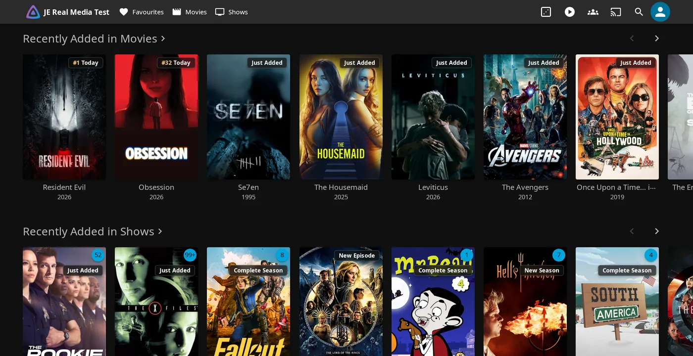
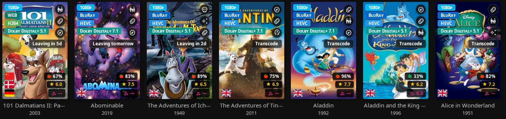
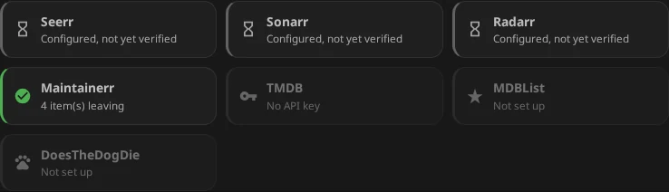
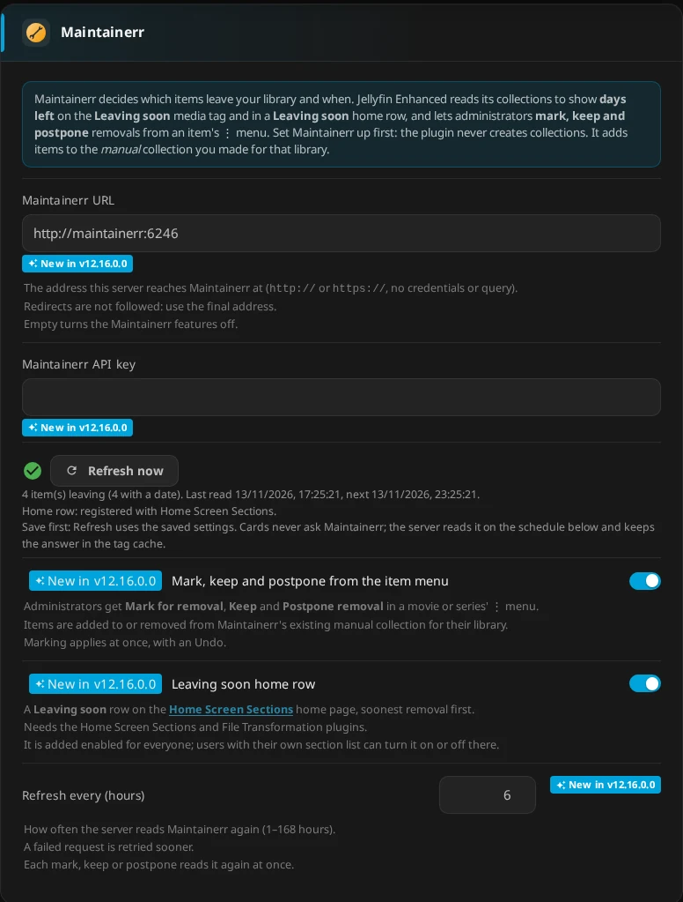
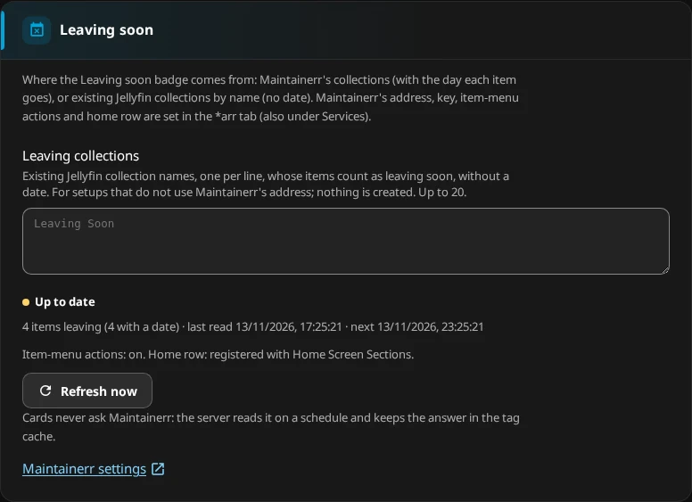
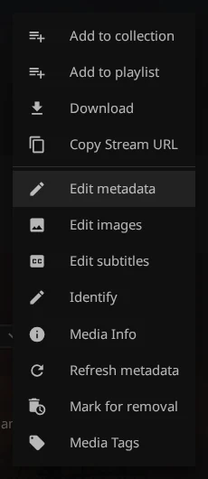
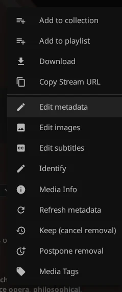
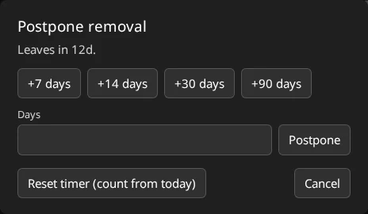
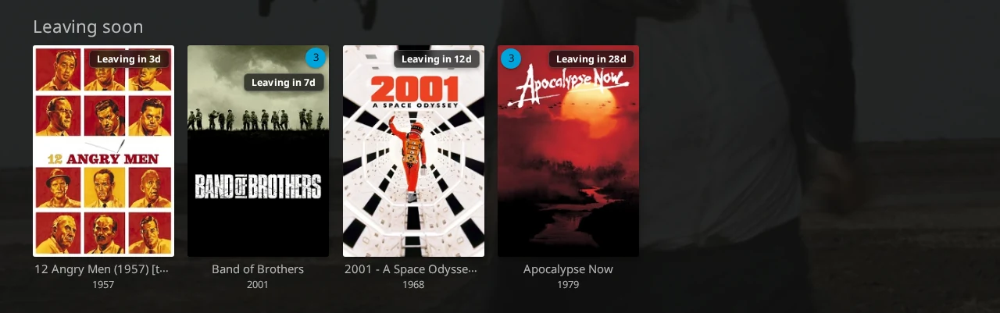

# Status Badges

Status badges such as Just Added, Trending and Leaving soon, their priority, and the removal tools that feed Leaving soon.

## Status Tags

Status Tags show one translucent badge per card: what is new, trending, airing next, or reaching a season milestone. They use the existing poster artwork and the selected [tag layout](tags-layouts.md#layouts).



**How to use:** Turn on the **Status** group on the **Groups** tab of **Media Tags** and choose its position. Pick the badge families on the **Status badges** tab (the Status row's **Badges** button opens it). Administrators set starting defaults on the **Status badges** tab of the Media Tags admin tab; each user can override the eight group switches.

| Setting | Default | What it does |
|---|---|---|
| Admin: **Enable Status Tags** / personal: **Status** switch | Off | Shows one badge per supported card. The admin switch also allows server trending and series schedule lookups |
| **Trending rank** | On | Shows the title's trending rank. Admin **Show Trending rank** off stops the shared list for everyone |
| **New Movie / New Series / New Episode** | On | Shows release and episode-arrival badges |
| **Just Added** | On | Shows recently added library items |
| **Airing Today / Airs / Returns / Coming Soon** | On | Shows schedule badges; Coming Soon works without TMDB |
| **New Season / Premiere / Finale / Complete Season** | On | Shows season and series milestones |
| **Returning / Ended / Cancelled** | Off | Shows a series' status when no higher-priority badge applies |
| **Leaving soon** | Off | Shows **Leaving in 5d** (or **Leaving soon**) on items the server will remove; needs an administrator's [Leaving soon source](#leaving-soon-maintainerr-or-reclaimerr) |
| **Direct-play warning** | Off | Shows **Transcode** or **Won't direct play** on movies and episodes this browser cannot play as they are ([web only](#direct-play-warning)) |
| Admin: **New release window (days)** | 30 | Premiere dates, new seasons, season premieres and recent TMDB finales; range 1–365 |
| Admin: **Just added window (days)** | 7 | Item/episode added dates, an episode's own air date and season binge drops; range 1–365 |
| Admin: **Show status badges on collections** | On | Whether a collection can carry a status badge at all. A collection shows **Just Added** when one of its members was added recently; turn this off to keep badges off collections |

### Badges and priority

First match wins, with one badge per card. When switched on, **Leaving soon** comes before every other badge on movies, series, seasons and episodes, and the **direct-play warning** after every other badge on movies, episodes and videos:

| Card | Badge order |
|---|---|
| Movie | Trending → Coming Soon → New Movie → Just Added → Post-credits / Mid-credits |
| Series | Trending → Airing Today → Series Finale / Binge Ready → New Season → Airs {date} → Returns {date} → New Episode → Coming Soon → New Series → Just Added → Returning / Ended / Cancelled |
| Season | Complete Season → Season Premiere → Season Finale → New Episode → Just Added |
| Episode | Season Premiere → Series Finale / Season Finale → New Episode → Just Added |
| Collection, video | Just Added |

| Badge | Cards | Data and conditions |
|---|---|---|
| **#N Today / #N This Week** | Movie, series | TMDB daily trending rank, or Seerr weekly trending fallback; requires the item's TMDB ID |
| **Coming Soon** | Movie, series | Jellyfin `PremiereDate` is in the future, including virtual items returned through fallback |
| **New Movie / New Series** | Movie / series | Jellyfin premiere date falls within the new-release window and has passed |
| **New Episode** | Series, season, episode | A container's latest non-virtual episode was added within the just-added window and the container predates that window, unless you have watched all of it (its played check shows on the poster). An episode itself aired within that window; one that was only added recently shows **Just Added** |
| **Just Added** | All supported types | Jellyfin `DateCreated`, the date used by **Date Added** sorting, falls within the just-added window. A collection uses the newest `DateCreated` among its members instead of its own date, and shows no badge when you cannot see that member: Jellyfin can create automatic collections again during a library scan, which would mark every one of them as just added |
| **New Season** | Series | The newest regular season's episode 1 aired within the new-release window; season number must exceed 1 |
| **Season Premiere** | Season, episode | The season's episode 1 aired within the new-release window; an episode card must itself be episode 1 of a regular season and have aired within the just-added window |
| **Season Finale** | Season, episode | The latest aired TMDB episode matches the library episode and is within the new-release window. TMDB `episode_type=finale` confirms it; if absent, the local episode must be last in its season and TMDB must have no next episode, or one in a later season |
| **Series Finale** | Series, episode | TMDB status is Ended or Canceled, and the last aired regular episode matches the visible library episode (a combined file such as S01E09-E10 matches when it holds that episode) and falls within the new-release window. Both cache and batch paths resolve the same regular episode: TMDB's latest regular episode first (so a library holding only S1E3 of an ended ten-episode season shows no finale), then TMDB season enrichment. The library's latest episode (caller-filtered series aggregate or a fetched local aggregate) only stands in when TMDB's per-season episode counts show it is the last episode of the last season, and keeps its air date's calendar day; season 0 never supplies a series finale |
| **Binge Ready** | Series | The same conditions as Series Finale, for a show whose premiere and final episode aired within 3 days of each other (a one-drop release). It replaces Series Finale on such shows and, like it, lasts for the new-release window. |
| **Complete Season** | Season | The whole season is in the library and arrived within the just-added window: TMDB lists the season's episode count, every episode of it has aired (none scheduled in it, and the latest aired episode is its last or a later season's), and the library covers every episode number from 1 to that count (a multi-episode file covers its range and counts as its last episode for finales; a duplicate or an extra number never fills a gap), all added within the window. Without TMDB facts, with an episode still to air or any episode missing, no completion is claimed and the season shows its next badge instead. A season with more than 100 episodes is not checked episode by episode, so it never claims completion |
| **Airing Today** | Series | TMDB's next episode air date is today in the user's local calendar |
| **Airs {date}** | Series | TMDB's next episode airs in the next seven days |
| **Returns {date}** | Series | TMDB's next episode airs within 30 days, more than 14 days after the last aired episode. Airs takes priority inside seven days |
| **Returning / Ended / Cancelled** | Series | Jellyfin Continuing/Ended first. TMDB may refine Ended to Cancelled, or supply a missing Jellyfin status |
| **Leaving in {days}d / Leaving tomorrow / Leaving today / Leaving soon** | Movie, series, season, episode | The item (or its season or series) is in a Maintainerr collection or a leaving collection. Days are local calendar days to Maintainerr's delete date (`addDate + deleteAfterDays`); **Leaving soon** without a date or once it has passed |
| **Transcode / Won't direct play** | Movie, episode, video | Jellyfin's `PlaybackInfo` answer for this browser's device profile: **Won't direct play** when only the container is unsupported (a remux), **Transcode** otherwise. The tooltip names the reasons |

Premiere and air dates are calendar days: a title released on 5 November is **Coming Soon** until midnight on 4 November where you are, then **New Movie** (or **New Episode**, **Season Premiere**) from local midnight, in every time zone; native posters use the time zone saved with your web settings. Series and seasons follow the same rule: the server records a new season's premiere as soon as its date has begun in the earliest time zone (UTC+14) and refreshes the series then, so **New Season** appears at your own midnight even east of UTC, and not before it west of UTC. Added dates (**Just Added**) are exact times. Dates read **Tomorrow**, then a localized weekday for two to five days ahead, then a localized short date such as **Nov 6**. The user's Jellyfin display language is preferred, followed by the JE language and browser locale.

With **Compact** density, Season Premiere becomes **Premiere**; Season Finale and Series Finale become **Finale**; Complete Season becomes **Complete**; Airing Today becomes **Today**; Coming Soon becomes **Soon**; Just Added becomes **Added**; New Episode becomes **New Ep**; Leaving in 5d becomes **5d left**; Won't direct play becomes **Remux**. Other labels retain their full text.

### Scenes


*Administrator native-poster preview using cached Jellyfin streams and TMDB keywords; not a physical-client capture.*

On [**Media Tags → Status badges**](../open-in-jellyfin.md?jeSection=media-tags&tab=badges), **Scenes** enables **Post-credits** and **Mid-credits** for movies. It starts off for both administrators and users. An administrator must enable the family on the Media Tags admin tab’s **Status badges** tab and configure the existing TMDB key. Then users can enable Scenes for their account. The movie in both the personal and admin live previews carries a Post-credits sample, shown when Scenes is enabled and no higher-priority family is selected.

TMDB’s exact `aftercreditsstinger` and `duringcreditsstinger` keywords supply the facts. The server resolves them daily through its shared response cache and keeps the result in the tag cache; no browser or native poster request contacts TMDB per card. A failed lookup omits an unknown marker and keeps previously confirmed facts for later retry. No keyword is not a guarantee that a movie has no extra scene. Scenes follows the usual one-badge priority, after Just Added; Post-credits wins when both keywords exist. Native posters and the batch fallback use the same facts and switches.

### TMDB and trending

A TMDB API key is required for Airing Today, Airs, Returns, Season Finale, Series Finale and Complete Season. Without one, Jellyfin supplies added/release badges, New Season, Season Premiere and Returning/Ended. Cancelled requires TMDB. No Seerr schedule fallback is used.

Trending reads **#N Today** from TMDB's daily list when a key is configured. Without a key, or when TMDB fails or returns no rankable titles, it reads **#N This Week** from Seerr. With neither source, no rank appears. Only movies and series with TMDB IDs receive ranks.

The server shares up to 60 movie/series ranks for 30 minutes, with a five-minute retry after an empty answer. The list contains only public TMDB IDs and ranks. Changed ranks re-badge cards already on the page.

For series cards on screen, and parent series of season/episode cards, the browser batches up to 50 accessible IDs through `GET /JellyfinEnhanced/status-tags/series`. It retains schedules for an hour and retries failures after five minutes. The server shares TMDB responses for six hours, with at most four lookups in flight and 35 upstream requests per ten-second window. If the series response omits `episode_type`, its latest aired season supplies it. For an ended series whose latest episode is a special, the newest aired regular season also supplies a separate last regular episode. Parent aggregates fetched through `/tag-data` are shared by series and episode cards, expire after ten minutes, and are discarded on user or filter changes. No schedule is stored per user or in the tag cache. One shared viewport observer gates schedule requests; offscreen, detached and recycled cards do not dispatch lookups. Targets are released on removal, identity reuse, renderer cleanup and user change. A single timer re-evaluates labels at the next local midnight, and visibility/focus events refresh active cards after a suspended tab returns. User changes, renderer cleanup and `pagehide` cancel midnight, batch and retry timers; initialisation and `pageshow` resume them.

### Leaving soon (Maintainerr or Reclaimerr)

Two removal tools can feed **Leaving soon**, the item menu and the home row: **Maintainerr** (below) and **Reclaimerr** (the next section). Exactly one is on at a time: each has a **Use** switch in its card in the [**\*arr**](../open-in-jellyfin.md?tab=arr) tab, and turning one on turns the other off (both can be off). The settings of the one that is off are kept. The shared options (item-menu switch, home row switch, refresh interval and the live state with **Refresh now**) are in their own **Leaving soon** card. Everything below that says Maintainerr applies while Maintainerr is the one that is on.



[Maintainerr](https://github.com/jorenn92/Maintainerr) puts the media its rules will delete into collections (often one called **Leaving Soon**) and deletes each item a set number of days after it was added. With **Leaving soon** on, cards say when an item goes.

An administrator sets the source in [**\*arr** › **Maintainerr**](../open-in-jellyfin.md?tab=arr&card=maintainerr) (shown as a linked copy under **Services**; the [**Media Tags** › **Status badges**](../open-in-jellyfin.md?jeSection=media-tags&tab=badges) › **Leaving soon** section shows its live state, with a **Refresh now** button and a link to the settings, and the Overview tab's **Service Status** lists Maintainerr with its last read):






| Setting | Default | What it does |
|---|---|---|
| **Maintainerr URL** | Empty | The address this server reaches Maintainerr at (`http://` or `https://`, no credentials or query). The server reads `GET /api/collections`, then every member of each active collection page by page (`GET /api/collections/media/{id}/content/{page}`, 500 at a time: the list itself names only a few members per collection), and computes each item's delete date from `addDate + deleteAfterDays`. Where a collection's first page is not there (HTTP 404, or JSON that is not a page of members), the members the list names are used. Inactive collections are skipped. Redirects are not followed: use the final address (a redirect shows as the last failure and is logged with its host) |
| **Maintainerr API key** | Empty | Sent as `X-Api-Key` when set. It is kept in the plugin configuration like the other keys and never sent to users or written to the Leaving soon snapshot or logs |
| **Leaving collections** | Empty | Existing Jellyfin collection names, one per line (up to 20), whose members count as leaving, without a date. For setups without the API; nothing is created |
| **Refresh every** | 6 hours | How often the server reads the source again (1–168 hours) |
| **Mark, keep and postpone from the item menu** | On | Administrators get **Mark for removal**, **Keep (cancel removal)** and **Postpone removal** in an item's ⋮ menu (see below). Needs the Maintainerr URL |
| **Leaving soon home row** | On | A **Leaving soon** row on a [Home Screen Sections](https://github.com/IAmParadox27/jellyfin-plugin-home-sections) home page (see below). Needs the Maintainerr URL |
| **Leaving soon** (family switch) | Off | Whether new users start with the badge on |



Cards never ask Maintainerr: the **Refresh Leaving Soon Tags** scheduled task (hourly, acting only once the interval has passed, and only while the badge (on by default or for some user), the home row or the Maintainerr actions use the data), a source change and **Refresh now** (in the Services card and in the Leaving soon section) read it on the server and put the result into the tag cache entries (`Leaving`). A failed request (including an answer that lists entries but no collection or member it can read, and a page of members that fails, or one after the first that is not a page) keeps the last good answer and retries after 15 minutes, then 30, 60 and so on, at most the refresh interval; the card shows the last read, the next one, the item counts and the last failure. Maintainerr items are matched by their Jellyfin item id (`mediaServerId`); a Plex-backed Maintainerr's movies and shows are matched by TMDB id. A season or episode leaves with its season or series, whichever goes first. Users who can see an item see its Maintainerr badge; a badge that only a leaving collection gives is shown to users who can access that collection (as for collection-matched [Custom Tags](tags-groups.md#custom-tags)). The collection names and the Maintainerr address stay on the server.

`LeavingSoonMaintainerrApiKey` is explicitly excluded from both user and administrator portable exports/imports, public/private configuration and runtime snapshots. The Maintainerr card (the *arr tab, with a linked copy under Services) keeps the key in a plain text field like the TMDB key, saved with the configuration page's **Save** button, and the Media Tags field patch neither takes nor returns it. The administrator-only core Jellyfin plugin configuration API retains its normal credential-editing contract. Source URLs, collection names and cadence are administrator settings; private collection provenance never reaches tag clients.

#### Marking, keeping and postponing from the item menu

With **Mark, keep and postpone from the item menu** on (and a Maintainerr URL), an administrator's ⋮ menu on a movie, series or season (the detail page's or a card's) gets:

| Item | Row | What happens |
|---|---|---|
| Not in Maintainerr | **Mark for removal** | The item is added to Maintainerr's manual collection for its library, at once, and a toast with **Undo** follows (Undo removes it again). There is no confirm dialog |
| In Maintainerr | **Keep (cancel removal)** | The item is removed from its Maintainerr collection; the toast's **Undo** marks it again |
| In Maintainerr | **Postpone removal** | A small chooser: **+7**, **+14**, **+30** or **+90 days**, a custom count (1–3650), or **Reset timer** (count the collection's days from today) |

 

 

Maintainerr is set up first, as today, with a rule per library that uses a **manual collection** (its "Use manual collection" option); the plugin never creates collections. An item is matched to the one active manual collection of its type (movie, show or season) on its Jellyfin library. When one library has several (say a 4K and an HD list, each tied to its own Radarr), the plugin asks each collection's Radarr or Sonarr server, as Maintainerr lists them, whether it holds the item (by TMDB id for movies, by the series' TVDB id for series and seasons) and uses the one that does. Marked from a movie's own page, the version picked there decides: the collection whose Radarr has that version's file (the same file name) is used, so the 4K and the 1080p copy of one movie each go to their own list. When nothing fits, or more than one does, the toast says so and names Maintainerr's collections. Every change reads Maintainerr again at once, so the badge, the row and the next menu follow without waiting for the scheduled refresh. The rows are only offered to administrators, and the server refuses everyone else regardless; the Maintainerr address and key, and the *arr addresses and keys Maintainerr holds, never reach the browser. Episodes get no rows.

The rows are added to Jellyfin's item menu the same way as **Media Tags**, so they share its dependence on jellyfin-web's private menu behaviour (see [One item's look](tags-layouts.md#one-items-look)).

#### The Leaving soon home row

With **Leaving soon home row** on (and a Maintainerr URL), the plugin registers a **Leaving soon** section with the [Home Screen Sections](https://github.com/IAmParadox27/jellyfin-plugin-home-sections) plugin when that plugin is installed (it also needs File Transformation to draw its rows). The row lists Maintainerr's items the viewer can see, soonest removal first, movies and series only (a leaving season or episode shows as its series), up to 20. It is registered on every start (Home Screen Sections keeps registrations in memory) and, if Home Screen Sections has no entry for it yet, added to its section list enabled for everyone with user override allowed; users who keep their own section list may need to turn it on there. The **Leaving soon** section of the Media Tags tab says whether the row is registered, or which plugin is missing. The cards carry the usual Leaving soon badge for users who have it on.



### Leaving soon (Reclaimerr)

[Reclaimerr](https://github.com/jessielw/Reclaimerr) scans your libraries with rules and routes the final deletion through Jellyfin, Radarr and Sonarr. With **Use Reclaimerr** on, the plugin reads it instead of Maintainerr:

| Setting | Default | What it does |
|---|---|---|
| **Use Reclaimerr** | Off | Turns Reclaimerr on and Maintainerr off |
| **Reclaimerr URL** | Empty | The address this server reaches Reclaimerr at (`http://` or `https://`, no credentials or query). Redirects are not followed |
| **Reclaimerr API token** | Empty | A token from Reclaimerr's **Settings › Integrations** with the candidates (manage), protections (manage), media (read) and system (read) scopes. Sent as a bearer token; masked in the page like the other keys, and never sent to users or written to the snapshot or logs |
| **Act as the Jellyfin user** | On | Requests and schedules are made **as the Jellyfin user who clicked**: **Request removal**, **Mark for removal**, and cancelling or moving a scheduled deletion carry their own name in Reclaimerr (a request shows `@Sam`, not the service account). It uses Reclaimerr's trusted-proxy sign-in, so Reclaimerr needs `FORWARD_AUTH_ENABLED=true`, `FORWARD_AUTH_USER_HEADER=Remote-User` and the address the plugin connects from in `FORWARD_AUTH_TRUSTED_PROXIES` (see below). The user needs a Reclaimerr account. People who sign in to Reclaimerr with their Jellyfin login (**media sign-in**) get one created and linked automatically (for example `sam_user`); the plugin finds the account through that link, read with the service account and cached for five minutes, so nothing has to be created or mapped by hand. A user who has never signed in to Reclaimerr has no account yet: the fallback files their action under the service account |
| **User header** | `Remote-User` | The header the user name is sent in; match Reclaimerr's `FORWARD_AUTH_USER_HEADER` |
| **Jellyfin user to Reclaimerr user** | Empty | Normally empty. One `Jellyfin name = Reclaimerr name` per line points a user at a specific Reclaimerr account instead of the linked one (for example `sam = samuel`); it wins over the link. Order: this list, then the linked account, then the same name |
| **Service account username / password (fallback)** | Empty | A dedicated Reclaimerr **admin** account. The plugin signs it in **by name** through the same trusted-proxy sign-in as users, so the password is optional and Reclaimerr's local login can stay switched off; the password is only used for a local login when the trusted sign-in is not available. It is **the fallback**: the plugin uses it when it cannot act as the user, that is when Reclaimerr's trusted-proxy sign-in is off, the connecting address is not trusted, or the user has no Reclaimerr account (the action then shows under the service account). It also reads scheduled deletions and pending requests, and it is what **Mark for removal** and **Request removal** need when **Act as the Jellyfin user** is off, because Reclaimerr's token API cannot do those. **Create service account** makes one: it asks for a Reclaimerr administrator's login once (used for that call, never stored), creates `jellyfin-enhanced` with a random password and saves it. Reading candidates, **Keep** and **Postpone** work with the token alone |

What it reads and does:

- **Leaving soon facts.** The cleanup candidates whose automatic deletion is scheduled, eligible or postponed (disabled and canceled ones are not leaving), and, with the service account, the manual deletions scheduled for a whole title or for one movie file. The date is the postponed-until day when there is one, else the end of the review period or the scheduled day. A season or episode on its own does not mark a series. Titles are matched to Jellyfin items by TMDB id, and a scheduled movie file marks only the library item that holds that file.
- **Item menu (administrators).** **Mark for removal** opens a chooser with **+7, +14, +30, +90 days** and an exact-day picker (30 days is only the default) and schedules a manual deletion of the whole title. **Keep** protects the candidate (or cancels the scheduled deletion). **Postpone removal** takes a day count, an exact day, or **Reset timer** for a candidate.
- **Request removal (everyone signed in).** A user who can see a movie or series and is not an administrator gets **Request removal** in the ⋮ menu. It files a Reclaimerr deletion request as that user (or as the service account when acting as the user is not possible), with "Requested by <user> from Jellyfin" as the reason; an administrator approves or denies it in Reclaimerr or on the Leaving Soon page. **Approving deletes immediately** by default (Reclaimerr acts on approval); with a Reclaimerr that can schedule approvals, the administrator can instead keep Reclaimerr's grace period or pick a day. Asking again while a request is waiting does not file a second one: the user is told it is already waiting.

#### Acting as the user: Reclaimerr side

Set these on the Reclaimerr container and restart it:

```env
FORWARD_AUTH_ENABLED=true
FORWARD_AUTH_USER_HEADER=Remote-User
FORWARD_AUTH_TRUSTED_PROXIES=<the address Jellyfin's requests arrive from>
```

`FORWARD_AUTH_TRUSTED_PROXIES` takes the peer address Reclaimerr sees, not the client. With Reclaimerr in Docker and Jellyfin on the same host, requests to the published port arrive from the Docker bridge gateway (for example `172.80.32.1`) or, when the plugin uses the host's LAN address, from that address; list the one you use. Reclaimerr rejects `*` and all-address ranges, ignores the header from any other peer (the log says "Ignored Remote-User authentication header from untrusted peer"), and only maps the name onto an **existing** active user: it never creates accounts or roles. Local sign-in keeps working for requests that carry no header. Anything running on the trusted address can claim any Reclaimerr user, so trust only addresses you control and keep the Reclaimerr port off the public internet.
- **Home row and badges.** The same **Leaving soon** row and badge as with Maintainerr, fed by Reclaimerr's data. Reclaimerr itself also keeps `Leaving Soon` collections in Jellyfin (named under **Settings › General › Leaving Soon Collections** in Reclaimerr); it has no Home Screen Sections row of its own, which is what this row adds.

### Direct-play warning

With **Direct-play warning** on, movies and episodes that this browser would not play as they are get **Transcode** (video, audio, subtitles, bitrate or HDR need converting) or **Won't direct play** (only the container needs a remux). Hover the badge for the reasons, for example *Transcode: video codec hevc, audio codec dts*.

The answer comes from Jellyfin's own negotiation, `POST /Items/{id}/PlaybackInfo` with the device profile the web player itself would send: a port of jellyfin-web 12.1's browser profile (the same browser checks for containers, codecs, HDR, interlacing and levels, and your **Playback** settings in this browser such as DTS, TrueHD, subtitle burn-in and PGS rendering, audio channels and maximum resolution), or the app's own profile in a desktop or TV app, and your saved video quality for this network (the one you chose, or the last automatic measurement). Signing in as another user or changing one of these settings in the page builds the profile again, so lookups ask with the new one. Nothing plays or transcodes. Lookups run only for cards on screen that show no other status badge, in idle moments, at most two at a time (also across page changes and user switches: a request still on its way keeps its place until it ends, at most 15 seconds, after which it is cancelled and counts as a failed lookup) and a few per idle slice. An item with several versions is asked about the version its card shows: the one you picked on its details page (Quality Tags remember it in this browser), else the one Jellyfin plays by default. Answers are kept per item, version, device profile and quality for a day, in memory and in this browser's tag cache store, and only for the media they were given for (each version's revision from the server, covering every fact a playback profile can check: bitrate, bit depth, level, scan type, frame rate, codec tag, anamorphic, reference frames, rotation, NAL length size, colour primaries, space and range, HDR10+ and Dolby Vision facts, and the codec, language and external, default and forced flags of every stream, subtitles included; a card without that revision fingerprints the same list from the facts it holds): a replaced or re-encoded file is asked about again at once, an answer stored before this check existed is asked again, and an answer still on its way for the old file is never shown for the new one; a failed lookup is retried after ten minutes. It skips every item Jellyfin would probe to answer: a `.strm` item (Jellyfin refreshes it with a remote probe on each such lookup, even when it was probed before) and an item whose tag data lists streams but no video stream in its first media source (media never probed) are not looked up and show no warning. Items whose tag data lists no streams at all (stripped or not sent) are looked up. It is a per-browser check: another device can play the same file differently. [Native Poster Tags](tags-server.md#native-poster-tags-experimental) never show it, because a static poster has no client profile.

!!! note "Native status badges"
    [Native Poster Tags](tags-server.md#native-poster-tags-experimental) draw the same winning status chip, with your family switches and the administrator's day windows. Native trending follows the web's sources and wording: TMDB's daily list (**#N Today**), else Seerr's weekly list (**#N This Week**), refreshed every 30 minutes (5 after an empty answer) in the background; with neither source it shows no popular badge. A poster request never waits for either. Native schedule facts share the six-hour TMDB response cache. Native posters show **Leaving soon** like the web (dates in the time zone saved with your web settings) but never the direct-play warning.

??? info "Cache, access filtering and styling"
    The current tag cache schema (`CurrentCacheSchemaVersion` in `Features/MediaTags/Services/TagCache/TagCacheService.cs`) includes `Leaving` (`DeleteAt`, Unix ms or null), `Awards`, `Logos`, `CustomTags`, named-source `Ratings`, `LibraryId` (library rules), `Status`, `LatestEpisodeAired`, `LatestEpisodeIndex` (`Season`, `Episode`, `IsLast`), `SeasonPremiere` (`Season`, `Aired`), `SeasonAddedSpan` (`First`, `Last`, `Count`) and `EpisodeIndex` (`Season`, `Episode`, nullable `IsLast`). Dates are Unix milliseconds UTC. Movie, series and episode entries can have `PremiereDate`. The persisted browser copy is replaced when its entry schema differs.

    All derived episode facts follow the existing access-filtering and `filterRevision` path. When any contributing episode is inaccessible, related aggregates are omitted conservatively; the shared entry is unchanged. The server-only `StatusEpisodeIds`, `LatestEpisodeId` and `NextEpisodePremiere` never enter client responses. `NextEpisodePremiere` records the next relevant future air date; reconciliation and snapshot load recompute elapsed boundaries without requiring a metadata save. Compatible snapshots without the optional field seed the boundary from their cached episode dates. Episode changes refresh sibling indexes and contributor lists together. With server cache off, `tag-data?latestEpisode=true` computes through the target user's access.

    Spoiler Guard preserves added-date badges and movie/series trending ranks. Guarded season/episode entries omit air dates and milestone indexes, suppressing premiere/finale badges. Complete Season still needs the whole season among their visible episodes.

    Style `.status-tag` or its `--trending`, `--new`, `--added`, `--schedule`, `--milestone`, `--status`, `--leaving`, `--playback` modifiers. Each chip has `data-je-status`: existing styles keep `added`, `newMovie`, `newSeries`, `newEpisode` and `trending`; new badges use keys such as `new_season`, every Leaving soon badge uses `leaving` and both direct-play warnings `direct_play` (which also carries `data-je-dp` and a tooltip); the number inside a trending chip is `.status-tag-rank`.
