# Tags & Badges

See quality, genres, audio languages, scores, age classifications, what is new or trending, and where a title streams or which network or studio made it while browsing your library. You can choose which badges appear, pick a layout for them (corners, bands, a caption below the poster, a summary pill or a minimal set), set their order and limits, and change their colors. People Tags add age and birthplace information to cast cards.

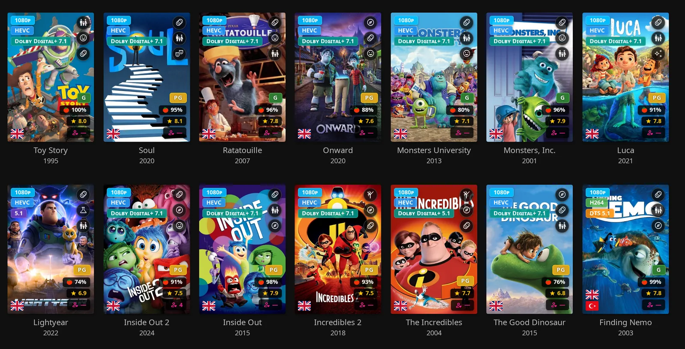
*The optional tag groups are enabled for this example; every group starts off.*

## Set up your tags

You can choose tags for your own account. If you administer the server, you can also set the starting values for users.

**How to use — personal preferences:**

1. Open the **Jellyfin Enhanced** panel from the user profile menu on Jellyfin 12 or the sidebar on 10.11. You can also press ++question++.
2. Select **Media Tags** and choose your tags on its tabs (see [The Media Tags section](#the-media-tags-section)). Changes save automatically to your Jellyfin account on the server.
3. Refresh another open client to load changes you made elsewhere.

**How to use — admin defaults:**

1. Open **Dashboard** → **Plugins** → **Jellyfin Enhanced** and select the **Media Tags** tab in the sidebar (under **Appearance**, after **Display**). Its sections are listed under it: **Overview**, **Layout defaults**, **Groups**, **Rules**, **Colours**, **Status badges** and **Server**. On a phone, open the page's menu, or use the row of section chips at the top of the tab. The **Media Tags** card on the **Display** tab opens it too. A link can open a section directly: `#/configurationpage?name=Jellyfin%20Enhanced&jeSection=media-tags&tab=<id>` (`overview`, `layout`, `groups`, `rules`, `colours`, `badges`, `server`; on Groups add `&group=quality` and so on). The old address `#/configurationpage?name=JellyfinEnhancedMediaTags&tab=<id>` still works and goes there.
2. Choose your settings. Each change saves on its own, so the tab needs no **Save Settings**. The line on the first card's header (on a phone, at the end of the section chips) says **Saving…**, then **All changes saved**. If a save fails, a bar at the bottom of the settings says **Not saved** with the settings it could not save and **Retry**. Those changes stay waiting while you move between sections, other tabs and links; the tab's sidebar entry shows a dot until they are saved. If they still cannot be saved when you leave the settings, it offers to take you back. Saving the other tabs (**Save Settings**, **Apply to all users**) waits for these changes and never undoes them. Signing out, or switching to another server, drops changes that were not saved; the next administrator to sign in never sees them, and an answer to that offer given after the switch takes no one back. Only the settings you change are saved, so another administrator's changes elsewhere are kept. If someone else changed the same setting since you opened the page, the bar says **Changed elsewhere** with both values of each setting and offers **Keep mine** or **Take theirs** (for one setting, **Keep <yours>** or **Use <theirs>**).
3. Refresh affected web clients to load the changes.

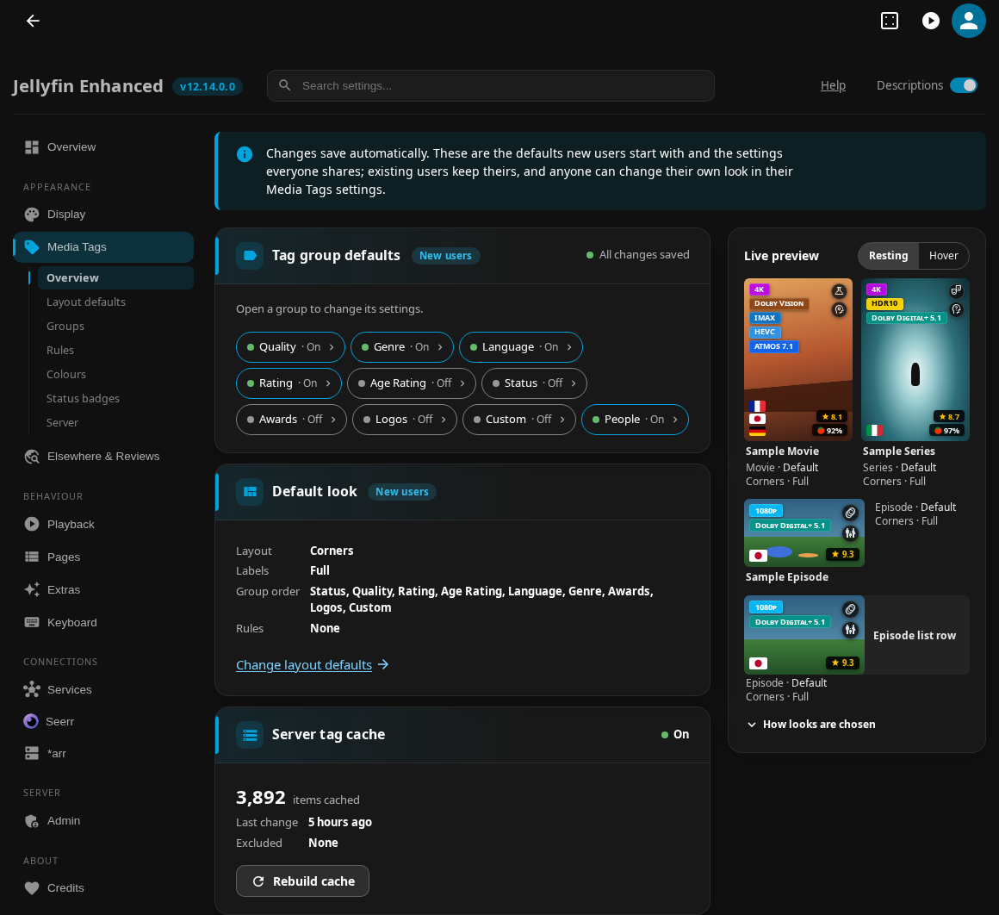

The **Media Tags** tab gathers every server-wide tag setting, laid out like the personal Media Tags settings, with a live preview of the cards a brand-new account would see. Its enabled groups follow the current server defaults, including changes awaiting a save, independently of the groups you use on your own account. The preview uses the saved server Tag Styles (refreshed after each **Colours** change is saved), not the colours your own account uses:

| Tab | What it holds |
|---|---|
| **Overview** | Which tag groups new users start with (select one to open it), the default look, the server tag cache (items cached, last change, **Rebuild cache**), Native Poster Tags and tag colours at a glance |
| **Layout defaults** | Default layout, **Label density**, **Tag size**, **Tag gap** and **Edge spacing**, each group's order, limit and position under **Group placement** (nine anchors for Corners, the layout's slots otherwise; **Reorder groups** shows the order buttons), **Card shapes** for episode thumbnails and list rows, **Hide tags on hover**, **No tags on the search page**, and **Apply defaults to all users** |
| **Groups** | The **Tag groups** card: one row per group (Quality, Genre, Language, Rating, Age Rating, Status, Awards, Logos, Custom, People) with a summary of its choice and its switch for new users; **Edit** opens its server settings (Quality's display and audio-language options under **Display behaviour** and **Audio language defaults**) |
| **Rules** | The default [tag look rules](#rules-and-locked-items): a list with **Edit**, the same add/edit form as each user's own **Rules & locks** (one to five conditions, then the look), and **Edit as JSON**; and the [server-wide item looks](#one-items-look) with **Edit** and remove; **How user-locked looks work** explains users' own locks |
| **Colours** | The [Tag Styles](#tag-styles-and-css) editor |
| **Status badges** | The badge families new users start with, the **Just added** and **New release** windows, and whether the TMDB key is set |
| **Server** | [Server-side tag cache](#server-side-tag-cache), library exclusions, **Rebuild cache**, browser cache options and [Native Poster Tags](#native-poster-tags-experimental) |

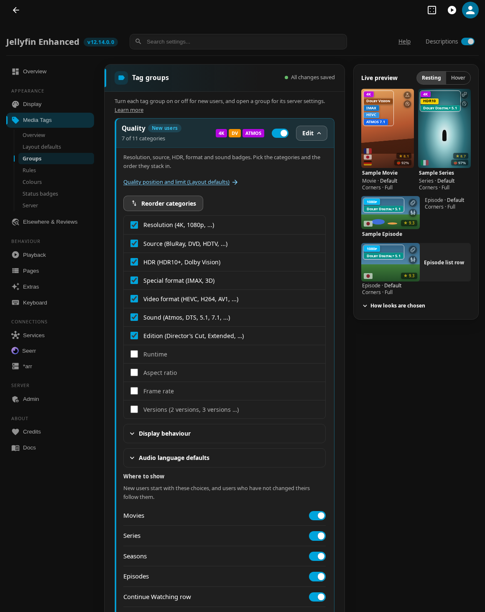

!!! warning "Apply defaults to all users"
    **Apply defaults to all users** (Overview tab) copies every saved Jellyfin Enhanced default, not only Media Tags, into every user's settings, replacing what they chose. It asks first and cannot be undone. **Reset all colours** and deleting a rule can be undone for a few seconds from the message at the bottom of the page.

Tables below show factory defaults. Rows marked “Admin / personal” give both exact labels for the same preference. Most admin defaults become the starting values for new personal settings. Saved personal values take precedence, so changing a server default does not overwrite a user's choice.

!!! note "Hover hiding starts off"
    **Hide tags on hover** follows the admin value for new users, and overwriting personal settings applies it too.

### The Media Tags section

Every personal poster tag setting lives in one section of the panel, **Media Tags**, between **UI Settings** and **Hidden Content**. Its tabs each do one job, and a live preview beside them shows the result as you change things.

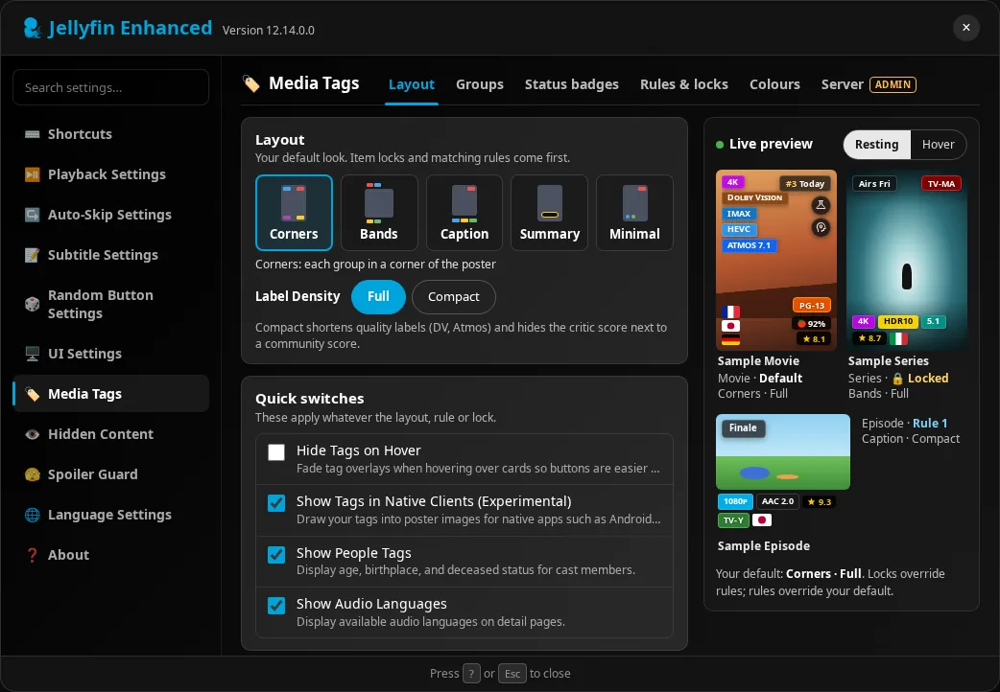

| Tab | What you set there |
|---|---|
| **Layout** | Your default look: one tile per [layout](#layouts) with a line describing the selected one, **Label density** (**Full** / **Compact**), **Tag size**, **Gap**, per-shape looks for **Episode thumbnails** and **List rows**, and the quick switches **Hide tags on hover**, **Show Tags in Native Clients (Experimental)** (only while the administrator has [Native Poster Tags](#native-poster-tags-experimental) on), **Show People Tags**. |
| **Groups** | The [tag groups](#tag-groups-order-position-limits) in priority order: move buttons, the on/off switch, and per group its position, **Show up to** and **Include** choices, plus **Reset to defaults**. The Status row's **Badges** button opens the next tab. |
| **Status badges** | Which [status badges](#status-tags) the Status group may show: **Just Added**, **New releases**, **Trending**, **Schedule**, **Milestones**, **Series status**, **Leaving soon** and **Direct-play warning**, each with a sample badge. The two time windows the administrator chose are shown beside Just Added and New releases. **Status position and limit in Groups** goes back to the Status row. |
| **Rules & locks** | Your [rules and locked items](#rules-and-locked-items) on the left, the **Add a rule** form on the right. |
| **Colours** | Your [Tag Colours](#tag-styles-and-css) preset, one tile per preset with sample chips in its real colours (a quality, a status and a rating chip, and a genre icon: the first genre the administrator coloured). Only shown while the administrator lets users pick a preset. |
| **Server** | Administrators only: shortcuts to **Server defaults for new users**, the **Tag colours editor**, the **Tag cache** and **Native poster tags**, each opening its section of the Media Tags admin tab. Other users never get this tab. |

**The live preview** draws four sample cards with the same layout code and tag styles as your library: a movie poster, a series poster, an episode still and a 92px list row. Each says where its look comes from (**Default**, **🔒 Locked**, **Server-wide**, **Rule N** or a shape look), decided the same way as for real cards: the series stands in for your most recently locked item and the episode for the first enabled rule, so a lock or rule change shows at once. **Resting** / **Hover** switches to what Summary and Minimal reveal on hover. While you edit a group, its chips are outlined and the others dimmed. Overflowing chips show as `+N`, as on real cards.

The live preview samples respond to pointer hover and keyboard focus to demonstrate genre expansion, reveal lists and hide-on-hover. Library genre-name reveal and hover hiding retain their pointer-hover behavior; keyboard reveal in the previews stays scoped to the samples. **Hover** pins all samples in that state, including on touch screens; **Resting** releases the pin while the pointed or focused sample stays active. This applies to the hub, administrator preview and item editor.

On a phone the section fills the screen: the tabs use short names (**Badges**, **Rules**), and the preview folds into a one-line strip under them. The strip names the sample that your current edit affects (the episode on **Rules & locks**, the series for schedule badges) and lists its chips, the edited group's first; tap **Preview** to unfold the full preview.

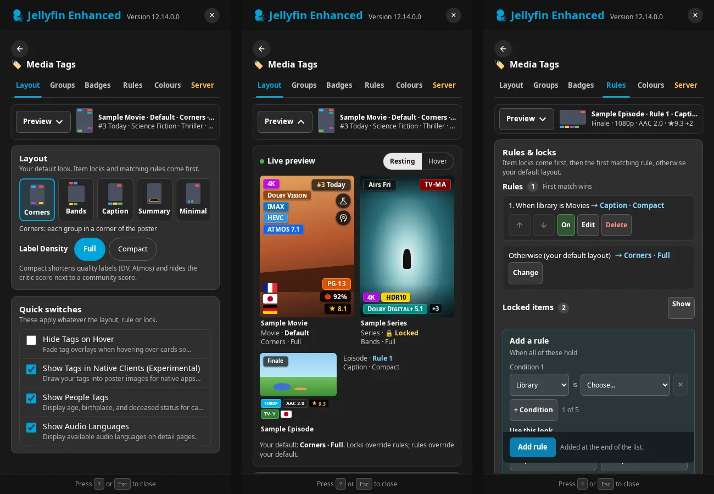

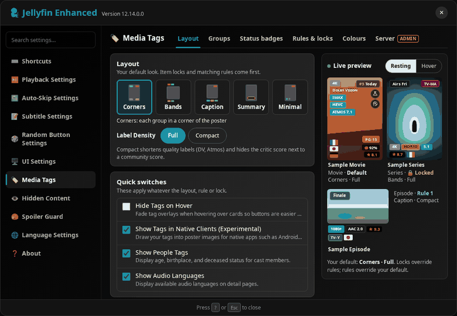

The panel's **Search settings…** box finds every Media Tags control by its label (for example *Trending*, *Show up to* or *Move Language up*); pick a match to open its tab, and its group if needed, with the control focused. Everything in the section works from the keyboard: arrow keys move between tabs and between tiles, and focus stays on the control you used after a move, a delete or an unlock. **UI Settings** keeps a short **Media Tags moved to its own section** note with an **Open** button.

!!! warning "Replacing everyone's preferences"
    **Overview** → **Quick Actions** → **Apply all plugin settings to every user** replaces saved personal preferences with the current admin values. It also replaces other Enhanced display/playback preferences, so each user would need to reapply their customizations. Read [Settings Overview](../getting-started/settings-overview.md) before using it.

### Where tags appear

You'll see poster badges in library grids, home rows, Jellyfin search results, and supported rows on detail pages. People Tags appear on cast cards instead.

| Feature | What you see | Where it appears |
|---|---|---|
| [Quality Tags](#quality-tags) | Resolution, source, HDR, special format, video codec, sound, edition | Supported library cards; series/season quality follows your aggregation policy |
| [Genre Tags](#genre-tags) | Genre icons (three by default), with names on hover | Supported library cards with genre metadata |
| [Language Tags](#language-tags) | Distinct flags (three by default) or a no-dialogue symbol | Supported library cards; cached series/season flags cover their episodes, collection flags cover linked movies and series |
| [Rating Tags](#rating-tags) | Community star score and critic percentage | Supported library cards |
| [User-review chips](#user-review-chips) | Average visible review rating, or an optional dash | Movie, series, season, and episode cards with a usable review identity |
| [Age Rating Tags](#age-rating-tags) | Official parental/content classification | Supported library cards with classification metadata |
| [Status Tags](#status-tags) | One badge: trending, release, schedule, milestone or series status | Supported library cards and eligible native posters |
| [Logo Tags](#logo-tags) | The streaming service, TV network or studio as a small logo (or its name) | Movie, series, season and episode cards; seasons and episodes show their series' logo |
| [People Tags](#people-tags) | Age, age at release, birthplace, deceased styling | Cast and guest-cast cards on web item detail pages |
| [Audio language links](#audio-language-links) | Named audio languages linking to Jellyfin tag lists | Movie, series, season, and episode detail pages; control in **UI Settings** |
| [Player badges](#player-badges) | Scores in the controls; optional age/advisory badge at playback start | Jellyfin web video player |

[Native Poster Tags](#native-poster-tags-experimental) draw supported poster groups into images for eligible native clients. Their page and row limits differ from web overlays.

!!! note "Tags need metadata"
    Each badge needs suitable metadata. A supported card does not guarantee every tag will appear.

??? info "Supported cards and locations"
    Web poster overlays apply to supported movie, series, season, episode, collection (`BoxSet`), and video cards, including videos in Home Videos/Photos libraries. Detail-page rows include season/episode cards and the series **Next Up** shelf. Large episode list images can also carry overlays.

    The web overlays skip the large artwork in the detail page's information area, cast cards, chapter/scene cards, **My Media**, modal dialogs, small list images, and plugin/catalog/device/library administration cards. Seerr search and discovery cards do not receive these library tags.

### Layouts

A layout decides where the poster groups appear and how much of each you see. Pick one for your account; each layout keeps its own arrangement, so you can switch back and forth without losing it. Positions are physical: **Top left** is the top-left corner of the poster in every interface language, right-to-left ones included, just as native posters draw it; the text inside each chip still reads in its own direction.

**How to use — personal preferences:**

1. In **Media Tags**, on the **Layout** tab, pick a layout tile, a **Label density** and, for Corners, an **Edge spacing**. The live preview shows your layout as you change it.
2. On the **Groups** tab, open a group to choose where it goes in that layout and how many tags it shows. Use the arrow buttons to change the priority order.

**How to use — admin defaults:** on the Media Tags admin tab, open **Layout defaults** and set the starting layout, density, size, gap, edge spacing, order, positions and limits. Changes save as you make them.

| Layout | Where tags go | Default arrangement |
|---|---|---|
| **Corners** (default) | Nine anchors: four corners, top/bottom centre, left/right centre and centre; groups sharing an anchor keep their priority order | Quality top left, genre and status top right, language bottom left, rating and age rating bottom right |
| **Bands** | A gradient band along the top (first group left, the others right) and one along the bottom that wraps; the middle of the poster stays clear | Status and age rating on top; quality, rating and language at the bottom; genre hidden |
| **Caption** | A strip below the poster, between the image and the title, plus a small stack at the poster's top left | Status on the poster; quality, rating, age rating and language in the caption; genre hidden |
| **Summary** | One pill at the bottom of the poster with up to three short facts (for example `Just Added · 4K DV · ★ 8.1`); every group's full chips appear over a dark scrim on hover or keyboard focus | Status, quality and rating in the pill; genre, language and age rating on hover |
| **Minimal** | Status at the top left, one coloured dot per quality chip (resolution blue, dynamic range orange, audio green, codec grey), the rating in the bottom-right corner; full chips on hover or focus | As listed; genre, language and age rating on hover |

=== "Corners"

    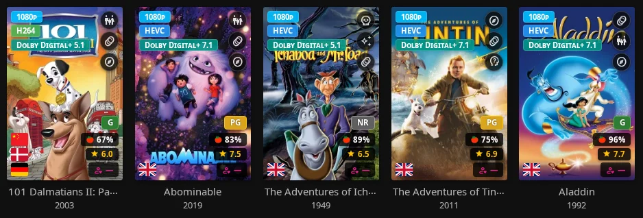

=== "Centre anchors"

    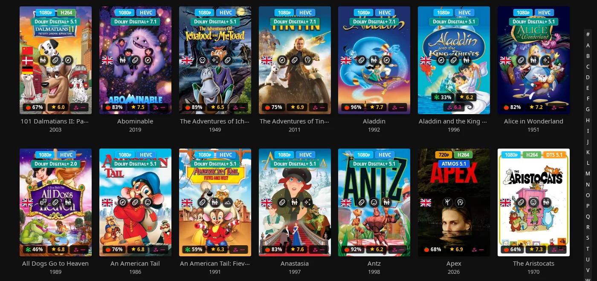

=== "Bands"

    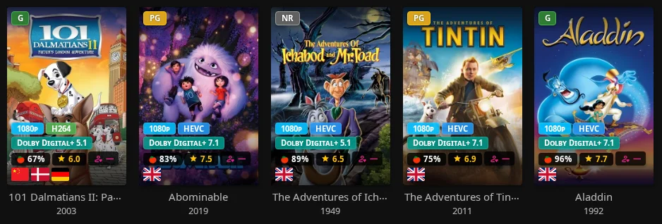

=== "Caption"

    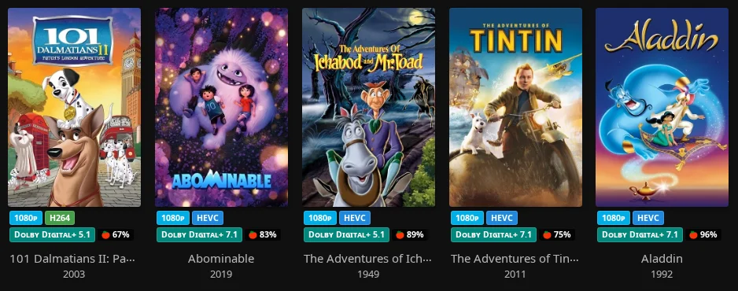

=== "Summary"

    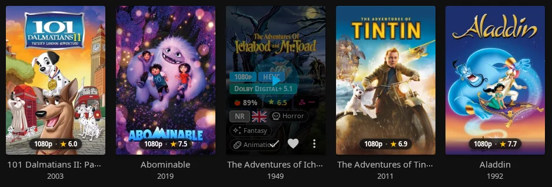

=== "Minimal"

    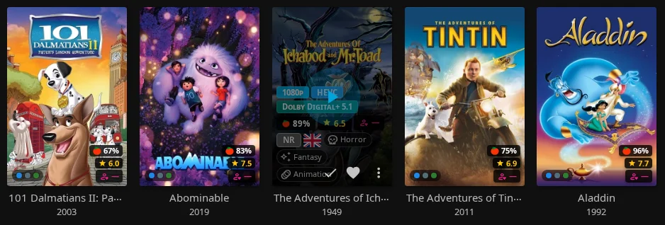

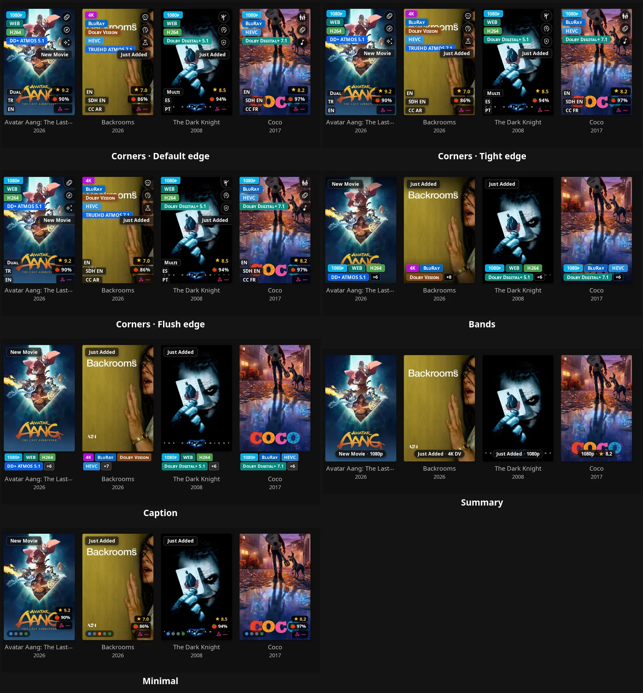
*The same four posters and tag groups in every layout.*

At left centre or right centre, a group can use the poster's width when the opposite side is empty. With groups on both sides, each keeps half the available width with a gap between them. The first chip at every anchor stays visible; a label too wide for its space is shortened with an ellipsis. The chip keeps its height and icon alignment while its text shortens, including linked Awards and Language chips. A `+N` chip counts only later chips that do not fit.

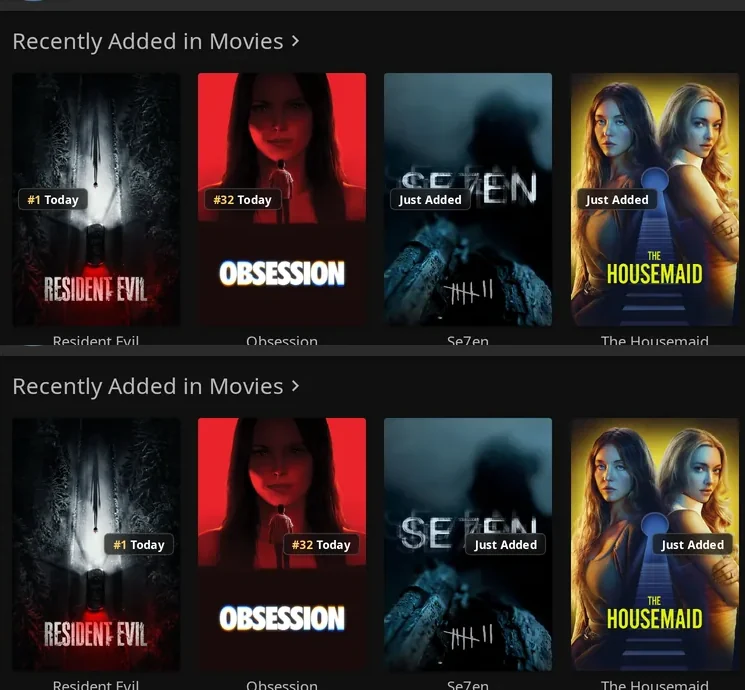
*Status at left centre (top) and right centre (bottom): the first badge stays visible.*

#### Tag size and spacing

On **Media Tags** → **Layout**, below **Label density**, choose **Tag size** and **Gap**. The live preview and the cards already on screen update immediately; the choices save to your account.

| Setting | Choices | Default |
|---|---|---|
| **Tag size** / admin **Default Tag size** | **Smaller (85%)**, **Default (100%)**, **Larger (115%)**, **Largest (130%)** | **Default (100%)** |
| **Gap** / admin **Default Gap** | **Tight** (75% of the usual spacing), **Default** (100%), **Roomy** (150%) | **Default** |

Size multiplies the existing card-width sizing, including text, icons, flags, chip padding, summary pills, hover reveals and **+N** chips. Gap adjusts the spacing between chips and groups in stacks, rows, bands and captions. Larger tags can leave room for fewer chips; the existing limits and overflow fitting still apply. Caption space grows with the chosen size and gap before tag data arrives. Edge insets stay at the chosen 6px, 3px or 0px regardless of size and gap.

Tag size choices are **85%**, **100%**, **115%**, and **130%**. The inherited **Same as default look** option still follows the default size.

Administrators set the starting choices on the plugin's **Media Tags** page, **Layout defaults** tab. New users and **Apply defaults to all users** take those choices. Existing version-0 settings keep their original size and gap, including when saving an unrelated preference. The first layout edit preserves both defaults unless you change one. **Reset to defaults** restores both admin choices.

An enabled shape override has its own **Tag size** and **Gap** selectors. **Same as default look** inherits that setting independently; choosing **Default** explicitly keeps 100% even if the default look is larger or roomier. Stored rule/lock shape looks accept the same fields. Native posters follow the account's size and gap in Corners and Bands, and ignore shape overrides.

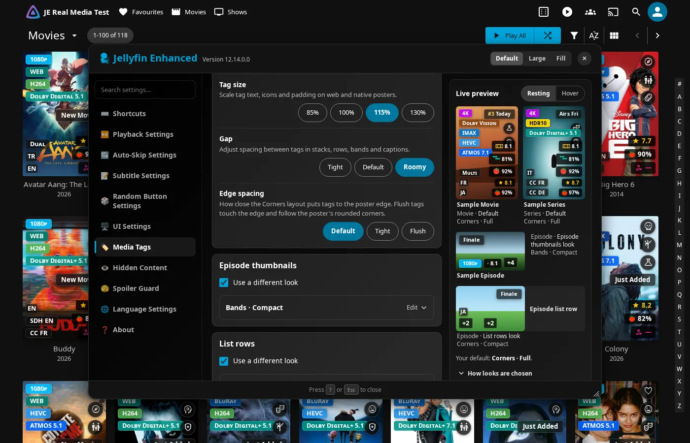

#### Edge spacing

**Edge spacing** sets how close the Corners layout puts tags to the poster edge, on all nine anchors:

| Edge spacing | Distance from the edge | Notes |
|---|---|---|
| **Default** | 6px | What Corners always looked like |
| **Tight** | 3px | |
| **Flush** | 0px | Tags touch the edge, like a tab hanging off the poster: the chip corners against an edge are square, and a tag in a corner follows the poster's own rounded corner. Nothing is drawn outside the poster |

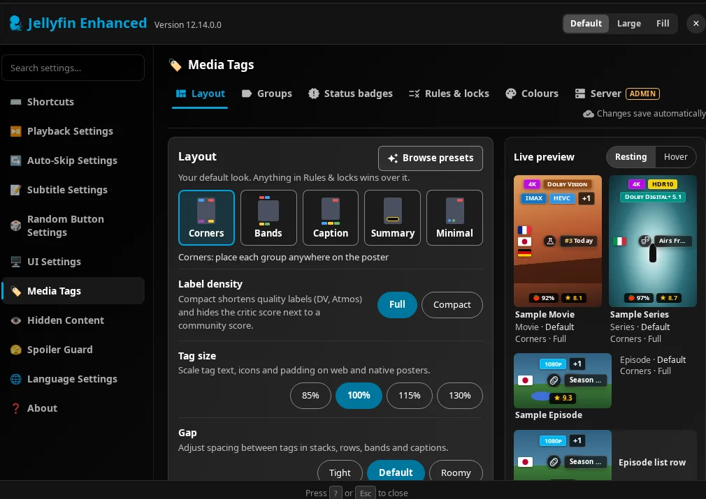
*Edge spacing sits on the Layout tab below Tag size and Gap.*

Flush chips have no visible border or shadow on the sides touching an edge; inward borders and shadows remain. Genre chips follow the same rule, with a flat side against the edge, and still show their name on hover. Language flags keep their shape. Top-centre tabs meet `top: 0` with square top corners, and bottom-centre tabs meet `bottom: 0` with square bottom corners. If a progress bar is present, bottom centre meets its top edge without a gap. Top centre first narrows to the gap between corner indicators and moves below them only when that gap cannot fit its first chip. Tight and Default retain their existing indicator and progress gaps. The other layouts have their own spacing and ignore it. Native Poster Tags use the selected inset in Corners; Bands retains its own 6px inset, including for overflow chips. Edge spacing applies to every Corners card, including shape overrides; size and gap may be overridden independently for each shape.

Native Flush uses the same touching-edge treatment and centre-row indicator fallback. A native image request does not provide the app's progress-bar geometry; callers with known geometry can supply it to the layout planner. Native apps drawing their own progress overlays still control that placement.

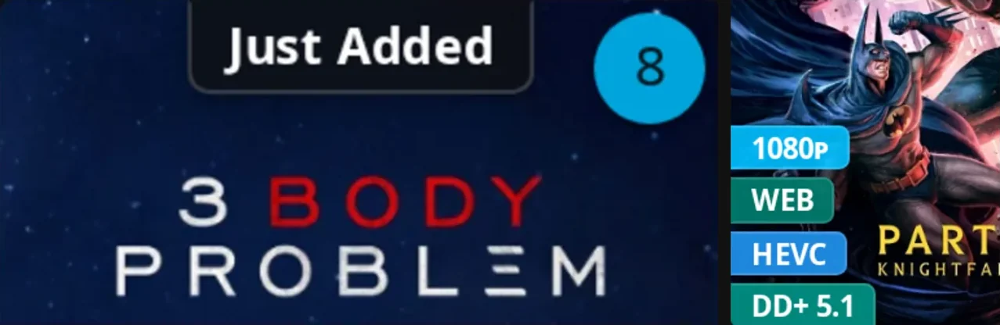
*Flush at 5×: the top-centre Status tab sits on the edge beside Jellyfin's count bubble; the bottom-left stack shows the compact `DD+ 5.1` label.*

!!! note "Flush and rounded posters"
    Flush tags are clipped to the poster's rounded corners rather than being given a radius of their own, so a corner tag takes exactly the curve your theme gives the poster.

#### Episode thumbnails and list rows

On **Layout**, turn on **Use a different look** under **Episode thumbnails** or **List rows**. Each shape has its own layout, label density, group positions and chip limits. **Use recommended** restores these starting arrangements:

| Shape | Recommended look |
|---|---|
| Episode thumbnails and backdrop cards | **Bands**, **Compact**: status and age rating on top, quality and rating below, language and genre hidden |
| Large list images | **Corners**, **Compact**: quality top left, status top right, rating bottom right, each limited to two chips; the other groups hidden |

Both switches start off. Switching one off uses your default look again. Portrait posters and square cards (including music and people) use the default look. Jellyfin's card classes determine the shape first; otherwise the image's rendered aspect ratio does (wider than 1.2:1 is landscape; square cards count as portrait), measured again whenever the card's width or height changes.

The choice for each card is **your item lock → the administrator's item look → first matching rule → shape override → default**. A lock, item look or rule takes precedence over the general shape settings. Stored rules and locks may also contain their own shape looks through the API; the rule editor continues to edit layout and density only.

The episode and list samples in the live preview follow their own shape settings. **Caption** on list rows still puts caption chips on the image; choose another layout to avoid this fallback. **Native Poster Tags** draw on poster images only and ignore shape overrides.

Shape chip limits run from **1** to **10**, then **All**. From **All**, press **−** to return to **10**; at **1**, **−** is disabled.

Administrators can choose **Same look as posters** or the recommended look for each shape under **Layout defaults** → **Card shapes** on the Media Tags admin tab. This seeds new users and applies when overwriting personal settings. Existing version-0 documents keep their old look until an explicit edit; merely loading or saving unrelated preferences does not enable overrides.

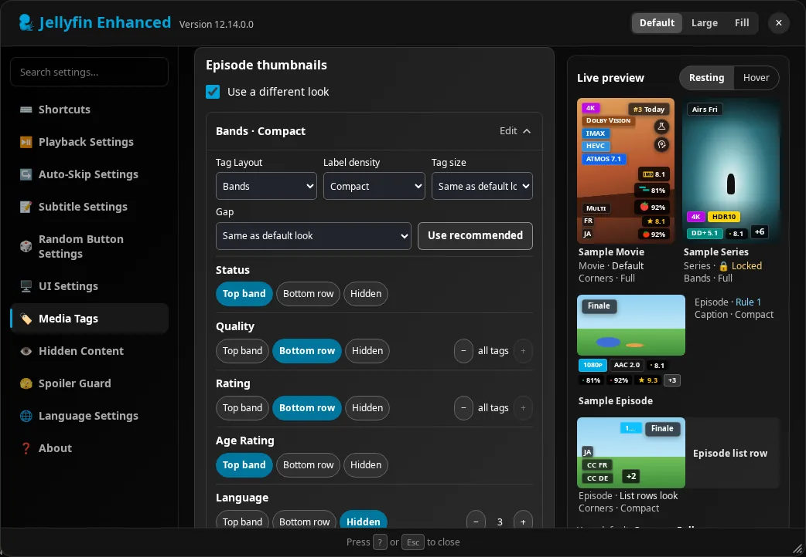

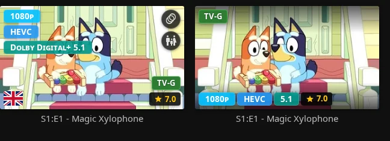

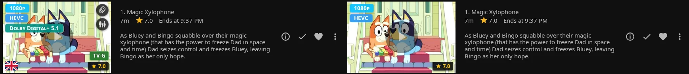

#### Tag groups: order, position, limits

Each group has a row on the **Groups** tab, highest priority first. Groups higher in the list win when space is short: they stack nearest the edge of a shared corner, come first in a band or the caption, and take the summary pill's three places first. The row shows where the group goes in the selected layout and how many tags it shows (for example **Bottom row · up to 3**); the switch on the right turns the group on or off.

Open a row to change it:

- **Position:** the places the selected layout offers, plus **Hidden**. Corners shows poster-shaped tiles in a 3×3 grid, with a marker on the selected place, and **Hidden** is an icon button beside them; the other layouts list their places as pills. Each row's controls sit in a second column beside its label. Changing the layout re-labels every row. **Dots** is offered to quality only.
- **Show up to:** how many tags the group shows, from 1 to 10. Quality and rating also offer **All**. Age rating and status always show one.
- **Include:** the quality categories with their stack order, or the rating group's **Community score** and **Critic score**. Other groups have nothing to choose here.
- **Where to show:** every group has the same six switches: **Movies**, **Series**, **Seasons**, **Episodes**, **Continue Watching row** and **Next Up row**. Turn one off to keep that group off those cards, for example genres off episodes or the age rating off the Next Up row. Each switch you have not changed follows the administrator's choice, and **Follow server** puts the whole group back on the administrator's choices. The item types also apply to [Native Poster Tags](#native-poster-tags-experimental). The two home rows are a web setting, because an app's image request does not say which row a poster is in. The live preview applies the switches to its sample movie, series and episode. People Tags appear on cast cards, not on media cards, so they have no switches. The item editor does not have them either, since they are set for all titles here. Collections and other videos always show the group. Rating works the same way: a Rating switch you turned off before this release stays off, and the others follow the administrator.
- **Show up to** reads **Always one tag** for Status, Age rating and a one-logo Logos group, on the hub and in the item editor.

The limit applies after each group's own filtering (quality categories, language grouping and priority, each group's **Where to show** switches). **Reset to defaults** restores the administrator's layout, density, positions, order and limits; your group switches and include choices stay.

**Show up to** appears only for groups that can show multiple chips. Status (including Leaving soon and direct play) and Age rating always have a limit of one. Logos hides the control when the administrator permits only one logo, and shows it when the maximum is two. Saved higher limits cannot increase these single-chip groups. The hub and administrator Layout defaults / Groups panels follow the same rule.

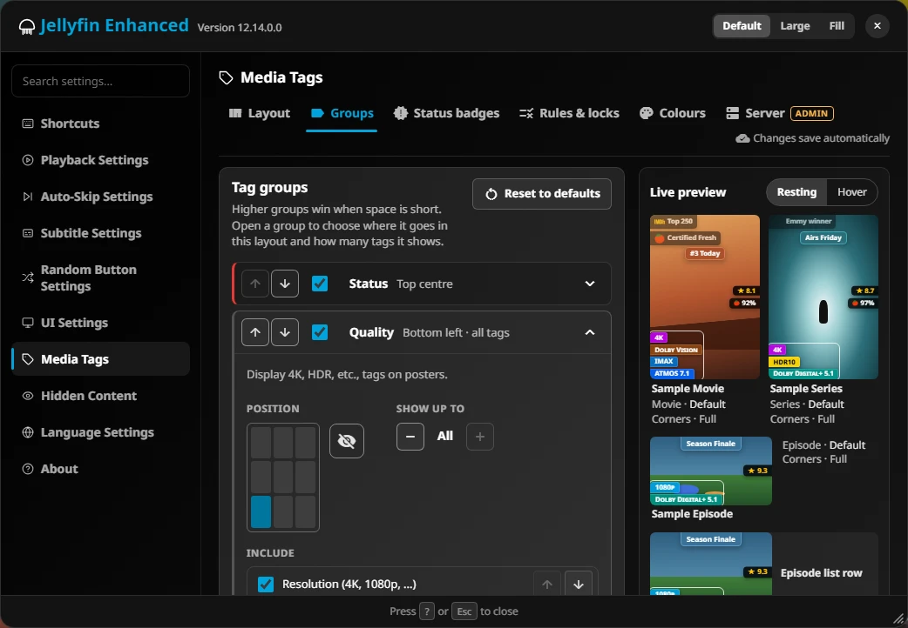

| Setting | Default | What it does |
|---|---|---|
| Personal: **Tag Layout** / admin: **Default Tag Layout** | **Corners** | Chooses one of the layouts above |
| Personal: **Label density** / admin: **Label density** under **Default look** | **Full** | **Compact** shortens quality labels (`Dolby Vision` → `DV`, `HDR10+` → `HDR+`, `ATMOS 7.1` → `ATMOS`, `Dolby Digital 5.1` → `DD 5.1`, `Dolby Digital+ 5.1` → `DD+ 5.1`) and hides the critic score when a community score is shown |
| **Tag Groups** order | Status, quality, rating, age rating, language, genre, awards, logos, custom | Priority order of the groups |
| **Show up to** | Genre 3, language 3, awards 2, custom 3; quality, rating and two-logo groups all | Hidden for single-chip Status and Age rating, and for Logos when **Logos per title** is 1; these groups always cap at 1 |
| **Position** — Quality / Genre / Language / Rating / Age Rating / Status Tags | Corners: **Top Left** / **Top Right** / **Bottom Left** / **Bottom Right** / **Bottom Right** / **Top Right** | Any of the nine anchors in the Corners layout; the admin **Position** selects set these defaults |
| Admin / personal: **Hide tags on hover** | Off | Fades web poster tags when you hover over a card, making its buttons easier to see; new and overwritten personal settings take the admin value |
| Admin: **Disable Tags on Search Page** | Off | Suppresses the poster tags on Jellyfin web search results, including age-rating and review chips; useful for compatibility with Gelato |

Compact quality vocabulary is shared by web and native rendering. The canonical Full label remains the colour identity; normalized layouts detect AC-3 and DTS-HD explicitly. Audio aliases follow the [TRaSH-Guides Audio Formats](https://trash-guides.info/Radarr/Radarr-collection-of-custom-formats/#audio-formats) vocabulary, adapted from release names to stream titles, codecs and profiles: Atmos and Plus forms win before plain DD, and DTS-HD before DTS. E-AC-3, EAC3, DDP, DD+ and Dolby Digital Plus share the DD+ identity; an E-AC-3 track whose profile or title says JOC (Dolby's object coding) is **DD+ ATMOS**.

| Full label (optional channel suffix) | Compact |
|---|---|
| Dolby Digital / Dolby Digital+ | DD / DD+ (keeps channels, for example DD+ 5.1) |
| DTS-HD MA / DTS-HD HRA / DTS-HD | DTS-HD (keeps channels) |
| TRUEHD / ATMOS / TRUEHD ATMOS / DD+ ATMOS / DTS-X / DTS (including DTS-ES) | Keeps the canonical codec name (both Atmos carriers shorten to ATMOS); drops channels |
| FLAC / PCM | Keep their name and channels (FLAC 2.0, PCM 7.1) |
| AAC / Opus / MP3 | Channel-only fallback (for example 5.1 or 7.1); stereo has no sound chip |
| Dolby Vision / HDR10+ / BluRay | DV / HDR+ / BD |

Other emitted video codec labels (AV1, HEVC, H265, VP9, H264, VP8, XVID, DIVX, WMV, MPEG2, MPEG4, MJPEG, THEORA) are already short and remain unchanged.

AC-3 tracks produce **Dolby Digital 5.1** in Full and **DD 5.1** in Compact (E-AC-3 uses **Dolby Digital+ 5.1** / **DD+ 5.1**). DTS-HD Master Audio and High Resolution remain distinct Full facts (**DTS-HD MA** / **DTS-HD HRA**) and both shorten to **DTS-HD**, retaining channels. A track that only says `DTS-HD` (no `MA`, `XLL` or `Master Audio` in its title or profile, and no HRA) is **DTS-HD**: JE does not claim it is lossless. Dolby TrueHD, Dolby Atmos and DTS:X stream aliases resolve to the established **TRUEHD**, **ATMOS** and **DTS-X** facts. The formatter also accepts their long names from portable or older cached labels; those aliases are not the detector’s canonical output. AAC, FLAC and Opus keep the existing channel-only fallback.

Existing version-0 Full layouts keep their previous audio labels until a layout setting is saved. This preserves their appearance; normalized layouts and Compact presentation use the codec facts above.

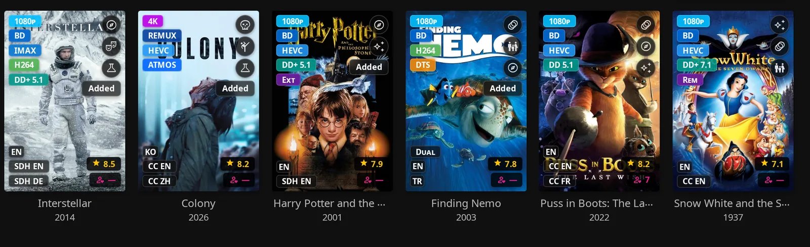
*Compact labels on real library files: `DD+ 5.1`, `DD 5.1`, `DTS-HD 5.1`, `BD`, `REMUX`, `IMAX`, `Ext` and `DC`.*

The four default corners keep their original appearance. Top and bottom centre wrap chips into centred rows (up to two); left and right centre stack chips vertically. Centre rows reserve the width occupied by corner groups, including a tall column from the opposite edge that reaches into the row on a short image, and each keeps to its half of the image; side columns reserve the height of their neighbouring corner stacks. Chips that are too wide or tall are hidden whole and counted in a **+N** chip, which names the hidden tags on hover or focus. Group limits apply before fitting.

Top-right groups move below Jellyfin's watched or unplayed-count indicator. Top centre reserves space for side indicators; in Flush it stays on the edge while the first chip fits that gap, and falls below indicators only when needed and only while it stays in the image's top half. On a short image crowded with tags (an episode still with every group on), a centre row with no room left even for a `+N` chip is left out; its tags stay in the card's hover description. Default and Tight keep their existing clearance. Bottom centre clears a card's progress bar; Flush meets the bar's top edge. People Tags have their own cast-card layout and no position.

At the left and right centre anchors, genre names appear toward the inside of the card on hover.

With **Hide tags on hover** off, genre names expand beside their icons on hover. Turn it on to fade poster tags instead.

<figure class="je-video">
  <video autoplay loop muted playsinline controls preload="metadata" aria-label="Genre labels expand and poster tags fade on hover">
    <source src="../../images/tags/tag-hover.mp4" type="video/mp4">
  </video>
  <figcaption>Genre names expand with Hide Tags on Hover off; turning it on fades the tags instead.</figcaption>
</figure>

#### Admin defaults

The **Layout defaults** section of the Media Tags admin tab sets what new users start with: the layout, density, group order, each group's position per layout and the limits. In Corners a group's position is one of nine anchors on a small poster (these are the group's old Position settings) or **Hidden**; pick another default layout to set its positions. A group's row is greyed out while it is off for new users. The order and limits are only stored once you change them.

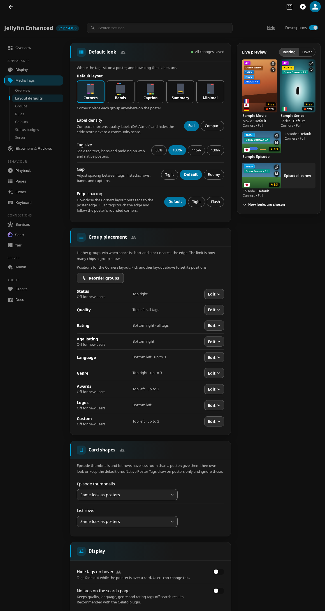

??? info "Upgrades, defaults, and limits"
    - Settings saved before layouts existed keep the **Corners** layout, your corner choices, full labels, the original stacking order and limits. Your first change in the layout editor changes only what you changed; everything else carries over. Administrators' new layout defaults never change an existing user's view.
    - The editor shows such settings in the default order; the order is saved the first time you move a group.
    - New users, and **Apply defaults to all users**, start from the administrator's layout defaults. A group hidden in the Corners layout on the Media Tags admin tab reaches users the same way; the corner positions apply to everyone who has not picked a corner.
    - **Caption** needs a title block below the image. List rows and other cards without one show the caption groups in the poster's top-left stack instead, with as many whole chips as fit the image's height and the rest counted in a `+N` chip. The caption strip has room for two rows of chips; lower-priority chips that do not fit are left out whole and counted in a `+N` chip; hovering or focusing the card shows their names at the top of the poster, and screen readers hear them as part of the card's description. Space for it is reserved as soon as a card appears so titles do not jump when the chips arrive.
    - The **Bands** bottom band keeps to two rows (then `+N`), or to the rows that fit below the top band's chips on short images such as episode thumbnails at the larger tag sizes, and on cards narrower than 160px both bands use compact labels.
    - In **Minimal**'s status and score stacks and **Caption**'s poster stack every chip stays whole and inside the card: one wider than the card keeps its rounded box 6px from the edges and ends its label with an ellipsis. On a card too narrow for the quality dots and the scores side by side, the scores sit just above the dots; on a short image (an episode still) with several rating sources, the scores that do not fit inside the image appear when you hover the card.
    - The **Summary** pill drops its lowest-priority facts when the card is too narrow for all of them; its tooltip keeps every fact. The hover reveal of **Summary** and **Minimal** always uses compact labels and keeps to two rows at the bottom of the poster (then `+N`), clear of the play button; on short cards such as episode thumbnails it shows only the rows that fit in the bottom 40% of the image. Jellyfin's card buttons stay on top and clickable.
    - **How rows fill:** the caption strip, the Bands bottom band, the hover reveal and the centre rows show chips in priority order until the first one that has no room left. That chip and every chip after it go behind `+N`, so a lower-priority chip never takes the place of a higher-priority one. A chip that could never fit is the only one skipped: one wider than the whole row, or, when there is room for just one row, one too wide to sit beside `+N`. A row's height is planned as if it held the slot's tallest chips. As a result, switching a group off or removing a chip only ever shows more of the others, and switching it back on gives the same card as before. Award and logo chips in the caption strip take the strip's chip size.
    - **Hide tags on hover** hides tags on the poster in Corners, Bands and Caption; the caption strip stays visible. In Summary and Minimal it hides the pill, dots and corner, and the full chips still appear.
    - Settings saved before layouts keep the **Default** edge spacing whatever the administrator picks; the first layout change pins it, so only a later Edge spacing change moves the tags.
    - [Native Poster Tags](#native-poster-tags-experimental) draw Corners or Bands. Caption, Summary and Minimal use the saved Corners profile with Full labels. Bands follows its positions, hidden groups, order and limits with its own padding; Corners follows edge spacing. Both respect the chosen Full or Compact label density, as on the web; settings saved before layouts (version 0) keep their previous labels.

### Rules and locked items

Rules give some cards a different look (a layout and a label density) than your default: for example, a caption strip in the Movies library and compact bands on episodes. A lock keeps one item's own look (set in its [Media Tags editor](#one-items-look)), whatever you change later.

**How to use:**

1. In **Media Tags**, open **Rules & locks**. The **Add a rule** form is always open beside the list (below it on a phone).
2. Pick one or more conditions (all of them must hold, up to five; every condition needs a value) and the look, which starts at **Caption** and **Compact**. Click **Add rule**: the rule goes to the end of the list.
3. Use the arrows to order the rules, **On**/**Off** to pause one, **Edit** to load it into the form (**Save rule** keeps its place and its On/Off state) or **Delete** to remove it.
4. To give one item its own look, choose **Media Tags** in its ⋮ menu (see [One item's look](#one-items-look)). In **Locked items**, **Edit** opens that editor again and **Unlock** releases the item. **Unlock all** asks for a second click. On a phone, **Show** unfolds the locked items and **Unlock all**.

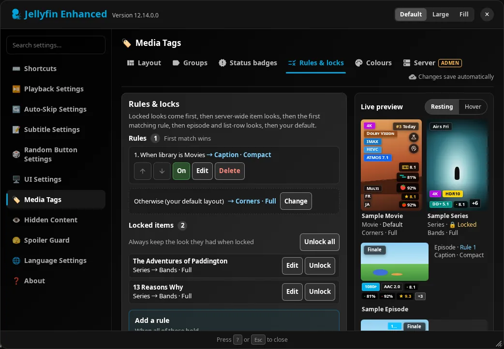

Each card gets its look from the first of these that applies:

1. **Your lock** on the item. A series locked for its seasons and episodes also gives them its look, unless one of them has its own lock.
2. **The administrator's item look** for it (**For everyone** in the item editor), the same way: the item's own, else its series'.
3. **The first enabled rule** whose conditions all hold, from the top of the list.
4. **The shape override**, if enabled for an episode thumbnail or list row.
5. **Your default** Tag Layout and Label density (the **Otherwise** row).

| Condition | Matches | Notes |
|---|---|---|
| **Library** | The library the item is in | Seasons and episodes use their series' library. An item in two libraries that share a folder uses the first one Jellyfin reports |
| **Type** | Movie, Series, Season, Episode, Collection or Video | The card's own type: an episode card showing its series' poster still counts as an episode |
| **Genre** | One of the item's genres | Not case-sensitive. Seasons and episodes use the genres the tag cache gives them |
| **Age rating** | The item's age rating | Compared as the age rating tags show it (`DE-12` and `FSK-12` match), not case-sensitive. Seasons and episodes fall back to their series' rating |

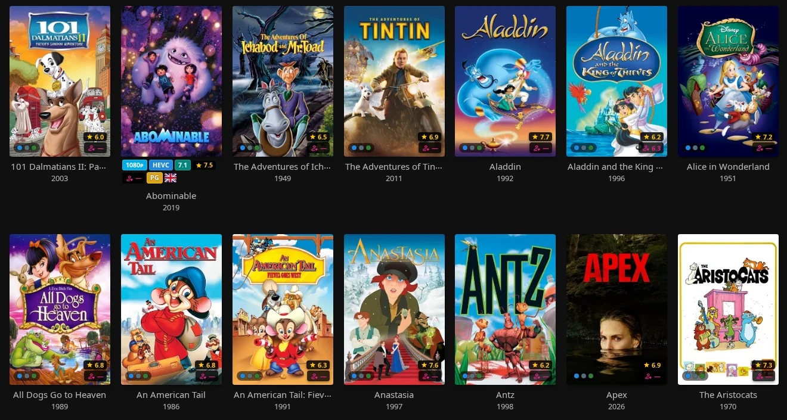

| Setting | Default | What it does |
|---|---|---|
| Personal: **Rules & locks** | No rules | Ordered rules: when every condition holds, the card uses that rule's layout and density |
| Personal: **Locked items** | None | Items that keep the look you gave them; **Edit** reopens the item editor, **Unlock all** asks for a second click |
| Admin: **Rules** tab | Empty | Rules that new users and **Apply defaults to all users** start with. The form is the personal one: up to five conditions (libraries by name, genres and age ratings from your library), **Edit** loads a rule into it (**Save rule** keeps its place, its On/Off state and any per-rule positions), **Cancel** goes back to adding. **Edit as JSON** sets what the form does not: per-rule group positions and episode or list-row looks |
| Admin: **Rules** → **Server-wide item looks** | None | Item looks every user gets (set with **For everyone** in the item editor); **Edit** opens the editor, the bin removes one with **Undo** |

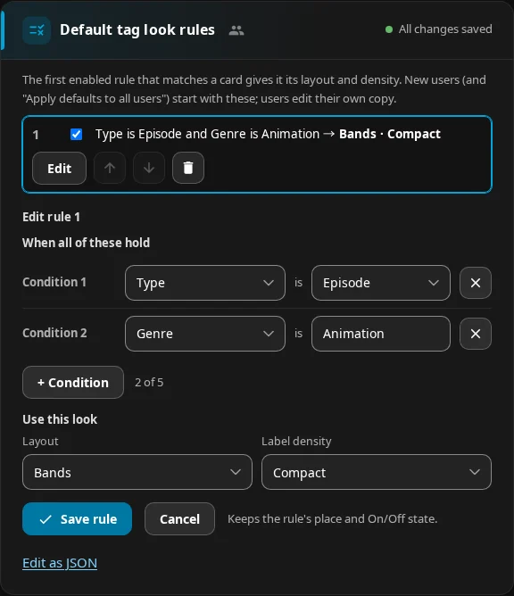

??? info "Limits and details"
    - Up to 50 rules, each with up to 5 conditions, up to 500 locked items per user and up to 500 server-wide item looks; past 500 the oldest is released. The server drops an invalid rule, lock or item look (an unknown layout, a malformed id) on its own and keeps the rest. A rule with an unknown condition, or more than five, is dropped whole: removing only that condition would make the rule match more cards than you asked for.
    - On the admin **Rules** tab, a draft you are typing in **Edit as JSON** is never replaced by a save, the server tidying the rules or another administrator's change: the box says when the saved rules changed beneath it, **Save JSON** replaces them with your text and **Revert** loads the saved ones.
    - A lock stores the layout, the density and where every group sits in that layout, plus any **Show up to**, size, gap and edge spacing chosen for the item, so later changes to your arrangement do not move a locked item. Group order still follows your settings, and so does anything the lock leaves at **Your default**.
    - A rule uses your arrangement for its layout. Group order and limits are yours for every look.
    - Rules on library, genre and age rating, and a series lock on its seasons and episodes, read the item's data: its entry in the server tag cache, or the batch lookup when the cache is off or does not have the item yet. The browser remembers what the lookup said about each item (type, series, library, genres, age rating), so cards drawn from the per-tag fallback cache match every rule as well; an item it knows nothing about is looked up once.
    - While a card's data is on its way and a rule or lock could change its look, its chips wait for the data instead of appearing in your default look and then moving. Type-only rules never make a card wait. Space for the caption strip follows your default in the meantime, so when a rule gives a card Caption (or takes it away) the strip appears (or goes) once the data arrives, the first time this browser sees that item. A card whose data does not come shows its tags in your default look once the lookup ends, or after 8 seconds at most.
    - The item editor looks the item up first when its data is not loaded yet, so it starts from the look the item's cards really have; if the lookup fails it says the current look is not known. If a rule or lock change cannot be saved, it is undone on screen and a message says so.
    - Saving a look for yourself and **For everyone** at once writes two things. If one of them fails, the editor says which was saved (it stays, also if you close the editor) and which was not; **Save** then writes only the missing one while you change nothing else.
    - Mixing Caption with other looks on one row is allowed; caption cards are taller than their neighbours.
    - Settings saved before layouts existed never pick up the administrator's default rules; rules you add yourself apply.
    - Changing a rule or a lock updates the cards on screen at once, without reloading their tags.
    - [Native Poster Tags](#native-poster-tags-experimental) follow rules too, decided from the same item data (the server tag cache entry, or the item itself when the cache is off): a rule that hides Quality on movies hides it on the TV as well, and a group you keep hidden by default (its position **Hidden**) appears on the TV wherever a rule gives it a place, for example Quality only in your 4K library. A rule choosing Caption, Summary or Minimal draws Corners there, with the rule's hidden groups still hidden. Native apps pick up a rule change when they next load the library (the poster addresses change). One difference: a genre rule matches a poster that Spoiler Guard protects on the TV, while the web, which receives that item without its genres, does not; either way the protected tags themselves stay hidden.
    - Locked cards carry `data-je-locked="1"` on their tag host for [custom CSS](../advanced/css-customization.md); cards with a server-wide item look do not. Nothing else marks them by default.
    - Server-wide item looks reach every account, including settings saved before layouts existed (which never take the administrator's rules); clients receive only item and series ids visible through their Jellyfin library and parental access checks; anonymous callers receive none.

### One item's look

Any movie, series, season, episode, collection or video can have its own look. Open its ⋮ menu, on its page or on its card, and choose **Media Tags**. The editor starts from the fully resolved look, including a shape look’s size, gap and limits, so opening it leaves the preview unchanged. It shows the item's poster with its real tags, in the look you are building:

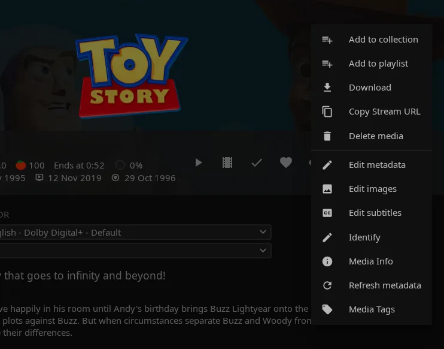

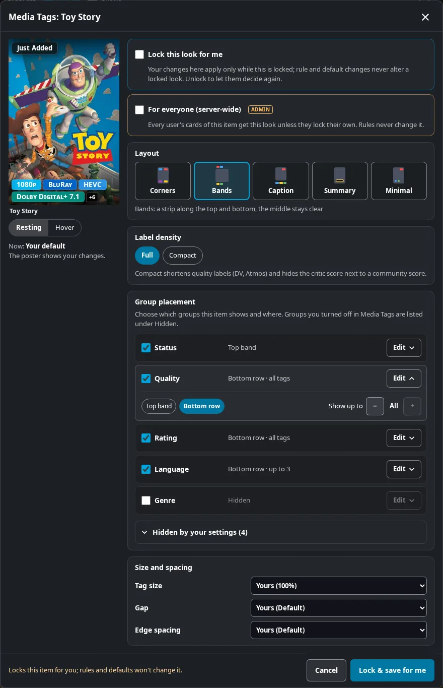

**How to use:**

1. Pick a **Layout** and **Label density**. Under **Group placement**, switch groups on or off for this item and open a group's **Edit** to choose where it goes (the nine named positions on Corners, the layout's places otherwise) and how many tags it shows (**Show up to**); groups you turned off in your Media Tags settings are listed under **Hidden by your settings**. **Size and spacing** changes tag size, gap and edge spacing for this item only (**Yours (…)** follows your settings).
2. For a series, season or episode, choose **Apply to**: **This series and its seasons and episodes** keeps one look on the series that its seasons and episodes share; **This episode only** (or **This series poster only**) keeps it to the one card.
3. Choose where the look goes at the top of the editor: **Lock this look for me** keeps it as your lock. If you change the look without choosing, the button reads **Lock & save for me** and saving locks it for you; **Cancel** leaves it unkept. The save button always names what it does (**Save for me**, **Save for everyone**, **Save for me and everyone**). Turning the lock off on a locked item and saving releases it; the message offers **Undo**. Undo restores only the released looks, keeps unrelated changes made since, and keeps a newer look on the same item.
4. Administrators also see **For everyone (server-wide)**: the look becomes the item's look for every user, unless they lock their own. The Media Tags admin tab lists these looks in its **Rules** section.

On a phone the editor fills the screen, with the poster beside the item's name at the top and **Save** always in reach:

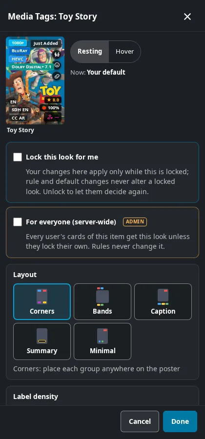

| Setting | Default | What it does |
|---|---|---|
| **Layout**, **Label density** | The item's current look | The look the item gets |
| **Groups** | The item's current look | On/off, place and **Show up to** per group; groups you switched off in your settings say so and show nothing |
| **Size and spacing** | **Your default: …** | Tag size, gap and edge spacing for this item; **Your default** follows your own setting |
| **Apply to** | Series: the series and its episodes; season or episode: this one only | Where the look is kept |
| **Lock this look for me** | Off (on for a locked item) | Saves the look as your lock; off releases it |
| Admin: **For everyone (server-wide)** | Off | Saves the look as the item's server-wide look |

??? info "Limits and details"
    - The editor's row is added to Jellyfin's own ⋮ menu with the same markup as its other rows, so it looks and works the same with a mouse, touch or keyboard. It appears only for items that can have poster tags and while at least one tag group is on.
    - The poster in the editor is the item's own artwork with the tags copied from its card on the page, or drawn from the tag cache. Nothing else on the page changes until **Save**.
    - [Native Poster Tags](#native-poster-tags-experimental) follow locks and server-wide item looks in Corners and Bands, with their size, gap, edge spacing, positions, hidden groups and limits; Caption, Summary and Minimal use your Corners positions there, with the item look’s hidden groups and limits still applied.

### Import, export and presets

Your Media Tags settings can be saved as a file, moved to another server or shared as a preset. Every import is checked by the server first and shows exactly what will change before anything is applied.

**How to use:**

1. In **Media Tags**, stay on **Layout** and scroll to the bottom: **Presets** and **Import & export**.
2. **Export settings** shows your settings as a document; **Download** saves it as a `.json` file and **Copy** puts it on the clipboard.
3. **Import settings** takes a file or pasted text. **Check** lists every setting that would change (old value → new value) and every setting that is skipped, with the reason. **Apply** saves the changes; the panel opens again on the new settings with **Undo** for 10 seconds.
4. Under **Presets**, **Apply** previews a preset the same way. **Share** copies a preset so someone else can import it. **Save as preset** keeps your current settings under a name and description; **Import preset** adds a shared preset to your list. **Delete** removes one of yours.

Export, **Check**, a preset's **Apply** and **Save as preset** first save your latest change, so they work on the settings the panel shows. If that save fails (for example the connection dropped), they stop and say your change is not saved yet; **Retry** (or **Check** / **Save** again) tries once more. If a setting the document sets changes in the panel after the preview, **Apply** shows the preview again instead. If saving an applied import fails, the import is taken back, except a setting you changed in the panel while it was saving: that newer change stays.

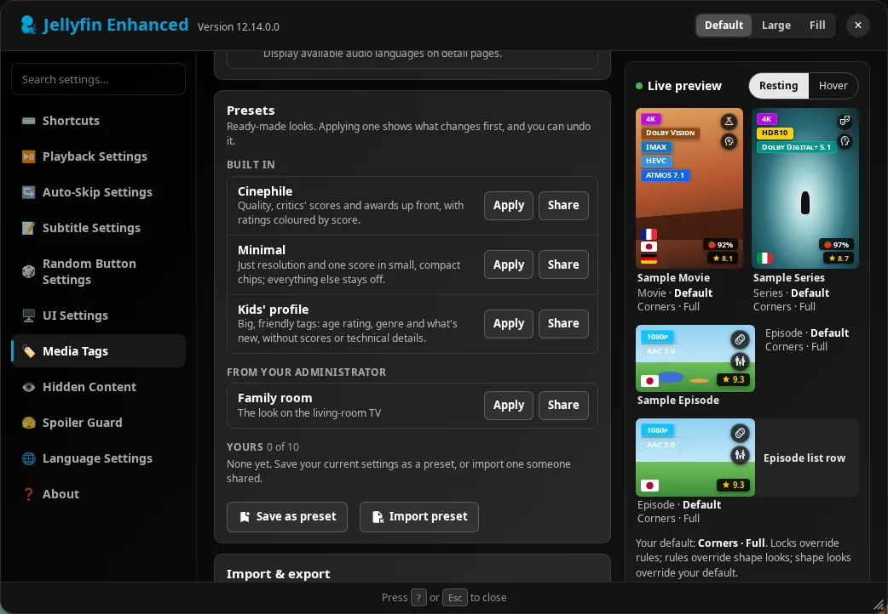

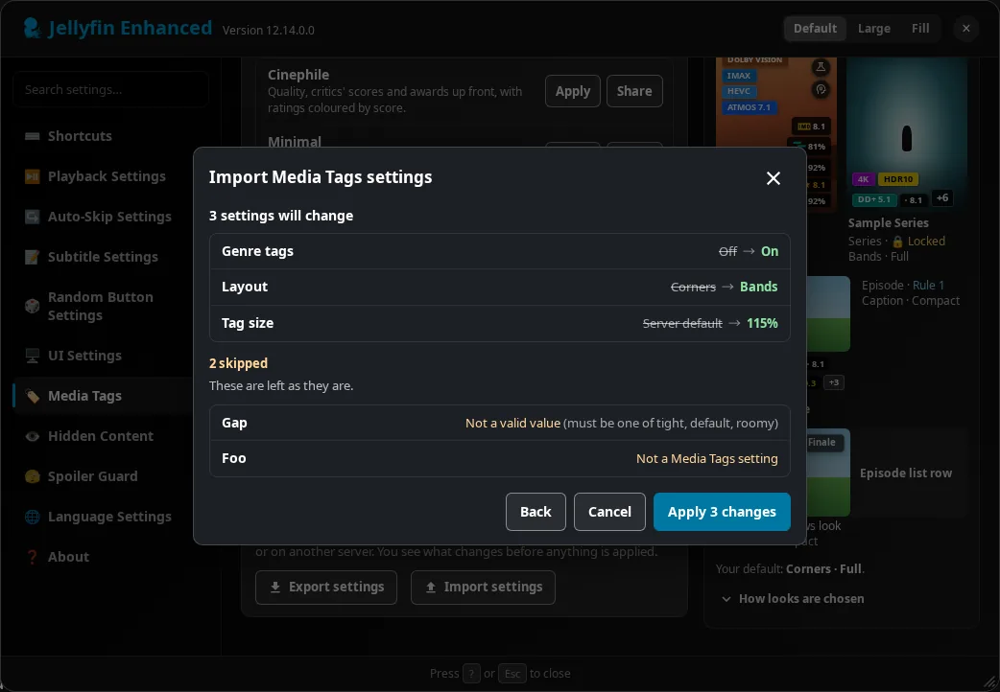

| Preset list | Where it comes from |
|---|---|
| **Built in** | **Cinephile** (quality, critics' scores and awards up front, ratings coloured by score), **Minimal** (resolution and one score in small compact chips) and **Kids' profile** (big tags: age rating, genre and what's new). |
| **From your administrator** | Presets the administrator offers on the Media Tags admin tab (up to 20). |
| **Yours** | Up to 10 presets you saved or imported. They are kept on the server, so they follow you to every device. |

A document carries your layout and its profiles, group order, limits and positions, card-shape looks, density, size, gap and edge spacing, group switches and what each group includes, rating sources, language display and priority, status badge families and your colour preset. Rules and locked items are left out: they name this server's libraries and titles. A preset can carry only some of these; applying it changes those and keeps the rest.

??? info "What is skipped, and why"
    - **Not a Media Tags setting**: a field this version does not know (from a newer version, or a typo).
    - **Not a valid value**: a value the settings save would not accept as given (an unknown layout, a cap over 10, a position that does not exist, a language that is not an ISO code). The reason is shown next to it.
    - **A secret, never imported**: API keys and the custom rule key never travel in a document.
    - A document from a newer version of Jellyfin Enhanced is refused as a whole; update the plugin first.
    - Settings saved before layouts existed export as they are (their layout version travels with them), so importing them elsewhere gives the same look. The built-in presets switch to the current layout system.

**Administrators** export and import the server-wide settings in the **Server** section of the Media Tags admin tab. Pasting a personal export from your own panel works too, so an administrator can make their own look the default for everyone: every setting on that tab (defaults, groups, Tag Styles, custom rules, award lists, logo choices, status windows, cache options and offered presets), never an API key or the custom rule key. An import shows the changes, asks for a confirmation and saves them like any edit on that page: a setting another administrator changed meanwhile waits for **Keep mine** or **Take theirs**, and the snackbar offers **Undo** for 10 seconds. **Presets for users** lists the presets offered in every user's Presets list: **Offer my settings** uses your own Media Tags settings (saved first: if that save fails it offers nothing and says so, with **Retry**), **Offer from a file** a preset or settings file; each can be shared or removed.

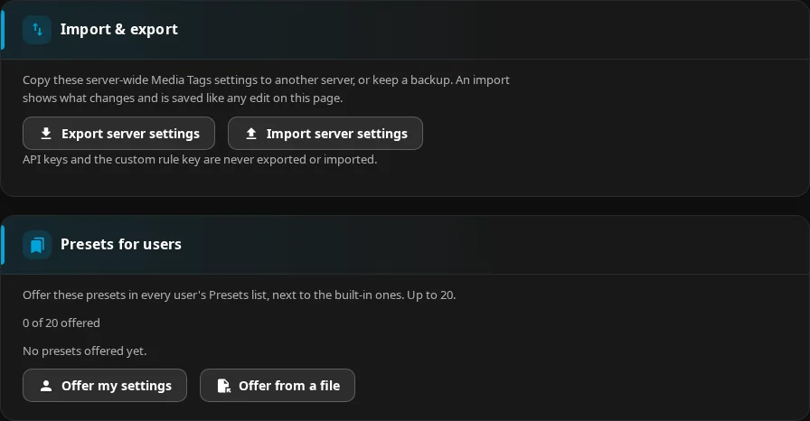

| Setting | Default | What it does |
|---|---|---|
| Personal: **Presets** / **Import & export** | Built-in presets only | Apply, share, save and import presets; export or import your settings with a preview and Undo |
| Admin: **Server** → **Import & export** | — | Export or import the server-wide Media Tags settings; secrets never included |
| Admin: **Server** → **Presets for users** | None | Up to 20 presets every user sees under **From your administrator** |

## Quality Tags

Quality badges help you identify a file's picture and sound format before opening it. They read Jellyfin's media metadata and naming signals.

**How to use:**

1. Turn on the **Quality** group on the **Groups** tab of **Media Tags**.
2. Open the row and select categories under **Include**.
3. Use **Move up** / **Move down** to change their stacking order.

Administrators configure the same defaults on the Media Tags admin tab under **Groups** → **Quality**.

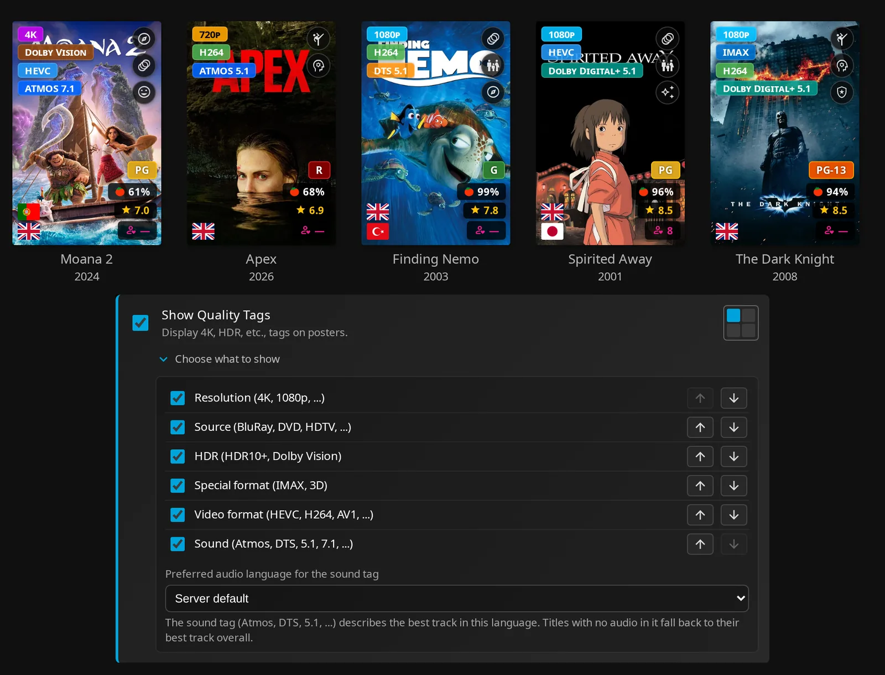

| Setting | Default | What it does |
|---|---|---|
| Admin: **Enable Quality Tags** / personal: **Quality** switch | Off | Enables the quality group |
| Admin: **Show resolution (4K, 1080p, ...)** / personal: **Resolution (4K, 1080p, ...)** | On; first | Shows resolution from the first video stream |
| **Source (REMUX, BluRay, WEB, HDTV, DVD, …)** | On; second | Shows the source inferred server-side from release naming, or the source of a physical-media stub |
| Admin: **Show HDR (HDR10+, Dolby Vision)** / personal: **HDR (HDR10+, Dolby Vision)** | On; third | Shows the dynamic range Jellyfin reports for the video (Dolby Vision, HDR10+, HDR10, HLG) |
| Admin: **Show special format (IMAX, 3D)** / personal: **Special format (IMAX, 3D)** | On; fourth | Shows detected IMAX/3D labels |
| Admin: **Show video format (HEVC, H264, AV1, ...)** / personal: **Video format (HEVC, H264, AV1, ...)** | On; fifth | Shows video codec labels |
| Admin: **Show sound (Atmos, DTS, 5.1, 7.1, ...)** / personal: **Sound (Atmos, DTS, 5.1, 7.1, ...)** | On; sixth | Shows recognized audio format/channel information |
| **Edition (Director’s Cut, Extended, …)** | On; seventh, after sound | Shows the edition from file/folder naming; its order is configurable |
| **Include low-quality sources (CAM, TS, TC, SCR)** | Off | Allows those source labels when the Source category is on |
| **Versions (2 versions, 3 versions …)** | Off; eleventh | On a movie, episode or video with several versions (media sources), how many: **2 versions** (Compact **×2**), in your language. Series and seasons never show it. The other quality chips describe one version (see [Detection details](#series-policy-and-detection-details)) |
| Personal: **Follow server settings** | — | Makes all 23 nullable Quality overrides follow the administrator again: edition, low-quality sources, technical categories, the Versions chip, all eleven category orders, display modes, minimum resolution, Hide SDR and the series policy. Until then, any change you make to one of them stays yours, even a change back to the administrator's value |
| Admin: **Preferred Audio Language for Sound Tags** | **No preference (best track overall)** | Chooses a fixed language whose audio tracks determine the sound tag |
| Admin: **Use Each User's Jellyfin Audio Language** | Off | Uses each user's Jellyfin preferred audio language; users without one retain the fixed admin language |
| Personal: **Preferred audio language for the sound tag** | **Server default** | Inherits server policy, uses **My Jellyfin audio language**, selects **No preference (best track overall)**, or chooses a specific language |

??? info "Badge examples"

    | Category | Examples the detector can produce |
    |---|---|
    | Resolution | `8K`, `4K`, `1440p`, `1080p`, `720p`, `576p`, `480p`, `LOW-RES` |
    | Source | `REMUX`, `BluRay`, `WEB`, `HD DVD`, `DVD`, `VHS`, `HDTV`, `SDTV`; physical stubs also support `Physical`; optional `CAM`, `TS`, `TC`, `SCR` |
    | Dynamic range | `Dolby Vision`, `HDR10+`, `HDR10`, `HLG`, `HDR`; All mode also shows a Dolby Vision stream's base layer (`HDR10`, `HDR10+` or `HLG`) and `SDR` |
    | Special format | `IMAX`, `3D` |
    | Video codec | `VVC`, `AV1`, `HEVC`, `H265`, `VP9`, `H264`, `VP8`, `XVID`, `DIVX`, `VC-1`, `WMV`, `MPEG2`, `MPEG4`, `MJPEG`, `THEORA`, `ProRes` |
    | Edition | `Director's Cut`, `Extended`, `Unrated`, `Theatrical`, `IMAX`, `Remastered`, `Criterion`, `Uncut`, `Final Cut`, `Special Edition`, `Redux`, `Ultimate` (Ultimate Cut/Edition), `Collector's Edition`, `Anniversary` (`25th Anniversary`, `Anniversary Edition`), `Uncensored`, `Open Matte`, `Rogue Cut`, `Black and Chrome`, `Masters of Cinema`, `Producer's Cut`, `Alternate Cut`, `Assembly Cut`, `International Cut`, `Restored`, `Hybrid`, `Roadshow` (Roadshow Cut/Edition/Version), `Despecialized`, `Fan Edit`, or a custom `{edition-…}` label |
    | Sound | `TRUEHD ATMOS`, `DTS-X`, `ATMOS` (carrier unknown), `DD+ ATMOS`, `TRUEHD`, `DTS-HD MA`, `PCM`, `FLAC`, `DTS-HD HRA`, `DTS-HD`, `Dolby Digital+`, `DTS`, `Dolby Digital`, `7.1`, `6.1`, `5.1`; codec labels include the same track's layout, such as `Dolby Digital 5.1`, `DTS 6.1`, `PCM 4.0`, `FLAC 2.0` or `TRUEHD ATMOS 7.1.4` |

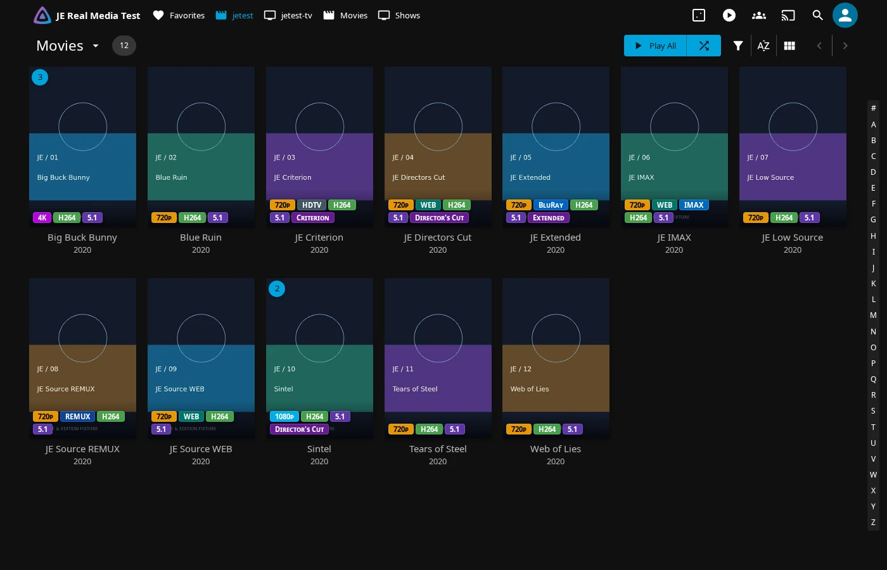

??? info "Compact phone labels and the Quality controls"

    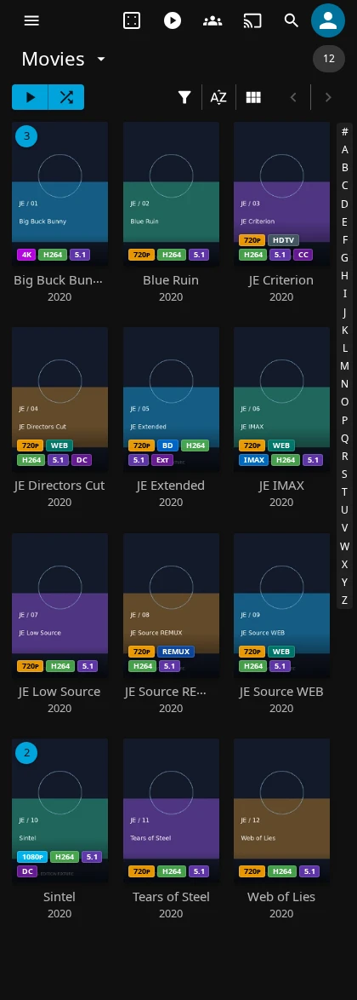

    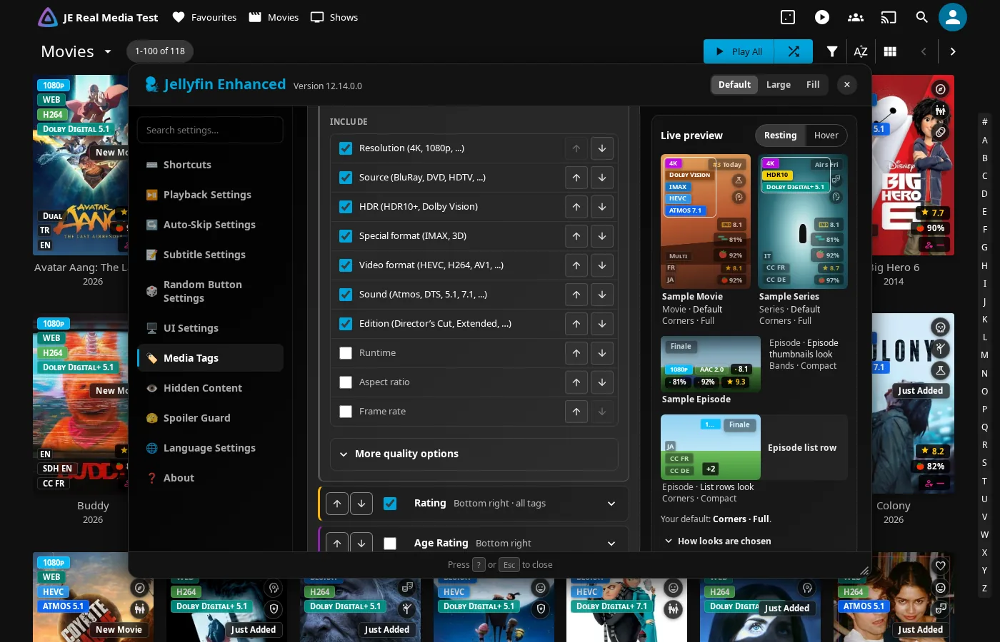

### Highest only or every stream value

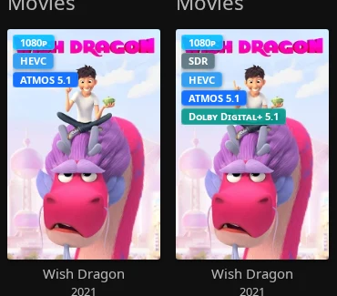

Under **Groups → Quality**, below the categories, choose a separate **Sound display mode**, **Video codec display mode** and **HDR display mode**. **Highest only** is the default and keeps the existing detector's output. **All distinct values** shows every recognized value from the available streams, deduplicated and ranked within its category. For sound, each codec stays paired with that track's own channels: `ATMOS 7.1`, `DTS 7.1`, `DTS 5.1`. For HDR, a Dolby Vision stream also lists its base layer, the format a display without Dolby Vision plays: `Dolby Vision` and `HDR10` for a profile 7 or 8.1 file, `Dolby Vision` and `HLG` for profile 8.4; a profile 5 file (no fallback) shows `Dolby Vision` alone. The existing sound-language preference still selects tracks before deduplication; this does not change playback.

| Setting | Default | Choices |
|---|---|---|
| **Sound display mode** | Highest only | Highest only / All distinct values |
| **Video codec display mode** | Highest only | Highest only / All distinct values |
| **HDR display mode** | Highest only | Highest only / All distinct values; All can include SDR |
| **Minimum resolution to show** | Off | Off / 720p / 1080p / 4K; hide resolution chips below the selected bucket |
| **Hide SDR** | Off | Suppresses SDR in All HDR mode; Highest only retains its existing omission of SDR |

Sound chooses the preferred language's tracks before extracting labels, including tracks with no displayable sound label. For example, English AAC stereo plus German Atmos shows no sound chip with English preferred; it does not fall back to German. Exact-region matches take priority over base-language matches. Only an absent language falls back to all available tracks; with no preference, all tracks are eligible.

Each personal control also offers **Server default**, which follows future administrator changes. Administrators set starting values under **Media Tags → Groups → Quality**. New accounts and **Apply defaults to all users** copy those defaults. Existing preferences keep their appearance until a mode or default changes; editing these controls does not migrate a legacy layout.

The resolution threshold is inclusive: **1080p** keeps 1080p and higher; **4K** hides the 1080p chips in a mostly 1080p library while keeping 4K and 8K standouts. Other quality categories remain eligible. Category switches and order apply first, then the Quality group's **Show up to** limit. Compact density shortens every additional chip as usual. Chips omitted by layout fitting count toward **+N**; chips intentionally removed by category filtering, thresholds or the group limit do not.

For series and seasons, each category in All mode follows the selected aggregation policy:

| Policy | All-mode values |
|---|---|
| Representative episode | That episode's distinct sets |
| Latest episode | The latest aired episode's distinct sets |
| Best quality | Union of the episodes' distinct sets, ranked |
| Only what every episode has | Intersection: values present in every episode; an unknown episode contributes an empty set |
| Best, marked when mixed | Ranked union, plus Mixed when an enabled category's episode sets differ |

Categories left on Highest only keep their existing aggregation semantics. Source, edition, special formats and resolution retain their existing policies. Restricted accounts aggregate only episodes they can access. Browser cache, batch fallback and Native Poster Tags use the same facts and filtering. Native Corners and Bands respect the chosen Full or Compact label density and their existing overflow rules.

### Runtime, aspect ratio and frame rate

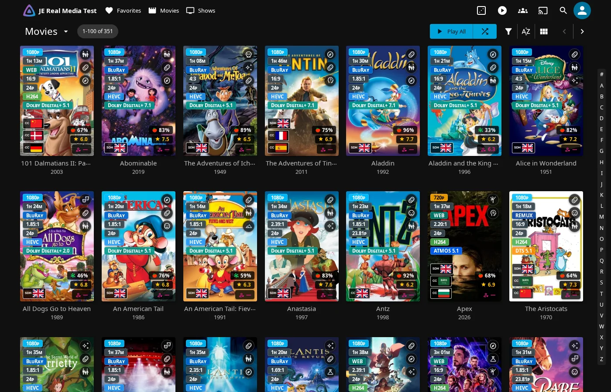

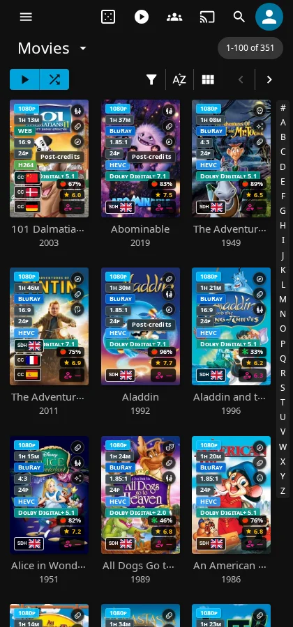

Under **Media Tags → Groups → Quality → Include**, enable **Runtime**, **Aspect ratio** or **Frame rate**. All three start off. Administrators choose defaults and stacking order on the Media Tags admin tab’s **Groups → Quality** section; existing personal choices remain in effect.

| Category | Full / Compact example | Source |
|---|---|---|
| Runtime | `1h 52m` / `1h52` | Jellyfin RunTimeTicks, truncated to whole minutes; unknown/zero values are omitted |
| Aspect ratio | `2.39:1` / `2.39`; `16:9`, `4:3`, `2.35:1`, `1.43:1` | Video display aspect, falling back to width/height |
| Frame rate | `24p`, `25p`, `30p`, `50i`, `60p`, `120p` | Real frame rate, otherwise average; interlaced rates display fields per second |

Aspect ratios snap to the nearest supported ratio within an absolute tolerance: 4:3 and 16:9 ±0.025; 1.43 ±0.015; 1.66 and 1.90 ±0.02; 1.85, 2.00, 2.20, 2.39 and 2.76 ±0.025; 2.35 ±0.019. Scope metadata at 2.39 and 2.40 shares the label `2.39:1` (`2.39` in Compact); 2.35 keeps `2.35:1`. A ratio never names a format: 1.43 (IMAX's film ratio) reads `1.43:1` and 1.90 (also the DCI full container, 2048×1080) reads `1.90:1`; the IMAX chip itself comes from the special-format detection, which needs an IMAX signal on the video, the item or its release name. The web snapping table is generated from the server table by `scripts/generate_technical_ratios.py`. Other usable ratios show two decimal places. This is a format hint derived from metadata, not a certification that a title was filmed in IMAX. Fractional rates such as 23.976, 29.97 and 59.94 snap to their familiar integer labels within 0.15; other rates retain up to two decimal places.

Series and seasons use the representative episode for these three facts under Representative, Best, Shared and Mixed policies. Latest uses the latest episode’s facts, just like Source and Edition. They follow the quality group’s order, cap, density and Tag Styles, including Native Poster Tags. Missing data leaves the chip out.

### Series policy and detection details

Series and seasons share the **Series and seasons show:** setting in **Media Tags** → **Groups** → **Quality**. The administrator sets its starting default on the Media Tags admin tab under **Groups** → **Quality** → **Series and season quality**. **Follow server (…)**, the starting choice, follows the administrator's later changes. Each user can instead choose one of these, which then stays theirs even when it matches the administrator's:

| Policy | What appears |
|---|---|
| **Representative episode** (default) | Today's behavior: the first non-virtual episode with usable streams, preferring regular episodes over specials |
| **Latest episode** | Quality of the non-virtual episode with the newest known air date at or before now; future and undated episodes cannot win, and when the newest has not been probed the newest probed one is used |
| **Best quality** | The best resolution, source, dynamic range, video codec and audio found independently across episodes; these facts can come from different episodes |
| **Only what every episode has** | A category appears only when every episode has the same value; mixed 1080p/4K episodes therefore show no resolution chip, and a season with WEB and BluRay episodes no source chip |
| **Best, marked when mixed** | Best quality plus a **Mixed** chip when an enabled resolution, source, dynamic-range, codec or sound category differs; compact density uses **±** |

The policy covers each series' episodes or each season's own episodes, including specials and all available media versions: when an episode's first version has not been probed, a probed alternate version's resolution, dynamic range and codec still count (an individual episode card describes its first probed version). The source is summarised across episodes like the technical categories (a season upgraded piecemeal from WEB to BluRay shows **BluRay** under Best, nothing under Only what every episode has, and **BluRay** with **Mixed** under Best, marked when mixed). Edition and special-format chips retain the representative episode for best/shared/mixed; latest takes those chips from its own episode. The codec and dynamic-range rankings follow the quality category orders below. Aggregated audio uses the same ranking as a single file (see **Sound** under Detection details: TRaSH's order for lossless and object audio, channels first among lossy tracks), among the preferred language's tracks; an unavailable language falls back to the available tracks.

Missing streams count as unknown: a known/unknown difference suppresses that category in shared mode and marks mixed mode. Empty containers show no mixed marker. Collections keep their existing behavior and normally have no quality badges. Older cache entries without a summary fall back to representative streams until rebuilt.

The server stores policy-independent summaries with both legacy and current sound facts, so changing the policy does not need another episode fetch. Version-0 accounts retain their previous audio vocabulary under every policy, sound display mode and language preference; normalized accounts use the current codec labels. Access-restricted users receive summaries, audio and subtitle languages (with partial-dub coverage) recomputed from the episodes they can see, using the existing access/filter revision, so a hidden episode never adds a language or a Dual/Multi badge. The batch fallback and Native Poster Tags honor the same policy. Quality category switches, ordering, layout limits, label density and Tag Styles still apply; **Mixed** is an editable quality label in Tag Styles.

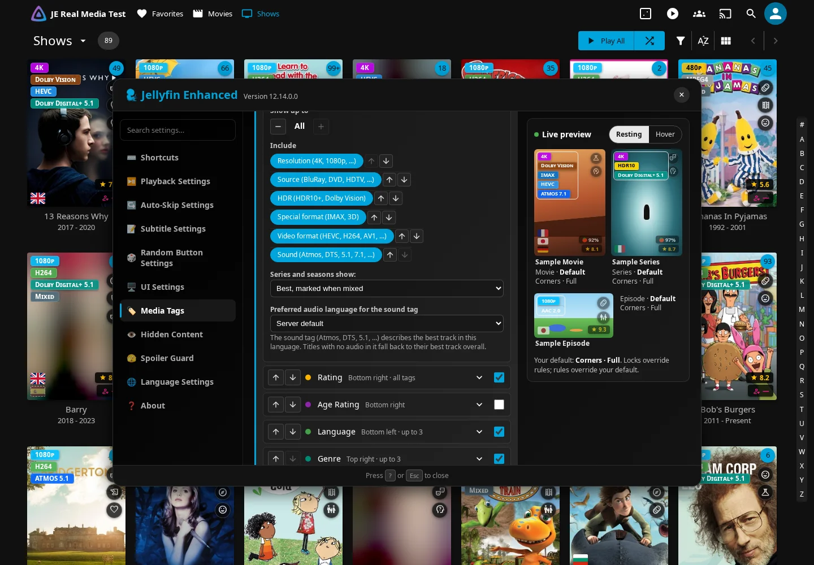

=== "Shared values"

    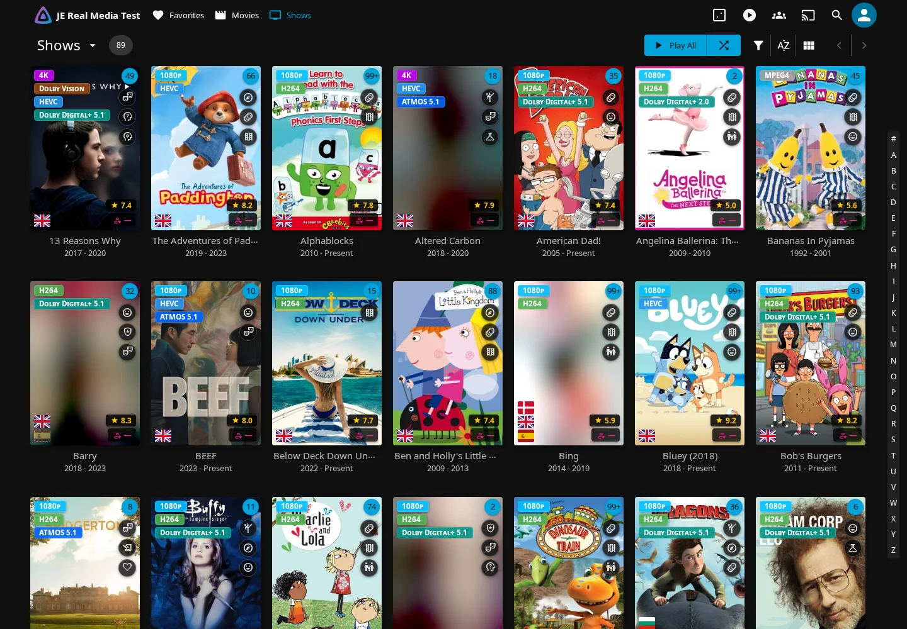

=== "Best with Mixed"

    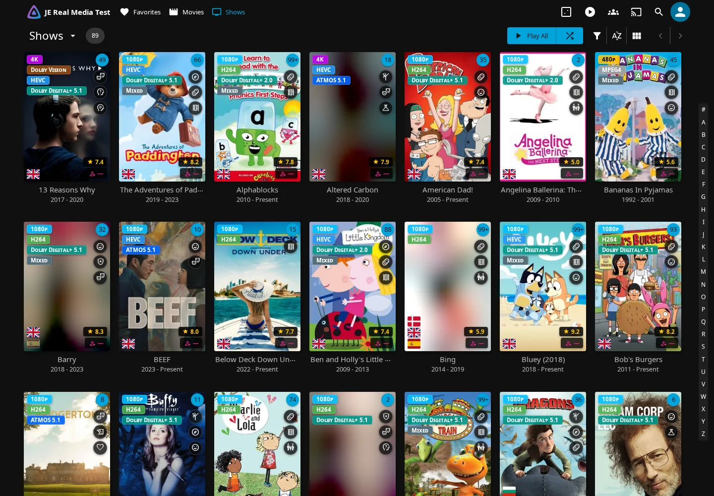

??? info "Detection and sound-language details"

    **Resolution:** the video's known width and height decide; a resolution word in the stream title (`1080p`, `4K`) only counts when Jellyfin has no dimensions for it, so a release named `720p` that is really 1920×1080 shows `1080p`. A known interlaced frame keeps its scan: `1080i` (Live TV recordings, broadcast captures), `576i` and `480i` (DVDs and SD broadcasts); a stream title naming `1080i`, `576i` or `480i` counts when the dimensions are unknown. The minimum-resolution setting treats `1080i` as 1080. A portrait frame is measured by its short and long sides, so a 1080×1920 phone video is `1080p`, not `4K`; a 4K-class height also needs a 4K-class width, so a 2560×1600 frame is `1440p`, and an 8K-class height needs an 8K-class width, so a 4:3 4096×3072 frame is `4K`. A codec named in a stream title counts only as a whole word (`NAV1GATOR` is no AV1), with or without its dot or hyphen (`H.264`, `VC-1`, `MPEG-2`). This applies to every account, including settings saved before layouts.

    Dimension fallback recognizes 8K at height ≥3000 or width ≥7000, and 4K at height ≥1550 or width ≥3500. A 3840×1600 ultrawide file can therefore show `4K`. PAL-sized video can show `576p`. Sorting and styling support `SD`, but the current web resolution detector does not produce it.

    **Source:** A `.disc` physical-media stub wins first. Otherwise JE checks the selected version's file name, then its immediate parent folder. Matching ignores case and uses separators such as dots, spaces, underscores, hyphens and brackets; `Blue Ruin` does not match BluRay. `BDRip`/`BRRip` and full discs (`BR-DISK`, `BD25`/`BD50`) become **BluRay**, `WEB-DL`/`WEBDL`/`WEBRip` and a bare `WEB` anywhere after the title (`1080p.WEB.DDP5.1`) become **WEB**, though any other source word in the name wins over a bare `WEB` (`Show.S01E01.The.Web.720p.HDTV` is **HDTV** even when the episode's own title is unknown), `HDTV`, `HDTVRip`, `PDTV` and Sonarr's `Raw-HD` become **HDTV**, Sonarr's `SDTV`, `TVRip`, `SATRip` and `DVBRip` become **SDTV**, `HD-DVD` becomes **HD DVD**, `DVDRip`, `DVD-R`, `DVD5` and `DVD9` become **DVD**, `VHSRip` becomes **VHS**, and anime's bare `BD` (`[BD 1080p HEVC FLAC]`) becomes **BluRay**. A scene release group closing the name after its codec, audio or resolution (`…WEB.H264-TS`) is a name, not a release word: a group called TS or CAM never names the source, even when nothing else does (`Film.2020.1080p.H264-CAM` has no source); compounds such as `BD-REMUX`, `WEB-DL`, `DVD-R` and `HD-DVD` stay whole. `.strm` names are read like any other file name; a remote version's address loses its query string, and when the address names nothing (`https://…/stream/123`) the item's own file name speaks for it. `HDRip` reads as **WEB** (as Radarr does), `PPV` as **HDTV**, `HDTC` as **TC**, and `R5` and `WORKPRINT` as **SCR**.

    **Unprobed and remote versions:** until Jellyfin has probed a version (a newly added file, a `.strm` or other remote stream that has not been played), it has no streams, so its card shows only its naming facts (source and edition, from the names); resolution, HDR, codec and sound appear once Jellyfin probes it. A card prefers a probed version when the first one is not. A title word is never a source: `Web of Lies (2016)` and `Charlotte's Web (2006)` produce none. A `.ts` file extension does not itself mean a telesync release.

    **Several versions of one item:** a card's quality chips (resolution, HDR, codec, sound, source and edition together) describe one version: on the web the version you last picked in the version selector on the item's page (remembered in this browser for each server and user, so another account signing in here starts from the first version), otherwise the first version Jellyfin lists that has been probed (has stream facts), else the first one listed; native posters use the same first probed version. The chips never mix versions: a remembered pick of an unprobed version shows only that version's naming facts. The item-level `Source`/`Edition` fields (used when no version-level facts exist, such as older cache entries) are chosen differently: the highest resolution bucket first, then the better copy: REMUX, BluRay, WEB, HD DVD, HDTV, DVD, SDTV, VHS, then the pre-release copies SCR, TC, TS, CAM, with stable server order for equal ranks. Series and season summaries rank sources the same way, over every version of every episode. For series and seasons, **Latest episode** uses that episode’s source and edition. **Representative episode** keeps the representative episode’s source and edition; **Best quality**, **Only what every episode has** and **Best, marked when mixed** summarise the source across episodes (see the policy table) and keep the representative episode’s edition. This does not select the version used for playback.

    **Disc structures:** when the names carry no source word, a version Jellyfin recognises as a Blu-ray or DVD disc structure (a `BDMV` or `VIDEO_TS` folder, or a Blu-ray or DVD image) shows **BluRay** or **DVD**.

    **Edition:** Explicit `{edition-…}` markers in the file name, then the parent folder, take precedence over known edition words in those names; an explicit label is shown as written (`{edition-Extended Director's Cut}`) unless it is exactly a known edition (`{edition-Directors Cut}` shows **Director's Cut**). Known edition and source words only count after the title: a name that starts with the item's own title, or its original title when the metadata is localised, is read from after it (`Uncut Gems 1080p WEB-DL.mkv` for the movie *Uncut Gems*, or for *Der schwarze Diamant* with original title *Uncut Gems*, has no edition; `Cam 1080p.mkv` for *Cam* no CAM source); otherwise after the year in brackets (`Uncut Gems (2019)` has no edition, `Movie (2020) Extended Cut` and `Film (2020) Extended 2024 BluRay` do), else after the first year that does not open the name (`The.Final.Cut.2004` has none, `2001 A Space Odyssey 1968 Remastered` does), and for an episode after its episode title: an episode marker ends the series title (`SxxEyy`, Sonarr's `1x05`, a daily air date such as `2024-03-15`, or an absolute number between ` - ` separators such as ` - 105 - `), the episode's own title (its Jellyfin name) right after any of these markers is skipped by name and release parsing starts right after it (`Show.S01E01.Pilot.Extended.1080p.WEB-DL` for the episode *Pilot* is Extended), a four-digit year between separators (`Title - 1982 - Final Cut`) is a year, not an absolute number, else the title ends at the first `[` or quality token (`The Daily Show - 2024-03-15 - Extended Interview [HDTV-720p]` has no edition) (`Show - S01E05 - The Director's Cut [WEBDL-1080p]` has no edition, and `Show.S01E01.The.Web.720p.HDTV` for the episode *The Web* is HDTV, not WEB). A name with no year and no episode marker only counts when it has some release word (`Movie.Extended.1080p.BluRay` does; `Uncut Gems.mkv` and `Remux (2024)` have nothing). A word that could be either, such as `Show.S01E03.Extended.1080p`, is read as the episode title; use `{edition-Extended}` to mark it. For example, `Movie (2020) {edition-Director's Cut}/Movie.1080p.WEB-DL.mkv` shows **WEB** and **Director's Cut**. Custom explicit edition labels are plain text, limited to 64 characters, and cannot include path separators. Directory paths stay on the server; clients receive labels and the existing basename-only legacy signals.

    Full density keeps full edition labels. Compact density uses **BD**, **DC**, **Ext**, **Unr**, **Rem**, **CC**, **Special**, **Ult**, **CE**, **Anniv**, **Unc**, **OM**, **Rogue**, **B&C**, **MoC**, **PC**, **Alt**, **Asm**, **Intl**, **Rest**, **Hyb**, **Road**, **Despec** and **Fan** for BluRay, Director's Cut, Extended, Unrated, Remastered, Criterion, Special Edition, Ultimate, Collector's Edition, Anniversary, Uncensored, Open Matte, Rogue Cut, Black and Chrome, Masters of Cinema, Producer's Cut, Alternate Cut, Assembly Cut, International Cut, Restored, Hybrid, Roadshow, Despecialized and Fan Edit. If both the special-format and edition categories would show IMAX, the special-format chip wins; disabling that category leaves the edition chip eligible. Native Poster Tags apply the same detection, category toggles/order and low-quality gate, with the chosen label density in both Corners and Bands.

    Source colours are deep blue for REMUX, blue for BluRay, teal for WEB, grey-blue for HDTV, grey for DVD and red for low-quality sources. Editions use purple. The known source and edition labels are available in **Tag Styles**; custom editions inherit the quality group's style.

    **Special format:** IMAX detection uses the item name, file names (without a release group closing them, so `…H264-IMAX` is not IMAX), paths and the video stream title, and excludes `NON-IMAX`; an audio or subtitle track named after IMAX does not count. 3D comes from Jellyfin's own 3D format for the version, else a file name with the whole word `3D` and a recognized format word such as `HSBS`, `FSBS`, `HTAB`, `FTAB` or `MVC`, outside a release group closing the name (`3Days.To.Kill.2014.1080p.H264-MVC` is not 3D).

    **Dynamic range:** JE reads Jellyfin's own video range type first (`SDR`, `HDR10`, `HDR10Plus`, `HLG` and the `DOVI…` Dolby Vision family with its base layer); the stream title only counts when that type is missing or unknown, and then only as a whole word (`Dolby Vision`, `DoVi`, `DV`, `HDR10+`, `HDR10`, `HLG`, `HDR`, `SDR`), so `DVD` or `Advanced` in a title never reads as Dolby Vision. A title naming Dolby Vision and a base layer (`Dolby Vision HDR10`, `Dolby Vision SDR`) keeps both in All mode, as the structured type would. When the type is unknown and the title has no hint, Jellyfin's coarse `VideoRange` still decides `HDR` (or known SDR). Jellyfin's `DOVIInvalid` (unusable Dolby Vision metadata) is never shown as Dolby Vision, even when the title says DV; the title's other hints and the coarse range still apply. A video stream with no range information at all shows no dynamic-range chip, even in All mode, rather than `SDR`.

    **Sound:** each track's channels are its actual layout: Jellyfin's channel layout (`mono` is `1.0`, `quad` `4.0`, `5.0`, `6.1`, …), else a layout named in its title when the track's channel count is unknown or agrees with it (its bed, or bed plus heights: `7.1.4` over 8 decoded channels), so a stereo track titled `5.1` stays `2.0`, else the usual layout for its count (1, 2, 6, 7 and 8 channels; another count without a layout shows no channel number). Height channels stay part of the layout (`5.1.2`, `7.1.4`, from Jellyfin's layout or the title) and count when tracks are ranked, so `7.1.4` beats `7.1`. Highest only ranks every eligible track (after the language preference below) and shows the best one, with that track's own codec and channels: TrueHD Atmos 7.1 beats AC-3 5.1 whatever their order in the file, and a DTS 5.1 track never borrows another track's 7.1. Codecs rank in the order of the [TRaSH-Guides audio scores](https://trash-guides.info/Radarr/Radarr-collection-of-custom-formats/#audio-formats): TrueHD Atmos, DTS:X, Atmos with an unknown carrier, DD+ Atmos, TrueHD, DTS-HD MA, PCM, FLAC, DTS-HD HRA, DTS-HD (unspecified), then the lossy tracks. Among lossy tracks (Dolby Digital+, DTS, Dolby Digital and tracks without a codec chip such as AAC) more channels win first, then the codec in that order, so an AAC 5.1 soundtrack beats an AC-3 2.0 dub and Dolby Digital+ 5.1 beats DTS 5.1. Above them the codec decides and more channels only break a tie; the first track wins a full tie. Two deliberate differences from TRaSH: PCM is listed before FLAC (TRaSH scores them equally), and a track without a codec chip ranks below Dolby Digital at the same channel count, because a named codec says more. A track's codec comes from its display title, then its codec and profile, but the stream codec bounds what a title may claim: a title can refine its carrier (DTS → DTS-HD MA, E-AC-3 → DD+ ATMOS) and never contradict it, so an AC-3 track titled "Atmos" stays Dolby Digital and an AAC track titled "DTS" or "TrueHD Atmos 7.1" has no codec chip (it shows its own layout when that is surround). A DTS-HD profile the stream reports (`DTS-HD MA` or `DTS-HD HRA`) outranks a title's other DTS claim, so a Master Audio track titled `DTS-HD HRA 5.1` stays **DTS-HD MA**; a title naming DTS:X still refines it. A track whose codec Jellyfin does not report lets the title decide. A layout named in a title can be any of `1.0` to `7.1` (`PCM 4.0`, `PCM 3.0`). A track without a recognised codec (AAC, Opus, MP3) shows its layout alone only for `5.1`, `6.1` and `7.1` (its bed, so `5.1.2` shows `5.1`); a recognised codec always carries its layout (`FLAC 2.0`, `PCM 4.0`, `DTS 6.1`).

    **Video codec and resolution:** `VC-1` is its own label (it read `WMV` before), and VVC (H.266) and Apple ProRes are recognised. XviD and DivX files, which Jellyfin reports as `mpeg4`, are named from their codec tag (`XVID`; `DIVX`, `DX50`, `DIV3`–`DIV6`). Resolution uses the height or, for cropped encodes, the width: 1920 wide is 1080p (`1920×800`), 1280 wide is 720p, and 640 wide or more is 480p, so a cropped DVD (`720×304`) is not `LOW-RES`. `1440p` needs a 1440-class height (1250 or more), so ultrawide `2560×1080` is 1080p. A `4K`/`2160p` hint in a title is ignored when the known height is below 1250 pixels, and an `8K`/`4320p` hint below 2500 pixels; the dimensions decide instead.

    **Settings saved before layouts (version 0)** get the same video detection as everyone (dynamic range, codec and resolution above), so a DVD title never reads as Dolby Vision on any account. Only their sound chip keeps its earlier vocabulary, so their cards keep their look (but it never claims a carrier the stream codec cannot be, such as Atmos on AC-3, or more channels than the track reports): the first recognised title (Atmos, TrueHD, DTS:X, DTS, Dolby Digital+) with the richest channels of the ordinary tracks, bucketed into 7.1, 5.1 or 2.0, and no `Dolby Digital`, `DTS-HD`, `FLAC` or `PCM` labels. That vocabulary applies in every sound display mode and series policy, but only to the words: the decision itself is checked against the tracks, so the codec and channels shown always come from one real track (a TrueHD 2.0 track beside an AAC 7.1 track reads `TRUEHD 2.0`, not `TRUEHD 7.1`), a DTS-HD MA track whose profile says XLL is `DTS`, never `DTS-X`, and when the earlier words would claim more, the best single track is described in them instead. Labels that vocabulary does not have (Dolby Digital, PCM, FLAC, a bare 2.0) are left out.

    **Commentary and audio description:** a commentary or audio-description track (see [Language Tags](#language-tags)) never decides the sound chip while the file has an ordinary audio track, in any mode, and All mode does not list it. The track title decides, in English, the common European languages, Russian, Ukrainian, Greek, Turkish, Arabic, Hebrew, Japanese, Chinese and Korean: commentary (`Commentary`, `Kommentar`, `Audiokommentar`, `commentaire`, `comentario`, `commento`, `commentaar`, `komentarz`, `kommentár`, `комментарий`, `коментар`, `σχόλια`, `yorum`, `تعليق`, `פרשנות`, `音声解説`, `コメンタリー`, `导演评论`, `解說`, `코멘터리` …) and audio description (`Audio Description`, `AD`, `Audiodeskription`, `Hörfilm`, `audiodescription`, `audiodescripción`, `syntolkning`, `synstolkning`, `аудиоописание`, `sesli betimleme`, `音声ガイド`, `口述影像`, `화면해설` …).

    A sound-language preference tries language plus region, then the base language, then all tracks if no match exists. For example, selecting a German AC3 5.1 dub replaces an English Atmos badge with `Dolby Digital 5.1` (`DD 5.1` in Compact); a version-0 account keeps its earlier `5.1` label. The detector does not emit `AC3` as a codec label. These choices change the badge, not the audio selected for playback.

## Genre Tags

Genre Tags show up to three genres (the genre limit of your [layout](#layouts)) as compact Material Design icons, so you can recognize them while browsing. You can hover to see names beside the icons. Administrators can give each genre its own colours in [Tag Styles](#genre-colours).

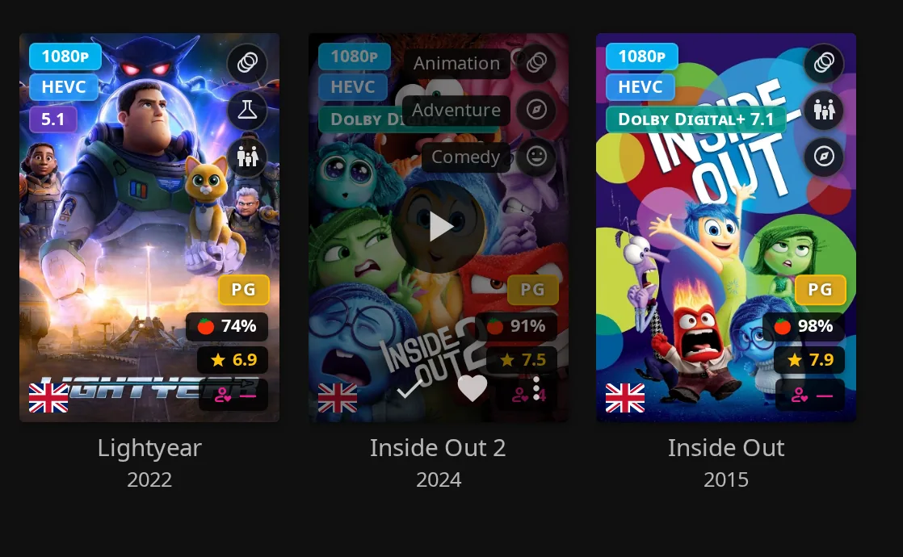

**How to use:**

1. Turn on the **Genre** group on the **Groups** tab of **Media Tags** and choose its position.
2. Leave **Hide tags on hover** off to see expanded names.

| Setting | Default | What it does |
|---|---|---|
| Admin: **Enable Genre Tags** / personal: **Genre** switch | Off | Shows genre icons on supported cards (three by default; see [Layouts](#layouts)) |

??? info "Genre sources and hover behavior"
    Genres come from Jellyfin metadata. Unfamiliar names use a generic icon.

    With **Server-Side Tag Cache** on, series and season cards keep their own genres when present and use episode or parent-series genres only when their own are missing. Batch fallback does the same: a season card shows its own genres, else its parent series'. Series cards without genres use the first episode.

    The names stay inside the card and clear of the other tags. Each one sits beside its icon, toward the middle of the card, and ends a few pixels before the next chip on its line or the card's edge: a long name is shortened with an ellipsis while at least 60% of it fits, and a name with less room is left out (its icon still names it in its tooltip). Icons side by side (a top or bottom centre row, a band) list their names one per line under the row, or above it when the row is in the lower half of the card. The same applies to the live previews' **Hover** view, and to the "More tags: …" note a card with a `+N` chip shows on hover: it takes the first band across the card, from the top down, that no chip or name touches, or is left out when there is none (the card link still describes the hidden tags).

    With **Hide tags on hover** on, names do not expand on the poster and the overlays fade out instead; the Summary and Minimal hover reveal still lists each genre by name, and a caption strip still shows names on hover. There is no genre-name expansion in a static native poster image.

## Language Tags

Codes, CC/SDH subtitle chips and Dual/Multi badges use the quality chips’ padding, radius, font, border and shadow, including Flush edges. **Tag Styles → Language** supplies their background, border and text colours, and **Poster** takes these from the artwork. Per-language code colours (such as `en`), or `dual` / `multi`, override the chip-kind and group colours. Flag images retain their original appearance and border ring. Partial code chips use reduced opacity; only partial flag images keep a dashed outline.

Short language code chips use tighter horizontal padding while retaining the quality font and height. When a corner language column crowds a centered rating, excess language chips move into `+N`, after the group limit is applied. The first language chip stays visible. In that mixed language-and-rating row, rating values stay complete; a rating without enough room moves into `+N` with its full value in the overflow description. Cards without that language column keep the usual first-chip fitting and ellipsis.

Language Tags show audio and subtitle languages as flags or short uppercase codes. Subtitle chips carry a **CC** prefix, or **SDH** when a hearing-impaired subtitle flag or a whole-word SDH/CC title marker is present. Hover a chip for Audio or Subtitles and the full language name, in your own language (`Audio: japonais` with French); partial dubs identify missing episode coverage. Dual/Multi tooltips include the distinct count and represented audio languages in priority order. A language fact assigned to the Summary pill keeps the CC prefix and full-name tooltip. Language chips follow the poster link, including Ctrl/Command-click and middle-click to open a new tab. An optional **Dual** (two audio languages) or **Multi** (three or more) badge helps you find multilingual titles. Audio with no linguistic content uses a crossed-out speech-bubble symbol labeled **No dialogue**. A language without a flag (Esperanto, Welsh, Latin and other languages with no single country) keeps a code chip such as `EO` in Flags style rather than disappearing, on the web and on Native Poster Tags; Bosnian, Khmer, Lao, Burmese and Luxembourgish use their countries' flags.

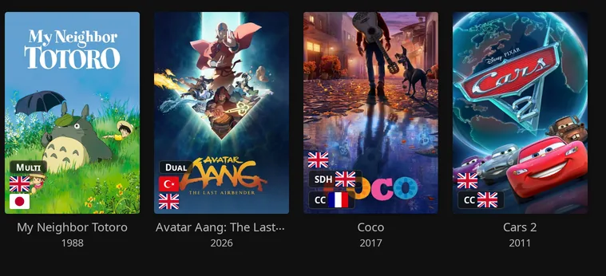

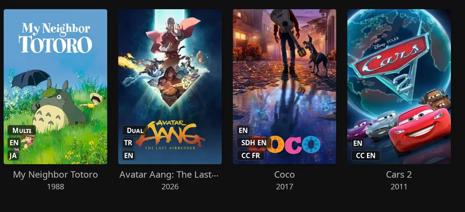

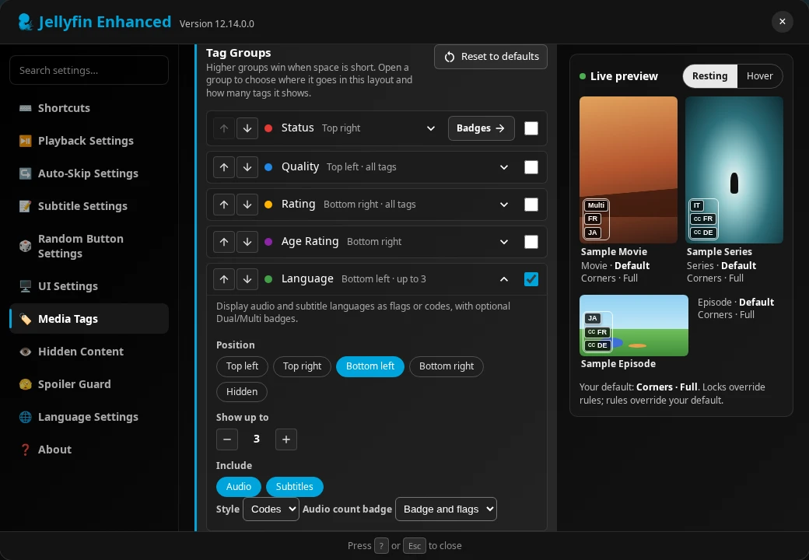

**How to use:**

1. Turn on the **Language** group on the **Groups** tab of **Media Tags**.
2. Expand **Language**. Under **Include**, choose **Audio**, **Subtitles**, or both. Choose **Flags** or **Codes** under **Style** and optionally enable the **Audio count badge**.
3. Set **Show up to** for the combined list. A badge takes one place, followed by audio chips, then subtitle chips. For a separate list on the detail page, enable **Show Audio Languages**.

Each user can choose a personal order under **Groups** → **Language** → **Priority**. **Follow server policy** starts on: it uses the administrator's **Priority Languages**, including future changes. Turn it off, search by language name or ISO code, and **Add** up to 12 languages. Move them with the up/down buttons or remove one. Equivalent codes such as `eng`/`en`, `fre`/`fra`/`fr`, Tagalog/Filipino and Norwegian variants share one preference. Personal priorities apply to audio and subtitles in Flags and Codes styles, the Dual/Multi badge and Summary pill, and Native Poster Tags.

**Only show priority languages** starts at **Follow server (…)**. Choose **Only priority languages** to filter, or **Priority languages first, then others** to keep the rest. This choice inherits independently of the list. An empty personal list means no prioritization or strict filtering. Switch **Follow server policy** back on to use the server list again. The server's **Merge Regional Variants** still controls regional flags; personal base-language choices match all regional tracks. These choices change poster badges, not playback track selection.

Priority controls pause while a change saves. If it fails, the previous list and strict choice return; other settings changed during the save still save with that restored policy. Try the priority edit again after the controls become available.

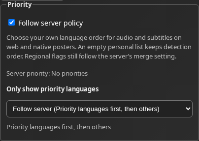

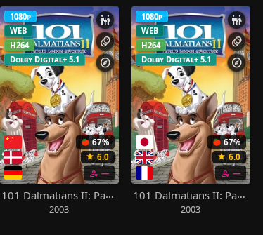

??? info "Phone editor and controls"

    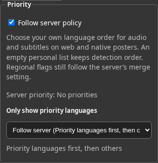

    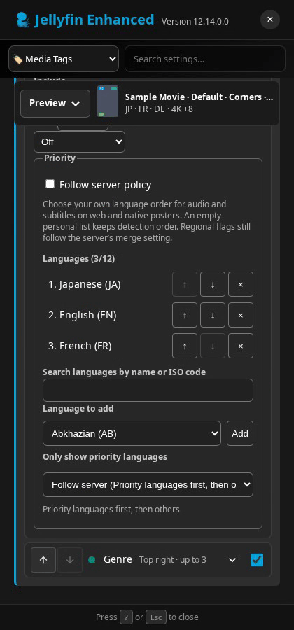

Administrators can set the shared fallback under **Priority Languages**. Existing personal settings without a priority list continue to follow that policy.

| Setting | Default | What it does |
|---|---|---|
| Admin: **Enable Language Tags** / personal: **Language** switch | Off | Shows distinct flags/symbols on supported cards (three by default; see [Layouts](#layouts)) |
| **Include: Audio / Subtitles** | Audio on, subtitles off | Choose either or both track types; repeated SDH tracks count once per language. A commentary or audio-description track is not a dub, and a language with only forced subtitles (signs, foreign dialogue) is not a subtitle option, so neither adds a chip or counts toward Dual/Multi |
| **Style: Flags / Codes** | Flags | Codes use uppercase ISO 639-1 where available, otherwise the three-letter code (for example `TL`, `NB`, `NN`, `FIL`); audio equivalence still governs deduplication and counting. Both styles have full-name tooltips identifying Audio or Subtitles |
| **Audio count badge** | Off | **Badge only** replaces audio chips when two or more audio languages qualify; **Badge and flags** keeps them (or codes with Codes style). Selected subtitles remain. Counts distinct canonical audio languages after priority filtering and before the cap; regional versions and no-dialogue tracks do not increase the count |
| Personal: **Priority** → **Follow server policy** | On | Follows the live administrator list; turn off for an ordered list of up to 12 ISO 639-1/639-2 languages. An empty personal list has no priorities. |
| Personal: **Only show priority languages** | Follow server | Inherits strict filtering, or explicitly filters/keeps other languages. |
| Admin: **Priority Languages** | Empty | Comma-separated language names or codes such as `English, ja, pt-BR`. Codes match equivalent two- and three-letter tags (`en` covers `eng`). A bare code also covers regional variants (`en` covers `en-US` and `en-GB`); a regional code accepts bare tags but not a different region (`pt-BR` covers `pt`, not `pt-PT`). Matching flags appear first in list order |
| Admin: **Only Show Priority Languages** | Off | With a nonempty priority list, removes flags that do not match; an item can show fewer flags than its limit, or none |
| Admin: **Merge Regional Variants** | Off | Regional and script variants such as `en-GB`, `pt-BR` or `zh-Hant` share their base language's flag, so tracks Jellyfin lists as one language show one flag |

### Grouping, regions, and partial dubs

With **Server-Side Tag Cache** enabled, series and season cards show audio languages across their episodes. A dub missing from some episodes has a dimmed flag or code with a dashed outline and “not on all episodes” in its title/alt text.

??? info "Flag grouping, coverage, and regions"
    Flags come through Jellyfin Enhanced's asset service. Tracks marked `zxx` (no linguistic content) use the **No dialogue** symbol. Norwegian Bokmål and Nynorsk (`nb`, `nob`, `nn`, `nno`) use Norway's flag, Cantonese (`yue`) Hong Kong's, Swiss German (`gsw`) Switzerland's and Irish (`ga`, `gle`) Ireland's.

    Languages sharing a flag are grouped before the three-flag limit. Their names are stored in the flag's title/alt text. Hover a flag or code to read those names. Tags remain visible on hover unless **Hide tags on hover** is enabled.

    Priority filtering also operates on grouped flags: a matching flag can represent additional languages sharing it. An empty priority list leaves flags unchanged even with strict filtering on. A personal list overrides the administrator list. Strict mode follows the personal override when set, otherwise the administrator value.

    Server-list matching uses the flag's language code, its base code, or its displayed language names, and compares codes the way the audio-language filter does across every language the chip represents: `ja` matches `jpn`, `en` matches `en-US`, and `te` finds the India flag Hindi claimed first. Personal ISO priorities match every represented language canonically.

    Cached audio and subtitle languages use the union across episodes. Subtitle tracks use the same access and Spoiler Guard stripping paths as audio. With the server cache off, container cards use their representative episode instead of the full union. Forced-only subtitle tracks are left out entirely; an SDH track shares its language's chip with the ordinary track, and a grouped subtitle chip carries SDH if any represented track is SDH. The tooltip reads, for example, **Subtitles (SDH): English**. Flags, Codes, the Summary pill and native posters preserve the marker. It appears only while Subtitles is enabled.

    The cached audio flags use the union of audio languages across episodes. Full-coverage flags normally come first, but administrator priorities can put a partial flag ahead of them. A grouped flag is partial only when all its represented languages are partial.

    Specials do not count against a series' full-coverage languages. Tracks with no usable language tag are ignored: none, `und` (undetermined), `mul` (several languages), `mis` (uncoded) and the local-use codes `qaa`–`qtz` (broadcast "original version" tracks are `qaa`). Equivalent tags such as `eng`/`en` or `fre`/`fr-FR` can count as the same dub. Regional variants that coexist in one episode, such as `es-419` and `es-ES`, are assessed separately.

    In batch fallback mode, series/season poster flags reflect a representative episode and do not show partial coverage.

    Cached collection flags combine languages from linked movie and series members. A collection containing an English movie and a Japanese movie can therefore show both flags; it does not mean every member has both languages. The flags follow the members: when a member file gains or loses an audio or subtitle track, or a member is deleted, the collection changes with it.

    Regional flags require explicit regional metadata. For example, `pt-BR` shows Brazil, `pt`/`pt-PT` show Portugal, `es-419`/`es-MX` show Mexico, and `zh-Hant` shows Taiwan. A base language such as `pt`, `es`, or `zh` keeps its default flag; JE does not guess a region.

!!! note "Tagging matters"
    Region detection depends on the language metadata in the media file. Poster Language Tags and the detail-page audio-language row have separate switches; enabling one does not enable the other.

## Audio language links

The detail-page audio-language row shows language names and flags. You can also sync languages to Jellyfin metadata tags, so clicking a matching language opens a list of items with that tag.

**How to use:**

1. Keep **Show Audio Languages** on in **UI Settings** to display the row.
2. As an administrator, open **Display** → **Audio Language Tags** and turn on **Enable Audio Language Tags Sync** and **Link audio languages to their tag page**. Click **Save Settings**.
3. Run **Sync Audio Language Tags to Jellyfin** under **Dashboard** → **Scheduled Tasks** → **Jellyfin Enhanced** to tag existing movies and series.

Admin settings below are under **Display**; the row's default is in **UI Preferences**, and synchronization controls are in **Audio Language Tags**.

| Setting | Default | What it does |
|---|---|---|
| Admin: **Show available audio languages on item detail page** / personal: **Show Audio Languages** | On | Displays the audio-language row on movie, series, season, and episode detail pages |
| Admin: **Enable Audio Language Tags Sync** | Off | Writes audio languages as Jellyfin tags on movies and series |
| Admin: **Tag Prefix** | `JE Language: ` (trailing space) | Prefixes synchronized language tags |
| Admin: **Link audio languages to their tag page** | On | Turns a displayed language into a link when a matching synchronized tag exists on the item |

!!! note "Schedule language synchronization"
    **Sync Audio Language Tags to Jellyfin** has **no default schedule**. Add a trigger or run it manually, especially with the server cache off.

??? info "Language matching and synchronization"
    A regional track gets a base tag, such as `JE Language: English`, and a regional tag, such as `JE Language: English (United States)`. A regional chip tries the matching regional tag first, then its base tag. Without a match it remains plain text.

    The synchronized series tags combine languages across episodes. The detail-page row itself uses a representative episode for series/seasons. It can therefore show fewer languages than cached poster flags or synchronized series tags.

    For playable items, changing the selected media version can change the row. More than three languages can scroll horizontally; missing usable data shows a dash.

    Synchronization directly tags movies and series, not seasons or episodes. With the server cache on, cache updates can sync new or changed items after library changes. Cache-excluded items skip that update path but can still be processed by the standalone task.

    Updates remove stale tags only under the current prefix. Changing the prefix leaves old-prefix tags behind. Disabling synchronization does not delete existing tags.

## Rating Tags

Rating Tags show an ordered selection of Community, Critic, IMDb, TMDb, Rotten Tomatoes critic and audience, Metacritic, Metacritic user, Letterboxd, Trakt, MyAnimeList, AniList, Roger Ebert and MDBList scores. Each named source has a bundled logo. MyAnimeList and AniList only have scores for anime, and Roger Ebert's only for films he reviewed, so on other titles those chips simply do not appear. Choose which item types and home rows show them. The scores come from the server tag cache, which the **Fetch Ratings from MDBList** task refreshes after each run, so a source appears once that task has covered a title.

**How to use:**

1. Turn on the **Rating** group on the **Groups** tab of **Media Tags**.
2. Under **Include**, tick sources and move them up or down. Set **Minimum score** and **Colour by score** if desired.
3. Keep or change the item types and home rows under **Choose where to show**.

Administrators set defaults on the Media Tags admin tab under **Groups** → **Rating**. MDBList itself (key, quota, fetch task) stays under **Elsewhere & Reviews** → **MDBList Ratings**; the Rating group shows whether it is set up.

| Setting | Default | What it does |
|---|---|---|
| Admin: **Enable Rating Tags** / personal: **Rating** switch | Off | Enables poster score chips and, when configured, user-review chips |
| Admin: **Show on movies** / personal: **Movies** | On | Allows rating and review chips on movie cards |
| Admin: **Show on series** / personal: **Series** | On | Allows rating and review chips on series cards |
| Admin: **Show on seasons** / personal: **Seasons** | On | Allows rating and review chips on season cards |
| Admin: **Show on episodes** / personal: **Episodes** | On | Allows rating and review chips on episode cards |
| Admin: **Show in the Continue Watching row** / personal: **Continue Watching row** | On | Allows rating and review chips in that row |
| Admin: **Show in the Next Up row** / personal: **Next Up row** | On | Allows rating and review chips in home **Next Up** and the series-page shelf |
| **Rating sources** | Community, Critic | Ordered enabled source list; an empty list hides source scores while review chips remain independent |
| **Minimum score** | Off | Off, 5, 6, 7 or 8; compares each source on a scale of ten before applying the group limit |
| **Colour by score** | Off | Red below 5, amber through green at 7.5; explicit Tag Styles colours take precedence |

Your item-type and row choices both apply. Turn off **Episodes** to hide these chips on every episode card, including **Next Up** and **Continue Watching**. Turn off a row to hide them only in that row. These choices do not hide quality, genre, language, or age-rating badges.

??? info "Score sources and fallback"
    Collections and videos are not governed by the four type switches. Critic scores below 60% use the rotten icon; 60% and above use the fresh icon. Compact density shows named-source values beside a tiny source-coloured dot. Native posters use the same source order, formats, minimum, cap and colours.

    Community and Critic come from Jellyfin's `CommunityRating` and `CriticRating`. Their sources depend on your metadata providers or synchronization, including [MDBList settings](../other/other-settings.md#mdblist-ratings). The overlays do not fetch TMDB or Rotten Tomatoes scores directly. A community score displayed as `0.0` becomes a dash; absent scores do not produce their respective chips.

    A season or episode with no score of its own (none, or 0) shows its series' community and critic scores. One with any score of its own shows only its own scores, so an episode's critic score is never replaced by its series'. The server cache, batch fallback and native posters follow the same rule.

Named sources use the server's existing MDBList service when its API key is configured. Full tag-cache builds warm bounded batches, and reconciliation refreshes expired ratings even when library metadata has not changed. Library changes warm their titles together, in batches of up to 150, before their entries are rebuilt; a native poster built on demand never waits for MDBList: it draws the scores already cached and the missing ones are fetched in the background for later posters. Found titles have a seven-day TTL; confirmed misses and failures keep the existing MDBList retry policy. A refresh that fails (an outage, a timeout, the daily quota) never erases scores a title already has: they stay on the cards and the title is tried again an hour later. Batch mode also shares this cache: a batch request waits at most two seconds for the scores of titles that have none, then answers with everything else (quality, language, status and the scores already cached) while the fetch finishes in the background. Such an answer is marked as waiting for scores, and the browser keeps it for only a minute (not the usual Local Storage lifetime): the next view after that asks again and shows the scores. Every batch answer also says when its scores stop being current, and the browser keeps it no longer than that: a week for found scores, three days for a title MDBList does not know, and an hour after a failed lookup (an outage, the daily quota), when the server tries again, so scores return on their own once MDBList recovers; a title whose scores are fresh never waits behind another title's fetch. The API key stays on the server. Without a key or a returned score, that source produces no chip. Seasons and episodes use their series' source ratings.

| Source | Example | Native scale |
|---|---|---|
| IMDb | 8.1 | /10 |
| TMDb | 81% | /100 |
| RT critic / RT audience | 92% / 88% | /100 |
| Metacritic | 74 | /100 |
| Letterboxd | 4.1 | /5 |
| Trakt | 85% | /100 |
| Metacritic user | 7.9 | /10 |
| MyAnimeList | 8.4 | /10 |
| AniList | 82% | /100 |
| Roger Ebert | 3.5 | /4 |
| MDBList | 78% | /100 |

Scores are written the way your language writes numbers: `8,1` in German or French, Arabic-Indic or Persian digits where the locale uses them (the language Jellyfin Enhanced's text follows; native posters use the language saved with your web settings, the same one their dates use). Units stay as they are (`%`, no space). Existing users retain their old Community/Critic include choices and order until they edit sources. New users take the administrator's defaults. Named sources have individual labels in **Tag Styles** and `data-je-rating-source` hooks for custom CSS.

!!! note "Spoiler Guard and scores"
    [Spoiler Guard](../spoiler-guard/spoiler-guard-settings.md) can suppress score data on protected items. Age classifications have a separate policy, described below.

### User-review chips

A pink person-with-heart chip shows the average star rating from reviews visible to you. It converts the 1–5 average to a /10 display: a four-star average appears as `8`.

**How to use:**

1. As an administrator, open **Elsewhere & Reviews** → **User Reviews**.
2. Turn on **Enable User Written Reviews** and **Show average user rating on poster cards**, then click **Save Settings**.
3. Each viewer must also turn on the **Rating** group. There is no separate personal review-chip switch.

To contribute, open an eligible detail page and click **Write a Review**. Choose stars, enter review text, or both.

| Setting | Default | What it does |
|---|---|---|
| **Enable User Written Reviews** | Off | Enables JE's stored user reviews; independent of Elsewhere and TMDB Reviews being enabled |
| **Show average user rating on poster cards** | Off | Adds the average-review chip to eligible cards with Rating Tags enabled |
| **Show a dash on posters for unrated items** | On | Shows a dash when no visible aggregate star rating exists; off removes that chip |
| **Hide reviews from hidden users** | On | Hides those authors' reviews from other non-admin viewers; self-view and admin exceptions apply |
| **Hide reviews from disabled users** | On | Applies the same visibility rule to disabled accounts |
| **Also save review star ratings as the user's Jellyfin rating** | Off | Mirrors movie/series review stars to Jellyfin's personal /10 rating, independently of the displayed average |

The optional dash means there is no visible average star rating, even if you have written a text-only review.

!!! warning "Mirroring replaces your Jellyfin rating"
    **Also save review star ratings as the user's Jellyfin rating** overwrites an existing personal Jellyfin rating.

??? info "Review identities, limits, and mirrored ratings"
    Movies and series require a TMDB ID. Seasons and episodes require the parent series' TMDB ID and their season/episode numbers.

    Matching identities share reviews across duplicate library items. Collections and generic videos do not have these review chips. The chips follow the same corner and scope exclusions as Rating Tags and respect applicable Spoiler Guard review restrictions.

    Stars range from 1–5 in half-star increments. Review text is limited to 2,000 characters, and a review needs stars or nonblank text. Only reviews with stars contribute to the poster average.

    Deleting a review or removing its stars clears the mirrored rating only if it still matches. A rating changed elsewhere is preserved. Season/episode reviews are not mirrored. Writing and moderating reviews is covered in [User Reviews](../elsewhere/elsewhere-features.md#user-reviews).

## Age Rating Tags

Age Rating Tags show the official parental/content classification Jellyfin already has, such as `PG-13`, `R`, `TV-MA`, `FSK-12` or `GB-15` (Jellyfin's TMDB provider writes most non-US ratings with their country code). Supported rating-board labels receive predefined colors, with a fallback for other labels.

**How to use:** Turn on the **Age Rating** group on the **Groups** tab of **Media Tags** and choose its position.

| Setting | Default | What it does |
|---|---|---|
| Admin: **Enable Age Rating Tags** / personal: **Age Rating** switch | Off | Shows the item's official classification on supported cards |
| Admin: **Colored Ratings Backgrounds** | Off | Under **Extras** → **UI Tweaks**, colors official classification boxes on detail pages and applicable player elements |

The default bottom-right position stacks with Rating Tags. Seasons and episodes normally show their own nonblank classification, or their series' classification if they have none.

Poster age badges use classification colors independently of **Colored Ratings Backgrounds**. That separate switch controls detail/player classification boxes.

??? info "Classification labels and colors"
    Equivalent labels share colors. For example, `DE-12` and `FSK 12` become `FSK-12`, and supported unrated labels become `NR`. Color support includes international boards, US TV descriptors, and ESRB classifications. These are classification colors, not gradients for community/critic scores.

!!! note "Spoiler Guard and classifications"
    Age classifications remain visible. When score stripping protects unwatched episodes or unstarted seasons, the badge can deliberately use the series classification instead of the child's own rating, avoiding a hint from an unusually high episode classification.

## Status Tags

Status Tags show one translucent badge per card: what is new, trending, airing next, or reaching a season milestone. They use the existing poster artwork and the selected [tag layout](#layouts).

**How to use:** Turn on the **Status** group on the **Groups** tab of **Media Tags** and choose its position. Pick the badge families on the **Status badges** tab (the Status row's **Badges** button opens it). Administrators set starting defaults on the **Status badges** tab of the Media Tags admin tab; each user can override the eight group switches.

| Setting | Default | What it does |
|---|---|---|
| Admin: **Enable Status Tags** / personal: **Status** switch | Off | Shows one badge per supported card. The admin switch also allows server trending and series schedule lookups |
| **Trending rank** | On | Shows the title's trending rank. Admin **Show Trending rank** off stops the shared list for everyone |
| **New Movie / New Series / New Episode** | On | Shows release and episode-arrival badges |
| **Just Added** | On | Shows recently added library items |
| **Airing Today / Airs / Returns / Coming Soon** | On | Shows schedule badges; Coming Soon works without TMDB |
| **New Season / Premiere / Finale / Complete Season** | On | Shows season and series milestones |
| **Returning / Ended / Cancelled** | Off | Shows a series' status when no higher-priority badge applies |
| **Leaving soon** | Off | Shows **Leaving in 5d** (or **Leaving soon**) on items the server will remove; needs an administrator's [Leaving soon source](#leaving-soon-maintainerr) |
| **Direct-play warning** | Off | Shows **Transcode** or **Won't direct play** on movies and episodes this browser cannot play as they are ([web only](#direct-play-warning)) |
| Admin: **New release window (days)** | 30 | Premiere dates, new seasons, season premieres and recent TMDB finales; range 1–365 |
| Admin: **Just added window (days)** | 7 | Item/episode added dates, an episode's own air date and season binge drops; range 1–365 |
| Admin: **Show status badges on collections** | On | Whether a collection can carry a status badge at all. A collection shows **Just Added** when one of its members was added recently; turn this off to keep badges off collections |

### Badges and priority

First match wins, with one badge per card. When switched on, **Leaving soon** comes before every other badge on movies, series, seasons and episodes, and the **direct-play warning** after every other badge on movies, episodes and videos:

| Card | Badge order |
|---|---|
| Movie | Trending → Coming Soon → New Movie → Just Added → Post-credits / Mid-credits |
| Series | Trending → Airing Today → Series Finale / Binge Ready → New Season → Airs {date} → Returns {date} → New Episode → Coming Soon → New Series → Just Added → Returning / Ended / Cancelled |
| Season | Complete Season → Season Premiere → Season Finale → New Episode → Just Added |
| Episode | Season Premiere → Series Finale / Season Finale → New Episode → Just Added |
| Collection, video | Just Added |

| Badge | Cards | Data and conditions |
|---|---|---|
| **#N Today / #N This Week** | Movie, series | TMDB daily trending rank, or Seerr weekly trending fallback; requires the item's TMDB ID |
| **Coming Soon** | Movie, series | Jellyfin `PremiereDate` is in the future, including virtual items returned through fallback |
| **New Movie / New Series** | Movie / series | Jellyfin premiere date falls within the new-release window and has passed |
| **New Episode** | Series, season, episode | A container's latest non-virtual episode was added within the just-added window and the container predates that window, unless you have watched all of it (its played check shows on the poster). An episode itself aired or was added within that window |
| **Just Added** | All supported types | Jellyfin `DateCreated`, the date used by **Date Added** sorting, falls within the just-added window. A collection uses the newest `DateCreated` among its members instead of its own date, and shows no badge when you cannot see that member: Jellyfin can create automatic collections again during a library scan, which would mark every one of them as just added |
| **New Season** | Series | The newest regular season's episode 1 aired within the new-release window; season number must exceed 1 |
| **Season Premiere** | Season, episode | The season's episode 1 aired within the new-release window; an episode card must itself be episode 1 of a regular season and have aired within the just-added window |
| **Season Finale** | Season, episode | The latest aired TMDB episode matches the library episode and is within the new-release window. TMDB `episode_type=finale` confirms it; if absent, the local episode must be last in its season and TMDB must have no next episode, or one in a later season |
| **Series Finale** | Series, episode | TMDB status is Ended or Canceled, and the last aired regular episode matches the visible library episode (a combined file such as S01E09-E10 matches when it holds that episode) and falls within the new-release window. Both cache and batch paths resolve the same regular episode: TMDB's latest regular episode first (so a library holding only S1E3 of an ended ten-episode season shows no finale), then TMDB season enrichment. The library's latest episode (caller-filtered series aggregate or a fetched local aggregate) only stands in when TMDB's per-season episode counts show it is the last episode of the last season, and keeps its air date's calendar day; season 0 never supplies a series finale |
| **Binge Ready** | Series | The same conditions as Series Finale, for a show whose premiere and final episode aired within 3 days of each other (a one-drop release). It replaces Series Finale on such shows and, like it, lasts for the new-release window. |
| **Complete Season** | Season | The whole season is in the library and arrived within the just-added window: TMDB lists the season's episode count, every episode of it has aired (none scheduled in it, and the latest aired episode is its last or a later season's), and the library covers every episode number from 1 to that count (a multi-episode file covers its range and counts as its last episode for finales; a duplicate or an extra number never fills a gap), all added within the window. Without TMDB facts, with an episode still to air or any episode missing, no completion is claimed and the season shows its next badge instead. A season with more than 100 episodes is not checked episode by episode, so it never claims completion |
| **Airing Today** | Series | TMDB's next episode air date is today in the user's local calendar |
| **Airs {date}** | Series | TMDB's next episode airs in the next seven days |
| **Returns {date}** | Series | TMDB's next episode airs within 30 days, more than 14 days after the last aired episode. Airs takes priority inside seven days |
| **Returning / Ended / Cancelled** | Series | Jellyfin Continuing/Ended first. TMDB may refine Ended to Cancelled, or supply a missing Jellyfin status |
| **Leaving in {days}d / Leaving tomorrow / Leaving today / Leaving soon** | Movie, series, season, episode | The item (or its season or series) is in a Maintainerr collection or a leaving collection. Days are local calendar days to Maintainerr's delete date (`addDate + deleteAfterDays`); **Leaving soon** without a date or once it has passed |
| **Transcode / Won't direct play** | Movie, episode, video | Jellyfin's `PlaybackInfo` answer for this browser's device profile: **Won't direct play** when only the container is unsupported (a remux), **Transcode** otherwise. The tooltip names the reasons |

Premiere and air dates are calendar days: a title released on 5 November is **Coming Soon** until midnight on 4 November where you are, then **New Movie** (or **New Episode**, **Season Premiere**) from local midnight, in every time zone; native posters use the time zone saved with your web settings. Series and seasons follow the same rule: the server records a new season's premiere as soon as its date has begun in the earliest time zone (UTC+14) and refreshes the series then, so **New Season** appears at your own midnight even east of UTC, and not before it west of UTC. Added dates (**Just Added**) are exact times. Dates read **Tomorrow**, then a localized weekday for two to five days ahead, then a localized short date such as **Nov 6**. The user's Jellyfin display language is preferred, followed by the JE language and browser locale.

With **Compact** density, Season Premiere becomes **Premiere**; Season Finale and Series Finale become **Finale**; Complete Season becomes **Complete**; Airing Today becomes **Today**; Coming Soon becomes **Soon**; Just Added becomes **Added**; New Episode becomes **New Ep**; Leaving in 5d becomes **5d left**; Won't direct play becomes **Remux**. Other labels retain their full text.

### Scenes

*Administrator native-poster preview using cached Jellyfin streams and TMDB keywords; not a physical-client capture.*

On **Media Tags → Status badges**, **Scenes** enables **Post-credits** and **Mid-credits** for movies. It starts off for both administrators and users. An administrator must enable the family on the Media Tags admin tab’s **Status badges** tab and configure the existing TMDB key. Then users can enable Scenes for their account. The movie in both the personal and admin live previews carries a Post-credits sample, shown when Scenes is enabled and no higher-priority family is selected.

TMDB’s exact `aftercreditsstinger` and `duringcreditsstinger` keywords supply the facts. The server resolves them daily through its shared response cache and keeps the result in the tag cache; no browser or native poster request contacts TMDB per card. A failed lookup omits an unknown marker and keeps previously confirmed facts for later retry. No keyword is not a guarantee that a movie has no extra scene. Scenes follows the usual one-badge priority, after Just Added; Post-credits wins when both keywords exist. Native posters and the batch fallback use the same facts and switches.

### TMDB and trending

A TMDB API key is required for Airing Today, Airs, Returns, Season Finale, Series Finale and Complete Season. Without one, Jellyfin supplies added/release badges, New Season, Season Premiere and Returning/Ended. Cancelled requires TMDB. No Seerr schedule fallback is used.

Trending reads **#N Today** from TMDB's daily list when a key is configured. Without a key, or when TMDB fails or returns no rankable titles, it reads **#N This Week** from Seerr. With neither source, no rank appears. Only movies and series with TMDB IDs receive ranks.

The server shares up to 60 movie/series ranks for 30 minutes, with a five-minute retry after an empty answer. The list contains only public TMDB IDs and ranks. Changed ranks re-badge cards already on the page.

For series cards on screen, and parent series of season/episode cards, the browser batches up to 50 accessible IDs through `GET /JellyfinEnhanced/status-tags/series`. It retains schedules for an hour and retries failures after five minutes. The server shares TMDB responses for six hours, with at most four lookups in flight and 35 upstream requests per ten-second window. If the series response omits `episode_type`, its latest aired season supplies it. For an ended series whose latest episode is a special, the newest aired regular season also supplies a separate last regular episode. Parent aggregates fetched through `/tag-data` are shared by series and episode cards, expire after ten minutes, and are discarded on user or filter changes. No schedule is stored per user or in the tag cache. One shared viewport observer gates schedule requests; offscreen, detached and recycled cards do not dispatch lookups. Targets are released on removal, identity reuse, renderer cleanup and user change. A single timer re-evaluates labels at the next local midnight, and visibility/focus events refresh active cards after a suspended tab returns. User changes, renderer cleanup and `pagehide` cancel midnight, batch and retry timers; initialisation and `pageshow` resume them.

### Leaving soon (Maintainerr)

[Maintainerr](https://github.com/jorenn92/Maintainerr) puts the media its rules will delete into collections (often one called **Leaving Soon**) and deletes each item a set number of days after it was added. With **Leaving soon** on, cards say when an item goes.

An administrator sets the source in **Media Tags** › **Status badges** › **Leaving soon**:

| Setting | Default | What it does |
|---|---|---|
| **Maintainerr URL** | Empty | The address this server reaches Maintainerr at (`http://` or `https://`, no credentials or query). The server reads `GET /api/collections` and computes each item's delete date from `addDate + deleteAfterDays`. Inactive collections are skipped. Redirects are not followed: use the final address (a redirect shows as the last failure and is logged with its host) |
| **Maintainerr API key** | Empty | Sent as `X-Api-Key` when set. It is kept in the plugin configuration like the other keys and never sent to users or written to the Leaving soon snapshot or logs |
| **Leaving collections** | Empty | Existing Jellyfin collection names, one per line (up to 20), whose members count as leaving, without a date. For setups without the API; nothing is created |
| **Refresh every** | 6 hours | How often the server reads the source again (1–168 hours) |
| **Leaving soon** (family switch) | Off | Whether new users start with the badge on |

Cards never ask Maintainerr: the **Refresh Leaving Soon Tags** scheduled task (hourly, acting only once the interval has passed), a source change and the section's **Refresh now** button read it on the server and put the result into the tag cache entries (`Leaving`). A failed request (including an answer that lists entries but no collection or member it can read) keeps the last good answer and retries after 15 minutes, then 30, 60 and so on, at most the refresh interval; the section shows the last read, the next one, the item counts and the last failure. Maintainerr items are matched by their Jellyfin item id (`mediaServerId`); a Plex-backed Maintainerr's movies and shows are matched by TMDB id. A season or episode leaves with its season or series, whichever goes first. Users who can see an item see its Maintainerr badge; a badge that only a leaving collection gives is shown to users who can access that collection (as for collection-matched [Custom Tags](#custom-tags)). The collection names and the Maintainerr address stay on the server.

`LeavingSoonMaintainerrApiKey` is explicitly excluded from both user and administrator portable exports/imports, public/private configuration and runtime snapshots. The Status badges page uses a write-only password input: stored keys are never populated, compared or returned by its patch response; an unchanged blank field keeps the key. The administrator-only core Jellyfin plugin configuration API retains its normal credential-editing contract. Source URLs, collection names and cadence are administrator settings; private collection provenance never reaches tag clients.

### Direct-play warning

With **Direct-play warning** on, movies and episodes that this browser would not play as they are get **Transcode** (video, audio, subtitles, bitrate or HDR need converting) or **Won't direct play** (only the container needs a remux). Hover the badge for the reasons, for example *Transcode: video codec hevc, audio codec dts*.

The answer comes from Jellyfin's own negotiation, `POST /Items/{id}/PlaybackInfo` with the device profile the web player itself would send: a port of jellyfin-web 12.1's browser profile (the same browser checks for containers, codecs, HDR, interlacing and levels, and your **Playback** settings in this browser such as DTS, TrueHD, subtitle burn-in and PGS rendering, audio channels and maximum resolution), or the app's own profile in a desktop or TV app, and your saved video quality for this network (the one you chose, or the last automatic measurement). Signing in as another user or changing one of these settings in the page builds the profile again, so lookups ask with the new one. Nothing plays or transcodes. Lookups run only for cards on screen that show no other status badge, in idle moments, at most two at a time (also across page changes and user switches: a request still on its way keeps its place until it ends, at most 15 seconds, after which it is cancelled and counts as a failed lookup) and a few per idle slice. An item with several versions is asked about the version its card shows: the one you picked on its details page (Quality Tags remember it in this browser), else the one Jellyfin plays by default. Answers are kept per item, version, device profile and quality for a day, in memory and in this browser's tag cache store, and only for the media they were given for (each version's revision from the server, covering every fact a playback profile can check: bitrate, bit depth, level, scan type, frame rate, codec tag, anamorphic, reference frames, rotation, NAL length size, colour primaries, space and range, HDR10+ and Dolby Vision facts, and the codec, language and external, default and forced flags of every stream, subtitles included; a card without that revision fingerprints the same list from the facts it holds): a replaced or re-encoded file is asked about again at once, an answer stored before this check existed is asked again, and an answer still on its way for the old file is never shown for the new one; a failed lookup is retried after ten minutes. It skips every item Jellyfin would probe to answer: a `.strm` item (Jellyfin refreshes it with a remote probe on each such lookup, even when it was probed before) and an item whose tag data lists streams but no video stream in its first media source (media never probed) are not looked up and show no warning. Items whose tag data lists no streams at all (stripped or not sent) are looked up. It is a per-browser check: another device can play the same file differently. [Native Poster Tags](#native-poster-tags-experimental) never show it, because a static poster has no client profile.

!!! note "Native status badges"
    [Native Poster Tags](#native-poster-tags-experimental) draw the same winning status chip, with your family switches and the administrator's day windows. Native trending follows the web's sources and wording: TMDB's daily list (**#N Today**), else Seerr's weekly list (**#N This Week**), refreshed every 30 minutes (5 after an empty answer) in the background; with neither source it shows no popular badge. A poster request never waits for either. Native schedule facts share the six-hour TMDB response cache. Native posters show **Leaving soon** like the web (dates in the time zone saved with your web settings) but never the direct-play warning.

??? info "Cache, access filtering and styling"
    The current tag cache schema (`CurrentCacheSchemaVersion` in `Services/TagCacheService.cs`) includes `Leaving` (`DeleteAt`, Unix ms or null), `Awards`, `Logos`, `CustomTags`, named-source `Ratings`, `LibraryId` (library rules), `Status`, `LatestEpisodeAired`, `LatestEpisodeIndex` (`Season`, `Episode`, `IsLast`), `SeasonPremiere` (`Season`, `Aired`), `SeasonAddedSpan` (`First`, `Last`, `Count`) and `EpisodeIndex` (`Season`, `Episode`, nullable `IsLast`). Dates are Unix milliseconds UTC. Movie, series and episode entries can have `PremiereDate`. The persisted browser copy is replaced when its entry schema differs.

    All derived episode facts follow the existing access-filtering and `filterRevision` path. When any contributing episode is inaccessible, related aggregates are omitted conservatively; the shared entry is unchanged. The server-only `StatusEpisodeIds`, `LatestEpisodeId` and `NextEpisodePremiere` never enter client responses. `NextEpisodePremiere` records the next relevant future air date; reconciliation and snapshot load recompute elapsed boundaries without requiring a metadata save. Compatible snapshots without the optional field seed the boundary from their cached episode dates. Episode changes refresh sibling indexes and contributor lists together. With server cache off, `tag-data?latestEpisode=true` computes through the target user's access.

    Spoiler Guard preserves added-date badges and movie/series trending ranks. Guarded season/episode entries omit air dates and milestone indexes, suppressing premiere/finale badges. Complete Season still needs the whole season among their visible episodes.

    Style `.status-tag` or its `--trending`, `--new`, `--added`, `--schedule`, `--milestone`, `--status`, `--leaving`, `--playback` modifiers. Each chip has `data-je-status`: existing styles keep `added`, `newMovie`, `newSeries`, `newEpisode` and `trending`; new badges use keys such as `new_season`, every Leaving soon badge uses `leaving` and both direct-play warnings `direct_play` (which also carries `data-je-dp` and a tooltip); the number inside a trending chip is `.status-tag-rank`.

## Awards Tags

Awards adds **IMDb Top 250**, **Rotten Tomatoes Certified Fresh**, **Oscar Winner**, **Emmy Winner** and **Letterboxd Top 250** chips to movie and series posters. Each has a source logo. Hover for its list rank or most recent known ceremony year. Clicking a chip opens the poster’s item; modifier and middle clicks open it in a new tab. Chips add no keyboard tab stops. In Summary, the hidden summary pill lets pointer events reach the revealed chips even when its three facts come from other groups. A nomination never produces a winner chip, and a high tomato score never implies Certified Fresh.

*Fixture facts demonstrate all ribbons without an MDBList key; this is rendering evidence, not verified award history for these titles.*

**How to use:**

1. An administrator enables **Media Tags settings → Groups → Awards**, then selects the ribbons. Each edit saves automatically.
2. For chart membership and Certified Fresh, configure the existing server **MDBList API Key**. Without a key these three ribbons are off; Oscar/Emmy use Wikidata without a key.
3. Run **Refresh Awards Tags** in **Dashboard → Scheduled Tasks → Jellyfin Enhanced**. Its default daily trigger is 04:00, and the first refresh starts on its own when you turn Awards on. The task also works with Server-Side Tag Cache off. Under **Groups → Awards**, **What it needs** shows whether the MDBList key is set and when the task last ran.
4. Each existing user enables **Awards** in **Media Tags → Groups**. New users take the admin default. Set its position, priority and **Show up to** limit like other groups (two by default, or All).

| Administrator setting | Default | Behavior |
|---|---|---|
| **Enable Awards Tags** | Off | Gates enrichment and the group's admin starting default; existing users retain their switch |
| **IMDb Top 250 / Certified Fresh / Oscar Winner / Emmy Winner / Letterboxd Top 250** | On while enabled | Selects which facts to fetch and which ribbons may appear |
| **IMDb Top 250 MDBList id or owner/slug** | `aramil89/imdb-top-250` | An MDBList list (not an IMDb link), numeric list IDs are accepted too |
| **Letterboxd Top 250 MDBList id or owner/slug** | `abdulwahabaa/letterboxd-top-250` | Configurable community list; only ranks 1–250 qualify |
| **Refresh interval (hours)** | 24 | Fact/list freshness, clamped to 1–168 hours; adjust the scheduled task trigger too for a shorter cadence |

The default [IMDb](https://mdblist.com/lists/aramil89/imdb-top-250) and [Letterboxd](https://mdblist.com/lists/abdulwahabaa/letterboxd-top-250) lists are maintained by MDBList users. Their availability, order and accuracy can change; a displayed rank is the configured list's rank. Replace the id/slug with a preferred maintained list as needed. An invalid or unavailable list fails independently; it does not become an empty successful chart.

Refreshes happen on the server, never per card. Chart requests and batched certification requests respect MDBList's existing account reserve. Wikidata queries share the detail-page awards cache (180-day positive, 30-day confirmed-negative, one-hour failure retry), with one actual query at a time, at least one second apart and provider Retry-After backoff. Refresh cancellation stops pending requests. Provider failures retain the last good facts for the same configuration and retry after an hour. Changing the key, lists or ribbon switches retires incompatible facts until refreshed. Facts and lists survive server restarts in `award-tags.json`; no key is written there.

Awards belongs to the exact movie or series, so seasons and episodes do not inherit a series win. Wikidata coverage is incomplete; no known win produces no winner chip. Unknown ceremony years omit the year. Spoiler Guard removes Awards wherever it strips score facts. Batch fallback and Native Poster Tags consume the same cached facts; native posters draw Awards in Corners and Bands with the same caps and order as the web. Static images cannot show hover details. All five labels and the whole Awards group have colours in **Tag Styles**.

The bundled simplified source marks and award silhouettes provide the same paths on web and native posters without remote logo downloads. They are nominative identification, distributed under this project's GPL-3.0 terms; award/service trademarks remain with their owners. See the asset generator and its provenance table. The existing detail-page CDN award logos remain independent.

## Logo Tags

Logo Tags show where a title streams, or the TV network or studio behind it, as one small logo on the card. Provider logos sit on a dark pill, network and studio logos on a light one so dark logos stay readable over any poster. A title without a logo image shows its name instead, shortened to its initials when it is long (`Home Box Office` → `HBO`).

**How to use:**

1. Turn on the **Logos** group on the **Groups** tab of **Media Tags**. Choose its position and **Show up to** like any other group.
2. Administrators choose what the logo shows under **Media Tags settings** → **Groups** → **Logos**.

| Setting | Default | What it does |
|---|---|---|
| Admin: **Enable Logo Tags** / personal: **Logos** switch | Off | Shows the Logos group; the admin value is the starting value for new users |
| Admin / personal: **Position** | Bottom left | The group's corner or anchor in the Corners layout. Bands puts it in the top band, Caption in the caption strip, Summary and Minimal in the hover reveal |
| Admin: **Movies show** | **Streaming service (studio when none)** | **Streaming service**, **Studio** or **No logo** |
| Admin: **Series show** | **Network** | **Network**, **Streaming service (network when none)** or **No logo**. Seasons and episodes show their series' logo |
| Admin: **Streaming region** | Empty (the Seerr default region, else US) | Two-letter country code whose subscription services count |
| Admin: **Logos per title** | 1 | 1 or 2; personal **Show up to** can show fewer |

??? info "Where the logos come from"
    - **Streaming service:** the title's subscription (flat-rate) services in the region, from TMDB's watch providers, in TMDB's order. Titles that no service streams there show their studio or network instead.
    - **Network and studio:** the names Jellyfin has for the item (its studios), with the matching TMDB network or production-company logo when TMDB has one; otherwise the name.
    - The server looks titles up with the **TMDB API Key** from the [Elsewhere settings](../elsewhere/elsewhere-settings.md) and keeps each answer for a day. Full tag cache builds and the daily **Refresh Tag Cache** fetch new and expired lookups in small, rate-limited batches; a failed lookup is retried after an hour. A newly added item gets its logo when its cache entry is built, and the batch lookup used with the server cache off waits at most three seconds for it.
    - Logo images are downloaded by the server once and served from its own cache (`/JellyfinEnhanced/logo/…`), so **browsers never contact TMDB**. Without a TMDB key or internet access the server cannot look anything up: cards show the studio or network names Jellyfin has, as name chips.
    - Turning the group on for the first user, or changing the administrator's choices, refreshes the logos of every cached item in the background. With the server tag cache on, the page you turned the group on from shows the logos once that refresh lands (it checks for a few minutes), without a reload.

**Native Poster Tags** draw the same logos from the server's image cache, and the name chip when an image is not cached yet; a poster request never waits for TMDB, it queues the lookup or image in the background and the poster is redrawn once it arrives. [Spoiler Guard](../spoiler-guard/spoiler-guard-settings.md)'s **Hide tags** removes the logos from protected items like their genres, on web cards, batch lookups and native posters. All browser fallback groups share the server-issued `StripRevision`, validated centrally for both memory and saved copies. Only unguarded (`none`) answers survive page loads; guarded answers stay on the current page, and unknown authority causes a fresh lookup. Logos the browser remembers (with the server tag cache off, or its local fallback on) carry that revision: after you protect or unprotect an item, or switch **Hide tags**, they are fetched again instead of being redrawn. Tag Styles colour the pills on the **Logos** tab. Custom CSS can target `.logo-overlay-container`, `.je-logo-chip` and its `data-je-logo-kind` / `data-je-logo-style` attributes (see [CSS Customization](../advanced/css-customization.md)).

## Custom Tags

Custom Tags turn your own Jellyfin metadata into poster chips. The administrator writes rules: items that carry a Jellyfin tag (for example `4K Remaster`) or belong to a collection (for example `Criterion`) get a chip with the rule's label and, optionally, an icon. Tags are the ones in each item's metadata (**Edit metadata** → **Tags**, or imported keywords).

**How to use — administrators:**

1. Open **Media Tags settings** → **Groups** → **Custom**.
2. Click **Add rule**. Choose **Tag** or **Collection**, then type the name: suggestions list the library's tags or collections. Enter the chip's **Label** and pick an **Icon** if you want one.
3. Complete rows save automatically. Colour each label under **Colours** → **Custom**.
4. **Enable Custom Tags** and its **Position** set the starting values for users, like the other groups.

**How to use — personal preferences:** turn on the **Custom** group on the **Groups** tab of **Media Tags** and choose its position and limit, like any other group.

| Setting | Default | What it does |
|---|---|---|
| Admin: **Enable Custom Tags** / personal: **Custom** switch | Off | Shows a chip for each rule an item matches |
| Admin: **Custom tag rules** | None | Up to 20 rules: **Match** (**Tag** or **Collection**), the tag or collection name, a **Label** of up to 24 characters and an optional **Icon** from the genre icon set |
| **Show up to** | 3 | Chips beyond the limit are left out, as for other groups |

Names match exactly but ignore case and extra spaces. Chips follow the rule order in the table, and reordering the rules takes effect at once; a rule whose name matches nothing simply shows no chip. Seasons and episodes take their series' tags and collections as well as their own. A collection chip only shows for users who can open that collection: if library access or parental controls hide the collection from someone, its chip is hidden on its items too, even on items they can see. Hovering a chip shows its label; administrators also see the tag or collection it came from. Other users never receive the tag or collection names a rule uses. Spoiler Guard treats custom chips like genres: when it hides tags (**Hide tags**, unless the user's own override keeps them), guarded items show no custom chips, since a tag or collection can give away the plot. With the server tag cache off, the browser keeps custom matches between page loads only for users with nothing guarded. A guard set on another device therefore takes effect on the next page load. Rule edits reach native posters at once, the server tag cache on or off: a poster drawn after the save matches its item against the new rules (label and icon edits keep the matches as they are). The server checks the rules when you save: it drops incomplete rows, unknown match types and labels made only of punctuation in any script (such as `*`, which the table flags), trims names and labels, shortens long labels and merges rows that name the same tag or collection.

??? info "When chips update"
    The [server tag cache](#server-side-tag-cache) records which rules each item matches. Editing an item's tags, adding items to or removing them from a collection, renaming or deleting a collection, or changing a series' tags updates its chips (and its seasons' and episodes') within seconds. Saving rules that match something new re-checks the whole cache in the background, without reading media files; changing only a label, icon or colour takes effect at once. The nightly reconcile and a full rebuild catch anything else.

    With the server tag cache off, chips come from each card's batched tag data and match **tags only**: collection membership needs the cache. Browsers remember an item's chips only while the rules stay the same.

## People Tags

People Tags add age and birthplace facts to cast and guest-cast cards on item detail pages. They support rectangular and round portraits.

**How to use:**

1. Turn on **Show People Tags** in **Media Tags** → **Layout**.
2. Open a title's detail page and view its cast.

Administrators can set the starting value in **Media Tags**.

| Setting | Default | What it does |
|---|---|---|
| Admin: **Enable People Tags** / personal: **Show People Tags** | Off | Adds age chips, birthplace information, and deceased styling to cast cards |
| Admin: **Tags Cache Duration (days)** | 30 | Sets the lifetime of cached person facts in the browser; allowed range 1–365 |

You'll see green current-age chips, red age-at-death chips, and blue age-at-release chips near the top of a rectangular portrait. Birthplace appears along the bottom, with a country flag when the place can be resolved. Deceased people receive a cross and grayscale styling; round portraits use an adjusted layout.

!!! note "Optional TMDB enrichment"
    To add facts from TMDB, the person needs a TMDB ID and your administrator must set **TMDB API Key** under **Elsewhere & Reviews**.

??? info "Person metadata and caching"
    Facts come from Jellyfin person metadata. Failed or unavailable TMDB enrichment keeps usable Jellyfin facts. Missing birth/death dates or birthplace omit the corresponding details. Age at release also needs the viewed item's visible premiere date; hidden or stripped dates cannot supply it.

    Age at release is calculated from birth to premiere without a death-date limit. For a posthumous release, that chip can show an age the person never reached.

    Birthplace flags require the last comma-separated part of the place to match a recognized country name. A place ending in `England UK` can therefore show its text without a flag.

    The separate browser facts cache holds at most 3,000 people. Ages are calculated from cached dates for the current visit rather than kept as stale age numbers. People Tags are web cast overlays and are not drawn by Native Poster Tags. Spoiler Guard can remove protected guest-cast/cast cards before these overlays appear.

## Player badges

You can show scores in the web video player's controls and an age-classification badge when playback starts. These are independent server settings; neither has a personal control in the panel.

**How to use:**

1. Configure score chips on the Media Tags admin tab (**Groups** → **Rating**, which also holds **Show the rating in the video player**).
2. Configure the playback-start classification badge under **Playback** → **Player Behaviour**.
3. Save the playback setting on the main page; Media Tags edits save automatically. Refresh the web client.

| Setting | Default | What it does |
|---|---|---|
| **Show Rating in Video Player** | On | Shows community and critic score chips near the time information in the on-screen controls, before **Ends at** |
| **Show Age Rating When Playback Starts** | Off | When an official classification is available, shows it with up to three recognized advisory tags and up to three genres when playback starts |

Neither setting requires poster Rating Tags or Age Rating Tags. Poster scope switches do not control player score chips.

??? info "Player score and classification behavior"
    Player score chips use Jellyfin's rating fields and can fall back to series scores when a season/episode has neither score.

    The playback-start badge needs an official classification. It uses the series' classification when an episode has none. It displays for five seconds, followed by a 400 ms fade.

    Advisories are selected from matching Jellyfin metadata tags. Episodes also use series genres when their own are missing and incorporate series tags. Missing advisories or genres omit only their respective lines. **Colored Ratings Backgrounds** can color its classification box.

## Languages

Media Tags follow the language Jellyfin Enhanced's text uses (your Jellyfin display language, else the Jellyfin Enhanced display language, else the browser's):

| What | Web | Native posters |
|---|---|---|
| Chip words (status badges, `Dual`/`Multi`, `Mixed`, editions such as `Extended`, award captions such as `Oscar Winner`) | Your language | The language saved with your web settings (the one their dates use) |
| Scores (`8,1` in German, Persian digits in Persian) | Your language's decimal separator and digits | Same, from the saved language; text is laid out with the Unicode bidirectional algorithm, as the browser draws it: numbers read left to right in Arabic and Persian, Hebrew or Arabic words mixed with numbers or Latin names keep their reading order, and bracket pairs resolve together |
| Dates (`Airs Nov 6`) and time zones | Your language and the browser's time zone | The saved language and time zone |
| Language names in tooltips (`Audio: japonais`) | Your language | No tooltips |
| Codecs, sources, resolutions, brand names (`HEVC`, `REMUX`, `4K`, `IMDb Top 250`) | Unchanged | Unchanged |

A string not yet translated into your language appears in English. Translations come from the project's [Weblate](https://hosted.weblate.org/engage/jellyfinenhanced/) contributors; most Media Tags strings are new and only in English so far. To see how far each language is, run `node scripts/tag-translation-coverage.mjs` in a checkout: it lists the translated Media Tags strings per language, and the test suite checks that every translated string keeps the `{placeholders}` of the English one.

## Server-Side Tag Cache

The server cache prepares tags for supported items in included libraries, so each page avoids repeating metadata requests. You receive only data allowed by your library access and Spoiler Guard policy. Each entry also records the item's library (a season's or episode's is its series'), which [tag look rules](#rules-and-locked-items) match on.

**How to use:**

1. Leave **Server-side tag cache** on (Media Tags admin tab → **Server**). Choose library exclusions if needed.
2. After changing exclusions, or after a plugin update that changes tag computation, click **Rebuild cache** there (or on the **Overview** tab).
3. Confirm the full rebuild. The Overview shows **Rebuilding** until it is done, keeps showing it if you reload the page meanwhile, and says so when the rebuild finishes.
4. Check server logs for progress and completion. The existing cache keeps serving while the new one builds in the background.

*Browser fallback controls appear only with the server tag cache off.*

| Setting | Default | What it does |
|---|---|---|
| **Server-Side Tag Cache** | On | Loads, builds, and maintains the server cache; off uses per-page batch fallback |
| **Exclude libraries from the tag cache** | Off | Reveals library selection for omitting libraries from precomputation |
| **Libraries to exclude** | Empty | Selects libraries to skip on the next full rebuild; an empty selection excludes nothing |
| **Tags Cache Duration (days)** | 30 | Lifetime of browser fallback entries and People Tags facts, not the server cache's refresh schedule; range 1–365 |
| **Persist Tag Fallback Cache in Browser Storage** | Off in configuration | Visible only with **Server-Side Tag Cache** off; saving in that mode forces it on. See Browser storage and fallback below |
| **Clear All Client Caches** | Action | Visible here only with **Server-Side Tag Cache** off; signals clients to invalidate JE caches on their next load. Does not rebuild the server snapshot or reset server-stored personal preferences |

### Builds, refreshes, and exclusions

The retained cache grows with the number of included items. Exclude large libraries or disable server mode if its memory cost is unsuitable.

Jellyfin compresses the cache response with Brotli or gzip, so a browser downloads about a tenth of its JSON size. On a 3,882-entry test library a full download was 14.7 MB of JSON and 1.39 MB on the wire, about 3.8 KB and 360 bytes per entry; entries have since grown to about 4.6 KB (3,892 entries, November 2026). At that size 50,000 entries are roughly 230 MB of JSON and, compressed as before, about 22 MB to download. The browser reads a full download in pages of 2,000 entries, so no response or parse holds the whole library. Up to 20,000 entries it keeps them in memory and stores a copy afterwards. Past that it writes what it holds, and then each page as it arrives, straight into its stored copy and keeps none of them, so a load never holds more than 20,000 entries plus one page; once the copy is complete it reads entries from it as cards need them. A load that keeps seeing the cache change underneath starts over twice, after short pauses, then leaves the cards to batch lookups until the next navigation tries again; it never asks for the whole cache in one response. After a load it fetches only changed entries, and removed items arrive as a list of ids.

`scripts/bench-tag-cache.mjs` measures this on a synthetic library whose entries carry the real ones' fields (about 4.2 KB of JSON each; the run prints the size). Memory is the heap still held after each page once garbage is collected, in Node; a browser's own peak (with IndexedDB's copies in flight) is somewhat higher. On a desktop with Node 26:

| Synthetic library | One response | Pages of 2,000 | Memory kept |
|---|---|---|---|
| 50,000 entries, 203.3 MB of JSON | one 203.3 MB body, one 1.7 s parse | largest body 8.3 MB, longest parse 48 ms | at most 102.5 MB kept between pages while loading (pages streamed into the stored copy past 20,000); 254.0 MB when every page was held until the copy was written |
| 100,000 entries, 407.2 MB of JSON | one 407.2 MB body, one 3.0 s parse | largest body 8.3 MB, longest parse 57 ms | at most 102.5 MB kept between pages; 508.7 MB when every page was held |

On the server, every page of a full load reads one shared, sorted list of the cache's keys, made once and made again only when an item is added or removed, instead of sorting the rest of the library for each page. An opt-in benchmark in the backend tests (`PrivacyCachePagingBenchmark`, run with `JE_BENCH_TAG_CACHE=1`) pages through 200,000 entries in about 0.3 s for an account that sees everything (100 pages, four such loads at once in about the same time), where sorting the rest of the library for every page took about 4 s for the keys alone.

Without a stored copy (private browsing, storage blocked or full), a library of up to 20,000 entries stays in memory and the next page load downloads it again; a larger one is not held at all: cards ask for their tags in batches of up to 200 for the rest of the session. Each browser profile downloads in full once, then again only after a full rebuild, more than 20,000 removals between rebuilds, a Spoiler Guard change, or an access change that makes an item visible the browser has not stored (a library or parental limit opened up). When the user can only see less (an item added where they cannot see it, library access removed, an item re-rated above their limit), the next update carries the list of ids they can still see, and the browser drops the rest and clears their tags from the cards on screen. Any update redraws the cards on screen whose items it changed; the other cards keep their tags. If you put Jellyfin behind a reverse proxy, let it pass `Accept-Encoding` through so compression stays on.

??? info "Cache lifecycle and excluded libraries"
    When poster review chips are enabled, visible review averages travel with the filtered cache data.

    At startup, JE restores `tag-cache.json` from `<PluginsPath>/configurations/Jellyfin.Plugin.JellyfinEnhanced/`. If no usable cache is available, it queues **Refresh Tag Cache** to build one. Library item additions, updates, and removals keep entries current. A series edit that changes its scores, age rating or genres also updates the seasons and episodes that take them from it (re-reading their metadata, not their media), on the same update or reconcile; native posters built while the cache is off drop those children's remembered entries at once. The scheduled task normally reconciles changes rather than recomputing every item. Its default daily trigger is 03:00.

    Excluded libraries do not lose access or forcibly lose their web tags. Cards without a server entry can use per-page batch fallback. Exclusions also bypass the normal cache-update audio-language synchronization path; the standalone language-sync task can still process those items.

    Builds load item data in small pages to reduce peak memory.

    Audio languages that JE reads from Matroska track headers (for regional tags such as `pt-BR`) are kept in `matroska-languages.json` next to the tag cache, keyed by file path, size and modification time. Later rebuilds, reconciles and tag-data requests do not open an unchanged file again, which matters on network and cloud mounts where each open can download a large read-ahead.

    Turning server mode off releases the in-memory cache and stops loading, building, monitoring, and scheduled refresh work. The saved snapshot remains on disk. Clients pick up the switch on their next load.

    Re-enabling from the dashboard restores the snapshot and catches up on missed changes in the background, without a restart.

    If you edit the configuration file by hand instead, restart Jellyfin and run **Refresh Tag Cache** to catch up.

### Browser storage and fallback

Turn off **Server-side tag cache** to reveal **Keep a tag cache in each browser** and **Clear all browser caches** in the **Server** section of the Media Tags admin tab (the configuration page's Overview keeps a quick action for the clear signal).

??? info "Browser storage and fallback details"
    The first web load downloads the server payload and saves an IndexedDB copy scoped to that server and user. Later loads restore that copy and request changes since the saved cursor. Tags wait for confirmation that the stored version and access/Spoiler Guard revision still match. A rebuild or changed filtering replaces the copy, including changes made from another device. Navigation also checks for updates, with requests spaced during rapid browsing.

    A copy written before the entry format last changed (version 11 added the library) is not restored; the browser downloads the cache again.

    The stored copy is invalidated when server mode is switched off, by **Clear All Client Caches**, or when another account signs in in the same browser. Each copy contains that user's filtered, spoiler-safe data.

    Without usable IndexedDB, including some private modes or storage failures, the client downloads the payload again on each page load and uses memory only.

    Saving with the server cache off forces **Persist Tag Fallback Cache in Browser Storage** on. The client enables localStorage fallback whenever server mode is off.

    Batch fallback fetches the items needed for the current page and keeps frequently used entries in memory. Every group validates its fallback data against the server-issued `StripRevision` through the shared renderer base. Only authoritative `none` entries persist in localStorage using **Tags Cache Duration (days)**; guarded entries are page-only, and unknown or mismatched revisions require fresh data. This is separate from the full server-payload copy in IndexedDB. Browser storage failures leave tags able to fetch data again. Average-review lookups in fallback mode are batched separately.

    For [rules and locked items](#rules-and-locked-items), the batch lookup's type, series, library, genres and age rating of each item are remembered beside those entries (`JE_tagLookFacts`, at most 3,000 items, newest kept). Like the per-tag entries, they belong to the signed-in user and are dropped when another account signs in or by **Clear All Client Caches**.

### Card identity and shared artwork

Web badges describe the card's item, even when an episode displays a season or series poster. Loading the artwork later does not change which item's tags appear. Cards without a valid item identifier can still use the poster URL as a fallback.

### Tags after navigation

With the server cache off, cards still waiting for a batch fetch are retried after navigation. Season cards added as a series page opens receive tags without a reload; completed cards keep their tags.

### Related routes

??? info "Diagnostic routes"
    These routes are useful when diagnosing a cache problem; routine setup uses the dashboard controls above. All require authentication. See the [API reference](../advanced/api.md) for broader API use.

    | Route | Access and behavior |
    |---|---|
    | `GET /JellyfinEnhanced/tag-cache/{userId}` | Own account or administrator; filtered cache payload. Returns 404 when server mode is off. Optional `since` is a Unix-millisecond cursor; use the returned generation `timestamp`, not `servedAt` |
    | `POST /JellyfinEnhanced/tag-data/{userId}` | Own account or administrator; per-page fallback for accessible items. Body is a nonempty array of at most 200 item-ID strings; optional `mediaSourceId` selects a media version; optional `latestEpisode=true` adds the newest episode's added date to series and seasons |
    | `GET /JellyfinEnhanced/status-tags/series?ids=…` | Signed-in caller; up to 50 accessible series IDs, returning TMDB status and last/next aired facts |
    | `GET /JellyfinEnhanced/status-tags/trending` | Any signed-in user; the shared trending list for Status Tags. Empty while the admin has Status Tags or the trending rank off |
    | `POST /JellyfinEnhanced/tag-cache/rebuild` | Administrator only; starts a full background rebuild. Returns 400 with server mode off, or 409 if a rebuild is already running |
    | `GET /JellyfinEnhanced/audio-language-tags?codes=…` | Returns base/regional synchronized tag names for the supplied comma-separated language codes; empty mapping when sync is off |

## Native Poster Tags (Experimental)

Native Poster Tags add your enabled poster groups to images shown in eligible native apps, without changing the original artwork files. The feature is built into JE, so you need no companion plugin or client modification.

*Server preview; this is not a native-app screenshot.*

*Personalized native image responses for the same movie: Corners (left), Bands (right). These are composited posters, not physical-device screenshots.*

*Web (left) and the real Jellyfin Android TV 0.19.10 app in the emulator (right): Flush Corners with Compact labels (top) and Status at left centre with Quality at right centre (bottom). The app dims unfocused cards.*

**How to use:**

1. Enable suitable tag groups and ensure the items have the required metadata.
2. On the Media Tags admin tab → **Server**, turn on **Native poster tags (experimental)**.
3. Each user can opt out with **Show Tags in Native Clients (Experimental)** in **Media Tags** → **Layout**.
4. Reopen the native app's library or restart the app to pick up changed poster addresses.

| Setting | Default | What it does |
|---|---|---|
| Admin: **Native poster tags (experimental)** | Off | Server-wide master switch; off serves original posters and stops native tag composition |
| Admin: **Additional excluded apps** | Empty | Adds web-wrapper client names that should retain original posters; newline- or comma-separated |
| Personal: **Show Tags in Native Clients (Experimental)** | On while allowed | Shows tags in native clients; hidden while the master switch is off, retaining the saved choice |

??? info "Stored native preferences"
    The admin configuration uses `NativePosterTagsEnabled` and `NativePosterTagsWebClientNames` for the master switch and additional client exclusions. The personal `UseNativePosterTags` value permits native tags when null or true; false opts out while retaining the preference when the master switch is off.

!!! note "Enable the tag groups too"
    The master switch alone does not produce visible tags: each user's applicable groups start off.

??? info "Supported groups and preferences"
    JE draws tags into Primary images for movies, series, seasons, episodes, collections, and videos. Supported groups are quality, genre, language, ratings, user-review, age-classification, Awards, Status, Logos and Custom. People Tags are not a native group.

    It uses personal tag switches, audio/subtitle includes, Flags/Codes style and Dual/Multi badge mode, quality categories/order, sound-language preference, each group's **Where to show** item-type switches, score includes, together with the personal language-priority policy (or the live administrator fallback). Native posters draw **Corners** or **Bands** from your saved default layout. Both respect the chosen Full or Compact label density, as on the web; version-0 (legacy) accounts keep their previous labels. Corners supports all nine anchors, hidden groups, your explicit group order (otherwise the original stacking order) and limits. Bands uses its own top/bottom/hidden profile, priority order and limits. Its translucent gradient strips keep the middle clear; the first top group starts left and later groups align right. Each strip fits at most two rows. The bottom strip shows chips in priority order until the first one with no room, as on the web, and counts the rest in **+N**; only a chip that could never fit is skipped on its own. The overflow chip uses the web’s 11px bold style multiplied by tag size and reserves the total-count width before bottom-band selection, then displays the actual omitted count. Caption, Summary and Minimal fall back to the saved Corners profile with Full labels because native images have no title block or hover surface. Per-item locks, server-wide item looks and [tag look rules](#rules-and-locked-items) apply natively (each look gets its own poster variant); shape overrides remain web features, because an image request does not say what shape of card shows it.

    **Centre-anchor differences:** in the centre slots (top and bottom centre, left and right centre, and centre), native posters omit whole chips that do not fit and show a fitting **+N** count for them; the count is left out when its own box cannot fit. A static image has no hover or focus, so the count cannot reveal the hidden names as the web's tooltip does. The first chip in a centre anchor stays visible with an ellipsis when necessary, keeping its original typography; subsequent chips that do not fit are omitted. The image request cannot reproduce the web card's progress bar, Jellyfin indicators or custom overlays; native placement uses the saved default Bands or Corners profile, the item's own look or the matching rule's. The four default corner positions are unchanged.

### Eligible clients and requests

Examples of native clients include Jellyfin for Android TV, Tizen, Swiftfin, Findroid, and Streamyfin.

The built-in exclusions are Jellyfin Web, Jellyfin Media Player, Jellium Desktop, Jellyfin Desktop, Jellyfin for WebOS, Jellyfin for Android (the phone app), Jellyfin iOS and Jellyfin iPadOS. These load web overlays and retain original poster images. Jellyfin for Android TV is a different client name and is eligible.

If a custom web wrapper shows tags twice, add its name as shown under **Dashboard** → **Devices** to **Additional excluded apps**.

??? info "Client matching and image requests"
    Native tags depend on the app retaining Jellyfin's personalized image tag in its poster request. Requests that omit it, or ask Jellyfin to draw its own watched/progress/unplayed-count indicators into the image, retain original artwork.

    Exclusion matching trims whitespace and compares exact names without case sensitivity. Unidentified clients are excluded.

### Limits and caching

??? info "Layout, Spoiler Guard, and image caching"

    - **Static layout:** genre hover names and **Hide tags on hover** do not apply. Size follows the image width rather than the app's final display size; landscape episode images use an adjusted layout.
    - **No page or row context:** **Disable Tags on Search Page** and the **Continue Watching row** / **Next Up row** switches of **Where to show** do not apply. Its item-type switches still apply. Tags can appear anywhere the app reuses that Primary image, including search and detail pages. If an episode card uses a series poster, its tags describe that image's owner.
    - **Spoiler-safe data:** native composition applies the user's Spoiler Guard stripping policy. Artwork follows the configured stock-card/blur policy, rather than always using blur. Spoiler-scoped responses use `no-store` so an old poster is not retained under a changed policy.
    - **Remote status:** cold or expired trending/schedule snapshots omit remote badges for that render and refresh in the background; image delivery never waits for TMDB. Queued series schedules refresh in batches of 16, up to four TMDB lookups at once within the shared rate limit, and each batch shows on the next poster request as soon as it finishes.
    - **First-view cost:** the server draws a poster the first time a particular variant/size is requested. Rendered images are cached with a 128 MiB memory budget and approximately 1 GiB disk budget under Jellyfin's cache directory, `jellyfin-enhanced/poster-tags`.
    - **Status dates and language:** saving personal preferences in the web client with Status enabled remembers that user's date locale and timezone. Native labels use that saved context; until then they use the JE display language (English fallback) and the server timezone. TMDB dates remain plain calendar dates, as on the web. Another native device cannot supply its own browser timezone through an image request. Short month/day dates use browser-generated locale patterns, month names, calendars and digits for the shipped languages and their regional variants (including en-IN, es-419 and fr-CA). An unlisted variant uses its closest culture ancestor. Saved Unicode locale extensions are retained, while native formatting uses their base language/script/region. Status text uses Tag Styles' Status group and individual badge colours; static chips do not apply the web backdrop blur.
    - **Status freshness:** posters with a visible Status group use five-minute URL buckets and an HTTP cache lifetime capped to the remaining URL bucket (whole seconds; sub-second remaining lifetime is served uncached), even with the server tag cache off. Date-window and local-midnight changes appear within five minutes after a fresh metadata/image request. A URL keeps drawing its tags through the next bucket too (status as of the request), so a poster requested just after a bucket boundary is not untagged; a client retaining a URL longer than that must refresh library metadata, and older tokens serve original artwork until then. The server draws a poster again only when the badge it shows changes: its stored composite is keyed by the resolved Status badge (and the filtered parent facts), not by the URL bucket, so a new URL for an unchanged poster is served from the stored image. Text and family colours enter the tile key. No live status data is persisted in the tag cache and its schema is unchanged.
    - **Refreshes:** settings changes can change poster addresses. With the server tag cache on, tag-data changes also change addresses for cached items. Apps can need a library refresh or restart to use them. With the cache off, tag-data changes keep the same URL; apps can show the old composite for up to an hour before revalidating that URL.
    - **Fallback:** unsupported identity/token requests, missing renderable tags, decode/render failures, sources over 32 MiB, or decoded image sides outside 32–4096 pixels can yield original artwork. These are implementation limits, not adjustable settings.

??? note "Signing key and backups"
    JE stores a 32-byte signing secret in `<PluginsPath>/configurations/Jellyfin.Plugin.JellyfinEnhanced/native-poster-tags.key`, separately from rendered-image caches. Preserve it in backups to retain personalized URL-signing continuity. JE recreates a missing or invalid key. Older URLs can then serve original artwork until clients refresh.

    If the key cannot be persisted, JE logs a warning and uses a process-lifetime key that changes after restart.

    On Unix, new keys use owner-only read/write permissions. There is no setting for this internal key.

??? info "Administrator preview route"
    Administrators can diagnose composition with `GET /JellyfinEnhanced/native-poster-tags/preview/{itemId}`. It requires an accessible supported item, an existing target user, and a local Primary image.

    Optional `userId` defaults to the caller. `width` defaults to 360, and width/optional height are clamped to 32–2048. Optional `topRightOffset` controls indicator clearance.

    The JPEG response uses `no-store` and includes `X-JE-Poster-Tags-*` diagnostics.

    The preview attempts composition even with the master/personal native switch off. It strips tag data for Spoiler Guard but uses original, unblurred artwork. It therefore does not preview image protection.

Server-wide item look edits preserve unrelated changes made by another administrator while saving. Removing a look and immediately choosing **Undo** cancels that edit. After an uncertain save failure, **Undo** stays pending until the server acknowledges the restored look. Server import and its **Undo** replace the complete item-look list, including when both lists contain 500 different entries. Edits made while a replacement is still saving or awaiting **Retry** become part of that replacement; **Keep mine** and **Take theirs** resolve the complete list.

## Tag Styles and CSS

Use Tag Styles to recolour poster tags without writing CSS. You pick a preset, then adjust a whole group of tags or a single tag. The same colours reach the web overlays and the posters drawn for native apps.

**How to use:**

1. Open the **Colours** section of the Media Tags admin tab and turn on **Use these tag colours**.
2. Under **Apply to**, choose **Web**, **Native posters** or **Both**.
3. Pick a **Preset**. It applies straight away and keeps any group or tag colours you set. The presets are always shown. Under the group tabs, **Preset for this group** gives one group its own preset (for example the Poster preset on Status only); **Same as the design** follows the main one.
4. Choose a group tab (**Quality**, **Age**, **Rating**, **Genre**, **Status**, **Language**, **Awards**, **Logos**, **Custom**), then **Whole group** or one tag.
5. Set **Background**, **Border** and **Text** with a swatch or any colour, and an **Opacity** of 40–100% on its own row. Watch the contrast badge and the preview; every status badge can be coloured, not only the first few.
6. Each edit saves on its own. Refresh web clients to see the change; native posters redraw the next time they load.

| Setting | Default | What it does |
|---|---|---|
| **Use these tag colours** | Off | Turns the colours on. Turning it off keeps your edits |
| **Apply to** | **Both** | **Web** recolours the overlays in Jellyfin Web; **Native posters** recolours the tags drawn into posters for apps such as Android TV (needs **Native poster tags (experimental)**) |
| **Preset** | **Default** | The colours every tag starts from (see below) |
| **Let users pick their own preset** | Off | Adds the **Colours** tab to each user's **Media Tags** section. Your group and tag colours stay on top of the preset a user picks |
| **Reset all colours** | | Clears every group and tag colour and returns to the **Default** preset after a confirmation; **Undo** in the message brings them back |

### Presets

Each preset sets a background, border and text colour for every kind of tag. Each preset tile previews a 4K, a rating and a PG-13 tag in its colours.

| Preset | Look |
|---|---|
| **Default** | The built-in colours. Nothing changes and custom CSS keeps working as before |
| **Glass** | Light translucent chips with a soft white border; white text, gold community scores and trending ranks, red critic scores |
| **Outline** | Dark translucent chips; the border and text take each tag's tint: blue resolution, orange dynamic range and IMAX/3D, green audio, grey codec and source, gold community score, red critic score, the board colour for age ratings. Genre, status and language get a white border |
| **Dark** | Near-black chips without a border; white text with gold and red scores |
| **Light** | Near-white chips without a border; dark text, darker gold and red scores, age ratings in their board colour |
| **Mono** | Neutral dark grey chips with light grey text and a faint border |
| **Poster** | Each tag takes its colour from the poster it sits on: the artwork's main colour, kept saturated (a red poster gives red tags) and darkened or lightened just enough that white or black text reads at 4.5:1 or better; a grey or very dark poster gives a neutral dark tag. The border is a lighter or darker shade of the same colour. Flags keep their own look |

#### The Poster preset

The colour comes from the artwork your browser is already showing (never the blurred placeholder shown while it loads): a 32px copy is read once, in idle time, and the result is remembered per poster in the browser, so scrolling back is instant. A new poster image for an item is read again. Nothing is sent anywhere. If the browser cannot read an image (for example artwork served from another site), that poster keeps the **Default** colours. Native posters work out the same colour from the image they draw on.

Group and tag colours you set stay on top, field by field: set a group's text to white and every tag of the group keeps white text over its poster colour. **Default** on a row hands that field back to the poster. Because the colours depend on the artwork, the [contrast check](#contrast-check) shows the worst case Poster can produce, and the preview shows the colours of a red poster.

### Groups and single tags

The editor shows every tag of the selected group in its current colours, so you can see the result before changing anything. A dot marks a group or tag you changed.

| Tab | Tags you can edit one by one | Notes |
|---|---|---|
| **Quality** | Every quality label (4K, HDR10, ATMOS, TRUEHD ATMOS, DD+ ATMOS, HEVC…) | Combined labels such as ATMOS 7.1 follow their base label; TRUEHD ATMOS and DD+ ATMOS are labels of their own that start with the ATMOS colours |
| **Age** | One chip per age rating colour board, shown with a sample rating | Hover a chip to see every rating it covers |
| **Rating** | **Community**, **Critic**, **User review** | Rating chips have no border of their own: a border colour draws a thin inner ring |
| **Genre** | Every genre with an icon of its own and **Other** (see [Genre colours](#genre-colours)) | **Text** colours the icon; a genre with colours of its own also colours its name beside it on hover |
| **Status** | **Just Added**, **New Movie**, **New Series**, **New Episode**, **Trending**, schedule, milestone and series-state badges | Applies to web and native posters. A Trending text colour also recolours the rank |
| **Awards** | **IMDb Top 250**, **Certified Fresh**, **Oscar Winner**, **Emmy Winner**, **Letterboxd Top 250** | Bundled logos keep their source colours; the chip background, text and border can change |
| **Language** | **Flag image**, **Language codes**, **Subtitles**, **Dual / Multi**, **Dual**, **Multi**, and individual ISO language codes | Chips share the quality-chip box and take background, border and text colours. Flag images keep only their border ring; partial flags keep their dashed outline |
| **Logos** | **Provider logo**, **Network / studio logo**, **Name chip** | Colours the pill behind the logo; **Text** colours the name chip |

| **Custom** | Each label of the **Custom tag rules** | The labels follow the rules table as you edit it; rules that share a label share its colours. The icon takes the text colour |

A tag's colours are worked out field by field: its own colour if you set one, else the group colour, else the preset. **Default** on a row removes that one colour from what you are editing, so it falls back to the group or the preset.

#### Genre colours

Each genre the icons know is its own tag on the **Genre** tab, shown as its icon (with its name where there is room; hover a tile for the name). **Find a genre** narrows the list. With the keyboard the tiles are a single stop: the arrow keys move the selection, **Home** and **End** jump to the first and last tile. A genre and its other spellings and translations share one tag, so colouring **Comedy** also colours *Comédie* and *Komödie*. Genres without an icon of their own (for example *Anime* or *Children*) use **Other**. Genre names are matched without regard to case.

*Poster preset with three coloured genres: Animation blue, Family green, Comedy yellow; every other tag takes its poster's colour.*

| Tag | Key | Icon | Also covers |
|---|---|---|---|
| Action | `action` | `sports_martial_arts` | acción, azione, akció, боевик |
| Adventure | `adventure` | `explore` | aventure, aventura, abenteuer, avventura, eventyr, äventyr, kaland, приключения |
| Animation | `animation` | `animation` | animación, animazione, animációs, мультфильм |
| Comedy | `comedy` | `mood` | comédie, comedia, komödie, commedia, komedie, komedi, vígjáték, комедия |
| Crime | `crime` | `local_police` | crimen, krimi, crimine, brott, bűnügyi, криминал |
| Documentary | `documentary` | `article` | documental, dokumentarfilm, documentario, dokumentar, dokumentär, dokumentum, документальный |
| Drama | `drama` | `theater_comedy` | drame, drammatico, dráma, драма |
| Family | `family` | `family_restroom` | familial, familiar, familienfilm, famiglia, familie, familj, családi, семейный |
| Fantasy | `fantasy` | `auto_awesome` | fantastique, fantasía, fantastico, фэнтези |
| History | `history` | `history_edu` | histoire, historique, historia, geschichte, storico, historie, történelmi, история |
| Horror | `horror` | `skull` | horreur, terror, orrore, gyser, skräck, ужасы |
| Music | `music` | `music_note` | musique, música, musica, musik, zenei, музыка |
| Mystery | `mystery` | `psychology_alt` | mystère, misterio, mistero, mysterie, mysterium, misztikus, детектив |
| Romance | `romance` | `favorite` | liebesfilm, romantico, romantik, romantikus, мелодрама |
| Science Fiction | `science fiction` | `science` | sci-fi, science-fiction, ciencia ficción, fantascienza, фантастика |
| TV Movie | `tv movie` | `tv` | téléfilm, película de tv, fernsehfilm, film per la tv, tv-film, tv film, телевизионный фильм |
| Thriller | `thriller` | `psychology` | suspense, триллер |
| War | `war` | `military_tech` | guerre, bélica, kriegsfilm, guerra, krig, krigs, háborús, военный |
| Western | `western` | `landscape` | вестерн |
| Superhero | `superhero` | `domino_mask` | superhéroes |
| Musical | `musical` | `music_video` | comédie musicale, musikfilm |
| Biography | `biography` | `menu_book` | biographie, biografía, biografico, életrajzi |
| Sport | `sport` | `sports_soccer` | deporte, sportivo |
| Game Show | `game-show` | `quiz` | jeu-concours, concurso, spielshow, game show, spilshow, spelshow, játékshow |
| Reality TV | `reality-tv` | `live_tv` | télé-réalité, telerrealidad, reality tv, valóság-tv, реалити-шоу |
| Other | `other` | `theaters` | Every genre not listed above |

The genre's colours apply to its icon on web cards and native posters alike; on the web, the name that appears beside the icon on hover, in the caption strip and in the Summary and Minimal hover lists, takes them too. Only a genre you colour on its own does that: **Whole group** colours and presets colour every icon but leave the names in their usual dark pill. The preview shows a Horror, a Comedy and an Animation icon. Documents saved before genres had their own tags (one colour for every genre) open with that colour as the **Whole group** colour, so nothing changes until you colour a genre.

### Contrast check

The badge under the colour rows rates the text against the background, both shown over a dark poster:

| Badge | Contrast | Meaning |
|---|---|---|
| **AA** (green) | 4.5:1 or more | Easy to read |
| **AA large only** (amber) | 3:1 to 4.5:1 | Readable for large or bold text only |
| **Low contrast** (red) | under 3:1 | Hard to read |

With **Whole group** selected, the badge only appears when a tag reads under 3:1, and names the tag that reads worst. Pick a single tag to see its own rating. Translucent presets also depend on the artwork behind them, so check the preview. Under **Poster**, a tag whose text or background comes from the artwork is rated by the worst case over any artwork, and the badge says so; a tag whose text and background are both set here is rated by those colours, and **Whole group** shows whichever reads worst.

### User presets

With **Let users pick their own preset** on, users choose **Tag Colours** on the **Colours** tab of **Media Tags** (see [The Media Tags section](#the-media-tags-section)). **Server default** follows your preset; any other choice replaces only the preset, never your group or tag colours. The web applies it right away, and native posters for that user follow the next time they load.

Styles change colours, not size, shape, position or visibility. For web layout, sizing, hiding and more detailed styling, see [CSS Customization](../advanced/css-customization.md).

!!! note "Style requirements"
    Native colours need **Native poster tags (experimental)**. Enable the tag feature and supply metadata first: CSS cannot create missing tags or restyle pixels already drawn into an image.

??? info "Stored style configuration"
    The saved fields are `TagStylesEnabled`, `TagStyleTarget` (`both`, `web` or `native`), `TagStylePreset` (`default`, `glass`, `outline`, `dark`, `light`, `mono` or `poster`), `TagStylesAllowUserPreset`, and `TagStyleOverrides`: an empty string, or a version 2 document `{"v":2,"preset":…,"groups":{…},"labels":{…}}` holding only the colours you set. Settings saved before this editor (version 1, with colours per quality label, age board, rating chip and genre) still load and look exactly as before: each tag you had changed keeps the colours it was drawn with, and the preset becomes **Default**, because the old presets were already baked into those colours. They are converted to version 2 on the next save. `TagStyleApplyScope` is no longer used. Each user's choice is `TagStylePreset` in their settings (`null` follows the admin). Saving checks the document, in either version: anything that is not a colour, an unknown group, tag or field, or a document over 40 KB keeps the current styles. See the [API reference](../advanced/api.md#style-and-native-preview-contracts) for the full format.

??? info "Web CSS behavior"
    Saved Tag Styles use stronger important colour rules than simple CSS recipes, but sufficiently specific important custom CSS can override them. Status chips carry `data-je-status` (`added`, `newMovie`, `newSeries`, `newEpisode`, `trending`, or a schedule/milestone/series-state key such as `season_finale`) if you want to target one kind yourself. Prefer the corner controls to transforms that can disrupt shared-corner stacking. Genre-name styling requires **Hide tags on hover** off. Hiding a displayed flag with CSS does not make a fourth flag appear.

??? info "Style API routes"
    The effective web colours are available through authenticated `GET /JellyfinEnhanced/tag-styles` (empty when disabled or targeting native posters only; optional `preset` for a user's own preset). The shipped defaults and preset palettes come from authenticated `GET /JellyfinEnhanced/tag-styles/catalog` (any signed-in user; it holds only the shipped palettes, no settings).

## Related badge systems

Other integrations have separate badge systems: see [Seerr](../seerr/seerr-features.md) for request/availability/provider badges and [*arr](../arr/arr-features.md) for service status and synchronized tag links. Those are configured independently of these poster groups.
