# Tags & Badges

See quality, genres, audio languages, scores, and age classifications while browsing your library. You can choose which badges appear, move them between corners, and change their colors. People Tags add age and birthplace information to cast cards.

*The optional tag groups are enabled for this example; all six groups start off.*

## Set up your tags

You can choose tags for your own account. If you administer the server, you can also set the starting values for users.

**How to use — personal preferences:**

1. Open the **Jellyfin Enhanced** panel from the user profile menu on Jellyfin 12 or the sidebar on 10.11. You can also press ++question++.
2. Select **UI Settings** and choose your tags. Changes save automatically to your Jellyfin account on the server.
3. Refresh another open client to load changes you made elsewhere.

**How to use — admin defaults:**

1. Open **Dashboard** → **Plugins** → **Jellyfin Enhanced** → **Display** → **Media Tags**.
2. Choose your settings and click **Save Settings**.
3. Refresh affected web clients to load the changes.

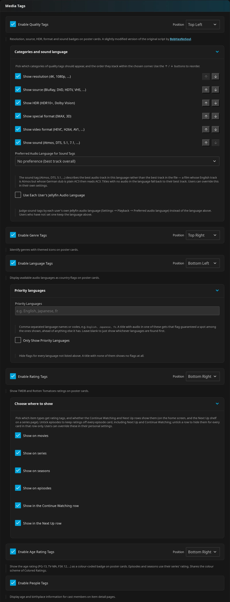

Tables below show factory defaults. Rows marked “Admin / personal” give both exact labels for the same preference. Most admin defaults become the starting values for new personal settings. Saved personal values take precedence, so changing a server default does not overwrite a user's choice.

!!! note "Hover hiding starts off"
    **Hide Tags on Hover** follows the admin value for new users, and overwriting personal settings applies it too.

!!! warning "Replacing everyone's preferences"
    **Overview** → **Quick Actions** → **Overwrite everyone's personal settings** replaces saved personal preferences with the current admin values. It also replaces other Enhanced display/playback preferences, so each user would need to reapply their customizations. Read [Settings Overview](../getting-started/settings-overview.md) before using it.

### Where tags appear

You'll see poster badges in library grids, home rows, Jellyfin search results, and supported rows on detail pages. People Tags appear on cast cards instead.

| Feature | What you see | Where it appears |
|---|---|---|
| [Quality Tags](#quality-tags) | Resolution, source, HDR, special format, video codec, sound | Supported library cards; series/season quality describes a representative episode |
| [Genre Tags](#genre-tags) | Up to three genre icons, with names on hover | Supported library cards with genre metadata |
| [Language Tags](#language-tags) | Up to three distinct flags or a no-dialogue symbol | Supported library cards; cached series/season flags cover their episodes, collection flags cover linked movies |
| [Rating Tags](#rating-tags) | Community star score and critic percentage | Supported library cards, subject to item-type and row scopes |
| [User-review chips](#user-review-chips) | Average visible review rating, or an optional dash | Movie, series, season, and episode cards with a usable review identity |
| [Age Rating Tags](#age-rating-tags) | Official parental/content classification | Supported library cards with classification metadata |
| [People Tags](#people-tags) | Age, age at release, birthplace, deceased styling | Cast and guest-cast cards on web item detail pages |
| [Audio language links](#audio-language-links) | Named audio languages linking to Jellyfin tag lists | Movie, series, season, and episode detail pages |
| [Player badges](#player-badges) | Scores in the controls; optional age/advisory badge at playback start | Jellyfin web video player |

[Native Poster Tags](#native-poster-tags-experimental) draw supported poster groups into images for eligible native clients. Their page and row limits differ from web overlays.

!!! note "Tags need metadata"
    Each badge needs suitable metadata. A supported card does not guarantee every tag will appear.

??? info "Supported cards and locations"
    Web poster overlays apply to supported movie, series, season, episode, collection (`BoxSet`), and video cards, including videos in Home Videos/Photos libraries. Detail-page rows include season/episode cards and the series **Next Up** shelf. Large episode list images can also carry overlays.

    The web overlays skip the large artwork in the detail page's information area, cast cards, chapter/scene cards, **My Media**, modal dialogs, small list images, and plugin/catalog/device/library administration cards. Seerr search and discovery cards do not receive these library tags.

### Positions and shared controls

You can place each poster group in a corner and hide badges on hover to make card buttons easier to see.

**How to use:**

1. In **UI Settings**, click the small four-corner selector beside a group's toggle. Administrators use **Position** for each poster group.
2. Choose **Top Left**, **Top Right**, **Bottom Left**, or **Bottom Right**.

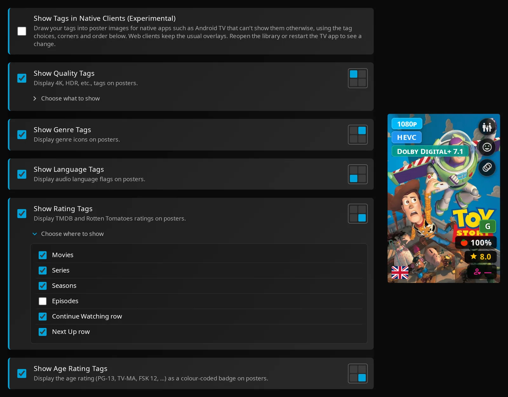

| Setting | Default | What it does |
|---|---|---|
| **Position** — Quality Tags | **Top Left** | Admin default and personal corner choice for quality badges |
| **Position** — Genre Tags | **Top Right** | Admin default and personal corner choice for genre icons |
| **Position** — Language Tags | **Bottom Left** | Admin default and personal corner choice for flags |
| **Position** — Rating Tags | **Bottom Right** | Admin default and personal corner choice for score and review chips |
| **Position** — Age Rating Tags | **Bottom Right** | Admin default and personal corner choice for classification badges |
| Admin / personal: **Hide Tags on Hover** | Off | Fades web poster overlays when you hover over a card, making its buttons easier to see; new and overwritten personal settings take the admin value |
| Admin: **Disable Tags on Search Page** | Off | Suppresses the poster overlays on Jellyfin web search results, including age-rating and review chips; useful for compatibility with Gelato |

Groups sharing a corner stack with a small gap rather than overlap. Top-right groups move below Jellyfin's watched or unplayed-count indicator. People Tags have their own cast-card layout and no corner selector.

With **Hide Tags on Hover** off, genre names expand beside their icons on hover. Turn it on to fade poster tags instead.

<figure class="je-video">
  <video autoplay loop muted playsinline controls preload="metadata" aria-label="Genre labels expand and poster tags fade on hover">
    <source src="../../images/tags/tag-hover.mp4" type="video/mp4">
  </video>
  <figcaption>Genre names expand with Hide Tags on Hover off; turning it on fades the tags instead.</figcaption>
</figure>

## Quality Tags

Quality badges help you identify a file's picture and sound format before opening it. They read Jellyfin's media metadata and naming signals.

**How to use:**

1. Turn on **Show Quality Tags** in **UI Settings**.
2. Expand **Choose what to show** and select categories.
3. Use **Move up** / **Move down** to change their stacking order.

Administrators configure the same defaults under **Categories and sound language** in **Media Tags**.

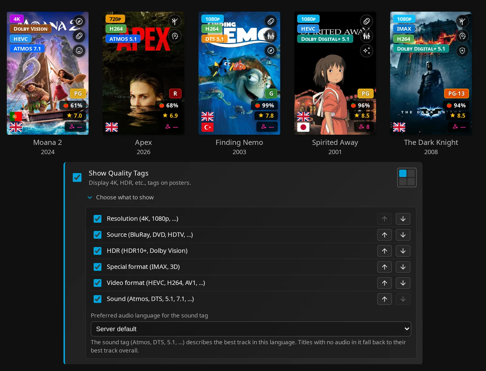

| Setting | Default | What it does |
|---|---|---|
| Admin: **Enable Quality Tags** / personal: **Show Quality Tags** | Off | Enables the quality group |
| Admin: **Show resolution (4K, 1080p, ...)** / personal: **Resolution (4K, 1080p, ...)** | On; first | Shows resolution from the first video stream |
| Admin: **Show source (BluRay, DVD, HDTV, VHS, ...)** / personal: **Source (BluRay, DVD, HDTV, ...)** | On; second | Shows the source of a physical-media stub |
| Admin: **Show HDR (HDR10+, Dolby Vision)** / personal: **HDR (HDR10+, Dolby Vision)** | On; third | Shows detected dynamic-range labels |
| Admin: **Show special format (IMAX, 3D)** / personal: **Special format (IMAX, 3D)** | On; fourth | Shows detected IMAX/3D labels |
| Admin: **Show video format (HEVC, H264, AV1, ...)** / personal: **Video format (HEVC, H264, AV1, ...)** | On; fifth | Shows video codec labels |
| Admin: **Show sound (Atmos, DTS, 5.1, 7.1, ...)** / personal: **Sound (Atmos, DTS, 5.1, 7.1, ...)** | On; sixth | Shows recognized audio format/channel information |
| Admin: **Preferred Audio Language for Sound Tags** | **No preference (best track overall)** | Chooses a fixed language whose audio tracks determine the sound tag |
| Admin: **Use Each User's Jellyfin Audio Language** | Off | Uses each user's Jellyfin preferred audio language; users without one retain the fixed admin language |
| Personal: **Preferred audio language for the sound tag** | **Server default** | Inherits server policy, uses **My Jellyfin audio language**, selects **No preference (best track overall)**, or chooses a specific language |

??? info "Badge examples"

    | Category | Examples the detector can produce |
    |---|---|
    | Resolution | `8K`, `4K`, `1440p`, `1080p`, `720p`, `576p`, `480p`, `LOW-RES` |
    | Source | `BluRay`, `HD DVD`, `DVD`, `VHS`, `HDTV`, `Physical` |
    | Dynamic range | `Dolby Vision`, `HDR10+`, `HDR10`, `HDR` |
    | Special format | `IMAX`, `3D` |
    | Video codec | `AV1`, `HEVC`, `H265`, `VP9`, `H264`, `VP8`, `XVID`, `DIVX`, `WMV`, `MPEG2`, `MPEG4`, `MJPEG`, `THEORA` |
    | Sound | `ATMOS`, `DTS-X`, `TRUEHD`, `DTS`, `Dolby Digital+`, `7.1`, `5.1`; codec labels can include channels, such as `ATMOS 7.1` |

### Detection limits

Series and season quality describes one representative episode, not every episode or media version. Missing streams or naming information can leave categories empty. Collections have no streams of their own and normally have no quality badges.

??? info "Detection and sound-language details"

    **Resolution:** JE first checks recognized video display-title hints, then dimensions. It rejects a misleading `4K`/`2160p` hint when the known height is below 1250 pixels.

    Dimension fallback recognizes 8K at height ≥3000 or width ≥7000, and 4K at height ≥1550 or width ≥3500. A 3840×1600 ultrawide file can therefore show `4K`. PAL-sized video can show `576p`. Sorting and styling support `SD`, but the current web resolution detector does not produce it.

    **Source and special format:** Source badges require a `.disc` media stub and select one source. An ordinary download's release name alone does not identify it as BluRay.

    IMAX detection uses title/name/path signals and excludes `NON-IMAX`. 3D requires a path containing `3d` and a recognized format signal such as `hsbs`, `fsbs`, `htab`, `ftab`, or `mvc`.

    **Sound:** JE takes the first recognized candidate display title, then checks technical metadata if no title matched. It detects channels separately. It does not rank every track by richness, despite the **No preference (best track overall)** option wording. Standalone channel fallback produces `5.1` or `7.1`; `2.0` can be appended to a recognized codec.

    A sound-language preference tries language plus region, then the base language, then all tracks if no match exists. For example, selecting a German AC3 5.1 dub can replace an English Atmos badge with `5.1`; the detector does not emit `AC3` as a codec label. These choices change the badge, not the audio selected for playback.

## Genre Tags

Genre Tags show up to three genres as compact Material Design icons, so you can recognize them while browsing. You can hover to see names beside the icons.

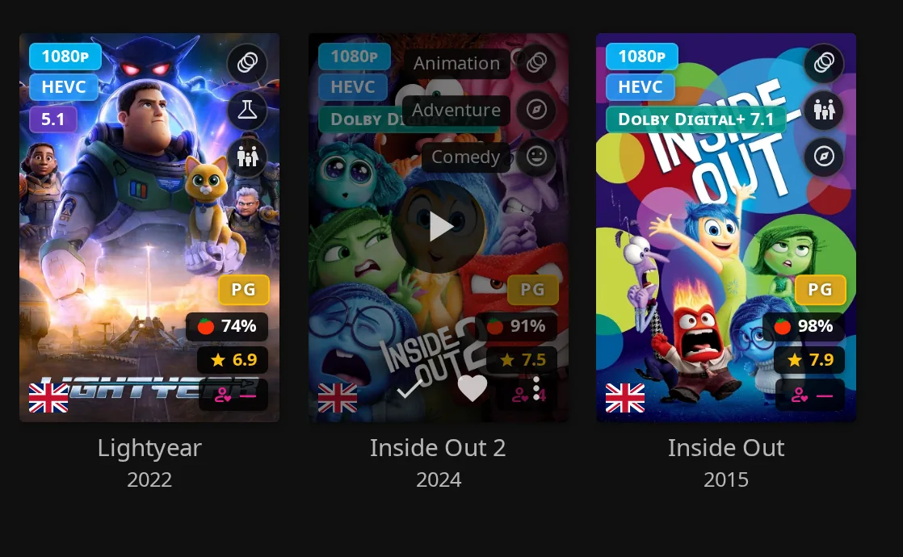

**How to use:**

1. Turn on **Show Genre Tags** in **UI Settings** and choose a corner.
2. Leave **Hide Tags on Hover** off to see expanded names.

| Setting | Default | What it does |
|---|---|---|
| Admin: **Enable Genre Tags** / personal: **Show Genre Tags** | Off | Shows up to three genre icons on supported cards |

??? info "Genre sources and hover behavior"
    Genres come from Jellyfin metadata. Unfamiliar names use a generic icon.

    With **Server-Side Tag Cache** on, series and season cards keep their own genres when present and use episode or parent-series genres only when their own are missing. In batch fallback, season cards prefer the parent series' genres whenever available, even if the season has its own. Series cards without genres use the first episode.

    With **Hide Tags on Hover** on, hover-name spans are omitted and the overlays fade out instead. There is no genre-name expansion in a static native poster image.

## Language Tags

Language Tags show available audio as flags, helping you find a dub while browsing. Audio with no linguistic content uses a crossed-out speech-bubble symbol labeled **No dialogue**.

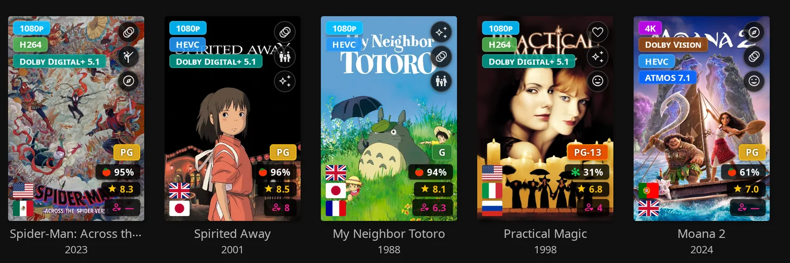

**How to use:**

1. Turn on **Show Language Tags** in **UI Settings**.
2. For readable language names, enable **Show Audio Languages** and use the [detail-page audio-language row](#audio-language-links).

Administrators can favor particular languages under **Priority languages**.

| Setting | Default | What it does |
|---|---|---|
| Admin: **Enable Language Tags** / personal: **Show Language Tags** | Off | Shows up to three distinct flags/symbols on supported cards |
| Admin: **Priority Languages** | Empty | Comma-separated language names or codes; use names such as `English, Japanese` to avoid differences between two- and three-letter codes. Matching flags appear first in list order |
| Admin: **Only Show Priority Languages** | Off | With a nonempty priority list, removes flags that do not match; an item can show fewer than three or none |

### Grouping, regions, and partial dubs

With **Server-Side Tag Cache** enabled, series and season cards show audio languages across their episodes. A dub missing from some episodes has a dimmed flag with a dashed outline and “not on all episodes” in its title/alt text.

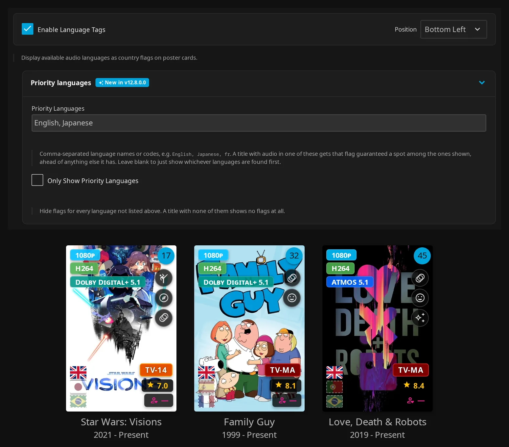

??? info "Flag grouping, coverage, and regions"
    Flags come through Jellyfin Enhanced's asset service. Tracks marked `zxx` (no linguistic content) use the **No dialogue** symbol.

    Languages sharing a flag are grouped before the three-flag limit. Their names are stored in the flag's title/alt text. Poster flags do not show hover tooltips.

    Priority filtering also operates on grouped flags: a matching flag can represent additional languages sharing it. An empty priority list leaves flags unchanged even with strict filtering on. Language priorities are server policy, with no personal priority-list setting.

    Priority matching uses the flag's language code, its base code, or its displayed language names. It does not equate two- and three-letter codes: `ja` does not match `jpn`, but `Japanese` matches the displayed name.

    The cached flags use the union of audio languages across episodes. Full-coverage flags normally come first, but administrator priorities can put a partial flag ahead of them. A grouped flag is partial only when all its represented languages are partial.

    Specials do not count against a series' full-coverage languages. Tracks with no usable language tag are ignored. Equivalent tags such as `eng`/`en` or `fre`/`fr-FR` can count as the same dub. Regional variants that coexist in one episode, such as `es-419` and `es-ES`, are assessed separately.

    In batch fallback mode, series/season poster flags reflect a representative episode and do not show partial coverage.

    Cached collection flags combine languages from linked movie members. A collection containing an English movie and a Japanese movie can therefore show both flags; it does not mean every member has both languages.

    Regional flags require explicit regional metadata. For example, `pt-BR` shows Brazil, `pt`/`pt-PT` show Portugal, `es-419`/`es-MX` show Mexico, and `zh-Hant` shows Taiwan. A base language such as `pt`, `es`, or `zh` keeps its default flag; JE does not guess a region.

!!! note "Tagging matters"
    Region detection depends on the language metadata in the media file. Poster Language Tags and the detail-page audio-language row have separate switches; enabling one does not enable the other.

## Audio language links

The detail-page audio-language row shows language names and flags. You can also sync languages to Jellyfin metadata tags, so clicking a matching language opens a list of items with that tag.

**How to use:**

1. Keep **Show Audio Languages** on in **UI Settings** to display the row.
2. As an administrator, open **Display** → **Audio Language Tags** and turn on **Enable Audio Language Tags Sync** and **Link audio languages to their tag page**. Click **Save Settings**.
3. Run **Sync Audio Language Tags to Jellyfin** under **Dashboard** → **Scheduled Tasks** → **Jellyfin Enhanced** to tag existing movies and series.

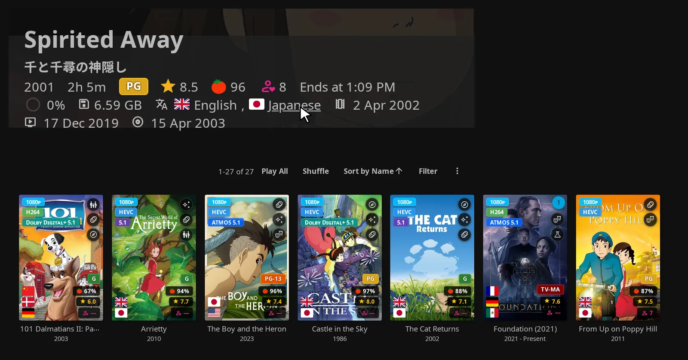

Admin settings below are under **Display**; the row's default is in **UI Preferences**, and synchronization controls are in **Audio Language Tags**.

| Setting | Default | What it does |
|---|---|---|
| Admin: **Show available audio languages on item detail page** / personal: **Show Audio Languages** | On | Displays the audio-language row on movie, series, season, and episode detail pages |
| Admin: **Enable Audio Language Tags Sync** | Off | Writes audio languages as Jellyfin tags on movies and series |
| Admin: **Tag Prefix** | `JE Language: ` (trailing space) | Prefixes synchronized language tags |
| Admin: **Link audio languages to their tag page** | On | Turns a displayed language into a link when a matching synchronized tag exists on the item |

!!! note "Schedule language synchronization"
    **Sync Audio Language Tags to Jellyfin** has **no default schedule**. Add a trigger or run it manually, especially with the server cache off.

??? info "Language matching and synchronization"
    A regional track gets a base tag, such as `JE Language: English`, and a regional tag, such as `JE Language: English (United States)`. A regional chip tries the matching regional tag first, then its base tag. Without a match it remains plain text.

    The synchronized series tags combine languages across episodes. The detail-page row itself uses a representative episode for series/seasons. It can therefore show fewer languages than cached poster flags or synchronized series tags.

    For playable items, changing the selected media version can change the row. More than three languages can scroll horizontally; missing usable data shows a dash.

    Synchronization directly tags movies and series, not seasons or episodes. With the server cache on, cache updates can sync new or changed items after library changes. Cache-excluded items skip that update path but can still be processed by the standalone task.

    Updates remove stale tags only under the current prefix. Changing the prefix leaves old-prefix tags behind. Disabling synchronization does not delete existing tags.

## Rating Tags

Rating Tags show Jellyfin's community score as a yellow-star chip and its critic score as a percentage. You can choose which item types and home rows show them.

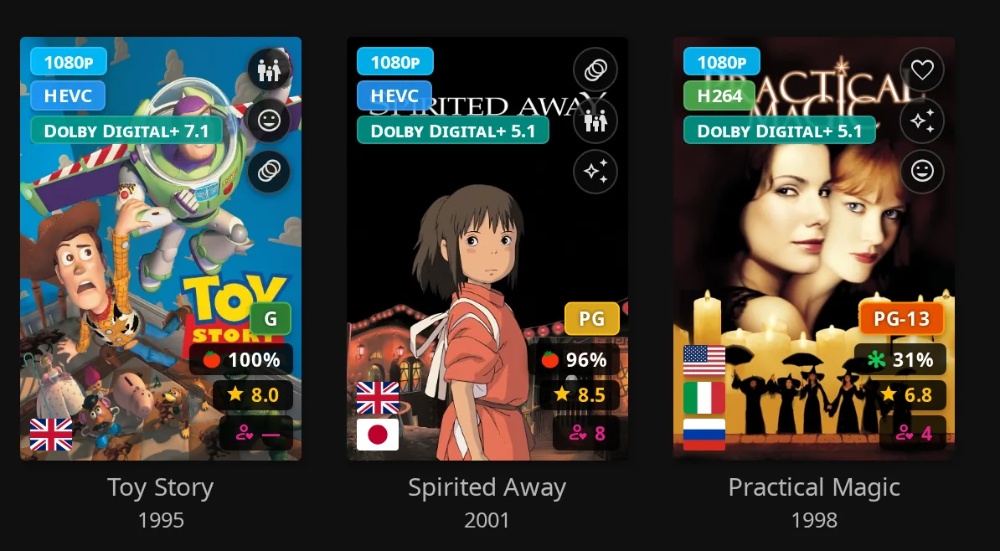

**How to use:**

1. Turn on **Show Rating Tags** in **UI Settings**.
2. Expand **Choose where to show** and select item types and home rows.

Administrators set defaults under the same heading in **Media Tags**.

| Setting | Default | What it does |
|---|---|---|
| Admin: **Enable Rating Tags** / personal: **Show Rating Tags** | Off | Enables poster score chips and, when configured, user-review chips |
| Admin: **Show on movies** / personal: **Movies** | On | Allows rating and review chips on movie cards |
| Admin: **Show on series** / personal: **Series** | On | Allows rating and review chips on series cards |
| Admin: **Show on seasons** / personal: **Seasons** | On | Allows rating and review chips on season cards |
| Admin: **Show on episodes** / personal: **Episodes** | On | Allows rating and review chips on episode cards |
| Admin: **Show in the Continue Watching row** / personal: **Continue Watching row** | On | Allows rating and review chips in that row |
| Admin: **Show in the Next Up row** / personal: **Next Up row** | On | Allows rating and review chips in home **Next Up** and the series-page shelf |

Your item-type and row choices both apply. Turn off **Episodes** to hide these chips on every episode card, including **Next Up** and **Continue Watching**. Turn off a row to hide them only in that row. These choices do not hide quality, genre, language, or age-rating badges.

??? info "Score sources and fallback"
    Collections and videos are not governed by the four type switches. Critic scores below 60% use the rotten icon; 60% and above use the fresh icon. Built-in chip colors are fixed rather than a score gradient.

    Scores come from Jellyfin's `CommunityRating` and `CriticRating`. Their sources depend on your metadata providers or synchronization, including [MDBList settings](../other/other-settings.md#mdblist-ratings). The overlays do not fetch TMDB or Rotten Tomatoes scores directly. A community score displayed as `0.0` becomes a dash; absent scores do not produce their respective chips.

    Season/episode score fallback differs by data path. The server cache substitutes both series scores when the child's community score is null. Batch fallback and player scores use the series only when neither child score is truthy. A child with only a critic score can therefore display differently between the cache and fallback paths.

!!! note "Spoiler Guard and scores"
    [Spoiler Guard](../spoiler-guard/spoiler-guard-settings.md) can suppress score data on protected items. Age classifications have a separate policy, described below.

### User-review chips

A pink person-with-heart chip shows the average star rating from reviews visible to you. It converts the 1–5 average to a /10 display: a four-star average appears as `8`.

**How to use:**

1. As an administrator, open **Elsewhere** → **User Reviews**.
2. Turn on **Enable User Written Reviews** and **Show average user rating on poster cards**, then click **Save Settings**.
3. Each viewer must also enable **Show Rating Tags**. There is no separate personal review-chip switch.

To contribute, open an eligible detail page and click **Write a Review**. Choose stars, enter review text, or both.

| Setting | Default | What it does |
|---|---|---|
| **Enable User Written Reviews** | Off | Enables JE's stored user reviews; independent of Elsewhere and TMDB Reviews being enabled |
| **Show average user rating on poster cards** | Off | Adds the average-review chip to eligible cards with Rating Tags enabled |
| **Show "—" on posters for unrated items** | On | Shows a dash when no visible aggregate star rating exists; off removes that chip |
| **Hide reviews from hidden users** | On | Hides those authors' reviews from other non-admin viewers; self-view and admin exceptions apply |
| **Hide reviews from disabled users** | On | Applies the same visibility rule to disabled accounts |
| **Also save review star ratings as the user's Jellyfin rating** | Off | Mirrors movie/series review stars to Jellyfin's personal /10 rating, independently of the displayed average |

The optional dash means there is no visible average star rating, even if you have written a text-only review.

!!! warning "Mirroring replaces your Jellyfin rating"
    **Also save review star ratings as the user's Jellyfin rating** overwrites an existing personal Jellyfin rating.

??? info "Review identities, limits, and mirrored ratings"
    Movies and series require a TMDB ID. Seasons and episodes require the parent series' TMDB ID and their season/episode numbers.

    Matching identities share reviews across duplicate library items. Collections and generic videos do not have these review chips. The chips follow the same corner and scope exclusions as Rating Tags and respect applicable Spoiler Guard review restrictions.

    Stars range from 1–5 in half-star increments. Review text is limited to 2,000 characters, and a review needs stars or nonblank text. Only reviews with stars contribute to the poster average.

    Deleting a review or removing its stars clears the mirrored rating only if it still matches. A rating changed elsewhere is preserved. Season/episode reviews are not mirrored. Writing and moderating reviews is covered in [User Reviews](../elsewhere/elsewhere-features.md#user-reviews).

## Age Rating Tags

Age Rating Tags show the official parental/content classification Jellyfin already has, such as `PG-13`, `R`, `TV-MA`, `FSK 12`, or `BBFC 15`. Supported rating-board labels receive predefined colors, with a fallback for other labels.

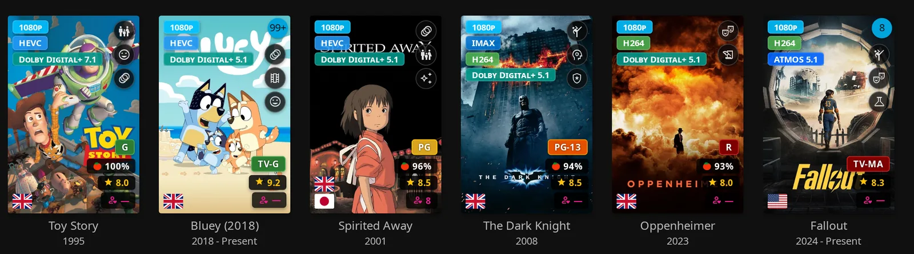

**How to use:** Turn on **Show Age Rating Tags** in **UI Settings** and choose a corner.

| Setting | Default | What it does |
|---|---|---|
| Admin: **Enable Age Rating Tags** / personal: **Show Age Rating Tags** | Off | Shows the item's official classification on supported cards |
| Admin: **Colored Ratings Backgrounds** | Off | Under **Extras** → **UI Tweaks**, colors official classification boxes on detail pages and applicable player elements |

The default bottom-right position stacks with Rating Tags. Seasons and episodes normally show their own nonblank classification, or their series' classification if they have none.

Poster age badges use classification colors independently of **Colored Ratings Backgrounds**. That separate switch controls detail/player classification boxes.

??? info "Classification labels and colors"
    Equivalent labels share colors. For example, `DE-12` and `FSK 12` become `FSK-12`, and supported unrated labels become `NR`. Color support includes international boards, US TV descriptors, and ESRB classifications. These are classification colors, not gradients for community/critic scores.

!!! note "Spoiler Guard and classifications"
    Age classifications remain visible. When score stripping protects unwatched episodes or unstarted seasons, the badge can deliberately use the series classification instead of the child's own rating, avoiding a hint from an unusually high episode classification.

## People Tags

People Tags add age and birthplace facts to cast and guest-cast cards on item detail pages. They support rectangular and round portraits.

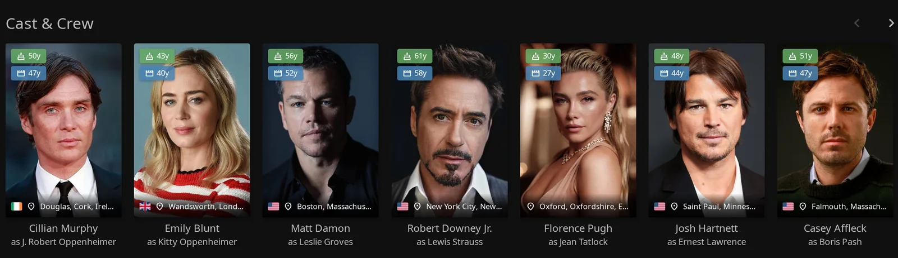

**How to use:**

1. Turn on **Show People Tags** in **UI Settings**.
2. Open a title's detail page and view its cast.

Administrators can set the starting value in **Media Tags**.

| Setting | Default | What it does |
|---|---|---|
| Admin: **Enable People Tags** / personal: **Show People Tags** | Off | Adds age chips, birthplace information, and deceased styling to cast cards |
| Admin: **Tags Cache Duration (days)** | 30 | Sets the lifetime of cached person facts in the browser; allowed range 1–365 |

You'll see green current-age chips, red age-at-death chips, and blue age-at-release chips near the top of a rectangular portrait. Birthplace appears along the bottom, with a country flag when the place can be resolved. Deceased people receive a cross and grayscale styling; round portraits use an adjusted layout.

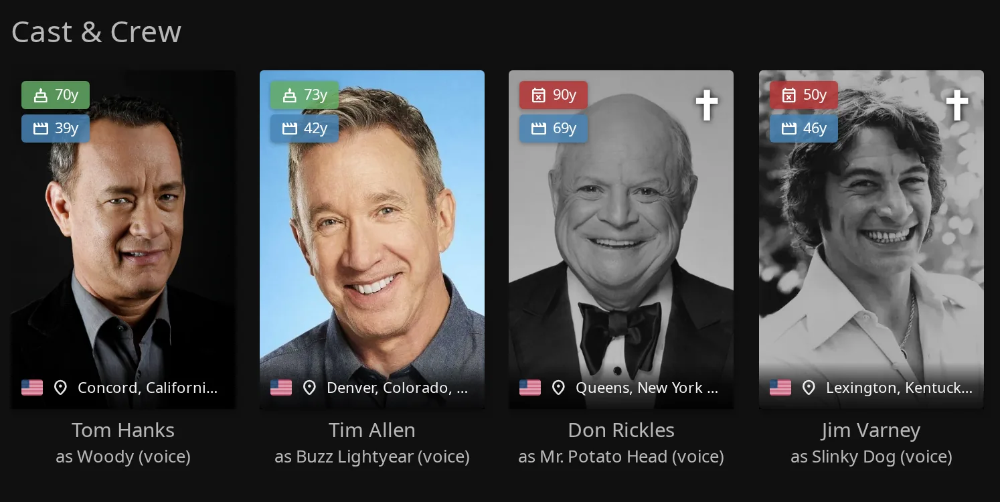

!!! note "Optional TMDB enrichment"
    To add facts from TMDB, the person needs a TMDB ID and your administrator must set **TMDB API Key** under **Elsewhere**.

??? info "Person metadata and caching"
    Facts come from Jellyfin person metadata. Failed or unavailable TMDB enrichment keeps usable Jellyfin facts. Missing birth/death dates or birthplace omit the corresponding details. Age at release also needs the viewed item's visible premiere date; hidden or stripped dates cannot supply it.

    Age at release is calculated from birth to premiere without a death-date limit. For a posthumous release, that chip can show an age the person never reached.

    Birthplace flags require the last comma-separated part of the place to match a recognized country name. A place ending in `England UK` can therefore show its text without a flag.

    The separate browser facts cache holds at most 3,000 people. Ages are calculated from cached dates for the current visit rather than kept as stale age numbers. People Tags are web cast overlays and are not drawn by Native Poster Tags. Spoiler Guard can remove protected guest-cast/cast cards before these overlays appear.

## Player badges

You can show scores in the web video player's controls and an age-classification badge when playback starts. These are independent server settings; neither has a personal control in the panel.

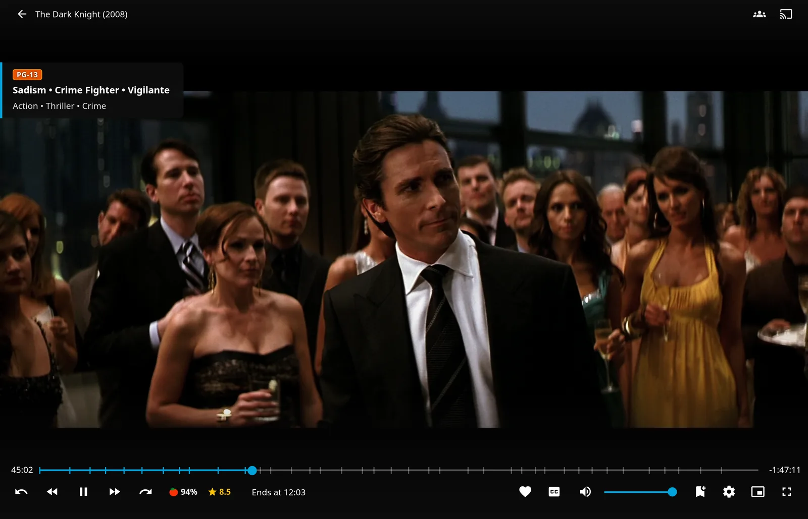

**How to use:**

1. Configure score chips under **Display** → **Media Tags**.
2. Configure the playback-start classification badge under **Playback** → **Playback & Tab Switch**.
3. Click **Save Settings**, then refresh the web client.

| Setting | Default | What it does |
|---|---|---|
| **Show Rating in Video Player** | On | Shows community and critic score chips near the time information in the on-screen controls, before **Ends at** |
| **Show Age Rating When Playback Starts** | Off | When an official classification is available, shows it with up to three recognized advisory tags and up to three genres when playback starts |

Neither setting requires poster Rating Tags or Age Rating Tags. Poster scope switches do not control player score chips.

??? info "Player score and classification behavior"
    Player score chips use Jellyfin's rating fields and can fall back to series scores when a season/episode has neither score.

    The playback-start badge needs an official classification. It uses the series' classification when an episode has none. It displays for five seconds, followed by a 400 ms fade.

    Advisories are selected from matching Jellyfin metadata tags. Episodes also use series genres when their own are missing and incorporate series tags. Missing advisories or genres omit only their respective lines. **Colored Ratings Backgrounds** can color its classification box.

## Server-Side Tag Cache

The server cache prepares tags for supported items in included libraries, so each page avoids repeating metadata requests. You receive only data allowed by your library access and Spoiler Guard policy. A change to a user's library or channel access, parental rating, schedule or tag rules applies to their next page load; on 10.11 too, where Jellyfin saves a policy without telling plugins.

**How to use:**

1. Leave **Server-Side Tag Cache** on under **Display** → **Media Tags**. Choose library exclusions if needed.
2. After changing exclusions, or after a plugin update that changes tag computation, click **Save Settings** and open **Admin** → **Tag Cache**.
3. Click **Rebuild Server Tag Cache** and confirm the full rebuild.
4. Check server logs for progress and completion. The existing cache keeps serving while the new one builds in the background.

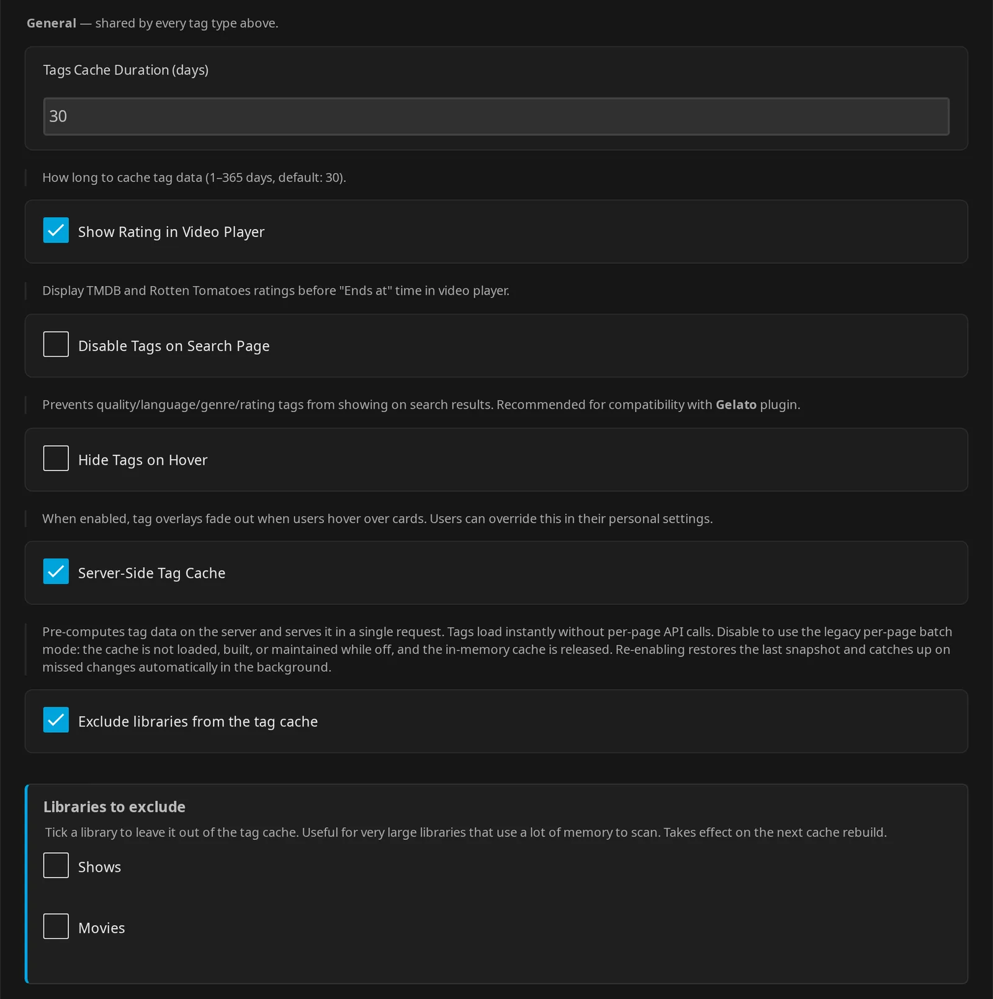
*Browser fallback controls appear only with **Server-Side Tag Cache** off.*

| Setting | Default | What it does |
|---|---|---|
| **Server-Side Tag Cache** | On | Loads, builds, and maintains the server cache; off uses per-page batch fallback |
| **Exclude libraries from the tag cache** | Off | Reveals library selection for omitting libraries from precomputation |
| **Libraries to exclude** | Empty | Selects libraries to skip on the next full rebuild; an empty selection excludes nothing |
| **Tags Cache Duration (days)** | 30 | Lifetime of browser fallback entries and People Tags facts, not the server cache's refresh schedule; range 1–365 |
| **Persist Tag Fallback Cache in Browser Storage** | Off in configuration | Visible only with **Server-Side Tag Cache** off; saving in that mode forces it on. See Browser storage and fallback below |
| **Clear All Client Caches** | Action | Visible here only with **Server-Side Tag Cache** off; signals clients to invalidate JE caches on their next load. Does not rebuild the server snapshot or reset server-stored personal preferences |

### Builds, refreshes, and exclusions

The retained cache grows with the number of included items. Exclude large libraries or disable server mode if its memory cost is unsuitable.

??? info "Cache lifecycle and excluded libraries"
    When poster review chips are enabled, visible review averages travel with the filtered cache data.

    At startup, JE restores `tag-cache.json` from `<PluginsPath>/configurations/Jellyfin.Plugin.JellyfinEnhanced/`. If no usable cache is available, it queues **Refresh Tag Cache** to build one. Library item additions, updates, and removals keep entries current. The scheduled task normally reconciles changes rather than recomputing every item. Its default daily trigger is 03:00.

    Excluded libraries do not lose access or forcibly lose their web tags. Cards without a server entry can use per-page batch fallback. Exclusions also bypass the normal cache-update audio-language synchronization path; the standalone language-sync task can still process those items.

    Builds load item data in small pages to reduce peak memory.

    Turning server mode off releases the in-memory cache and stops loading, building, monitoring, and scheduled refresh work. The saved snapshot remains on disk. Clients pick up the switch on their next load.

    Re-enabling from the dashboard restores the snapshot and catches up on missed changes in the background, without a restart.

    If you edit the configuration file by hand instead, restart Jellyfin and run **Refresh Tag Cache** to catch up.

### Browser storage and fallback

Turn off **Server-Side Tag Cache** to reveal **Persist Tag Fallback Cache in Browser Storage** and **Clear All Client Caches** in **Media Tags**.

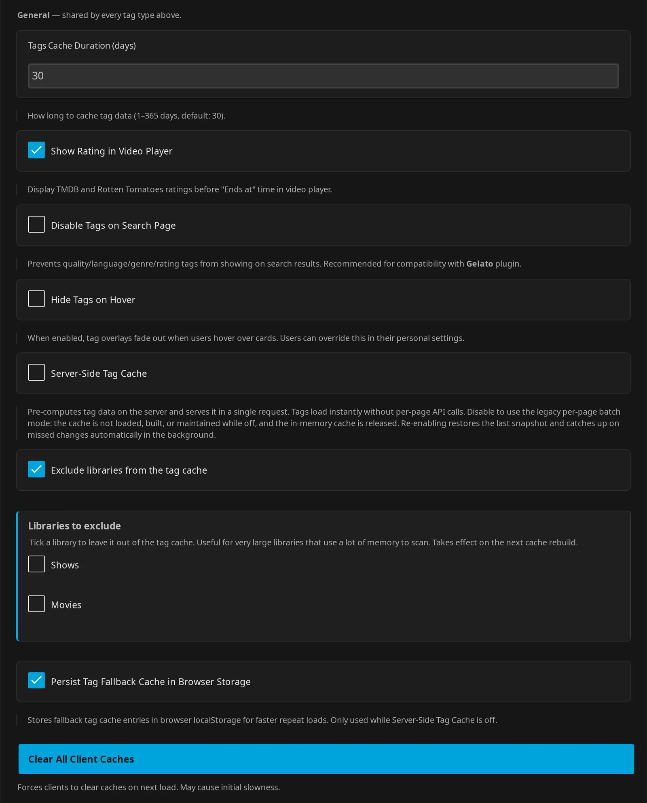

??? info "Browser storage and fallback details"
    The first web load downloads the server payload and saves an IndexedDB copy scoped to that server and user. Later loads restore that copy and request changes since the saved cursor. Tags wait for confirmation that the stored version and access/Spoiler Guard revision still match. A rebuild or changed filtering replaces the copy, including changes made from another device. Navigation also checks for updates, with requests spaced during rapid browsing.

    The stored copy is invalidated when server mode is switched off, by **Clear All Client Caches**, or when another account signs in in the same browser. Each copy contains that user's filtered, spoiler-safe data.

    Without usable IndexedDB, including some private modes or storage failures, the client downloads the payload again on each page load and uses memory only.

    Saving with the server cache off forces **Persist Tag Fallback Cache in Browser Storage** on. The client enables localStorage fallback whenever server mode is off.

    Batch fallback fetches the items needed for the current page and keeps frequently used entries in memory. With server mode off, it also persists fallback entries in localStorage, using **Tags Cache Duration (days)**. This is separate from the full server-payload copy in IndexedDB. Browser storage failures leave tags able to fetch data again. Average-review lookups in fallback mode are batched separately.

### Related routes

??? info "Diagnostic routes"
    These routes are useful when diagnosing a cache problem; routine setup uses the dashboard controls above. All require authentication. See the [API reference](../advanced/api.md) for broader API use.

    | Route | Access and behavior |
    |---|---|
    | `GET /JellyfinEnhanced/tag-cache/{userId}` | Own account or administrator; filtered cache payload. Returns 404 when server mode is off. Optional `since` is a Unix-millisecond cursor; use the returned generation `timestamp`, not `servedAt` |
    | `POST /JellyfinEnhanced/tag-data/{userId}` | Own account or administrator; per-page fallback for accessible items. Body is a nonempty array of at most 200 item-ID strings; optional `mediaSourceId` selects a media version |
    | `POST /JellyfinEnhanced/tag-cache/rebuild` | Administrator only; starts a full background rebuild. Returns 400 with server mode off, or 409 if a rebuild is already running |
    | `GET /JellyfinEnhanced/audio-language-tags?codes=…` | Returns base/regional synchronized tag names for the supplied comma-separated language codes; empty mapping when sync is off |

## Native Poster Tags (Experimental)

Native Poster Tags add your enabled poster groups to images shown in eligible native apps, without changing the original artwork files. The feature is built into JE, so you need no companion plugin or client modification.

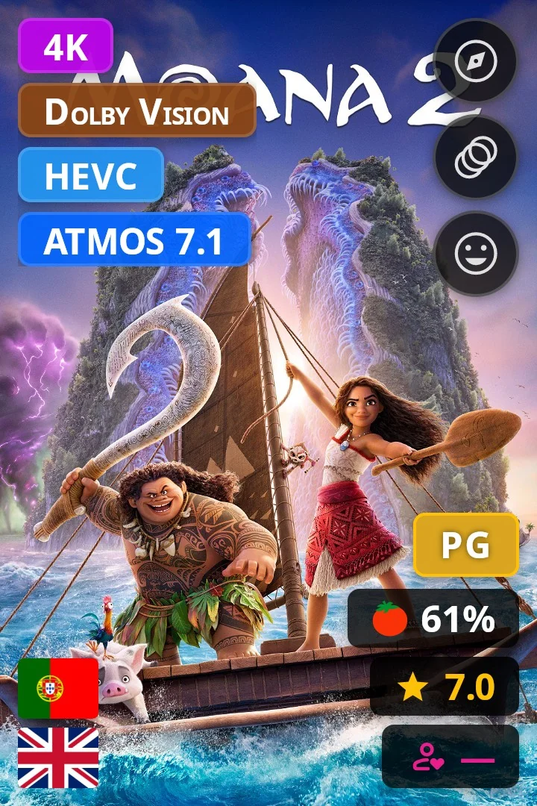
*Server preview; this is not a native-app screenshot.*

**How to use:**

1. Enable suitable tag groups and ensure the items have the required metadata.
2. Under **Display** → **Media Tags**, turn on **Enable Native Poster Tags (Experimental)** and click **Save Settings**.
3. Each user can opt out with **Show Tags in Native Clients (Experimental)** in **UI Settings**.
4. Reopen the native app's library or restart the app to pick up changed poster addresses.

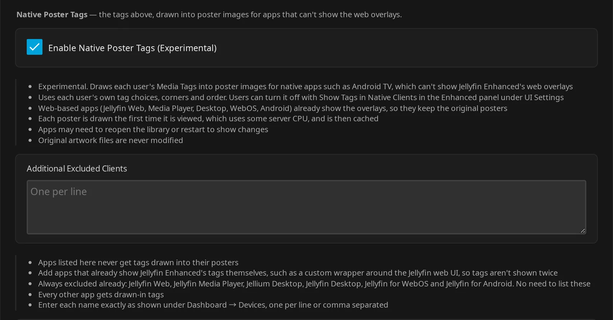

| Setting | Default | What it does |
|---|---|---|
| Admin: **Enable Native Poster Tags (Experimental)** | Off | Server-wide master switch; off serves original posters and stops native tag composition |
| Admin: **Additional Excluded Clients** | Empty | Adds web-wrapper client names that should retain original posters; newline- or comma-separated |
| Personal: **Show Tags in Native Clients (Experimental)** | On while allowed | Shows tags in native clients; hidden while the master switch is off, retaining the saved choice |

??? info "Stored native preferences"
    The admin configuration uses `NativePosterTagsEnabled` and `NativePosterTagsWebClientNames` for the master switch and additional client exclusions. The personal `UseNativePosterTags` value permits native tags when null or true; false opts out while retaining the preference when the master switch is off.

!!! note "Enable the tag groups too"
    The master switch alone does not produce visible tags: each user's applicable groups start off.

??? info "Supported groups and preferences"
    JE draws tags into Primary images for movies, series, seasons, episodes, collections, and videos. Supported groups are quality, genre, language, community/critic rating, user-review, and age-classification. People Tags are not a native group.

    It uses personal tag switches, corners, quality categories/order, sound-language preference, and rating item-type scopes, together with the administrator's language-priority policy.

### Eligible clients and requests

Examples of native clients include Jellyfin for Android TV, Tizen, Swiftfin, Findroid, and Streamyfin.

The built-in exclusions are Jellyfin Web, Jellyfin Media Player, Jellium Desktop, Jellyfin Desktop, Jellyfin for WebOS, and Jellyfin for Android (the phone app). These load web overlays and retain original poster images. Jellyfin for Android TV is a different client name and is eligible.

If a custom web wrapper shows tags twice, add its name as shown under **Dashboard** → **Devices** to **Additional Excluded Clients**.

??? info "Client matching and image requests"
    Native tags depend on the app retaining Jellyfin's personalized image tag in its poster request. Requests that omit it, or ask Jellyfin to draw its own watched/progress/unplayed-count indicators into the image, retain original artwork.

    Exclusion matching trims whitespace and compares exact names without case sensitivity. Unidentified clients are excluded.

### Limits and caching

??? info "Layout, Spoiler Guard, and image caching"

    - **Static layout:** genre hover names and **Hide Tags on Hover** do not apply. Size follows the image width rather than the app's final display size; landscape episode images use an adjusted layout.
    - **No page or row context:** **Disable Tags on Search Page** and the **Continue Watching row** / **Next Up row** rating scopes do not apply. Item-type scopes still apply. Tags can appear anywhere the app reuses that Primary image, including search and detail pages. If an episode card uses a series poster, its tags describe that image's owner.
    - **Spoiler-safe data:** native composition applies the user's Spoiler Guard stripping policy. Artwork follows the configured stock-card/blur policy, rather than always using blur. Spoiler-scoped responses use `no-store` so an old poster is not retained under a changed policy.
    - **First-view cost:** the server draws a poster the first time a particular variant/size is requested. Rendered images are cached with a 128 MiB memory budget and approximately 1 GiB disk budget under Jellyfin's cache directory, `jellyfin-enhanced/poster-tags`.
    - **Refreshes:** settings changes can change poster addresses. With the server tag cache on, tag-data changes also change addresses for cached items. Apps can need a library refresh or restart to use them. With the cache off, tag-data changes keep the same URL; apps can show the old composite for up to an hour before revalidating that URL.
    - **Fallback:** unsupported identity/token requests, missing renderable tags, decode/render failures, sources over 32 MiB, or decoded image sides outside 32–4096 pixels can yield original artwork. These are implementation limits, not adjustable settings.

??? note "Signing key and backups"
    JE stores a 32-byte signing secret in `<PluginsPath>/configurations/Jellyfin.Plugin.JellyfinEnhanced/native-poster-tags.key`, separately from rendered-image caches. Preserve it in backups to retain personalized URL-signing continuity. JE recreates a missing or invalid key. Older URLs can then serve original artwork until clients refresh.

    If the key cannot be persisted, JE logs a warning and uses a process-lifetime key that changes after restart.

    On Unix, new keys use owner-only read/write permissions. There is no setting for this internal key.

??? info "Administrator preview route"
    Administrators can diagnose composition with `GET /JellyfinEnhanced/native-poster-tags/preview/{itemId}`. It requires an accessible supported item, an existing target user, and a local Primary image.

    Optional `userId` defaults to the caller. `width` defaults to 360, and width/optional height are clamped to 32–2048. Optional `topRightOffset` controls indicator clearance.

    The JPEG response uses `no-store` and includes `X-JE-Poster-Tags-*` diagnostics.

    The preview attempts composition even with the master/personal native switch off. It strips tag data for Spoiler Guard but uses original, unblurred artwork. It therefore does not preview image protection.

## Tag Styles and CSS

Use Tag Styles to change supported tag colors without writing CSS. The server editor can apply colors to web overlays, native poster images, or both.

**How to use:**

1. Open **Display** → **Media Tags** and turn on **Enable Tag Styles**.
2. Choose **Apply Tag Styles To**.
3. Click a tag to edit its colors and opacity (0–100%), or choose a preset and click **Apply Preset**.
4. Click **Save Settings** and refresh clients as needed.

Use **Reset This Tag** to restore a tag's defaults, or **Reset All Tag Styles** to remove all overrides.

<figure class="je-video">
  <video autoplay loop muted playsinline controls preload="metadata" aria-label="Selecting a tag style preset and editing its colors">
    <source src="../../images/admin/tag-styles.mp4" type="video/mp4">
  </video>
  <figcaption>Apply a preset, edit a tag's color and opacity, then reset the styles.</figcaption>
</figure>

| Setting | Default | What it does |
|---|---|---|
| **Enable Tag Styles** | Off | Enables saved color overrides; disabling it preserves edits |
| **Apply Tag Styles To** | **Both (Jellyfin Web and poster images)** | Alternatives: **Jellyfin Web only** or **Poster images only (apps without web overlays)** |
| **Preset** | **Default colours** | Selects **Glass**, **Outline**, **Dark**, **Light**, or **Default colours** for **Apply Preset** |
| **Apply to** | **All tags** | Applies a preset or bulk colors to all editable groups, or **This tab only** |
| **Colours** | Background `#000000` at 60%; Border `#ffffff` at 50%; Text `#ffffff` at 100%; application boxes unchecked | Selects bulk colors and opacity; check the fields to include, then use **Apply Colours** |

| Editor tab | Editable fields |
|---|---|
| **Quality** | **Background**, **Border**, **Text** |
| **Age ratings** | **Background**, **Border**, **Text** |
| **Rating chips** | **Background**, **Text and star** |
| **Genre** | **Background**, **Border**, **Icon** |

Saved overrides start empty. The bulk color pickers do not apply themselves automatically. Language flags and People Tags are not editor tabs.

??? info "Stored style configuration"
    The saved fields are `TagStylesEnabled`, `TagStyleTarget` (`both`, `web`, or `native`), `TagStylePreset` (`default` initially), `TagStyleApplyScope` (`all` or `tab`), and `TagStyleOverrides` (an empty string initially). Applying bulk colors sets the preset value to `custom`.

!!! note "Check the style scope"
    **Apply to** returns to its saved value after you switch editor tabs, select a tag, or apply a preset or bulk colors. Select **This tab only** immediately before each application if you want to limit changes to the current tab.

Styles change colors, not size, shape, position, or visibility. For web layout, sizing, hiding, and more detailed styling, see [CSS Customization](../advanced/css-customization.md).

!!! note "Style requirements"
    Native colors require **Enable Native Poster Tags (Experimental)**. Enable the tag feature and supply metadata first: CSS cannot create missing tags or restyle pixels already drawn into an image.

??? info "Web CSS behavior"
    On the web, critic-chip styling also reaches user-review chips because they share that chip class.

    Saved Tag Styles use stronger important color rules than simple CSS recipes, but sufficiently specific important custom CSS can override them. Prefer the corner controls to transforms that can disrupt shared-corner stacking. Genre-name styling requires **Hide Tags on Hover** off. Hiding a displayed flag with CSS does not make a fourth flag appear.

??? info "Style API routes"
    The effective web color overrides are available through authenticated `GET /JellyfinEnhanced/tag-styles` (empty when disabled or targeting native only). The shipped defaults catalog is administrator-only `GET /JellyfinEnhanced/tag-styles/catalog`.

Other integrations have separate badge systems: see [Seerr](../seerr/seerr-features.md) for request/availability/provider badges and [*arr](../arr/arr-features.md) for service status and synchronized tag links. Those are configured independently of these poster groups.
