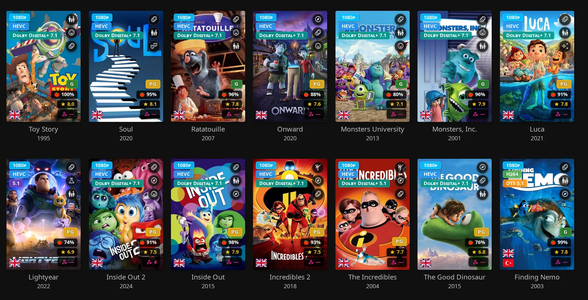
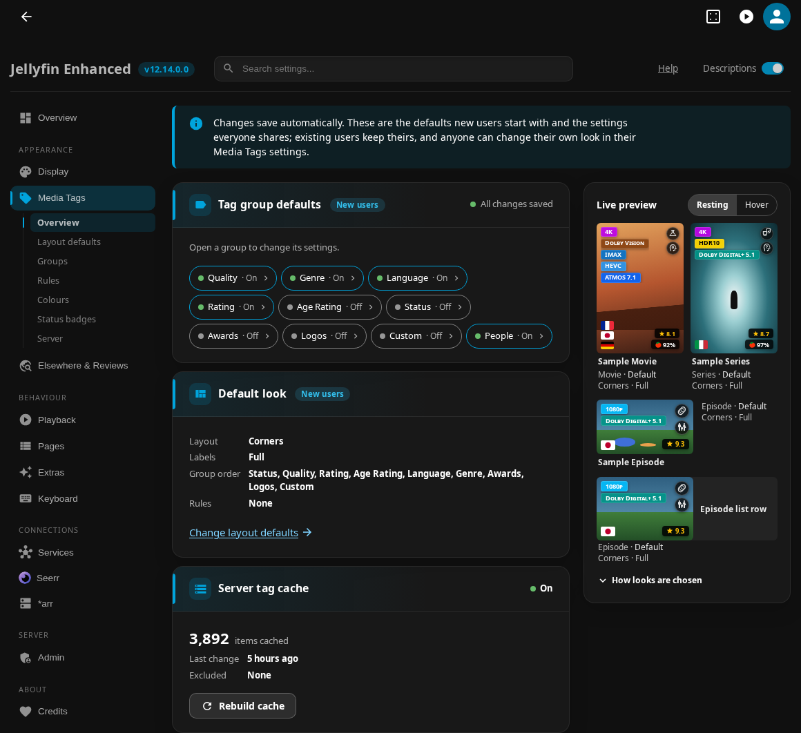
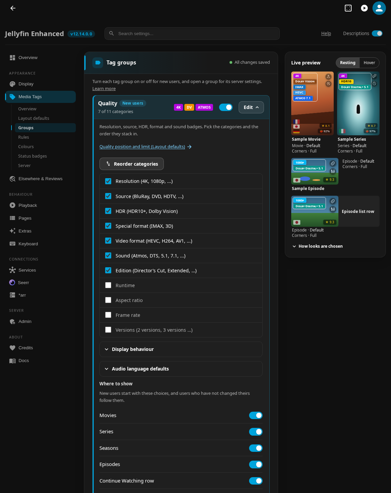
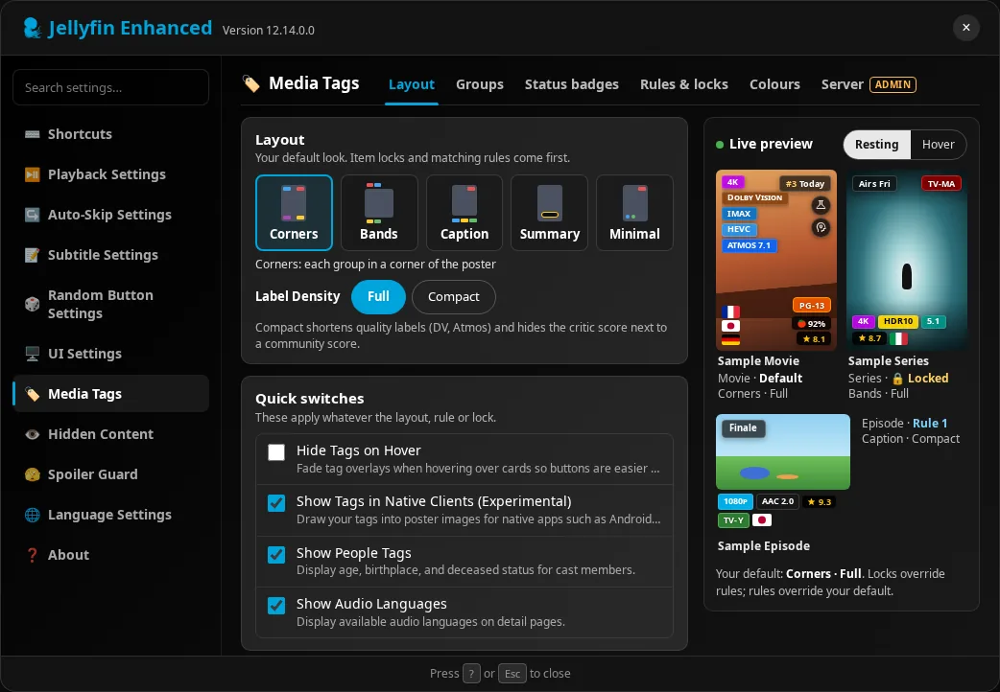
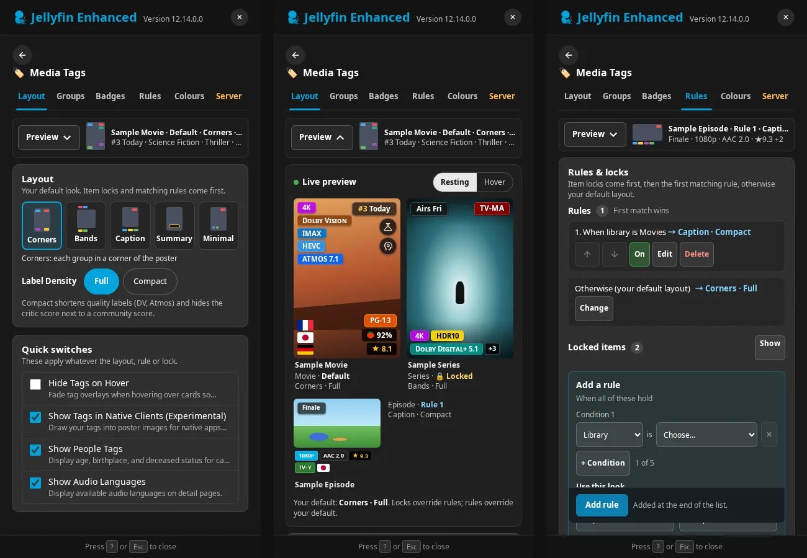
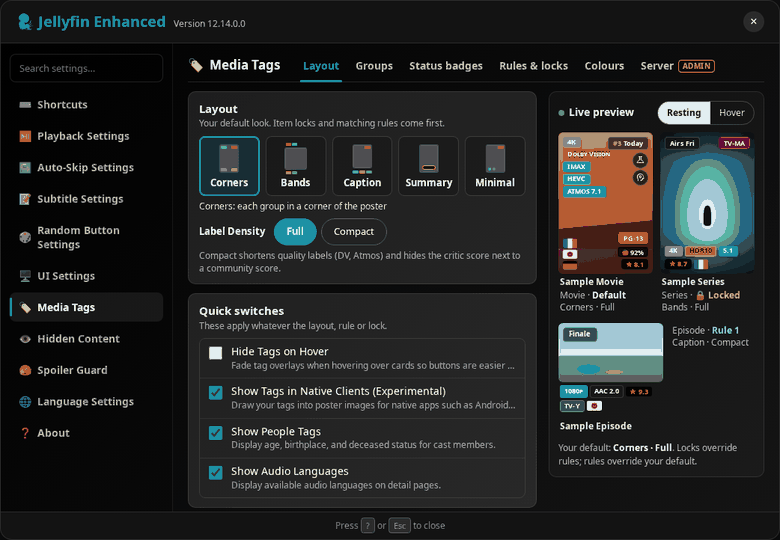

# Tags & Badges

See quality, genres, audio languages, scores, age classifications, what is new or trending, and where a title streams or which network or studio made it while browsing your library. You can choose which badges appear, pick a layout for them (corners, bands, a caption below the poster, a summary pill or a minimal set), set their order and limits, and change their colors. People Tags add age and birthplace information to cast cards.

*The optional tag groups are enabled for this example; every group starts off.*

## Set up your tags

You can choose tags for your own account. If you administer the server, you can also set the starting values for users.

**How to use — personal preferences:**

1. Open the **Jellyfin Enhanced** panel from the user profile menu on Jellyfin 12 or the sidebar on 10.11. You can also press ++question++.
2. Select **Media Tags** and choose your tags on its tabs (see [The Media Tags section](#the-media-tags-section)). Changes save automatically to your Jellyfin account on the server.
3. Refresh another open client to load changes you made elsewhere.

**How to use — admin defaults:**

1. Open [**Media Tags**](../open-in-jellyfin.md?jeSection=media-tags) on your server's Jellyfin Enhanced configuration page. Its sections are [Overview](../open-in-jellyfin.md?jeSection=media-tags&tab=overview){ .je-quiet }, [Layout defaults](../open-in-jellyfin.md?jeSection=media-tags&tab=layout){ .je-quiet }, [Groups](../open-in-jellyfin.md?jeSection=media-tags&tab=groups){ .je-quiet }, [Rules](../open-in-jellyfin.md?jeSection=media-tags&tab=rules){ .je-quiet }, [Colours](../open-in-jellyfin.md?jeSection=media-tags&tab=colours){ .je-quiet }, [Status badges](../open-in-jellyfin.md?jeSection=media-tags&tab=badges){ .je-quiet } and [Server](../open-in-jellyfin.md?jeSection=media-tags&tab=server){ .je-quiet }.
2. Change settings. Each change saves on its own; this tab has no **Save Settings**.
3. Refresh affected web clients.

A live preview shows the cards a brand-new account would get from the current server defaults, including unsaved changes, using the saved server Tag Styles (refreshed after each **Colours** save). It does not use your own account's groups or colours.

??? info "How saving works"

    The card header shows **Saving…**, then **All changes saved**. If a save fails, a bar at the bottom says **Not saved**, lists the settings and offers **Retry**. They stay queued while you move between sections, tabs and links, and the sidebar entry shows a dot until they are saved. Leaving with unsaved changes offers to take you back.

    **Save Settings** and **Apply to all users** on the other tabs wait for these changes and never undo them. Signing out or switching server drops unsaved changes; the next administrator never sees them.

    Only the settings you change are saved, so another administrator's changes elsewhere are kept. If someone changed the same setting since you opened the page, the bar says **Changed elsewhere** with both values and offers **Keep mine** or **Take theirs**.

Sections of the tab:

| Tab | What it holds |
|---|---|
| **Overview** | Which tag groups new users start with (select one to open it), the default look, the server tag cache (items cached, last change, **Rebuild cache**), Native Poster Tags and tag colours at a glance |
| **Layout defaults** | Default layout, **Label density**, **Tag size**, **Tag gap** and **Edge spacing**, **Size and opacity per tag** (each kind of tag's opacity and size for users who have not set their own), each group's order, limit and position under **Group placement** (nine anchors for Corners, the layout's slots otherwise; **Reorder groups** shows the order buttons), **Card shapes** for episode thumbnails and list rows, **Hide tags on hover**, **No tags on the search page**, and **Apply defaults to all users** |
| **Groups** | The **Tag groups** card: one row per group (Quality, Genre, Language, Rating, Age Rating, Status, Awards, Logos, Custom, People) with a summary of its choice and its switch for new users; **Edit** opens its server settings (Quality's display and audio-language options under **Display behaviour** and **Audio language defaults**) |
| **Rules** | The default [tag look rules](tags-layouts.md#rules-and-locked-items): a list with **Edit**, the same add/edit form as each user's own **Rules & locks** (one to five conditions, then the look), and **Edit as JSON**; and the [server-wide item looks](tags-layouts.md#one-items-look) with **Edit** and remove; **How user-locked looks work** explains users' own locks |
| **Colours** | The [Tag Styles](tags-server.md#tag-styles-and-css) editor |
| **Status badges** | The badge families new users start with, the **Just added** and **New release** windows, and whether the TMDB key is set |
| **Server** | [Server-side tag cache](tags-server.md#server-side-tag-cache), library exclusions, **Rebuild cache**, browser cache options and [Native Poster Tags](tags-server.md#native-poster-tags-experimental) |

!!! warning "Apply defaults to all users"
    **Apply defaults to all users** (Overview tab) copies every saved Jellyfin Enhanced default, not only Media Tags, into every user's settings, replacing what they chose. It asks first and cannot be undone. **Reset all colours** and deleting a rule can be undone for a few seconds from the message at the bottom of the page.

Tables below show factory defaults. Rows marked “Admin / personal” give both exact labels for the same preference. Most admin defaults become the starting values for new personal settings. Saved personal values take precedence, so changing a server default does not overwrite a user's choice.

!!! note "Hover hiding starts off"
    **Hide tags on hover** follows the admin value for new users, and overwriting personal settings applies it too.

### The Media Tags section

Every personal poster tag setting lives in one section of the panel, **Media Tags**, between **UI Settings** and **Hidden Content**. Its tabs each do one job, and a live preview beside them shows the result as you change things.

| Tab | What you set there |
|---|---|
| **Layout** | Your default look: one tile per [layout](tags-layouts.md#layouts) with a line describing the selected one, **Label density** (**Full** / **Compact**), **Tag size**, **Gap**, **Size and opacity per tag** (opacity and size for each kind of tag, e.g. a large solid resolution tag beside small half-transparent sound and language tags), per-shape looks for **Episode thumbnails** and **List rows**, and the quick switches **Hide tags on hover**, **Show Tags in Native Clients (Experimental)** (only while the administrator has [Native Poster Tags](tags-server.md#native-poster-tags-experimental) on), **Show People Tags**. |
| **Groups** | The [tag groups](tags-layouts.md#tag-groups-order-position-limits) in priority order: move buttons, the on/off switch, and per group its position, **Show up to** and **Include** choices, plus **Reset to defaults**. The Status row's **Badges** button opens the next tab. |
| **Status badges** | Which [status badges](tags-status.md#status-tags) the Status group may show: **Just Added**, **New releases**, **Trending**, **Schedule**, **Milestones**, **Series status**, **Leaving soon** and **Direct-play warning**, each with a sample badge. The two time windows the administrator chose are shown beside Just Added and New releases. **Status position and limit in Groups** goes back to the Status row. |
| **Rules & locks** | Your [rules and locked items](tags-layouts.md#rules-and-locked-items) on the left, the **Add a rule** form on the right. |
| **Colours** | Your [Tag Colours](tags-server.md#tag-styles-and-css) preset, one tile per preset with sample chips in its real colours (a quality, a status and a rating chip, and a genre icon: the first genre the administrator coloured). Only shown while the administrator lets users pick a preset. |
| **Server** | Administrators only: shortcuts to **Server defaults for new users**, the **Tag colours editor**, the **Tag cache** and **Native poster tags**, each opening its section of the Media Tags admin tab. Other users never get this tab. |

**The live preview** draws four sample cards with the same layout code and tag styles as your library: a movie poster, a series poster, an episode still and a 92px list row. Each says where its look comes from (**Default**, **🔒 Locked**, **Server-wide**, **Rule N** or a shape look), decided the same way as for real cards: the series stands in for your most recently locked item and the episode for the first enabled rule, so a lock or rule change shows at once. **Resting** / **Hover** switches to what Summary and Minimal reveal on hover. While you edit a group, its chips are outlined and the others dimmed. Overflowing chips show as `+N`, as on real cards.

The live preview samples respond to pointer hover and keyboard focus to demonstrate genre expansion, reveal lists and hide-on-hover. Library genre-name reveal and hover hiding retain their pointer-hover behavior; keyboard reveal in the previews stays scoped to the samples. **Hover** pins all samples in that state, including on touch screens; **Resting** releases the pin while the pointed or focused sample stays active. This applies to the hub, administrator preview and item editor.

On a phone the section fills the screen: the tabs use short names (**Badges**, **Rules**), and the preview folds into a one-line strip under them. The strip names the sample that your current edit affects (the episode on **Rules & locks**, the series for schedule badges) and lists its chips, the edited group's first; tap **Preview** to unfold the full preview.

The panel's **Search settings…** box finds every Media Tags control by its label (for example *Trending*, *Show up to* or *Move Language up*); pick a match to open its tab, and its group if needed, with the control focused. Everything in the section works from the keyboard: arrow keys move between tabs and between tiles, and focus stays on the control you used after a move, a delete or an unlock.

!!! warning "Replacing everyone's preferences"
    **Overview** → **Quick Actions** → **Apply all plugin settings to every user** replaces saved personal preferences with the current admin values. It also replaces other Enhanced display/playback preferences, so each user would need to reapply their customizations. Read [Settings Overview](../getting-started/settings-overview.md) before using it.

### Where tags appear

You'll see poster badges in library grids, home rows, Jellyfin search results, and supported rows on detail pages. People Tags appear on cast cards instead.

| Feature | What you see | Where it appears |
|---|---|---|
| [Quality Tags](tags-quality.md#quality-tags) | Resolution, source, HDR, special format, video codec, sound, edition | Supported library cards; series/season quality follows your aggregation policy |
| [Genre Tags](tags-quality.md#genre-tags) | Genre icons (three by default), with names on hover | Supported library cards with genre metadata |
| [Language Tags](tags-quality.md#language-tags) | Distinct flags (three by default) or a no-dialogue symbol | Supported library cards; cached series/season flags cover their episodes, collection flags cover linked movies and series |
| [Rating Tags](tags-groups.md#rating-tags) | Community star score and critic percentage | Supported library cards |
| [User-review chips](tags-groups.md#user-review-chips) | Average visible review rating, or an optional dash | Movie, series, season, and episode cards with a usable review identity |
| [Age Rating Tags](tags-groups.md#age-rating-tags) | Official parental/content classification | Supported library cards with classification metadata |
| [Status Tags](tags-status.md#status-tags) | One badge: trending, release, schedule, milestone or series status | Supported library cards and eligible native posters |
| [Logo Tags](tags-groups.md#logo-tags) | The streaming service, TV network or studio as a small logo (or its name) | Movie, series, season and episode cards; seasons and episodes show their series' logo |
| [People Tags](tags-groups.md#people-tags) | Age, age at release, birthplace, deceased styling | Cast and guest-cast cards on web item detail pages |
| [Audio language links](tags-quality.md#audio-language-links) | Named audio languages linking to Jellyfin tag lists | Movie, series, season, and episode detail pages; control in **UI Settings** |
| [Player badges](tags-groups.md#player-badges) | Scores in the controls; optional age/advisory badge at playback start | Jellyfin web video player |

[Native Poster Tags](tags-server.md#native-poster-tags-experimental) draw supported poster groups into images for eligible native clients. Their page and row limits differ from web overlays.

!!! note "Tags need metadata"
    Each badge needs suitable metadata. A supported card does not guarantee every tag will appear.

??? info "Supported cards and locations"
    Web poster overlays apply to supported movie, series, season, episode, collection (`BoxSet`), and video cards, including videos in Home Videos/Photos libraries. Detail-page rows include season/episode cards and the series **Next Up** shelf. Large episode list images can also carry overlays.

    The web overlays skip the large artwork in the detail page's information area, cast cards, chapter/scene cards, **My Media**, modal dialogs, small list images, and plugin/catalog/device/library administration cards. Seerr search and discovery cards do not receive these library tags.

## Related badge systems

Other integrations have separate badge systems: see [Seerr](../seerr/seerr-features.md) for request/availability/provider badges and [*arr](../arr/arr-features.md) for service status and synchronized tag links. Those are configured independently of these poster groups.
