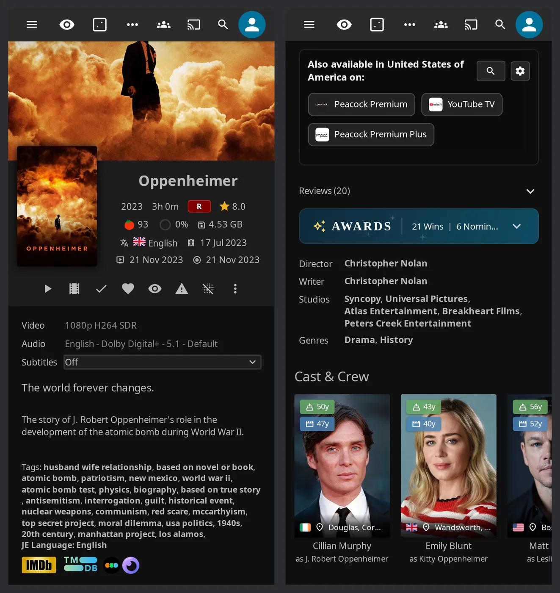

# Compatibility

JE supports Jellyfin Server 12.x and 10.11.x with separate builds. You'll get the web features in clients that load your server's web interface. Native apps can use some server features too.

## Jellyfin versions

Use the build that matches your Jellyfin server. Both versions support the seven JE pages, tags, and automatic requests.

1. Install the matching build from the shared plugin repository.
2. Restart Jellyfin. See [installation](../installation/installation.md) for the full steps.

| Area | Jellyfin 12.x | Jellyfin 10.11.x |
| --- | --- | --- |
| Plugin build | Jellyfin 12.x build | Jellyfin 10.11.x build |
| Script loading and branding | Supported | Supported |
| JE pages and native Home tabs | Supported; Modern Layout has navigation limits below | Supported, including native Home tabs |
| Personal Enhanced panel | Drawer, user settings menu, player button, shortcut, and Modern Layout avatar-menu entry | Drawer, user settings menu, player button, and shortcut |

!!! note "Older Jellyfin servers"

    Jellyfin 10.10 needs the historical plugin line, frozen at 10.11.1.0.

!!! warning "Wrong build installed"

    If **Wrong plugin build for this Jellyfin version** appears on the admin page, reinstall the matching build and restart. See [troubleshooting](../installation/troubleshooting.md).

??? info "Build and API details"

    | Server | Build file | Runtime target |
    | --- | --- | --- |
    | Jellyfin 12.x | `Jellyfin.Plugin.JellyfinEnhanced_12.0.0.zip` | .NET 10 |
    | Jellyfin 10.11.x | `Jellyfin.Plugin.JellyfinEnhanced_10.11.0.zip` | .NET 9 |

    Script loading and branding use built-in request-time middleware on both versions. The conditional server code adapts Activity library access and item statistics. Jellyfin 12 uses access-scoping and batch APIs; 10.11 uses compatible access queries and individual user-data reads. These differences don't reserve the seven JE pages, tags, or automatic requests for Jellyfin 12.

    The startup log reports a wrong build as `BUILD/HOST MISMATCH`. The authenticated, administrator-only `/JellyfinEnhanced/host-compat` diagnostic identifies the expected artifact. There is no setting to turn off this check.

## Clients and playback

For the panel, tags, and browser playback tools, open the web interface served by your Jellyfin server. Check the table below if you prefer an app or a separate player.

| Client | What to expect |
| --- | --- |
| Jellyfin web served by your server | The injected panel, page navigation, tags, search integration, and browser playback tools are available when their settings and requirements are met. |
| Official Android and iOS apps using the embedded web interface | Web enhancements can run when the app loads the server's injected web page. Playback tools need browser playback. |
| Jellyfin Desktop and other desktop web wrappers | Web enhancements depend on loading the server's web interface. JE's browser playback tools aren't available in an external or native player. |
| Android TV, Roku, Swiftfin, and other native clients | JE's injected panel, pages, buttons, and shortcuts aren't added to their native interface. Enabled server features can still affect their Jellyfin requests, images, and saved user data. |
| Independently hosted web clients | Connecting to a JE server alone doesn't add JE's web enhancements to a separately hosted client. |

Browser playback tools include the pause screen, subtitle styling, long-press speed changes, automatic skipping, and picture-in-picture. What you can use also depends on your browser's playback capabilities.

??? note "Playback limits"

    JE's playback tools control a browser video element. External and native players don't provide that element. Independently hosted web clients don't automatically pass through JE's injection middleware; connecting to a JE server alone doesn't install JE's client scripts in a separately served web shell.

    Auto-skip seeks a browser video element. Progressive transcoding can limit seeking, and the seek isn't synchronized to other SyncPlay members.

### What works for native clients

Native apps can benefit from JE's server features even though they don't show its panel or buttons. Set your personal policies in the web interface first.

| Server feature | What can work in native clients |
| --- | --- |
| Automatic requests | Season and movie requests triggered by qualifying playback activity, plus server-side watchlist monitoring when enabled. |
| Native Poster Tags | Personalized supported artwork for identified native clients when admin **Enable Native Poster Tags (Experimental)** and personal **Show Tags in Native Clients (Experimental)** are on. |
| Hidden Content | Filtering on supported item, search, and Home-row responses when the server feature and your applicable filters are on. |
| Spoiler Guard | Filtering of supported images and Jellyfin metadata. |
| Saved Jellyfin data | Watched status and configured MDBList community/critic rating synchronization. Watchlist synchronization also stores Jellyfin data. |

??? note "Native-client limits"

    Image caching can delay Native Poster Tag changes. A native app's locally cached Hidden Content results may also need refreshing.

    JE's Reviews panel is additionally suppressed by injected web code. Server protection doesn't promise review suppression in a separate client. Displaying a synchronized watchlist requires a suitable client interface.

    These effects don't guarantee that every native screen uses a filtered endpoint. The [tag guide](../enhanced/tags.md), [Hidden Content guide](../enhanced/enhanced-features.md#content-management), [Spoiler Guard guide](../spoiler-guard/spoiler-guard-features.md), and [Seerr guide](../seerr/seerr-features.md) describe the switches and limits.

## Modern and Legacy layouts

Your layout changes where you'll find JE's settings and pages. Native Home tabs work on Jellyfin 12's Modern and Legacy layouts, and on 10.11.

| Layout | How to reach JE |
| --- | --- |
| Jellyfin 12 Modern Layout, desktop | Open your avatar menu's **Jellyfin Enhanced** entry for personal settings. Use Home tabs for pages, or JE's header shortcut tray if a native tab button is hidden. |
| Jellyfin 12 Modern Layout, mobile | Use sidebar links, including Plugin Pages links. |

!!! note "Modern Layout has no desktop sidebar links"

    Its header and drawer differ from the Legacy layout. Sidebar links are only visible on mobile. JE adds header shortcut-tray links when Modern Layout hides native Home tab buttons.

See [page placement](pages-and-tabs.md#choose-a-placement) to choose navigation that suits your layout.

??? info "How native links stay usable"

    Generated links carry a stable `jeTab` identity as well as the current numeric `tab` index. This lets them recover when other tabs change position.

## Companion plugins

Companion plugins add optional navigation and playback tools. You don't need File Transformation for normal JE script loading or branding.

1. Install and activate the companion for the feature you want, along with its prerequisites.
2. Check **Overview → Optional Dependencies** for detection status.
3. If **Plugin detection issue** appears, use **Retry**. A failed probe isn't proof that a plugin is missing.

| Companion | Used for | Without it |
| --- | --- | --- |
| File Transformation | Prerequisites of other web modifications, including page/tab companions shown by JE's dependency dashboard | Normal JE script loading and branding still work. |
| Plugin Pages | The **Use Plugin Pages** variants under **Pages** | Its registered navigation entries aren't available. JE's standalone implementations for Bookmarks, Hidden Content, Requests, Calendar, and Recommendations can provide navigation when their other placement settings permit it; Activity and Catch Up need a tab or Plugin Pages. |
| Custom Tabs | The **Use Custom Tabs** variants under **Pages** | It can't create the Home containers those options expect. Custom Tabs mode can suppress JE's standalone sidebar links, so turn it off and select a native Home tab or another available placement. |
| Intro Skipper | Timestamp source and admin dependency check for **Auto-Skip** | Auto-skip controls are unavailable in the admin UI when the plugin is known to be absent. |
| In-Player Episode Preview | **Open Episode Preview** player shortcut | JE can't open the companion's preview interface. |
| KefinTweaks | Watchlist interface for Seerr/Jellyfin watchlist features | Server-side watchlist data and monitoring don't provide a built-in JE watchlist browser. KefinTweaks is detected as a web modification, rather than a normal server plugin. |

??? info "How script loading and auto-skip work"

    Intro Skipper is also detected as SkipIntro. The playback engine reads Jellyfin Media Segments and needs valid intro/outro boundaries.

    JE doesn't automatically switch to an on-disk rewrite when File Transformation is absent. The hidden configuration flag `DisableScriptInjectionMiddleware` defaults to `false`. Setting it to `true` explicitly selects legacy startup injection into `WebPath/index.html`, which needs write access there. This is separate from File Transformation detection. Normal injection and branding need writable JE configuration/data storage, not a writable web directory. Startup may still clean an old JE script tag from `index.html`.

## External services by feature

Connect only the services your chosen features need. The table shows where to set each one up.

1. Open the admin page and enter credentials and instance settings in the relevant tab.
2. Use addresses reachable from the Jellyfin server for API calls. Set browser-facing URL mappings separately.
3. Click **Save Settings** and refresh your client.

!!! tip "Addresses inside containers"

    In a container, `localhost` means that container.

| Feature | Requires | Where to configure |
| --- | --- | --- |
| Seerr search, requests, issues, and discovery | Enabled Seerr integration, reachable Seerr URL and API key; a linked, unblocked user with the relevant Seerr permissions | **Seerr → Seerr Connection Setup** and **Users**; [Seerr settings](../seerr/seerr-settings.md) and [permission audit](../seerr/permission-audit.md) |
| Automatic season requests | Configured Seerr and the automatic request switches, eligible playback, and permitted linked users | **Seerr → Automatic Requests**; [Seerr features](../seerr/seerr-features.md) |
| Automatic movie requests | Configured Seerr plus **TMDB API Key** for movie discovery, eligible playback, and permitted linked users | **Seerr → Seerr Connection Setup** and **Automatic Requests** |
| Requests page | **Enable Requests Page**; Seerr for requests/issues, enabled Sonarr/Radarr instances with API keys for downloads/history | **Pages → Requests Page**, **Seerr**, and **\*arr**; [*arr settings](../arr/arr-settings.md) |
| Calendar | **Enable Calendar Page** and at least one configured source: enabled Sonarr/Radarr instance with API key, or Shoko URL and API key | **Pages → Calendar Page** and **\*arr → Sonarr / Radarr / Shoko**; [*arr features](../arr/arr-features.md) |
| Sonarr/Radarr item links and tag synchronization | Enabled instances with **URL** and **API Key**. Item links also need a Jellyfin administrator account and **Enable \*arr Links on Detail Pages**. Sync needs **Enable Tags Sync** and its scheduled task. | **\*arr → Sonarr / Radarr**, **\*arr UI Links**, and **Tags Sync** |
| Bazarr link | A Jellyfin administrator account, one **Bazarr URL**, and **Enable \*arr Links on Detail Pages**; optional **Bazarr URL Mappings**. No API key is needed. | **\*arr → Bazarr**; [*arr settings](../arr/arr-settings.md) |
| Shoko anime Calendar entries | **Shoko URL**, **Shoko API Key**, and selected episode types; Sonarr/Radarr aren't required | **\*arr → Shoko** |
| Recommendations page | **Enable Recommendations Page**, enabled/configured Seerr, and a linked user; studio-produced TV discovery also needs a TMDB key | **Pages → Seerr Recommendations Page** and **Seerr**; [Seerr features](../seerr/seerr-features.md) |
| Elsewhere streaming providers and TMDB reviews | **TMDB API Key**, the relevant switches, and appropriate TMDB item IDs | **Elsewhere & Reviews**; [Elsewhere & Reviews Settings](../elsewhere/elsewhere-settings.md) |
| MDBList ratings and rating synchronization | **MDBList API Key** and the relevant display/fetch/sync switches; fetching depends on the account's available allowance | **Display → MDBList Ratings**; [MDBList settings](../other/other-settings.md#mdblist-ratings) |
| Standalone Letterboxd links | **Enable Letterboxd Links**; movies need an IMDb ID. No Letterboxd account/API key is configured in JE | **Extras → External Links**; [Other settings](../other/other-settings.md) |
| Ordinary poster rating tags | Stored Jellyfin community or critic ratings; no JE TMDB/MDBList key merely to display those values | **Display → Media Tags** or personal **UI Settings**; [Tags & badges](../enhanced/tags.md) |

??? note "Service and network details"

    **Show synced tags as links** displays existing prefixed tags for viewers independently of service connections, synchronization, and administrator item links.

    Bazarr links open the movies/series overview, rather than a specific item. Letterboxd links for people use a name-derived actor link; JE has no TV-series Letterboxd link. Ordinary poster rating tags display Jellyfin's stored `CommunityRating` or `CriticRating`.

    JE also fetches allow-listed assets through its server-side CDN cache. A fresh installation needs upstream connectivity for uncached assets. The admin **Docs** tab loads this hosted documentation in your browser. Optional **Share Anonymous Usage Statistics** is off by default and is separate from service and asset requests; see [Community Analytics](../advanced/community-analytics.md).
