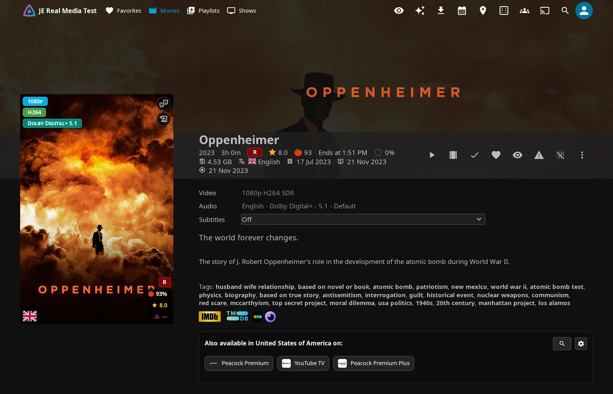

# Quick start

Get Jellyfin Enhanced running, choose a few settings, and try it in your browser. You don't need Seerr, *arr services, or companion plugins to open the Enhanced panel and use the basic playback tools.

## 1. Install and reload

1. Follow the [installation guide](../installation/installation.md) to add the repository and install **Jellyfin Enhanced**. Choose the build for your server: Jellyfin 12.x or 10.11.x.
2. Restart Jellyfin.
3. Open the web interface served by your Jellyfin server and refresh it.

??? info "How it works"

    JE normally adds its scripts while the server serves the web page. Normal script loading and custom branding don't require File Transformation or a writable web directory.

    Plugin Pages adds page navigation through its own integration; Custom Tabs embeds JE pages on Home. Install their prerequisites if you choose either integration. JE's native Home tabs need no companion plugin. Intro Skipper and In-Player Episode Preview support additional playback tools. See [compatibility](compatibility.md#companion-plugins).

## 2. Set up the server

Choose the starting preferences for accounts that haven't loaded JE yet. You can connect optional services now or later.

1. As an administrator, open **Dashboard → Plugins → Jellyfin Enhanced**. This is the server configuration page; your personal panel is separate.
2. In **Overview**, check **Service Status** and **Optional Dependencies** for integrations you plan to use.
3. In **Display** and **Playback**, choose starting preferences.
4. In **Pages**, enable the pages you want and choose how users reach them. [JE pages & tabs](pages-and-tabs.md) explains the options.
5. If you use Seerr, Sonarr, Radarr, Bazarr, Shoko, or TMDB-based features, connect them now; see **Connect optional services** below.
6. Click **Save Settings**, then refresh affected web clients.

These are administrator defaults for a new configuration. Where a setting supplies a personal starting value, users can change it for their account.

| Setting | Default | What it does |
| --- | --- | --- |
| **Enable Custom Pause Screen** | On | Shows the pause overlay after your personal delay, initially 5 seconds. |
| **Enable Bookmarks Feature** | On | Lets you save playback timestamps. |
| **Enable Random Button** | On | Adds random library browsing. |
| **Auto-pause on tab switch** | On | Sets the starting value for your personal **Auto-pause** preference. |
| **Show available audio languages on item detail page** | On | Sets the starting value for your personal language display preference. |

Main media-tag preferences start off, including quality, genre, language, rating, and people tags. Seerr, Spoiler Guard, Activity, Requests, Calendar, Hidden Content, Catch Up, and Active Streams also start off. Some suggestions in [What to try first](#what-to-try-first) need features that start off, so enable them first.

!!! note "Elsewhere needs a key"

    Elsewhere starts on, but needs a TMDB API key. No key is configured initially.

??? note "Existing personal preferences"

    JE saves starting preferences when an account first loads JE. Saving admin defaults doesn't replace those saved preferences, even for users who never customized them. To replace them for everyone, save the defaults first, then use **Overview → Quick Actions → Overwrite everyone's personal settings**. See [settings overview](settings-overview.md) for its scope, storage, and backups.

??? note "Connect optional services"

    - **Seerr:** Open **Seerr**, turn on **Enable Seerr integration**, enter **Seerr URL(s) (One per line)** and **Seerr API Key**, then click **Test** beside the key. Follow the [Seerr setup guide](../seerr/seerr-settings.md#setup) to link/import Jellyfin accounts. In **Users**, click **Import Users Now** to import unblocked users. Then use **Permission Audit → Run Audit** to check linked accounts; it doesn't import missing ones.
    - **Sonarr, Radarr, Bazarr, or Shoko:** Configure them in **\*arr**. Use addresses reachable from the Jellyfin server. Configure public browser links separately with URL mappings when needed.
    - **TMDB:** Add **TMDB API Key** in **Seerr** or **Elsewhere & Reviews** if your chosen features need it. Both fields edit the same key. Basic poster tags don't require it.

    Click **Save Settings** and refresh affected clients after configuring services. Test each optional service separately. Opening the personal panel confirms that JE's client interface loaded; it doesn't confirm that every integration is ready.

## 3. Open your personal panel

Use the Enhanced panel to make JE feel right for your account. Your main preferences and shortcut overrides save to your account on the server.

1. Open the panel using an entry below.
2. Use **Search settings…** or select a section to find a preference.

<figure class="je-video">
  <video autoplay loop muted playsinline controls preload="metadata" aria-label="Opening Enhanced and switching between its settings sections">
    <source src="../images/getting-started/panel-open-sections.mp4" type="video/mp4">
  </video>
  <figcaption>Open the panel and select a settings section.</figcaption>
</figure>

| Where you are | How to open the panel |
| --- | --- |
| Desktop | Press ++"?"++ while you're outside an input field. |
| Jellyfin 12 Modern Layout | Open your avatar menu and select **Jellyfin Enhanced**. |
| Visible navigation drawer, including on a phone | Choose **Jellyfin Enhanced → Enhanced Panel**. |
| Jellyfin's user settings menu, including on a phone | Select **Jellyfin Enhanced - User Settings**. |
| Mobile or TV web player | Select the tune button titled **Jellyfin Enhanced** when the player controls are available; desktop layouts hide it. |

Reload any other device to pick up your changes.

See [settings overview](settings-overview.md#the-personal-enhanced-panel) for all sections and entry points.

## What to try first

- Open **Shortcuts** and try **Go to Home** with ++shift+h++. Click a displayed key to customize it; ++backspace++ restores the administrator's binding.
- Start a browser video and press ++b++ to save a bookmark. Open **Bookmarks** to return to that timestamp later.
- In **UI Settings**, enable a poster tag category and browse a library. [Tags & badges](../enhanced/tags.md) explains their data requirements and scopes.
- Pause a browser video and wait without interacting to try the pause screen. Adjust playback preferences in **Playback Settings**.
- If your administrator enabled them, open **Calendar**, **Requests**, or **Seerr Recommendations** (**Recommendations** in Plugin Pages or JE-managed Custom Tabs) to try the connected services.

## Keep going

- :material-download: **Install Jellyfin Enhanced**

    Repository setup and the matching server build.

    [Installation](../installation/installation.md)

- :material-devices: **Check your setup**

    Server versions, clients, layouts, and service requirements.

    [Compatibility](compatibility.md)

- :material-tune: **Find a setting**

    Admin tabs, personal preferences, resets, and backups.

    [Settings overview](settings-overview.md)

- :material-tab: **Choose your pages**

    Bookmarks, Calendar, Requests, and the other JE pages.

    [JE pages & tabs](pages-and-tabs.md)

- :material-tag: **Explore the features**

    Playback tools, shortcuts, tags, and content management.

    [Enhanced features](../enhanced/enhanced-features.md)

- :material-lifebuoy: **Resolve a loading problem**

    Installation checks and troubleshooting.

    [Troubleshooting installation](../installation/troubleshooting.md)

