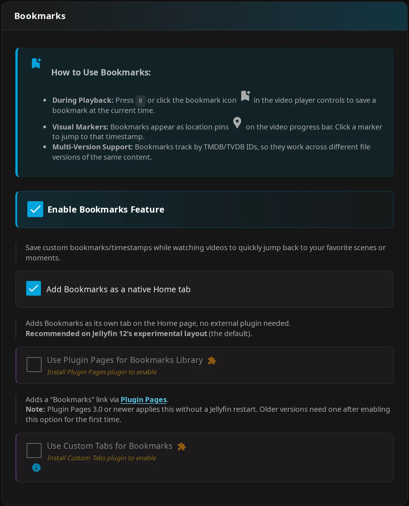
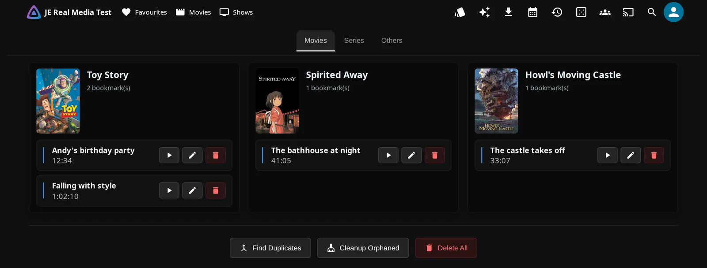
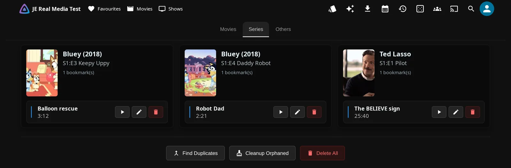
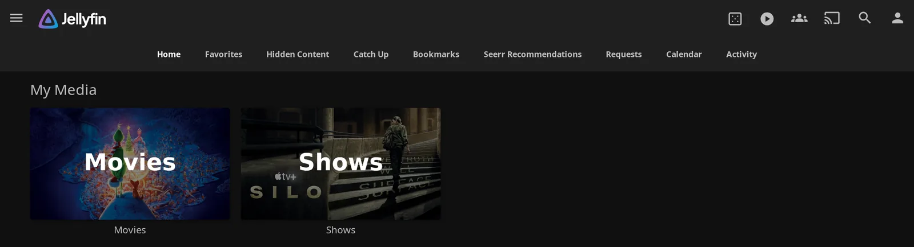
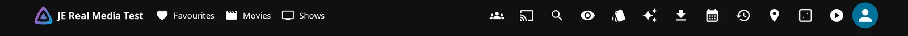
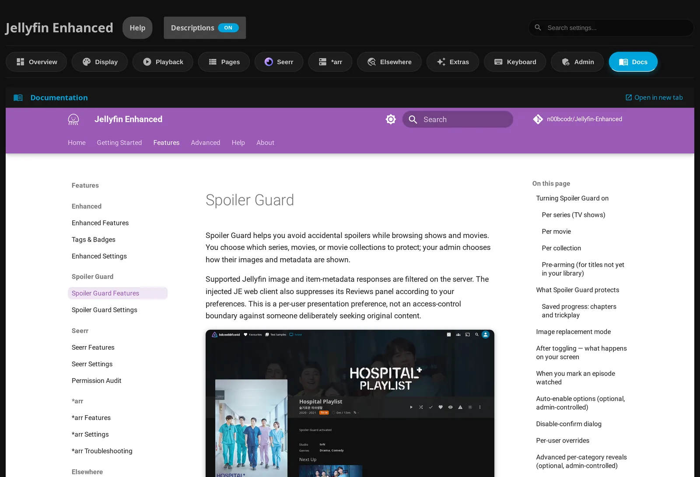

# JE Pages & Tabs

JE adds seven pages for bookmarks, upcoming releases, requests, and more. Choose which ones to enable and where you want users to find them. Page content and navigation have separate settings.

## Choose a placement

Native Home tabs are a quick way to make pages easy to reach. They need no companion plugin and work on Jellyfin 12 and 10.11.

1. Open admin **Dashboard → Plugins → Jellyfin Enhanced → Pages**.
2. Enable the feature and its **Add … as a native Home tab** option.
3. Click **Save Settings** and refresh the user's web client.

You can also choose one of the other placements below.

| Placement | Requires | How users reach it |
| --- | --- | --- |
| JE standalone page | JE's injected web interface; available for Bookmarks, Hidden Content, Requests, Calendar, and Recommendations | JE's navigation drawer link where the layout exposes it, or the supported standalone route below. |
| Native Home tab | JE's injected web interface and that page's native-tab setting | The named Home tab. If the layout hides its button, use JE's fallback header shortcut-tray link. |
| Plugin Pages | Active Plugin Pages companion and that page's Plugin Pages setting | The companion's registered page entry. On Jellyfin 12's Modern Layout, sidebar entries are mobile navigation. |
| Custom Tabs | Active Custom Tabs companion, its prerequisites, that page's Custom Tabs setting, and a matching tab entry | The configured tab on Home. JE can create its entry automatically or you can add it manually. |

!!! note "Choose one Home-tab mode per page"

    Native Home tabs and Custom Tabs can't be enabled together for the same page; selecting one deselects the other. JE's native tabs can coexist with unrelated Custom Tabs. Plugin Pages is a separate option and can be enabled alongside a native tab.

!!! note "Modern Layout on Jellyfin 12"

    Desktop has no visible sidebar page links in this layout. JE's native tab button can also be hidden, so JE adds a header shortcut-tray fallback. On phones, use the drawer or Home/header links. The avatar-menu **Jellyfin Enhanced** entry opens personal settings; it isn't a replacement menu for every JE page.

All page-placement switches and **Add the Custom Tabs entry for me** start Off. Of these seven pages, only the Bookmarks feature starts On.

*The automatic-entry option is hidden here because Custom Tabs isn't installed.*

??? note "Activity and Catch Up need navigation"

    Activity and Catch Up have no JE standalone sidebar page. Enabling either feature without a tab or Plugin Pages doesn't create a navigable page.

## Bookmarks

Save a moment while watching so you can return to the scene later. Your timestamps are saved per account on the server.

1. During browser playback, press ++b++ with the default binding or use the bookmark button.
2. Open **Bookmarks** to play, edit, or organize saved timestamps. You don't need a companion plugin to manage them.

Use **Series** for episode bookmarks; each episode has its own card.

For library maintenance, see [Enhanced features](../enhanced/enhanced-features.md#playback-controls).

Admin **Pages → Bookmarks**:

| Setting | Default | What it does |
| --- | --- | --- |
| **Enable Bookmarks Feature** | On | Enables bookmarking and the library. |
| **Add Bookmarks as a native Home tab** | Off | Adds a JE-managed Home tab. |
| **Use Plugin Pages for Bookmarks Library** | Off | Registers the companion page. |
| **Use Custom Tabs for Bookmarks** | Off | Shows the page in a Custom Tabs container. |
| **Add the Custom Tabs entry for me** | Off | Manages the matching companion entry on save. |

??? note "Details"

    Without a selected tab or active Plugin Pages integration, the standalone library uses `#/bookmarks`.

    Internal setting names:

    | Setting | Property |
    | --- | --- |
    | **Enable Bookmarks Feature** | `BookmarksEnabled` |
    | **Add Bookmarks as a native Home tab** | `BookmarksUseNativeTab` |
    | **Use Plugin Pages for Bookmarks Library** | `BookmarksUsePluginPages` |
    | **Use Custom Tabs for Bookmarks** | `BookmarksUseCustomTabs` |
    | **Add the Custom Tabs entry for me** | `BookmarksAutoCreateCustomTab` |

## Hidden Content

Keep titles or other supported items off selected surfaces, then review or unhide them in one place.

1. Set your personal filters in the Enhanced panel's **Hidden Content** section.
2. Hide items from the supported surfaces you use.
3. Open **Hidden Content** to review or unhide them. Administrators can also manage other users' lists when **Let admins view and manage other users' hidden content** is on.

See [content management](../enhanced/enhanced-features.md#content-management) and [Enhanced settings](../enhanced/enhanced-settings.md).

Admin **Pages → Hidden Content**:

| Setting | Default | What it does |
| --- | --- | --- |
| **Enable Hidden Content** | Off | Enables hide controls, filtering, management, and personal settings. |
| **Add Hidden Content as a native Home tab** | Off | Adds a Home tab. |
| **Use Plugin Pages for Hidden Content** | Off | Registers the companion page. |
| **Use Custom Tabs for Hidden Content** | Off | Shows the page in a Custom Tabs container. |
| **Add the Custom Tabs entry for me** | Off | Manages the companion entry. |
| **Let admins view and manage other users' hidden content** | On | Allows administrators to select another user's hidden list and use **Edit** to add or unhide items for that user. |

??? note "Details"

    The standalone route is `#/hidden-content`. Disabling the server feature preserves saved hidden items. Hiding filters supported responses and web surfaces; it doesn't revoke library access.

    Internal setting names:

    | Setting | Property |
    | --- | --- |
    | **Enable Hidden Content** | `HiddenContentEnabled` |
    | **Add Hidden Content as a native Home tab** | `HiddenContentUseNativeTab` |
    | **Use Plugin Pages for Hidden Content** | `HiddenContentUsePluginPages` |
    | **Use Custom Tabs for Hidden Content** | `HiddenContentUseCustomTabs` |
    | **Add the Custom Tabs entry for me** | `HiddenContentAutoCreateCustomTab` |
    | **Let admins view and manage other users' hidden content** | `HiddenContentAdmin` |

## Requests and downloads

**Requests** brings together Seerr requests and issues with Sonarr/Radarr downloads and download history. Use it to check progress in one place. Scroll through the stacked **Downloads**, **Requests**, **Issues**, and **History** sections when their content is enabled and available.

<figure class="je-video">
  <video autoplay loop muted playsinline controls preload="metadata" aria-label="Scrolling through stacked Downloads, Requests, Issues and History sections">
    <source src="../../images/arr/requests-sections-flow.mp4" type="video/mp4">
  </video>
  <figcaption>Scroll through the combined Requests page to see downloads, requests, issues, and history.</figcaption>
</figure>

1. Configure Seerr for requests/issues, and enabled Sonarr/Radarr instances with API keys for downloads/history.
2. Enable the page and choose its placement.
3. Open **Requests** to inspect status. Your available actions depend on the linked Seerr user's permissions.

See [*arr features](../arr/arr-features.md), [*arr settings](../arr/arr-settings.md), and [Seerr permissions](../seerr/permission-audit.md).

Admin **Pages → Requests Page**:

| Setting | Default | What it does |
| --- | --- | --- |
| **Enable Requests Page** | Off | Enables the combined page. |
| **Add Requests as a native Home tab** | Off | Adds a Home tab. |
| **Use Plugin Pages for Requests** | Off | Registers the companion page. |
| **Use Custom Tabs for Requests** | Off | Shows the page in a Custom Tabs container. |
| **Add the Custom Tabs entry for me** | Off | Manages the companion entry. |

**Show Downloads in Requests Page**, **Show Seerr Issues Section**, and **Show Download History Section** control the page's content separately.

??? note "Details"

    The standalone route is `#/downloads`. There isn't a separate JE Downloads page, even though internal properties and this route use that name.

    Internal setting names:

    | Setting | Property |
    | --- | --- |
    | **Enable Requests Page** | `DownloadsPageEnabled` |
    | **Add Requests as a native Home tab** | `DownloadsUseNativeTab` |
    | **Use Plugin Pages for Requests** | `DownloadsUsePluginPages` |
    | **Use Custom Tabs for Requests** | `DownloadsUseCustomTabs` |
    | **Add the Custom Tabs entry for me** | `DownloadsAutoCreateCustomTab` |

## Calendar

Browse upcoming movies and episodes from your configured Sonarr, Radarr, or Shoko sources. Shoko can be your only source.

1. Open **Calendar** and select a view and filters.
2. Open an event to see its details.

See [*arr features](../arr/arr-features.md) and [*arr settings](../arr/arr-settings.md) for source setup and access filters.

Admin **Pages → Calendar Page**:

| Setting | Default | What it does |
| --- | --- | --- |
| **Enable Calendar Page** | Off | Enables the Calendar. |
| **Add Calendar as a native Home tab** | Off | Adds a Home tab. |
| **Use Plugin Pages** | Off | Registers the Calendar companion page. |
| **Use Custom Tabs** | Off | Shows the page in a Custom Tabs container. |
| **Add the Custom Tabs entry for me** | Off | Manages the companion entry. |

??? note "Details"

    The standalone route is `#/calendar`. When Calendar detects its active Plugin Pages integration, its standalone page yields to that integration. Use the registered page entry rather than relying on the direct route.

    Internal setting names:

    | Setting | Property |
    | --- | --- |
    | **Enable Calendar Page** | `CalendarPageEnabled` |
    | **Add Calendar as a native Home tab** | `CalendarUseNativeTab` |
    | **Use Plugin Pages** | `CalendarUsePluginPages` |
    | **Use Custom Tabs** | `CalendarUseCustomTabs` |
    | **Add the Custom Tabs entry for me** | `CalendarAutoCreateCustomTab` |

## Recommendations

Find something to watch in trending, popular, and upcoming feeds, or browse studios, networks, and genre tiles. This discovery page is separate from recommendations on an individual item's details.

1. Open **Seerr Recommendations** from its standalone link or native Home tab, or **Recommendations** from Plugin Pages or a JE-managed Custom Tabs entry.
2. Open a row or category to explore it.

!!! note "Seerr is required"

    Enable and configure Seerr, and link your user. Studio-produced TV feeds also require **TMDB API Key**.

See [Seerr features](../seerr/seerr-features.md).

Admin **Pages → Seerr Recommendations Page**:

| Setting | Default | What it does |
| --- | --- | --- |
| **Enable Recommendations Page** | Off | Enables discovery. |
| **Add Recommendations as a native Home tab** | Off | Adds a Home tab. |
| **Use Plugin Pages** | Off | Registers the companion page. |
| **Use Custom Tabs** | Off | Shows the page in a Custom Tabs container. |
| **Add the Custom Tabs entry for me** | Off | Manages the companion entry. |

??? note "Details"

    The standalone route is `#/recommendations`. Changing placement can't repair disabled integrations or missing upstream permissions.

    Internal setting names:

    | Setting | Property |
    | --- | --- |
    | **Enable Recommendations Page** | `RecommendationsPageEnabled` |
    | **Add Recommendations as a native Home tab** | `RecommendationsUseNativeTab` |
    | **Use Plugin Pages** | `RecommendationsUsePluginPages` |
    | **Use Custom Tabs** | `RecommendationsUseCustomTabs` |
    | **Add the Custom Tabs entry for me** | `RecommendationsAutoCreateCustomTab` |

## Activity

See recent watched, favorited, and reviewed activity from people on your server. Library access and author-visibility rules control what you can see.

Open **Activity** from a configured tab or Plugin Pages entry. See [Enhanced features](../enhanced/enhanced-features.md) and [Enhanced settings](../enhanced/enhanced-settings.md).

Admin **Pages → Activity Feed**:

| Setting | Default | What it does |
| --- | --- | --- |
| **Enable Activity Feed** | Off | Enables activity recording and display. |
| **Add Activity as a native Home tab** | Off | Adds a Home tab. |
| **Use Plugin Pages** | Off | Registers the companion page. |
| **Use Custom Tabs** | Off | Shows the page in a Custom Tabs container. |
| **Add the Custom Tabs entry for me** | Off | Manages the companion entry. |

Choose activity types in this admin section.

!!! note "Active Streams needs data collection"

    **Show Active Streams section** also needs active-stream data collection enabled in **Extras**. This is independent of showing the header widget.

??? note "Details"

    Watched activity includes qualifying partial playback, as well as completions. JE provides no standalone `#/activity` route.

    Internal setting names:

    | Setting | Property |
    | --- | --- |
    | **Enable Activity Feed** | `ActivityFeedEnabled` |
    | **Add Activity as a native Home tab** | `ActivityFeedUseNativeTab` |
    | **Use Plugin Pages** | `ActivityFeedUsePluginPages` |
    | **Use Custom Tabs** | `ActivityFeedUseCustomTabs` |
    | **Add the Custom Tabs entry for me** | `ActivityFeedAutoCreateCustomTab` |

## Catch Up

Work through unwatched titles as a card deck. You'll see only titles you can access.

1. Open **Catch Up** from a configured tab or Plugin Pages entry.
2. Use buttons or swipe gestures to mark a title watched, dismiss it, or add it to your watchlist.

See [Enhanced features](../enhanced/enhanced-features.md) for the deck and its actions.

Admin **Pages → Catch Up**:

| Setting | Default | What it does |
| --- | --- | --- |
| **Enable Catch Up** | Off | Enables the deck. |
| **Record Catch Up activity** | On | Records deck actions when Catch Up is enabled; admins can read the page's **Activity** panel. |
| **Add Catch Up as a native Home tab** | Off | Adds a Home tab. |
| **Use Plugin Pages** | Off | Registers the companion page. |
| **Use Custom Tabs** | Off | Shows the page in a Custom Tabs container. |
| **Add the Custom Tabs entry for me** | Off | Manages the companion entry. |

??? note "Details"

    JE provides no standalone `#/catchup` route. The activity log retains the current file and one rotated file; [settings and data](settings-overview.md#settings-and-data-on-disk) covers its location and backups.

    Internal setting names:

    | Setting | Property |
    | --- | --- |
    | **Enable Catch Up** | `CatchUpEnabled` |
    | **Record Catch Up activity** | `CatchUpLogEnabled` |
    | **Add Catch Up as a native Home tab** | `CatchUpUseNativeTab` |
    | **Use Plugin Pages** | `CatchUpUsePluginPages` |
    | **Use Custom Tabs** | `CatchUpUseCustomTabs` |
    | **Add the Custom Tabs entry for me** | `CatchUpAutoCreateCustomTab` |

## Plugin Pages setup and fallback

Plugin Pages adds registered page entries through its companion plugin. Use it when you want that plugin to handle page navigation.

1. Install and activate Plugin Pages with its prerequisites.
2. Enable the JE feature and its Plugin Pages option above.
3. Click **Save Settings**.
4. Refresh users' web clients.

!!! note "Some registration changes need a restart"

    Plugin Pages 3.0+ supports live registration/removal on save. Older interfaces need a Jellyfin restart after registration changes. If the server log says live registration failed, restart even with a newer version, then refresh clients.

??? note "Registration and fallback details"

    JE registers embedded pages with the companion, including `/JellyfinEnhanced/catchUpPage`. These registration URLs aren't standalone JE controller routes to substitute for web navigation.

    If Plugin Pages is missing, its registered link isn't available. Bookmarks, Hidden Content, Requests, Calendar, and Recommendations have standalone implementations, with fallback navigation when no other selected placement suppresses it. Activity and Catch Up need a native tab or working Custom Tabs integration instead.

    A failed companion detection probe doesn't guarantee fallback. Resolve **Plugin detection issue** with **Retry**, then save and refresh.

## Custom Tabs: automatic or manual entries

Custom Tabs embeds JE pages on Home through its companion plugin. You can let JE manage the matching entry or add it yourself.

### Let JE manage the entry

Let JE create a matching companion entry when you save.

1. Install and activate a compatible Custom Tabs version with its prerequisites, including File Transformation.
2. Enable the JE feature, its Custom Tabs option (for example, **Use Custom Tabs for Bookmarks**), and **Add the Custom Tabs entry for me**.
3. Click **Save Settings**.

!!! note "The automatic control depends on detection"

    **Add the Custom Tabs entry for me** appears only when JE recognizes the installed companion's configuration structure and the page is enabled with its Custom Tabs option ticked, such as **Use Custom Tabs for Bookmarks**. An unrecognized structure requires manual setup. The content switch alone doesn't create a companion tab.

??? note "Entry ownership and detection details"

    JE creates a missing matching entry. If one already exists, JE leaves it in place and doesn't claim a manually created entry. On later saves, turning off the feature, its Custom Tabs option, or automatic management removes a matching entry only if JE owns it. Re-enabling all three creates it again.

    The internal ownership flags are `BookmarksCustomTabJeOwned`, `HiddenContentCustomTabJeOwned`, `DownloadsCustomTabJeOwned`, `CalendarCustomTabJeOwned`, `RecommendationsCustomTabJeOwned`, `ActivityFeedCustomTabJeOwned`, and `CatchUpCustomTabJeOwned`. All default to `false`. They have no user-facing setting label and record ownership rather than another placement choice.

    If Custom Tabs is absent, JE skips synchronization and retains stored intent for a later installation. If detection or its configuration read fails, automatic controls are hidden and an intended create can be skipped. JE settings can also save without creating the tab if the companion configuration cannot be saved. Check the save feedback, then use **Retry** or reload and save again.

### Add the entry yourself

Create your own companion entry using the matching title and content below.

1. Leave **Add the Custom Tabs entry for me** off.
2. Open **Dashboard → Plugins → Custom Tabs**, add a tab, and paste the matching content into **HTML Content**. You can use **Copy** beside the marker on JE's admin page or copy it from the table below.
3. Turn on the JE feature and its Custom Tabs option too.
4. Save both configurations and refresh the client.

| Page/title | Content to paste |
| --- | --- |
| **Bookmarks** | `

` |
| **Hidden Content** | `

` |
| **Requests** | `

` |
| **Calendar** | `

` |
| **Recommendations** | `

` |
| **Activity** | `

` |
| **Catch Up** | `

` |

??? note "Missing or inactive Custom Tabs"

    Custom Tabs mode can suppress JE's standalone links without creating the expected Home container if the companion is missing or inactive. Disable that mode and choose a native tab or another available placement.

## Reach the pages on desktop and phone

In a layout with a visible drawer, use its page links. On Jellyfin 12 Modern Layout desktop, use Home tabs or JE's fallback header shortcut tray; on phones, use the drawer, Home, or header tray. Plugin Pages and Custom Tabs supply their own entries only when their integration is working.

*Jellyfin 12 Legacy layout shows the enabled JE pages beside Home and Favorites.*

On Jellyfin 12's Modern Layout, JE adds header icons when native tab buttons are hidden. When space is limited, extra actions move into the **More from Jellyfin Enhanced** (•••) launcher.

Use the native Home links JE generates so they keep working when other tabs move. All these page interfaces require the injected web client; [native-client server effects](compatibility.md#what-works-for-native-clients) are separate.

Administrators can open **Docs → Documentation** on the JE configuration page to browse the hosted docs inside the dashboard, or select **Open in new tab**.

??? note "Direct routes and native link identities"

    For enabled standalone pages, append the route below to your server's `/web/index.html`, including any base-URL prefix. For example, Calendar is `/web/index.html#/calendar` and Requests is `/web/index.html#/downloads`. Direct navigation opens the standalone page only when the conditions below are met.

    | Page | Standalone route | When standalone navigation is available | Native link identity |
    | --- | --- | --- | --- |
    | Bookmarks | `#/bookmarks` | Native Home tab and Custom Tabs options off; no detected Plugin Pages integration | `jeTab=bookmarks` |
    | Hidden Content | `#/hidden-content` | Native Home tab and Custom Tabs options off; no detected Plugin Pages integration | `jeTab=hidden-content` |
    | Requests | `#/downloads` | No detected Plugin Pages integration | `jeTab=requests` |
    | Calendar | `#/calendar` | No detected Plugin Pages integration | `jeTab=calendar` |
    | Recommendations | `#/recommendations` | No detected Plugin Pages integration | `jeTab=recommendations` |
    | Activity | Use a tab or Plugin Pages | No standalone route | `jeTab=activity` |
    | Catch Up | Use a tab or Plugin Pages | No standalone route | `jeTab=catchup` |

    A detected Plugin Pages integration means the page's Plugin Pages option is enabled and JE detects its registered page entry. Use that sidebar entry instead of the standalone route. For Bookmarks or Hidden Content with native-tab placement enabled, use the generated Home link; with Custom Tabs placement enabled, open the configured Home tab. These guards prevent the standalone page from opening; they don't automatically redirect you to the selected placement.

    Use the native links JE generates: they include both `tab=<current index>` and the stable `jeTab` identity. Don't hard-code a numeric tab index, because other tabs can move it.
