# Settings overview

Use the admin configuration page for server features, service connections, and starting preferences. Use the personal Enhanced panel for your account's preferences and shortcut overrides.

## The admin configuration page

Open **Dashboard → Plugins → Jellyfin Enhanced** as an administrator. On Jellyfin 12 the plugin's navigation entry goes straight there; on 10.11, open the installed plugin's configuration. [Open it on your server](../open-in-jellyfin.md?tab=overview)

1. Find a setting with **Search settings...** or the sidebar. Pick a tab to see its cards, a card to show only that, and the tab name again to show everything. **Descriptions** shows or hides the explanatory text.
2. Check the unsaved indicator, then click **Save Settings**.
3. Refresh affected web clients.

The **Media Tags** tab is the exception: it saves each change as you make it and previews what a new user will see. See [Tags & badges](../enhanced/tags.md).

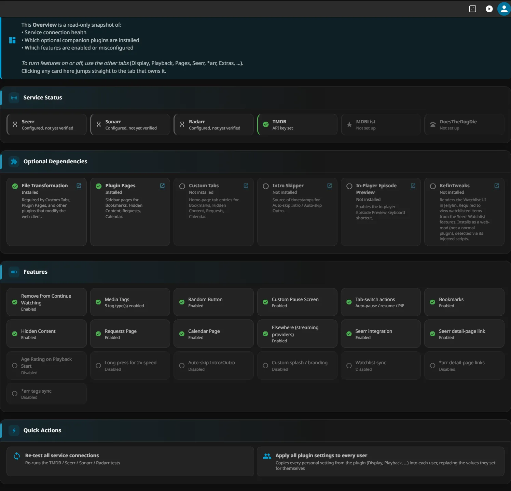

| Tab | What you'll find | Detailed guide |
| --- | --- | --- |
| [**Overview**](../open-in-jellyfin.md?tab=overview) | Service status (with remaining MDBList and DoesTheDogDie requests), optional dependencies, enabled features, and quick actions for connection tests, applying settings to users, and clearing client tag caches | [Defaults and resets](#admin-defaults-and-personal-overrides), [compatibility](compatibility.md) |
| [**Display**](../open-in-jellyfin.md?tab=display) | Watch progress, file information, [Spoiler Guard](../open-in-jellyfin.md?tab=display&card=spoiler-guard){ .je-quiet }, [icons and theme](../open-in-jellyfin.md?tab=display&card=icons-theme){ .je-quiet }, [random button](../open-in-jellyfin.md?tab=display&card=random-button){ .je-quiet }, [default language](../open-in-jellyfin.md?tab=display&card=default-language){ .je-quiet }, [awards](../open-in-jellyfin.md?tab=display&card=awards){ .je-quiet }, [MDBList ratings](../open-in-jellyfin.md?tab=display&card=mdblist-ratings){ .je-quiet } | [Enhanced settings](../enhanced/enhanced-settings.md), [Spoiler Guard settings](../spoiler-guard/spoiler-guard-settings.md) |
| [**Media Tags**](../open-in-jellyfin.md?jeSection=media-tags) | Poster tags: starting groups, layout, rules, colours, status badges, the tag cache and Native Poster Tags | [Tags & badges](../enhanced/tags.md) |
| [**Playback**](../open-in-jellyfin.md?tab=playback) | [Player behaviour](../open-in-jellyfin.md?tab=playback&card=player-behaviour){ .je-quiet }, [auto-skip](../open-in-jellyfin.md?tab=playback&card=auto-skip){ .je-quiet }, [subtitles](../open-in-jellyfin.md?tab=playback&card=subtitles){ .je-quiet }, [panel and toast timing](../open-in-jellyfin.md?tab=playback&card=shortcuts-panel-toast-timing){ .je-quiet } | [Enhanced settings](../enhanced/enhanced-settings.md) |
| [**Pages**](../open-in-jellyfin.md?tab=pages) | Enablement, content and placement for [Bookmarks](../open-in-jellyfin.md?tab=pages&card=bookmarks){ .je-quiet }, [Hidden Content](../open-in-jellyfin.md?tab=pages&card=hidden-content){ .je-quiet }, [Requests](../open-in-jellyfin.md?tab=pages&card=requests-page){ .je-quiet }, [Calendar](../open-in-jellyfin.md?tab=pages&card=calendar-page){ .je-quiet }, [Recommendations](../open-in-jellyfin.md?tab=pages&card=seerr-recommendations-page){ .je-quiet }, [Activity Feed](../open-in-jellyfin.md?tab=pages&card=activity-feed){ .je-quiet }, [Catch Up](../open-in-jellyfin.md?tab=pages&card=catch-up){ .je-quiet } and [Leaving Soon](../open-in-jellyfin.md?tab=pages&card=leaving-soon){ .je-quiet } | [JE pages & tabs](pages-and-tabs.md) |
| [**Seerr**](../open-in-jellyfin.md?tab=seerr) | [Connection and TMDB key](../open-in-jellyfin.md?tab=seerr&card=seerr-connection-setup){ .je-quiet }, [search and requests](../open-in-jellyfin.md?tab=seerr&card=search-requests){ .je-quiet }, [discovery](../open-in-jellyfin.md?tab=seerr&card=discovery-ui-extras){ .je-quiet }, automatic requests, [watchlist sync](../open-in-jellyfin.md?tab=seerr&card=watchlist){ .je-quiet }, [user import](../open-in-jellyfin.md?tab=seerr&card=users){ .je-quiet }, [permission audit](../open-in-jellyfin.md?tab=seerr&card=permission-audit){ .je-quiet }, [caching diagnostics](../open-in-jellyfin.md?tab=seerr&card=debug-caching){ .je-quiet } | [Seerr settings](../seerr/seerr-settings.md), [permission audit](../seerr/permission-audit.md) |
| [**\*arr**](../open-in-jellyfin.md?tab=arr) | [Sonarr](../open-in-jellyfin.md?tab=arr&card=sonarr){ .je-quiet } and [Radarr](../open-in-jellyfin.md?tab=arr&card=radarr){ .je-quiet } instances, [Bazarr](../open-in-jellyfin.md?tab=arr&card=bazarr){ .je-quiet }, [Shoko](../open-in-jellyfin.md?tab=arr&card=shoko){ .je-quiet }, [UI links](../open-in-jellyfin.md?tab=arr&card=arr-ui-links){ .je-quiet }, [tag sync](../open-in-jellyfin.md?tab=arr&card=tags-sync){ .je-quiet }, [Maintainerr](../open-in-jellyfin.md?tab=arr&card=maintainerr){ .je-quiet }, [Reclaimerr](../open-in-jellyfin.md?tab=arr&card=reclaimerr){ .je-quiet } | [*arr settings](../arr/arr-settings.md) |
| [**Elsewhere & Reviews**](../open-in-jellyfin.md?tab=elsewhere) | [Streaming providers](../open-in-jellyfin.md?tab=elsewhere&card=elsewhere-streaming-providers){ .je-quiet }, [TMDB key and region](../open-in-jellyfin.md?tab=elsewhere&card=tmdb){ .je-quiet }, [TMDB reviews](../open-in-jellyfin.md?tab=elsewhere&card=tmdb-reviews){ .je-quiet }, [AniList](../open-in-jellyfin.md?tab=elsewhere&card=anilist){ .je-quiet }, [review translation](../open-in-jellyfin.md?tab=elsewhere&card=review-translation){ .je-quiet }, [user reviews](../open-in-jellyfin.md?tab=elsewhere&card=user-reviews){ .je-quiet }, [release dates](../open-in-jellyfin.md?tab=elsewhere&card=release-dates){ .je-quiet } | [Elsewhere & Reviews Settings](../elsewhere/elsewhere-settings.md) |
| [**Services**](../open-in-jellyfin.md?tab=services) | TMDB, AniList, MDBList, DoesTheDogDie and the removal tools in one place. Each card is a copy of the one in its feature tab, so changing either changes both | [Elsewhere & Reviews Settings](../elsewhere/elsewhere-settings.md) |
| [**Extras**](../open-in-jellyfin.md?tab=extras) | [UI tweaks](../open-in-jellyfin.md?tab=extras&card=ui-tweaks){ .je-quiet }, [active streams](../open-in-jellyfin.md?tab=extras&card=active-streams){ .je-quiet }, [external links](../open-in-jellyfin.md?tab=extras&card=external-links){ .je-quiet }, [metadata icons](../open-in-jellyfin.md?tab=extras&card=metadata-icons-sidebar-links){ .je-quiet }, [splash screen](../open-in-jellyfin.md?tab=extras&card=splash-screen-override){ .je-quiet }, [custom image assets](../open-in-jellyfin.md?tab=extras&card=custom-image-assets){ .je-quiet } | [Other settings](../other/other-settings.md) |
| [**Keyboard**](../open-in-jellyfin.md?tab=keyboard&card=keyboard-shortcuts) | **Disable Keyboard Shortcuts** and the server's shortcut bindings; click a key to edit it | [Enhanced features](../enhanced/enhanced-features.md#playback-controls), [personal shortcut controls](#admin-defaults-and-personal-overrides) |
| [**Admin**](../open-in-jellyfin.md?tab=admin) | [Usage statistics](../open-in-jellyfin.md?tab=admin&card=usage-statistics){ .je-quiet }, [maintenance mode](../open-in-jellyfin.md?tab=admin&card=maintenance-mode){ .je-quiet }, [developer settings](../open-in-jellyfin.md?tab=admin&card=developer-settings){ .je-quiet } | [Other settings](../other/other-settings.md), [Community Analytics](../advanced/community-analytics.md) |
| **Credits**, **Docs** | The projects JE builds on, and this documentation embedded in the page | [Quick start](index.md) |

=== "Display"

    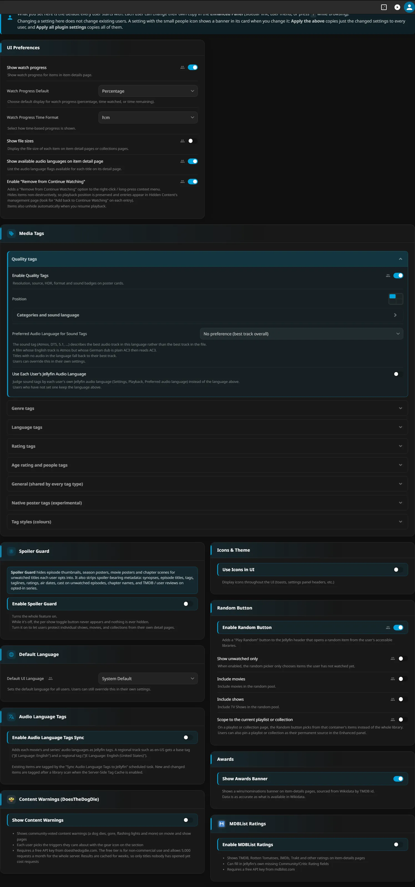

=== "Playback"

    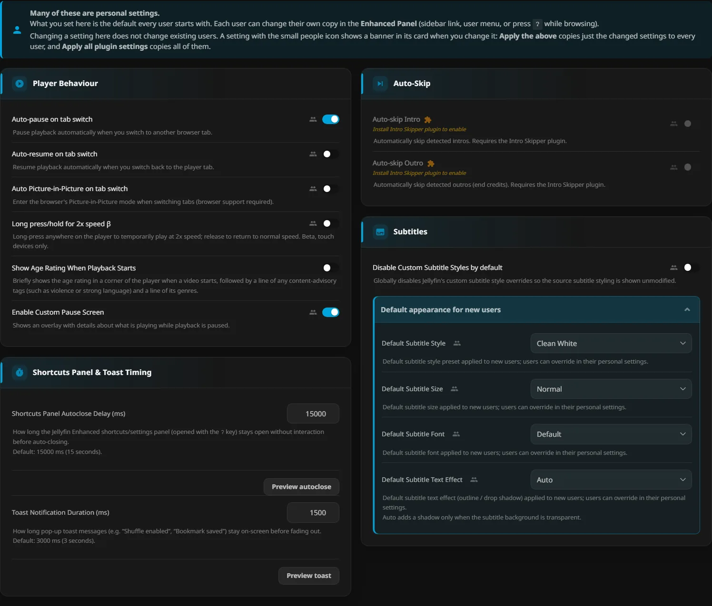

=== "Pages"

    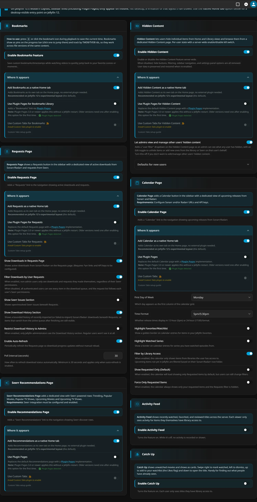

=== "Extras"

    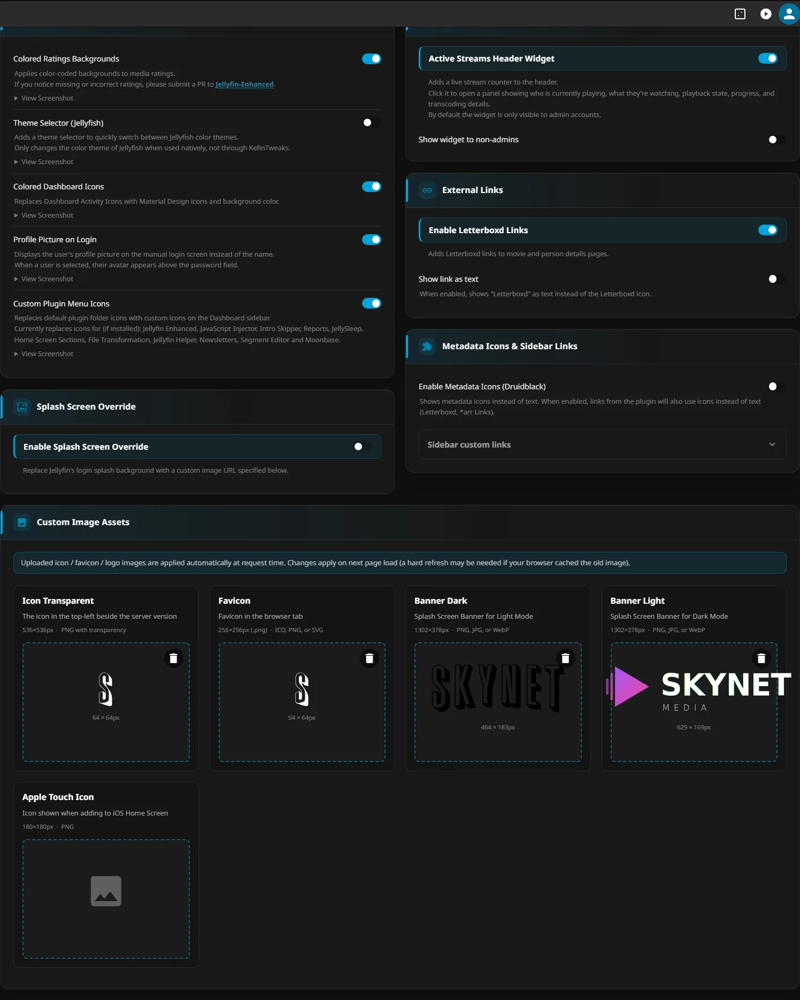

=== "Keyboard"

    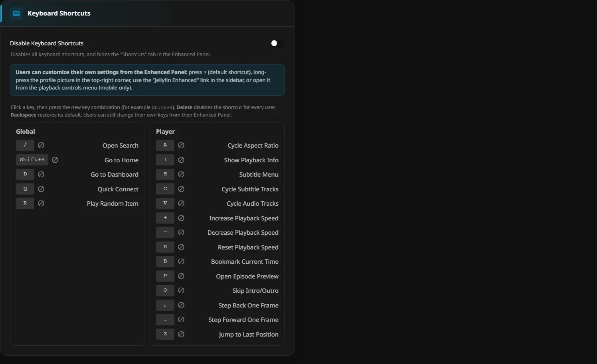

=== "Admin"

    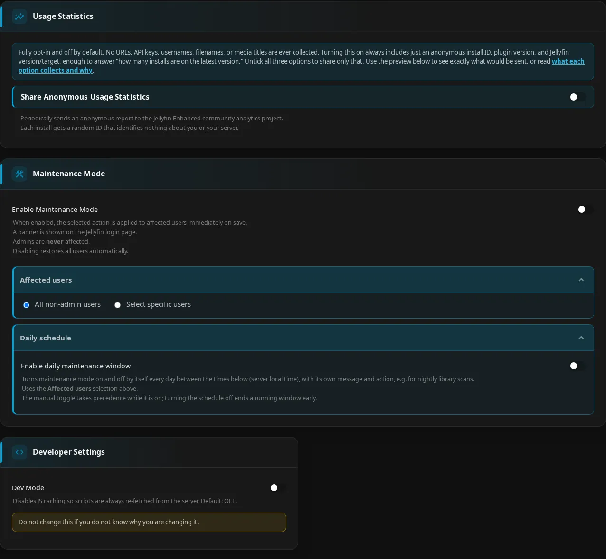

In **Overview**, the What's New notice links to the settings groups that contain controls added since the last dismissal. New Media Tags settings are listed as **Media Tags > _section_** and open the Media Tags tab at that section. Use the release-notes link for the full changelog.

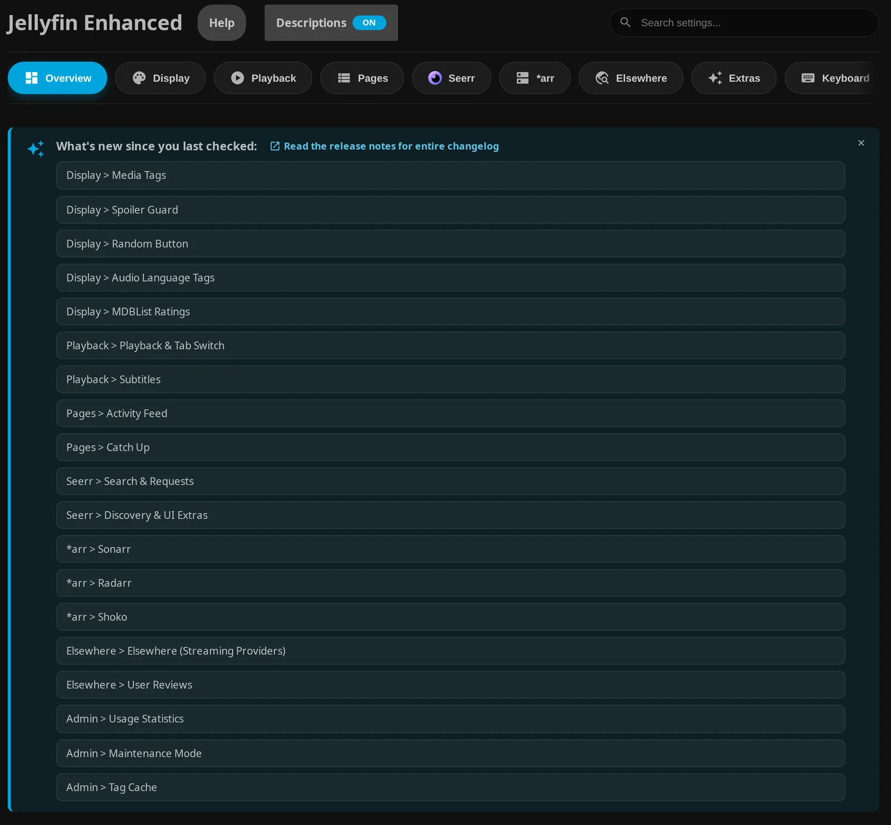

??? info "Admin page details"

    The page uses the same route on both versions: `/web/index.html#/configurationpage?name=Jellyfin%20Enhanced`. Include your Jellyfin base-URL prefix if configured.

    Tabs scroll when they don't fit. Search, section jumps, and links in the What's New notice don't save changes. API fields are masked when unfocused and revealed while editing.

    The **Docs** tab loads the hosted documentation when you first select it. It isn't an offline copy bundled with the plugin; your browser needs access to the hosted site. JE retains the loaded page across tab switches. If it doesn't receive a load event within eight seconds, it replaces the frame with a message and external link. **Open in new tab** is available independently.

## The personal Enhanced panel

You can change your own preferences without administrator access. Open the panel using whichever entry fits your layout:

| Where | How to open it |
| --- | --- |
| Desktop keyboard | Press ++"?"++ outside an input or textarea. |
| Visible desktop or phone drawer | Select **Jellyfin Enhanced → Enhanced Panel**. Jellyfin 12's Modern Layout exposes these drawer links on mobile. |
| Jellyfin 12 Modern Layout avatar menu | Select **Jellyfin Enhanced**. |
| Jellyfin user settings menu, including on phones | Select **Jellyfin Enhanced - User Settings**. |
| Mobile or TV web player | Select the tune button titled **Jellyfin Enhanced** beside the player's settings button when those controls are available; desktop layouts hide it. |

1. Use **Search settings…** to filter the section list by the text inside each pane, or select a section from the navigator. On desktop, the sections and selected pane sit side by side.

    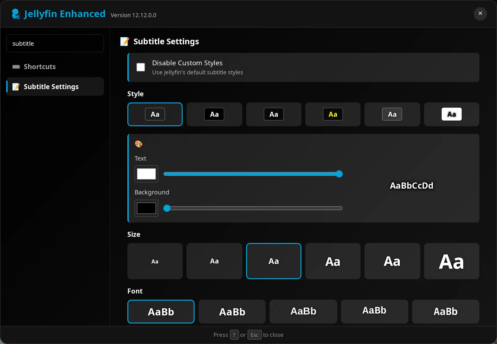

2. On a phone, select a section to open its pane. Use the back arrow to return to the navigator.

    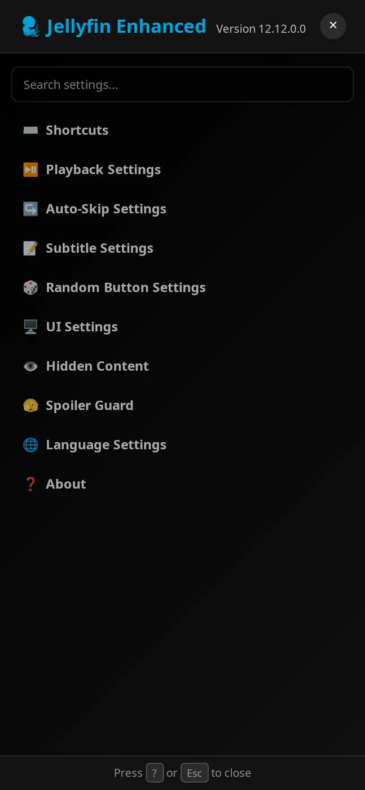

    <figure class="je-video">
      <video autoplay loop muted playsinline controls preload="metadata" aria-label="Phone settings navigation uses sections and a back arrow">
        <source src="../../images/getting-started/panel-phone-navigation.mp4" type="video/mp4">
      </video>
      <figcaption>Open Jellyfin Enhanced from the avatar menu, then use the back arrow between sections.</figcaption>
    </figure>

3. Change a preference using its control. Personal changes save as you make them; there is no admin-style **Save Settings** button here.

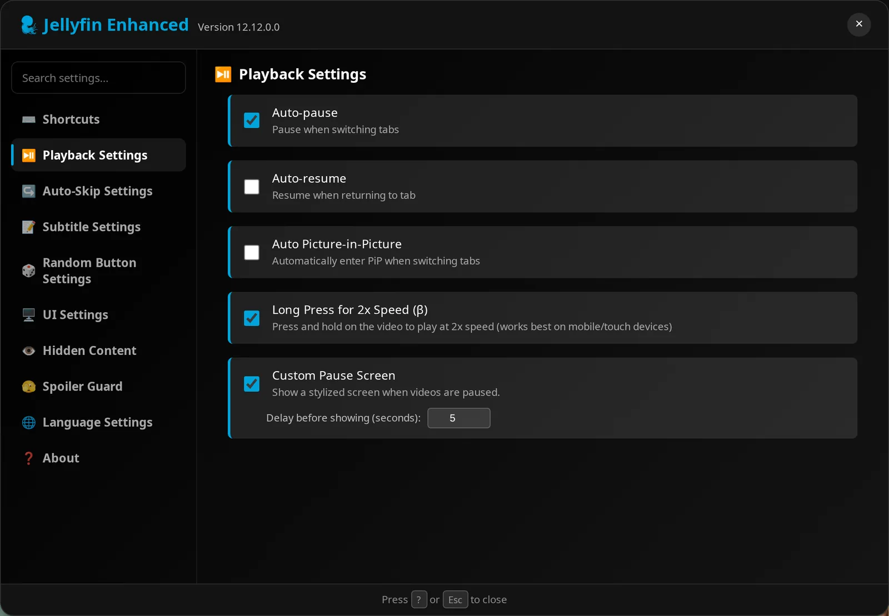

| Section | What you can change | Detailed guide |
| --- | --- | --- |
| **Shortcuts** | View bindings, record a personal key combination, disable a binding, or restore the admin binding | [Enhanced features](../enhanced/enhanced-features.md#playback-controls) |
| **Playback Settings** | Auto-pause, auto-resume, picture-in-picture, long-press speed, and pause screen | [Enhanced settings](../enhanced/enhanced-settings.md) |
| **Auto-Skip Settings** | Personal intro/outro skipping preferences | [Enhanced settings](../enhanced/enhanced-settings.md) |
| **Subtitle Settings** | **Disable Custom Styles**, style/color, size, font, text effect, and position | [Enhanced settings](../enhanced/enhanced-settings.md) |
| **Random Button Settings** | Enablement, unwatched-only selection, item types, and random source | [Enhanced settings](../enhanced/enhanced-settings.md) |
| **UI Settings** | Watch progress, file size and other display choices | [Enhanced settings](../enhanced/enhanced-settings.md) |
| **Media Tags** | Poster tag layout, groups and their order/positions/limits, status badges, rules and locks, colour preset, native poster preference, people tags and audio language links | [Enhanced settings](../enhanced/enhanced-settings.md#media-tags), [Tags & badges](../enhanced/tags.md) |
| **Hidden Content** | Personal hide controls and surface filters, plus access to the hidden list; present when the server feature is enabled | [Enhanced settings](../enhanced/enhanced-settings.md) |
| **Spoiler Guard** | Personal overrides for admin-enabled categories and **Don't ask me to confirm when turning Spoiler Guard off**; present only when admin **Enable Spoiler Guard** is on | [Spoiler Guard settings](../spoiler-guard/spoiler-guard-settings.md#per-user-overrides) |
| **Language Settings** | **Display Language** and **Clear Translation Cache** | [Enhanced settings](../enhanced/enhanced-settings.md) |
| **About** | Version, release notes, and the repository contribution link | [About](../about.md) |

Open **About** to check your JE version or select **Release Notes** or **Contribute**.

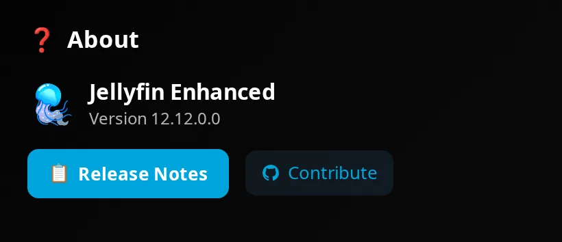

!!! note "Some sections need an enabled feature"

    Controls and sections depend on enabled features. **Disable Keyboard Shortcuts** hides **Shortcuts** and stops ordinary JE shortcut handling. Auto-skip needs supported segments and playback; see [compatibility](compatibility.md#companion-plugins).

??? note "Panel shortcut and device refresh"

    The panel-opening ++"?"++ listener remains available even when ordinary shortcuts are disabled. Saved shortcut overrides don't change it.

    Opening the panel fetches fresh `settings.json`. For a full update of scripts, feature availability, and other user documents on another device, refresh that client.

## Admin defaults and personal overrides

JE saves your starting preferences the first time your account loads JE. Changing admin defaults later doesn't replace those saved preferences, even if you never customize anything. To push new defaults to existing users, use [Apply defaults to existing users](#apply-defaults-to-existing-users).

To set starting preferences for accounts that haven't loaded JE yet, change them on the admin page and click **Save Settings**. To customize your own account, use the personal Enhanced panel.

!!! note "Server features control availability"

    A personal preference can't enable a page or integration that's disabled on the server. If a child control is disabled, turn on or configure its required parent switch, key, or companion plugin first.

| Setting | Default | What it does |
| --- | --- | --- |
| Admin **Default UI Language** | **System Default** | Starting language for a new personal settings document; doesn't force existing users to change language. |
| Personal **Display Language** | Starting value from **Default UI Language**; **Auto** on a fresh server | Overrides JE's display language for your account; changing it saves and reloads. |
| Admin **Disable Keyboard Shortcuts** | Off | Disables ordinary shortcut handling and hides the personal shortcut pane. |
| Personal **Disable Custom Styles** | Starting value from admin **Disable Custom Subtitle Styles by default** (Off on a fresh server) | Uses Jellyfin's default subtitle styles for your account. |

??? info "How starting values are chosen"

    JE creates a missing `settings.json` using current admin defaults. Settings without admin defaults use built-in defaults.

    Client fallbacks fill in missing values. An ordinary **Save Settings** updates the server configuration. **Default UI Language → System Default** stores an empty value.

### Apply defaults to existing users

Saving admin defaults changes what new users start with. Existing users keep their saved choices until you apply the change.

A setting that users also hold personally shows a small people icon. When you change one, a banner appears in its card with two actions:

- **Apply the above** copies only the settings listed in the banner to every existing user. Their other personal settings stay as they are.
- **Apply all plugin settings** replaces every personal preference with the current admin values, the same as **Overview → Quick Actions → Apply all plugin settings to every user**.

Use the second action when you want existing users to start over with the current defaults. It replaces saved personal preferences.

!!! warning "Back up before replacing all preferences"

    There is no per-user undo. Restore a backup or have users reapply their choices.

1. Open **Overview → Quick Actions → Apply all plugin settings to every user**, or use **Apply all plugin settings** in a card's banner.
2. Confirm the action to save the current form and reset existing users' preferences.
3. Have users refresh their clients.

??? note "What the overwrite action changes"

    | Data | Effect of the overwrite action |
    | --- | --- |
    | `settings.json` | Replaced with current admin defaults, except watch progress mode/time format reset to **Percentage** / **h:m** regardless of **Watch Progress Default** / **Watch Progress Time Format**. Personal subtitle colors/position and random source selections reset to built-in defaults; audio language and native poster preferences return to inheriting server settings. Internal panel/Calendar view state also resets. |
    | `hidden-content.json` | Personal filter settings reset; hidden items retained. |
    | Existing `spoilerblur.json` | Preference overrides reset to inherit admin policy; protection lists retained. A missing file isn't created just for this reset. |
    | `shortcuts.json` | Personal shortcut overrides retained. |
    | Bookmarks, Elsewhere settings, shared reviews/activity | Not reset by this action. |

    Before resetting preferences, the action synchronizes managed Custom Tabs entries. It resets users with existing canonical JE user directories. A Jellyfin user without a JE directory receives the defaults when JE first creates their settings instead. If an individual reset fails, check the server log. The endpoint reports skipped settings/Hidden Content users; Spoiler Guard preference failures are logged separately. The admin success dialog isn't a per-file audit.

    **Clear all client tag caches** and **Clear Translation Cache** clear caches, not personal preferences.

### Reset a shortcut

You can change a shortcut for your account or return to the administrator's binding.

1. Open **Shortcuts** and click a displayed key.
2. While it is listening, press your new combination. Press ++backspace++ to remove your override and restore the current administrator binding, or ++delete++ to disable the shortcut for your account.

??? note "Shortcut rules and admin bindings"

    Conflicting combinations and reserved browser-player bindings are rejected. These edits save to `shortcuts.json`.

    In admin **Keyboard**, the same keys edit server bindings: ++backspace++ restores the plugin's built-in binding, and ++delete++ disables the server binding. Users with saved personal overrides can still have their own bindings. The personal panel doesn't offer a single button to reset every preference.

## Settings and data on disk

Your server stores JE's configuration and personal data in Jellyfin's configured directories. These paths vary by installation, so don't assume one Docker mount or operating-system path.

Use the file reference below to locate the data you want to back up. Follow [Backup and restore](#backup-and-restore) for the copying steps.

!!! note "Storage must be writable"

    JE needs writable configuration/data and log storage.

??? info "File locations and storage details"

    The admin XML is `<PluginConfigurationsPath>/Jellyfin.Plugin.JellyfinEnhanced.xml` (Jellyfin's `ConfigurationFilePath` for this plugin). The user/shared data root is:

    ```text
    <PluginsPath>/configurations/Jellyfin.Plugin.JellyfinEnhanced/
    ```

    User directories use the Jellyfin user ID in lowercase with hyphens removed, for example a 32-character GUID, rather than the username.

    | Location | Contents |
    | --- | --- |
    | `<user-id>/settings.json` | Main personal Enhanced preferences, including panel and Calendar view state. |
    | `<user-id>/shortcuts.json` | Personal shortcut overrides. |
    | `<user-id>/bookmark.json` | Saved video bookmarks. |
    | `<user-id>/elsewhere.json` | Personal Elsewhere preferences. |
    | `<user-id>/hidden-content.json` | Hidden items and personal filters. |
    | `<user-id>/spoilerblur.json` | Spoiler Guard lists and preference overrides. |
    | `<user-id>/processed-watchlist-items.json` | Watchlist-monitor processing state. |
    | `reviews.json` | Shared user reviews. |
    | `activity.json` | Shared watched/favorite activity records. |
    | `catchup-log.jsonl`, `catchup-log.1.jsonl` | Catch Up activity log and one rotated copy, when recording is enabled. Rotation occurs after the current file exceeds 5 MiB. |
    | `native-poster-tags.key` | Internal 32-byte secret signing personalized poster URLs. Preserve it for URL-signing continuity. |
    | `cdn-cache/` | Downloaded asset cache; regenerable when upstream assets are reachable. |

    Custom branding uses `<directory containing the plugin XML>/<plugin XML filename without .xml>/custom_branding/`. With the normal XML filename, that is `<PluginConfigurationsPath>/Jellyfin.Plugin.JellyfinEnhanced/custom_branding/`. This is derived from `ConfigurationFilePath`; don't assume it is always the same physical root as the user documents.

    Some browser state remains local, including theme selection, caches, and UI state. A server backup doesn't copy that browser storage. If the poster signing key is missing or has the wrong length, JE recreates it; previously issued personalized URLs can return original artwork until clients refresh. If the key can't be persisted, JE logs a warning and uses a key lasting only for that server process.

## Upgrade migration

At startup, JE updates old uppercase or hyphenated user-directory names to lowercase names without hyphens. Keep its recovery files if you're investigating preferences that changed after an upgrade.

!!! note "Downgrading doesn't restore data"

    Installing a different plugin build doesn't automatically restore an earlier version of your data.

??? info "How migration handles existing files"

    JE skips already canonical names and unrelated directories.

    - If the canonical directory is absent, JE renames the old directory.
    - In the code's case-only rename branch, it renames through `<directory>.case-rename-<suffix>` before assigning the canonical name.
    - When it merges distinct directories, it chooses files individually by modification time; the canonical copy wins a tie. It doesn't merge settings fields or bookmark records within those files.
    - A canonical file replaced by a newer source is preserved as `<file>.pre-case-merge-<suffix>`. After a successful directory merge, the source is preserved as `<directory>.migrated-<suffix>`.

    Stored JSON fields with `null` are skipped during deserialization so model defaults can fill those fields without discarding the rest of the document.

## Backup and restore

A file backup lets you restore preferences and saved data after a move or a reset. JE has no general settings backup/export/import interface or bookmark export/import UI.

1. Stop Jellyfin for a consistent copy.
2. Back up the admin XML and the entire user/shared data root listed above. Include every user directory, shared files, the poster signing key, and any migration recovery files you want to keep.
3. Back up the derived `custom_branding` directory if it is outside that root. The `cdn-cache` directory can be regenerated.
4. If you use Plugin Pages or Custom Tabs, preserve their configuration as part of your Jellyfin backup too. Their entries live outside JE's XML.

To restore:

1. While Jellyfin is stopped, copy the files to the equivalent configured paths. Retain write access for the Jellyfin service account.
2. Install the build matching the restored server, then start Jellyfin.
3. Refresh your clients.

!!! note "Include accounts when moving the server"

    User documents follow Jellyfin user IDs. Restoring JE data alone doesn't recreate accounts or give a new account its old ID. Include Jellyfin's own account/server backup when moving the whole installation.

**Apply all plugin settings to every user** resets preferences; it doesn't restore a backup.

## Account deletion and retained data

Deleting a Jellyfin user leaves that user's JE directory and shared records in place. Uninstalling JE also leaves user data behind.

For intentional cleanup, back up first. Account for the personal directory and shared stores separately; removing one personal directory doesn't remove shared records.

??? note "What deletion and uninstall do"

    JE's deletion handlers invalidate identity, tag-access, and review-author caches. They don't purge personal documents or the user's shared reviews, activity, or Catch Up log records. Hiding an unresolved review author doesn't erase that author's data.

    JE's uninstall hook removes legacy script injection; it doesn't implement a user-data purge.
