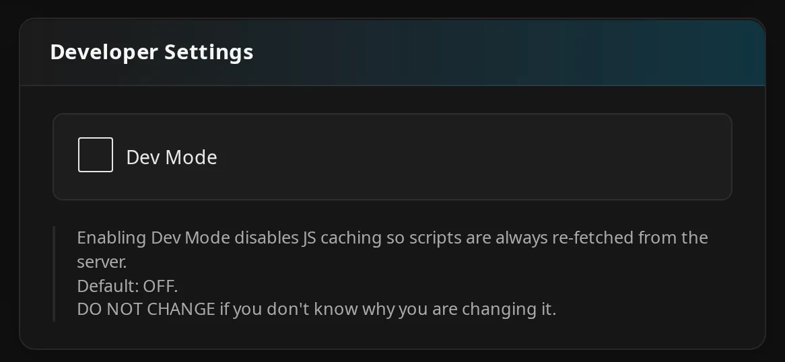

# Troubleshooting installation

Use this page when JE is missing, its web scripts fail to load, or an update leaves old behavior behind. For the installation sequence, use the [Installation Guide](installation.md). Check [Compatibility](../getting-started/compatibility.md) before diagnosing a client or layout issue.

## Plugin Not Appearing After Installation

Check that Jellyfin has loaded the server plugin first. If it has, troubleshoot the personal panel next.

1. Check Jellyfin's installed plugins for **Jellyfin Enhanced**. Confirm it is enabled and that you restarted Jellyfin after installation or an enable/disable change.
2. Check the Jellyfin server log for plugin-loading errors. Record the running Jellyfin version and the build you installed.
3. Check the loaded JE version using the address in the details below.
4. If the server plugin loads, continue with [Scripts Not Loading](#scripts-not-loading).

??? note "Details"

    Open `/JellyfinEnhanced/version` on the same server. Include your Jellyfin base URL prefix if configured. A successful response reports the loaded JE version; you do not need to sign in. A 404 can mean the plugin did not load or your proxy did not send the request to Jellyfin.

    Clearing browser caches cannot repair a server plugin that failed to load.

### Wrong plugin build

Install the build that matches your Jellyfin version, then restart the server. See [Compatibility](../getting-started/compatibility.md) for version requirements.

1. Back up your configuration.
2. Replace the mismatched installation using the shared repository in the [Installation Guide](installation.md).
3. Restart Jellyfin.

??? info "How it works"

    The administrator page can show **Wrong plugin build for this Jellyfin version**. The startup log reports `BUILD/HOST MISMATCH` and the expected release asset: `Jellyfin.Plugin.JellyfinEnhanced_12.0.0.zip` for Jellyfin 12, or `Jellyfin.Plugin.JellyfinEnhanced_10.11.0.zip` for Jellyfin 10.11.

    These filenames identify the build target, not the JE release version.

    For administrator diagnostics, authenticated `GET /JellyfinEnhanced/host-compat` reports the build target, host target, expected asset, and manifest URL. It also checks administrator access; a signed-out request or an ordinary user cannot use it. There is no configuration switch to disable the compatibility check.

    The same JE version number on two ZIP files does not make their build targets interchangeable.

## Scripts Not Loading

Check the page Jellyfin sends to your browser, then check whether JE's scripts load.

1. Open browser developer tools with ++f12++.
2. Select the **Network** tab and reload the web client.
3. Follow the page and request checks below.

!!! note

    Keep your server's base URL prefix on all requests below.

### Check the served page

Look for JE's script in the original page response. Scripts may change the page after it loads, so inspect the response in **Network**.

1. Inspect the HTML response and look for `/JellyfinEnhanced/script?v=…`.
2. If it is missing, compare direct Jellyfin access with access through your proxy. The proxy may serve an old saved page or a separately hosted web interface.
3. Check server logs and the loading setting described below.

An independently served web client does not automatically receive JE's injection. See [Compatibility](../getting-started/compatibility.md) for the client requirements.

??? info "How it works"

    Normal injection applies to GET requests whose paths end in `/web`, `/web/`, or `/web/index.html`, including a base URL prefix. The response must be HTTP 200 with an HTML content type and a closing `</body>`. JE skips injection if a JE script reference is already present.

    Check server logs for `Script injection middleware error`. Also check whether `DisableScriptInjectionMiddleware` was deliberately changed in the configuration file. Its default is `false`. Setting it to `true` makes JE add its script to `index.html` when Jellyfin starts. There is no control for it on the administrator settings page. See [Permission Issues](#permission-issues) for this older loading method.

### Check client requests

Check the script requests for a failed download or a response that contains the wrong kind of content.

1. Filter **Network** requests by `JellyfinEnhanced`.
2. Check the status, response type, and response body of the script request and `/JellyfinEnhanced/bundle.js?v=…`.
3. Check browser messages for blocked scripts, browser extensions, content-security-policy errors, or failed assets.

Administrator diagnostic setting, under **Admin** → **Developer Settings**:

| Setting | Default | What it does |
| --- | --- | --- |
| **Dev Mode** | Off | Stops reusing saved scripts and loads them individually so you can diagnose loading errors. |

Leave **Dev Mode** off for normal use. If you change it for diagnosis, save and reload the client. After an update, start with a hard refresh. Use the targeted controls below if only scripts, translations, tags, or images remain out of date.

??? info "How it works"

    JE normally loads its scripts together from `/JellyfinEnhanced/bundle.js?v=…`. If that request fails, JE can try loading the scripts individually. If you see individual requests, check the console for the original failure and whether loading recovered. You do not need to sign in to request the bundle or its diagnostic source map at `/JellyfinEnhanced/bundle.js.map`.

    A 404 suggests a missing route or proxy path problem. An HTML login page returned for a JavaScript request suggests proxy authentication or rewriting.

### Background tasks are separate

Run **Jellyfin Enhanced Startup** manually after fixing an error that stopped JE's background services from starting. For a missing script with normal settings, use the page and request checks above.

??? info "How it works"

    **Jellyfin Enhanced Startup** runs when Jellyfin starts. It starts JE's background services and runs **Refresh Tag Cache** if the server tag cache is enabled and empty. JE normally adds its script when Jellyfin serves the web page.

    If you deliberately chose the older method that writes to `index.html`, running the task also retries that operation.

## Update Not Working

Confirm Jellyfin restarted with the updated plugin, then check for an old page or script in your browser or proxy cache.

1. Compare `/JellyfinEnhanced/version` with the version shown by the installed plugin. Confirm the server restarted after the update.
2. Check [Wrong plugin build](#wrong-plugin-build) if you changed Jellyfin server lines.
3. Hard-refresh the browser, then compare the served script tag and script/bundle responses using [Scripts Not Loading](#scripts-not-loading). Check proxy caching if local access works but remote access does not.
4. If the installed plugin files are still wrong, back up configuration/data, remove the affected JE installation through the plugin manager, and restart. Use the [Installation Guide](installation.md) to install the matching build again.

??? note "Details"

    Uninstalling JE attempts to remove any old script added to the web files and leaves your saved user data in place. Reinstalling or downgrading the plugin does not restore earlier settings; restore a backup separately if you need them. See [Settings Overview](../getting-started/settings-overview.md) for backups and restoration.

### Preferences changed after an upgrade

If your preferences changed after an upgrade, check for a user-folder migration error before trying to recover the data. The recovery steps below apply to a failed migration that left a `.case-rename-…` folder.

To recover from this failure:

1. Find `Failed to migrate user dir` in the server log and identify the affected user folder.
2. Stop Jellyfin and back up both the lowercase folder and the leftover `.case-rename-…` folder.
3. Compare their files and copy the versions you want to keep into the lowercase folder. Replacing a file replaces all the settings or bookmarks inside it; keep the backups.
4. Start Jellyfin and reload your client to check the restored data.

??? info "How it works"

    JE stores each user's data in a folder named with their lowercase ID, without hyphens. When Jellyfin starts, JE checks older uppercase or hyphenated folders and renames them if the lowercase folder is missing. If a hyphenated old folder and the lowercase folder both exist, JE tries to keep the newer copy of each file; the lowercase folder's copy wins when modification times match. It chooses whole files rather than combining the bookmarks or settings inside them. Keep `.pre-case-merge-…` file backups and `.migrated-…` copies of old folders when investigating unexpected changes.

    On a case-sensitive filesystem, such as a typical Linux installation, you can have separate uppercase and lowercase folders for the same user. If their names differ only in capitalization, JE can move the uppercase folder to a `.case-rename-…` name and then fail because the lowercase folder already exists. The old data stays in that `.case-rename-…` folder without a file merge. JE checks old ID-named folders again on later starts, but skips folders with the `.case-rename-…` suffix, so restarting does not recover that data automatically.

## Wrong Plugin Build or Restart Required

If the configuration page shows **Wrong plugin build for this Jellyfin version** or the logs contain `BUILD/HOST MISMATCH:`, the running plugin build targets a different Jellyfin version. If the warning names a zip to install, install it from the plugin repository, then stop and start the Jellyfin service or container.

Both builds share the same plugin version number and installation path. Jellyfin's **Dashboard** → **Restart** restarts the server inside the same process and keeps the previous build loaded in memory, even after the correct file is installed. If the warning says the plugin file on disk was replaced after Jellyfin loaded it, or shows **Plugin restart required** (`STALE PLUGIN BUILD:` in the logs), start with a full process restart:

- Linux service: `sudo systemctl restart jellyfin`
- Docker: `docker restart <container>`
- Windows: stop and start the Jellyfin service

Refresh the configuration page after Jellyfin starts again. If the wrong-build warning is still there, the file on disk is the wrong build too: install the zip it names, then restart the process again.

## Permission Issues

Find the path and operation in the full error before changing permissions. The account running Jellyfin needs write access to plugin configuration/data and log storage.

Normal script loading does not need a writable web directory. Use the table to check the affected storage.

| Failing path or operation | What to check |
| --- | --- |
| User document, such as `settings.json` or `bookmark.json` | Write access to JE's user-data directory for the account running Jellyfin. |
| `custom_branding` upload | Administrator access and write access to branding storage. |
| `cdn-cache` | Write access to JE's asset-cache storage. |
| `JellyfinEnhanced_yyyy-mm-dd.log` | Write access to Jellyfin's configured log directory. |
| `index.html` | Whether the operation is old-tag cleanup or deliberately enabled legacy injection. |

See [Settings Overview](../getting-started/settings-overview.md) for actual storage locations and backup boundaries.

### Old-tag cleanup and the legacy fallback

Check whether JE was removing an old script tag or using the older method that writes a new one. An `index.html` error does not mean every installation needs that older method.

1. Find Jellyfin's configured web directory and inspect its `index.html` for the old JE tag.
2. Identify whether the error is reading the file or writing the cleaned version.
3. Back up the file before removing an old tag or making a narrowly scoped permission change.

??? info "How it works"

    JE can attempt to remove an old JE script tag from the configured web directory's `index.html`. An error such as `Error during cleanup of old script from index.html` does not mean every installation needs on-disk injection.

    JE only writes its script to `index.html` at startup if you deliberately set `DisableScriptInjectionMiddleware=true`. To return to normal script loading, restore the default `false` and restart. File Transformation is not required for JE's normal loading method; see [Compatibility](../getting-started/compatibility.md) for companion-plugin roles.

### Platform-Specific Permission Issues

These checks apply to the failing storage path, or to web-file cleanup/legacy injection when those operations are actually involved. Paths and service identities vary by installation.

#### Docker

Check the container's actual Jellyfin UID/GID, the affected bind mount or volume, host ownership, and whether the mount is read-only.

Normal JE installations do not require an `index.html` bind mount.

??? note "Details"

    A path such as `/jellyfin/jellyfin-web/index.html` is an example, not a requirement for every image.

    If you deliberately maintain an `index.html` bind mount for the older script-loading method, update it when you upgrade the container's web interface. An old copied page can break after a Jellyfin upgrade. To return to normal loading, set `DisableScriptInjectionMiddleware=false` and restart Jellyfin.

#### Windows

Identify the account that actually runs the Jellyfin service or process. Check that account's permissions on the specific failing configuration, log, or web file. Do not assume the account is `NETWORK SERVICE` or grant write access to the entire installation tree.

#### Linux

Identify the service user and configured data, log, and web paths. Check ownership, parent-directory access, mount flags, and any service or security-policy restrictions for the failing operation. Avoid recursive ownership or permission changes across system installation directories.

## Stale caches or missing assets

Use the action that matches the stale or missing content. Clearing all browser storage is not routine maintenance and does not replace saved server preferences.

| Symptom | Targeted action |
| --- | --- |
| Old scripts after an update | Hard-refresh; inspect the script version and proxy cache using [Scripts Not Loading](#scripts-not-loading). |
| Stale translation strings | Personal **Language Settings** → **Clear Translation Cache** reloads this browser. **Refresh Translation Cache** signals clients to refresh translations on their next page load. See [Translation Updates](../faq-support/contributing-translations.md#translation-updates) for bundled-locale limits. |
| Stale browser tag data | With **Server-Side Tag Cache** off, use administrator **Overview** → **Quick Actions** → **Clear all client tag caches**, or **Display** → **Clear All Client Caches**, then reload affected clients. |
| Stale server tag data | **Refresh Tag Cache** updates changed entries and rebuilds the cache when needed. **Admin** → **Tag Cache** → **Rebuild Server Tag Cache** starts a full rebuild. |
| Missing locally mirrored icons or other CDN assets | Check asset requests and server logs; run **Refresh CDN Assets** after repairing upstream connectivity. See the details below for the request path. |

The admin **Display** controls for tag caching are:

| Setting | Default | What it does |
| --- | --- | --- |
| **Server-Side Tag Cache** | On | Enables the server cache and its background maintenance. |
| **Exclude libraries from the tag cache** | Off; no libraries selected | Excludes the selected libraries when the switch is on. Both the switch and a selection are needed. |
| **Persist Tag Fallback Cache in Browser Storage** | Off | Saves tag data in your browser when the server cache is off. |

See [Media tags](../enhanced/tags.md) if tags are missing or show incorrect information.

??? note "Details"

    **Clear all client tag caches** and **Clear All Client Caches** are both hidden while server caching is on. Use the server-cache actions instead.

    Turning off **Server-Side Tag Cache** checks **Persist Tag Fallback Cache in Browser Storage** automatically. Saving enables it whenever the server cache is off.

    **Refresh Tag Cache** runs daily at 03:00 by default. Starting background services, updating the server cache, rebuilding it completely, and clearing browser caches are separate actions. Choose the one that matches your problem.

    For missing CDN assets, check `/JellyfinEnhanced/cdn/{source}/{path}` and server logs.

### CDN connectivity and limits

Restore your server's internet connection, then run **Refresh CDN Assets** if locally served images or icons are missing. JE serves saved copies through Jellyfin, but it still needs internet access to fetch assets it has not saved yet.

!!! note

    A fresh offline installation may be missing those files. Material Symbols fonts are included with the plugin.

??? info "How it works"

    JE downloads supported external images and other assets, stores copies, and serves them through your Jellyfin server.

    **Refresh CDN Assets** runs at startup and every 24 hours. JE and your browser keep downloaded assets for 24 hours before checking for updates. If JE cannot download an asset and has no saved copy, it waits five minutes before trying again. It can keep serving an older saved copy if the download fails. Each asset can be up to 8 MiB; JE removes older files to keep its saved copies within 512 MiB. These limits are fixed. If one download times out, the task continues with the remaining files unless you cancel it.

## Admin Config Page Tabs Not Switching

Compare direct local access with your remote URL. If the tabs work locally, check your proxy before changing plugin settings.

1. If you use Cloudflare **Rocket Loader**, try disabling it for your Jellyfin hostname and reload. It modifies script execution and can interfere with the admin page.
2. If the problem remains, check browser console and **Network** errors.

??? note "Details"

    The current tabs are **Overview**, **Display**, **Playback**, **Pages**, **Seerr**, **\*arr**, **Elsewhere & Reviews**, **Extras**, **Keyboard**, **Admin**, and **Docs**.

    A proxy authentication page returned in place of JSON or JavaScript is a different failure from an unreachable service. For Seerr and *arr, server connection URLs must be reachable by Jellyfin without an interactive browser sign-in; user-facing URL mappings are separate. Follow [Seerr settings](../seerr/seerr-settings.md) or [*arr troubleshooting](../arr/troubleshooting-support.md) for service-specific diagnosis.

### Plugin detection issue

Fix the failed plugin-list request, then click **Retry**. **Plugin detection issue** means JE could not reliably check optional plugins; it does not by itself prove a companion is missing.

After enabling or disabling a companion, restart Jellyfin so detection reflects the running plugins. See [JE Pages & Tabs](../getting-started/pages-and-tabs.md) for placement and registration requirements.

## Getting Help

Collect the failed request, console error, and relevant server log using [How do I gather logs for bug reports?](../faq-support/faq.md#how-do-i-gather-logs-for-bug-reports). Then [report an issue](../faq-support/report-issues.md) or use the [support channels](../faq-support/support.md).
