# Other Features

Personalize Jellyfin's web interface, inspect active streams, add external ratings, and manage maintenance windows. These features come with Jellyfin Enhanced; you do not need to install the optional UI scripts separately. See [Other Settings](other-settings.md) for the settings reference.

??? note "Where to find these controls"

    “Other” is a documentation category. Open **Dashboard** → **Plugins** → **Jellyfin Enhanced**; administrator controls are spread across **Display**, **Playback**, **Extras**, **Pages**, and **Admin**.

    Web enhancements need supported Jellyfin page layouts and markup. See [Compatibility](../getting-started/compatibility.md) for clients and layouts.

## Custom Branding

Replace Jellyfin's logos, banners, browser favicon, and touch icon with your own images. You do not need to edit jellyfin-web files or install another branding plugin.

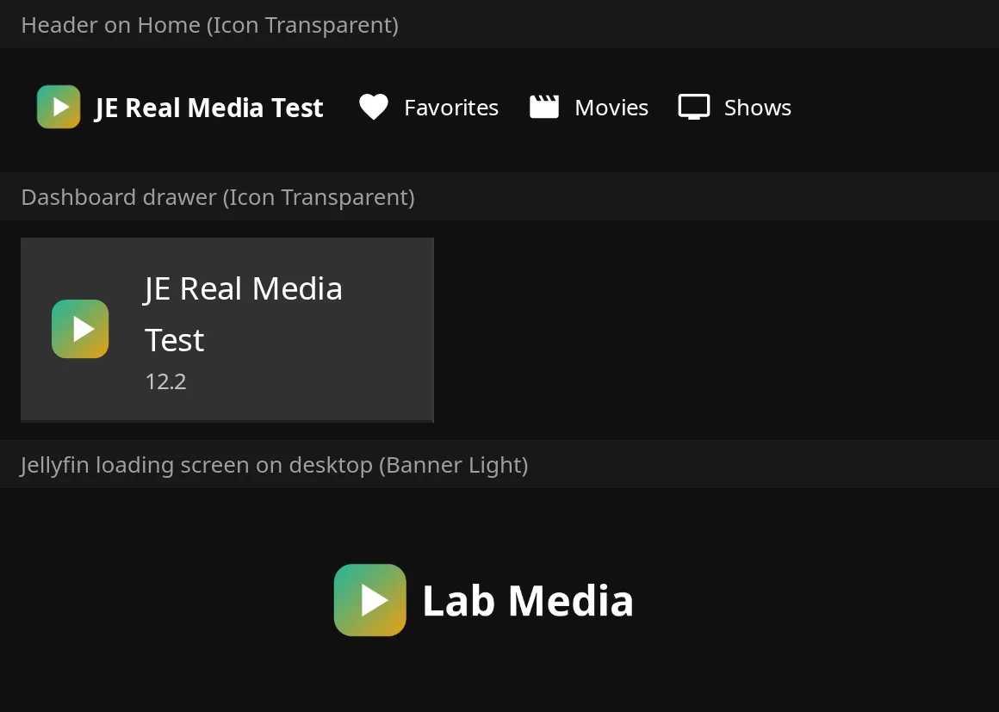

### How to use

1. Open the admin **Extras** tab → **Custom Image Assets**.
2. Click a slot or drop an image onto it. Upload starts immediately; wait for **✓ Uploaded**.
3. Check the preview and measured dimensions where available, then reload Jellyfin. Use ++ctrl+f5++ if the old asset remains cached.
4. To replace a file, upload again. To remove it, use that slot's trash button; deletion acts immediately and restores stock-asset fallback.

<figure class="je-video">
  <video autoplay loop muted playsinline controls preload="metadata" aria-label="Uploading a branding image and restoring the stock asset">
    <source src="../../images/other/branding-upload-flow.mp4" type="video/mp4">
  </video>
  <figcaption>Upload an icon, refresh to see it, then delete it and refresh to restore the stock logo.</figcaption>
</figure>

!!! note "Uploads apply immediately"

    **Save Settings** applies configuration fields such as the splash override. Uploaded files do not wait for **Save Settings**. Replacing them normally needs a browser reload rather than a server restart.

### Asset slots

All slots are administrator uploads under **Extras** → **Custom Image Assets**.

| Setting | Default | What it does |
|---|---|---|
| **Icon Transparent** | Stock icon | Top-left logo beside the server version; recommended 536×536 transparent PNG. |
| **Favicon** | Stock favicon | Browser tab icon; UI recommends 256×256 for PNG and lists ICO, PNG, or SVG. Prefer ICO. |
| **Banner Dark** | Stock banner | Light-mode loading banner; recommended 1302×378. |
| **Banner Light** | Stock banner | Dark-mode loading banner; recommended 1302×378. |
| **Apple Touch Icon** | Stock touch icon | iOS Home Screen and supported PWA touch icons; recommended 180×180 PNG. |

!!! note "Formats and limits"

    Use PNG for the PNG slots and ICO for the favicon. Uploads accept image MIME types up to 10 MiB; dimensions are recommendations.

??? info "How it works"

    JE's middleware serves the uploaded files without converting them. PNG slots are stored and served as `.png`, and the favicon as `.ico`. Use matching content even though the banner UI also lists JPG/WebP and the favicon UI lists PNG/SVG. See [the asset reference](other-settings.md#custom-branding) for fixed filenames.

### Storage and troubleshooting

Keep the branding directory writable and persistent. If branding does not appear, confirm upload success, reload, and check server logs and storage permissions.

??? note "Details"

    Files are stored in:

    ```text
    <JE configuration-file directory>/<JE configuration-file basename>/custom_branding/
    ```

    The absolute path varies by Jellyfin installation. Assets survive server/web updates when the configuration storage is retained; deleting custom files removes the overrides.

    JE's middleware handles supported hashed branding filenames and Jellyfin 12's sized touch icons. If a custom file is absent or cannot be served, Jellyfin serves its stock asset. JE does not rewrite every arbitrary image URL.

    The configuration-only `DisableBrandingMiddleware` property defaults to `false`; `true` bypasses the overrides. There is no visible settings-page switch for it. It does not disable the separate JavaScript splash.

## Icon Settings

Choose the icons you see in JE's panel headings and ordinary toast notifications.

### How to use

1. Open admin **Display** → **Icons & Theme** and enable **Use Icons in UI**.
2. Choose **Icon Style**.
3. Click **Save Settings** and reload.

| Setting | Default | What it does |
|---|---|---|
| **Use Icons in UI** | On | Displays helper icons in supported JE UI regions. |
| **Icon Style** | **Emoji** | Chooses **Emoji**, **Lucide Icons**, or **Material UI Icons**. Requires **Use Icons in UI**. |

??? note "Details"

    This does not replace every Jellyfin icon or every extra's own icons. Unsupported helper entries fall back to emoji. [Metadata Icons](#metadata-icons) controls a separate stylesheet for item metadata and external links.

## Extras

Customize the dashboard, login screen, and user-preferences menu with these optional enhancements.

**How to use:** Most switches are under admin **Extras** → **UI Tweaks**. Turn on the switch you want, click **Save Settings**, and reload the affected page.

??? note "Details"

    The user Activity Feed is a separate feature under **Pages** → **Activity Feed**. See [Enhanced Features](../enhanced/enhanced-features.md) and [Enhanced Settings](../enhanced/enhanced-settings.md) for its watch, favorite, review, and page-delivery controls. Dashboard icon coloring does not change that feed.

    Its Active Streams section needs the stream-widget switch and, for non-admins, the viewer-access switch. It polls every 15 seconds while its container and document are visible. The header widget described below refreshes on demand.

### Colored Activity Icons

Give matching events in the dashboard Home activity list predefined Material icons and colors, making them easier to distinguish.

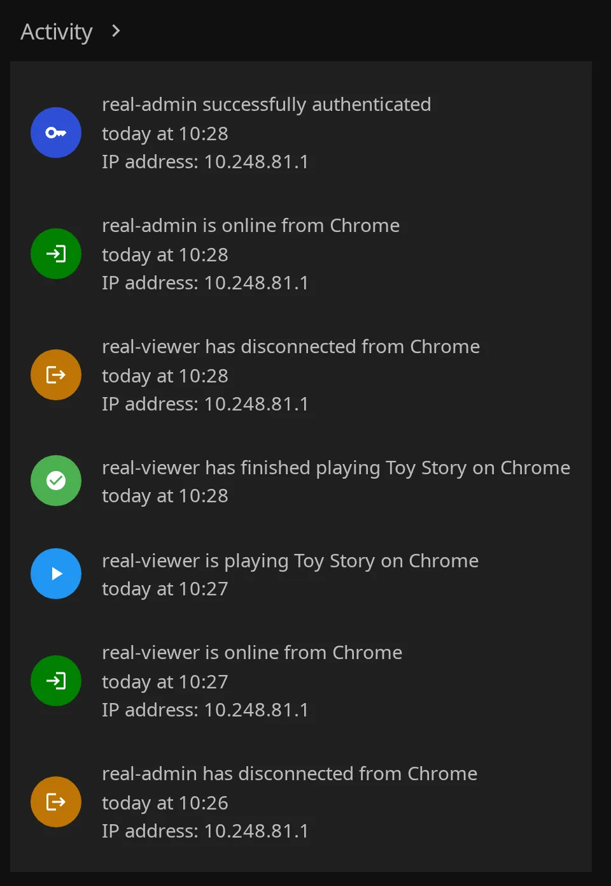
*These icons belong to dashboard activity, separate from the JE Activity Feed.*

**How to use:** Enable **Colored Dashboard Icons** under admin **Extras** → **UI Tweaks**, save, and open the dashboard Home page. The full **Activity** page is unchanged.

| Setting | Default | What it does |
|---|---|---|
| **Colored Dashboard Icons** | Off | Applies predefined replacements to supported dashboard event entries. |

??? note "Details"

    There is no color picker. Matching depends on supported event wording and expected dashboard markup; unmatched text receives no mapped replacement. This is separate from the user Activity Feed.

### Colored Ratings

Color official age/content classifications, including PG-13, TV-MA, and supported international boards. This feature does not color TMDB, IMDb, or Rotten Tomatoes numerical review scores.

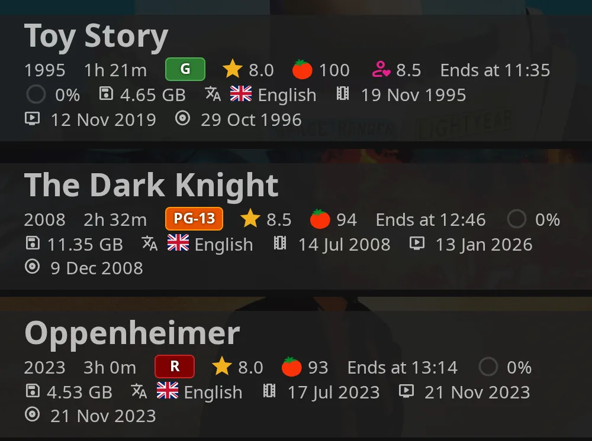

**How to use:** Enable **Colored Ratings Backgrounds** under admin **Extras** → **UI Tweaks**, save, and open a detail page with an official rating.

| Setting | Default | What it does |
|---|---|---|
| **Colored Ratings Backgrounds** | Off | Applies classification-specific backgrounds to supported official-rating chips. |

No ratings API key is needed.

??? info "How it works"

    Supported styling includes country-prefixed ratings, bare classifications, US TV descriptors, and ESRB labels. German forms such as `DE-12` and `FSK 12` normalize to `FSK-12`, with FSK-specific colors. Unknown classifications use a neutral blue-grey background. This is separate from [MDBList Ratings](#mdblist-ratings) and [poster tags](../enhanced/tags.md).

### Login Image Display

Select a user card on the login screen to show that user's profile picture above the password field. The picture replaces the username area while it is shown.

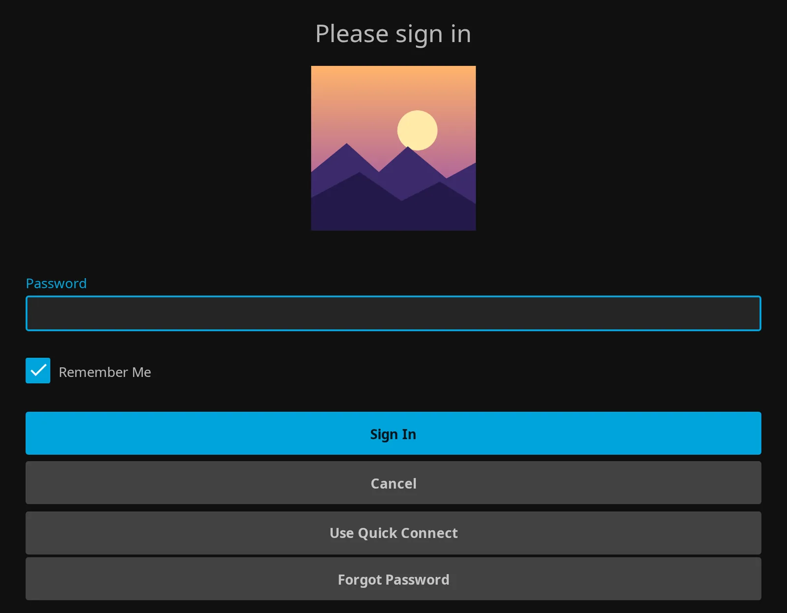

**How to use:** Enable **Profile Picture on Login** under admin **Extras** → **UI Tweaks**, save, and reload the signed-out login page. Select a user with a profile picture.

| Setting | Default | What it does |
|---|---|---|
| **Profile Picture on Login** | Off | Displays the selected login card's avatar above the password field on supported markup. |

??? note "Details"

    JE matches the selected username to an available login user card. If no matching card or image is available, or the image fails to load, JE restores the ordinary form. Hidden users entered through **Manual Login** have no matching public card, so their avatar is not shown.

### Plugin Icons

Replace supported dashboard plugin-menu icons with a mixture of Material icons and image logos. You can also add links to existing plugin configuration pages.

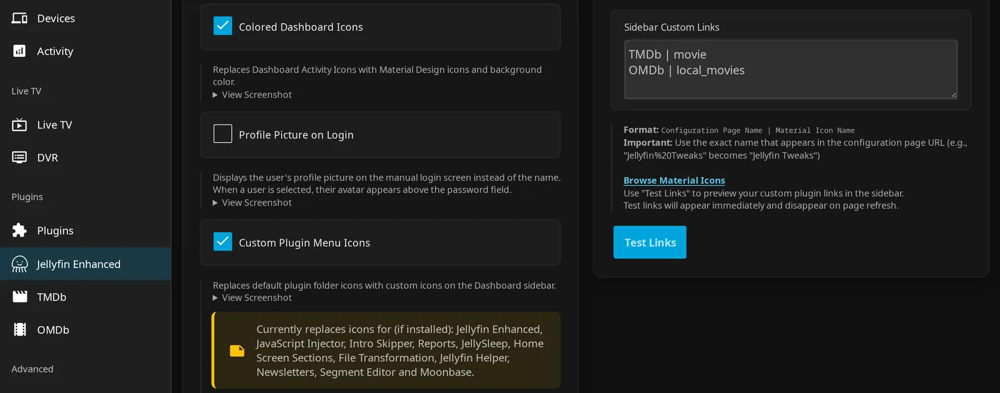

**How to use:**

1. Enable **Custom Plugin Menu Icons** under admin **Extras** → **UI Tweaks**.
2. To add a configuration-page link, open **Extras** → **External Links** → **Sidebar Custom Links**. Enter one pair per line, using the exact decoded page name, including spaces:

    ```text
    Configuration Page Name | Material Icon Name
    ```

    For example:

    ```text
    Jellyfin Enhanced | tune
    ```

3. Click **Test Links** to preview the entered links in the current window until refresh.
4. Click **Save Settings** to persist the configuration, then reload the dashboard sidebar.

| Setting | Default | What it does |
|---|---|---|
| **Custom Plugin Menu Icons** | Off | Replaces matching plugin-link icons and enables saved custom configuration-page links. |
| **Sidebar Custom Links** | Empty | Under **Extras** → **External Links**; adds one configuration-page name/icon pair per line. |

??? info "How it works"

    Built-in replacements are:

    | Plugin link | Replacement |
    |---|---|
    | Jellyfin Enhanced | Jellyfish image/favicon |
    | JavaScript Injector | JavaScript image logo |
    | Intro Skipper | `redo` |
    | Reports | `insert_chart_outlined` |
    | JellySleep | `dark_mode` (matches `Jellysleep` in the route) |
    | Home Screen Sections | `dashboard_customize` |
    | File Transformation | `file_open` |
    | Newsletters | `newspaper` |
    | Segment Editor | `content_cut` |
    | Jellyfin Helper | Image logo |
    | Moonbase | Image logo |

    These replacements require matching rendered plugin links. They do not install plugins, and layouts without the supported dashboard sidebar markup may not show them.

    JE builds a `#/configurationpage?name=...` link. The second field is an icon name, not a URL. Saved custom links depend on **Custom Plugin Menu Icons**.

### Plugin revision display

JE makes supported dashboard plugin-detail pages easier to scan by hiding repeated version rows. It keeps the first row for each version within each revision list.

**How to use:** Open a plugin's detail page. This runs automatically, with no dedicated setting.

??? note "Details"

    This only changes presentation. It does not delete packages, reorder rows, change installation handlers, or install a version. It relies on Jellyfin 12-style MUI accordion markup; do not expect the same presentation on every 10.11 layout.

### Theme Selector

Choose a color palette from Jellyfin's user-preferences menu. Install the Jellyfish base theme natively first; the selector imports color palettes for that theme.

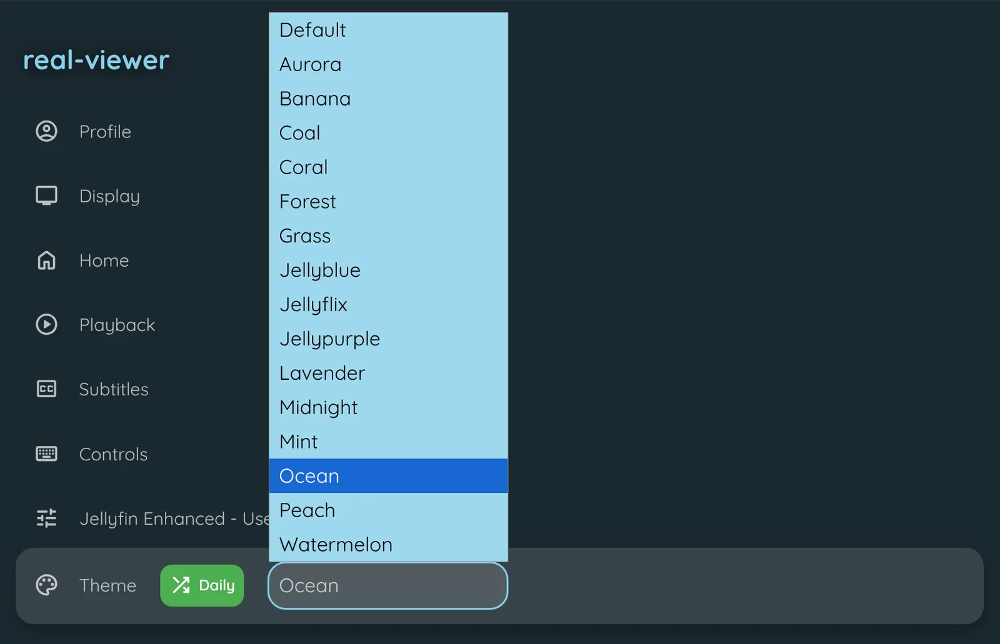

**How to use:**

1. Enable **Theme Selector (Jellyfish)** under admin **Extras** → **UI Tweaks**, click **Save Settings**, and reload.
2. Open Jellyfin's user-preferences menu and choose a palette under **Theme**. Choosing one fades and reloads the page.
3. For a daily random palette, use the shuffle button with the tooltip **Random daily theme**. It shows **Daily** while daily randomization is enabled. Enabling it can immediately choose a palette and reload the page.

<figure class="je-video">
  <video autoplay loop muted playsinline controls preload="metadata" aria-label="Changing the selected theme palette and enabling Daily mode">
    <source src="../../images/other/theme-switch.mp4" type="video/mp4">
  </video>
  <figcaption>Choose Coral and Forest, then enable Daily to apply a random palette.</figcaption>
</figure>

| Setting | Default | What it does |
|---|---|---|
| **Theme Selector (Jellyfish)** | Off | Admin switch that makes the selector available. |
| **Theme** | **Default** | Personal, browser-stored palette selection. **Default** removes the imported palette. |
| **Random daily theme** | Off | Personal, browser-stored daily randomization choice. |

??? note "Details"

    The 16 choices are **Default**, **Aurora**, **Banana**, **Coal**, **Coral**, **Forest**, **Grass**, **Jellyblue**, **Jellyflix**, **Jellypurple**, **Lavender**, **Midnight**, **Mint**, **Ocean**, **Peach**, and **Watermelon**.

    Selections use user-prefixed browser storage rather than JE's server-stored personal settings. Daily selection uses a UTC date and is evaluated during initialization; an already-open page does not necessarily switch at midnight. This selector changes native Jellyfish colors and is not a KefinTweaks theme selector.

### Active Streams Widget

See who is watching, what they are playing or have paused, and how Jellyfin is delivering each stream. Administrators can also broadcast a native Jellyfin message.

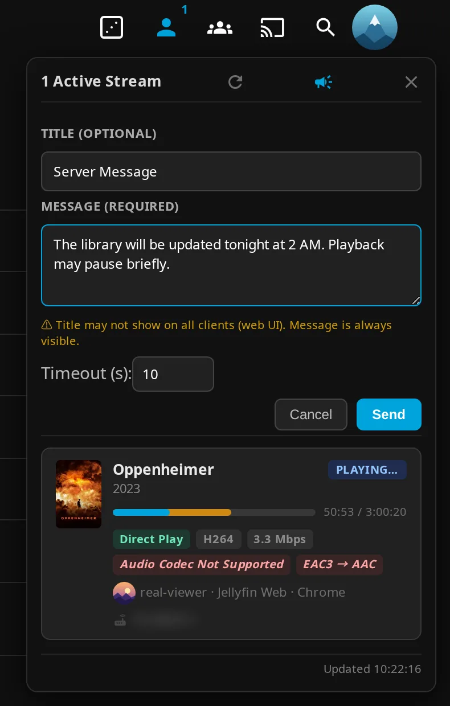

**How to use:**

1. Enable **Active Streams Header Widget** under admin **Extras** → **UI Tweaks**, click **Save Settings**, and reload.
2. Click the stream icon in the Jellyfin header to open the panel. Its title shows the active-stream count, or **No Active Streams** when none are playing.
3. Click the **Refresh sessions** icon with the tooltip **Refresh** for current data. The footer shows the last update time.

| Setting | Default | What it does |
|---|---|---|
| **Active Streams Header Widget** | Off | Adds the counter and sessions panel, available to administrators by default. |
| **Show widget to non-admins** | Off | Gives signed-in non-admin viewers access to current sessions. |

??? info "How it works"

    The widget fetches at initialization, opening, and **Refresh**, without continuous background polling. Cards can show:

    - Item/episode title and navigation to its detail page.
    - Playing/paused state, position, runtime, and playback progress.
    - Direct-play/transcoding badges, codecs, bitrate, and dimensions/frame rate when supplied.
    - Transcoding reasons, supported codec-conversion details, and an amber transcode-buffer progress layer when reported.
    - User name/avatar, client, device, and — for administrators only — IP address.

    During playback, JE also places the control in supported player-overlay header markup and positions the panel beneath it. Technical details depend on the session data supplied by Jellyfin; dimensions and frame rate are not guaranteed for Direct Play.

    The **Direct Play** badge checks whether video is being transcoded. It can appear alongside audio-transcode reasons and codec-conversion badges when the video is copied but the audio is converted.

| Header appearance | Meaning |
|---|---|
| Play icon, no badge | No active streams. |
| Person icon with 1 | One playing stream. |
| Group icon with count | Multiple streams, including mixed playing/paused states. |
| Pause icon with count | All streams paused. |
| Red icon | Session retrieval failed. |

!!! note "Non-admin session visibility"

    **Show widget to non-admins** exposes other users' current titles, names, clients, devices, and playback information. It does not apply the historical Activity Feed's library-access filtering. IP addresses and broadcasting remain admin-only.

#### Broadcast messages

Send a native Jellyfin message to signed-in sessions, including idle sessions.

**How to use (administrators):**

1. Click the megaphone button with the tooltip **Broadcast message**.
2. Fill in the form below and click **Send**. Use **Cancel** to close the form.

| Field | Default | What it does |
|---|---|---|
| **Title (optional)** | Empty | Optional heading; the browser input limits it to 200 characters. Some clients, including web presentations, may not show it. |
| **Message (required)** | Empty | Nonblank body; the browser input limits it to 1000 characters. Put the important information here. |
| **Timeout (s):** | 10 seconds | Message duration; the input declares 1–3600 seconds. Zero uses 10 seconds. |

??? info "How it works"

    Broadcasting attempts delivery to signed-in sessions with usable user names, including idle sessions. The result reports sent/skipped sessions and errors. Delivery and display depend on the client supporting Jellyfin messages.

    The UI character limits are not equivalent server validators. The send handler does not clamp the timeout to the input bounds.

## Timeout Settings

Adjust how long the Enhanced panel and ordinary JE toasts remain visible.

### How to use

1. Open admin **Playback** → **Shortcuts Panel & Toast Timing**.
2. Enter durations in milliseconds and try **Preview autoclose** or **Preview toast**.
3. Click **Save Settings** and reload to use the new durations.

| Setting | Default | What it does |
|---|---|---|
| **Shortcuts Panel Autoclose Delay (ms)** | 15000 ms (15 seconds) | Inactivity delay before the Enhanced panel closes. |
| **Toast Notification Duration (ms)** | 1500 ms (1.5 seconds) | Duration of ordinary JE toast notifications. |

??? note "Details"

    Hover clears the panel timer; leaving restarts it. Movement, clicks, scrolling, and dragging reset timing. The number inputs have no declared minimum/maximum. Zero uses the corresponding client default and does not disable panel auto-close.

    The admin toast help text says 3000 ms, but this release's server default and client fallback are 1500 ms. Previews have their own fallback/cap behavior, described in [Other Settings](other-settings.md#timeout-settings). Hidden Content's eight-second Undo toast and broadcast timeouts are independent.

## Letterboxd Integration

Add a **Letterboxd** external link to supported movie and person detail pages.

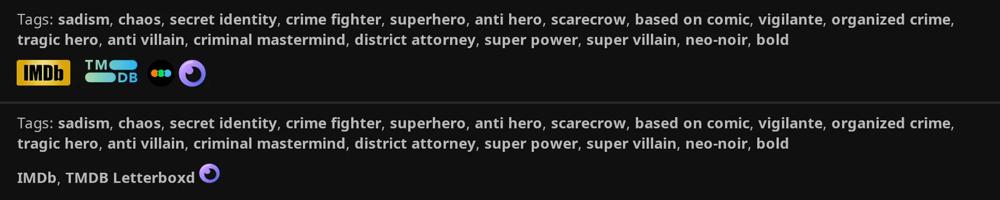

### How to use

1. Open admin **Extras** → **External Links** and turn on **Enable Letterboxd Links**.
2. Optionally enable **Show link as text**, then click **Save Settings** and reload.
3. Open a movie with an IMDb ID, or a person detail page, and click **Letterboxd**.

| Setting | Default | What it does |
|---|---|---|
| **Enable Letterboxd Links** | Off | Adds supported movie/person links. |
| **Show link as text** | Off | Uses **Letterboxd** text instead of an icon. |

!!! note "Metadata Icons uses icon links"

    **Enable Metadata Icons (Druidblack)** disables the text option and forces it off on save.

??? info "How it works"

    Movie links use an IMDb redirect (`https://letterboxd.com/imdb/<IMDb ID>`), not TMDB mapping. Movies without IMDb IDs are skipped. Person links use a name-derived actor slug. Ambiguous names or names that cannot produce a usable slug may fail.

    Series do not receive this standalone link treatment. The page needs a supported external-links area.

## Metadata Icons

Show supported item metadata and external links as icons using Druidblack's metadata-icon stylesheet.

### How to use

1. Open admin **Extras** → **External Links** and turn on **Enable Metadata Icons (Druidblack)**.
2. Click **Save Settings** and reload.
3. Open an item detail page to see its metadata and external links.

| Setting | Default | What it does |
|---|---|---|
| **Enable Metadata Icons (Druidblack)** | Off | Styles supported metadata and external links, and forces Letterboxd and *arr links into icon mode. |

??? info "How it works"

    JE loads `public-icon.css` through its local asset service. The stylesheet determines which metadata it can style. This is separate from **Use Icons in UI**, **Icon Style**, and [poster tags](../enhanced/tags.md).

## MDBList Ratings

Show ratings from multiple sources on detail pages. You can also fill Jellyfin's own Community/Critic Rating fields, using either feature or both.

### How to use

1. Get an API key from [MDBList preferences](https://mdblist.com/preferences/#api).
2. Open admin **Display** → **MDBList Ratings** and turn on **Enable MDBList Ratings**.
3. Enter **MDBList API Key** and click **Check** to test it and inspect quota/reset information. This works before saving.
4. Leave **Show Ratings Row on Item Details** on for badges. Expand **Configure ratings shown** to choose sources and reorder them with the arrows.
5. Click **Save Settings**, reload, and open a supported item with a TMDB ID.

| Setting | Default | What it does |
|---|---|---|
| **Enable MDBList Ratings** | Off | Master switch. |
| **MDBList API Key** | Empty | Account key used by the server. |
| **Show Ratings Row on Item Details** | On | Enables source badges when the master is on. |
| **Configure ratings shown** | All returned sources (empty list) | Selects and orders detail-page badges independently of synchronization sources. |
| **Show % Symbol** | Off | Adds `%` only to normalized badge scores. |

These controls apply server-wide under admin **Display** → **MDBList Ratings**. They are not personal settings.

??? info "How it works"

    Based on [xroguel1ke's original script](https://github.com/xroguel1ke/jellyfin_ratings).

    MDBList ratings requests are proxied through JE, so ordinary viewers do not need the key. Administrators can view, edit, and test it in plugin configuration.

### The ratings row

See badges from your chosen rating sources on supported detail pages.

!!! note "TMDB IDs are required"

    Movies and series need TMDB IDs. Seasons and episodes use their parent series' TMDB ID and series ratings. Missing IDs, no usable rating data, or unsupported page markup can leave the page without a row.

To hide the row, turn off **Show Ratings Row on Item Details**. An empty source list shows all returned sources, including when every badge checkbox is unchecked.

??? info "How it works"

    JE prefers placement before external links, then uses metadata or other detail-page anchors. Placement varies with layout and theme. The default order prioritizes **TMDB**, **RT Critic**, **RT Audience**, **IMDb**, **Trakt**, and **Metascore**, followed by remaining returned sources. You can also select **Metacritic User**, **Letterboxd**, **Roger Ebert**, **MAL**, **AniList**, and **Master**; see [the source reference](other-settings.md#mdblist-ratings).

    Badges use source logos or text, show vote-count tooltips when available, and link to source pages where enough information exists. Some links are derived; some badges, such as **Master** without a source URL, stay unlinked. There are no numerical red/yellow/green score bands.

    Normalized `Score` values are shown on a 0–100 scale, optionally with `%`. Raw `Value` fallbacks keep their source scale and precision, such as `3.5`, without `%`. **RT Critic** uses a red tomato for normalized scores of 60 or higher and a green splat below 60; without a normalized score, it falls back to MDBList's Fresh/Rotten flag.

### Filling in Jellyfin's own ratings

Fill Jellyfin's Community/Critic Rating fields from MDBList data. Fetching ratings and writing them to Jellyfin are separate tasks.

**How to use:**

1. Under admin **Display** → **MDBList Ratings**, enable the MDBList master and the matching task switches.
2. Choose your sources, fallbacks, reserve, and overwrite behavior below, then click **Save Settings**.
3. For initial library-wide synchronization, open **Dashboard** → **Scheduled Tasks**. Run **Fetch Ratings from MDBList**, then **Sync Ratings from MDBList to Jellyfin**.
4. Add your own triggers for recurring runs; neither task has a default trigger.

| Task | Default trigger | What it does |
|---|---|---|
| **Fetch Ratings from MDBList** | None | Fetches missing/stale movie/series data into the MDBList cache. Makes API calls, without changing Jellyfin rating fields. |
| **Sync Ratings from MDBList to Jellyfin** | None | Writes Jellyfin rating fields from available cache data. Makes no MDBList API calls. |

All controls below are under admin **Display** → **MDBList Ratings**.

| Setting | Default | What it does |
|---|---|---|
| **Fetch Ratings from MDBList** | Off | Allows the Fetch task to run. |
| **Fetch Task Reserve** | 400 | Stops Fetch when the remaining account quota is at or below the reserve. |
| **Sync Ratings from MDBList to Jellyfin** | Off | Allows the Sync task to run. |
| **Star Rating Source (Community Rating)** | **TMDB** | Primary source for Community Rating. |
| **Star Rating Fallback Source** | **None** | Used when the primary source has no usable score. |
| **Tomato Rating Source (Critic Rating)** | **RT Critic** | Primary source for Critic Rating. |
| **Tomato Rating Fallback Source** | **None** | Used when the primary source has no usable score. |
| **Overwrite Existing Jellyfin Ratings** | Off | Preserves existing fields when off; replaces fields with usable selected-source data when on. |

??? info "How it works"

    Both tasks are registered regardless of their switches. Browsing can also populate data usable by Sync, so Fetch does not have to be enabled for Sync to use already-cached ratings.

    Sync considers non-virtual movies/series with numeric TMDB IDs. It prefers normalized scores; only TMDB and RT Critic may fall back to raw values. Community Rating divides the selected result by ten; Critic Rating uses it directly. **Roger Ebert** is available for badges, not synchronization. Source selectors and fallback choices are listed in [Other Settings](other-settings.md#sources-and-fallbacks).

    With overwrite off, each populated field is preserved independently. A missing Community or Critic Rating can still be filled later; an item is skipped entirely only when both are populated. With overwrite on, usable cached values can replace existing provider or manually edited ratings. Missing source data does not erase fields. These Jellyfin fields are also what JE's community/critic poster and player tags read; the detail-page MDBList badges remain independent.

### Batching

Fetch skips fresh ratings on later runs.

??? info "Batch requests and retries"

    Fetch requests up to 150 distinct TMDB IDs of the same media type per batch. Each matched title's response includes its available rating sources, so the same server cache supports both badges and Sync. A failed batch preserves existing stale entries or missing entries for a later retry; it does not turn the entire batch into one-hour failure records.

### How refreshing works

JE caches ratings for found MDBList titles for seven days. A later detail lookup or Fetch run can refresh them after expiry.

??? info "Other caches and saved Jellyfin ratings"

    | Data | Refresh behavior |
    |---|---|
    | Confirmed no match | Cached for three days. |
    | Failed individual lookup | Retry placeholder lasts one hour. |
    | Browser display results | Additional response-cache layer for revisits; cleared on a user switch. |
    | Jellyfin Community/Critic fields | Updated only by Sync here, from available cached data. They are persisted metadata, not another expiring display cache. |

    Server MDBList data is stored in `mdblist-ratings.json` under `<Jellyfin plugins directory>/configurations/Jellyfin.Plugin.JellyfinEnhanced/`. Running Sync frequently does not fetch newer upstream values. With overwrite off, already-populated fields remain unchanged even after the MDBList cache refreshes.

### Account quota

JE uses your MDBList account status to track limits, remaining quota, and reset time.

??? info "Quota checks and safeguards"

    Server status is cached for about three minutes, and JE adjusts its cached remaining count after requests. **Check** can test an unsaved key without replacing the saved key's quota cache.

    Both individual and batch requests stop at a five-request safety margin when status is known. Fetch additionally observes **Fetch Task Reserve** and stops conservatively if account status cannot be read. Individual lookups may proceed when status is unavailable. These checks do not reserve capacity against other applications using the same MDBList account. Consult [MDBList's API documentation](https://docs.mdblist.com/docs/api) for account-plan and short-window limits rather than assuming a fixed allowance.

If no badges appear, check the master/display switches, key status, TMDB metadata, and available source data. If Jellyfin's own fields stay unchanged, check the Sync switch, cached data, chosen sources, and overwrite setting. Failed batches are logged and can be retried on a later Fetch run.

## Content Warnings

Show community-voted content warnings, such as "a dog dies", gore or flashing lights, on movie and series pages. The data comes from [DoesTheDogDie](https://www.doesthedogdie.com), and each user chooses which triggers matter to them.

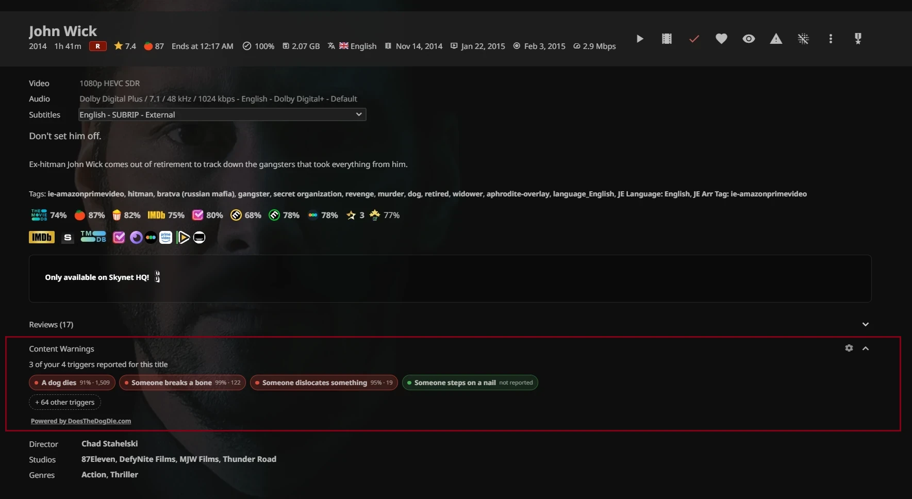

### How to use

1. Create a DoesTheDogDie account and copy the API key from your profile page.
2. Open admin **Display** → **Content Warnings (DoesTheDogDie)** and turn on **Show Content Warnings**.
3. Paste the key into **DoesTheDogDie API Key**, click **Save Settings**, and reload the web client.
4. Open a movie or series that DoesTheDogDie knows about. A **Content Warnings** section appears above Reviews.
5. Click the gear icon on the section to choose your own triggers.

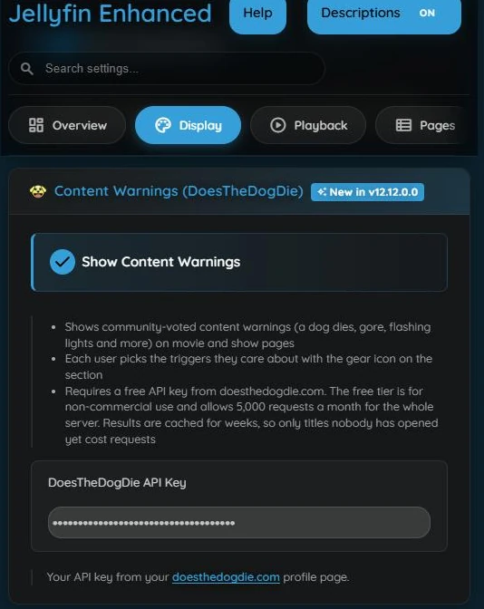

| Setting | Default | What it does |
|---|---|---|
| **Show Content Warnings** | Off | Master switch. The section also needs a saved key. |
| **DoesTheDogDie API Key** | Empty | Account key used by the server. Viewers never see it. |

### Reading the section

Each chip is one trigger with the share of votes that say it happens in the title and the total number of votes, for example `A dog dies 91% · 1,509`. Hover a chip to see the yes/no split.

| Colour | Share of "yes" votes |
|---|---|
| Red | 90% and above |
| Orange | 75% to 89% |
| Yellow | 50% to 74% |
| Green | One of your picked triggers, reported as not happening |

Before you pick anything, the section lists every trigger that most voters say is present, most-voted first. Topics with fewer than three votes are left out so a single stray vote cannot headline the list.

### Choosing your triggers

The gear icon opens a searchable list of all DoesTheDogDie topics, grouped by category. Tick the ones you care about and click **Save**. The choice is personal and stored server-side with your other settings, so it follows you between devices.

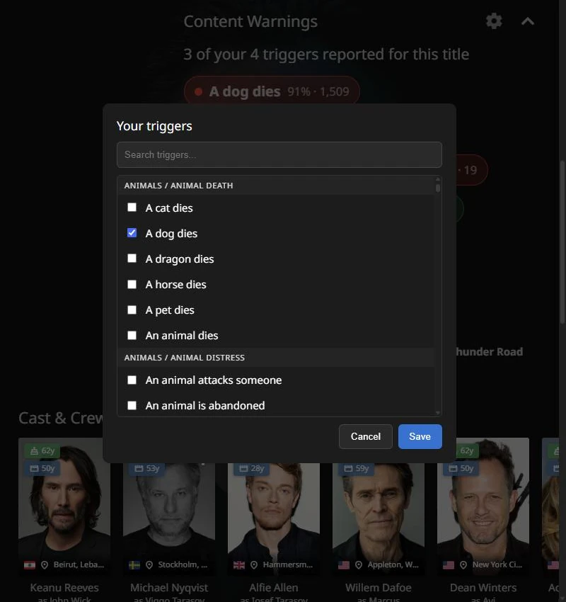

After you have picked triggers:

- Your triggers are shown first, with a summary such as "2 of your 5 triggers reported for this title".
- A picked trigger that voters say does not happen shows as a green "not reported" chip.
- A picked trigger nobody has voted on for this title is not shown, because no data is not the same as "does not happen".
- Everything else is folded behind **+ N other triggers**. Click it to expand and click again to fold.

### Request budget

DoesTheDogDie's free tier allows 5,000 requests a month for the whole server and is for non-commercial use only. JE keeps requests low:

- One shared cache serves every user, and your personal trigger filter is applied in the browser, so it costs nothing.
- A title that has not been opened before costs two requests. After that it costs none: results are kept for 30 days, and a title DoesTheDogDie does not know is remembered for 14 days.
- Several people opening the same new title at once share one lookup.
- JE reads the remaining monthly and per-minute allowance from every response, stops looking up new titles when about 100 requests remain for the month, and pauses all lookups when DoesTheDogDie reports a rate limit.
- The topic list for the picker is refreshed about once a month.

!!! note "Attribution"

    DoesTheDogDie requires the text "Powered by DoesTheDogDie.com" next to its data. JE shows it under the section and links it to the title's page on their site. The wording is fixed and is not translated.

If nothing appears, check that the master switch is on and a key is saved, that the item has a TMDB ID, and that DoesTheDogDie has the title. Seasons and episodes use their parent series. Lookups that fail are retried after an hour.

## Hidden Content

Hide and restore content with JE's per-user tools.

**How to use:** Follow [Content Management](../enhanced/enhanced-features.md#content-management), the canonical guide for usage, filtering limits, page placement, and administrator management. See [Enhanced Settings](../enhanced/enhanced-settings.md) for the server controls and personal defaults.

## Splash Screen

Show your logo on a black full-screen loading overlay while Jellyfin starts. The logo fits inside the screen, with a decorative progress bar; this is a loading screen rather than a persistent login background.


### How to use

1. Open admin **Extras** → **Custom Image Assets** and turn on **Enable Splash Screen Override**.
2. Enter **Splash Screen Image URL** and check that the URL opens an image in your browser.
3. Click **Save Settings** and reload.

| Setting | Default | What it does |
|---|---|---|
| **Enable Splash Screen Override** | Off | Enables JE's loading overlay. |
| **Splash Screen Image URL** | `/web/assets/img/banner-light.png` | Supplies the logo from a browser-reachable URL or suitable same-origin path. |

??? note "Details"

    Use a logo that remains legible within approximately 250×250 px. A remote URL is supported; you do not need to copy files into jellyfin-web. For same-origin paths, include your configured application base where needed: the default `/web/...` path assumes Jellyfin is served at the origin root.

    JE uses the image URL as entered; it does not discover Jellyfin's current hashed banner filename for you. Test the URL instead of assuming the default path exists.

    Progress is decorative, not a measured percentage of server work. JE detects application readiness and fades the overlay out, with a 20-second fallback timeout. If the UI is already ready, the overlay may appear only briefly. It suppresses a competing Media Bar splash while active; test combinations of loading-screen customizations if the presentation looks wrong.

## Internationalization

Use community translations for JE's interface, with an administrator default and a personal language choice.

### How to use

- **Administrator default:** Open **Display** → **Default Language**, choose **Default UI Language**, and click **Save Settings**.
- **Personal choice:** Open **Enhanced Panel** from the sidebar. Under **Language Settings** → **Display Language**, select a language or **Auto**. Your choice saves to the server and browser language key, then reloads the page.

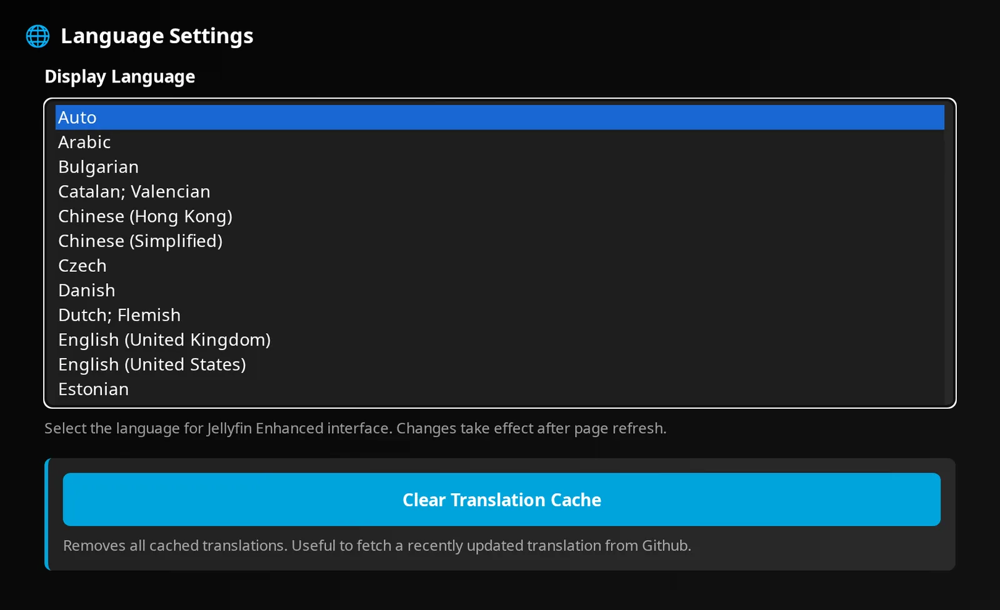

| Setting | Default | What it does |
|---|---|---|
| **Default UI Language** | **System Default** (empty) | Admin default for users without a saved personal selection. |
| **Display Language** | **Auto** (empty before the admin default supplies a starting value) | Per-user override in **Language Settings**, including an explicitly saved **Auto**. |

The admin setting is a dropdown, not an arbitrary-code text field. It does not force users who already have a saved language choice to change.

### Supported Languages

You can choose from these bundled languages; `pr` is **Pirate**:

```text
ar, bg, ca, cs, da, de, en-GB, en-US, es, et, fa, fi, fr, gsw,
he, hu, it, ko, ml, nl, no, pl, pr, pt, pt-BR, ru, sk, sv, tr,
uk, zh-CN, zh-HK
```

<p align="left">
  <a href="https://hosted.weblate.org/engage/jellyfinenhanced/">
    
  </a>
</p>

??? note "Bundled files and language choices"

    Version 12.12.0.0 bundles 33 locale files. The bundled server list excludes base `en`, giving 32 locale entries; regional English variants are selectable.

    The admin selector adds **System Default**, and the personal selector adds **Auto**. Both selectors can discover additional upstream locale choices. Translation completeness varies by locale.

### How It Works

Your saved personal language choice takes precedence over the admin default, even when that choice is **Auto**.

??? info "Translation loading and cache"

    Automatic loading uses the browser's user language key when populated, then Jellyfin's resolved document language, with English as fallback. A server-saved choice supplies the starting browser value only when that key is absent; changing language on another device does not replace an existing browser choice.

    JE reuses a valid versioned browser translation cache for up to 24 hours. When loading fresh data, it tries the bundled locale first and uses remote fallback through the server's local asset route when needed. Old-version browser entries are removed after a plugin update.

    For any language other than base English, including `en-GB` and `en-US`, JE also loads English through the same cache and uses it underneath the chosen locale. Strings that are missing or empty in that locale show in English instead of as raw key names.

    The loader builds regional, base-language, and English candidates, but an individual candidate's internal English fallback can succeed before the outer loop reaches the base language. Do not assume every unsupported regional code resolves to its base translation.

### Contributing Translations

Help translate JE through [Contributing Translations](../faq-support/contributing-translations.md).

To clear your browser's cached translations, use **Clear Translation Cache** under personal **Language Settings**. This reloads the page without resetting your feature preferences or language choice.

??? note "Details"

    Loading still prefers bundled data. Upstream changes do not immediately replace a usable bundled locale in this release. The server **Refresh Translation Cache** task under **Dashboard** → **Scheduled Tasks** → **Jellyfin Enhanced** is a separate signal for clients on their next load and runs at startup.

## Maintenance Mode

Warn users during server work, optionally restrict non-admin accounts or remote connections, and restore JE's recorded changes when the window ends.

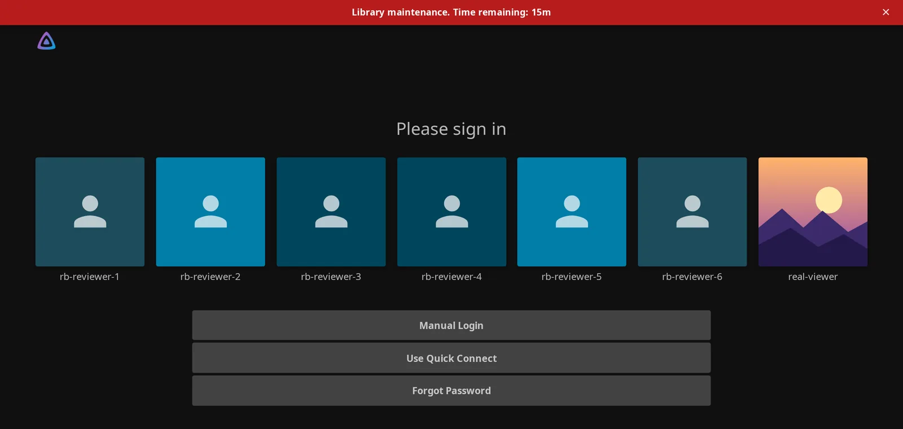

### How to use

1. Open admin **Admin** → **Maintenance Mode**.
2. Enter **Login Page Banner Message** and **Active Session Notification**.
3. Under **Action**, choose **Disable user accounts**, **Disable remote connections**, both, or neither.
4. Choose **Affected Users**: **All non-admin users** or **Select specific users**.
5. Set **Duration (minutes)**; `0` means until disabled.
6. Turn on **Enable Maintenance Mode** and click **Save Settings**.
7. To end manual maintenance, turn off **Enable Maintenance Mode** and save. Check logs/status if policies do not restore as expected.

!!! warning "Saving can restrict access immediately"

    The default manual action disables non-admin accounts. Leave both **Action** boxes unchecked for a banner/notification-only window. Administrators are excluded from policy changes. An empty specific-user selection means all eligible non-admin users; **Deselect All** does not mean “affect nobody.”

### Settings

All settings are server controls under admin **Admin** → **Maintenance Mode**.

| Setting | Default | What it does |
|---|---|---|
| **Enable Maintenance Mode** | Off | Applies a manual maintenance window on save. |
| **Duration (minutes)** | 0 | Sets the manual end time; `0` is open-ended. |
| **Login Page Banner Message** | `This server is currently undergoing maintenance. Please try again.` | Plain-text web banner. |
| **Active Session Notification** | `Server undergoing maintenance.` | Native message attempted after successful manual Enable on applicable saves. |
| **Remind on playback start** | Off | Reminds affected non-admin sessions, with a five-minute cooldown. |
| **Disable user accounts** | On under **Action** | Disables affected accounts' login. |
| **Disable remote connections** | Off under **Action** | Disables affected users' remote access; LAN remains available if accounts stay enabled. |
| **Affected Users** | **All non-admin users** | Shared target selection for manual and scheduled windows. |

See [Other Settings](other-settings.md#maintenance-mode) for input bounds, action encodings, and blank-message behavior.

### What maintenance does

JE shows a plain-text banner on login and signed-in pages, including for administrators.

??? info "Account policies and session messages"

    The injected web client adjusts page/header offsets for the banner's height. Account restrictions use Jellyfin's user policies on the server. JE changes only the selected account/remote-access permissions; it does not promise to disconnect an already-playing session immediately.

    After a successful manual Enable request, each applicable configuration save attempts a 30-second native message to signed-in sessions with known users, including idle sessions and administrators. Scheduled opening also attempts a 30-second message. Blank notification text falls back to the banner, then built-in notification text. This messaging is independent of the Active Streams widget; client support and delivery failures can affect what users see.

### Countdown and message tokens

Add time remaining or an end time to your maintenance messages.

**How to use:** Put `{countdown}` or `{ends_at}` in a banner or notification message. Click × (**Close**) to dismiss the banner for the current document.

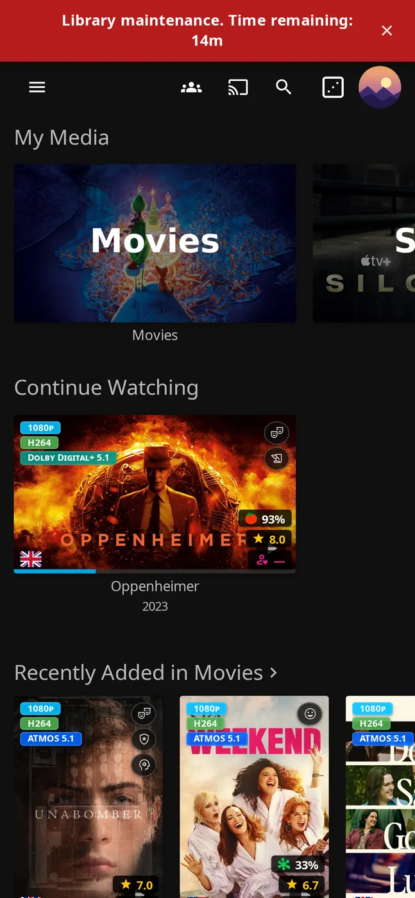

??? note "Details"

    Banner and notification messages accept case-insensitive `{countdown}` and `{ends_at}`:

    - `{countdown}` is time remaining, rounded up to the next minute, such as `1h 05m` or `12m`.
    - `{ends_at}` is the end time: viewer-local time in the banner, server-local time in native messages.

    With a known end and no `{countdown}` token, JE appends English `Time remaining: ….` text. For open-ended maintenance, it removes the time tokens.

    The banner updates the countdown every 15 seconds using the message and end time originally loaded. It removes itself when that known end passes. It does not poll for early cancellation or later message/end-time changes. Reload to reliably obtain changed server state.

    Closing the banner restores page offsets for the current document. It does not end maintenance or change restrictions, and no dismissal preference is saved. Reloading can show the banner again.

??? info "How it works"

    Re-saving an existing manual window preserves its end only when action, affected-user selection, and requested duration are unchanged. Changing action or targets reconciles restrictions and applies a fresh window. Changing the duration restarts the manual clock. The background service handles timed expiry and turns the manual switch off.

### Reminders on playback start

Remind affected non-admin users about maintenance when they start playback. This is most useful when accounts remain enabled.

**How to use:** Enable **Remind on playback start**.

??? note "Details"

    JE attempts a 15-second native message, with a five-minute per-session cooldown. It uses the active manual/scheduled notification, with the same text fallbacks and time tokens. Display depends on the client's Jellyfin-message support.

### Scheduled window

Run maintenance at the same time each day using the server's local clock.

**How to use:**

1. Turn on **Enable daily maintenance window**.
2. Set **Start time** and **End time**. Check the displayed server time and UTC offset, particularly for containers. An end earlier than the start crosses midnight.
3. Choose the scheduled messages and **Scheduled Action**, then click **Save Settings**.
4. To end a scheduled window early, turn off **Enable daily maintenance window** and save. This also attempts restoration.

| Setting | Default | What it does |
|---|---|---|
| **Enable daily maintenance window** | Off | Runs a daily window using server-local time. |
| **Start time** / **End time** | `00:00` / `08:00` | Daily window bounds; supports crossing midnight. |
| **Scheduled Banner Message** | `The library is updating; slowdowns are normal. Time remaining: {countdown}` | Banner for the daily window. |
| **Scheduled Session Notification** | `The library is updating; slowdowns are normal.` | Opening notification and, if enabled, playback reminder text. |
| **Disable user accounts** / **Disable remote connections** | Both Off under **Scheduled Action** | Scheduled policy changes; default is banner/notification-only. |

!!! note "Choose valid, different times"

    Equal or invalid start/end times make JE ignore the schedule. Manual maintenance takes precedence while active.

??? info "How it works"

    The daily window uses the shared **Affected Users** selection and its own messages/action. Saving unrelated settings with the manual toggle off does not end a running scheduled window.

    Checks begin roughly 15 seconds after startup and repeat about every 30 seconds. Open/close transitions and expiry are not guaranteed at the exact second. Users already browsing get changed banner state on their next load; opening notifications are attempted separately.

### Maintenance recovery

Check that maintenance has restored the account access you expected.

**How to use:** Check server logs, administrator status, and actual account/remote-access policies. A saved toggle alone does not prove restoration succeeded.

!!! warning "Check that access is restored"

    Disabling maintenance or reaching its end restores only JE's recorded changes. Previously disabled accounts and previously restricted remote access remain restricted. Removing the journal alone does not restore users.

??? note "Details"

    JE journals successfully applied policy changes and absolute end times in `maintenance-state.json` under `<Jellyfin plugins directory>/configurations/Jellyfin.Plugin.JellyfinEnhanced/`.

    Restoration can partially fail. JE retries with backoff capped at one hour. It continues restoration on the disable/expiry path even if a journal write fails.

    If the journal is unreadable or corrupt, enabling is blocked. JE attempts to preserve corrupt content in a `.corrupt-<timestamp>` backup, but backup creation can fail. Preserve the journal and any backup, inspect logs and affected user policies, and reconcile outstanding restoration before repairing or removing the file.

### Administrator routes

You can script maintenance using these routes with an authenticated administrator account.

??? note "Maintenance API reference"

    Prefix paths with your Jellyfin application base if applicable. See [API](../advanced/api.md) for the wider API reference.

    | Method and route | Purpose |
    |---|---|
    | `GET /JellyfinEnhanced/MaintenanceMode/Status` | Current window state, source, recorded change counts, end time, and server-local time/offset. |
    | `GET /JellyfinEnhanced/MaintenanceMode/Users` | Lists all eligible non-admin accounts for the selector, not just currently affected users. |
    | `POST /JellyfinEnhanced/MaintenanceMode/Enable` | Applies a manual window. |
    | `POST /JellyfinEnhanced/MaintenanceMode/Disable` | Ends maintenance and attempts restoration. `includeScheduled=true` also ends the current scheduled occurrence without immediately reopening it. |
    | `POST /JellyfinEnhanced/MaintenanceMode/Broadcast` | Attempts a native message independently of the Active Streams widget. |

## Cache Management

Refresh stale JE data without resetting personal preferences.

### How to use

Choose the action below that matches the data you need refreshed. Confirm **Clear All Client Caches** when prompted.

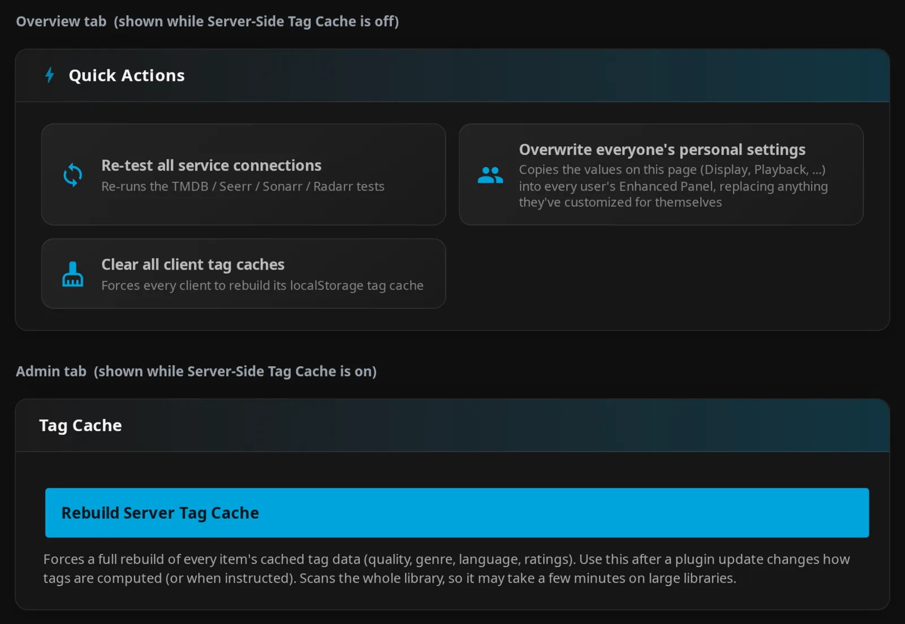
*The client-clear shortcut appears with **Server-Side Tag Cache** off; the server-rebuild button appears with it on.*

| Action | Location | What it does |
|---|---|---|
| **Clear All Client Caches** | Admin **Display** → **Media Tags**, with **Server-Side Tag Cache** off; **Overview** → **Quick Actions** labels the shortcut **Clear all client tag caches** | Clears targeted JE client caches on the next load, after confirmation. |
| **Rebuild Server Tag Cache** | Admin **Admin** → **Tag Cache**, with **Server-Side Tag Cache** on | Rebuilds library tag data on the server. |
| **Clear Translation Cache** | Per-user Enhanced panel → **Language Settings** | Clears this browser's translation entries and reloads. |

Cache actions do not wipe unrelated browser storage, reset server-stored personal settings, or delete the MDBList server cache. Clearing/rebuilding tag data can make the next load slower. For tag-cache setup and defaults, see [Tags & Badges](../enhanced/tags.md).

??? info "How it works"

    **Clear All Client Caches** sets a server signal to invalidate targeted JE client caches on the next load.

    Under **Dashboard** → **Scheduled Tasks**, **Refresh Translation Cache** signals clients to refresh translations on their next load and runs at startup by default. **Refresh CDN Assets** refreshes local copies of external assets at startup and every 24 hours. Both are separate from the personal translation-clear button; fresh translation loading still prefers bundled locales. See [Scheduled Tasks](other-settings.md#scheduled-tasks) for requirements and triggers.

## Usage Statistics

Choose whether your server shares usage statistics. Reporting is off by default.

### How to use

1. Open admin **Admin** → **Usage Statistics** and turn on **Share Anonymous Usage Statistics**.
2. On first enabling it, the form selects feature-toggle states, usage counts, and data-file sizes. Adjust the categories you want to share.
3. Use **Preview**, then click **Save Settings** to opt in.

| Setting | Default | What it does |
|---|---|---|
| **Share Anonymous Usage Statistics** | Off | Opts the server into reporting after saving. |
| **Feature toggle states (on/off only)** | On | Includes feature enable/disable states when reporting is on. |
| **Feature usage counts** | On | Includes usage counts when reporting is on. |
| **Data file sizes (bytes only, never contents)** | On | Includes file sizes when reporting is on. |
| **Reporting interval (days)** | 15 | Sets the reporting interval, within 7–30 days. |

See [the settings reference](other-settings.md#usage-statistics) and [Community Analytics](../advanced/community-analytics.md) for preview, collection, privacy, and reporting details.

## Support

If something does not work, verify its switch and requirements, reload the client, and check the browser console and Jellyfin logs. See [FAQ](../faq-support/faq.md) for common solutions, [Troubleshooting Installation](../installation/troubleshooting.md) for injection/loading problems, or [report an issue on GitHub](https://github.com/n00bcodr/Jellyfin-Enhanced/issues).
