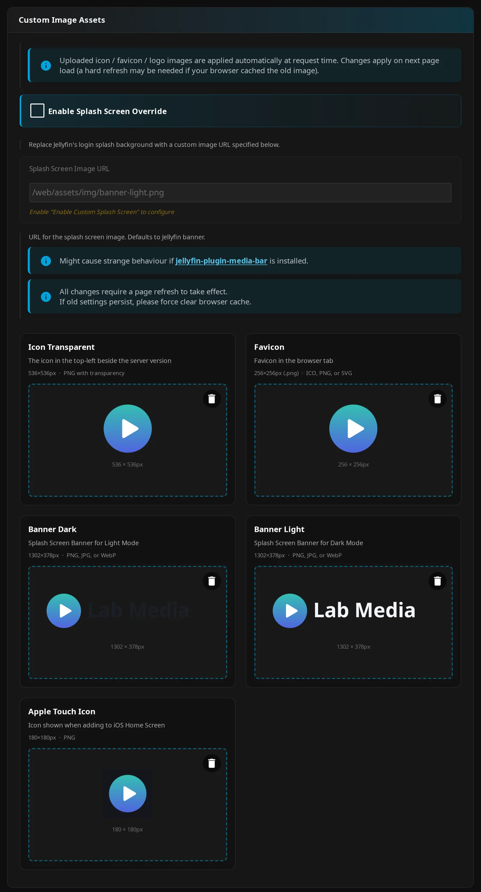
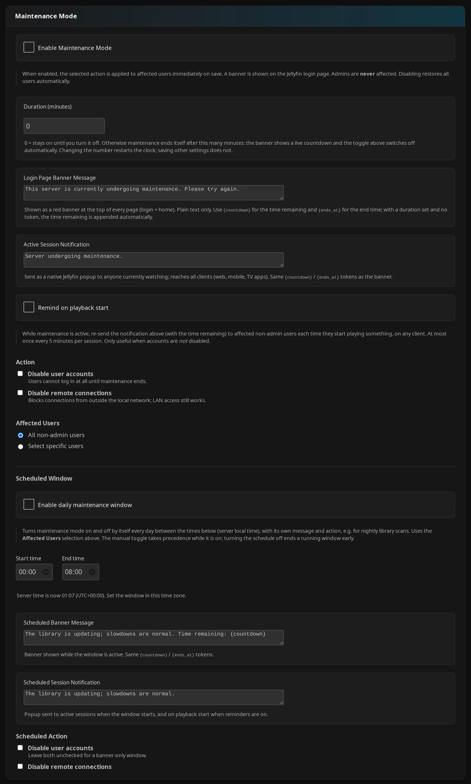

# Other Settings

Use these controls to personalize Jellyfin and manage your server. Unless marked per-user, they are administrator settings. See [Other Features](other-features.md) for usage and [Settings Overview](../getting-started/settings-overview.md) for personal defaults and overrides.

??? note "Admin tab reference"

    “Other” is a documentation category, not a plugin tab. Open **Dashboard** → **Plugins** → **Jellyfin Enhanced** and use the locations below.

    After changing configuration fields, click **Save Settings** and reload the web client. Branding uploads and cache actions apply separately.

    | Admin tab | Settings covered here |
    |---|---|
    | **Display** | **Icons & Theme**, **Default Language**, **MDBList Ratings**, **Content Warnings**, client tag-cache clearing |
    | **Playback** | **Shortcuts Panel & Toast Timing** |
    | **Extras** | **UI Tweaks**, **External Links**, **Custom Image Assets** |
    | **Pages** | Hidden Content and Activity Feed — links to their canonical guides below |
    | **Admin** | **Usage Statistics**, **Maintenance Mode**, **Tag Cache**, **Developer Settings** |

## Custom Branding

Replace Jellyfin's branding with your own logos and icons. You do not need another branding plugin.

### How to use

1. Open admin **Extras** → **Custom Image Assets**.
2. Click a slot or drop an image onto it. Upload starts immediately; wait for **✓ Uploaded**.
3. Check the preview and measured dimensions where available, then reload. Use ++ctrl+f5++ if an old image remains cached.
4. Upload again to replace a slot, or use its trash button to delete the custom file immediately. Reload after either action.

**Save Settings** applies configuration fields; uploads do not wait for it.



| Setting | Default | What it does |
|---|---|---|
| **Icon Transparent** | Stock icon | Replaces the top-left logo beside the server version. UI recommendation: 536×536 PNG with transparency. |
| **Favicon** | Stock favicon | Replaces the browser tab icon. UI suggests 256×256 for PNG and lists ICO, PNG, or SVG. Prefer ICO. |
| **Banner Dark** | Stock banner | Replaces the light-mode loading banner. UI recommendation: 1302×378, PNG, JPG, or WebP. Prefer PNG. |
| **Banner Light** | Stock banner | Replaces the dark-mode loading banner. UI recommendation: 1302×378, PNG, JPG, or WebP. Prefer PNG. |
| **Apple Touch Icon** | Stock touch icon | Replaces the iOS Home Screen icon and supported PWA touch-icon assets, including Jellyfin 12's sized variants. UI recommendation: 180×180 PNG. |

!!! note "Accepted uploads are not converted"

    Use PNG for `.png` slots and ICO for the favicon, even when the UI lists other formats. Uploads accept image MIME types up to 10 MiB. Recommended dimensions are not enforced.

??? info "How it works"

    These slots are uploaded files, not configuration properties. JE serves them through its own middleware and uses Jellyfin's stock asset when no replacement file exists. It keeps the original bytes without converting them, under these fixed filenames. The served MIME type follows the filename extension.

    | Slot | Filename |
    |---|---|
    | **Icon Transparent** | `icon-transparent.png` |
    | **Favicon** | `favicon.ico` |
    | **Banner Dark** | `banner-dark.png` |
    | **Banner Light** | `banner-light.png` |
    | **Apple Touch Icon** | `apple-touch-icon.png` |

??? note "Details"

    Files live in `<JE configuration-file directory>/<JE configuration-file basename>/custom_branding/`. The absolute path depends on your installation. Keep that storage writable and persistent to retain branding across updates. See [Custom Branding](other-features.md#custom-branding) for middleware behavior and troubleshooting.

## Icon Settings

Choose the icons you see in JE's panel headings and toast notifications.

**How to use:** Open admin **Display** → **Icons & Theme**, turn on **Use Icons in UI**, and choose **Icon Style**. Click **Save Settings** and reload.

| Setting | Default | What it does |
|---|---|---|
| **Use Icons in UI** | On | Enables icons in JE regions that use its icon helper, including toasts and panel headings. |
| **Icon Style** | **Emoji** | Chooses **Emoji**, **Lucide Icons**, or **Material UI Icons**. Available when **Use Icons in UI** is on. |

??? info "How it works"

    These controls apply to JE regions that use its icon helper. They do not replace every Jellyfin icon or every icon supplied by an extra. Unsupported helper entries fall back to emoji. [Metadata Icons](#metadata-icons) is a separate feature.

    Stored style values are **Emoji** (`emoji`), **Lucide Icons** (`lucide`), and **Material UI Icons** (`mui`).

## Extras

Customize the dashboard, login screen, and user-preferences menu with these optional switches.

### How to use

1. Open admin **Extras** → **UI Tweaks** and turn on the switches you want.
2. For **Sidebar Custom Links**, open **Extras** → **External Links**. Enter one configuration-page name/icon pair per line, using the decoded page name, including spaces:

    ```text
    Jellyfin Enhanced | tune
    ```

3. Use **Test Links** to preview entered links in the current window until refresh.
4. Click **Save Settings** to persist your configuration, then reload.

| Setting | Default | What it does |
|---|---|---|
| **Colored Dashboard Icons** | Off | Replaces matching icons in the dashboard Home activity list with predefined Material icons and colors. |
| **Colored Ratings Backgrounds** | Off | Colors official age/content classifications, such as PG-13, TV-MA, and FSK-12. Does not color numerical review scores. |
| **Profile Picture on Login** | Off | Shows the selected public login card's avatar above the password field and hides the username area. Hidden users entered through **Manual Login** have no matching card. |
| **Custom Plugin Menu Icons** | Off | Replaces supported plugin-link icons in the dashboard sidebar. Also enables saved custom configuration-page links. |
| **Theme Selector (Jellyfish)** | Off | Adds **Theme** to Jellyfin's user-preferences menu. Requires the Jellyfish base theme installed natively to use its color palettes. |
| **Sidebar Custom Links** | Empty | Adds configuration-page links when **Custom Plugin Menu Icons** is enabled. One `Configuration Page Name \| Material Icon Name` pair per line. |

??? note "Details"

    The second **Sidebar Custom Links** field is an icon name, not a destination URL. See [Extras](other-features.md#extras) for supported plugin mappings, theme choices, and login limitations.

### Activity Feed

Use the user Activity Feed to see activity separately from dashboard icon coloring.

**How to use:** Open **Pages** → **Activity Feed**. Follow [Enhanced Settings](../enhanced/enhanced-settings.md) and [Enhanced Features](../enhanced/enhanced-features.md) for setup and use.

!!! note "Active Streams section requirements"

    Enable **Enable Activity Feed**, **Show Active Streams section**, and **Active Streams Header Widget**. Non-admin viewers also need **Show widget to non-admins**.

??? info "How it works"

    The feed's stream section polls while visible. The header widget below refreshes on demand.

## Active Streams Widget

See who is watching and open their current session details from Jellyfin's header.

**How to use:** Open admin **Extras** → **UI Tweaks** and turn on **Active Streams Header Widget**. Click **Save Settings**, reload, and open the widget; use **Refresh** for current data.

| Setting | Default | What it does |
|---|---|---|
| **Active Streams Header Widget** | Off | Adds a header counter and a sessions panel. Administrators have access by default. |
| **Show widget to non-admins** | Off | Allows signed-in non-admin users to read current sessions when the widget is enabled. |

!!! note "What non-admin viewers can see"

    Enabling **Show widget to non-admins** exposes other users' stream titles, names, clients, devices, and playback details. This session list does not use the historical Activity Feed's library-access filtering. IP addresses and broadcasting remain admin-only.

??? info "How it works"

    The widget fetches at initialization, when opened, and with **Refresh**; it does not continuously poll. See [Active Streams Widget](other-features.md#active-streams-widget) for cards, player placement, and broadcast fields.

## Timeout Settings

Adjust how long the Enhanced panel and ordinary JE toast messages stay visible.

### How to use

1. Open admin **Playback** → **Shortcuts Panel & Toast Timing** and enter durations in milliseconds.
2. Try **Preview autoclose** and **Preview toast**. They use your unsaved inputs.
3. Click **Save Settings** and reload.

| Setting | Default | What it does |
|---|---|---|
| **Shortcuts Panel Autoclose Delay (ms)** | 15000 ms | Sets the Enhanced panel's inactivity timer. Hover keeps it open; interaction restarts the timer. |
| **Toast Notification Duration (ms)** | 1500 ms | Sets the duration of ordinary JE toast messages. |

??? note "Details"

    Previews fall back for invalid values or values below 200 ms and cap at 120000 ms. These preview limits do not constrain the saved settings. Preview fallbacks are 15000 ms for the panel and 3000 ms for the toast; the latter differs from the actual client default. The number inputs declare no minimum or maximum. Zero uses the client default and does not disable auto-close.

    The toast field's help text says 3000 ms, but the server default and client fallback are **1500 ms**. Hidden Content's Undo toast lasts eight seconds independently; broadcasts use their own timeout.

## Letterboxd Integration

Add a **Letterboxd** link to supported movie and person detail pages.

**How to use:** Open admin **Extras** → **External Links**, turn on **Enable Letterboxd Links**, and optionally enable **Show link as text**. Click **Save Settings** and reload.

| Setting | Default | What it does |
|---|---|---|
| **Enable Letterboxd Links** | Off | Adds external links on supported movie and person detail pages. |
| **Show link as text** | Off | Displays **Letterboxd** text instead of the normal icon. |

!!! note "Requirements and text links"

    Movies need an IMDb ID. **Show link as text** depends on **Enable Letterboxd Links**. **Enable Metadata Icons (Druidblack)** disables the text option and forces it off when saved.

??? note "Details"

    Person links use name-derived actor slugs and can be ambiguous or fail to resolve. This standalone feature does not add series links. See [Letterboxd Integration](other-features.md#letterboxd-integration).

## Metadata Icons

Show supported metadata and external links as icons on item detail pages.

**How to use:** Open admin **Extras** → **External Links** and turn on **Enable Metadata Icons (Druidblack)**. Click **Save Settings**, reload, and inspect an item's metadata and external links.

| Setting | Default | What it does |
|---|---|---|
| **Enable Metadata Icons (Druidblack)** | Off | Styles supported metadata and external links. Forces Letterboxd and *arr links into icon mode. |

??? info "How it works"

    JE loads Druidblack's metadata-icon stylesheet through its local asset service and applies supporting external-link styling. This is separate from **Use Icons in UI**, **Icon Style**, and poster tags. See [Metadata Icons](other-features.md#metadata-icons).

## MDBList Ratings

Show ratings from several sources on detail pages, or fill Jellyfin's own Community/Critic Rating fields. Displaying ratings, fetching data, and writing Jellyfin fields have separate controls.

### How to use

1. Open admin **Display** → **MDBList Ratings** and turn on **Enable MDBList Ratings**.
2. Enter **MDBList API Key** and click **Check**. This tests the entered key before saving and shows account quota/reset information.
3. Leave **Show Ratings Row on Item Details** on for badges. Open **Configure ratings shown** to select and reorder them with the up/down controls.
4. Click **Save Settings** and reload.

### Fetch, then sync

After setting up the master switch and key above:

1. Enable **Fetch Ratings from MDBList**, choose a reserve, and enable **Sync Ratings from MDBList to Jellyfin** if you want Jellyfin fields populated.
2. Choose primary/fallback sources, review overwrite behavior, and click **Save Settings**.
3. Under **Dashboard** → **Scheduled Tasks**, run **Fetch Ratings from MDBList**, then **Sync Ratings from MDBList to Jellyfin**. Add your own triggers for recurring runs; neither supplies one by default.

### Display controls

| Setting | Default | What it does |
|---|---|---|
| **Enable MDBList Ratings** | Off | Master switch for ratings requests, display, and both rating tasks. |
| **MDBList API Key** | Empty | Key from [MDBList preferences](https://mdblist.com/preferences/#api). Administrators can view, edit, and test it; ordinary viewer requests go through JE. |
| **Show Ratings Row on Item Details** | On | Displays source badges on supported movie/series detail pages; seasons and episodes use their parent series. Requires the master switch. |
| **Configure ratings shown** | Empty source list: all returned sources | Expands checkboxes and up/down controls to select and order detail-page badges independently of sync sources. |
| **Show % Symbol** | Off | Adds `%` to normalized badge scores; raw-value fallbacks retain their source scale and precision. |

To hide the entire row, turn off **Show Ratings Row on Item Details**. Clearing every badge checkbox saves an empty list, which shows all usable returned sources.

### Fetch controls

| Setting | Default | What it does |
|---|---|---|
| **Fetch Ratings from MDBList** | Off | Allows the corresponding scheduled task to fetch missing/stale MDBList data without changing Jellyfin rating fields. |
| **Fetch Task Reserve** | 400 | Stops Fetch when the remaining account quota is at or below this value. |

??? note "Details"

    Fetch uses the cached live remaining quota. **Fetch Task Reserve** input bounds are 1–100000.

### Sync controls

| Setting | Default | What it does |
|---|---|---|
| **Sync Ratings from MDBList to Jellyfin** | Off | Allows the corresponding scheduled task to write Jellyfin's Community/Critic Rating fields from cached data, without MDBList API calls. |
| **Star Rating Source (Community Rating)** | **TMDB** | Selects the source written to Community Rating. |
| **Star Rating Fallback Source** | **None** (empty) | Used when the primary star-rating source has no usable score. |
| **Tomato Rating Source (Critic Rating)** | **RT Critic** | Selects the source written to Critic Rating. |
| **Tomato Rating Fallback Source** | **None** (empty) | Used when the primary critic-rating source has no usable score. |
| **Overwrite Existing Jellyfin Ratings** | Off | Off: preserves each populated field independently. On: replaces each field for which the selected primary/fallback source has usable cached data. Missing data does not erase existing values. |

??? info "How it works"

    Based on [xroguel1ke's original script](https://github.com/xroguel1ke/jellyfin_ratings).

    The master switch gates operation; display/fetch/sync choices are stored independently. Source changes do not replace populated Jellyfin fields unless **Overwrite Existing Jellyfin Ratings** is on.

    Both tasks are registered even when their switches are off. Execution checks the master switch and the corresponding task switch. Sync needs usable cache data, not an enabled Fetch switch: viewing detail pages can also populate the cache, despite the configuration help saying Fetch must be enabled first.

### Sources and fallbacks

All four sync selectors offer **TMDB**, **RT Critic**, **RT Audience**, **IMDb**, **Trakt**, **Metascore**, **Metacritic User**, **Letterboxd**, **MAL**, **AniList**, and **Master**. The two fallback selectors also offer **None**. **Roger Ebert** is available only for badges.

??? info "How it works"

    | Source label | Stored value |
    |---|---|
    | **TMDB** | `tmdb` |
    | **RT Critic** | `tomatoes` |
    | **RT Audience** | `popcorn` |
    | **IMDb** | `imdb` |
    | **Trakt** | `trakt` |
    | **Metascore** | `metacritic` |
    | **Metacritic User** | `metacriticuser` |
    | **Letterboxd** | `letterboxd` |
    | **MAL** | `myanimelist` |
    | **AniList** | `anilist` |
    | **Master** | `master` |
    | **Roger Ebert** | `rogerebert` |

    Sync prefers MDBList's normalized `Score`; only TMDB and RT Critic may fall back to raw `Value`. Community Rating converts the chosen result to the 0–10 scale by dividing by ten; Critic Rating uses it directly on the 0–100 scale.

    The default order prioritizes TMDB, RT Critic, RT Audience, IMDb, Trakt, and Metascore, then the others. A nonempty list selects only those sources in that order.

See [MDBList Ratings](other-features.md#mdblist-ratings) for batching, expiry, quota safeguards, and troubleshooting.

## Content Warnings

Show community content warnings from DoesTheDogDie on movie and series pages. Spoiler Guard keeps protected titles’ warnings collapsed until the viewer clicks **Show**, including titles not yet in the library. See the [feature guide](other-features.md#content-warnings) for what users see and how the request budget works.

### How to use

1. Open admin **Display** → **Content Warnings (DoesTheDogDie)** and turn on **Show Content Warnings**.
2. Enter **DoesTheDogDie API Key**, from your account profile on doesthedogdie.com.
3. Click **Save Settings** and reload.

| Setting | Default | What it does |
|---|---|---|
| **Show Content Warnings** | Off | Master switch. Needs a saved key to take effect. |
| **DoesTheDogDie API Key** | Empty | Used by the server only. Never sent to clients. Stored with the other API keys in `secrets.json`; once saved the page shows a masked value with **Replace** and **Clear**. |

These controls are server-wide. Each user picks their own triggers from the gear icon on the section, so there is no admin trigger list.

!!! warning "Free tier limits"

    The free API tier is for non-commercial use and allows 5,000 requests a month and 30 per minute for the whole server. A commercial server needs their Commercial tier. Results are cached for weeks, so usage depends mostly on how many different titles are opened.

## Hidden Content

Manage Hidden Content's server settings and personal options.

**How to use:** Open **Pages** → **Hidden Content** for server controls, or the Enhanced panel for personal controls. See [Content Management](../enhanced/enhanced-features.md#content-management) for hiding, restoration, delivery modes, and administrator management. [Enhanced Settings](../enhanced/enhanced-settings.md) covers all defaults and personal options.

## Splash Screen

Show your logo on JE's loading overlay, with a decorative progress bar.

**How to use:** Open admin **Extras** → **Custom Image Assets**, turn on **Enable Splash Screen Override**, and enter **Splash Screen Image URL**. Check that the URL opens an image in your browser, then click **Save Settings** and reload.

| Setting | Default | What it does |
|---|---|---|
| **Enable Splash Screen Override** | Off | Shows JE's loading overlay with a contained logo and decorative progress bar. |
| **Splash Screen Image URL** | `/web/assets/img/banner-light.png` | Browser-reachable logo URL or suitable same-origin path. Available when the override is enabled. |

??? note "Details"

    Use a logo legible within approximately 250×250 px. Include your Jellyfin application base in a same-origin path if needed; the default `/web/...` path assumes Jellyfin is served at the origin root.

    JE uses the image URL as entered; it does not discover Jellyfin's current hashed banner filename. Test the URL instead of assuming the default path exists.

    JE suppresses a competing Media Bar splash while its override is active. Combinations of custom loading screens may still need testing. See [Splash Screen](other-features.md#splash-screen).

## Default UI Language

Choose a starting language for JE's interface. Users can save a personal choice that overrides the admin default.

**How to use:**

- **Administrator default:** Open **Display** → **Default Language**, choose **Default UI Language**, and click **Save Settings**.
- **Personal choice:** Open the Enhanced panel → **Language Settings** and choose **Display Language**. A change saves your preference and browser language key, then reloads.

**Administrator setting:**

| Setting | Default | What it does |
|---|---|---|
| **Default UI Language** | **System Default** (empty) | Supplies the initial JE display language for users without a saved personal choice. Choose a listed language; this is a dropdown, not a free-text language-code input. The saved language stays selected while the list loads, or if it can't load, so saving the page keeps it. |

**Per-user location:** Enhanced panel → **Language Settings**.

| Setting | Default | What it does |
|---|---|---|
| **Display Language** | **Auto** (empty before the admin default supplies a starting value) | Overrides the admin default with a saved personal selection. |

JE only saves, and only writes into the browser's shared Jellyfin language setting, a language it supports: one it ships (or its base language, so `en-AU` uses English). Anything else, such as a stray `undefined` or `null`, a malformed code (the whole code is checked, so `en-12` or `en-US-US` is malformed even though English is shipped) or an unknown language, is saved as **Auto**, and a malformed value already in the browser's language setting is removed so Jellyfin falls back to its own choice. The list of supported languages comes with JE's translations script: if that script didn't load, JE writes no language at all, and the panel shows the saved language without letting it be changed until the page is reloaded.

??? info "How it works"

    A saved personal selection, including an explicitly saved **Auto**, takes precedence over the admin default. Automatic resolution uses the browser's user language key, then Jellyfin's document language, with English as fallback. See [Internationalization](other-features.md#internationalization) for bundled languages and loading behavior.

## Cache Management

Refresh cached JE data when it becomes stale. These actions do not reset all preferences or delete the MDBList server cache.

**How to use:** Choose the action below for the data you want to refresh. **Clear All Client Caches** asks for confirmation.

| Action | Location | What it does |
|---|---|---|
| **Clear All Client Caches** | Admin **Display** → **Media Tags**, with **Server-Side Tag Cache** off; **Overview** → **Quick Actions** labels the shortcut **Clear all client tag caches** | Clears targeted JE client caches on their next page load. Keeps server-stored personal preferences and unrelated browser storage. |
| **Rebuild Server Tag Cache** | Admin **Admin** → **Tag Cache**, with **Server-Side Tag Cache** on | Rebuilds cached tag data for the library. This may take time on a large server. |
| **Clear Translation Cache** | Per-user Enhanced panel → **Language Settings** | Clears this browser's translation entries and reloads. Does not signal other clients or reset the language selection. |

??? info "How it works"

    After confirmation, **Clear All Client Caches** updates the server's client-cache signal.

    `ClearLocalStorageTimestamp` and `ClearTranslationCacheTimestamp` both start at `0`. They are invalidation markers, not durations or switches. The latter is set by **Refresh Translation Cache**, a scheduled task; there is no separate admin button with the personal cache-clear label.

    For tag-cache configuration, see [Tags & Badges](../enhanced/tags.md). A translation reload still prefers a usable bundled locale; refreshing the CDN cache does not force the loader to replace it with an upstream translation.

## Scheduled Tasks

Run JE's background jobs manually or choose when they run.

**How to use:** Open **Dashboard** → **Scheduled Tasks** and run a task or manage its triggers. Enabling a feature does not add a trigger where the task's default is none.

| Task | Default trigger | Requirements and effect |
|---|---|---|
| **Fetch Ratings from MDBList** | None | MDBList master, Fetch switch, valid key, and available quota. Fetches missing/stale movie/series ratings in batches and updates the server cache. |
| **Sync Ratings from MDBList to Jellyfin** | None | MDBList master, Sync switch, and usable cached data. Writes Jellyfin's rating fields locally. |
| **Refresh Translation Cache** | Server startup | Signals clients to refresh translation caches on their next load. Can be run manually. |
| **Refresh CDN Assets** | Server startup and every 24 hours | Refreshes server-local copies of external assets; no enable switch. |
| **Sync Tags from *arr to Jellyfin** | None | Requires **Enable Tags Sync** and configured *arr integration. See [*arr Features](../arr/arr-features.md) and [*arr Settings](../arr/arr-settings.md) for prefixes, filters, and tag removal options before running. |

??? note "Details"

    **Refresh Translation Cache** sets a server timestamp to signal clients. The asset service also uses a 24-hour cache policy.

    The daily maintenance window uses a background service, not a Jellyfin scheduled task.

## Maintenance Mode

Warn users during server work and optionally restrict non-admin accounts or remote connections. Read [Maintenance Mode](other-features.md#maintenance-mode) before enabling.

!!! warning "Saving can restrict access immediately"

    Saving can immediately change account and remote-access policies. The manual default disables non-admin accounts. For a banner/notification-only window, leave both **Action** boxes unchecked.

**Admin location:** **Admin** → **Maintenance Mode**.

### Manual maintenance

Keep maintenance on until you disable it, or set a duration.

**How to use:**

1. Enter the banner and session messages, then choose **Action** and **Affected Users**.
2. Set **Duration (minutes)** and turn on **Enable Maintenance Mode**.
3. Click **Save Settings**. To end the window, turn off **Enable Maintenance Mode** and save again.


*The capture has both manual **Action** boxes unchecked; **Disable user accounts** is on by default.*

| Setting | Default | What it does |
|---|---|---|
| **Enable Maintenance Mode** | Off | Applies the manual window on save. Turning it off attempts restoration of changes JE recorded. |
| **Duration (minutes)** | 0 | `0` means until disabled. Positive values set an absolute end time. Input bounds: 0–525600. |
| **Login Page Banner Message** | `This server is currently undergoing maintenance. Please try again.` | Plain-text web banner. Supports `{countdown}` and `{ends_at}`. |
| **Active Session Notification** | `Server undergoing maintenance.` | Native message attempted on applicable saves with manual maintenance enabled. Blank text falls back to the banner, then built-in notification text. |
| **Remind on playback start** | Off | Sends a 15-second reminder to affected non-admin sessions starting playback, with a five-minute per-session cooldown. Also applies to scheduled maintenance. |
| **Disable user accounts** | On | Under **Action**; disables login for affected non-admin accounts. |
| **Disable remote connections** | Off | Under **Action**; disables remote access for affected non-admin users. With accounts enabled, LAN access remains available. |
| **Affected Users** | **All non-admin users** | Choose **All non-admin users** or **Select specific users**. Shared with scheduled maintenance. Administrators are excluded from policy changes. |

!!! warning "An empty user selection affects all non-admins"

    An empty selection means all eligible non-admin users. **Deselect All** does not mean “affect nobody.”

    While the user list is loading, or if it fails to load, saving keeps the stored selection. Maintenance that's switched on then uses that selection, never every account. **Select specific users** takes effect once the list has loaded.

??? info "How it works"

    Both **Action** boxes unchecked stores `none`; account-only stores `disable_accounts`, remote-only stores `disable_remote`, and both stores `both`.

    **Affected Users** stores `all` or a JSON array of selected user IDs.

    The configuration's banner default above differs from the deliberately blank banner's client fallback: `This server is currently undergoing maintenance. Please try again later.` Blank fields do not reliably suppress the banner or notifications.

### Scheduled window

Run a daily maintenance window using the server's local clock. Manual maintenance takes precedence while active.

**How to use:**

1. Turn on **Enable daily maintenance window** and choose **Start time** and **End time**.
2. Check the server time and UTC offset shown under the time fields.
3. Choose scheduled messages and **Scheduled Action**, then click **Save Settings**.

| Setting | Default | What it does |
|---|---|---|
| **Enable daily maintenance window** | Off | Opens/closes maintenance daily using server-local time. Manual maintenance takes precedence while active. |
| **Start time** | `00:00` | Start of the window; must differ from the end. |
| **End time** | `08:00` | End of the window. Earlier than the start means the window crosses midnight. |
| **Scheduled Banner Message** | `The library is updating; slowdowns are normal. Time remaining: {countdown}` | Plain-text banner during scheduled maintenance. |
| **Scheduled Session Notification** | `The library is updating; slowdowns are normal.` | Native message attempted when the window opens; also used for playback reminders. |
| **Disable user accounts** | Off | Under **Scheduled Action**; scheduled account restriction. |
| **Disable remote connections** | Off | Under **Scheduled Action**; scheduled remote-access restriction. |

!!! note "Choose valid, different times"

    Invalid or equal times make JE ignore the schedule.

??? info "How it works"

    The default **Scheduled Action** is `none`, with both boxes unchecked. The same action encodings apply as in manual maintenance.

    Checks begin about 15 seconds after startup and repeat about every 30 seconds. Transitions are not guaranteed at the exact second.

!!! warning "Restoration and recovery"

    JE restores only policy changes it recorded as applied. Accounts already disabled, or remote access already restricted before maintenance, stay that way. Partial failures can leave restoration pending. Preserve `maintenance-state.json`, check logs and actual user policies, and follow [Maintenance recovery](other-features.md#maintenance-recovery) if the journal is unreadable. Deleting it alone does not restore users.

## Usage Statistics

Choose whether your server shares usage statistics. See [Community Analytics](../advanced/community-analytics.md) for what is collected and how it is used.

### How to use

1. Open admin **Admin** → **Usage Statistics** and turn on **Share Anonymous Usage Statistics**. On first enabling it, the form selects all three categories.
2. Uncheck any categories you do not want and inspect **Preview**.
3. Click **Save Settings** to opt in.

| Setting | Default | What it does |
|---|---|---|
| **Share Anonymous Usage Statistics** | Off | Opts the server into usage reporting after saving. |
| **Feature toggle states (on/off only)** | On | Includes feature-switch states and selected text settings when reporting is enabled. |
| **Feature usage counts** | On | Includes usage counts when reporting is enabled. |
| **Data file sizes (bytes only, never contents)** | On | Includes only the total size of the custom branding directory, without file names or contents, when reporting is enabled. |
| **Reporting interval (days)** | 15 | Sets the reporting interval, constrained to 7–30 days. |

The page shows the last-sent time, or that no report has been sent. **Preview** shows your current selections without registering the installation or transmitting a report.

??? note "Details"

    Later enable/disable changes preserve your configured category choices. To preview while saved reporting remains off, check the master temporarily without saving.

??? info "How it works"

    Reporting also maintains internal state, not additional editable controls. `AnalyticsHasBeenConfigured` starts at `false`; `AnalyticsLastReportedAt` and `AnalyticsForbiddenSinceLastSuccess` start at `0`. `AnalyticsInstallId`, `AnalyticsInstallSecret`, `AnalyticsLastPayloadJson`, `AnalyticsLastReportedPluginVersion`, `AnalyticsLastReportedJellyfinTarget`, and `AnalyticsLastReportedJellyfinVersion` start empty. These track registration, configured choices, and report history; see [Community Analytics](../advanced/community-analytics.md) for their role.

## Developer Settings

Use **Dev Mode** when developing JE scripts. Leave it off for normal use.

**How to use:** Open admin **Admin** → **Developer Settings**, change **Dev Mode**, click **Save Settings**, and reload.

| Setting | Default | What it does |
|---|---|---|
| **Dev Mode** | Off | Disables normal script caching for development. |

??? note "Details"

    In **Dev Mode**, clients load individual scripts and the bundle is rebuilt with no-store responses.

    The following configuration-only troubleshooting properties have no visible admin controls:

    | Property | Default | What it does |
    |---|---|---|
    | `DisableScriptInjectionMiddleware` | `false` | Bypasses JE's request-time script-injection middleware. |
    | `DisableBrandingMiddleware` | `false` | Bypasses uploaded branding overrides and lets stock assets pass through. |

    See [Troubleshooting Installation](../installation/troubleshooting.md) before changing configuration-only properties.
