# List Placeholders

Put titles you don't have yet on your collections and playlists. They appear on the list's page as **Not in your library** entries with their Seerr status and a request button. When a title reaches your library, the real item takes its place.

A typical use is turning a watch-order guide into one playlist: films, whole series, single seasons, crossover episodes and announced titles, in the guide's order, filled in as they arrive. You can type titles in one by one, paste a whole list, or link the playlist to a list on MDBList, TMDB, Trakt, IMDb or [Chronolists](#chronolists-watch-orders) and keep it in sync.

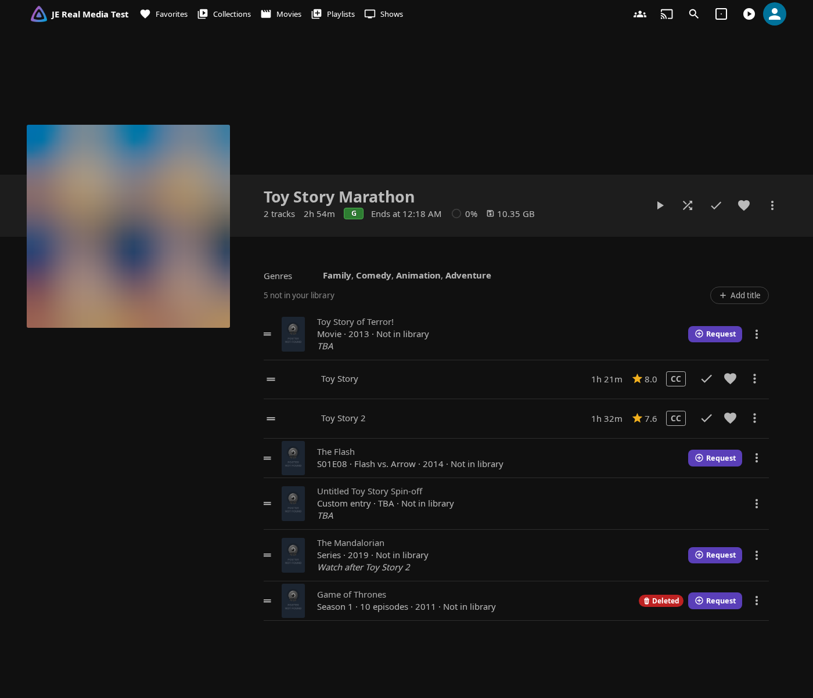

!!! info "Off by default"

    An administrator turns the feature on with **Show titles you don't have on collections and playlists** in the **Seerr Settings** tab, section **List Placeholders**. Its other options are off by default too (only **Only request released titles** starts on), so existing setups don't change. See [List Placeholders settings](seerr-settings.md#list-placeholders).

**What needs Seerr:** status badges, request buttons, the **Add title** search, **Add to collection or playlist**, **Import list** and automatic requests all go through Seerr. Without Seerr you can still add custom entries, and administrators with the Radarr/Sonarr switch on can still search titles in **Add title** and [add them to Radarr and Sonarr](#add-to-radarr-and-sonarr-admins).

!!! note "Web UI only"

    The entries are drawn by the plugin in Jellyfin's web UI and the apps that embed it (see [Compatibility](../index.md#compatibility)). Other apps only show a list's real items. Swap-in, syncing and automatic requests run on the server, so they work whichever app you watch with.

## What a placeholder can be

| Kind | Example | Shown as |
|---|---|---|
| **Movie** | Man of Steel | Movie · 2013 |
| **Whole series** | Peacemaker | Series · 0 of 16 aired · 2022 |
| **One season** | Peacemaker, season 1 | Season 1 · 0 of 8 aired · 2022 |
| **Specific episodes** | The Flash 1x08 | S01E08 · Flash vs. Arrow · 2014 |
| **Custom entry** | A rumoured film with no TMDB page yet | Custom entry · TBA |

- **Specific episodes** always belong to one season. A range such as `S08E01–05` is one entry; a selection that spans two seasons becomes one entry per season.
- **Progress:** seasons and series count the episodes already in the list against the ones that have aired (**n of m aired**, plus **n upcoming** for announced episodes). Right after adding, until Seerr's episode list is read, they show the episode count instead.
- **Upcoming and undated titles:** a title with a future date shows **Coming 23 Oct 2026**. One without a date shows its year if known, else **TBA**. The date is the movie's release date, the series' first air date, the season's premiere or, for episodes, the first listed episode's air date (or the season's premiere).
- **Dates stay current:** they're read from Seerr when a title is added and again by the daily **List Placeholders Maintenance** task, so a TBA entry gets its date once one is announced.
- **Custom entries** are for titles with no TMDB match yet. Give a **Title** and **Type**, and optionally a **Year**, **Release date** and **Note**. They have no status or request button. Once the title has a TMDB page, use **Link to a title** in the entry's ⋮ menu to turn it into a movie, series, season or episodes entry. If you already have that title, it goes into the list straight away.

## Playlists

Placeholders sit **inline**, in playlist order, between the real items.

- Each row shows the poster, title, kind and date, the Seerr status and a **Request** button. Click a row to open the Seerr More Info modal.
- **Drag to reorder:** drag real items and placeholders by their handles. Moves of real items are saved to the Jellyfin playlist as usual, and Jellyfin's own menu actions for moving an item to the top or bottom keep working.
- **Play**, **Shuffle** and playing from a row only play real items. Placeholders are skipped.
- Editors get a ⋮ menu on each placeholder: **More info**, **Move up** / **Move down** (when the row can't be dragged), **Link to a title** (custom entries), **Add to Radarr** / **Add to Sonarr** (administrators, [when enabled](#add-to-radarr-and-sonarr-admins)) and **Remove from list**.

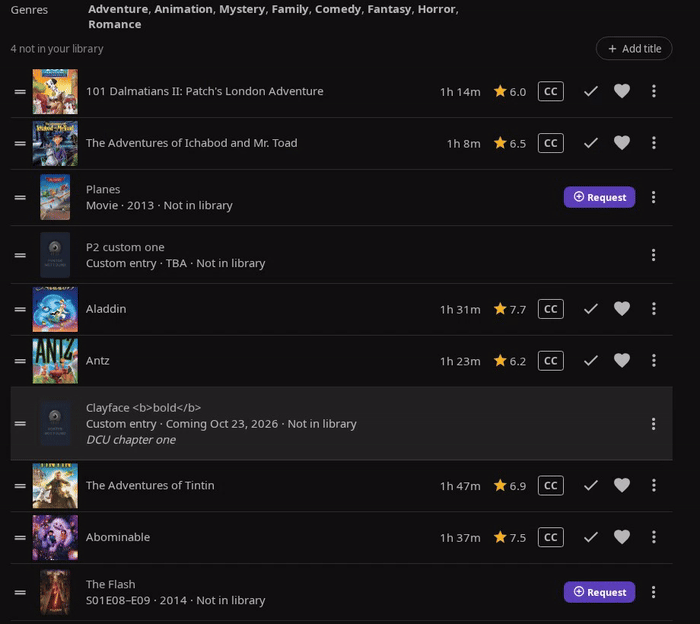

Dragging needs Jellyfin's own edit rights on the playlist: its owner and users it's shared with as editors. An administrator managing someone else's playlist moves placeholders with **Move up** / **Move down**, and can't reorder its real items.

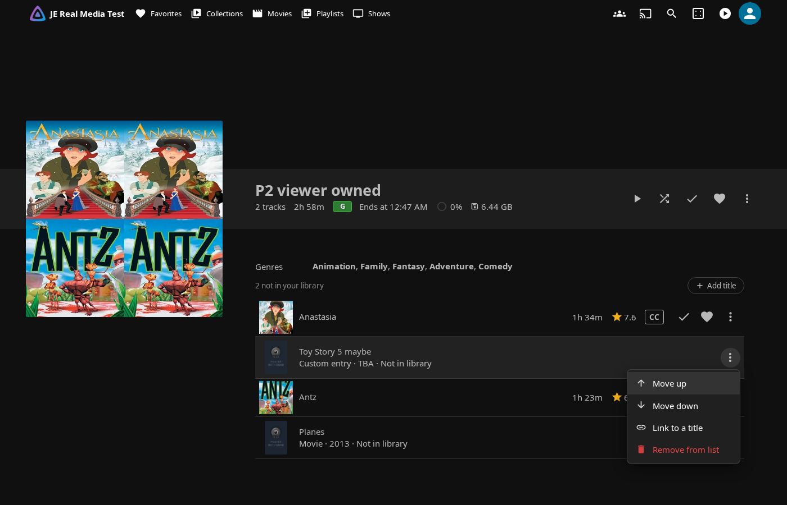

!!! tip "TV layout"

    In TV layout the rows are focusable with the remote and have no drag handles. Use **Move up** / **Move down** in the ⋮ menu instead.

## Collections

Collections get their own **Not in your library** section below their items, sorted by release date (undated and TBA titles last, then by title).

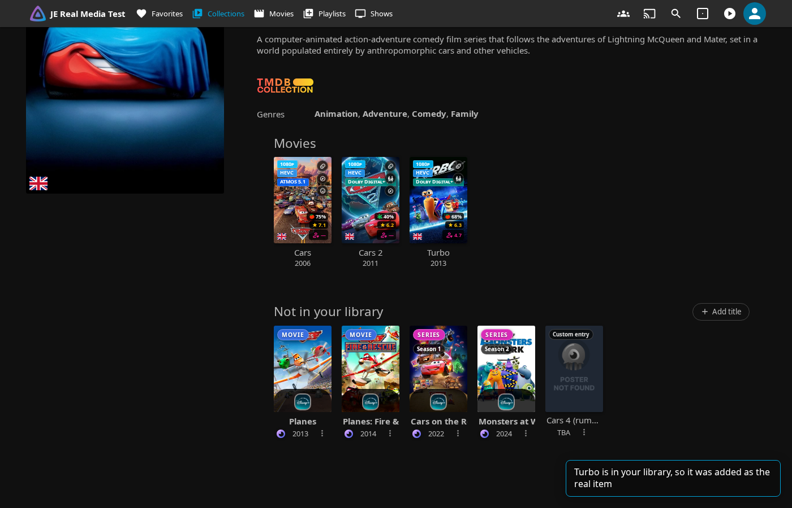

- Cards look and work like Seerr result cards, with a status badge and request button, plus a chip on seasons (Season N), episodes (S01E08) and custom entries. Editors also get the ⋮ menu.
- The Seerr **Missing from** *collection name* row leaves out titles that are already placeholders, so nothing shows twice.

## Poster collage

A playlist or collection that only holds placeholders shows Jellyfin's generic icon. With **Give lists with only "Not in your library" titles a poster collage** turned on, it gets a collage of its first four placeholder posters instead: square for playlists, poster-shaped for collections.

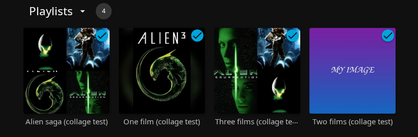

- The collage is only used while the list has no real items. Once one arrives, the collage is removed and Jellyfin makes its own image again (for collections Jellyfin 12 makes none, so the generic icon comes back).
- It never replaces an image you set. To keep a list without a collage, give it your own image; deleting the collage alone doesn't help, it comes back.
- When users with parental controls can see the list, only posters every one of them may see are used, so the collage can have fewer posters, or none.
- It appears about 15 seconds after the list changes. Turning the setting off removes every collage the plugin made.

## Requesting

The **Request** button uses your own Seerr account, permissions and quotas, like anywhere else in the plugin.

- **Movies** follow the usual flow, including the advanced options for users allowed to use them.
- **TV** opens the season selection with the placeholder's season already ticked: for episodes, the season they belong to; for a whole series, nothing. If Seerr has partial requests turned off, the modal says every season will be requested.
- A season or episodes placeholder shows the status of its season.
- With 4K requests enabled, collection cards have **Request in 4K** in the request button's dropdown, like other Seerr cards. The placeholder's badge keeps showing the regular status.
- The badges are the usual [request status indicators](seerr-features.md#request-status-indicators).

Statuses come from one shared index of Seerr's media and requests that the server keeps up to date in the background, so a list of hundreds of entries makes no per-card Seerr calls. Until the index is ready, playlist rows show a spinner and collection cards no badge.

## Adding titles

Only users who can edit the list can add titles (see [Permissions](#permissions)). A title you already have is always added as the **real item** instead of a placeholder.

Editors see a toolbar above a playlist's rows, or beside a collection's **Not in your library** heading, with **Add title** and **Import list**.

### Add title

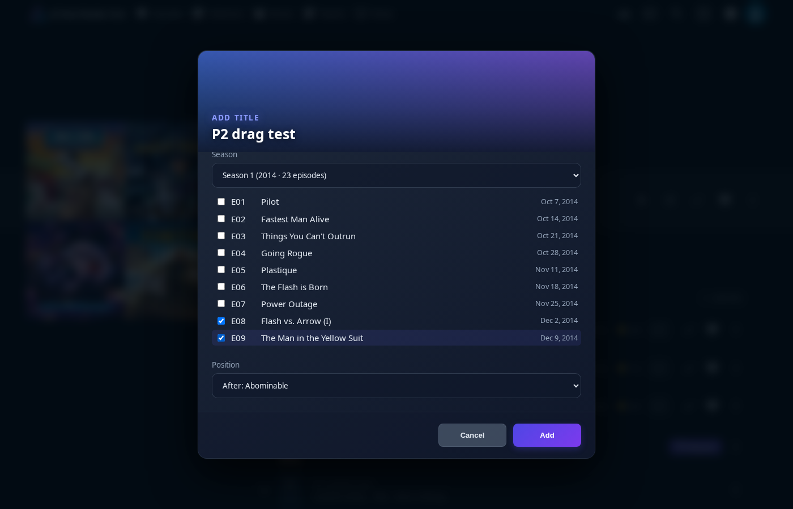

1. **Search** movies and TV shows through Seerr, or switch to **Custom entry**.
2. For a show, choose **What to add**: **Whole series**, **One season** or **Specific episodes** (of one season).
3. For a playlist, choose the **Position**: **At the end**, **At the start** or **After:** any row.
4. Click **Add**.

**Shows you partly have:** in a playlist, when some episodes of the season or series are already in your library, those episodes go in as real items, in episode order, and one placeholder stands for the rest. If the season or series is already complete in your library, only the real items are added. In a collection, a show you have goes in as its series, and a season you partly have as its season, with the placeholder kept until the season is complete.

### From Seerr cards and More Info

Every Seerr movie and TV card (search results, discovery, recommendations, similar titles) has an **Add to collection or playlist** button, and so does the Seerr **More Info** modal.

| Seerr card | More Info modal |
|---|---|
| 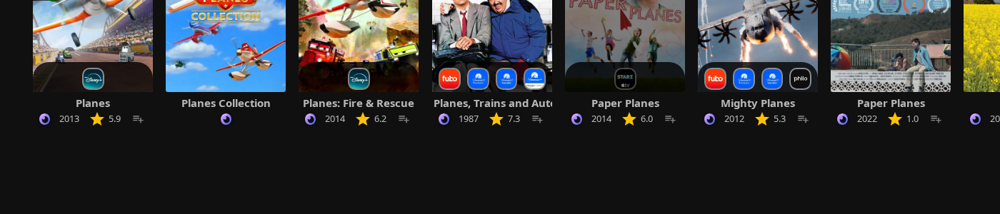 | 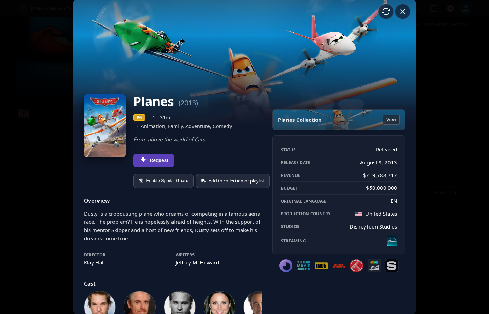 |

The dialog that opens offers:

- **List:** the playlists and collections you can edit. Administrators also see other users' playlists, shown as *Playlist (Owner)*.
- **New playlist…:** creates a playlist you own, with a **Playlist name** and **Visible to all users**.
- **New playlist from a list…:** opens [Import list](#import-a-list) for a new playlist.
- **What to add** for a show, and the **Position** (**At the end** / **At the start**) in a playlist.

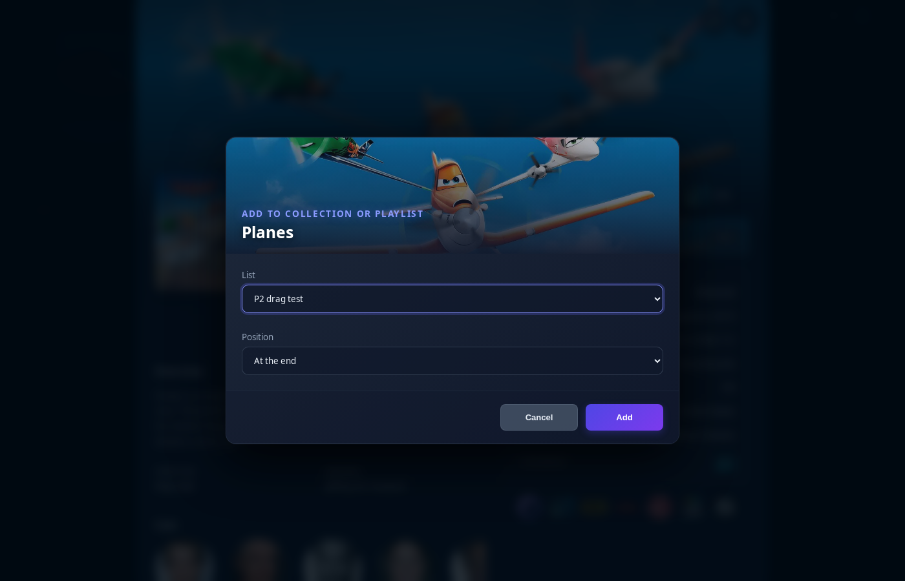

A toast confirms where the title went, with a link to the list. If the title is already there, the toast says so.

### Import a list

Turn a whole list into placeholders and real items, in its order: a watch-order guide, a spreadsheet export, a list of links, or a list on another site.

**Where:**

- **Import list** in a list's toolbar imports into that playlist or collection.
- **Import list…** next to **New Playlist** on the Playlists page, and **New playlist from a list…** in the Add to collection or playlist dialog, create a new playlist.

**Steps:**

1. **Paste** the text, or switch to **From URL** and give a [list address](#from-a-list-url). The dialog shows how many titles it found. If the text has headings, tick the **Sections to import**. A pasted list address offers to switch to **From URL**.
2. **Look up titles.** Every entry is looked up in Seerr, 25 at a time, and the rows appear as they're found. Chronolists entries need no lookup.
3. **Review** the rows (below).
4. Choose where the entries go: the **Position** (**At the end** / **At the start**) in an existing playlist, or a **Playlist name** and **Visible to all users** for a new one. Then click **Import** *n*.

Entries are added in the list's order. A toast reports how many went in as placeholders and how many came from your library, and a new playlist opens.

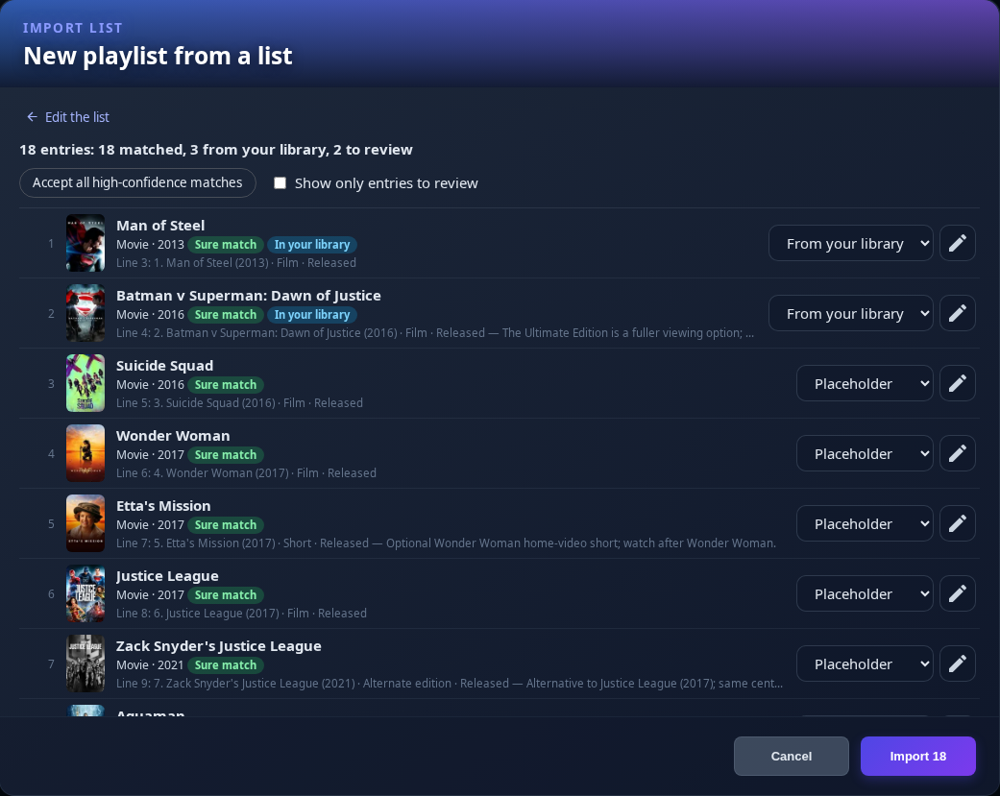

**Reviewing.** Each row shows the original line, the match (poster, title, kind, year) and how sure the match is: **Sure match**, **Likely match**, **Unsure** or **No match**. **In your library** (or *n of m episodes in your library*) marks titles you already have. Each row starts with a suggested choice, and the summary counts the rows that still need a look:

- **From your library**, **Placeholder**, **Custom entry** or **Skip**: what the row becomes.
- The ✎ button opens **Change match**: the other candidates, **Search for another title**, and for a show **What to add** (whole series, one season or specific episodes, preselected from the line). For "A or B" lines, pick either version or **Add both versions, in this order**.
- **Accept all high-confidence matches** sets every sure match to its suggested choice at once; only rows you settled with **Change match** are left alone. **Show only entries to review** hides the rest.
- **Retry failed lookups** appears when Seerr didn't answer for some rows.
- A row naming the same title as an earlier one is flagged as a duplicate.

Rows that need a look say why, for example no year given, two versions, or another title being a close match. Matching keeps improving, so treat the review as the final word: whatever you set there is what gets imported.

**Good to know:**

- Users with parental controls are never offered titles their controls hide.
- Seerr lookups are paced for the whole server: at most 4 at once and about 10 a second, shared by all users. A 150-line list takes about half a minute. Results are cached for 30 minutes.
- Looking titles up needs a Seerr-linked account that isn't on the [user import blocklist](seerr-settings.md#auto-import-jellyfin-users-to-seerr); administrators can always do it.
- Up to 2000 entries can be imported at once.

#### Supported formats

Headings, blank lines and prose are skipped. The importer understands:

- **Numbered or bulleted lines** with a Markdown link, a year or date, a type, a status and a note:
  `13. [Peacemaker - Season 1](https://www.dc.com/tv/peacemaker-2022) (2022) · TV series · Released — 8 episodes.`
- **Title and year:** `Man of Steel (2013)`
- **Dates and TBA:** `Clayface (2026-10-23) · Film · Scheduled`, `Swamp Thing (TBA) · TV series · In development`
- **Markdown tables**, using their title (or "Watch"), year (or "Released"), type (or "Format") and notes columns
- **Seasons:** `Peacemaker - Season 1`, `Peacemaker — season 1`, `Peacemaker S1`, or a `Season 2` line under a show
- **Episodes:** `Flash 1x08`, `S01E08`, ranges like `Flash 8x01–05`, `Season 2 Episode 3`
- **Chains**, split into separate entries in order: `Flash 1x08 → Arrow 3x08`
- **Either/or:** `Justice League or Zack Snyder's Justice League`, kept as one row with both titles to choose from
- **Episodes named by title:** `Legends "Crisis on Infinite Earths: Part Five"`; the show is found, and you pick the episode in **Change match**
- **Links and ids:** TMDB, IMDb and TVDB links or ids, such as `https://www.themoviedb.org/movie/49521`, `tt0770828` or `tvdb:279121`
- **CSV exports:** IMDb list and watchlist exports, Letterboxd list exports, and simple sheets with title, year, id, type, season and episode columns

```text title="Pasted"
### DCEU
1. [Man of Steel](https://www.dc.com/movies/man-of-steel-2013) (2013) · Film · Released
13. [Peacemaker - Season 1](https://www.dc.com/tv/peacemaker-2022) (2022) · TV series · Released — 8 episodes.

### DCU
6. [Clayface](https://www.dc.com/movies) (2026-10-23) · Film · Scheduled

| Event | Exact chapter order |
| --- | --- |
| Flash vs. Arrow (2014) | Flash **1x08** → Arrow **3x08** |
| Armageddon (2021) | Flash **8x01–05**, in order. |
```

This becomes, in order: Man of Steel (movie), Peacemaker season 1, Clayface (movie), The Flash S01E08, Arrow S03E08 and The Flash S08E01–E05. Each table row's event becomes the note of its entries, and its year picks The Flash (2014) over the 1990 show.

### From a list URL

In **Import list**, switch to **From URL** and give the address of a list on one of these sites. Its entries go through the same review, and the list stays [linked](#linked-lists-and-sync). The tab lists the sites that work on your server.

| Site | Supported URLs | Needs |
|---|---|---|
| **MDBList** | user lists `mdblist.com/lists/user/list`, external lists `mdblist.com/lists/user/external/123`, official lists `mdblist.com/lists/official/movies/…` | Nothing for public lists. Private lists only for administrators, through the [MDBList API Key](../other/other-settings.md#mdblist-ratings) (counts against its daily quota) |
| **TMDB** | lists `themoviedb.org/list/8136`, collections `themoviedb.org/collection/…`, charts such as `themoviedb.org/movie/top-rated` or `themoviedb.org/tv/airing-today`, trending `themoviedb.org/trending/movie/week` | The [TMDB API Key](../elsewhere/elsewhere-settings.md#getting-a-tmdb-api-key) for lists and most charts. Collections, trending and upcoming movies also work through Seerr without it |
| **Trakt** | `trakt.tv/users/user/lists/list`, `trakt.tv/users/user/watchlist`, official lists `trakt.tv/lists/official/…`, charts such as `trakt.tv/movies/trending` or `trakt.tv/shows/watched/weekly` | The **Trakt Client ID** setting. Public lists only. Seasons and episodes are kept |
| **IMDb** | lists `imdb.com/list/ls…`, public watchlists `imdb.com/user/ur…/watchlist`, charts `imdb.com/chart/top` (also `toptv`, `moviemeter`, `tvmeter`, `bottom`, `top-english-movies`) | The **Allow IMDb list URLs (unofficial)** setting |
| **Chronolists** | watch orders `chronolists.com/dctv`, `chronolists.com/mcu`, … | Nothing. See [below](#chronolists-watch-orders) |
| **Letterboxd** | Not fetched | See below |

Only these sites' own addresses are accepted. Up to 1000 entries are read from a list (5000 from a Chronolists watch order), and the first 100 from a TMDB or Trakt chart.

!!! note "IMDb and Letterboxd"

    Neither site has a public API the plugin can use. IMDb lists can be read through IMDb's unofficial website API once an administrator allows it, but that API may stop working at any time and is for personal use only. Letterboxd's terms forbid scraping, so its addresses are never fetched. For either site you can:

    - **Mirror the list on MDBList** (My Lists → External Lists) and import the MDBList URL. The mirror can stay linked like any other list.
    - **Export it as CSV** on IMDb or Letterboxd and paste the file's contents.

### Chronolists watch orders

[Chronolists](https://chronolists.com) publishes chronological watch orders for whole universes, down to single crossover episodes. Import one with **Import list** → **From URL** and the universe's address, for example `https://chronolists.com/dctv` for the Arrowverse.

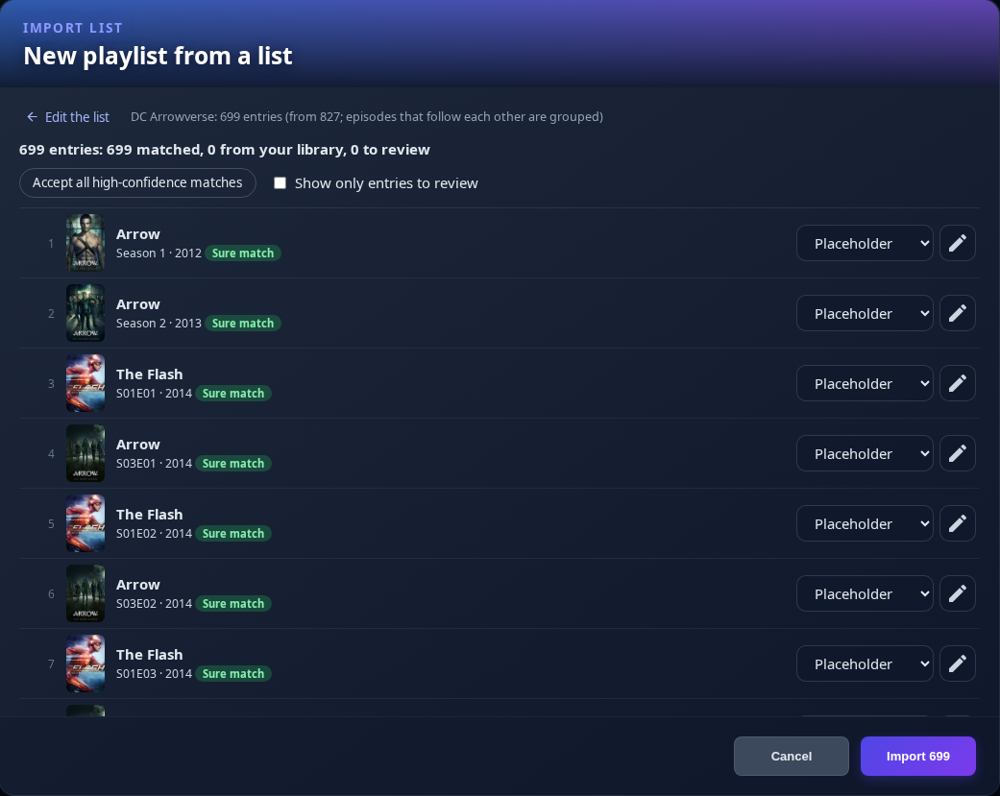

- **No lookups:** the page already names every title exactly, so all rows arrive as sure matches at once, without Seerr searches.
- **Grouped episodes:** episodes that follow each other in the watch order become one entry, a whole season when the run covers it, so the Arrowverse's 800-odd episodes become about 700 entries. The review header says so.
- **Kept in order:** with **Keep in sync with this list**, episodes and films added to the watch order later are inserted at their place in it, not at the end. Entries that move on the site keep their place in your list.
- **Episodes you have** go in as real items, the rest as placeholders, as with any import.
- If Chronolists changes how its pages are built, the import or sync stops with a message and nothing in your list changes until the plugin is updated. If only a few entries can't be read, the rest is imported or synced and nothing is removed.

### Linked lists and sync

A list imported from a URL stays linked to its source. Two options in the review decide what later syncs do:

- **Keep in sync with this list** (on by default): the list takes part in the scheduled sync.
- **Remove entries that leave the list** (off by default): a sync also removes entries that dropped off the source, but **only entries the import or a sync added**, including the real items they turned into. Entries you added yourself are never removed. A real item is only removed if it's in the playlist once.

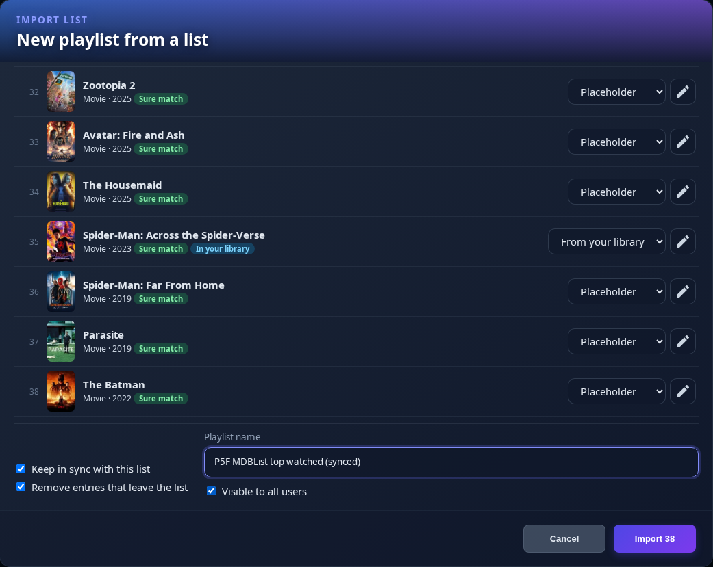

Editors see the link in the list's toolbar as **Linked:** *name*, with the time and result of the last sync. Its menu has **Sync now**, both options, **Open the list's page** and **Unlink**. Unlinking keeps every entry.

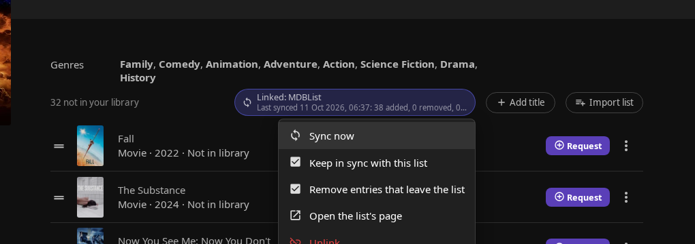

How syncing works:

- **When:** once an administrator turns on **Keep linked lists in sync**, the **Sync linked lists (list placeholders)** scheduled task syncs every list with **Keep in sync with this list**, every 12 hours. **Sync now** works either way.
- **Where new entries go:** at their place in the source's order, right after the nearest earlier entry that's in your playlist. Collections have no order.
- **Only sure matches** are added, because nobody reviews them. The rest is tried again next time. Chronolists entries need no lookup; other sources need Seerr.
- Entries you skipped in the review or removed later aren't added back (they're remembered for 90 days), and a title the list already has (for example a new episode of a season that's a placeholder) gets no second entry.
- **As whom:** a sync runs with the rights of the user who linked the list. If that user is deleted, can no longer edit the list, or can't see an entry that should be removed, syncing pauses and the link says why. When an editor changes an option in the link's menu, the list is linked again as them and syncing resumes.
- When a list site answers only partly, or the list is longer than the limit, nothing is removed. Once a list holds 2000 placeholders, syncing adds no new placeholders (titles you have still go in) and says the list is full.

## When a title arrives

When a title on a list reaches your library, the plugin puts the real item in its place:

- **Movies** are inserted into a playlist at the placeholder's spot, or added to the collection, and the placeholder goes away.
- **Seasons fill in episode by episode.** Each episode that arrives goes in at its place in episode order, next to the ones already there. The placeholder shows **n of m aired** (plus **n upcoming** while episodes are still to air) until the season is complete: every episode has aired and is in the list, or, for a show that has ended, every aired episode is. Then it goes away.
- **Specific episodes** go in one by one as they arrive. The placeholder goes away once all of them are in.
- **Whole series:** in a playlist, episodes of every regular season (not specials) fill in the same way, and the placeholder stays until the show has ended and every aired episode is in. In a collection, the series itself is added.
- **Seasons and episodes in a collection:** a season is added as soon as its first episode arrives, and specific episodes are added one by one. The placeholder stays until it's complete, as above.

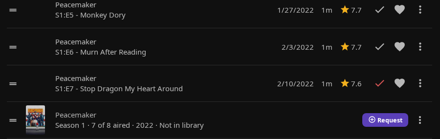

- While an arriving item is being added, the entry shows **Available — adding…** with a link to it.
- Items are added to a playlist as its owner, and only items the owner can see (library access and parental controls).
- An item that's already in the playlist isn't added a second time.
- Swap-in runs a few seconds after a library scan finds the item, when the list is opened, after a server restart, and in the daily **List Placeholders Maintenance** task, which also refreshes release dates and episode lists. An open page updates when Jellyfin reports the change, which can take about 30 seconds.
- A show numbered differently in your library than on TMDB (some anime, DVD order), or a season or series with 1000 or more episodes, never counts as complete. Remove its placeholder by hand.

## Automatic requests

With **Request the next titles of a list while it's being watched** turned on (**Seerr Settings** → **Automatic Requests** → **List Placeholder Requests**), the plugin requests what comes next in a list while someone watches it. Editors see **Auto-request: next** *n* in the list's toolbar.

When someone plays an item of a playlist or collection that has placeholders, the next placeholders after it are requested from Seerr **as that user**, with their Seerr permissions, approval rules and quotas.

| Placeholder | Request |
|---|---|
| Movie | The movie |
| One season | That season |
| Specific episodes | The season they belong to |
| Whole series | Season 1 (or the first regular season), or once some of it is in the list, the first season with episodes missing (aired ones, with **Only request released titles**) |
| Custom entry | Never |

- **Next** means playlist order, or release date order in a collection. In a collection, playing an episode counts for its series or season.
- **Titles to request each time** (1–10, default 1) sets how many are requested, and **Minutes watched before requesting** (default 5; 0 = as soon as playback starts) sets when. It fires once per user, playback session and item.
- **Only request released titles** (on by default) skips titles that aren't out yet, TBA included.
- **Skipped, and not counted:** titles already requested or available (checked with Seerr right before each request), custom entries, titles the user's parental controls hide, and users who aren't linked to Seerr, are excluded from Seerr or may not request that kind of title. Up to 50 entries after the played item are looked at.
- When the item is in several lists, the user's own and editable lists come first, and each title (for TV, each season) is requested only once.
- An administrator's playback never requests from another user's private playlist.
- The same title or season isn't requested again for the same user within 6 hours.

!!! tip "With Auto Season and Auto Movie Requests"

    The switches are independent. With [Auto Season Requests](seerr-features.md#auto-request-settings) also on, a series requested here gets its later seasons from that feature. Each title's status is checked with Seerr right before it's requested, and the features never request the same title at the same moment, so they don't duplicate each other.

## Add to Radarr and Sonarr (admins)

With **Let administrators add placeholders to Radarr and Sonarr** turned on, administrators can send a title straight to Radarr or Sonarr, not through Seerr, so no Seerr request is created. This works even without Seerr.

- **Add to Radarr** / **Add to Sonarr** in the ⋮ menu of a placeholder row or card.
- **Add title** also shows a **Radarr / Sonarr** group of results. Pick one to add it as a placeholder, or use its button to send it to Radarr or Sonarr. A result without a TMDB id becomes a custom entry, and without Seerr, shows can only be added as the whole series.

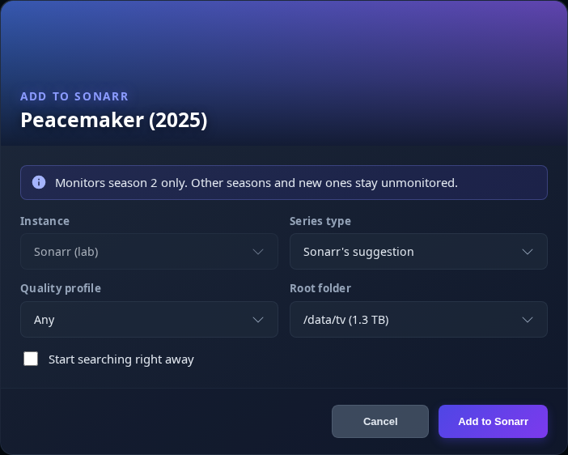

The dialog asks for the **Instance** (the enabled instances on the [*arr Settings tab](../arr/arr-settings.md#multi-instance-configuration)), **Quality profile** and **Root folder**, then **Minimum availability** (Radarr, default **Released**) or **Series type** (Sonarr, default **Sonarr's suggestion**), and **Start searching right away**. It says upfront whether the title is already there, and remembers your last choices per instance in this browser.

| Placeholder | What Radarr / Sonarr gets |
|---|---|
| Movie | The movie, monitored |
| Whole series | The series, with every regular season monitored (not specials) and new seasons too |
| One season | Only that season monitored. Other and future seasons stay unmonitored |
| Specific episodes | Only those episodes monitored |

- If Sonarr already has the series, a season or episodes placeholder **adds monitoring** for that part only. Whatever is already monitored is left alone.
- A movie or whole series that's already there is reported as already in Radarr or Sonarr, and nothing changes (an unmonitored movie stays unmonitored).
- Episodes Sonarr doesn't list yet are named in the result, and the toast links to the title in Radarr or Sonarr.
- Custom entries can't be added.

!!! note "Sonarr v3"

    Adding a single season relies on Sonarr v4. On Sonarr v3 the chosen season is monitored as asked, but seasons added later may be monitored too.

## Permissions

The server checks every action, including direct API calls.

| Action | Who |
|---|---|
| See a list's placeholders | Anyone who can see the list in Jellyfin |
| Add, move, remove, import or sync on a **playlist** | Its owner, users it's shared with as editors, and administrators |
| Add, remove, import or sync on a **collection** | Administrators and users allowed to manage collections |
| Create a playlist from the dialog or an import | Any user, who then owns it |
| Look titles up for an import | Seerr-linked users not on the user import blocklist, and administrators |
| Request a placeholder | Users who can request in Seerr, with their own permissions and quotas |
| Add to Radarr or Sonarr | Administrators only |

- **Administrators and other users' playlists:** the plugin lets administrators manage placeholders on every playlist, which Jellyfin itself doesn't. Real items it adds to someone else's playlist are added as the owner, and only if the owner can see them.
- **Parental controls:** placeholders follow the same rules as Seerr results (see [Parental Ratings](seerr-features.md#parental-ratings)). Restricted users don't see titles above their limit, titles whose rating can't be determined, or other users' custom entries. Hidden entries aren't counted anywhere, and a linked list's sync counts are only shown to users who see every entry.

## Limits

- **Duplicate items in a playlist:** only the first copy of an item that appears twice can be moved, because Jellyfin always moves the first copy. Adding an item that's already in the list is refused with **That item is already in this list**.
- **Other users' playlists:** administrators who aren't editors of a playlist can move its placeholders but not its real items.
- A list holds up to **2000** placeholders; beyond that, titles you have still go in as real items. An import takes up to 2000 entries, and up to 1000 entries are read from a list URL (5000 from Chronolists, 100 from a TMDB or Trakt chart).
- Status badges come from a background index of Seerr, so a request deleted in Seerr usually keeps its badge for up to 20 minutes.
- A show whose name is too short or common to be found by a Seerr title search (for example "Legends") can't be matched from its title alone. Use **Search for another title** in the review.
- **Jellyfin 10.11:** the feature builds for 10.11 and is covered by automated tests, but hasn't been tried on a live 10.11 server yet. It is developed and tested on Jellyfin 12.
