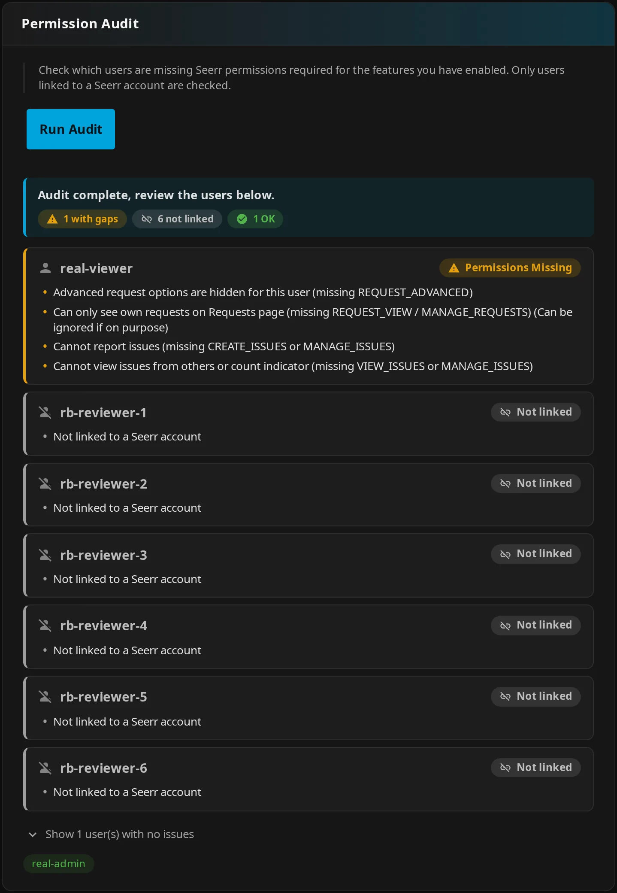

# Seerr Permission Audit

Check whether your Jellyfin users are linked to Seerr and have the permissions needed for enabled JE features. The audit helps you find account and access problems before users try to request media.

## Overview

The audit checks account linkage and selected permission gaps. It does not show a complete inventory of each account's permissions.

!!! note "Administrator check"

    **Run Audit** is a read-only administrator action. It does not change accounts, settings, or permissions, and never imports users. There is no persistent audit setting.

## Where to find it

Run the check from JE's Seerr settings.

**How to use:** Open **Dashboard** → **Plugins** → **Jellyfin Enhanced** → **Seerr** → **Permission Audit**, then press **Run Audit**.

## Quick steps

Use the audit after connecting Seerr or changing feature access.

**How to use:**

1. Configure and enable Seerr with saved URLs and API key. Use **Test** under **Seerr Connection Setup** to check connectivity with the entered credentials.
2. Save changes to feature switches and **Blocked Users**.
3. Open **Seerr** → **Permission Audit**, press **Run Audit**, and wait.
4. Review missing-permission cards against your intended access policy. Adjust permissions in Seerr, or use [user import](seerr-settings.md#step-4-configure-user-import-optional) if an account is genuinely missing.
5. Run the audit again after changes, then verify the relevant request/issue workflow as that user.

!!! note "Save before auditing"

    **Run Audit** uses the saved server configuration. It does not save pending form changes. Many users or failed upstream addresses can make the check slow.

## How it works

The audit checks Jellyfin users against Seerr's stored account links. It honors **Blocked Users**.

??? info "How it works"

    The audit iterates Jellyfin users and attempts to resolve each account using Seerr's stored `jellyfinUserId`. It bypasses JE's user lookup cache and explicitly disables automatic import for the audit, even when automatic import is enabled elsewhere.

    User lookup reads the first `take=1000` users from each attempted Seerr URL. Large Seerr user lists can therefore leave a valid account unresolved.

## Interpreting results

Each result tells you whether an account was linked and whether the selected checks passed.

**How to use:** Review **Not linked** and **Permissions Missing** cards, then check the limits below before treating **OK** as proof of access.

| Result | What it means | What to do |
| --- | --- | --- |
| **Not linked** | No Seerr account was resolved. | Check logs before assuming an import is needed. |
| **Permissions Missing** | A linked account fails one or more checks below. The card lists those selected gaps, rather than every permission held. | Review the gaps against your intended access policy. |
| **OK** | Linkage and the checks performed passed. | Verify the relevant workflow as that user. |

??? note "Details"

    **Not linked** can mean an absent account, a JE-blocked user, an upstream HTTP failure, an exception, or an unexpected response shape.

    In mixed results, passing users appear in a collapsed list. If everyone passes, the UI shows an all-OK summary without individual names.

### Checks performed

The enabled features determine which permissions the audit checks. A linked Seerr administrator passes automatically.

**How to use:** Expand the table to see which saved feature switches caused a warning. Feature switches are admin settings documented in [Seerr settings](seerr-settings.md); the defaults below come from JE's server configuration.

??? info "How it works"

    These checks apply to linked accounts without Seerr `ADMIN`.

    | Check | When checked | Passing Seerr permission |
    | --- | --- | --- |
    | Request capability | Every linked non-Seerr-admin account | Any of `REQUEST`, `REQUEST_MOVIE`, `REQUEST_TV` |
    | 4K movies | **Enable 4K Requests** is on (default off) | `REQUEST_4K` or `REQUEST_4K_MOVIE` |
    | 4K series | **Enable 4K TV Requests** is on (default off) | `REQUEST_4K` or `REQUEST_4K_TV` |
    | Advanced options | **Show advanced request options** is on (default off) and request capability is present | Specifically `REQUEST_ADVANCED` |
    | Other users' requests | **Enable Requests Page** is on (default off) | `REQUEST_VIEW` or `MANAGE_REQUESTS` |
    | Create issues | **Show "Report Issue" button on items** is on (default off) | `CREATE_ISSUES` or `MANAGE_ISSUES` |
    | Issue indicator | **Show open issue indicator** is on (default off) | `VIEW_ISSUES` or `MANAGE_ISSUES` |

!!! tip "Own requests may be enough"

    An own-requests-only warning can be intentional. Ordinary linked users can still use the Requests page for their own requests without permission to view other users' requests. Grant broader access only if that is your intended policy.

### Limits of an OK result

An **OK** result confirms only the checks performed. It does not validate quotas, Sonarr/Radarr setup, parental policy, or every media/quality-specific permission.

**How to use:** Test the request or issue workflow as the user after reviewing the audit.

??? note "Details"

    Passing the generic request check with movie-only permission does not prove TV request access.

    The advanced-options audit specifically checks `REQUEST_ADVANCED`. Actual advanced-option authorization also accepts `MANAGE_REQUESTS` and linked Jellyfin/Seerr administrators, so the audit can warn about a user whose advanced options work.

    More generally, the audit does not apply the linked Jellyfin-administrator bypass used by actual proxy permission checks. It evaluates the linked Seerr account's permissions.

    **Show Seerr Issues Section** does not independently activate an audit check. An OK result does not prove a user can read that section: ordinary linked users still need `VIEW_ISSUES` or `MANAGE_ISSUES`. See [issue permissions](seerr-features.md#issues-on-the-requests-page).

## Troubleshooting & notes

A failed account lookup can look like a missing account. Check the connection and account link before importing again.

**How to use:**

1. For **Not linked**, inspect JE's preceding warning/error log lines.
2. Check **Blocked Users** and the stored Jellyfin ID. Matching usernames are insufficient.
3. If import is needed, use **Import Users Now**. This saves configuration and performs a separate action that imports accounts. See [import prerequisites, throttling, and email conflicts](seerr-settings.md#step-4-configure-user-import-optional).

??? info "How it works"

    The administrator endpoint is `GET /JellyfinEnhanced/jellyseerr/permission-audit`. It rejects non-admins and returns HTTP 503 if the saved integration is disabled or URLs/key are missing. It uses saved credentials, unlike **Test**, which uses entered form values.

    An unreachable Seerr server, a reverse proxy returning HTML, or a response-shape mismatch can look like a missing account. A working connection test does not prove every user's linkage.

    Bypassing the user lookup cache makes this audit fresher than a cached account check. It does not clear all browser caches or guarantee every upstream state is current. Saving JE configuration clears its Seerr server caches. See [Debug and caching](seerr-settings.md#debug-and-caching) and [connection troubleshooting](seerr-features.md#connection-issues).
