# Seerr Integration

Search, request, and discover media from Jellyfin using your Seerr instance. Start with [Seerr setup](seerr-settings.md#setup), then check your accounts with [Permission Audit](permission-audit.md).

!!! note "Client and connection requirements"

    These interfaces run in the Jellyfin web client. Server playback automations can also react to native clients. External Seerr links need to be accessible from your device.

??? info "How it works"

    JE proxies API calls through the Jellyfin server, keeping the Seerr API key out of the browser and avoiding browser CORS requirements.

    JE is independent of Seerr. Report integration problems to the [Jellyfin Enhanced project](../faq-support/report-issues.md).

## Features

- [Search and requests](#search-integration), including seasons, 4K, collections, advanced destinations, and quotas.
- [Jellyfin's own details page for titles that aren't in the library](#titles-that-arent-in-the-library-jellyfins-own-details-page-experimental) (experimental, Jellyfin 12 web).
- [More Info](#more-info), [item-specific recommendations](#item-details), [discovery](#discovery-pages), and the [Recommendations page](#recommendations-page).
- [Issue reporting](#issue-reporting) and the shared [Requests page](#requests-page).
- [Watchlist sync](#watchlist-sync) and [automatic requests](#auto-request-settings).
- [Library access](#library-access) filtering of every Seerr answer.

### Search Integration

Seerr adds movies and series you can request alongside Jellyfin's own search results. Cards show request and availability status; person results are excluded.

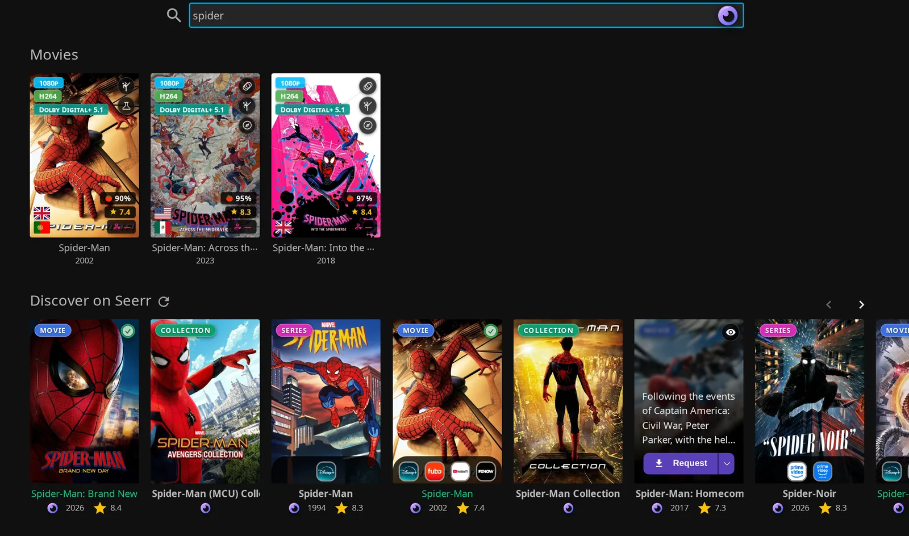

#### Requesting:

**How to use:**

1. Enter a query in Jellyfin search. **Discover on Seerr** appears alongside library results; Seerr-only mode uses **Seerr Results**.
2. Hover a card on desktop, or use its touch/keyboard controls, to reveal the overview and request actions. Press **Request** for an unrequested title; TV opens season selection. Movie requests open **Request Movie** when advanced options are enabled for your account; otherwise they submit immediately.
3. Open a poster for details. Title links for library matches open Jellyfin, including partially available series. Other results open More Info or Seerr, depending on the admin settings.
4. Scroll the Seerr row sideways to load more results. Use the refresh icon beside its heading to reload the row.

<figure class="je-video">
  <video autoplay loop muted playsinline controls preload="metadata" aria-label="Searching Seerr and filling a movie request dialog">
    <source src="../../images/seerr/search-request.mp4" type="video/mp4">
  </video>
  <figcaption>The demonstration stops before submission.</figcaption>
</figure>

To show only Seerr results, double-click or double-tap the active Seerr icon. With the active icon focused, you can also press ++enter++ or ++space++ to toggle this mode. You need a linked account.

To narrow results by year, search for `Title (YYYY)`, including the closing parenthesis.

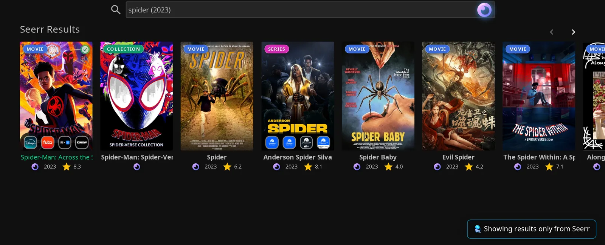

Admin settings under **Seerr** → **Search & Requests** ([full reference](seerr-settings.md#search-and-collection-results)):

| Setting | Default | What it does |
| --- | --- | --- |
| **Show Seerr Results in Search** | On | Adds Seerr search when the integration is enabled and the viewer is linked. |
| **Exclude search items already in library** | Off | Removes library matches, including partially owned series and movies owned in lower quality. |
| **Show Collections in Seerr Results** | On | Adds collections derived from matching movies when Seerr search is on. |

!!! note "Search exclusions"

    Search exclusion can hide a movie you want in 4K or a series with missing seasons. Use **Request More** on the series detail page or request directly in Seerr. Discovery/recommendation exclusion is a separate setting. [Hidden Content](#hidden-content-on-seerr-results) can also affect which cards you see.

??? info "How it works"

    A library match needs a Jellyfin media ID and available/partially available status, with TV season data also considered.

    The year filter uses a movie's release year or a series' first-air year. Unknown or nonmatching years are excluded. Jellyfin's native results are unaffected.

#### Season selection

Choose which seasons to request when Seerr allows partial TV requests.

**How to use:**

1. Open a TV request to see season selection.
2. Choose requestable seasons or **Select All Seasons**.
    With [Only Allow Requesting One Season at a Time](seerr-settings.md#only-allow-requesting-one-season-at-a-time) on, **Select All Seasons** is removed and each request is limited to one season (needs partial requests enabled in Seerr).
3. Press **Request** to submit your selection.

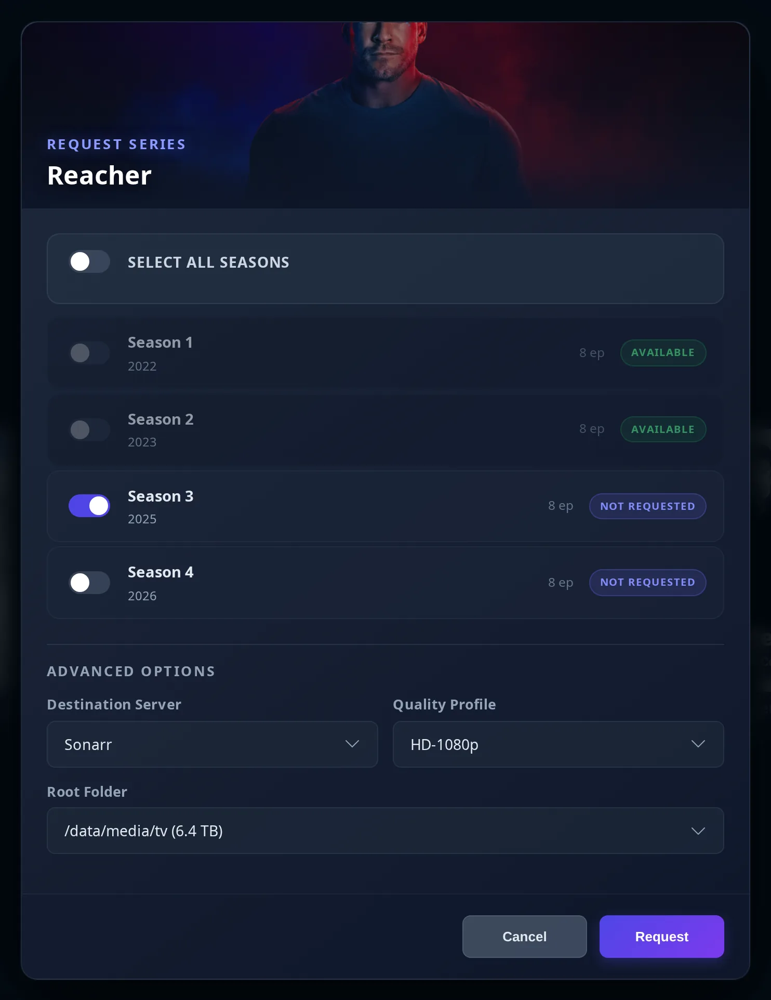

!!! note "Seerr controls season selection"

    TV requests depend on Seerr's partial-request and special-episode settings. Without partial requests, the checkboxes are disabled, and submission requests every regular season number returned by Seerr, or the whole series if none are returned.

??? info "How it works"

    **Specials** appear only when enabled upstream and are excluded from **Select All Seasons**. Seasons with zero episodes are hidden. The request dialog refreshes status every ten seconds while retaining your selections.

    If upstream settings cannot be read, JE uses its last successful settings. Without those, it treats partial requests and specials as disabled.

    Library season-presence checks can make deleted seasons requestable again even while Seerr still reports them available. Request eligibility also depends on the selected quality's status and Seerr's authorization.

#### 4K TV Requesting:

Request series in 4K when your Seerr setup supports it.

**How to use:**

1. Turn on the admin setting **Enable 4K TV Requests**.
2. Choose **Request in 4K** from a TV request dropdown.
3. In **Request Series - 4K**, choose seasons and submit with **Request in 4K**.

Movie cards also offer **Request in 4K** when **Enable 4K Requests** is on. Choose 4K from the dropdown before opening an advanced movie request dialog.

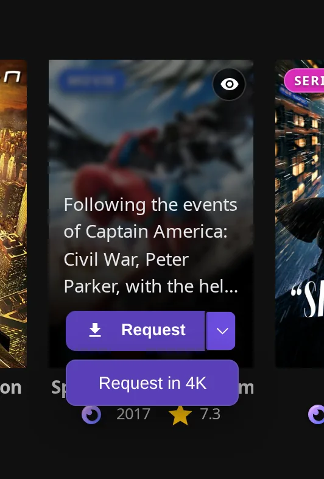

Admin settings under **Seerr** → **Search & Requests**:

| Setting | Default | What it does |
| --- | --- | --- |
| **Enable 4K Requests** | Off | Exposes 4K movie requests. Requires a suitable Seerr 4K Radarr destination and permissions. |
| **Enable 4K TV Requests** | Off | Exposes 4K series requests. Requires a suitable Seerr 4K Sonarr destination and permissions. |

Normal and 4K statuses are separate. These switches expose actions; Seerr still decides whether a request is accepted. See [4K settings](seerr-settings.md#enable-4k-tv-requests).

??? note "Details"

    In More Info, unrequested series can show **Request**, follow-up requests can show **Request More**, and **Request in 4K** can be a dropdown choice or a standalone button when normal requests are unavailable.

#### Series without a TVDB match:

You can match a series manually when its TMDB metadata has no TVDB ID.

**How to use:**

1. In the season dialog, select the correct series from the Sonarr search candidates.
2. If needed, enter **TVDB ID**: the numeric ID in the series' thetvdb.com address.
3. Request normally.

??? note "Details"

    When neither upstream metadata nor Seerr's stored media record supplies a match, the season dialog offers Sonarr search candidates. Manual entry also works when candidates cannot be retrieved or Sonarr is not configured in Seerr.

    Series with an existing TVDB match do not show this block. This matching workflow has no separate JE setting.

#### Advanced request options

Choose where and how Seerr downloads a request when your account has access to advanced options.

**How to use:** In the request dialog, choose **Destination Server**, **Quality Profile**, and **Root Folder**. Fill every required choice before submitting.

Admin settings under **Seerr** → **Search & Requests** ([full reference](seerr-settings.md#show-advanced-request-options)):

| Setting | Default | What it does |
| --- | --- | --- |
| **Show advanced request options** | Off | Shows destination choices to authorized linked users. |

??? info "How it works"

    Linked Jellyfin/Seerr administrators and users with `REQUEST_ADVANCED` or `MANAGE_REQUESTS` can use advanced options. Other users' advanced fields are hidden and stripped if sent.

    Servers are sorted alphabetically. JE selects the matching normal/4K default and any supplied profile/folder defaults. Folder labels can include free space. Explicit selections bypass JE's client-side override-rule evaluation.

#### Request quotas

Quota information helps you see how many requests you have left and when another slot may become available.

**How to use:** Check the quota chip when requesting a title. It shows the movie or series quota for that title. A next-slot estimate can appear while you still have requests left.

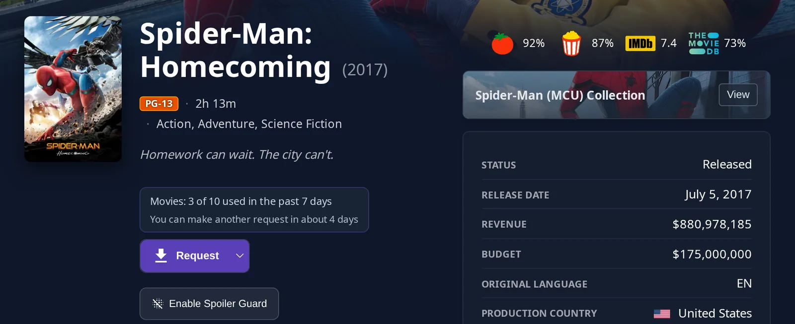

Admin settings under **Seerr** → **Search & Requests** ([full reference](seerr-settings.md#show-advanced-request-options)):

| Setting | Default | What it does |
| --- | --- | --- |
| **Show request quota info** | On | Shows finite Seerr quota usage, window, and estimated next-slot timing, and enables detailed quota-error handling. |

??? note "Details"

    Unlimited quotas show no chip. One or two remaining slots show a warning; exhausted quotas show a restricted state.

    A recognized quota-exceeded HTTP 403 opens **Request limit reached** with recovery guidance. Turning quota information off gives simpler errors without changing the upstream limit.

#### Collection requests

Request several movies from a collection in one place.

**How to use:**

1. Open a collection card or a movie's collection membership badge to use **Request Collection**.
2. Choose movies individually or with **Select All Movies**.
3. Press **Request Selected Movies**.

Admin settings under **Seerr** → **Search & Requests**:

| Setting | Default | What it does |
| --- | --- | --- |
| **Show Collections in Seerr Results** | On | Adds search collection cards from matching movies. Depends on **Show Seerr Results in Search**. |

??? note "Details"

    Available movies and entries with normal-quality Pending/Processing media status are disabled. Other entries start checked, including partially available or blocklisted entries whose requests may fail upstream. Requests are sequential and normal quality; feedback reports successful and failed counts. A quota error recognized while quota information is enabled stops the remaining batch. A separate TMDB key supplies fallback collection metadata if Seerr returns no collection.

#### Request Status Indicators:

Status labels help you see whether a title is available or a request needs attention. Cards, More Info chips, season rows, and Requests cards summarize related but different Seerr states.

**How to use:** Read the label on the card or season row using the guide below.

| Status | Meaning |
| --- | --- |
| **Available** | Seerr reports availability. |
| **Partially Available** | Some series content is available; season rows use **Partial**. |
| **Pending Approval** | A request is waiting for approval. |
| **Requested** | A request is in progress without active transfer information. |
| **Processing** | Active download activity on shared cards/season displays. The Requests page filter has the broader meaning described [below](#usage). |
| **Declined** | The request was declined. This is separate from blocklisting the media. |
| **Blocklisted** | Seerr has blocked the media. |
| **Deleted** | Previously tracked media was removed; it can become requestable again. |
| **Not Requested** | No request recorded, used in season/collection displays. |

??? note "Details"

    These are fetched/cached snapshots, not a continuous live feed. Local checks can correct stale availability. An upgrade download can retain **Available** while showing activity. A pending request can coexist with partially available media. Season rows also use **Requested** for Pending/Processing media without active downloads.

    **Request**, **Request Missing**, and **Request More** are actions, not status names. Series controls can include counts of available/requested seasons. More Info displays normal and 4K chips independently. Request actions update their interface; the season request dialog polls, the Requests page can auto-refresh, and More Info has manual refresh. See [cache settings](seerr-settings.md#debug-and-caching) when a state looks stale.

### Item Details

Find more to watch in **Similar** and **Recommended** rows on movie and series detail pages. You can open details and request titles just as you do in search.

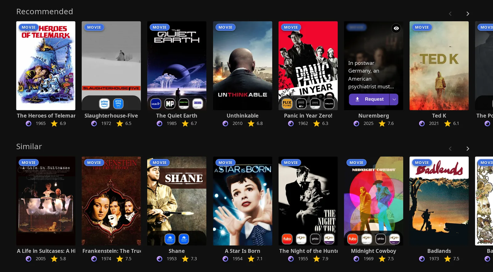

#### Configure

**How to use:**

1. Turn on either row under **Seerr** → **Discovery & UI Extras** → **Item Pages Discovery**.
2. Open an eligible movie or series detail page and browse the rows.
3. To request more seasons, press **Request More** beside the season list when it is available. On Jellyfin 12, this list is headed **Series**. This opens season selection.

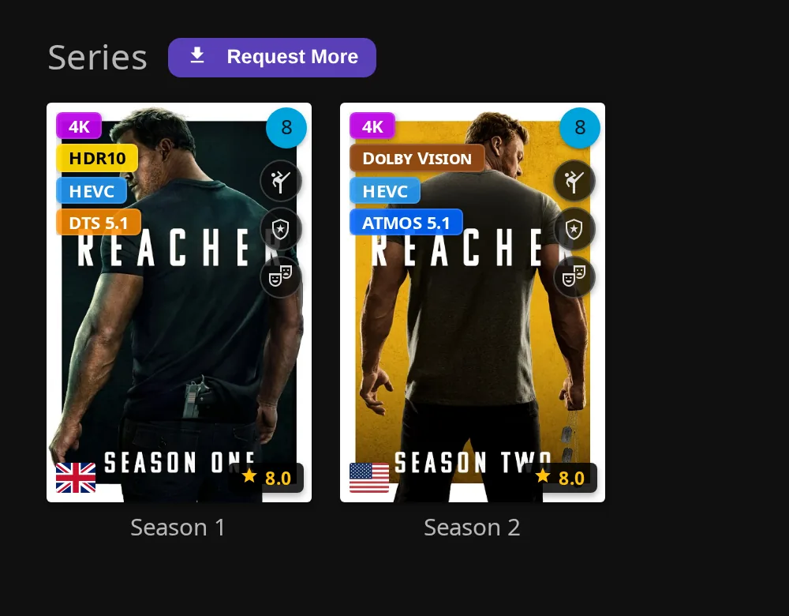

Admin settings ([full reference](seerr-settings.md#item-pages-discovery)):

| Setting | Default | What it does |
| --- | --- | --- |
| **Show similar items** | On | Adds **Similar**. |
| **Show recommended items** | On | Adds **Recommended** independently. |
| **Show "Request More" button on Series** | On | Adds follow-up season requesting when eligible. |
| **Exclude items already in library** | On | Filters shared discovery/recommendation cards. |
| **Exclude blocklisted items** | Off | Filters media with Seerr's blocked media status, rather than declined requests. |

!!! note "Requirements"

    The rows need a TMDB-identified movie or series and working Seerr user access.

??? info "How it works"

    JE places the rows after Jellyfin's **More Like This** region. Each row has up to 20 items before filtering, without unlimited additional pages.

    **Request More** appears for requestable additional regular seasons containing episodes. Local season-presence and Seerr status checks can make deleted seasons eligible again.

    JE also adds a Seerr link to the **External Links** row independently of *arr links. It opens More Info when enabled, otherwise Seerr in a new tab; the [detail-link settings](seerr-settings.md#more-info-and-detail-links) control its visibility and icon/text appearance.

### More Info

More Info lets you read about a title, check its availability, and request it without leaving Jellyfin.

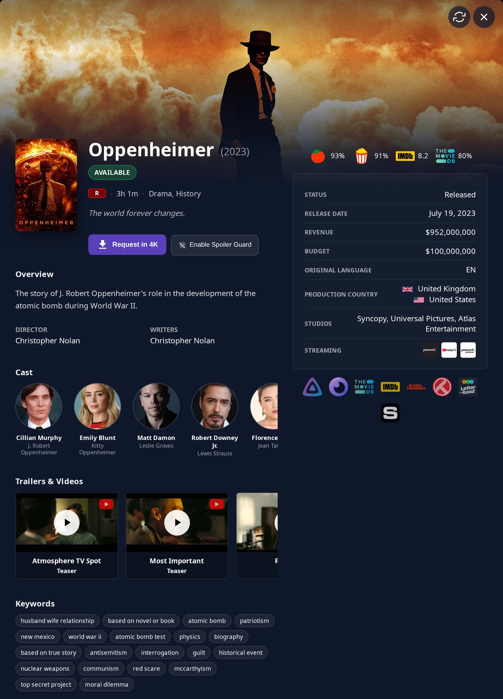

**How to use:**

1. Open a result poster or the Seerr detail link.
2. Choose a request action. Where a season availability badge links to Jellyfin, use it to open that library season.
3. Press the refresh icon (**Refresh status**) to update request, status, download data, and seasons.

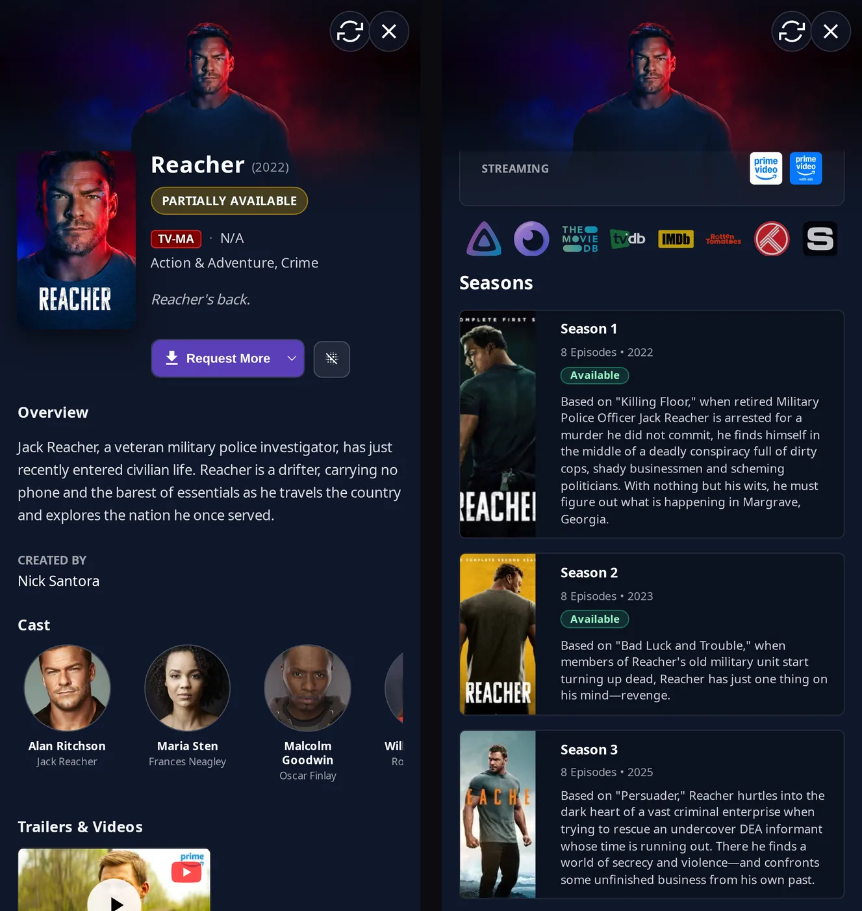

Admin settings under **Seerr** → **Discovery & UI Extras** ([full reference](seerr-settings.md#more-info-and-detail-links)):

| Setting | Default | What it does |
| --- | --- | --- |
| **Open results in "More Info" modal** | On | Uses JE's modal for result details and the Seerr detail link. |
| **Link available items' posters straight to Jellyfin** | Off | Makes available posters open Jellyfin directly; available title links already do. |
| **Show Seerr link on item detail pages** | On | Adds a link for TMDB-identified movies/series. |
| **Show as text instead of icon** | Off | Changes the enabled detail link to text. |
| **Show Streaming Providers on Posters** | Off | Adds up to four subscription-provider icons using the admin Elsewhere region/provider filters; requires TMDB configuration. |

??? note "Details"

    More Info shows metadata, content rating, overview, requester names/avatars, and normal/4K status. Depending on upstream data, it includes download bars, cast/crew, trailers, keywords, collection membership, external links, and TV seasons with availability badges that link to the library when a Jellyfin season ID is resolved.

    It does not continuously poll. It shows up to 20 cast entries, 20 keywords, and six trailers. **View on SIMKL** is available when an IMDb ID exists, with no separate switch.

    The modal's **Streaming** section is independent of poster icons. With TMDB configured, it shows up to six unique subscription providers using your per-user Elsewhere region, then the server region (US by default). If the selected region is absent from supplied data, it tries US and then the first supplied region. See [provider settings](seerr-settings.md#streaming-providers).

#### Spoiler Guard before library arrival

Protect a title from spoilers before it arrives in your library. This is a **per-user** choice.

**How to use:** Press **Enable Spoiler Guard** in More Info. The button becomes **Spoiler Guard (pending)**; you can disable it again from there.

Related admin settings ([Spoiler Guard reference](../spoiler-guard/spoiler-guard-settings.md)):

| Setting | Default | What it does |
| --- | --- | --- |
| **Enable Spoiler Guard** | Off | Enables protection and the More Info toggle. |
| **Auto-enable Spoiler Guard on Seerr request** | Off | Arms successful JE requests for their requester, within the configured content-type scope. Manual arming does not require this switch. |

!!! note "Requires Spoiler Guard"

    Your admin must enable Spoiler Guard. Your choice is stored with your pending protected titles.

#### Hidden Content on Seerr results

Hide a title for your Jellyfin account, even before it reaches your library.

**How to use:** Use **Hide** on an enabled Seerr card. Use **Unhide** or restore it through Hidden Content. See [Hidden Content](../enhanced/enhanced-features.md#content-management) for management and [its settings](../enhanced/enhanced-settings.md) for personal overrides.

The server master switch is under **Pages** → **Hidden Content**. The following are admin defaults that users can override, except for the master switch:

| Setting | Default | What it does |
| --- | --- | --- |
| **Enable Hidden Content** | Off | Server master switch; required for the feature. |
| **Show "Hide" button on Seerr search results** | On | Default visibility of Seerr hide buttons. Your personal Hidden Content enablement and hide-button visibility must also be on (both default on). |
| **Filter Search results** | Off | Default removal of hidden titles from search. |
| **Filter Discovery** | On | Default removal from discovery. |
| **Filter Suggestions / recommendations** | On | Default removal from recommendation rows. |
| **Filter Requests page** | On | Default removal from the Requests page. |

??? note "Details"

    These personal defaults also apply in new user configuration. Hiding a title and filtering it out of a particular surface are separate choices.

!!! note "People without a linked Seerr account"
    Someone whose Jellyfin account isn't linked to Seerr gets no Seerr rows and, from the More Info window, a message
    that their Seerr account isn't linked yet. With Requests & downloads handling requests itself (Jellyfin Enhanced
    mode) they get both anyway, from public details filtered for them (see
    [People without a Seerr account](../arr/arr-features.md#discover-and-search-je-mode)).

### Titles that aren't in the library: Jellyfin's own details page (experimental)

Open a title you don't have on a regular Jellyfin details page instead of the More Info modal: backdrop, logo, poster, title, year, runtime, rating, tagline, overview, genres, tags, cast and crew, the seasons and episodes of a series, and *More Like This*. Nothing is added to your library: the page is filled in from Seerr and TMDB while you look at it, and other apps (TV, mobile, DLNA) never see these titles in their lists.

**How to use:**

1. Under **Seerr** → **Discovery & UI Extras**, turn on **Open titles that aren't in the library on Jellyfin's own details page (Experimental)**.
2. Click **Save Settings** and reload the web client.
3. Open a title you don't have from search, a discovery row, recommendations, or the Requests page.

| Setting | Default | What it does |
| --- | --- | --- |
| **Open titles that aren't in the library on Jellyfin's own details page (Experimental)** | Off | Opens absent titles on a Jellyfin details page in the Jellyfin 12 web client. With it off, on Jellyfin 10.11 and in other apps, titles open as before. |

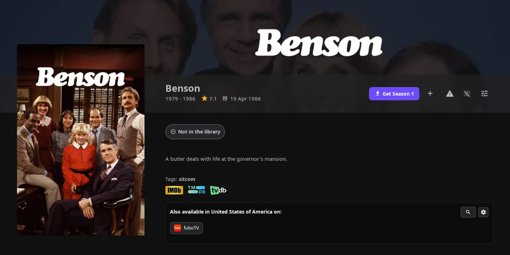

??? info "Where it opens from"
    Seerr search results, discovery rows (genre, network, studio, person, collection, tag),
    recommendations and *Recommended*/*Similar* rows, Home Screen Sections discover cards, the Requests page (also its
    Discover tab and, when Jellyfin Enhanced handles requests, the *Not in your library* search row), the calendar,
    Hidden Content, and notifications about a title. A title (or the season or episode asked for) that you can
    open in Jellyfin goes to your library copy instead; Seerr's own "it's in the library" link is checked for you first.
    On a search card, Enter opens the page and Space still shows the overview with its Request button.

??? info "What the page shows"
    It is laid out like Jellyfin's own page for a library title of the same kind. The request
    action sits first in Jellyfin's button row, where *Play* is on a library title (*Request*, **Get Season N**, **Get it**,
    *Search*, or what stands in their way, such as *Paused: storage full*); the title's other request actions follow it as
    icon buttons like the row's own (their name shows on hover), then *Report issue*, Spoiler Guard, *Manage* and *Notify
    me* in their usual places. The status pill heads the details below, with the request's cost under it. On top of
    Jellyfin's layout:

    

    - **Request**: with [Requests & downloads](../arr/arr-features.md#titles-that-arent-in-the-library-native-details)
      on, the status pill and journey, *Request* (the request sheet), *Notify me* and, for administrators, *Manage*.
      Series pages get **Get Season N**; season pages list every episode as a row with **Get it** (or *Search* for one
      missing for a long while) when you show missing episodes, or the *Missing: E1, E2…* banner when you don't; episode
      pages get **Get it**. Without Requests & downloads, *Request* opens the request window over the page.
    - The ratings row (Rotten Tomatoes, IMDb, TMDB) above the external links, where the MDBList ratings sit on a library
      title; the trailers and teasers, and an *Information* panel: production status, release or air dates, revenue,
      budget, original language, production countries, studios, streaming services and links (Seerr, TMDB, IMDb, TVDB,
      Rotten Tomatoes, Trakt, Letterboxd, SIMKL), plus the movie's collection with *View*. *Elsewhere* works as on any
      details page.
    - **Spoiler Guard** (movies and series): its button in the row, where a library title has it. Turned on, Spoiler Guard
      is waiting for the title and protects it once it's in your library.
    - **Open**: when the title arrives in your library while the page is open, an *Open* button takes you to it. A link
      to such a page after that goes straight to the library copy, and so does going Back to it.
    - **What you already have**: a season page of a series Jellyfin has (a season it doesn't) lists the seasons and
      episodes you can open as themselves (a file holding two episodes, E01-E02, once, with neither episode also shown as
      missing), links to the library's series and season above it, and the *More like this*
      row shows your copy of a title even when Seerr doesn't know it's in the library.
    - Artwork links on these pages are made for your account and the page they were shown on, and last a day; a page
      open longer than that gets new ones when it's shown again. They keep working after a server restart.

??? note "Controls a library title has that this page doesn't"
    Play, Shuffle, Played, Favourite, the More menu, Download, Hide and Spoiler Guard's library-item button are hidden:
    there is nothing to play, and no rule or mark is ever stored for the page itself (Spoiler Guard's button above keeps
    its rule by the title's TMDB id).

??? info "Where the names lead"
    The cast and crew, genres, studios or networks and tags on the page are links, as on a
    library title:

    - **People**: someone Jellyfin already has opens their Jellyfin page (with the *More with …* row of their other
      titles). Anyone else opens a page of their own, built the same way: photo, name, biography, birth and death,
      birthplace, what they're known for and their **Filmography** (roles before guest appearances, best-known titles
      first, movies and series together in that order under *All*, with the usual All / Movies / Series filter and sort).
      Each title in it opens your library copy when you have one you can open (the 4K copy or another version counts),
      otherwise its own page like this one. Titles you have are always in it, whatever *Exclude library items* says, since it's the only list of
      that person's titles. A person TMDB marks as an adult performer isn't shown to accounts with a parental limit. In
      Requests & downloads' own request mode the filmography needs no Seerr account.
    - **Genres, studios and networks**: Jellyfin's own list of that genre or studio when your library has titles in it
      that you can open (with the genre or network discovery row below, when it's on); otherwise a discovery page with
      just that row (no Seerr account needed in Requests & downloads' own request mode). On such a page the row keeps the
      titles you have, whatever *Exclude library items* says, since it's the page's only list. **Tags** open the tag's list
      with its discovery row.
    - A name that would lead to an empty page isn't a link: with a discovery row turned off only the genres, studios and
      tags your library has for you stay links.
    - **Without a Seerr account** (Requests & downloads' own request mode): the page's ratings, *Information*, trailers
      and collection come from the server, read with Jellyfin Enhanced's own Seerr key, so they show for everyone the page
      opens for. The same goes for the discovery rows on library pages (a person's *More with …*, a genre's, studio's,
      network's or tag's *More …* row): they read the same server-filtered feeds as the pages above. People with a Seerr
      account keep Seerr's own answers. The *Report issue* button needs a Seerr account and isn't shown without one.
    - Season and episode pages show the series' genres and its regular cast (Seerr has no cast list per season or
      episode).
    - Your parental limits and library access apply on every one of these pages. The filmography and the discovery pages'
      rows are filtered on the server before they reach the browser: a title the library has but hides from you, a title
      in a library you can't open, and a title not in the library whose own page you couldn't open are not sent at all.
    - The server fetches these lists, and the pages themselves, for everyone with one Seerr key, so each account can start
      only so many new reads at once (about sixty, then one a second; anything someone has already opened doesn't count).
      Past that a page waits a moment for its turn, and a list asks again when the server says it may. Scrolling far down
      a discovery page very fast can pause for a moment while it catches up.
    - Lists filtered for your account are read again each time a page shows, so a change to your library access or
      parental limit shows without reloading.

!!! note "When it can't open"
    A title your account may not see (parental limits, libraries you can't open, an account
    not linked to Seerr) shows "This title isn't available to you." with *Go back*, never the modal. A page you go back
    to is checked again before any of it shows. If Seerr can't be
    reached, you're taken back and the More Info modal opens once; if that happens again within a few seconds the page
    says it can't be loaded right now. With the setting off, on Jellyfin 10.11 and in other apps, titles open exactly as
    before (the modal, or Seerr, as set above).

### Discovery Pages

Find related movies and series beyond your library on Jellyfin genre, studio/network, tag, person, and collection pages. You can request them from the same cards used elsewhere in Seerr integration.

**How to use:**

1. Enable the relevant discovery switch below.
2. Open the corresponding page from your library.
3. Where both media types are available, choose **All**, **Movie**, or **Series**. Use **Popular**, **Top Rated**, **Newest**, or **Oldest** where supported.

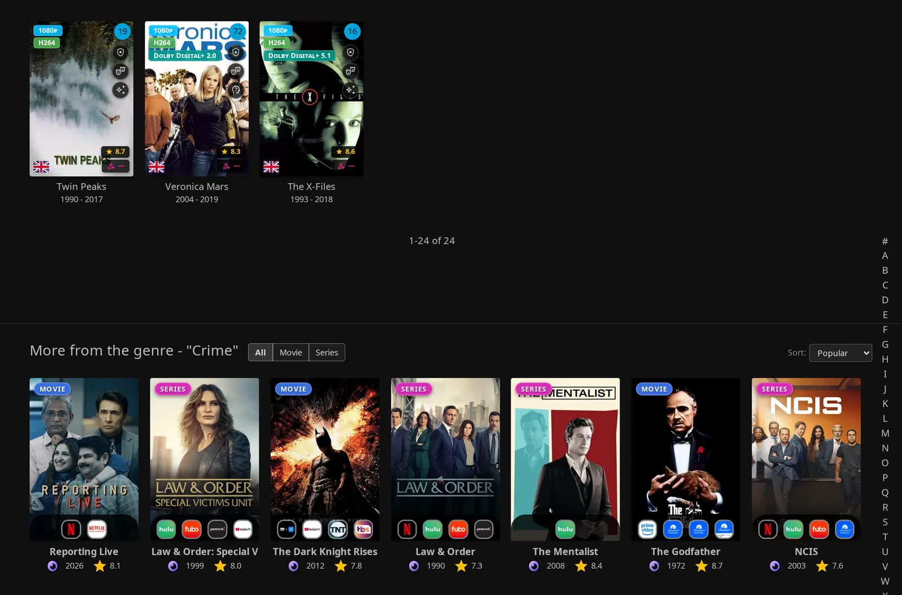

#### Available Discovery Types

Admin settings under **Seerr** → **Discovery & UI Extras** → **"More" Discovery** ([full reference](seerr-settings.md#more-discovery)):

| Setting | Default | What it does |
| --- | --- | --- |
| **Show "More from Network"** | On | Adds discovery for known networks and production companies. |
| **Show "More Genre"** | On | Adds genre discovery. |
| **Show "More Tag"** | On | Adds tag discovery using a matched TMDB keyword. |
| **Show "More from Actor"** | On | Adds actor/crew credits using a TMDB ID or name search. |
| **Show missing collection movies** | On | Shows missing movies with request buttons on BoxSet pages that have a TMDB collection ID. |

Network/studio pages can combine movies and series. Studio-produced series come from TMDB and require the separate TMDB key; those cards initially show status only for series already in the library, so open a card for fuller status. Some networks have no matching movie-company feed. Seerr-backed genre, keyword, and person discovery do not require a separate TMDB key.

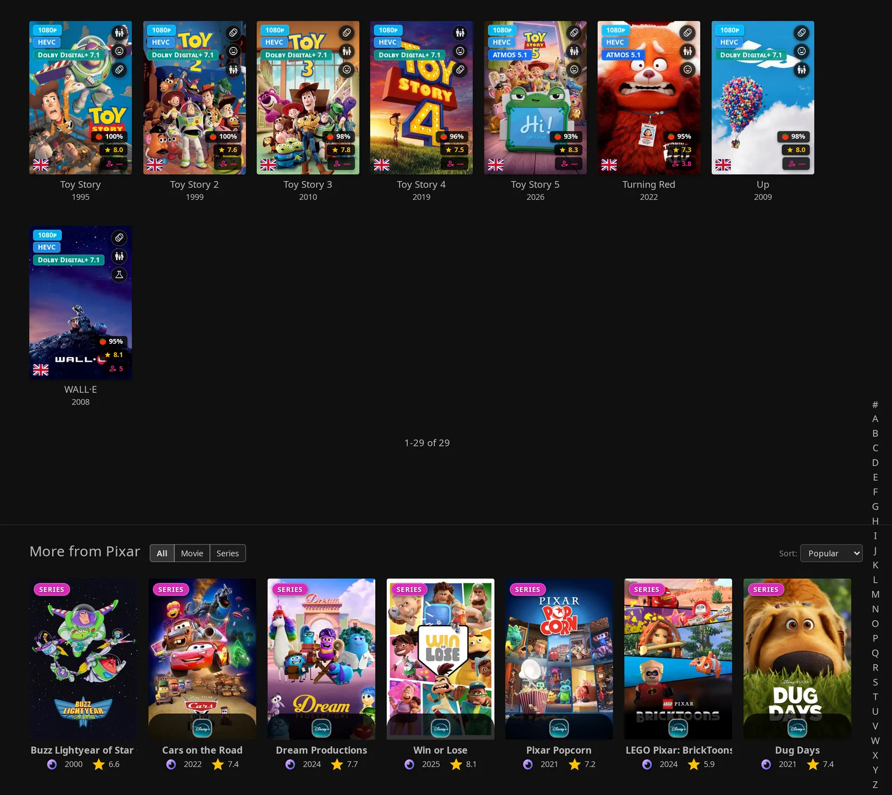

Open a person page to find more titles featuring that actor or crew member.

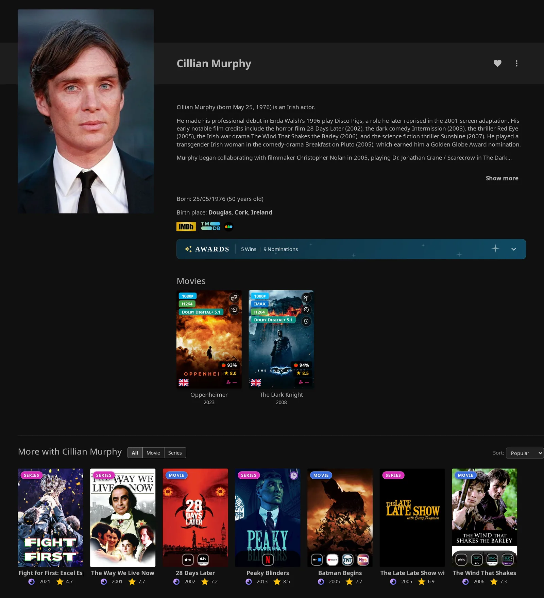

Tag discovery prefers an exact TMDB keyword match, otherwise the first keyword result. No match gives no discovery results; a non-exact match can represent a different keyword. Arbitrary Jellyfin tags do not automatically define TMDB catalogs.

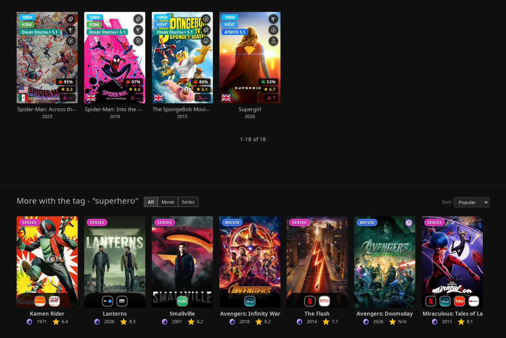

Collection details show **Missing from** followed by the collection name and availability counts. Fully available movies are excluded and remaining parts are sorted by release date. This is a fixed set without the general discovery filter/sort controls. Use its cards to request missing movies. Collection parts remain subject to shared exclusions, Hidden Content, and [parental filtering](#parental-ratings).

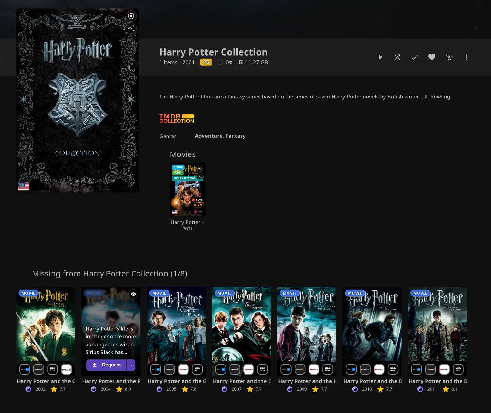

#### Configure

Discovery and recommendation cards share these admin filters under **Item Pages Discovery**:

| Setting | Default | What it does |
| --- | --- | --- |
| **Exclude items already in library** | On | Removes library matches from shared discovery/recommendation cards. |
| **Exclude blocklisted items** | Off | Removes Seerr blocklisted media from those cards. |

These are separate from **Exclude search items already in library**. Availability still depends on matching metadata, configured services, and linked user access.

#### Features

??? info "How it works"

    Sort scope varies: Recommendations categories sort fetched pages locally, rather than the entire upstream catalog. Person credits are deduplicated and shown in chunks of 40.

    Discovery is added to these Jellyfin routes:

    | Page | Route |
    | --- | --- |
    | Studio/network | `#/list?studioId=<Jellyfin studio ID>` |
    | Genre | `#/list?genreId=<Jellyfin genre ID>` |
    | Tag | `#/list?type=tag&tag=<encoded tag>` |
    | Person | `#/details?id=<Jellyfin person ID>` |
    | Collection | `#/details?id=<Jellyfin BoxSet ID>` |

### Recommendations page

Browse trending, popular, and upcoming titles in **Seerr Recommendations**. This dedicated discovery page is separate from item-specific **Similar**/**Recommended** rows.

**How to use:**

1. Open the configured Recommendations navigation entry.
2. Select a row heading or tile to open a category.
3. Use its filters and sort controls, then scroll for further pages.
4. Use the category's own back arrow to return.

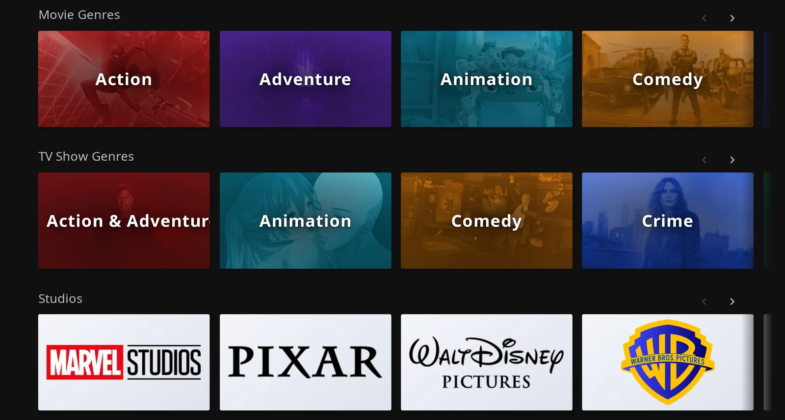

Admin settings under **Pages** → **Seerr Recommendations Page** ([full navigation reference](seerr-settings.md#seerr-recommendations-page)):

| Setting | Default | What it does |
| --- | --- | --- |
| **Enable Recommendations Page** | Off | Enables the page for linked viewers with configured, enabled Seerr. |
| **Add Recommendations as a native Home tab** | Off | Adds a Home tab without a companion plugin. |
| **Use Plugin Pages** | Off | Uses Plugin Pages integration. |
| **Use Custom Tabs** | Off | Embeds Recommendations with Custom Tabs; incompatible with its native tab. |
| **Add the Custom Tabs entry for me** | Off | Creates/removes the managed Custom Tabs entry with that mode. |

!!! note "Returning to a category"

    Categories have no independent URL or history entry. Refreshing the page does not restore the category.

??? info "How it works"

    The built-in page URL is `/web/index.html#/recommendations`; preserve your web/base path.

    The landing page previews are **Trending**, **Popular Movies**, **Popular TV Shows**, **Upcoming Movies**, and **Upcoming TV Shows**. It also has **Movie Genres**, **TV Show Genres**, **Studios**, and **Networks** tiles.

    Landing rows are page-one previews; only category views load further pages. Search and Recommendations insert results after their initial fetches complete. Studio and network logos are bundled, so they show with or without a TMDB key and fall back to the styled name if one fails to load; studio-produced TV requires the separate TMDB key.

### Seamless Scrolling

JE loads results ahead to reduce gaps as you scroll, while keeping their feed order. This works in search rows, paged discovery sections, and Recommendations categories.

**How to use:** Scroll horizontally in search or down a category to load more. If loading pauses, press the circular-arrow button to continue or **Tap to retry** after a failed load.

<figure class="je-video">
  <video autoplay loop muted playsinline controls preload="metadata" aria-label="More discovery results load as the page scrolls">
    <source src="../../images/seerr/discovery-scroll.mp4" type="video/mp4">
  </video>
  <figcaption>More genre results appear as you scroll.</figcaption>
</figure>

There is no separate setting. Active search/discovery/page settings and their exclusions determine the feed.

??? info "How it works"

    Recommendations landing previews and item-detail rows do not gain unlimited paging.

    - The client shows cards ahead and prefetches further pages; posters load as cards approach the screen.
    - Empty filtered pages advance automatically. After 40 consecutive empty pages, loading pauses with a circular-arrow button. Press it to continue from the same position. Other stalled-buffer pauses can also occur.
    - Failed loads retry with backoff, then offer **Tap to retry**.
    - Upstream pagination limits apply, including TMDB's 500-page cap. Filtering, pauses, and failures can still produce gaps or fewer results.

### Parental Ratings

JE applies your Jellyfin parental policy to protected Seerr browsing and request paths. You do not need a separate JE switch.

**How to use:** Configure the user's parental policy in Jellyfin.

??? info "How it works"

    These rules apply the current user's parental rating, movie/series unrated policy, and blocked/allowed tags. They filter search, discovery, recommendations, person credits/known-for entries, collection parts, request lists, watchlist responses, and issues. They also gate protected title details, seasons, requests, and TMDB helper access.

    Users without a maximum rating, movie/series block-unrated preference, or blocked/allowed tags need no additional parental metadata lookups.

    - Certifications use the server's metadata country, with US only when none is configured, and Jellyfin's rating table. Other countries' ratings are not substituted. More Info can display another region's rating through your Elsewhere preference without changing enforcement.
    - Successfully fetched titles without a recognized local rating follow the user's unrated policy for that media type. Failed/unresolved lookups remain hidden until verified. Search/discovery can re-fetch once delayed lookups finish.
    - Resolved ratings/keywords are cached server-wide for 24 hours; failed lookups retry after five minutes. With a TMDB key, certification lookups use TMDB; otherwise JE uses Seerr title details.
    - Blocked tags match TMDB keywords and genre names. Allowed tags form an allow-list against keywords only; blocked tags win. Matches compare the full value, ignoring case: `Sci-Fi` matches `sci-fi`, but not `sci fi`. Community keyword coverage can be incomplete.
    - Collection cards remain visible without a rating; their movies are filtered when opened.

!!! note "Server automation boundary"

    Automatic movie/season requests go directly to Seerr. They bypass JE's parental-request checks and do not check the **Blocked Users** list. Scheduled watchlist matching is not limited to each user's library access. Review [automation limits](#auto-request-settings) and [watchlist access limits](#retention-and-access-limits) before relying on parental filtering for them.

### Library access

Seerr answers only show titles you could open in Jellyfin, so a library you can't access stays private.

Seerr links every title it knows to its Jellyfin item, whichever library holds it. Before a Seerr answer reaches a user, each linked item is checked against that user's own Jellyfin access (libraries they may open, parental rating, blocked tags):

- A title held only in libraries the user can't open is left out of search, discovery ("More with" a person, "More from" a genre, studio, network or tag), similar and recommended rows, filmographies, collections and the watchlist. It isn't shown as something to request either.
- When the user can open another copy (the 4K copy, or a copy in another library), the card links to that copy instead.
- A title's own details, requests and issues keep their entry, without the link to an item the user can't open.
- A title held only in 4K counts as in the library once its 4K copy is available: its card opens the 4K copy, and *Exclude library items* leaves it out of the rows like any other title you have.

Unrestricted users see Seerr's answers as before. This is always on and needs no setting.

### Issue Reporting

Report video, audio, subtitle, or other media problems to Seerr without leaving an eligible Jellyfin detail page. The modal also shows existing reports and comments grouped by type.

#### How to Report

**How to use:**

1. Open a movie, series, regular season, or episode detail page and press the report icon (**Report issue**).
2. Select **Issue Type**. Optionally enter **Description (Optional)**.
3. For TV, use **Season**/**Episode** as appropriate. Selectors use local library entries; season/episode pages attempt to preselect and lock the corresponding fields.
4. Press **Submit Report**.

<figure class="je-video">
  <video autoplay loop muted playsinline controls preload="metadata" aria-label="Opening and filling a Seerr issue report without submitting it">
    <source src="../../images/seerr/issue-modal-flow.mp4" type="video/mp4">
  </video>
  <figcaption>The demonstration fills an episode report and cancels before submission.</figcaption>
</figure>

Admin settings under **Seerr** → **Discovery & UI Extras** ([full reference](seerr-settings.md#show-report-issue-button)):

| Setting | Default | What it does |
| --- | --- | --- |
| **Show "Report Issue" button on items** | Off | Adds reporting to eligible detail pages. |
| **Show open issue indicator** | Off | Shows an orange report icon and open-issue count, capped at `9+`; requires the report-button switch. |

!!! note "Reporting requirements"

    You need a linked account and permission to create issues. Viewing reports needs viewing permission. Manage issue status and conversations in Seerr.

#### Issue Types

Choose **Video**, **Audio**, **Subtitles**, or **Other** in **Issue Type**.

??? info "How it works"

    Specials (season zero) and other item types are excluded. The item needs TMDB identification, which can come from the parent series or fallback lookup; submission also needs a Seerr media record (`mediaInfo.id`). Ordinary users need `CREATE_ISSUES` or `MANAGE_ISSUES`; reads need `VIEW_ISSUES` or `MANAGE_ISSUES`. Linked Jellyfin/Seerr administrators bypass those local permission checks.

    The report icon isn't shown when Seerr couldn't be reached when Jellyfin was opened (reload the page once Seerr is back), when the user has no linked Seerr account, or when the item has no TMDB match. If Seerr stops answering while Jellyfin is open, the icon is shown crossed out; pressing it (or ++enter++/++space++ on it) says why, and nothing else happens. Once Seerr answers again, the title's page has the normal report icon the next time it is shown.

    Existing-report and indicator fetches each inspect at most 50 global issue entries, filtered locally by title, so older matching reports can be absent. The modal has no resolve, reopen, delete, or comment-posting controls.

## Requests Page

The shared Requests page combines Seerr requests and optional issues with *arr downloads/history. This page is the guide to its Seerr parts; see [*arr features](../arr/arr-features.md) for download progress, search, import outcomes, and history.

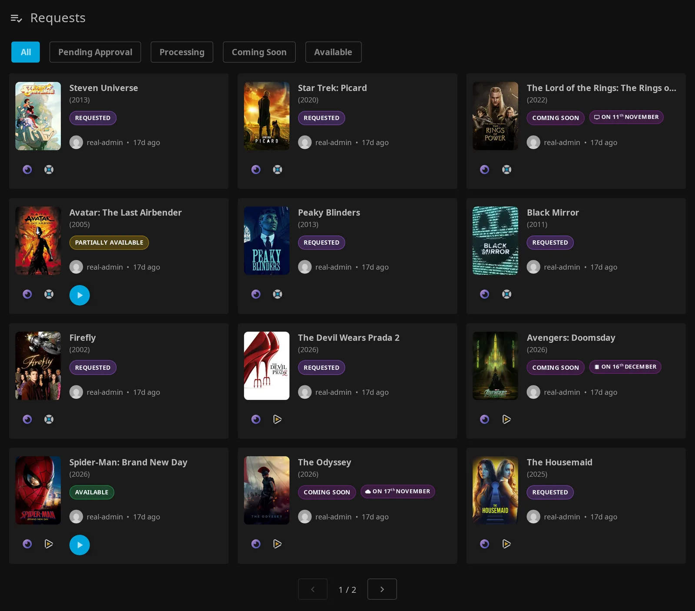

### Setup

Enable the shared page to browse requests in Jellyfin.

**How to use:**

1. Open **Dashboard** → **Plugins** → **Jellyfin Enhanced** → **Pages** → **Requests Page**.
2. Turn on **Enable Requests Page**.
3. Press **Save Settings**.

| Setting | Default | What it does |
| --- | --- | --- |
| **Enable Requests Page** | Off | Enables the shared page. |
| **Show Seerr Issues Section** | Off | Adds issue browsing for authorized users when Seerr is enabled. |

These are admin settings under **Pages**, not **Seerr**. See [Requests Page Management](seerr-settings.md#requests-page-management) for navigation choices, manual Custom Tabs HTML, and download/history visibility settings.

!!! note "Connection requirements"

    Seerr requests need enabled/configured Seerr and linked accounts. Only the download sections need *arr configuration.

??? note "Details"

    Native Home tabs and built-in navigation need no companion plugin. Plugin Pages 3.0 or newer applies integration on save. Older versions need a restart after first enabling it; failed live registration also needs a restart.

### Polling Settings

Auto-refresh keeps the page updated while you browse.

**How to use:** Enable auto-refresh and choose its interval below.

Admin settings under **Pages** → **Requests Page**:

| Setting | Default | What it does |
| --- | --- | --- |
| **Enable Auto-Refresh** | On | Refreshes requests and the enabled downloads/issues/history sections. |
| **Poll Interval (seconds)** | 30 | Interval when enabled; input range 30–300 seconds. |

??? info "How it works"

    Polling stops when you leave the standalone page or switch away from its native Home or Custom Tabs tab. With Plugin Pages, it can continue after navigation until you reload or close the browser page. Hidden browser tabs are skipped. An issue-read HTTP 403 suppresses repeated issue polling while the permission-denied state persists. Updates refresh sections in place; cached upstream state can still be stale.

### Usage

#### Access Requests Page

Open the page to check your requests.

**How to use:** Open **Requests** in the configured navigation or Requests Home tab.

??? note "Details"

    The built-in URL is `/web/index.html#/downloads`; preserve your actual web/base path. Navigation placement depends on the selected integration, layout, and viewport. See [page navigation](seerr-settings.md#enable-requests-page).

#### Request browsing and management

Browse your requests by status. If you have management permission, you can also approve or decline pending requests.

**How to use:**

1. Choose **All**, **Pending Approval**, **Processing**, **Coming Soon**, or **Available**.
2. Use the pagination arrows to browse more cards.
3. Follow a card's link to Seerr or an available Jellyfin item.
4. If authorized, press **Approve** or **Decline** on a pending request.

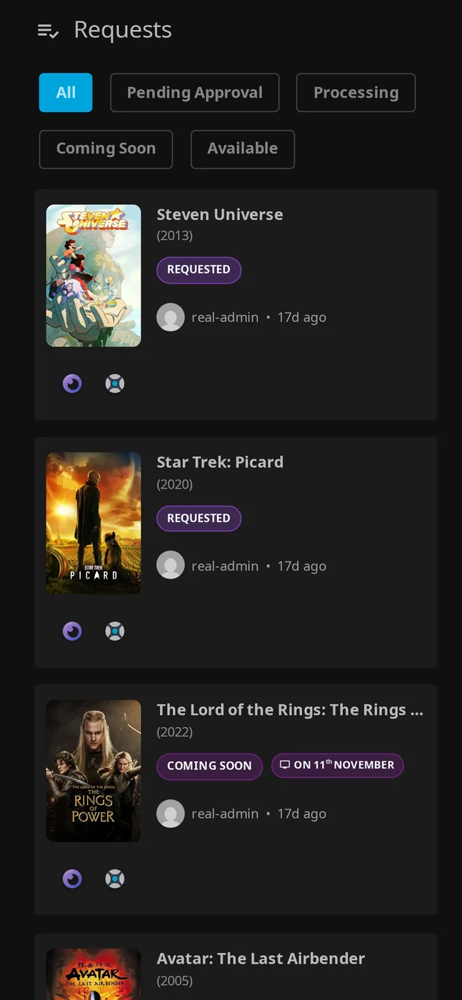

??? info "How it works"

    Page size adjusts to the viewport and fits whole card rows. There is no Declined filter tab; declined cards can appear in **All**. The Downloads search control does not search requests or issues.

    Linked ordinary users see their own requests. Linked Jellyfin administrators and Seerr accounts with `ADMIN`, `REQUEST_VIEW`, or `MANAGE_REQUESTS` can see all requests, except that with **Filter Downloads by User Requests** on, non-admins see only their own requests whatever their Seerr permissions. Request cards show requester information and status. Authorized Jellyfin/Seerr administrators and `MANAGE_REQUESTS` users can press **Approve** or **Decline** on pending requests. Controls follow the raw pending request status even if some media is already available.

    **Coming Soon** uses future movie release or TV air dates and displays countdowns. **Processing** excludes Coming Soon and orphaned requests; the client additionally excludes **Partially Available** entries. Processing/Coming Soon read at most 500 upstream requests before local pagination.

    **Orphaned** means an eligible approved/processing request is older than ten minutes from creation and every relevant configured, enabled *arr instance successfully reports no matching title. Missing instances or failed checks do not establish orphaning. Orphaned cards remain in **All** and are excluded from **Processing**/**Coming Soon**.

If your account has no visible requests, the section shows **No requests found**. Download progress, completion/import status, and paginated history use the same page. Their separate visibility/privacy controls are in [Requests settings](seerr-settings.md#show-downloads-section); see [*arr features](../arr/arr-features.md) for their behavior.

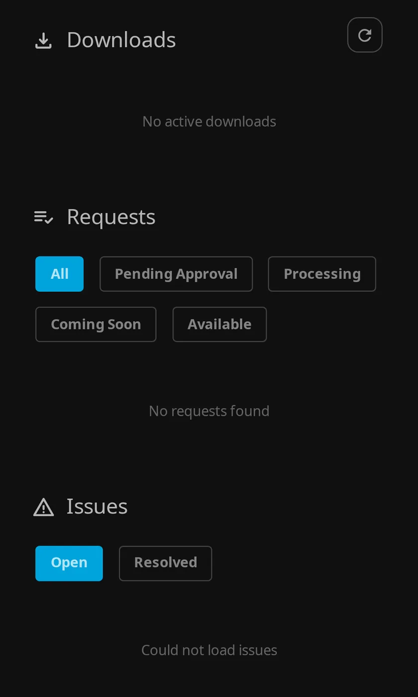

### Issues on the Requests page

Browse Seerr issues in Jellyfin when your account has viewing permission. Your parental policy also filters the results.

**How to use:**

1. Choose **Open** or **Resolved** and use pagination to browse.
2. Press an issue's eye button to open the report modal.
3. Click its card to open the Jellyfin item when a library ID exists.

Admin setting under **Pages** → **Requests Page**:

| Setting | Default | What it does |
| --- | --- | --- |
| **Show Seerr Issues Section** | Off | Adds the section when the page and Seerr are enabled. |

??? note "Details"

    Ordinary linked users need `VIEW_ISSUES` or `MANAGE_ISSUES`; linked Jellyfin/Seerr administrators bypass the local viewing check. Users without viewing permission cannot load issue data; the section shows **Could not load issues**, with a **No permission to view issues** toast for an HTTP 403 response. The modal lets you read existing reports/comments or submit another report when authorized. Manage issue status and conversations in Seerr.

### Watchlist Sync

JE adds items between your Seerr and Jellyfin watchlists. You can sync in either direction; removing an item from one watchlist does not remove it from the other.

**How to use:**

1. Enable the desired direction under **Seerr** → **Watchlist** and save.
2. Adjust or run its task under **Dashboard** → **Scheduled Tasks**.
3. To add requested media when library items arrive or change, also restart Jellyfin or run **Jellyfin Enhanced Startup** once after enabling it.

Admin settings ([full reference](seerr-settings.md#add-requested-media-to-watchlist)):

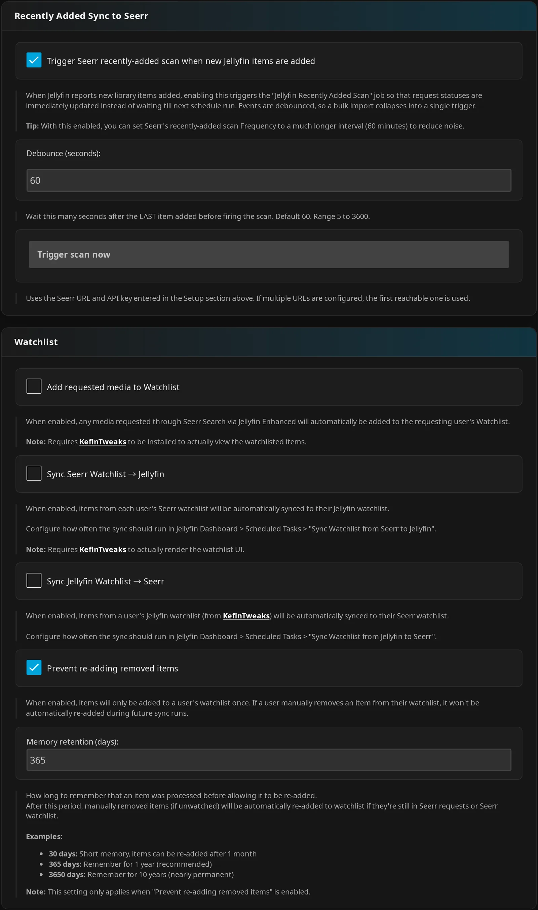

| Setting | Default | What it does |
| --- | --- | --- |
| **Add requested media to Watchlist** | Off | Watches movie/series library additions and updates and adds matching requested titles for their requesters, including requests made outside JE. |
| **Sync Seerr Watchlist → Jellyfin** | Off | Enables the incoming scheduled task. |
| **Sync Jellyfin Watchlist → Seerr** | Off | Enables the outgoing scheduled task. |
| **Prevent re-adding removed items** | On | Remembers processed incoming items so manual Jellyfin watchlist removal persists during future sync/monitoring. |
| **Memory retention (days):** | 365 | Retains processed-item memory; input range 1–3650, used when prevention is enabled. |

??? info "How it works"

    Jellyfin watchlisting sets the user's `Likes` value, displayed as a watchlist by the [KefinTweaks plugin](https://github.com/ranaldsgift/KefinTweaks).

#### Seerr → Jellyfin

Bring Seerr watchlist entries into Jellyfin once they match items in the Jellyfin library.

**How to use:** Enable **Sync Seerr Watchlist → Jellyfin**. **Sync Watchlist from Seerr to Jellyfin** runs daily at 03:00 by default.

Requests are included only when **Add requested media to Watchlist** is also on. The event monitor is separate from this scheduled sync.

??? info "How it works"

    Incoming sync tries configured URLs until a user-list fetch succeeds, reads one upstream watchlist page per user, and examines up to 500 requests. The event monitor uses the first configured URL and examines up to 1000 requests. Both exclude blocked users and do not check watched status before setting `Likes`.

#### Jellyfin → Seerr

Bring Jellyfin movie and series watchlist entries into Seerr.

**How to use:** Enable **Sync Jellyfin Watchlist → Seerr**. **Sync Watchlist from Jellyfin to Seerr** runs daily at 03:30 by default.

??? info "How it works"

    It uses the first configured URL, linked accounts, and TMDB-identified movie/series watchlist items. It skips entries already on Seerr's watchlist and excludes blocked users. Removals are not mirrored. Turning the sync off during a run stops it before the next item; a user blocked during a run is skipped from then on.

#### Retention and access limits

Re-addition prevention remembers processed items for a limited time.

**How to use:** Choose **Memory retention (days):** above to control how long JE remembers them.

??? note "Details"

    Processed-item memory is stored in `processed-watchlist-items.json` using processing timestamps, not removal dates. Incoming sync cleans expired entries when prevention is enabled. After expiry, a still-eligible item can be added again; watched items are not exempt from incoming addition. Scheduled library matching is not scoped to the user's library access, so review this automation separately from protected UI parental filtering.

### Icon States

The Seerr search icon shows whether your connection and account link are working. An active icon does not itself grant request permission.

**How to use:** Check the icon and its tooltip against the states below.

| Icon | State | Meaning |
| :---: | --- | --- |
|  | Active | Connected and linked. Tooltip: **Seerr is active** followed by **Double-click to show only Seerr results**, or **Double-click to show all results** in Seerr-only mode. |
|  | Unlinked | Hue-shifted icon; tooltip **User not found on Seerr**. Check import/linkage and **Blocked Users**. |
|  | Inactive | Grayscale icon; tooltip **Seerr is not connected.** Check integration and server connectivity. |

## Troubleshooting

### Connection Issues

Check the connection when the Seerr icon is inactive or links fail to open.

**How to use:**

1. Verify **Enable Seerr integration**, URLs, and API key. Press **Test** in [connection setup](seerr-settings.md#step-3-configure-plugin).
2. If API calls work but external Seerr links fail, configure [URL Mappings](#url-mappings). Use an internal URL for API calls and a public mapping for browser links.
3. For **User not found on Seerr**, check Seerr's Jellyfin connection, the stored Jellyfin user ID, and JE's **Blocked Users** selection. Use [user import](seerr-settings.md#step-4-configure-user-import-optional) and [Permission Audit](permission-audit.md).

??? info "How it works"

    Use the Jellyfin server/container's network context: a loopback address refers to that environment, not your browser's device. A public URL that requires an interactive proxy login may return HTML instead of API JSON.

    Logs distinguish non-JSON, authentication, and Cloudflare failures and can include `status`, `Content-Type`, and `cf-ray` diagnostics. Container host names such as `host.docker.internal`/`host.containers.internal` can use allowed host mappings; literal link-local/metadata destinations remain blocked by the URL guard.

    Identical usernames do not establish linkage. An upstream outage can also prevent user resolution.

### Search Not Working

Check search settings and filters when results are missing or slow.

**How to use:**

1. Check the icon's active tooltip, **Show Seerr Results in Search**, and the current query.
2. Remove a trailing year filter to compare results.
3. For slow results, check server-to-Seerr connectivity, upstream response time, and server logs/browser console.

??? note "Details"

    Library exclusion, Hidden Content, blocklisting, and parental policies can reduce the row. A loading/retry/continuation control can indicate filtered or failed pages, rather than an empty upstream catalog. Search waits for initial data. See [Seamless Scrolling](#seamless-scrolling) and [Debug and caching](seerr-settings.md#debug-and-caching).

### Request Issues

Check account access and Seerr setup when a request fails or its status looks stale.

**How to use:**

1. Check the linked account's media/quality-specific permissions, quota, Seerr Sonarr/Radarr configuration, and current request status.
2. Fill required advanced choices and any TVDB match.
3. For stale status, refresh the relevant page or dialog and inspect Seerr's queue.
4. To help Seerr discover newly added library media, use [Recently Added Sync to Seerr](seerr-settings.md#recently-added-sync-to-seerr).

??? note "Details"

    [Permission Audit](permission-audit.md) checks selected permission gaps, but does not validate quotas or every request-specific permission.

    Saving JE configuration clears Seerr server caches; other browser caches can persist. Triggering the recently-added scan does not finish a download/import or guarantee an immediate update.

### TMDB API Issues

Ordinary Seerr search uses Seerr's TMDB access. Automatic movie requests, studio-produced series, and provider displays also need JE's shared **TMDB API Key**.

**How to use:** Test the key beside its input, then check server connectivity and logs. See [installation troubleshooting](../installation/troubleshooting.md) for network and proxy problems.

## Advanced Configuration

### URL Mappings

Map the Jellyfin server address used by your client to a browser-accessible Seerr address. These mappings affect displayed links; proxy calls continue to use **Seerr URL(s) (One per line)**.

**How to use:**

1. Open **Seerr** → **Seerr Connection Setup** → **Advanced URL Mappings**.
2. Enter one `jellyfin_url|seerr_url` pair per line.
3. Press **Validate Mappings**, then save.

Admin setting:

| Setting | Default | What it does |
| --- | --- | --- |
| **Seerr URL Mappings** | Empty | Selects a browser-facing Seerr URL from the client server address. |

??? note "Details"

    ```text
    https://jellyfin.example.com|https://seerr.example.com
    http://192.168.1.10:8096|http://192.168.1.10:5055
    https://example.com/jellyfin|https://example.com/seerr
    ```

    Matching uses `ApiClient.serverAddress()` or the browser origin, ignores case and trailing slashes, requires equality rather than a prefix, and takes the first matching line. Without a match, external links use the first configured Seerr URL, which may differ from the URL that successfully answered a proxy request. See [connection settings](seerr-settings.md#step-3-configure-plugin).

### Auto-Request Settings

Server automations can request the next season or collection movie based on playback events. They use the playback user's linked Seerr account and Seerr's request authorization, without injected web controls.

**How to use:**

1. Enable the desired feature under **Seerr** → **Automatic Requests**.
2. Save, then restart Jellyfin or run **Jellyfin Enhanced Startup** once to start monitoring playback.

!!! warning "Review automation access"

    These are server-wide settings without personal opt-out switches. Automatic movie/season requests bypass JE's parental-request checks and do not check the **Blocked Users** list. Review the accounts and permissions used for these automations separately.

??? note "Details"

    Automatic movie/season services send requests directly to Seerr and bypass the controller's parental-request gate and import-blocklist lookup.

    Requested-media watchlist monitoring also initializes at startup when enabled, but does exclude blocked users.

#### Auto Season Request:

Request the next numeric season as you approach the end of the current one.

**How to use:** Enable the automation and choose the remaining-episode threshold below. In a ten-episode season with threshold 2, episode 8 meets the threshold.

Admin settings ([full reference](seerr-settings.md#auto-season-requests)):

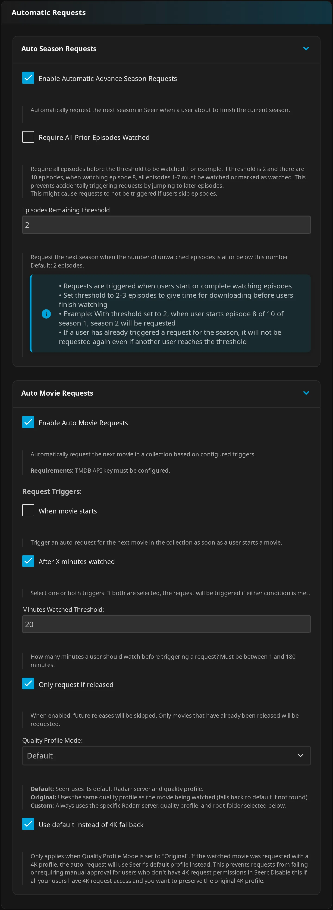

| Setting | Default | What it does |
| --- | --- | --- |
| **Enable Automatic Advance Season Requests** | Off | Enables playback-triggered next-season checks. |
| **Require All Prior Episodes Watched** | Off | Requires earlier locally present episodes in the current season to be watched/marked watched; current and later episodes need not be watched. |
| **Episodes Remaining Threshold** | 2 | Maximum remaining episodes for the trigger; input range 1–20. |

??? info "How it works"

    Remaining episodes are the upstream season total minus the current episode number, clamped to zero.

    Start detection requires playback at most two minutes in and below 5%; stop detection requires completion or at least 90%. The series needs a TMDB ID; counts are read through Seerr without a separate TMDB key. The next season must contain episodes and must not already be available/requested. Recent season requests are deduplicated across users for about an hour.

#### Auto Movie Request:

Request the next collection movie when you play a movie from that collection.

**How to use:** Enable the automation, choose either or both playback triggers, and select a quality profile mode below.

Admin trigger settings ([complete trigger and destination reference](seerr-settings.md#auto-movie-requests)):

| Setting | Default | What it does |
| --- | --- | --- |
| **Enable Auto Movie Requests** | Off | Enables playback-triggered collection checks. Requires a TMDB ID, collection membership, JE's TMDB key, and linked user access. |
| **When movie starts** | Off | Checks at most five minutes in and below 5% playback. |
| **After X minutes watched** | On | Checks when playback position reaches the threshold. Seeking or resuming can satisfy it. |
| **Minutes Watched Threshold:** | 20 | Position threshold in minutes; input range 1–180. |
| **Only request if released** | On | A future release date prevents submission; a movie with no release date yet counts as not released. |
| **Quality Profile Mode:** | **Default** | Uses Seerr defaults, copies the first existing request with **Original**, or sends configured choices with **Custom**. |

??? info "How it works"

    JE considers the next movie released in the collection after the watched one, whatever order Seerr or TMDB lists the collection in. It does not search farther ahead if that next movie is already available/pending/processing or skipped by release checking.

    User/movie checks are throttled to about once per hour. **Original** copies Seerr request settings rather than the watched file's quality. Unusable original settings and an empty **Custom** configuration fall back to **Default**. The default **Use default instead of 4K fallback** behavior also falls back when original settings were 4K.

!!! note "With Ask for it (Requests & downloads, phase 3)"
    With **Requests & downloads** phase 3 (**Ask for it**) on, both automations record their requests in Jellyfin Enhanced under the household rules instead of sending them to Seerr directly; see [Automatic requests with "Ask for it"](../arr/arr-features.md#automatic-requests-with-ask-for-it).
