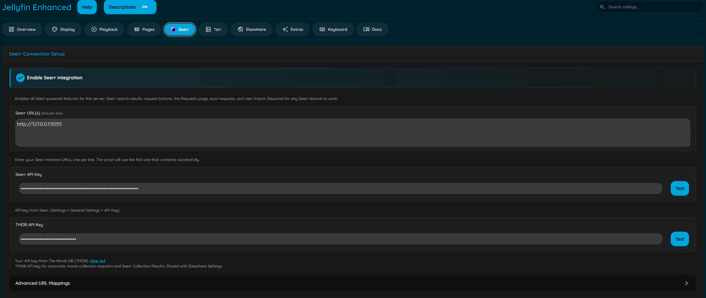
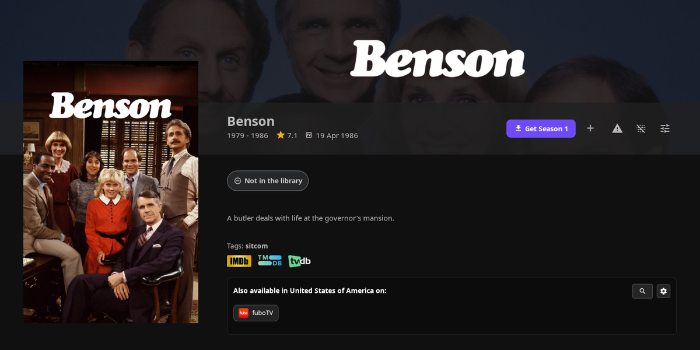
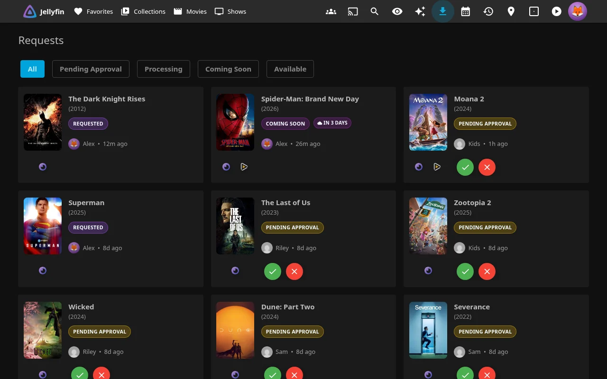

# Seerr Integration

Search, request, and discover media directly from Jellyfin using your Seerr instance.



!!! info "Note"

    **This plugin is NOT affiliated with Seerr.** Seerr is an independent project. This plugin simply integrates with it to enhance the Jellyfin experience.

    **Please report any issues with this plugin to the Jellyfin Enhanced repository, not to the Seerr team.**

## Features

- **Search + Request** - Search + request from Seerr, directly from Jellyfin search results
    - **Advanced requests** *(requires configuration)*
    - **4K Requests**
    - **4K TV Requests**
    - **Season selection**

- **Requests Tab**
    - **View request status** - pending, approved, available
- **Recommendations + Discovery** - Recommendations and similar items on detail pages
- **Jellyfin's own details page for titles that aren't in the library** *(experimental, Jellyfin 12 web)*
- **Issue Reporting** - Report problems directly to Seerr
- **Watchlist Sync** - Auto-add requested media to Jellyfin watchlist *([requires the KefinTweaks plugin](https://github.com/ranaldsgift/KefinTweaks)*)


!!! tip "How it works"

    To ensure security and prevent CORS errors, the plugin uses the Jellyfin server as a proxy. This keeps your Seerr API key safe and avoids browser security issues.


### Search Integration

#### Requesting:

1. Type search query in Jellyfin search bar
2. Results from both Jellyfin and Seerr appear
3. Seerr results show request status
4. Click to request or view details
5. Scroll the Seerr row sideways; further pages load ahead of you (see [Seamless Scrolling](#seamless-scrolling))

!!! tip

    Enable **Exclude search items already in library** under **Search & Requests** to hide Seerr results you already have in Jellyfin, including shows where only some seasons are in your library, so the Seerr row only shows things you can request.

!!! warning

    A movie in the library in a lower quality won't appear to request in higher quality like 4K, and a show with only some seasons won't appear to request the rest. Missing seasons can still be requested with the **Request More** button on the show's page, and anything can still be requested directly in Seerr.

#### 4K TV Requesting:

1. Enable **4K TV Requests** in plugin settings.
2. For TV results, use the request split-button dropdown and choose **Request in 4K**.
3. The season selection modal opens in 4K mode.
4. The modal header shows **Request Series - 4K** and the primary button shows **Request in 4K**.

!!! tip

    In More Info modal, TV actions use **Request More** as the primary action, with **Request in 4K** in the dropdown when 4K is requestable.

#### Series without a TVDB match:

Some series (often anime and shorts) have no TVDB ID on TMDB, so Seerr cannot hand them to Sonarr. Seerr's own web UI asks you to pick the right match; the plugin does the same inside the season selection modal:

1. A **match series** block appears above the season list, listing the candidates Seerr finds by searching Sonarr for the title.
2. Click the correct match, or type the series' **TVDB ID** (the number in its thetvdb.com URL) if none of them fit or Seerr has no Sonarr configured.
3. Request as usual; the request is sent to Seerr with that TVDB ID.

Series that already have a TVDB ID never show this block, and neither do series Seerr has already matched (for example after an earlier matched request), since Seerr reuses the ID it has stored.

#### Request Status Indicators:

- **Available** - Already in your library
- **Pending Approval** - Request submitted, awaiting admin approval
- **Requested** - Request approved, waiting to be downloaded
- **Processing** - Actively downloading
- **Declined** - Request was declined by an admin
- **Not Requested** - Click to request

### Item Details

View Seerr recommendations and similar items on detail pages.

- Recommended items section
- Similar items section
- Request directly from recommendations
- Exclude items already in library
- Real-time request status

#### Configure
1. Check **"Show Seerr Recommendations and Similar items"**
2. Optional: Enable **"Exclude already in library items"**
3. Optional: Enable **"Exclude rejected items"**

Someone whose Jellyfin account isn't linked to Seerr gets no Seerr rows and, from the More Info window, a message
that their Seerr account isn't linked yet. With Requests & downloads handling requests itself (Jellyfin Enhanced
mode) they get both anyway, from public details filtered for them (see
[People without a Seerr account](../arr/arr-features.md#discover-and-search-je-mode)).

### Titles that aren't in the library: Jellyfin's own details page (experimental)

With **Open titles that aren't in the library on Jellyfin's own details page** on (Seerr settings, *Discovery & UI
Extras*; off by default), a title you don't have opens on a regular Jellyfin details page instead of the More Info
modal: the backdrop, logo, poster, title, year, runtime, rating, tagline, overview, genres, tags, cast and crew, the
seasons and episodes of a series, and *More Like This*. Nothing is added to your library: the page is filled in from
Seerr and TMDB while you look at it, and other apps (TV, mobile, DLNA) never see these titles in their lists.

**Where it opens from.** Seerr search results, discovery rows (genre, network, studio, person, collection, tag),
recommendations and *Recommended*/*Similar* rows, Home Screen Sections discover cards, the Requests page (also its
Discover tab and, when Jellyfin Enhanced handles requests, the *Not in your library* search row), the calendar,
Hidden Content, and notifications about a title. A title (or the season or episode asked for) that you can
open in Jellyfin goes to your library copy instead; Seerr's own "it's in the library" link is checked for you first.
On a search card, Enter opens the page and Space still shows the overview with its Request button.

**What the page shows.** It is laid out like Jellyfin's own page for a library title of the same kind. The request
action sits first in Jellyfin's button row, where *Play* is on a library title (*Request*, **Get Season N**, **Get it**,
*Search*, or what stands in their way, such as *Paused: storage full*); the title's other request actions follow it as
icon buttons like the row's own (their name shows on hover), then *Report issue*, Spoiler Guard, *Manage* and *Notify
me* in their usual places. The status pill heads the details below, with the request's cost under it. On top of
Jellyfin's layout:



- **Request**: with [Requests & downloads](../arr/arr-features.md#titles-that-arent-in-the-library-native-details)
  on, the status pill and journey, *Request* (the request sheet), *Notify me* and, for administrators, *Manage*.
  Series pages get **Get Season N**; season pages list every episode as a row with **Get it** (or *Search* for one
  missing for a long while) when you show missing episodes, or the *Missing: E1, E2…* banner when you don't; episode
  pages get **Get it**. Without Requests & downloads, *Request* opens the request window over the page.
- The ratings row (Rotten Tomatoes, IMDb, TMDB) above the external links, where the MDBList ratings sit on a library
  title; the trailers and teasers, and an *Information* panel: production status, release or air dates, revenue,
  budget, original language, production countries, studios, streaming services and links (Seerr, TMDB, IMDb, TVDB,
  Rotten Tomatoes, Trakt, Letterboxd, SIMKL), plus the movie's collection with *View*. *Elsewhere* works as on any
  details page.
- **Spoiler Guard** (movies and series): its button in the row, where a library title has it. Turned on, Spoiler Guard
  is waiting for the title and protects it once it's in your library.
- **Open**: when the title arrives in your library while the page is open, an *Open* button takes you to it. A link
  to such a page after that goes straight to the library copy, and so does going Back to it.
- **What you already have**: a season page of a series Jellyfin has (a season it doesn't) lists the seasons and
  episodes you can open as themselves (a file holding two episodes, E01-E02, once, with neither episode also shown as
  missing), links to the library's series and season above it, and the *More like this*
  row shows your copy of a title even when Seerr doesn't know it's in the library.
- Artwork links on these pages are made for your account and the page they were shown on, and last a day; a page
  open longer than that gets new ones when it's shown again. They keep working after a server restart.

Play, Shuffle, Played, Favourite, the More menu, Download, Hide and Spoiler Guard's library-item button are hidden:
there is nothing to play, and no rule or mark is ever stored for the page itself (Spoiler Guard's button above keeps
its rule by the title's TMDB id).

**Where the names lead.** The cast and crew, genres, studios or networks and tags on the page are links, as on a
library title:

- **People**: someone Jellyfin already has opens their Jellyfin page (with the *More with …* row of their other
  titles). Anyone else opens a page of their own, built the same way: photo, name, biography, birth and death,
  birthplace, what they're known for and their **Filmography** (roles before guest appearances, best-known titles
  first, movies and series together in that order under *All*, with the usual All / Movies / Series filter and sort).
  Each title in it opens your library copy when you have one you can open (the 4K copy or another version counts),
  otherwise its own page like this one. Titles you have are always in it, whatever *Exclude library items* says, since it's the only list of
  that person's titles. A person TMDB marks as an adult performer isn't shown to accounts with a parental limit. In
  Requests & downloads' own request mode the filmography needs no Seerr account.
- **Genres, studios and networks**: Jellyfin's own list of that genre or studio when your library has titles in it
  that you can open (with the genre or network discovery row below, when it's on); otherwise a discovery page with
  just that row (no Seerr account needed in Requests & downloads' own request mode). On such a page the row keeps the
  titles you have, whatever *Exclude library items* says, since it's the page's only list. **Tags** open the tag's list
  with its discovery row.
- A name that would lead to an empty page isn't a link: with a discovery row turned off only the genres, studios and
  tags your library has for you stay links.
- **Without a Seerr account** (Requests & downloads' own request mode): the page's ratings, *Information*, trailers
  and collection come from the server, read with Jellyfin Enhanced's own Seerr key, so they show for everyone the page
  opens for. The same goes for the discovery rows on library pages (a person's *More with …*, a genre's, studio's,
  network's or tag's *More …* row): they read the same server-filtered feeds as the pages above. People with a Seerr
  account keep Seerr's own answers. The *Report issue* button needs a Seerr account and isn't shown without one.
- Season and episode pages show the series' genres and its regular cast (Seerr has no cast list per season or
  episode).
- Your parental limits and library access apply on every one of these pages. The filmography and the discovery pages'
  rows are filtered on the server before they reach the browser: a title the library has but hides from you, a title
  in a library you can't open, and a title not in the library whose own page you couldn't open are not sent at all.
- The server fetches these lists, and the pages themselves, for everyone with one Seerr key, so each account can start
  only so many new reads at once (about sixty, then one a second; anything someone has already opened doesn't count).
  Past that a page waits a moment for its turn, and a list asks again when the server says it may. Scrolling far down
  a discovery page very fast can pause for a moment while it catches up.
- Lists filtered for your account are read again each time a page shows, so a change to your library access or
  parental limit shows without reloading.

**When it can't open.** A title your account may not see (parental limits, libraries you can't open, an account
not linked to Seerr) shows "This title isn't available to you." with *Go back*, never the modal. A page you go back
to is checked again before any of it shows. If Seerr can't be
reached, you're taken back and the More Info modal opens once; if that happens again within a few seconds the page
says it can't be loaded right now. With the setting off, on Jellyfin 10.11 and in other apps, titles open exactly as
before (the modal, or Seerr, as set above).

### Discovery Pages

Browse and discover content by various criteria.

#### Available Discovery Types

- **Genre Discovery** - Browse by genre (Action, Comedy, etc.)
- **Network Discovery** - Browse by studio or network (Netflix, HBO, Marvel Studios, etc.). A studio's movies are shown beside the series it produced and a network's series beside its own movies, with an All / Movies / Series toggle whenever both exist; the Recommendations page's Studios and Networks tiles open the same kind of page. Series by studio come from TMDB rather than Seerr, so that half needs a TMDB API key, and its cards only show a request status for series already in the library (open the card for the rest)
- **Person Discovery** - Browse by actor, director, crew
- **Tag Discovery** - Browse by custom tags

#### Features

- Filter by TV/Movies/All, sort by Popular / Top Rated / Newest / Oldest
- Seamless infinite scroll (see [Seamless Scrolling](#seamless-scrolling))
- Request directly from discovery
- Library awareness (hide owned items)
- Respects each user's parental controls (see [Parental Ratings](#parental-ratings))

#### Configure

1. Check respective discovery options in settings
2. Access via custom navigation or direct URLs

### Seamless Scrolling

Seerr search rows, the "More from" sections (genre, network, person, tag) and the Recommendations page load further results before you reach them, so scrolling never shows a loading gap while still showing every result:

- The section appears as soon as the page opens (its heading first, cards streaming in when Seerr answers) instead of waiting for Jellyfin's own list and every request to finish.
- A few screens of results are kept rendered ahead of you (about three screens for vertical sections, four row-widths for the search row once you start scrolling it). Several pages are fetched at once, more when filters hide most of a page, and the pages after those are prefetched into the cache.
- Filtered pages never stall the feed: if a page renders no cards (everything hidden, blocklisted or already in your library) the next pages are requested straight away. After 40 consecutive empty pages loading pauses on a **Keep looking** button rather than hammering Seerr; pressing it resumes exactly where the feed left off, so nothing is skipped.
- Card posters are loaded from TMDB as cards approach the screen rather than a whole page at a time.
- Failed page loads are retried with backoff and then offer **Tap to retry**. TMDB's 500-page limit is respected.

### Parental Ratings

Seerr results respect each user's Jellyfin parental controls: **Max Parental Rating**, **Block unrated items** and **Blocked / Allowed Tags** from the user's policy. For a restricted user, titles they may not see are removed from search, discovery ("More from" sections and the Recommendations page), similar/recommended rows, person filmographies (including "known for" titles), collections, the requests list and page, the watchlist and the issue list; opening such a title's details, seasons or related rows, requesting it, or fetching it through the plugin's TMDB endpoints is refused. This is always on and needs no setting: users without any restriction are unaffected.

- Certifications are read from TMDB only for the server's metadata country (US when no country is configured) and scored with Jellyfin's own rating table. Missing or unrecognized local ratings follow the user's **Block unrated items** policy; ratings from other countries are not substituted. The More Info modal may show a different region's rating if a user has picked another Elsewhere region.
- Titles whose rating cannot be determined are hidden for restricted users. A discovery or search page whose lookups have not finished within the plugin's budget is re-fetched automatically once they have, rather than shown with gaps. Users without a limit are unaffected and nothing extra is fetched for them.
- Resolved ratings and keywords are cached server-wide for 24 hours so the extra lookups are one-off; a lookup that fails is retried after 5 minutes. With a TMDB API key configured the lookups use TMDB's small certification endpoints; otherwise Seerr's title details are used.
- **Blocked Tags / Allowed Tags** are enforced too. A blocked tag matches a title's TMDB keywords and genre names, so blocking "zombie" (a keyword Jellyfin would import as an item tag) or "horror" (a genre) both work; Allowed Tags act as a strict allow-list matched against keywords only, exactly like the library. Blocked tags always win. Keyword coverage on TMDB is community-sourced, so genre blocks give broader coverage than keyword blocks. A tag matches the same way it does in your library: the whole value, ignoring case only ("Sci-Fi" matches "sci-fi" but not "sci fi"), so a tag that works on your library items works here.
- Collection cards themselves (e.g. "Saw Collection") are not rated and stay visible; their parts are filtered when opened.

### Library access

Seerr links every title it knows to its Jellyfin item, whichever library holds it. Before a Seerr answer reaches a user, each linked item is checked against that user's own Jellyfin access (libraries they may open, parental rating, blocked tags):

- A title held only in libraries the user can't open is left out of search, discovery ("More with" a person, "More from" a genre, studio, network or tag), similar and recommended rows, filmographies, collections and the watchlist. It isn't shown as something to request either.
- When the user can open another copy (the 4K copy, or a copy in another library), the card links to that copy instead.
- A title's own details, requests and issues keep their entry, without the link to an item the user can't open.
- A title held only in 4K counts as in the library once its 4K copy is available: its card opens the 4K copy, and *Exclude library items* leaves it out of the rows like any other title you have.

Unrestricted users see Seerr's answers as before. This is always on and needs no setting.

### Issue Reporting

Report problems with media directly to Seerr.

#### Issue Types

- Video (quality, corruption, wrong file)
- Audio (sync, missing tracks, quality)
- Subtitles (sync, missing, incorrect)
- Other (metadata, artwork, etc.)

#### How to Report

1. Open movie or TV show detail page
2. Click report icon in action buttons
3. Select issue type
4. For TV: Select season and episode (optional)
5. Enter description
6. Submit report

!!! note

    When Seerr can't be reached, the report icon is shown crossed out. Pressing it (or Enter/Space on it) says
    why, and nothing else happens.

    The report icon isn't shown at all when:

    * The user has no linked Seerr account
    * The item has no TMDB match

## Requests Page



Monitor active downloads from Sonarr/Radarr and manage Seerr requests and issues in one dedicated page.

### Setup

1. Go to **Dashboard** → **Plugins** → **Jellyfin Enhanced**
2. Navigate to **Seerr Settings** tab
3. Check **"Enable Requests Page"**
4. Optionally check **"Show Downloads in Requests Page"** to display active *arr downloads (enabled by default)
5. Optionally check **"Show Seerr Issues Section"** to display Seerr issues
6. Choose integration method:
   - **Use Plugin Pages** - Adds sidebar link (requires [Plugin Pages](https://github.com/IAmParadox27/jellyfin-plugin-pages) plugin; Jellyfin 12: user profile menu instead)
   - **Use Custom Tabs** - Adds custom tab (requires [Custom Tabs](https://github.com/IAmParadox27/jellyfin-plugin-custom-tabs) plugin)
7. Configure polling settings (see below)
8. Click **Save**
9. Restart Jellyfin if using Plugin Pages

### Polling Settings

#### Enable Polling

- Auto-refresh download status
- Recommended: Enabled

#### Poll Interval:

- Default: 30 seconds
- Range: 30-300 seconds
- Lower = more frequent updates, higher server load

### Usage

#### Access Requests Page

- Click "Requests" in sidebar (Plugin Pages; Jellyfin 12: user profile menu instead)
- Navigate to custom tab (Custom Tabs)
- Direct URL: `/web/index.html#!/jellyfinenhanced/requests`

#### Features

- View active downloads (if enabled)
- View Seerr requests with status chips (Pending Approval, Requested, Processing, Declined)
- View reported issues (if enabled)
- Progress bars and ETA for downloads
- Quality and size information
- Filter by status
- Search functionality
- **Approve / Decline buttons** — admins and users with Manage Requests permission see green approve and red decline icon buttons on pending requests

### Issues on Downloads Page

View and manage Seerr issues directly from the Requests page.

#### Features

- View all reported issues
- Filter issues by status
- Pagination support
- TMDB detail lookup with caching
- Issue card rendering with styling
- Open issue reporter modal from issues list

#### Configuration

1. Go to plugin settings → Seerr Settings tab
2. Check **"Enable Requests Page"**
3. Check **"Show Seerr Issues Section"**
4. Click **Save**

#### How to use

- Navigate to Requests page
- Issues appear in dedicated section
- Click issue to view details
- Use Seerr reporter modal for management

### Watchlist Sync

Automatically sync watchlist items between Seerr and Jellyfin in both directions.

#### Seerr → Jellyfin

!!! note

    [Requires the KefinTweaks plugin](https://github.com/ranaldsgift/KefinTweaks) to provide watchlist functionality

- Add requested items to Jellyfin watchlist when they become available in the library
- Sync Seerr watchlist items to Jellyfin
- Prevent re-addition of previously removed items
- Runs via the **Sync Watchlist from Seerr to Jellyfin** scheduled task

#### Jellyfin → Seerr

- Sync each user's Jellyfin watchlist to their linked Seerr watchlist
- Only syncs items that have a TMDB ID and a linked Seerr account
- Skips items already present in the Seerr watchlist
- Runs via the **Sync Watchlist from Jellyfin to Seerr** scheduled task (default: daily at 03:30)

#### Configuration:

- **Add Requested Media to Watchlist** - Auto-add when available
- **Sync Seerr Watchlist** - Sync Seerr watchlist to Jellyfin
- **Sync Jellyfin Watchlist to Seerr** - Sync Jellyfin watchlist to Seerr
- **Prevent Watchlist Re-Addition** - Remember removed items
- **Memory Retention Days** - How long to remember (default: 365)


### Icon States

When on the search page, a Seerr icon indicates connection status.

| **Icon** | **State** | **Description** |
| :---: | :--- | :--- |
| | **Active** | Seerr is successfully connected, and the current Jellyfin user is correctly linked to a Seerr user. <br> Results from Seerr will load along with Jellyfin and requests can be made. |
|  | **User Not Found** | Seerr is successfully connected, but the current Jellyfin user is not linked to a Seerr account. <br>If plugin auto import is enabled, linking will be attempted automatically. If disabled, import users manually in Seerr. Results will not load until linked. |
|  | **Offline** | The plugin could not connect to any of the configured Seerr URLs. <br> Check your plugin settings and ensure Seerr is running and accessible. Results will not load. |


## Troubleshooting

### Connection Issues

**Icon Shows Offline:**

1. Verify Seerr URL is correct and accessible
2. Check Seerr is running
3. Test connection in plugin settings
4. Check server logs for errors

**Icon Shows User Not Found:**

1. Verify "Enable Jellyfin Sign-In" is enabled in Seerr
2. If plugin auto import is enabled, run **Import Users Now** from Jellyfin plugin settings
3. If plugin auto import is disabled, import Jellyfin user manually in Seerr
4. Ensure the user is not selected in the **Blocked users** list
5. Ensure same username in both systems

### Search Not Working

**No Results Appearing:**

1. Check icon status (must be green/active)
2. Verify API key is correct
3. Check browser console for errors
4. Test API endpoints manually

**Results Slow to Load:**

1. Use internal Seerr URL
2. Check network latency
3. Verify Seerr performance
4. Check server resources

### Request Issues

**Cannot Make Requests:**

1. Verify user has request permissions in Seerr
2. Check request limits not exceeded
3. Ensure item not already requested
4. Check Seerr logs

**Requests Not Appearing:**

1. Refresh Seerr page
2. Check request was successful (no errors)
3. Verify user permissions
4. Check Seerr request queue

### TMDB API Issues

If reviews, elsewhere, or Seerr icons not working:

- TMDB API may be blocked in your region
- Check [Seerr troubleshooting](https://docs.seerr.dev/troubleshooting#tmdb-failed-to-retrievefetch-xxx)
- Use VPN or proxy if needed
- Contact ISP about API access

## Advanced Configuration

### URL Mappings

Jellyfin and Seerr URLs can be mapped. This changes the Seerr URLs displayed to users, depending on which URL that access Jellyfin

Useful for mapping Seerr URLs to Jellyfin URls, for **local access** (LAN) and **remote access**

```text title="Formatting"
jellyfin_url|seerr_url
```

!!! example "Examples"

    === "Remote access"

        ```text
        https://jellyfin.mydomain.com|https://seerr.mydomain.com
        ```

    === "Local access"

        ```text
        http://192.168.1.10:8096|http://192.168.1.10:5055
        ```

    === "Remote access + Local access"

        ```text
        https://jellyfin.mydomain.com|https://seerr.mydomain.com
        http://192.168.1.10:8096|http://192.168.1.10:5055
        ```

    === "Using base URLs + paths"

        ```text
        https://example.com/jellyfin|https://example.com/seerr
        ```

### Auto-Request Settings

Automatically request media based on viewing behavior.

#### Auto Season Request:

- Trigger when X episodes remaining in season
- Require all episodes watched (optional)
- Configurable threshold

#### Auto Movie Request:

- Trigger on playback start
- Trigger after X minutes watched
- Check release date (only request if released)

With **Requests & downloads** phase 3 ("Ask for it") on, both record their requests in Jellyfin Enhanced under the
household rules instead of sending them to Seerr directly; see
[Automatic requests with "Ask for it"](../arr/arr-features.md#automatic-requests-with-ask-for-it).
