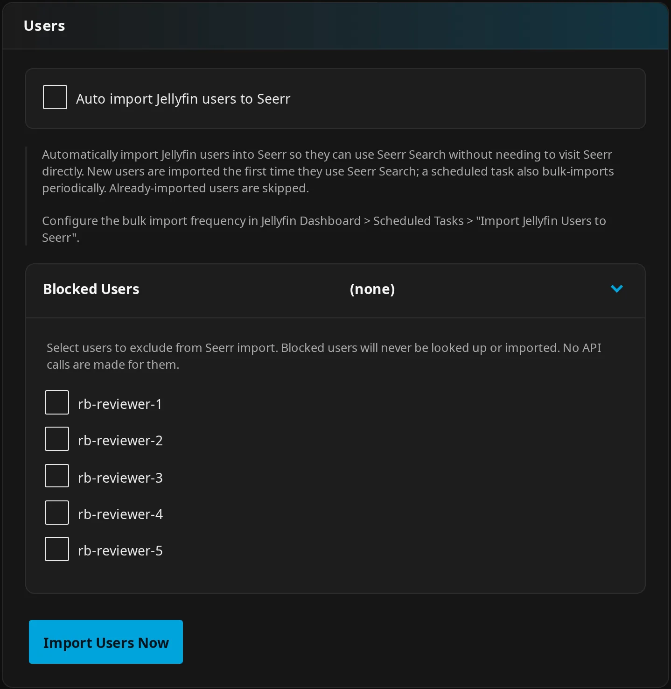
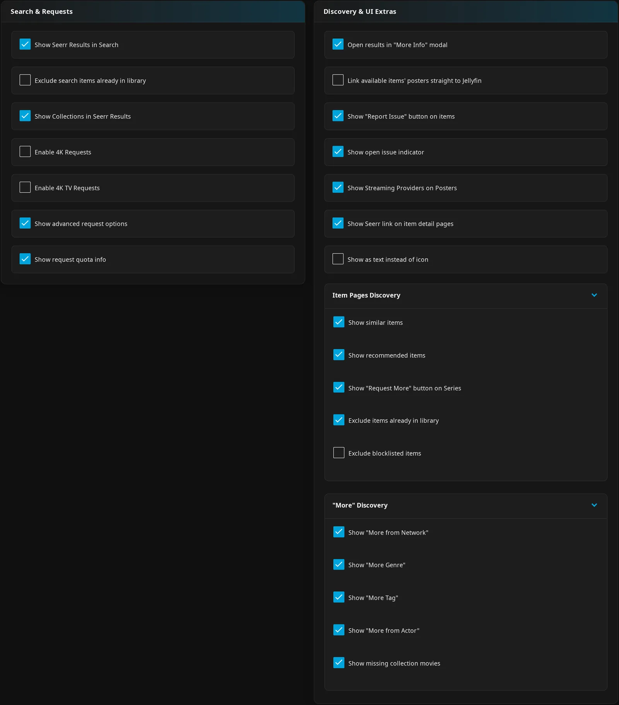
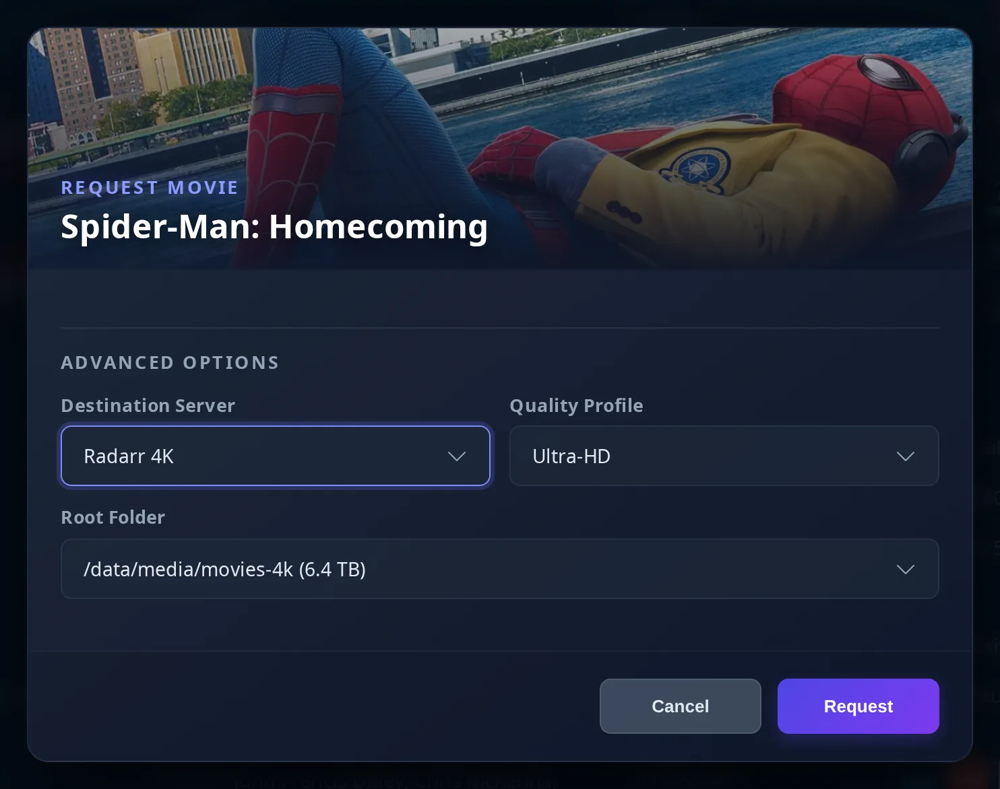

# Seerr Settings

Configure the connection, user access, requests, discovery, and server automations here. For the workflows, see [Seerr features](seerr-features.md); for account and permission checks, see [Permission Audit](permission-audit.md).

All settings here are **admin (server) settings** unless marked as per-user.

!!! note "Seerr controls account access"

    Permissions and quotas belong to the linked Seerr account. Enabling a JE feature does not grant those permissions.

## Setup

Connect Seerr to search and request media from Jellyfin. Follow the setup steps below.

!!! note "Before you start"

    You need a reachable Seerr instance, its API key, and Seerr accounts linked to your Jellyfin users. API calls need an address reachable from the Jellyfin server; browser-facing Seerr links need an address your users can reach.

??? info "How it works"

    JE sends API calls through the Jellyfin server, keeping the Seerr API key out of the browser and avoiding browser CORS requirements.

### Step 1: Enable Jellyfin Sign-In in Seerr

Let Jellyfin users sign in to Seerr.

**How to use:**

1. In Seerr's **Settings** → **Users**, enable **Enable Jellyfin Sign-In** and save.
2. Configure Seerr's Jellyfin connection before importing users.

*This upstream example includes a legacy Jellyseerr annotation. Allowing new users to sign in there is separate from JE's automatic import.*

??? note "Details"

    The upstream interface can differ between Seerr versions.

### Step 2: Import Jellyfin Users

Import the Jellyfin accounts you want to use with Seerr.

**How to use:**

1. In Seerr's **Users** page, use **Import Jellyfin Users**.
2. Select the accounts and press **Import**.

You can instead use JE's [automatic or manual import](#step-4-configure-user-import-optional).

*Imported accounts still need the appropriate Seerr permissions.*

*This is an import selection dialog. Sample usernames do not establish whether an account has request access.*

??? info "How it works"

    JE links accounts by the normalized Jellyfin user ID stored in Seerr's `jellyfinUserId`. Matching usernames alone does not link accounts.

### Step 3: Configure Plugin

Enter your connection details in JE to enable Seerr features.

**How to use:**

1. Open **Dashboard** → **Plugins** → **Jellyfin Enhanced** → **Seerr**.
2. Under **Seerr Connection Setup**, turn on **Enable Seerr integration**.
3. Enter **Seerr URL(s) (One per line)** and **Seerr API Key**. The configuration help points to Seerr's **Settings** → **General Settings** → **API Key** for the key.
4. Press **Test** beside the Seerr key.
5. Leave **Show Seerr Results in Search** enabled if you want search integration. Add a **TMDB API Key** for the features that need it.
6. Press **Save Settings**, then verify user access with [Permission Audit](permission-audit.md).

| Setting | Default | What it does |
| --- | --- | --- |
| **Enable Seerr integration** | Off | Enables Seerr features independently of the search-results switch. |
| **Seerr URL(s) (One per line)** | Empty | Connection addresses for calls from the Jellyfin server. |
| **Seerr API Key** | Empty | Authenticates server calls to Seerr. |
| **TMDB API Key** | Empty | Shared with Elsewhere; enables the additional TMDB features listed below. |
| **Seerr URL Mappings** | Empty | Under **Advanced URL Mappings**. Maps the Jellyfin address used by a client to a browser-facing Seerr address; see [URL Mappings](seerr-features.md#url-mappings). |

!!! note "Testing and connection addresses"

    **Test** uses the entered values, including unsaved changes. It does not verify each user's linkage or permissions. Use an address reachable from the Jellyfin server or container. Multiple addresses should reach the same Seerr installation.

??? info "How it works"

    If a public proxy requires an interactive login, use an internal service address for API calls and a public address in the mappings.

    Saved URL lines must parse as HTTP or HTTPS addresses; invalid lines are dropped. Proxy calls try configured addresses until one succeeds; some background tasks use only the first address.

    The shared **TMDB API Key** is required for automatic movie requests, studio-produced TV discovery, and streaming-provider displays. It also provides fallback collection metadata. Ordinary Seerr search does not require a separate TMDB key.

### Step 4: Configure User Import (Optional)

Let JE create missing Seerr accounts automatically, or import users when you choose.

**How to use:**

1. Open **Seerr** → **Users**.
2. For automatic import, enable **Auto import Jellyfin users to Seerr** and save.
3. For an immediate import, press **Import Users Now**. This saves the current configuration and imports unblocked users.
4. Read the imported/total counts and any returned errors. Reaching Seerr does not mean every account was imported.

| Setting | Default | What it does |
| --- | --- | --- |
| **Auto import Jellyfin users to Seerr** | Off | Imports missing accounts as needed and on a schedule. Already imported users are skipped. |
| **Blocked Users** | None | Excludes selected Jellyfin accounts from JE's Seerr user lookup and import, and from watchlist monitoring/sync. |

!!! note "Import requirements and access"

    **Import Users Now** is an administrator action. It works with automatic import off, but the saved integration must be enabled and saved URLs/key must be nonempty. Importing an account does not grant all request permissions. **Blocked Users** is not a universal gate on direct server automations; see [automation limits](seerr-features.md#auto-request-settings).

The **Import Jellyfin Users to Seerr** scheduled task runs every six hours by default when automatic import is enabled. It checks the switch and the blocklist again before trying the next Seerr address, so turning auto import off or blocking someone during a run counts. Change its trigger under **Dashboard** → **Scheduled Tasks**.

??? note "Details"

    Just-in-time import can run during user resolution for search and other proxy operations.

    The manual import endpoint, `POST /JellyfinEnhanced/jellyseerr/import-users`, rejects non-admins. Disabled integration returns HTTP 400 with `Jellyseerr integration is not enabled`; missing credentials return HTTP 400 with `Jellyseerr URL or API key not configured`. Imports normally have a 30-second throttle (HTTP 429: `Import was run recently. Please wait before retrying.`). If no users were imported and errors were returned, JE resets the throttle so you can fix the problem and retry.

For conflicting-email errors, inspect Seerr for an old or duplicate account before changing anything. Verify the account's stored Jellyfin user ID, then run [Permission Audit](permission-audit.md).

## Optional Features

### Search and collection results

Add requestable titles and collections to Jellyfin search.

**How to use:** Open **Seerr** → **Search & Requests** and choose the options below. See [Search Integration](seerr-features.md#search-integration) and [collection requests](seerr-features.md#collection-requests).

| Setting | Default | What it does |
| --- | --- | --- |
| **Show Seerr Results in Search** | On | Adds Seerr results to Jellyfin search when integration and user access are working. |
| **Exclude search items already in library** | Off | Hides library matches from search, including partially owned series and lower-quality movie copies. |
| **Show Collections in Seerr Results** | On | Derives collection cards from matching movies. Depends on **Show Seerr Results in Search**. |

!!! note "Search exclusions"

    Excluding library matches can hide opportunities to request missing seasons or 4K copies. Use a series' **Request More** action or Seerr directly if search exclusion hides something you want to request.

??? note "Details"

    The search exclusion is independent of **Exclude items already in library**, which controls discovery and recommendation cards.

### Enable 4K Requests

Show 4K movie request actions.

**How to use:** Open **Seerr** → **Search & Requests** and turn on **Enable 4K Requests**.

| Setting | Default | What it does |
| --- | --- | --- |
| **Enable 4K Requests** | Off | Exposes 4K movie request actions; Seerr still validates the request. |

!!! note "4K movie requirements"

    Seerr needs a configured 4K Radarr destination and suitable permissions for 4K movie requests.

### Enable 4K TV Requests

Show 4K season requests alongside normal-quality requests.

**How to use:** Open **Seerr** → **Search & Requests** and turn on **Enable 4K TV Requests**. See [4K TV Requesting](seerr-features.md#4k-tv-requesting).

| Setting | Default | What it does |
| --- | --- | --- |
| **Enable 4K TV Requests** | Off | Exposes **Request in 4K**, opening the season dialog in 4K mode. Normal and 4K availability are tracked separately. |

!!! note "4K series requirements"

    Seerr needs a configured 4K Sonarr destination and suitable 4K series permissions.

### Show Advanced Request Options

Let authorized users choose **Destination Server**, **Quality Profile**, and **Root Folder** in request dialogs. Quota information shows their remaining request allowance.

For movies, choose **Request in 4K** before opening the dialog; its title remains **Request Movie**, and matching 4K destination defaults are selected when supplied.

**How to use:** Open **Seerr** → **Search & Requests** and choose the options below. See [advanced request options](seerr-features.md#advanced-request-options) and [request quotas](seerr-features.md#request-quotas).

| Setting | Default | What it does |
| --- | --- | --- |
| **Show advanced request options** | Off | Shows destination choices to authorized linked users. |
| **Show request quota info** | On | Shows finite Seerr quota usage, its rolling window, and estimated next-slot availability when supplied. Enables detailed quota-error handling. |

??? note "Details"

    Linked Jellyfin/Seerr administrators and users with `REQUEST_ADVANCED` or `MANAGE_REQUESTS` can use advanced options. Unauthorized fields are hidden and stripped if submitted.

    Unlimited quotas show no chip. One or two remaining slots show a warning; exhausted quotas show a restricted state. A recognized quota-exceeded HTTP 403 opens **Request limit reached** with retry guidance and advice to contact an admin. Turning quota information off uses simpler error handling; it does not remove the Seerr quota.

### More Info and detail links

Choose how result posters and Seerr detail links open.

**How to use:** Open **Seerr** → **Discovery & UI Extras** and choose the options below. See [More Info](seerr-features.md#more-info) and [Item Details](seerr-features.md#item-details).

| Setting | Default | What it does |
| --- | --- | --- |
| **Open results in "More Info" modal** | On | Opens non-library result details in JE's modal instead of following an external Seerr link. Also controls the Seerr detail-page link. |
| **Link available items' posters straight to Jellyfin** | Off | Makes available posters open their Jellyfin item directly. Available title links already lead to Jellyfin. |
| **Show Seerr link on item detail pages** | On | Adds a Seerr link to the **External Links** row for TMDB-identified movies/series, independently of *arr links. |
| **Show as text instead of icon** | Off | Uses a text Seerr detail link. Depends on **Show Seerr link on item detail pages**. |
| **Open titles that aren't in the library on Jellyfin's own details page (Experimental)** | Off | Opens titles you don't have on a Jellyfin details page instead of the modal (Jellyfin 12 web). See [Titles that aren't in the library](seerr-features.md#titles-that-arent-in-the-library-jellyfins-own-details-page-experimental). |

??? note "Details"

    Collection cards and membership badges use the collection request dialog. More Info's refresh button updates status and seasons manually; it does not continuously poll.

### Show 'Report Issue' Button

Let users report media problems from Jellyfin detail pages.

**How to use:** Open **Seerr** → **Discovery & UI Extras** and enable the report button. See [Issue Reporting](seerr-features.md#issue-reporting) for item eligibility, permissions, and the report form.

| Setting | Default | What it does |
| --- | --- | --- |
| **Show "Report Issue" button on items** | Off | Adds reporting to eligible movie, series, season, and episode details. |
| **Show open issue indicator** | Off | Colors the report icon orange and shows the open-issue count, visually capped at `9+`. Depends on the report-button switch. |

!!! note "Issue permissions"

    Reporting needs a linked account and creation permission. Viewing existing reports and the count needs viewing permission. Manage issue status and conversations in Seerr.

??? note "Details"

    Both the modal and indicator fetch at most 50 global issue entries and filter them by title, so older matching reports can be absent. The modal shows existing reports/comments and submits new reports.

### Streaming providers

Show subscription-provider icons on Seerr posters.

**How to use:** Open **Seerr** → **Discovery & UI Extras** and turn on **Show Streaming Providers on Posters**.

| Setting | Default | What it does |
| --- | --- | --- |
| **Show Streaming Providers on Posters** | Off | Adds up to four subscription-provider icons from the admin's default Elsewhere region to Seerr posters. |

!!! note "Requires TMDB"

    Configure **TMDB API Key** to show streaming providers.

??? info "How it works"

    Poster icons use the server region (US by default), the server's provider selection (empty by default, meaning all), and provider exclusions (empty by default). Configure these under [Elsewhere settings](../elsewhere/elsewhere-settings.md).

    More Info's **Streaming** section is independent of this switch. With TMDB configured, it uses your **per-user Elsewhere region**, then the server region, then US. If that region is absent from supplied data, it tries US and then the first supplied region. It shows up to six unique subscription providers.

### Item Pages Discovery

Add related titles and follow-up season requests to item detail pages.

**How to use:** Open **Seerr** → **Discovery & UI Extras** → **Item Pages Discovery** and choose the options below. See [Item Details](seerr-features.md#item-details).

| Setting | Default | What it does |
| --- | --- | --- |
| **Show similar items** | On | Adds a **Similar** row to eligible movie/series details. |
| **Show recommended items** | On | Adds a separate **Recommended** row. |
| **Show "Request More" button on Series** | On | Adds **Request More** beside seasons when additional regular seasons with episodes are requestable. |
| **Exclude items already in library** | On | Filters shared discovery/recommendation cards; separate from search exclusion. |
| **Exclude blocklisted items** | Off | Filters Seerr blocklisted media from those cards. Declined requests are a different state. |

!!! note "Requirements"

    Similar and recommended rows require a TMDB ID and working Seerr user access.

??? note "Details"

    Each row has up to 20 items before filtering, without unlimited paging.

### More discovery

Find titles beyond your library from genre, studio, tag, person, and collection pages.

**How to use:** Open **Seerr** → **Discovery & UI Extras** → **"More" Discovery** and enable the types you want. See [Discovery Pages](seerr-features.md#discovery-pages) for routes and matching requirements.

| Setting | Default | What it does |
| --- | --- | --- |
| **Show "More from Network"** | On | Adds network/production-company discovery to Jellyfin studio pages. Studio-produced TV needs the separate TMDB key. |
| **Show "More Genre"** | On | Adds genre discovery to Jellyfin genre pages. |
| **Show "More Tag"** | On | Adds discovery using a TMDB keyword matched from the Jellyfin tag. |
| **Show "More from Actor"** | On | Adds filmography discovery to person pages using a TMDB ID or name search. |
| **Show missing collection movies** | On | Shows missing movies with request buttons on BoxSet pages that have a TMDB collection ID. |

### Add Requested Media to Watchlist

Add requested titles to the requester's Jellyfin watchlist as they reach the library, or sync watchlist entries between Seerr and Jellyfin.

**How to use:**

1. Open **Seerr** → **Watchlist** and enable the options you want.
2. Save your settings.
3. After enabling requested-media monitoring, restart Jellyfin or run **Jellyfin Enhanced Startup** once to start watching for library additions and updates.

See [Watchlist Sync](seerr-features.md#watchlist-sync) for schedules, limits, and additive behavior.

| Setting | Default | What it does |
| --- | --- | --- |
| **Add requested media to Watchlist** | Off | Adds requested movies/series to the requester's Jellyfin watchlist when library additions or updates match them, including requests made outside JE. |
| **Sync Seerr Watchlist → Jellyfin** | Off | Enables incoming scheduled watchlist sync. That task also includes requests when the requested-media switch is on. |
| **Sync Jellyfin Watchlist → Seerr** | Off | Enables outgoing scheduled watchlist sync for linked accounts and TMDB-identified movies/series. |
| **Prevent re-adding removed items** | On | Remembers processed items so removing one from Jellyfin's watchlist does not cause it to be added again during incoming sync/monitoring. |
| **Memory retention (days):** | 365 | Keeps processed-item memory for this many days; input range 1–3650. Applies when re-addition prevention is on. |

??? note "Details"

    The [KefinTweaks plugin](https://github.com/ranaldsgift/KefinTweaks) provides the Jellyfin watchlist interface. Sync switches are checked when their scheduled tasks run. Neither direction mirrors deletions.

### Sync Seerr Watchlist to Jellyfin

Bring Seerr watchlist entries into Jellyfin with a scheduled task. It runs daily at 03:00 by default.

**How to use:** Enable **Sync Seerr Watchlist → Jellyfin**, then adjust or run **Sync Watchlist from Seerr to Jellyfin** under **Dashboard** → **Scheduled Tasks**. See [Watchlist Sync](seerr-features.md#watchlist-sync).

### Sync Jellyfin Watchlist to Seerr

Bring Jellyfin watchlist entries into Seerr with a scheduled task. It runs daily at 03:30 by default.

**How to use:** Enable **Sync Jellyfin Watchlist → Seerr**, then adjust or run **Sync Watchlist from Jellyfin to Seerr** under **Dashboard** → **Scheduled Tasks**.

### Only Allow Requesting One Season at a Time
- Removes **Select All** from the season modal and lets users tick only one season per request
- Applies everywhere the season modal opens (search, more info, item details)
- Needs **Partial requests** enabled in Seerr; otherwise Seerr requires all seasons and this setting has no effect
- With [Requests & downloads](../arr/arr-features.md#asking-for-titles) phase 3 on, Jellyfin Enhanced's own request sheet and series-page buttons follow it too, in Seerr mode (while Seerr takes partial requests) and in Jellyfin Enhanced mode: no **Everything** for several seasons, **Pick seasons…** takes one, and **Get missing episodes** asks for the first season with missing episodes. The server refuses an ask for more than one season (`409 single_season_only`). Requests recorded before the option was turned on can still be approved.

### Auto Import Jellyfin Users to Seerr

Let JE create missing Seerr accounts for Jellyfin users.

**How to use:** Follow [Configure User Import](#step-4-configure-user-import-optional) for the controls and manual action. Use [Permission Audit](permission-audit.md) after linking accounts or changing their permissions.

## Automatic requests

Request the next season or collection movie based on playback. These server automations can also react to native-client playback events.

**How to use:**

1. Enable Seerr and the relevant automation below.
2. Save, then restart Jellyfin or run **Jellyfin Enhanced Startup** once.

See [Auto-Request Settings](seerr-features.md#auto-request-settings) for triggers and policy limits.

### Auto Season Requests

Request the next numeric season near the end of the current one.

**How to use:** Open **Seerr** → **Automatic Requests** → **Auto Season Requests**. Enable the feature and choose the threshold below.

| Setting | Default | What it does |
| --- | --- | --- |
| **Enable Automatic Advance Season Requests** | Off | Requests the next numeric season using the playback user's linked Seerr account when the threshold is met. |
| **Require All Prior Episodes Watched** | Off | Requires earlier episodes present in the current Jellyfin season to be watched or marked watched. Does not require the current or later episodes to be watched. |
| **Episodes Remaining Threshold** | 2 | Triggers when upstream season episode count minus current episode number is at most this value; input range 1–20. |

!!! note "Season request requirements"

    You need a series TMDB ID and usable Seerr request access. Episode counts come through Seerr; a separate TMDB key is not required.

### Auto Movie Requests

Request the next collection movie based on playback.

**How to use:** Open **Seerr** → **Automatic Requests** → **Auto Movie Requests**. Enable the feature, choose playback triggers, and select a quality profile mode.

| Setting | Default | What it does |
| --- | --- | --- |
| **Enable Auto Movie Requests** | Off | Considers the next movie released in the collection after the watched one, whatever order Seerr or TMDB lists the collection in. |
| **When movie starts** | Off | Checks near the start of playback. |
| **After X minutes watched** | On | Checks after playback reaches the position threshold. Seeking or resuming can meet it. |
| **Minutes Watched Threshold:** | 20 | Playback-position threshold in minutes; input range 1–180. |
| **Only request if released** | On | Skips a movie with a future release date; a movie with no release date yet counts as not released. |
| **Quality Profile Mode:** | **Default** | **Default** lets Seerr choose. **Original** copies settings from the watched movie's first Seerr request. **Custom** sends the configured selections below. |
| **Use default instead of 4K fallback** | On | In **Original**, falls back to Seerr defaults when the copied request was 4K. Turn off to preserve those 4K settings. |
| **Radarr Server:** | Unset | Destination used only in **Custom**. |
| **Quality Profile:** | Unset | Profile used only in **Custom**. |
| **Root Folder:** | Empty | Folder used only in **Custom**. |

!!! note "Movie request requirements"

    You need **TMDB API Key**, a TMDB-identified movie in a collection, and a linked account with usable request permissions.

??? info "How it works"

    **Original** uses Seerr request records, not the watched file's measured quality. It falls back to **Default** without usable original settings. **Custom** also falls back if no custom value is set. The service orders the collection by release itself and does not search farther ahead when the next movie is already available/requested or is skipped by release checking.

    Start-only stores `OnStart`; both trigger choices store `Both`. The default trigger mode is `OnMinutesWatched`.

    The unset starting values are `-1` for **Radarr Server:** and `0` for **Quality Profile:**.

## Recently Added Sync to Seerr

Help Seerr discover availability after Jellyfin library additions by triggering its recently-added scan.

**How to use:** Open **Seerr** → **Recently Added Sync to Seerr**, enable the automatic scan, and save. For an administrator test, press **Trigger scan now**.

| Setting | Default | What it does |
| --- | --- | --- |
| **Trigger Seerr recently-added scan when new Jellyfin items are added** | Off | Triggers a scan after movie, series, season, and episode additions. |
| **Debounce (seconds):** | 60 | Wait after the last addition; input range 5–3600 seconds. |

!!! note "Scan limits"

    A scan does not complete downloading/importing or guarantee an immediate status update.

??? info "How it works"

    New additions reset a timer. After the final event, JE waits for **Debounce (seconds):**, then dispatches the automatic scan to every configured Seerr URL.

    **Trigger scan now** uses the entered URLs/key, including unsaved values, and stops at the first successful URL. It is an administrator action, not a saved setting.

    After startup initialization, changing the automatic scan switch requires no restart because its listener is always registered.

## Requests Page Management

The shared [Requests page](seerr-features.md#requests-page) brings Seerr requests and optional issues together with *arr downloads/history. Download connection and visibility details also appear in [*arr settings](../arr/arr-settings.md).

### Enable Requests Page

Choose how users open Requests in Jellyfin.

**How to use:**

1. Open **Pages** → **Requests Page** and turn on **Enable Requests Page**.
2. Choose a navigation option below, or leave the navigation modes off for built-in navigation.
3. Save your settings.

| Setting | Default | What it does |
| --- | --- | --- |
| **Enable Requests Page** | Off | Enables the shared page. Seerr requests require enabled/configured Seerr and linked viewers; download sections need configured *arr services. |
| **Add Requests as a native Home tab** | Off | Adds a native Home tab without a companion plugin. Recommended by the UI for Jellyfin 12's experimental layout. |
| **Use Plugin Pages for Requests** | Off | Uses the [Plugin Pages plugin](https://github.com/IAmParadox27/jellyfin-plugin-pages) integration. |
| **Use Custom Tabs for Requests** | Off | Embeds Requests with the [Custom Tabs plugin](https://github.com/IAmParadox27/jellyfin-plugin-custom-tabs). Cannot be combined with the native Home tab. |
| **Add the Custom Tabs entry for me** | Off | When the page and Custom Tabs mode are enabled, creates the matching entry on save. Turning Custom Tabs mode off removes the managed entry; turning it on recreates it. |

For routes, layout limits, Plugin Pages restart rules, and Custom Tabs setup, see [JE Pages & Tabs](../getting-started/pages-and-tabs.md#choose-a-placement).

### Show Downloads Section

Show active downloads and recent import history alongside requests.

**How to use:** Open **Pages** → **Requests Page** and choose the download visibility options below.

| Setting | Default | What it does |
| --- | --- | --- |
| **Show Downloads in Requests Page** | On | Displays active *arr downloads. Also required to show the history section. |
| **Filter Downloads by User Requests** | On | Limits queue/history for non-admins to content they requested through Seerr, and the request list to their own requests whatever their Seerr permissions. Library access applies either way. Without usable Seerr linkage or matching requests, their results can be empty. |
| **Show Download History Section** | On | Adds paginated recent import history. |
| **Restrict Download History to Admins** | Off | Restricts history to Jellyfin administrators, enforced by the server. |

!!! warning "Download visibility"

    Administrators bypass download-user filtering. Turning it off exposes other users' queue/history entries to authenticated viewers, subject to the separate admin-only history setting.

Request visibility has its own Seerr permission rules. For progress, import outcomes, history bounds, and download search, see [*arr features](../arr/arr-features.md).

### Show Seerr Issues Section

Let authorized users browse Seerr issues on Requests.

**How to use:** Open **Pages** → **Requests Page** and turn on **Show Seerr Issues Section**.

| Setting | Default | What it does |
| --- | --- | --- |
| **Show Seerr Issues Section** | Off | Adds **Issues** with **Open**/**Resolved** filters and pagination when Seerr is enabled. |

??? note "Details"

    Linked ordinary users need `VIEW_ISSUES` or `MANAGE_ISSUES` to load issue data; linked Jellyfin/Seerr administrators bypass that local check. Issues returned by Seerr are subject to parental filtering. See [Issues on the Requests page](seerr-features.md#issues-on-the-requests-page).

### Auto-Refresh Settings

Refresh Requests automatically while users browse.

**How to use:** Open **Pages** → **Requests Page** and choose whether and how often to refresh.

| Setting | Default | What it does |
| --- | --- | --- |
| **Enable Auto-Refresh** | On | Refreshes the page's requests, enabled downloads, issues, and history. |
| **Poll Interval (seconds)** | 30 | Refresh interval when enabled; input range 30–300 seconds. |

??? info "How it works"

    Polling stops when you leave the standalone page or switch away from its native Home or Custom Tabs tab. With Plugin Pages, it can continue after navigation until you reload or close the browser page. Hidden browser tabs are skipped. An issue-read HTTP 403 suppresses repeated issue polling while that permission-denied state persists. The visible manual refresh/search controls belong to Downloads; request and issue lists use filters and pagination. Caching can still affect freshness.

## Seerr Recommendations Page

Give users a dedicated page for discovering movies and series.

**How to use:**

1. Open **Pages** → **Seerr Recommendations Page**.
2. Enable the page and choose a navigation option below.
3. Save your settings.

See [Recommendations browsing](seerr-features.md#recommendations-page) for using the page.

| Setting | Default | What it does |
| --- | --- | --- |
| **Enable Recommendations Page** | Off | Enables **Seerr Recommendations**. |
| **Add Recommendations as a native Home tab** | Off | Adds a native Home tab without a companion plugin. |
| **Use Plugin Pages** | Off | Uses Plugin Pages for Recommendations. |
| **Use Custom Tabs** | Off | Embeds Recommendations with Custom Tabs; incompatible with its native Home tab. |
| **Add the Custom Tabs entry for me** | Off | Creates the matching Custom Tabs entry on save when the page and Custom Tabs mode are enabled; disabling/re-enabling that mode removes/recreates the managed entry. |

!!! note "Connection requirements"

    The page needs enabled/configured Seerr and a linked viewer.

For routes, layout limits, Plugin Pages restart rules, and Custom Tabs setup, see [JE Pages & Tabs](../getting-started/pages-and-tabs.md#choose-a-placement).

??? note "Details"

    Discovery exclusions apply to shared cards. Studio-produced series require the separate TMDB key; studio and network logos are bundled and need no key.

## Debug and caching

Use these controls to investigate stale status or permissions.

**How to use:** Open **Seerr** → **Debug** and adjust the cache settings below. Reload other clients as needed.

| Setting | Default | What it does |
| --- | --- | --- |
| **Disable server-side response cache** | Off | Fetches Seerr responses and account lookups without using the server cache. |
| **Response Cache TTL (min)** | 10 | Minutes to keep cached Seerr responses, such as search and discovery. |
| **User ID Cache TTL (min)** | 30 | Minutes to keep Jellyfin-to-Seerr account lookup results. |

??? info "How it works"

    Both TTL inputs have a minimum of 1 minute and no HTML maximum. Disabling the cache increases upstream calls; it does not clear every browser cache.

    Saving JE configuration clears its Seerr server caches. [Permission Audit](permission-audit.md) bypasses user lookup caching independently. A refresh control does not guarantee every cached layer has been cleared.
