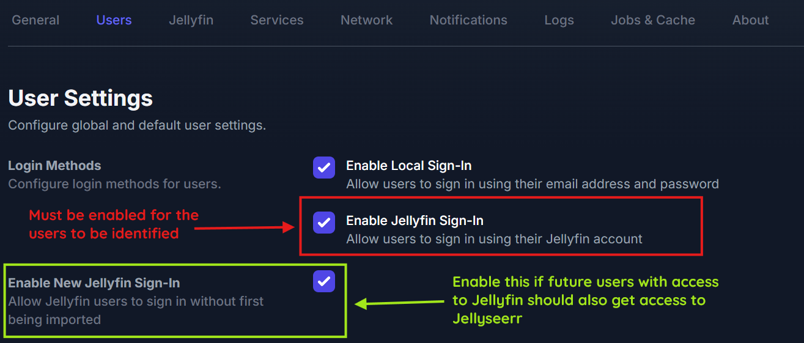
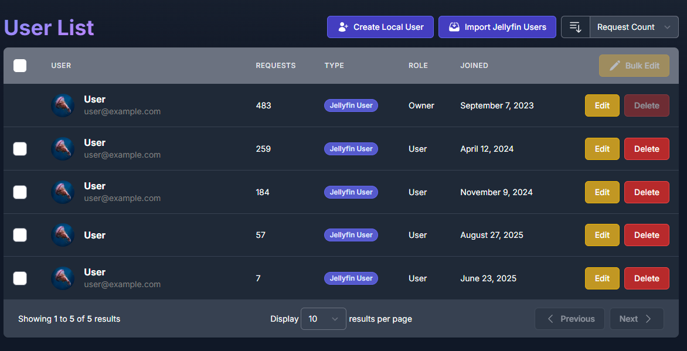
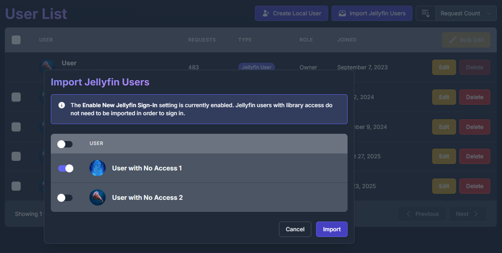
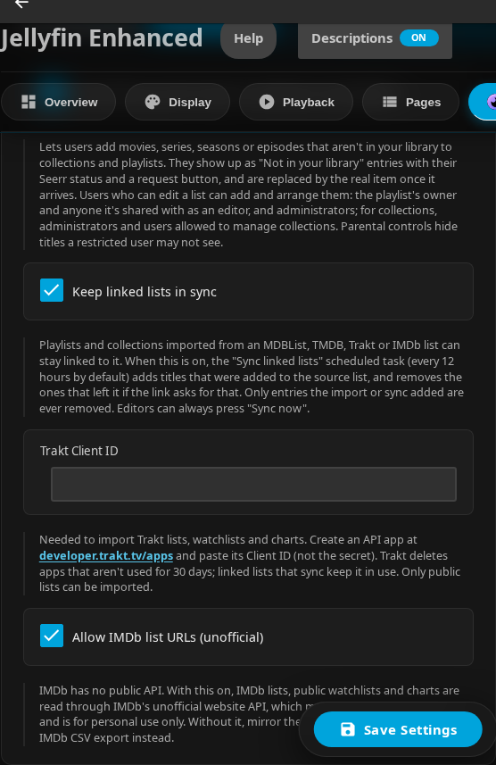

# Seerr Settings

!!! info "Prerequisites"

    **Prerequisites:**

    - Seerr instance
      - **API key**
      - Jellyfin Sign-In enabled

!!! warning "Disclaimer"

    **This plugin is NOT affiliated with Seerr.** Seerr is an independent project.

    **Please report plugin issues to the Jellyfin Enhanced repository, not to the Seerr team.**

## Setup

### Step 1: Enable Jellyfin Sign-In in Seerr

1. In Seerr, go to **Settings** → **Users**
2. Enable **"Enable Jellyfin Sign-In"**
3. Save settings

### Step 2: Import Jellyfin Users

This step is optional if you enable plugin-side auto import.

1. In Seerr, go to **Users** page
2. Click **"Import Jellyfin Users"**
3. Select users to import
4. Save changes

**User Access:**

- Users WITH access:

  

- Users WITHOUT access:

  

### Step 3: Configure Plugin

1. Go to **Dashboard** → **Plugins** → **Jellyfin Enhanced**
2. Navigate to **Seerr Settings** tab
3. Check **"Show Seerr Results in Search"**
4. Enter your **Seerr URL(s)** (one per line)
   - Use internal URL for best performance
   - Can provide multiple URLs (first successful connection used)
5. Enter your **Seerr API Key**

   - Found in Seerr: **Settings** → **General** → **API Key**
6. Click **"Test Connection"** to verify
7. Enable optional features (see below)
8. Click **Save**

### Step 4: Configure User Import (Optional)

Enable automatic import in the plugin if you do not want to manually import users in Seerr.

When enabled, new Jellyfin users are automatically imported into Seerr the first time they use Seerr Search.

1. Go to **Dashboard** → **Plugins** → **Jellyfin Enhanced**
2. Navigate to **Seerr Settings** tab
3. In **User Import**, check **"Auto import Jellyfin users to Seerr"**
4. Optional: expand **Blocked users** and select users to exclude
5. Optional: click **Import Users Now** to run immediate bulk import
6. Click **Save**

!!! tip
    The scheduled task **Import Jellyfin Users to Seerr** runs every 6 hours by default when auto import is enabled.
    You can change the trigger in Jellyfin Dashboard -> Scheduled Tasks.

## Optional Features

### Add Requested Media to Watchlist
!!! note "Requirements"

    **Requirements:**

      - The **[KefinTweaks plugin](https://github.com/ranaldsgift/KefinTweaks)**
      - Automatically add items to Jellyfin watchlist when they become available

### Sync Seerr Watchlist to Jellyfin
- Sync your Seerr watchlist items to Jellyfin watchlist
- Items added when they become available in library

### Sync Jellyfin Watchlist to Seerr
- Sync each user's Jellyfin watchlist to their linked Seerr watchlist
- Runs via the **Sync Watchlist from Jellyfin to Seerr** scheduled task (default: daily at 03:30)
- Requires users to have a linked Seerr account

### Show 'Report Issue' Button
- Display issue reporting button on item detail pages
- Report video, audio, subtitle, or other problems

### Enable 4K Requests
!!! note "Requirements"

    **Requirements:**

    - Seerr instance with **4K configuration**
    - Permissions for users to request 4K quality

### Enable 4K TV Requests

!!! note "Requirements"
    **Requirements:**

    - Seerr instance with **4K Sonarr configured**
    - Permissions for users to request **4K Sonarr** quality

  When enabled:

  - TV request buttons include a 4K dropdown action.
  - Choosing **Request in 4K** opens the season modal in 4K mode.
  - The season modal title shows **Request Series - 4K**.
  - The primary season modal button label becomes **Request in 4K**.

### Show Advanced Request Options
- Display advanced options (server, quality profile, root folder) in the request modal
- Shown only to users with **Advanced Requests** or **Manage Requests** in Seerr, and to admins
- For other users the advanced fields are hidden and ignored if sent

### Auto Import Jellyfin Users to Seerr

- Just-in-time import when a user first accesses Seerr search and is not linked yet
- Scheduled bulk import via **Import Jellyfin Users to Seerr** task
- Manual bulk import via **Import Users Now** button
- Blocklist support to exclude selected Jellyfin users from lookup/import

## Requests Page Management

### Enable Requests Page

Display a dedicated page showing active downloads from *arr and requests from Seerr.

**Configuration:**

1. Go to **Dashboard** → **Plugins** → **Jellyfin Enhanced**
2. Navigate to **Seerr Settings** tab (look for the section titled "Requests Page")
3. Check **"Enable Requests Page"**
4. Choose integration method:
   - **Use Plugin Pages** - Adds sidebar link (requires [Plugin Pages](https://github.com/IAmParadox27/jellyfin-plugin-pages) plugin; Jellyfin 12: user profile menu instead)
   - **Use Custom Tabs** - Adds custom tab (requires [Custom Tabs](https://github.com/IAmParadox27/jellyfin-plugin-custom-tabs) plugin)
5. Click **Save** and restart Jellyfin if using Plugin Pages

### Show Downloads Section

Control whether active downloads from Sonarr/Radarr appear on the Requests page.

- **Enabled by default** - Shows active downloads alongside requests and issues
- Requires *arr integration to be configured
- Can be toggled independently

### Show Seerr Issues Section

Display Seerr issues on the Requests page.

- View all reported issues
- Filter by issue status
- Link to Seerr reporter modal

### Auto-Refresh Settings

- **Enable Auto-Refresh** - Automatically refresh download and request status
- **Poll Interval** - How often to refresh (30-300 seconds, default: 30)
  - Lower = more frequent updates (higher server load)
  - Higher = less frequent updates (lower server load)

## List Placeholders

Lets users put titles they don't have yet on collections and playlists, as **Not in your library** entries. See [List Placeholders](list-placeholders.md) for how the feature works.

Found in the **Seerr Settings** tab under **List Placeholders**. Everything is off by default, and the other options need the first one.

| Setting | Default | Description |
|---|---|---|
| **Show titles you don't have on collections and playlists** | Off | Lets users add movies, series, seasons, episodes and custom entries that aren't in your library to collections and playlists. They show their Seerr status and a request button, and are replaced by the real item once it arrives. Who can add them: a playlist's owner, users it's shared with as editors, and administrators; for collections, administrators and users allowed to manage collections |
| **Give lists with only "Not in your library" titles a poster collage** | Off | Gives a playlist or collection with no real items yet a collage of its first placeholder posters instead of Jellyfin's generic icon. Only used while the list has no real items, and never replaces an image you set. Turning it off removes the collages. See [Poster collage](list-placeholders.md#poster-collage) |
| **Keep linked lists in sync** | Off | Lets the **Sync linked lists (list placeholders)** scheduled task (every 12 hours by default) update playlists and collections linked to a list URL. Editors can always use **Sync now** |
| **Trakt Client ID** | *(empty)* | Needed to import Trakt lists, watchlists and charts (see [below](#trakt-client-id)). Server-side only |
| **Allow IMDb list URLs (unofficial)** | Off | Reads IMDb lists, public watchlists and charts through IMDb's unofficial website API, which may stop working at any time and is for personal use only. Without it, mirror the list on MDBList or paste an IMDb CSV export |
| **Let administrators add placeholders to Radarr and Sonarr** | Off | Adds **Add to Radarr** / **Add to Sonarr** to placeholder menus, and Radarr/Sonarr results to **Add title**, for administrators only. Uses the enabled instances on the ***arr Settings** tab, with a choice of instance, quality profile and root folder. Works without Seerr |

List URLs from TMDB use the [TMDB API Key](../elsewhere/elsewhere-settings.md#getting-a-tmdb-api-key) for user lists and most charts, and private MDBList lists use the [MDBList API Key](../other/other-settings.md#mdblist-ratings). Chronolists watch orders need no key. See [From a list URL](list-placeholders.md#from-a-list-url).

### Trakt Client ID

1. Create an API app at [developer.trakt.tv/apps](https://developer.trakt.tv/apps)
2. Copy its **Client ID** (not the Client Secret) into **Trakt Client ID**
3. Click **Save**

!!! note

    Trakt deletes apps that aren't used for 30 days. Linked lists that sync keep the app in use. Only public Trakt lists can be imported.

### List Placeholder Requests

Found in the **Seerr Settings** tab under **Automatic Requests** → **List Placeholder Requests**. Needs Seerr and **Show titles you don't have on collections and playlists**. See [Automatic requests](list-placeholders.md#automatic-requests).

| Setting | Default | Description |
|---|---|---|
| **Request the next titles of a list while it's being watched** | Off | When someone plays an item of a playlist or collection with **Not in your library** titles, requests the titles that come next in that list from Seerr, as that user. A season requests that season, specific episodes the season they belong to, and a whole series its first season (or, once some of it is in the list, the first season with episodes missing) |
| **Titles to request each time** | 1 | How many of the next titles to request (1-10) |
| **Minutes watched before requesting** | 5 | Request once playback reaches this position (0-600 minutes). 0 requests as soon as playback starts |
| **Only request released titles** | On | Skip titles that aren't out yet, including ones without a date (TBA) |

These work independently of Auto Season Requests and Auto Movie Requests. With Auto Season Requests also on, a series requested here gets its later seasons from that feature.

### Scheduled Tasks

In **Dashboard** → **Scheduled Tasks**, category **Jellyfin Enhanced**:

| Task | Default trigger | What it does |
|---|---|---|
| **List Placeholders Maintenance** | Daily at 04:30 | Refreshes release dates and episode lists of placeholders, adds titles that arrived in the library to their playlists and collections, and removes the placeholders of deleted lists. Does nothing while the feature is off |
| **Sync linked lists (list placeholders)** | Every 12 hours | Re-reads the lists that playlists and collections are linked to, adds new entries and, where the link asks for it, removes entries that left. Does nothing unless **Keep linked lists in sync** is on |
