# Spoiler Guard

Spoiler Guard helps you avoid accidental spoilers while browsing shows and movies. You choose which series, movies, or movie collections to protect. Your admin chooses how their images and metadata are shown.

## Turning Spoiler Guard on

Protect the titles you want to browse without spoilers. Your choices apply to your account.

!!! note "Admin requirement"

    Your admin must turn on **Enable Spoiler Guard** to make protection and the JE controls available.

### Per series (TV shows)

Protect a series to cover its unwatched episodes and eligible later seasons.

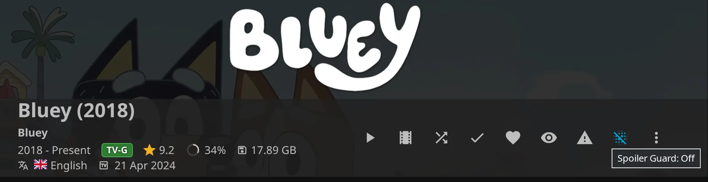

**How to use:**

1. Open the series detail page in the JE web interface.
2. Click the dotted blur icon in the action row, normally just before the three-dot menu. The icon changes and a toast confirms the change. Its tooltip and accessibility label become **Spoiler Guard: On**.
3. Click again to turn direct protection off.

<figure class="je-video">
  <video autoplay loop muted playsinline controls preload="metadata" aria-label="Enabling Spoiler Guard and viewing protected episodes">
    <source src="../series-toggle.mp4" type="video/mp4">
  </video>
  <figcaption>With <strong>Strict refresh mode (full page reload after toggle)</strong> enabled, the toggle reloads the page before you browse protected episodes.</figcaption>
</figure>

| Setting | Default | What it does |
|---|---|---|
| **Enable Spoiler Guard** (admin) | Off | Makes protection and the JE controls available. |
| **Spoiler Guard: Off** / **Spoiler Guard: On** (per title, per user) | Off; automatic modes can enable it | Toggles your direct series, movie, or collection entry. These labels appear in the detail button's tooltip and accessibility label. |

??? info "How it works"

    The entry is stored on the server for your account. Other clients can use it when they fetch fresh metadata and supported image responses; see [Multi-client support](#multi-client-support).

### Per movie

Protect a movie to hide applicable metadata while it is unplayed. The movie title stays visible.

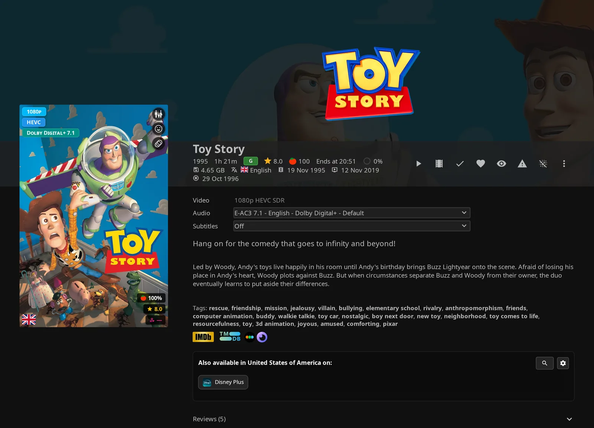

**How to use:** Open the movie detail page and click the same dotted blur icon.

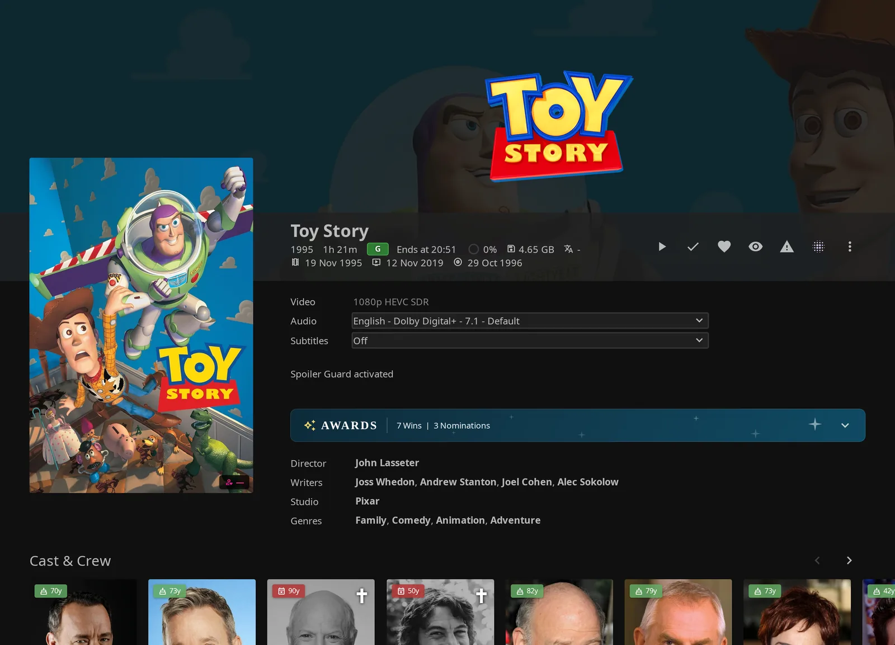
*The poster stays visible with **Keep movie posters visible** enabled, while quality and rating overlays follow their separate policies.*

Your admin can turn off **Keep movie posters visible** to protect movie posters and thumbnails too. Hiding descriptions also removes external links and trailers from eligible protected items.

??? note "Image exceptions"

    Movie Primary/poster and Thumb images remain visible by default. Turning off **Keep movie posters visible** applies image replacement to them. Chapter thumbnails, screenshots, and optionally backdrops follow their own protection rules.

### Per collection

Protect a collection to cover its linked movies according to each movie's played state. The collection's own name, art, and description stay visible.

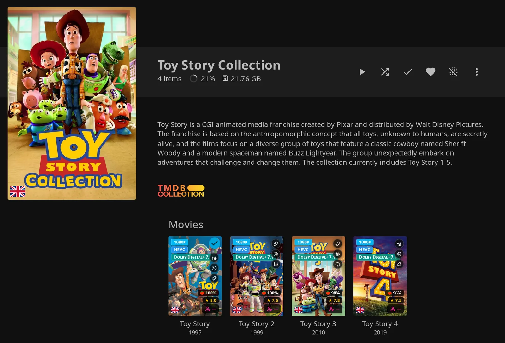

**How to use:** Open the movie collection's detail page and click the dotted blur icon.

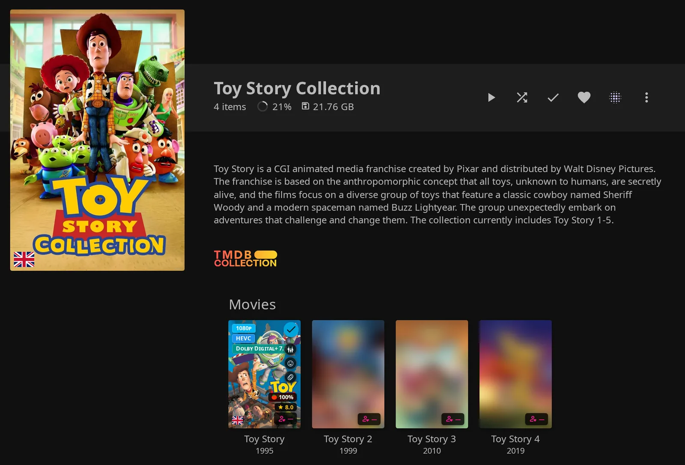
*With **Keep movie posters visible** off and **Blur images** selected, unplayed member posters blur while the played movie stays clear.*

The off-state collection button alone does not establish whether a member has direct protection.

!!! note "A movie can have more than one source of protection"

    Turning a movie's direct entry off does not override collection protection. Turning a collection off preserves direct movie entries and protection from other collections.

??? info "How it works"

    Collection protection uses membership rather than copying entries into your movie list. A movie is protected if you enabled it directly **or** it belongs to any guarded collection. Its tooltip can show **Spoiler Guard: Off** while inherited protection remains.

    Membership changes can take up to the 30-second scope-cache window to appear.

### Pre-arming (for titles not yet in your library)

You can register protection before a title arrives, even if another user requested it.

**How to use:**

1. Open a movie or TV title's **More Info** modal in the [Seerr integration](../seerr/seerr-features.md).
2. Click **Enable Spoiler Guard**. The button changes to **Spoiler Guard (pending)**. The toast says **Spoiler Guard will engage when this title arrives in your library.**
3. To remove pending or matching direct protection, reopen the modal and click the enabled button again. The usual disable confirmation applies.

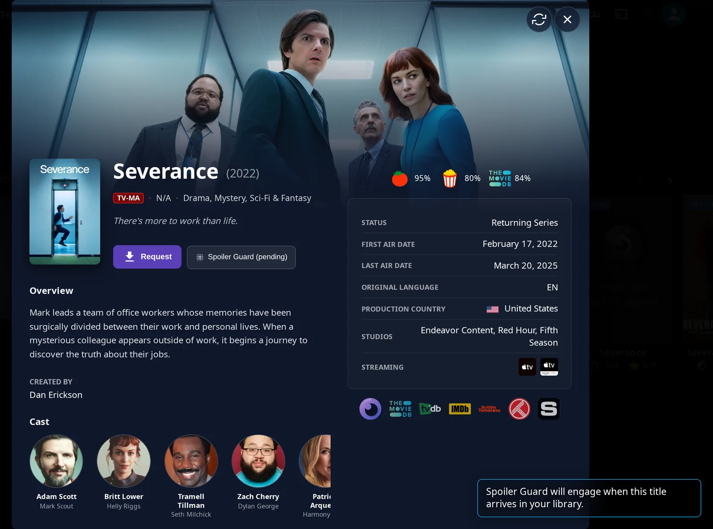

!!! note "Requirements"

    Turn on **Enable Spoiler Guard** in the admin **Display** tab under **Spoiler Guard**. You also need a working Seerr connection, access to the modal, and a title with a positive TMDB ID.

These are admin Seerr settings:

| Setting | Default | What it does |
|---|---|---|
| **Enable Seerr integration** | Off | Enables the integration. |
| **Seerr URL(s) (One per line)** | Empty | Supplies your Seerr instance URLs. |
| **Seerr API Key** | Empty | Authenticates the connection. |
| **Show Seerr Results in Search** | On | Makes Seerr results available through search. |
| **Open results in "More Info" modal** | On | Opens eligible non-library results in the modal. |

Manual pre-arming works independently of automatic enablement and its type/library scope.

??? note "Seerr setup details"

    In the admin **Seerr** tab, configure the connection under **Seerr Connection Setup**, search results under **Search & Requests**, and **Open results in "More Info" modal** under **Discovery & UI Extras**. See [Seerr settings](../seerr/seerr-settings.md).

    | Setting | Internal property |
    |---|---|
    | **Enable Seerr integration** | `JellyseerrEnabled` |
    | **Seerr URL(s) (One per line)** | `JellyseerrUrls` |
    | **Seerr API Key** | `JellyseerrApiKey` |
    | **Show Seerr Results in Search** | `JellyseerrShowSearchResults` |
    | **Open results in "More Info" modal** | `JellyseerrUseMoreInfoModal` |

??? info "How pending protection works"

    When a matching Series or Movie is added or updated, its metadata must contain the same TMDB ID and the item must be accessible to you. Promotion is scheduled after a two-second settling delay. Protection becomes active after the state write succeeds.

    If an accessible match already exists, clicking the button can create a real entry immediately. The modal still labels it **Spoiler Guard (pending)**.

    Pending entries survive restarts. Startup reloads their keys for later library events; it does not sweep every existing library match.

    Each account has a fixed limit of 500 normal pending entries. At the limit, new inserts fail with HTTP 429. Existing entries can still be updated, removed, or promoted. You can also manage them through the [authenticated endpoints](spoiler-guard-settings.md#inspection-and-automation-endpoints).

!!! warning "If the update fails"

    A failed modal update shows **Couldn't update Spoiler Guard for this title. See console.** Reload and check the state before relying on protection.

## What Spoiler Guard protects

Spoiler Guard hides images and information that could reveal what happens next. The table below applies to eligible items when your admin has enabled the relevant policy and you have not opted out.

**How to use:** Protect a title, then use the [metadata settings](spoiler-guard-settings.md#hide-metadata-on-unwatched-episodes) to choose which fields to hide.

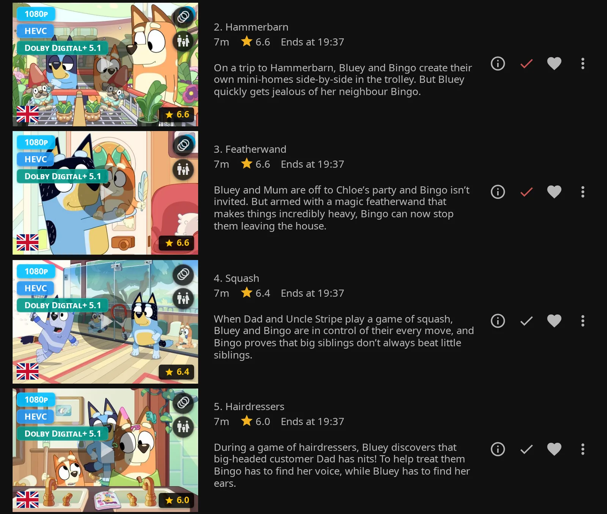

With **Blur images** selected, unplayed episodes lose their original artwork and protected metadata. Played episodes keep theirs.

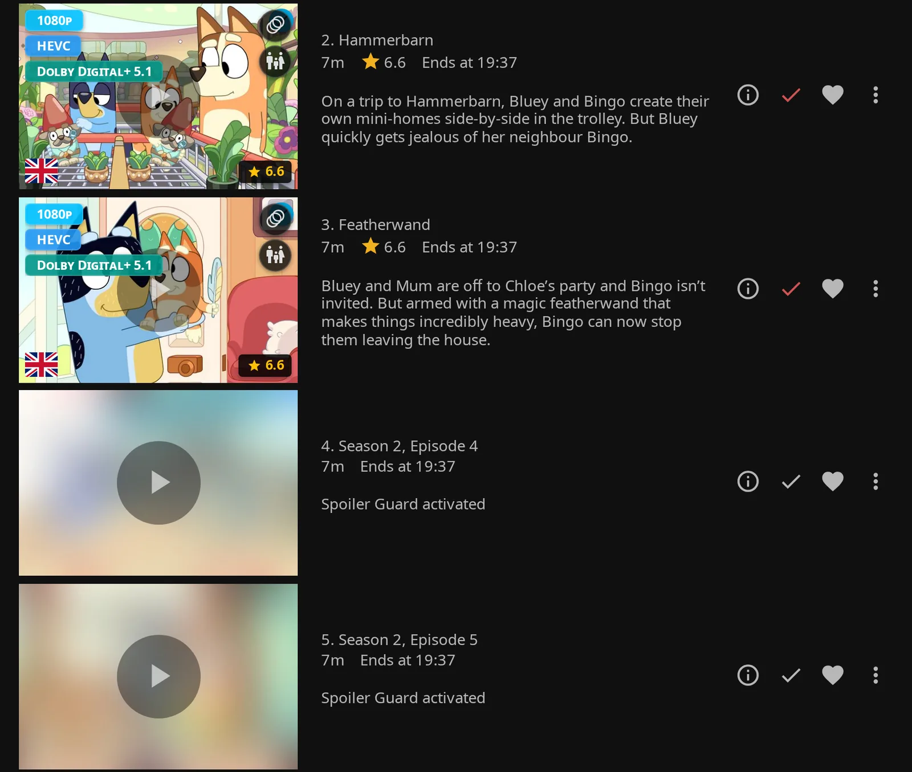

| Surface | Treatment |
|---|---|
| Episode images | Unplayed episodes use parent artwork or blur. Played episodes keep their images. |
| Season images | Season 0 (specials) and Season 1 stay visible. Later seasons use replacement until any episode in that season you may see is played; an episode hidden from you (a blocked tag, a rating or library change) doesn't count from the next request. |
| Movie images | Unplayed, guarded movies follow image policy. Posters and thumbnails stay visible by default. |
| Descriptions | Nonempty descriptions become your configured placeholder, initially `Spoiler Guard activated`. Series descriptions have a separate control. |
| Episode and season titles | Numbered protected episodes become `Season X, Episode Y`; eligible numbered seasons become `Season N`. |
| Story tags and JE overlays | Story tags, genre, language, and quality overlays follow **Hide tags**. Score overlays follow **Hide ratings**. |
| Chapters | Protected names become `Chapter N`, keeping timestamps. Thumbnail images have separate rules. |
| Trickplay previews | Protected preview sheets use image replacement while [**Hide trickplay seek previews**](spoiler-guard-settings.md#image-replacement-mode) is on. Saved progress can reveal whole sheets. You can opt out with [**Seek previews**](spoiler-guard-settings.md#per-user-overrides). |
| Taglines, ratings, air date | Removes taglines, community/critic scores, and premiere dates. |
| Cast | Hides guest stars or the entire cast, depending on your settings. |
| Search hints | Protected episode hints use generic titles or the placeholder. |
| JE Reviews panel | Hides reviews on guarded series, their season/episode pages, and directly guarded movies. |

??? note "Item eligibility and extra metadata"

    Advanced mode can reveal the next episode's Primary/Thumb image. Those image types are also exempt by default for movies. Missing numbering can prevent episode or season title replacement.

    **Hide tags** empties story tags and controls JE genre, language, and stream-derived quality overlays. **Hide ratings** separately controls community/critic score overlays.

    **Guest stars only (recommended)** removes entries marked as guest stars. **Entire cast (regulars + guest stars)** removes every People entry, including crew.

    Search hints can also have matched-term echoes cleared. Advanced reveals do not relax this path.

    Played state does not exempt reviews. Collection-only movie scope does not suppress the JE Reviews panel.

    Metadata scope varies by item type:

    | Item | Metadata eligibility |
    |---|---|
    | Guarded series | Applicable fields are protected without a played-state exemption. Series title and images remain visible. |
    | Season 0 or 1 | Season metadata passes through; unplayed episodes within it remain independently eligible. |
    | Later season | Applicable fields are protected until any episode in that season is played. |
    | Unplayed episode | Protected when its parent series is guarded. Played episodes are exempt from normal item stripping. |
    | Unplayed movie | Protected by a direct entry or guarded collection membership. Movie title remains visible. |
    | Extra carrying a guarded `SeriesId` | Can receive applicable stripping without an extra-specific played exemption. |
    | Collection | Its own metadata passes through; the toggle covers member movies. |

    **Hide episode descriptions** also controls eligible movie, later-season, and extra descriptions. Title or description protection can additionally clear paths, links, stream/attachment text, surviving character roles, and chapter image-path metadata. These effects can persist even when you opt out of cast or chapter-name hiding; see [Auxiliary metadata](spoiler-guard-settings.md#auxiliary-metadata).

### Saved progress: chapters and trickplay

Saved progress can reveal movie chapters and preview sheets you have already reached. Spoiler Guard uses Jellyfin's saved position, so hovering or seeking does not reveal more.

**How to use:** Resume from your saved playback position. Episode chapters stay protected until the episode is played, subject to your separate chapter-name preference.

The trickplay rules below apply while your admin's [**Hide trickplay seek previews**](spoiler-guard-settings.md#image-replacement-mode) is on and you have not unchecked [**Seek previews**](spoiler-guard-settings.md#per-user-overrides). Otherwise seek previews are shown in full.

??? info "How saved-progress boundaries work"

    The saved position is Jellyfin's `PlaybackPositionTicks`.

    For movies, chapter names and thumbnails are revealed only when their start is **strictly before** saved progress. A chapter starting exactly at the resume point remains protected. Chapter image responses use a private 30-second cache window.

    For both movies and episodes, a trickplay sheet is revealed only when its calculated exclusive end is at or before saved progress. A sheet crossing the resume point stays protected. Padding in the final sheet can keep it protected until the item is played.

    Missing trickplay metadata or lookup failures retain protection. Advanced next-episode image reveals do not reveal chapter images or trickplay.

## Image replacement mode

Protected images can use parent artwork or blur, depending on your admin's choice.

**How to use:** As an admin, select **Image replacement mode** and **Blur intensity**. The complete [image settings table](spoiler-guard-settings.md#image-replacement-mode) lists defaults and exceptions.

=== "Stock cards"

    **Show stock cards (hide images entirely, default)** replaces eligible episode images with the series backdrop, season images with the series poster, and collection-only movie images with collection art.

    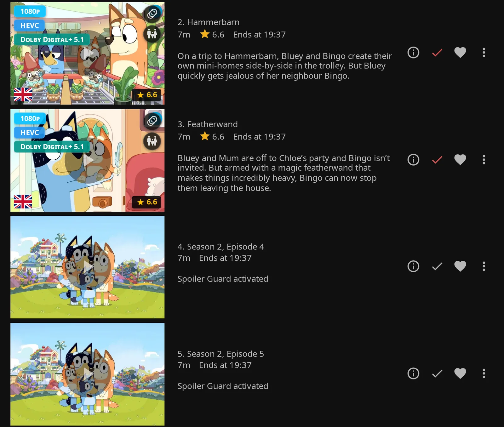

=== "Blur images"

    **Blur images** blurs the original image. Higher **Blur intensity** values produce stronger blur, but recognizable silhouettes or colors can remain.

??? info "How it works"

    Eligible protected images on supported responses are replaced on the server before delivery. **Blur images** uses Gaussian blur.

    In stock-card mode, missing parent artwork or a direct movie entry falls back to blur. A direct movie entry uses this fallback even when a guarded collection also covers the movie. Recognized processing failures use dark fallback images.

    Unsupported response shapes, unresolved identity, and configured exemptions can still return originals.

## After toggling — what happens on your screen

Toggling protection on a detail page refreshes matching item images. Descriptions, titles, and ratings already on the page normally update when you next navigate.

**How to use:** Navigate or reload to see updated text. Your admin can enable **Strict refresh mode (full page reload after toggle)** to reload the page automatically.

<figure class="je-video">
  <video autoplay loop muted playsinline controls preload="metadata" aria-label="Artwork changes immediately while metadata refreshes after navigation">
    <source src="../refresh-flow.mp4" type="video/mp4">
  </video>
  <figcaption>With <strong>Strict refresh mode (full page reload after toggle)</strong> off, images update after the toggle; descriptions and titles update after navigation.</figcaption>
</figure>

??? info "How it works"

    A detail-page toggle refreshes matching Jellyfin item-image URLs in image sources, source sets, and inline backgrounds. It also invalidates JE tag data and can remove an existing Reviews panel. It does not refresh every image or trickplay URL.

    **Strict refresh mode (full page reload after toggle)** schedules a reload after 600 ms. Fetching and showing the updated content take further time.

    Seerr-modal toggles and personal preference saves do not invoke this detail-page refresh/reload path. Navigate or reload to see their effects on existing content.

## When you mark an episode watched

Played episodes regain their images in the injected JE web interface. Marking them unplayed makes them eligible for protection again.

**How to use:** Mark the episode played or unplayed. Images update automatically; navigate or reload to update titles, descriptions, and ratings already on the page. Other clients need fresh metadata and image requests to show the change.

<figure class="je-video">
  <video autoplay loop muted playsinline controls preload="metadata" aria-label="Marking an episode played reveals its image, and marking it unplayed restores blur; page reloads update the metadata">
    <source src="../watched-flow.mp4" type="video/mp4">
  </video>
  <figcaption>Images change after each played-state update; reloading reveals or protects the episode title and description.</figcaption>
</figure>

??? info "How it works"

    Successful supported mark-played or mark-unplayed requests schedule an image refresh after about 200 ms. Fetching and showing the updated content add time.

    The hook recognizes POST/DELETE requests to `/Users/<id>/PlayedItems/<id>` and `/UserPlayedItems/<id>`. It skips the refresh if loaded Spoiler Guard state is empty and always uses an image refresh, even with strict refresh enabled.

## Auto-enable options (optional, admin-controlled)

Automatic modes can add protection for you when you start a show, request a title, or add titles to the library.

**How to use:** As an admin, turn on **Enable Spoiler Guard**, choose the automatic modes you want, and save.

| Setting | Default | What it does |
|---|---|---|
| **Auto-enable Spoiler Guard on first play of a new show** | Off | Adds a series when you start S1E1 and currently have no played episode in that series. Never protects movies. |
| **Auto-enable Spoiler Guard on Seerr request** | Off | Records protection after qualifying successful requests through JE's Seerr proxy. |
| **Auto-enable Spoiler Guard when new titles are added to the library** | Off | Queues new shows and movies for per-user protection. |

??? note "Scope and existing titles"

    The **TV shows** and **Movies** scope applies to automatic modes, although first play only supports shows. Library scope applies to first play, library add, and apply-existing; it does not restrict Seerr pending intent or its promotion. Automatic writes can fail, so check refreshed state when needed. An already-loaded web session may need reload to see additions.

    For library additions, batch processing starts about ten seconds after the first addition.

    Rescans do not arm existing titles. An admin can use **Apply to existing titles now…** or **Spoiler Guard: apply to existing titles** under scheduled tasks. See [automatic settings and existing-title protection](spoiler-guard-settings.md#auto-enable-options) for eligibility, saved scope, skips, preview, and cancellation.

## Disable-confirm dialog

Turning protection off normally asks you to confirm, helping you avoid an accidental reveal. The dialog is titled **Disable Spoiler Guard?** and says:

> Original images and episode details will be visible again straight away.

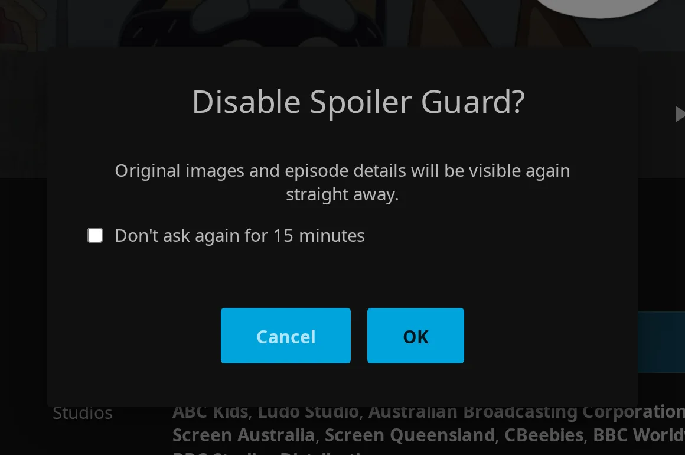

**How to use:**

1. Turn protection off and confirm the dialog.
2. To snooze future prompts, check **Don't ask again for 15 minutes** before confirming.
3. For a permanent preference, enable **Don't ask me to confirm when turning Spoiler Guard off** in your personal settings.

??? note "Confirmation and refresh details"

    Matching images refresh after a detail-toggle confirmation. Text already on the page updates on navigation unless **Strict refresh mode (full page reload after toggle)** is enabled. Collection inheritance can still protect a movie after its direct entry is removed.

    The 15-minute snooze expires and applies to your account in that browser. It is stored separately for each user in browser local storage. If the Jellyfin dialog is unavailable, a native confirmation appears without the snooze checkbox.

## Per-user overrides

You can reveal selected information for your account without changing anyone else's protection.

**How to use:**

1. Open **Enhanced Panel** from the sidebar, or **Jellyfin Enhanced** from the user menu.
2. Select **Spoiler Guard**.
3. Under **Show me this even with Spoiler Guard on**, uncheck a category to reveal that information. Checked boxes inherit admin protection. Rows appear only for categories the admin enabled.

The [per-user settings table](spoiler-guard-settings.md#per-user-overrides) covers every category and its default. Changes save immediately; navigate or reload to update existing page content.

??? note "Override limits"

    Metadata opt-outs do not directly turn off image replacement. Images retain their admin policy, played/progress rules, and exemptions. **Seek previews** is the exception: unchecking it shows trickplay thumbnails while you seek through protected unwatched items.

    **Advanced per-category reveals** works in the other direction: unchecking it restores uniform metadata protection and disables the next-episode image exception for your account.

## Advanced per-category reveals (optional, admin-controlled)

Your admin can reveal selected information for your next unwatched episode and the rest of its season. With advanced mode enabled and otherwise default settings, only the next episode's real title is revealed.

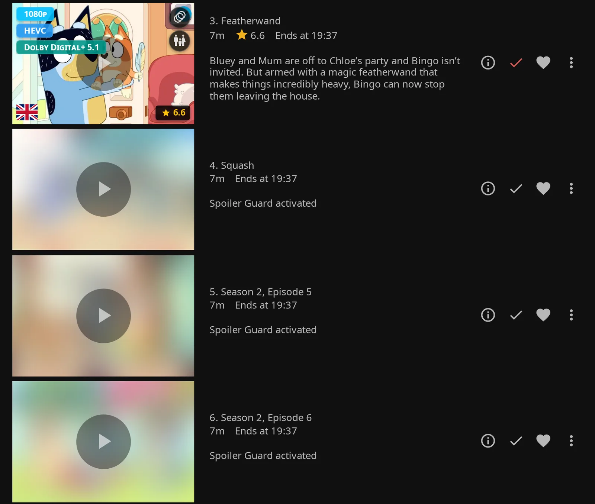

**How to use:** Ask your admin to enable advanced mode and choose what to reveal in the [advanced settings table](spoiler-guard-settings.md#advanced-per-category-reveals). To opt out, uncheck **Advanced per-category reveals** in your own settings.

??? info "How the next episode is selected"

    The boundary is the first unplayed, nonvirtual episode ordered by season number, episode number, then sort name, excluding Season 0. An in-progress episode remains eligible while unplayed. This can differ from Jellyfin's rewatch-aware Next Up selection.

    Only the boundary item ID receives next-episode reveals. Alternate versions sharing its numbering receive the current-season category. Other seasons and specials retain the normal enabled protections.

    A missing boundary, missing episode number, nonpositive/missing season number, or resolver failure gives no category reveal.

    Advanced mode can relax titles, descriptions, and ratings in supported episode metadata. Unchecking **Next episode: keep image hidden** can also reveal the next episode's Primary/Thumb image. Search hints and card score overlays retain their separate, stricter policies. Chapter/trickplay protection still follows its own rules.

    The boundary is computed again on the next request after any change that decides it: a watched-state change, an episode added, removed or updated (renumbered or re-rated), or a change to your library, channel or parental access, however it was made. A stale boundary isn't safe (a later episode could keep the next-episode reveal and show its title after an earlier one became visible), so the five-minute cache lifetime only bounds what Jellyfin doesn't report (an episode changed straight in its database).

## Multi-client support

Native apps and external players can benefit from server protection when they use supported Jellyfin APIs with a resolvable user identity. JE's buttons and other web controls require the injected web interface.

**How to use:** Fetch fresh item metadata and images in your client after changing protection.

??? info "Supported responses and client limits"

    The server filters supported image and item-metadata responses. It covers common item lists/details, episode and season lists, Next Up, upcoming/resume/latest items, search hints, suggestions/similar items, playlists, movie recommendations, image information, playback information, item images, and trickplay images on recognized routes and response shapes.

    JE's toggle buttons, preferences, confirmation, automatic page-image refresh, and Reviews-panel suppression require the injected web interface. That interface suppresses its Reviews panel according to your preferences. Other clients using JE's Reviews API need their own suppression behavior: the API does not filter reviews according to the viewer's Spoiler Guard state.

    Spoiler Guard does not rewrite metadata embedded in media files or information obtained outside supported APIs. Raw-path consumers can be affected by metadata stripping. Client caching and unsupported responses can change what you see. This page does not establish a versioned test matrix for individual apps.

## What's not protected (by design)

Series titles/images, collection metadata/art, and Season 0/1 season metadata/art remain available for navigation. Movie titles and, by default, posters stay visible. Unplayed episodes inside Season 0/1 remain eligible for protection.

??? note "Other visible information"

    Ordinary item responses retain episode numbering, runtime, production year, counts, genres, and official age ratings. JE overlays can hide genres separately and retain the series age classification. Logo and Banner image types are outside image replacement. A missing season or episode number can leave an ordinary episode title unchanged; search hints have separate fallback logic, and description hiding can replace their names even with title replacement off.

## Per-user isolation

Your stored lists and preferences belong to your account. Spoiler Guard changes what you see; it is not an access-control boundary against someone deliberately seeking original content.

**How to use:** Fetch fresh authenticated metadata after changing protection. Native clients need fresh metadata to receive changed image tags; another browser's loaded JE state stays cached until reload or user switch.

??? info "How the server identifies your account"

    When **Enable Spoiler Guard** is on, recognized authenticated-user metadata responses receive per-user image identity markers. Clients that echo those image tags let the server select your policy without relying on your IP address. Userless API-key responses do not automatically receive a user marker.

    Requests resolve identity in this order:

    1. Authenticated user.
    2. Image marker.
    3. Single-user-server shortcut.
    4. Session-validated browser cookie.
    5. Session users matching the request IP.

    No candidates means no per-user protection. Ambiguous metadata identity passes through. For ambiguous images, the filter chooses the first candidate whose scope covers the item, then applies that user's played/progress state and exemptions. A **Seek previews** opt-out applies only when every candidate whose scope covers the item made it. Ambiguity does not guarantee replacement. Identity markers select presentation policy and are not credentials.

## Troubleshooting

If protection does not look right, start with the checks that match what you see.

### The toggle is missing

1. Have your admin enable **Enable Spoiler Guard** under **Display** → **Spoiler Guard**.
2. Open a series, movie, or collection detail page in the injected JE web interface.
3. Confirm that Spoiler Guard state loaded successfully. [Store problems](spoiler-guard-settings.md#health-spoiler-state-corruption-recovery) can affect the controls.

### Images or text still look unchanged

1. Reload item metadata and check the dotted icon's tooltip. Text already on the page normally waits for navigation after a detail toggle.
2. Check played-state exemptions, **Keep movie posters visible**, artwork policy, seek-preview settings, advanced reveals, and collection inheritance.
3. If old images remain in a native client, use its image-cache clearing function. In a browser, try a reload or ++ctrl+f5++ for a stale cache.

??? note "Native client refreshes"

    Restart behavior depends on the client. Later state changes still require fresh metadata and changed image tags.

### Protection looks wrong behind a proxy or shared IP

1. Fetch fresh authenticated metadata and check that the client uses the returned image tags.
2. Clear stale client image caches if necessary.
3. Check your Jellyfin reverse-proxy/networking configuration.

??? info "Why old image URLs can cause problems"

    Old URLs without markers use fallback identity resolution. This can mix plausible users on a shared IP or resolve none.

### Preferences cannot be saved, or reviews disappear broadly

Check server logs and [recorded health events](spoiler-guard-settings.md#health-spoiler-state-corruption-recovery). Repair or reconfigure the store if needed, then reload the web session.

??? info "What happens when state loading fails"

    A failed initial state load disables personal preference controls to avoid overwriting unknown state. Reviews can be suppressed broadly on eligible page types when state loading fails.
